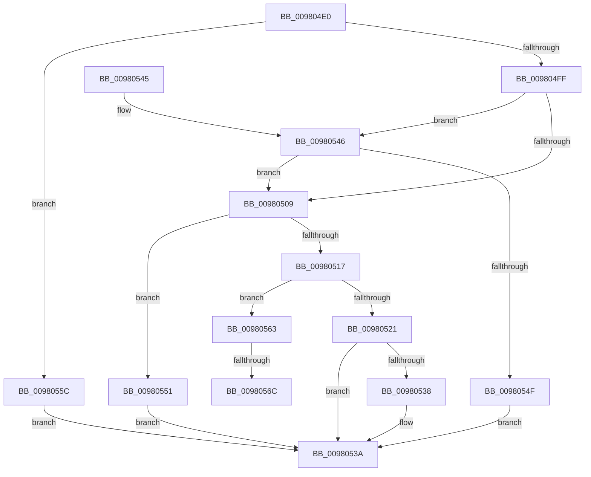

# EtwSetProcessTelemetryCoverage

- RVA: `0x009804E0`–`0x0098057D` (길이 `157` bytes)
- VA: `0x00000001409804E0`
- 실행 섹션: `PAGE`
- PDB 이름 있음: `예`; PDB Function 태그: `예`
- unwind 정보 RVA: `0x00062E24`
- 디코드: `45`개 명령, `157/157` bytes 표시
- 미해석 바이트: `0` (있으면 어셈블리에 `.byte`로 보존)

> 이 문서는 커널 이미지의 기계어와 PDB 기호를 분석해 생성했습니다. 4번과 5번은 함수 원형과 자료형을 바이너리 사용 방식에서 추정한 C 해석이며 원본 소스 복구 결과는 아닙니다.

## 1. Dependencies

- 직접 호출 지점: **4**; 고유 호출 대상: **4**
- 직접 호출자로 확인된 함수: **1**
- RIP 상대 이미지 참조: **1**

### Outgoing calls
- `0x00980527` → [EtwpCoverageRecord](EtwpCoverageRecord_function_009821BC.md) (function, `0x009821BC`)
- `0x0098052F` → [EtwpCoverageEnsureUserModeView](EtwpCoverageEnsureUserModeView_function_00980584.md) (function, `0x00980584`)
- `0x00980546` → [EtwpCoverageEnsureContext](../70/EtwpCoverageEnsureContext_function_007028E4.md) (function, `0x007028E4`)
- `0x00980572` → [EtwpCoverageCheckCP](../7B/EtwpCoverageCheckCP_function_007B9BC4.md) (function, `0x007B9BC4`)

### Direct callers
- [NtSetInformationProcess](../AE/NtSetInformationProcess_function_00AE5370.md) at `0x00AE9508`

### Static image references
- `0x009804FF` → RVA `0x00E684E8` (`.data`; read)

## 2. Other-region calls and transfers

- 다른 실행 섹션으로 향하는 call: **0**
- call이 아닌 외부 분기/꼬리 이동: **2**
  - `0x00980566` → [sub_00B2A52C + 0x1D](../B2/Unknown_function_00B2A52C.md) (`tail-transfer`)
  - `0x00980578` → [sub_00B2A52C + 0xB](../B2/Unknown_function_00B2A52C.md) (`tail-transfer`)

## 3. Assembly (complete function range)

```asm
009804E0  48 89 5C 24 08                  mov qword ptr [rsp + 8], rbx
009804E5  57                              push rdi
009804E6  48 83 EC 20                     sub rsp, 0x20
009804EA  65 48 8B 04 25 88 01 00 00      mov rax, qword ptr gs:[0x188]
009804F3  48 8B DA                        mov rbx, rdx
009804F6  48 3B 88 B8 00 00 00            cmp rcx, qword ptr [rax + 0xb8]
009804FD  75 5D                           jne 0x14098055c
009804FF  48 83 3D E1 7F 4E 00 00         cmp qword ptr [rip + 0x4e7fe1], 0
00980507  74 3D                           je 0x140980546
00980509  8B 43 10                        mov eax, dword ptr [rbx + 0x10]
0098050C  48 8B 3D D5 7F 4E 00            mov rdi, qword ptr [rip + 0x4e7fd5]
00980513  A8 01                           test al, 1
00980515  75 3A                           jne 0x140980551
00980517  8B 43 0C                        mov eax, dword ptr [rbx + 0xc]
0098051A  3D 00 FF FF FF                  cmp eax, 0xffffff00
0098051F  73 42                           jae 0x140980563
00980521  48 8B D3                        mov rdx, rbx
00980524  48 8B CF                        mov rcx, rdi
00980527  E8 90 1C 00 00                  call 0x1409821bc
0098052C  48 8B CF                        mov rcx, rdi
0098052F  E8 50 00 00 00                  call 0x140980584
00980534  85 C0                           test eax, eax
00980536  78 02                           js 0x14098053a
00980538  33 C0                           xor eax, eax
0098053A  48 8B 5C 24 30                  mov rbx, qword ptr [rsp + 0x30]
0098053F  48 83 C4 20                     add rsp, 0x20
00980543  5F                              pop rdi
00980544  C3                              ret
00980545  CC                              int3
00980546  E8 99 23 D8 FF                  call 0x1407028e4
0098054B  85 C0                           test eax, eax
0098054D  79 BA                           jns 0x140980509
0098054F  EB E9                           jmp 0x14098053a
00980551  83 4B 0C FF                     or dword ptr [rbx + 0xc], 0xffffffff
00980555  B8 0D 00 00 C0                  mov eax, 0xc000000d
0098055A  EB DE                           jmp 0x14098053a
0098055C  B8 BB 00 00 C0                  mov eax, 0xc00000bb
00980561  EB D7                           jmp 0x14098053a
00980563  83 F8 FE                        cmp eax, -2
00980566  0F 85 DD 9F 1A 00               jne 0x140b2a549
0098056C  48 8B D3                        mov rdx, rbx
0098056F  48 8B CF                        mov rcx, rdi
00980572  E8 4D 96 E3 FF                  call 0x1407b9bc4
00980577  90                              nop
00980578  E9 BA 9F 1A 00                  jmp 0x140b2a537
```

## 4. C-style interpretation (structured pseudocode)

```c
__int64 __fastcall EtwSetProcessTelemetryCoverage(__int64 a1, __int64 a2)
{
    __int64 result;
    __int64 v_rsp;
    unsigned __int64 v_stack_p8;

    v_stack_p8 = v_rbx;
    v_rsp = (v_rsp) - (32);
    if (a1 != (*(unsigned __int64 *)(*(unsigned __int64 *)(gs_base + (0 + 392)) + 184))) goto loc_0098055C;
    if ((*(unsigned __int64 *)(v_rip + 5144545)) == 0) goto loc_00980546;
loc_00980509:
    if ((((unsigned __int8)((unsigned int)(*(unsigned int *)(a2 + 16)))) & (1)) != 0) goto loc_00980551;
    if (((unsigned int)((unsigned int)(*(unsigned int *)(a2 + 12)))) >= 0xFFFFFF00ULL) goto loc_00980563;
    result = EtwpCoverageRecord(*(unsigned __int64 *)(v_rip + 5144533), a2, a3, a4);
    result = EtwpCoverageEnsureUserModeView(*(unsigned __int64 *)(v_rip + 5144533), a2, a3, a4);
    if (!(sign_flag)) {
        result = 0;
    }
    v_rsp = (v_rsp) + (32);
    return result;
loc_00980546:
    result = EtwpCoverageEnsureContext(*(unsigned __int64 *)(v_rip + 5144533), a2, a3, a4);
    if (!sign_flag) goto loc_00980509;
    goto loc_0098053A;
loc_00980551:
    goto loc_0098053A;
loc_0098055C:
    goto loc_0098053A;
loc_00980563:
    result = EtwpCoverageCheckCP(*(unsigned __int64 *)(v_rip + 5144533), v_stack_p8, a3, a4);
}
```

## 5. (Beta) C Style

```c
int64_t EtwSetProcessTelemetryCoverage(int64_t Arg1, void *Arg2)
{
    uint8_t *arg2 = (uint8_t *)Arg2;

    int64_t result;
    int64_t local_rsp;
    uint64_t v_stack_p8;

    v_stack_p8 = local_rbx;
    local_rsp = (local_rsp) - (32);
    if (Arg1 != (*(uint64_t *)(*(uint64_t *)(gs_base + (0 + 0x188)) + 0xB8))) goto loc_0098055C;
    if ((*(uint64_t *)(v_rip + 0x4E7FE1)) == 0) goto loc_00980546;
loc_00980509:
    if ((((uint8_t)((uint32_t)(*(uint32_t *)(arg2 + 0x10)))) & (1)) != 0) goto loc_00980551;
    if (((uint32_t)((uint32_t)(*(uint32_t *)(arg2 + 0xC)))) >= 0xFFFFFF00ULL) goto loc_00980563;
    result = EtwpCoverageRecord(*(uint64_t *)(v_rip + 0x4E7FD5), Arg2, a3, a4);
    result = EtwpCoverageEnsureUserModeView(*(uint64_t *)(v_rip + 0x4E7FD5), Arg2, a3, a4);
    if (!(sign_flag)) {
        result = 0;
    }
    local_rsp = (local_rsp) + (32);
    return result;
loc_00980546:
    result = EtwpCoverageEnsureContext(*(uint64_t *)(v_rip + 0x4E7FD5), Arg2, a3, a4);
    if (!sign_flag) goto loc_00980509;
    goto loc_0098053A;
loc_00980551:
    goto loc_0098053A;
loc_0098055C:
    goto loc_0098053A;
loc_00980563:
    result = EtwpCoverageCheckCP(*(uint64_t *)(v_rip + 0x4E7FD5), v_stack_p8, a3, a4);
}
```

### 관측된 메모리 오프셋

구조체 형식이 확인되지 않은 접근은 인자 기준의 오프셋으로만 기록했습니다.

| 기준 인자 | 오프셋 표현 | 폭 (bit) | 접근 |
|---|---:|---:|---|
| `Arg2` | `+ 0xC` | `32` | `R` |
| `Arg2` | `+ 0xC` | `32` | `R/W` |
| `Arg2` | `+ 0x10` | `32` | `R` |

## 6. Execution-region graph

[열기: 2D/3D 그래프와 함수 탐색 컨트롤 패널](../../../control-panel.html?section=page&rva=0x009804E0&view=graph)

- 2D 그래프는 위에서 아래로 흐르고, 3D 그래프는 빈 공간을 드래그해 회전합니다. Shift+드래그는 이동, 휠은 확대·축소, 함수 노드 선택은 대상 보고서 이동입니다.

### Static fallback


