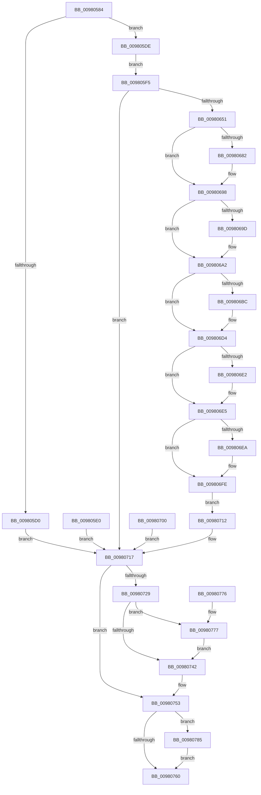

# EtwpCoverageEnsureUserModeView

- RVA: `0x00980584`–`0x00980795` (길이 `529` bytes)
- VA: `0x0000000140980584`
- 실행 섹션: `PAGE`
- PDB 이름 있음: `예`; PDB Function 태그: `아니요`
- unwind 정보 RVA: `0x000976A8`
- 디코드: `112`개 명령, `529/529` bytes 표시
- 미해석 바이트: `0` (있으면 어셈블리에 `.byte`로 보존)

> 이 문서는 커널 이미지의 기계어와 PDB 기호를 분석해 생성했습니다. 4번과 5번은 함수 원형과 자료형을 바이너리 사용 방식에서 추정한 C 해석이며 원본 소스 복구 결과는 아닙니다.

## 1. Dependencies

- 직접 호출 지점: **7**; 고유 호출 대상: **7**
- 직접 호출자로 확인된 함수: **1**
- RIP 상대 이미지 참조: **5**

### Outgoing calls
- `0x0098063C` → [MmMapViewOfSection](MmMapViewOfSection_function_00981680.md) (function, `0x00981680`)
- `0x0098066E` → [KeAbPreAcquire](../../text/21/KeAbPreAcquire_function_00210230.md) (function, `0x00210230`)
- `0x00980693` → [ExfAcquirePushLockExclusiveEx](../../text/20/ExfAcquirePushLockExclusiveEx_function_0020FC90.md) (function, `0x0020FC90`)
- `0x00980749` → [KeAbPostRelease](../../text/2E/KeAbPostRelease_function_002E1600.md) (function, `0x002E1600`)
- `0x0098074E` → [KeLeaveCriticalRegion](../../text/25/KeLeaveCriticalRegion_function_0025D8B0.md) (function, `0x0025D8B0`)
- `0x0098077E` → [ExfTryToWakePushLock](../../text/26/ExfTryToWakePushLock_function_00265DD0.md) (function, `0x00265DD0`)
- `0x0098078E` → [MiUnmapViewOfSection](../88/MiUnmapViewOfSection_function_0088A4C4.md) (function, `0x0088A4C4`)

### Direct callers
- [EtwSetProcessTelemetryCoverage](EtwSetProcessTelemetryCoverage_function_009804E0.md) at `0x0098052F`

### Static image references
- `0x00980667` → RVA `0x00EFF1B8` (`.data`; read)
- `0x00980676` → RVA `0x00EFF1B8` (`.data`; read/write)
- `0x009806AB` → RVA `0x00E684E0` (`.data`; write)
- `0x00980720` → RVA `0x00E684E0` (`.data`; read)
- `0x00980729` → RVA `0x00E684E0` (`.data`; read/write)

## 2. Other-region calls and transfers

- 다른 실행 섹션으로 향하는 call: **5**
  - `0x0098066E` → [KeAbPreAcquire](../../text/21/KeAbPreAcquire_function_00210230.md) (`PAGE` → `.text`)
  - `0x00980693` → [ExfAcquirePushLockExclusiveEx](../../text/20/ExfAcquirePushLockExclusiveEx_function_0020FC90.md) (`PAGE` → `.text`)
  - `0x00980749` → [KeAbPostRelease](../../text/2E/KeAbPostRelease_function_002E1600.md) (`PAGE` → `.text`)
  - `0x0098074E` → [KeLeaveCriticalRegion](../../text/25/KeLeaveCriticalRegion_function_0025D8B0.md) (`PAGE` → `.text`)
  - `0x0098077E` → [ExfTryToWakePushLock](../../text/26/ExfTryToWakePushLock_function_00265DD0.md) (`PAGE` → `.text`)
- 별도 외부 분기/꼬리 이동을 확인하지 못했습니다.

## 3. Assembly (complete function range)

```asm
00980584  4C 8B DC                        mov r11, rsp
00980587  49 89 5B 08                     mov qword ptr [r11 + 8], rbx
0098058B  56                              push rsi
0098058C  41 56                           push r14
0098058E  41 57                           push r15
00980590  48 83 EC 70                     sub rsp, 0x70
00980594  49 83 63 18 00                  and qword ptr [r11 + 0x18], 0
00980599  49 83 63 D0 00                  and qword ptr [r11 - 0x30], 0
0098059E  65 48 8B 04 25 88 01 00 00      mov rax, qword ptr gs:[0x188]
009805A7  48 8B B0 B8 00 00 00            mov rsi, qword ptr [rax + 0xb8]
009805AE  48 89 B4 24 A8 00 00 00         mov qword ptr [rsp + 0xa8], rsi
009805B6  49 83 63 E0 00                  and qword ptr [r11 - 0x20], 0
009805BB  4C 8B B6 E0 02 00 00            mov r14, qword ptr [rsi + 0x2e0]
009805C2  4D 89 73 D0                     mov qword ptr [r11 - 0x30], r14
009805C6  49 83 BE A0 07 00 00 00         cmp qword ptr [r14 + 0x7a0], 0
009805CE  74 0E                           je 0x1409805de
009805D0  83 64 24 50 00                  and dword ptr [rsp + 0x50], 0
009805D5  48 83 CB FF                     or rbx, 0xffffffffffffffff
009805D9  E9 39 01 00 00                  jmp 0x140980717
009805DE  EB 15                           jmp 0x1409805f5
009805E0  89 44 24 50                     mov dword ptr [rsp + 0x50], eax
009805E4  48 83 CB FF                     or rbx, 0xffffffffffffffff
009805E8  48 8B B4 24 A8 00 00 00         mov rsi, qword ptr [rsp + 0xa8]
009805F0  E9 22 01 00 00                  jmp 0x140980717
009805F5  48 83 64 24 60 00               and qword ptr [rsp + 0x60], 0
009805FB  C7 44 24 48 02 00 00 00         mov dword ptr [rsp + 0x48], 2
00980603  83 64 24 40 00                  and dword ptr [rsp + 0x40], 0
00980608  C7 44 24 38 01 00 00 00         mov dword ptr [rsp + 0x38], 1
00980610  48 8D 44 24 60                  lea rax, [rsp + 0x60]
00980615  48 89 44 24 30                  mov qword ptr [rsp + 0x30], rax
0098061A  48 8D 44 24 68                  lea rax, [rsp + 0x68]
0098061F  48 89 44 24 28                  mov qword ptr [rsp + 0x28], rax
00980624  48 83 64 24 20 00               and qword ptr [rsp + 0x20], 0
0098062A  45 33 C9                        xor r9d, r9d
0098062D  4C 8D 84 24 A0 00 00 00         lea r8, [rsp + 0xa0]
00980635  48 8B D6                        mov rdx, rsi
00980638  48 8B 49 08                     mov rcx, qword ptr [rcx + 8]
0098063C  E8 3F 10 00 00                  call 0x140981680
00980641  89 44 24 50                     mov dword ptr [rsp + 0x50], eax
00980645  48 83 CB FF                     or rbx, 0xffffffffffffffff
00980649  85 C0                           test eax, eax
0098064B  0F 88 C6 00 00 00               js 0x140980717
00980651  65 48 8B 04 25 88 01 00 00      mov rax, qword ptr gs:[0x188]
0098065A  66 01 98 E4 01 00 00            add word ptr [rax + 0x1e4], bx
00980661  90                              nop
00980662  45 33 C0                        xor r8d, r8d
00980665  33 D2                           xor edx, edx
00980667  48 8D 0D 4A EB 57 00            lea rcx, [rip + 0x57eb4a]
0098066E  E8 BD FB 88 FF                  call 0x140210230
00980673  4C 8B F8                        mov r15, rax
00980676  F0 48 0F BA 2D 38 EB 57 00 00   lock bts qword ptr [rip + 0x57eb38], 0
00980680  73 16                           jae 0x140980698
00980682  4C 8D 05 2F EB 57 00            lea r8, [rip + 0x57eb2f]
00980689  48 8B D0                        mov rdx, rax
0098068C  48 8D 0D 25 EB 57 00            lea rcx, [rip + 0x57eb25]
00980693  E8 F8 F5 88 FF                  call 0x14020fc90
00980698  4D 85 FF                        test r15, r15
0098069B  74 05                           je 0x1409806a2
0098069D  41 C6 47 0A 01                  mov byte ptr [r15 + 0xa], 1
009806A2  65 48 8B 04 25 88 01 00 00      mov rax, qword ptr gs:[0x188]
009806AB  48 89 05 2E 7E 4E 00            mov qword ptr [rip + 0x4e7e2e], rax
009806B2  49 83 BE A0 07 00 00 00         cmp qword ptr [r14 + 0x7a0], 0
009806BA  75 18                           jne 0x1409806d4
009806BC  48 8B 84 24 A0 00 00 00         mov rax, qword ptr [rsp + 0xa0]
009806C4  49 89 86 A0 07 00 00            mov qword ptr [r14 + 0x7a0], rax
009806CB  48 83 A4 24 A0 00 00 00 00      and qword ptr [rsp + 0xa0], 0
009806D4  33 C9                           xor ecx, ecx
009806D6  48 8B 86 10 03 00 00            mov rax, qword ptr [rsi + 0x310]
009806DD  48 85 C0                        test rax, rax
009806E0  74 03                           je 0x1409806e5
009806E2  48 8B 08                        mov rcx, qword ptr [rax]
009806E5  48 85 C9                        test rcx, rcx
009806E8  74 14                           je 0x1409806fe
009806EA  41 8B 86 A0 07 00 00            mov eax, dword ptr [r14 + 0x7a0]
009806F1  89 84 24 98 00 00 00            mov dword ptr [rsp + 0x98], eax
009806F8  89 81 5C 04 00 00               mov dword ptr [rcx + 0x45c], eax
009806FE  EB 12                           jmp 0x140980712
00980700  89 44 24 50                     mov dword ptr [rsp + 0x50], eax
00980704  48 83 CB FF                     or rbx, 0xffffffffffffffff
00980708  48 8B B4 24 A8 00 00 00         mov rsi, qword ptr [rsp + 0xa8]
00980710  EB 05                           jmp 0x140980717
00980712  83 64 24 50 00                  and dword ptr [rsp + 0x50], 0
00980717  65 48 8B 0C 25 88 01 00 00      mov rcx, qword ptr gs:[0x188]
00980720  48 39 0D B9 7D 4E 00            cmp qword ptr [rip + 0x4e7db9], rcx
00980727  75 2A                           jne 0x140980753
00980729  48 83 25 AF 7D 4E 00 00         and qword ptr [rip + 0x4e7daf], 0
00980731  F0 48 0F C1 1D 7E EA 57 00      lock xadd qword ptr [rip + 0x57ea7e], rbx
0098073A  80 E3 06                        and bl, 6
0098073D  80 FB 02                        cmp bl, 2
00980740  74 35                           je 0x140980777
00980742  48 8D 0D 6F EA 57 00            lea rcx, [rip + 0x57ea6f]
00980749  E8 B2 0E 96 FF                  call 0x1402e1600
0098074E  E8 5D D1 8D FF                  call 0x14025d8b0
00980753  48 8B 94 24 A0 00 00 00         mov rdx, qword ptr [rsp + 0xa0]
0098075B  48 85 D2                        test rdx, rdx
0098075E  75 25                           jne 0x140980785
00980760  8B 44 24 50                     mov eax, dword ptr [rsp + 0x50]
00980764  48 8B 9C 24 90 00 00 00         mov rbx, qword ptr [rsp + 0x90]
0098076C  48 83 C4 70                     add rsp, 0x70
00980770  41 5F                           pop r15
00980772  41 5E                           pop r14
00980774  5E                              pop rsi
00980775  C3                              ret
00980776  CC                              int3
00980777  48 8D 0D 3A EA 57 00            lea rcx, [rip + 0x57ea3a]
0098077E  E8 4D 56 8E FF                  call 0x140265dd0
00980783  EB BD                           jmp 0x140980742
00980785  45 33 C9                        xor r9d, r9d
00980788  45 33 C0                        xor r8d, r8d
0098078B  48 8B CE                        mov rcx, rsi
0098078E  E8 31 9D F0 FF                  call 0x14088a4c4
00980793  EB CB                           jmp 0x140980760
```

## 4. C-style interpretation (structured pseudocode)

```c
__int64 __fastcall EtwpCoverageEnsureUserModeView(__int64 a1, __int64 a2, __int64 a3, int a4)
{
    __int64 result;
    __int64 v_rbx;
    __int64 v_rsp;
    unsigned __int64 v_stack_m20;
    unsigned __int64 v_stack_m28;
    unsigned int v_stack_m38;
    unsigned int v_stack_m40;
    unsigned int v_stack_m48;
    unsigned int v_stack_m50;
    unsigned __int64 v_stack_m58;
    unsigned __int64 v_stack_m60;
    unsigned __int64 v_stack_m68;
    unsigned int v_stack_p10;
    unsigned __int64 v_stack_p18;
    unsigned __int64 v_stack_p20;
    unsigned __int64 v_stack_p8;

    *(unsigned __int64 *)(v_rsp + 8) = v_rbx;
    v_rsp = (v_rsp) - (112);
    v_stack_p20 = *(unsigned __int64 *)(*(unsigned __int64 *)(gs_base + (0 + 392)) + 184);
    *(unsigned __int64 *)(v_rsp - 48) = *(unsigned __int64 *)(*(unsigned __int64 *)(*(unsigned __int64 *)(gs_base + (0 + 392)) + 184) + 736);
    if ((*(unsigned __int64 *)(*(unsigned __int64 *)(*(unsigned __int64 *)(*(unsigned __int64 *)(gs_base + (0 + 392)) + 184) + 736) + 1952)) == 0) goto loc_009805DE;
    v_rbx = (v_rbx) | (-1);
    goto loc_00980717;
loc_009805DE:
    goto loc_009805F5;
loc_009805F5:
    v_stack_m40 = 2;
    v_stack_m50 = 1;
    v_stack_m58 = v_stack_m28;
    v_stack_m60 = v_stack_m20;
    a4 = 0;
    result = MmMapViewOfSection(*(unsigned __int64 *)(a1 + 8), *(unsigned __int64 *)(*(unsigned __int64 *)(gs_base + (0 + 392)) + 184), v_stack_p18, a4);
    v_stack_m38 = (unsigned int)(result);
    v_rbx = (v_rbx) | (-1);
    if (sign_flag) goto loc_00980717;
    a3 = 0;
    a2 = 0;
    result = KeAbPreAcquire(v_rip + 5761866, a2, a3, a4);
    if (!(condition_is_above_or_equal)) {
        a3 = v_rip + 5761839;
        a2 = result;
        a1 = v_rip + 5761829;
        result = ExfAcquirePushLockExclusiveEx(a1, a2, a3, a4);
    }
    if (result != 0) {
        *(unsigned __int8 *)(result + 10) = 1;
    }
    *(unsigned __int64 *)(v_rip + 5144110) = *(unsigned __int64 *)(gs_base + (0 + 392));
    result = *(unsigned __int64 *)(gs_base + (0 + 392));
    if ((*(unsigned __int64 *)(*(unsigned __int64 *)(*(unsigned __int64 *)(*(unsigned __int64 *)(gs_base + (0 + 392)) + 184) + 736) + 1952)) == 0) {
        result = v_stack_p18;
        *(unsigned __int64 *)(*(unsigned __int64 *)(*(unsigned __int64 *)(*(unsigned __int64 *)(gs_base + (0 + 392)) + 184) + 736) + 1952) = result;
    }
    a1 = 0;
    if (*(unsigned __int64 *)(*(unsigned __int64 *)(*(unsigned __int64 *)(gs_base + (0 + 392)) + 184) + 784) != 0) {
        a1 = *(unsigned __int64 *)(*(unsigned __int64 *)(*(unsigned __int64 *)(*(unsigned __int64 *)(gs_base + (0 + 392)) + 184) + 784));
    }
    result = *(unsigned __int64 *)(*(unsigned __int64 *)(*(unsigned __int64 *)(gs_base + (0 + 392)) + 184) + 784);
    if (a1 != 0) {
        result = *(unsigned int *)(*(unsigned __int64 *)(*(unsigned __int64 *)(*(unsigned __int64 *)(gs_base + (0 + 392)) + 184) + 736) + 1952);
        v_stack_p10 = (unsigned int)(result);
        *(unsigned int *)(a1 + 1116) = (unsigned int)(result);
    }
    goto loc_00980712;
loc_00980712:
loc_00980717:
    if ((*(unsigned __int64 *)(v_rip + 5143993)) != (*(unsigned __int64 *)(gs_base + (0 + 392)))) goto loc_00980753;
    v_rbx = (unsigned __int8)((v_rbx) & (6));
    if (((unsigned __int8)(v_rbx)) == 2) goto loc_00980777;
loc_00980742:
    result = KeAbPostRelease(v_rip + 5761647, a2, a3, a4);
    result = KeLeaveCriticalRegion(v_rip + 5761647, a2, a3, a4);
loc_00980753:
    if (v_stack_p18 != 0) goto loc_00980785;
loc_00980760:
    v_rsp = (v_rsp) + (112);
    return (unsigned int)(v_stack_m38);
loc_00980777:
    result = ExfTryToWakePushLock(v_rip + 5761594, v_stack_p18, a3, a4);
    goto loc_00980742;
loc_00980785:
    a4 = 0;
    a3 = 0;
    result = MiUnmapViewOfSection(*(unsigned __int64 *)(*(unsigned __int64 *)(gs_base + (0 + 392)) + 184), v_stack_p18, a3, a4);
    goto loc_00980760;
}
```

## 5. (Beta) C Style

```c
int64_t EtwpCoverageEnsureUserModeView(void *Arg1, int64_t Arg2, int64_t Arg3, int32_t Arg4)
{
    uint8_t *arg1 = (uint8_t *)Arg1;

    int64_t result;
    int64_t local_rbx;
    int64_t local_rsp;
    uint64_t v_stack_m20;
    uint64_t v_stack_m28;
    uint32_t v_stack_m38;
    uint32_t v_stack_m40;
    uint32_t v_stack_m48;
    uint32_t v_stack_m50;
    uint64_t v_stack_m58;
    uint64_t v_stack_m60;
    uint64_t v_stack_m68;
    uint32_t v_stack_p10;
    uint64_t v_stack_p18;
    uint64_t v_stack_p20;
    uint64_t v_stack_p8;

    *(uint64_t *)(local_rsp + 0x8) = local_rbx;
    local_rsp = (local_rsp) - (112);
    v_stack_p20 = *(uint64_t *)(*(uint64_t *)(gs_base + (0 + 0x188)) + 0xB8);
    *(uint64_t *)(local_rsp - 0x30) = *(uint64_t *)(*(uint64_t *)(*(uint64_t *)(gs_base + (0 + 0x188)) + 0xB8) + 0x2E0);
    if ((*(uint64_t *)(*(uint64_t *)(*(uint64_t *)(*(uint64_t *)(gs_base + (0 + 0x188)) + 0xB8) + 0x2E0) + 0x7A0)) == 0) goto loc_009805DE;
    local_rbx = (local_rbx) | (-1);
    goto loc_00980717;
loc_009805DE:
    goto loc_009805F5;
loc_009805F5:
    v_stack_m40 = 2;
    v_stack_m50 = 1;
    v_stack_m58 = v_stack_m28;
    v_stack_m60 = v_stack_m20;
    Arg4 = 0;
    result = MmMapViewOfSection(*(uint64_t *)(arg1 + 0x8), *(uint64_t *)(*(uint64_t *)(gs_base + (0 + 0x188)) + 0xB8), v_stack_p18, Arg4);
    v_stack_m38 = (uint32_t)(result);
    local_rbx = (local_rbx) | (-1);
    if (sign_flag) goto loc_00980717;
    Arg3 = 0;
    Arg2 = 0;
    result = KeAbPreAcquire(v_rip + 5761866, Arg2, Arg3, Arg4);
    if (!(condition_is_above_or_equal)) {
        Arg3 = v_rip + 5761839;
        Arg2 = result;
        Arg1 = v_rip + 5761829;
        result = ExfAcquirePushLockExclusiveEx(Arg1, Arg2, Arg3, Arg4);
    }
    if (result != 0) {
        *(uint8_t *)(result + 0xA) = 1;
    }
    *(uint64_t *)(v_rip + 0x4E7E2E) = *(uint64_t *)(gs_base + (0 + 0x188));
    result = *(uint64_t *)(gs_base + (0 + 0x188));
    if ((*(uint64_t *)(*(uint64_t *)(*(uint64_t *)(*(uint64_t *)(gs_base + (0 + 0x188)) + 0xB8) + 0x2E0) + 0x7A0)) == 0) {
        result = v_stack_p18;
        *(uint64_t *)(*(uint64_t *)(*(uint64_t *)(*(uint64_t *)(gs_base + (0 + 0x188)) + 0xB8) + 0x2E0) + 0x7A0) = result;
    }
    Arg1 = 0;
    if (*(uint64_t *)(*(uint64_t *)(*(uint64_t *)(gs_base + (0 + 0x188)) + 0xB8) + 0x310) != 0) {
        Arg1 = *(uint64_t *)(*(uint64_t *)(*(uint64_t *)(*(uint64_t *)(gs_base + (0 + 0x188)) + 0xB8) + 0x310));
    }
    result = *(uint64_t *)(*(uint64_t *)(*(uint64_t *)(gs_base + (0 + 0x188)) + 0xB8) + 0x310);
    if (Arg1 != NULL) {
        result = *(uint32_t *)(*(uint64_t *)(*(uint64_t *)(*(uint64_t *)(gs_base + (0 + 0x188)) + 0xB8) + 0x2E0) + 0x7A0);
        v_stack_p10 = (uint32_t)(result);
        *(uint32_t *)(arg1 + 0x45C) = (uint32_t)(result);
    }
    goto loc_00980712;
loc_00980712:
loc_00980717:
    if ((*(uint64_t *)(v_rip + 0x4E7DB9)) != (*(uint64_t *)(gs_base + (0 + 0x188)))) goto loc_00980753;
    local_rbx = (uint8_t)((local_rbx) & (6));
    if (((uint8_t)(local_rbx)) == 2) goto loc_00980777;
loc_00980742:
    result = KeAbPostRelease(v_rip + 5761647, Arg2, Arg3, Arg4);
    result = KeLeaveCriticalRegion(v_rip + 5761647, Arg2, Arg3, Arg4);
loc_00980753:
    if (v_stack_p18 != 0) goto loc_00980785;
loc_00980760:
    local_rsp = (local_rsp) + (112);
    return (uint32_t)(v_stack_m38);
loc_00980777:
    result = ExfTryToWakePushLock(v_rip + 5761594, v_stack_p18, Arg3, Arg4);
    goto loc_00980742;
loc_00980785:
    Arg4 = 0;
    Arg3 = 0;
    result = MiUnmapViewOfSection(*(uint64_t *)(*(uint64_t *)(gs_base + (0 + 0x188)) + 0xB8), v_stack_p18, Arg3, Arg4);
    goto loc_00980760;
}
```

### 관측된 메모리 오프셋

구조체 형식이 확인되지 않은 접근은 인자 기준의 오프셋으로만 기록했습니다.

| 기준 인자 | 오프셋 표현 | 폭 (bit) | 접근 |
|---|---:|---:|---|
| `Arg1` | `+ 0x8` | `64` | `R` |

## 6. Execution-region graph

[열기: 2D/3D 그래프와 함수 탐색 컨트롤 패널](../../../control-panel.html?section=page&rva=0x00980584&view=graph)

- 2D 그래프는 위에서 아래로 흐르고, 3D 그래프는 빈 공간을 드래그해 회전합니다. Shift+드래그는 이동, 휠은 확대·축소, 함수 노드 선택은 대상 보고서 이동입니다.

### Static fallback


