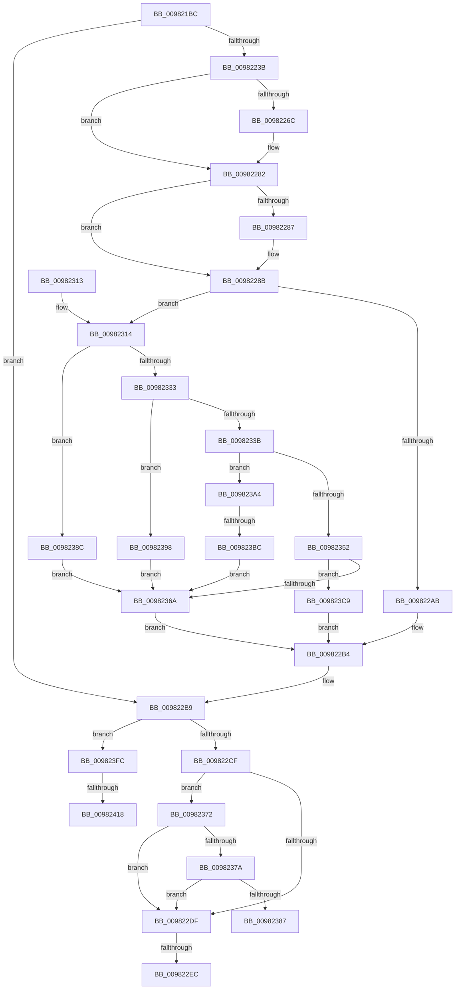

# EtwpCoverageRecord

- RVA: `0x009821BC`–`0x0098242A` (길이 `622` bytes)
- VA: `0x00000001409821BC`
- 실행 섹션: `PAGE`
- PDB 이름 있음: `예`; PDB Function 태그: `예`
- unwind 정보 RVA: `0x000978FC`
- 디코드: `152`개 명령, `622/622` bytes 표시
- 미해석 바이트: `0` (있으면 어셈블리에 `.byte`로 보존)

> 이 문서는 커널 이미지의 기계어와 PDB 기호를 분석해 생성했습니다. 4번과 5번은 함수 원형과 자료형을 바이너리 사용 방식에서 추정한 C 해석이며 원본 소스 복구 결과는 아닙니다.

## 1. Dependencies

- 직접 호출 지점: **10**; 고유 호출 대상: **10**
- 직접 호출자로 확인된 함수: **3**
- RIP 상대 이미지 참조: **7**

### Outgoing calls
- `0x0098222E` → [EtwpCoverageValidateCP](../../text/46/EtwpCoverageValidateCP_function_0046068C.md) (function, `0x0046068C`)
- `0x00982258` → [KeAbPreAcquire](../../text/21/KeAbPreAcquire_function_00210230.md) (function, `0x00210230`)
- `0x0098227D` → [ExfAcquirePushLockExclusiveEx](../../text/20/ExfAcquirePushLockExclusiveEx_function_0020FC90.md) (function, `0x0020FC90`)
- `0x009822F3` → [_security_check_cookie](../../text/6A/_security_check_cookie_function_006AC640.md) (function, `0x006AC640`)
- `0x00982326` → [TelemetryCoverageTableLocateInternal](../../text/4B/TelemetryCoverageTableLocateInternal_function_004BE690.md) (function, `0x004BE690`)
- `0x00982347` → [EtwpCoverageAddToStringBuffer](../../text/46/EtwpCoverageAddToStringBuffer_function_004605E8.md) (function, `0x004605E8`)
- `0x009823A7` → [EtwpCoverageFlushPending](../AB/EtwpCoverageFlushPending_function_00AB6700.md) (function, `0x00AB6700`)
- `0x009823AF` → [EtwpCoverageEnsureStringBuffer](../7B/EtwpCoverageEnsureStringBuffer_function_007B9CDC.md) (function, `0x007B9CDC`)
- `0x009823F2` → [KeSetTimer2](../../text/3A/KeSetTimer2_function_003A08E0.md) (function, `0x003A08E0`)
- `0x0098241F` → [ExfTryToWakePushLock](../../text/26/ExfTryToWakePushLock_function_00265DD0.md) (function, `0x00265DD0`)

### Direct callers
- [EtwTelemetryCoverageReport](../../text/46/EtwTelemetryCoverageReport_function_00460430.md) at `0x004605AA`
- [EtwpCoverageHighIrqlCPWorkItemCallback](../../text/65/EtwpCoverageHighIrqlCPWorkItemCallback_function_00651B00.md) at `0x00651BC3`
- [EtwSetProcessTelemetryCoverage](EtwSetProcessTelemetryCoverage_function_009804E0.md) at `0x00980527`

### Static image references
- `0x009821D8` → RVA `0x00E0A740` (`.data`; read)
- `0x00982244` → RVA `0x00EFF1B8` (`.data`; read)
- `0x0098225D` → RVA `0x00EFF1B8` (`.data`; read/write)
- `0x00982298` → RVA `0x00E684E0` (`.data`; write)
- `0x009822C2` → RVA `0x00E684E0` (`.data`; read)
- `0x009822CF` → RVA `0x00E091D8` (`.data`; read)
- `0x009822DF` → RVA `0x00E684F8` (`.data`; read)

## 2. Other-region calls and transfers

- 다른 실행 섹션으로 향하는 call: **8**
  - `0x0098222E` → [EtwpCoverageValidateCP](../../text/46/EtwpCoverageValidateCP_function_0046068C.md) (`PAGE` → `.text`)
  - `0x00982258` → [KeAbPreAcquire](../../text/21/KeAbPreAcquire_function_00210230.md) (`PAGE` → `.text`)
  - `0x0098227D` → [ExfAcquirePushLockExclusiveEx](../../text/20/ExfAcquirePushLockExclusiveEx_function_0020FC90.md) (`PAGE` → `.text`)
  - `0x009822F3` → [_security_check_cookie](../../text/6A/_security_check_cookie_function_006AC640.md) (`PAGE` → `.text`)
  - `0x00982326` → [TelemetryCoverageTableLocateInternal](../../text/4B/TelemetryCoverageTableLocateInternal_function_004BE690.md) (`PAGE` → `.text`)
  - `0x00982347` → [EtwpCoverageAddToStringBuffer](../../text/46/EtwpCoverageAddToStringBuffer_function_004605E8.md) (`PAGE` → `.text`)
  - `0x009823F2` → [KeSetTimer2](../../text/3A/KeSetTimer2_function_003A08E0.md) (`PAGE` → `.text`)
  - `0x0098241F` → [ExfTryToWakePushLock](../../text/26/ExfTryToWakePushLock_function_00265DD0.md) (`PAGE` → `.text`)
- call이 아닌 외부 분기/꼬리 이동: **5**
  - `0x009822E6` → [sub_00B2A746 + 0xE4](../B2/Unknown_function_00B2A746.md) (`tail-transfer`)
  - `0x00982387` → [sub_00B2A746 + 0x2F](../B2/Unknown_function_00B2A746.md) (`tail-transfer`)
  - `0x009823B6` → [sub_00B2A746](../B2/Unknown_function_00B2A746.md) (`tail-transfer`)
  - `0x00982412` → [sub_00B2A746 + 0x18](../B2/Unknown_function_00B2A746.md) (`tail-transfer`)
  - `0x00982425` → [sub_00B2A746 + 0x18](../B2/Unknown_function_00B2A746.md) (`tail-transfer`)

## 3. Assembly (complete function range)

```asm
009821BC  48 89 5C 24 18                  mov qword ptr [rsp + 0x18], rbx
009821C1  55                              push rbp
009821C2  56                              push rsi
009821C3  57                              push rdi
009821C4  41 54                           push r12
009821C6  41 55                           push r13
009821C8  41 56                           push r14
009821CA  41 57                           push r15
009821CC  48 8D 6C 24 E0                  lea rbp, [rsp - 0x20]
009821D1  48 81 EC 20 01 00 00            sub rsp, 0x120
009821D8  48 8B 05 61 85 48 00            mov rax, qword ptr [rip + 0x488561]
009821DF  48 33 C4                        xor rax, rsp
009821E2  48 89 45 10                     mov qword ptr [rbp + 0x10], rax
009821E6  45 33 ED                        xor r13d, r13d
009821E9  48 8B F9                        mov rdi, rcx
009821EC  4C 8B F2                        mov r14, rdx
009821EF  44 89 6C 24 30                  mov dword ptr [rsp + 0x30], r13d
009821F4  48 B9 04 00 00 00 80 F7 FF FF   movabs rcx, 0xfffff78000000004
009821FE  48 8D 54 24 34                  lea rdx, [rsp + 0x34]
00982203  48 B8 20 03 00 00 80 F7 FF FF   movabs rax, 0xfffff78000000320
0098220D  45 8B E5                        mov r12d, r13d
00982210  41 8B F5                        mov esi, r13d
00982213  48 8B 00                        mov rax, qword ptr [rax]
00982216  44 8B 39                        mov r15d, dword ptr [rcx]
00982219  49 8B CE                        mov rcx, r14
0098221C  4C 0F AF F8                     imul r15, rax
00982220  44 89 6C 24 34                  mov dword ptr [rsp + 0x34], r13d
00982225  49 C1 EF 18                     shr r15, 0x18
00982229  4C 89 7C 24 38                  mov qword ptr [rsp + 0x38], r15
0098222E  E8 59 E4 AD FF                  call 0x14046068c
00982233  48 83 CB FF                     or rbx, 0xffffffffffffffff
00982237  85 C0                           test eax, eax
00982239  74 7E                           je 0x1409822b9
0098223B  65 48 8B 04 25 88 01 00 00      mov rax, qword ptr gs:[0x188]
00982244  48 8D 0D 6D CF 57 00            lea rcx, [rip + 0x57cf6d]
0098224B  45 33 C0                        xor r8d, r8d
0098224E  33 D2                           xor edx, edx
00982250  66 01 98 E4 01 00 00            add word ptr [rax + 0x1e4], bx
00982257  90                              nop
00982258  E8 D3 DF 88 FF                  call 0x140210230
0098225D  F0 48 0F BA 2D 51 CF 57 00 00   lock bts qword ptr [rip + 0x57cf51], 0
00982267  48 8B F0                        mov rsi, rax
0098226A  73 16                           jae 0x140982282
0098226C  4C 8D 05 45 CF 57 00            lea r8, [rip + 0x57cf45]
00982273  48 8B D0                        mov rdx, rax
00982276  48 8D 0D 3B CF 57 00            lea rcx, [rip + 0x57cf3b]
0098227D  E8 0E DA 88 FF                  call 0x14020fc90
00982282  48 85 F6                        test rsi, rsi
00982285  74 04                           je 0x14098228b
00982287  C6 46 0A 01                     mov byte ptr [rsi + 0xa], 1
0098228B  65 48 8B 04 25 88 01 00 00      mov rax, qword ptr gs:[0x188]
00982294  45 8B 7E 0C                     mov r15d, dword ptr [r14 + 0xc]
00982298  48 89 05 41 62 4E 00            mov qword ptr [rip + 0x4e6241], rax
0098229F  48 8B 47 10                     mov rax, qword ptr [rdi + 0x10]
009822A3  8B 48 18                        mov ecx, dword ptr [rax + 0x18]
009822A6  44 3B F9                        cmp r15d, ecx
009822A9  72 69                           jb 0x140982314
009822AB  41 BC 01 00 00 00               mov r12d, 1
009822B1  41 8B F5                        mov esi, r13d
009822B4  4C 8B 7C 24 38                  mov r15, qword ptr [rsp + 0x38]
009822B9  65 48 8B 04 25 88 01 00 00      mov rax, qword ptr gs:[0x188]
009822C2  48 39 05 17 62 4E 00            cmp qword ptr [rip + 0x4e6217], rax
009822C9  0F 84 2D 01 00 00               je 0x1409823fc
009822CF  48 8D 1D 02 6F 48 00            lea rbx, [rip + 0x486f02]
009822D6  45 85 E4                        test r12d, r12d
009822D9  0F 84 93 00 00 00               je 0x140982372
009822DF  44 39 2D 12 62 4E 00            cmp dword ptr [rip + 0x4e6212], r13d
009822E6  0F 85 3E 85 1A 00               jne 0x140b2a82a
009822EC  48 8B 4D 10                     mov rcx, qword ptr [rbp + 0x10]
009822F0  48 33 CC                        xor rcx, rsp
009822F3  E8 48 A3 D2 FF                  call 0x1406ac640
009822F8  48 8B 9C 24 70 01 00 00         mov rbx, qword ptr [rsp + 0x170]
00982300  48 81 C4 20 01 00 00            add rsp, 0x120
00982307  41 5F                           pop r15
00982309  41 5E                           pop r14
0098230B  41 5D                           pop r13
0098230D  41 5C                           pop r12
0098230F  5F                              pop rdi
00982310  5E                              pop rsi
00982311  5D                              pop rbp
00982312  C3                              ret
00982313  CC                              int3
00982314  45 8B 5E 08                     mov r11d, dword ptr [r14 + 8]
00982318  41 8B D3                        mov edx, r11d
0098231B  41 89 4E 0C                     mov dword ptr [r14 + 0xc], ecx
0098231F  48 8B 77 10                     mov rsi, qword ptr [rdi + 0x10]
00982323  48 8B CE                        mov rcx, rsi
00982326  E8 65 C3 B3 FF                  call 0x1404be690
0098232B  4C 8B E8                        mov r13, rax
0098232E  44 39 18                        cmp dword ptr [rax], r11d
00982331  74 59                           je 0x14098238c
00982333  8B 47 20                        mov eax, dword ptr [rdi + 0x20]
00982336  39 46 20                        cmp dword ptr [rsi + 0x20], eax
00982339  73 5D                           jae 0x140982398
0098233B  44 8B 44 24 34                  mov r8d, dword ptr [rsp + 0x34]
00982340  49 8B 16                        mov rdx, qword ptr [r14]
00982343  48 8B 4F 28                     mov rcx, qword ptr [rdi + 0x28]
00982347  E8 9C E2 AD FF                  call 0x1404605e8
0098234C  8B F0                           mov esi, eax
0098234E  85 C0                           test eax, eax
00982350  74 52                           je 0x1409823a4
00982352  41 8B 46 08                     mov eax, dword ptr [r14 + 8]
00982356  41 89 45 00                     mov dword ptr [r13], eax
0098235A  FF 47 40                        inc dword ptr [rdi + 0x40]
0098235D  48 8B 47 10                     mov rax, qword ptr [rdi + 0x10]
00982361  FF 40 20                        inc dword ptr [rax + 0x20]
00982364  83 7F 40 01                     cmp dword ptr [rdi + 0x40], 1
00982368  74 5F                           je 0x1409823c9
0098236A  45 33 ED                        xor r13d, r13d
0098236D  E9 42 FF FF FF                  jmp 0x1409822b4
00982372  85 F6                           test esi, esi
00982374  0F 84 65 FF FF FF               je 0x1409822df
0098237A  83 3D 57 6E 48 00 05            cmp dword ptr [rip + 0x486e57], 5
00982381  0F 86 58 FF FF FF               jbe 0x1409822df
00982387  E9 E9 83 1A 00                  jmp 0x140b2a775
0098238C  8B 74 24 30                     mov esi, dword ptr [rsp + 0x30]
00982390  41 BC 01 00 00 00               mov r12d, 1
00982396  EB D2                           jmp 0x14098236a
00982398  48 8B 07                        mov rax, qword ptr [rdi]
0098239B  F0 FF 40 04                     lock inc dword ptr [rax + 4]
0098239F  41 8B F4                        mov esi, r12d
009823A2  EB C6                           jmp 0x14098236a
009823A4  48 8B CF                        mov rcx, rdi
009823A7  E8 54 43 13 00                  call 0x140ab6700
009823AC  48 8B CF                        mov rcx, rdi
009823AF  E8 28 79 E3 FF                  call 0x1407b9cdc
009823B4  85 C0                           test eax, eax
009823B6  0F 89 8A 83 1A 00               jns 0x140b2a746
009823BC  45 89 7E 0C                     mov dword ptr [r14 + 0xc], r15d
009823C0  48 8B 0F                        mov rcx, qword ptr [rdi]
009823C3  F0 FF 41 04                     lock inc dword ptr [rcx + 4]
009823C7  EB A1                           jmp 0x14098236a
009823C9  8B 47 1C                        mov eax, dword ptr [rdi + 0x1c]
009823CC  4C 8D 4C 24 68                  lea r9, [rsp + 0x68]
009823D1  48 8B 0F                        mov rcx, qword ptr [rdi]
009823D4  45 33 ED                        xor r13d, r13d
009823D7  48 69 D0 F0 D8 FF FF            imul rdx, rax, -0x2710
009823DE  48 81 C1 F0 00 00 00            add rcx, 0xf0
009823E5  4C 89 6C 24 68                  mov qword ptr [rsp + 0x68], r13
009823EA  45 33 C0                        xor r8d, r8d
009823ED  48 89 5C 24 70                  mov qword ptr [rsp + 0x70], rbx
009823F2  E8 E9 E4 A1 FF                  call 0x1403a08e0
009823F7  E9 B8 FE FF FF                  jmp 0x1409822b4
009823FC  4C 89 2D DD 60 4E 00            mov qword ptr [rip + 0x4e60dd], r13
00982403  F0 48 0F C1 1D AC CD 57 00      lock xadd qword ptr [rip + 0x57cdac], rbx
0098240C  80 E3 06                        and bl, 6
0098240F  80 FB 02                        cmp bl, 2
00982412  0F 85 46 83 1A 00               jne 0x140b2a75e
00982418  48 8D 0D 99 CD 57 00            lea rcx, [rip + 0x57cd99]
0098241F  E8 AC 39 8E FF                  call 0x140265dd0
00982424  90                              nop
00982425  E9 34 83 1A 00                  jmp 0x140b2a75e
```

## 4. C-style interpretation (structured pseudocode)

```c
__int64 __fastcall EtwpCoverageRecord(__int64 a1, __int64 a2, int a3)
{
    __int64 result;
    __int64 v_r13;
    __int64 v_r15;
    __int64 v_rbx;
    __int64 v_rsp;
    unsigned __int64 v_stack_m120;
    unsigned __int64 v_stack_m124;
    unsigned int v_stack_m128;
    unsigned __int64 v_stack_m48;
    unsigned __int64 v_stack_m58;
    unsigned __int64 v_stack_p18;
    unsigned int v_stack_p30;
    unsigned int v_stack_p34;
    unsigned __int64 v_stack_p68;
    unsigned __int64 v_stack_p70;

    v_stack_p18 = v_rbx;
    v_rsp = (v_rsp) - (288);
    result = (*(unsigned __int64 *)(v_rip + 4752737)) ^ (v_rsp);
    v_stack_m48 = result;
    v_r13 = 0;
    v_stack_m128 = 0;
    v_r15 = ((unsigned int)(*(unsigned int *)(a1))) * (*(unsigned __int64 *)(result));
    v_stack_m124 = 0;
    v_r15 = (v_r15) >> (24);
    v_stack_m120 = v_r15;
    result = EtwpCoverageValidateCP(a2, v_stack_m124, a3, a4);
    v_rbx = (v_rbx) | (-1);
    if ((unsigned int)(result) == 0) goto loc_009822B9;
    a3 = 0;
    a2 = 0;
    result = KeAbPreAcquire(v_rip + 5754733, a2, a3, a4);
    if (!(condition_is_above_or_equal)) {
        a3 = v_rip + 5754693;
        a2 = result;
        a1 = v_rip + 5754683;
        result = ExfAcquirePushLockExclusiveEx(a1, a2, a3, a4);
    }
    if (result != 0) {
        *(unsigned __int8 *)(result + 10) = 1;
    }
    *(unsigned __int64 *)(v_rip + 5136961) = *(unsigned __int64 *)(gs_base + (0 + 392));
    if (((unsigned int)((unsigned int)(*(unsigned int *)(a2 + 12)))) < ((unsigned int)((unsigned int)(*(unsigned int *)(*(unsigned __int64 *)(a1 + 16) + 24))))) goto loc_00982314;
loc_009822B4:
loc_009822B9:
    if ((*(unsigned __int64 *)(v_rip + 5136919)) == (*(unsigned __int64 *)(gs_base + (0 + 392)))) goto loc_009823FC;
    if (1 == 0) goto loc_00982372;
loc_009822DF:
    a1 = (v_stack_m48) ^ (v_rsp);
    result = _security_check_cookie(a1, a2, a3, a4);
    v_rsp = (v_rsp) + (288);
    return result;
loc_00982314:
    *(unsigned int *)(a2 + 12) = (unsigned int)(a1);
    result = TelemetryCoverageTableLocateInternal(*(unsigned __int64 *)(a1 + 16), (unsigned int)((unsigned int)((unsigned int)(*(unsigned int *)(a2 + 8)))), a3, a4);
    if ((*(unsigned int *)(result)) == ((unsigned int)((unsigned int)(*(unsigned int *)(a2 + 8))))) goto loc_0098238C;
    if ((*(unsigned int *)(*(unsigned __int64 *)(a1 + 16) + 32)) >= ((unsigned int)((unsigned int)(*(unsigned int *)(a1 + 32))))) goto loc_00982398;
    result = EtwpCoverageAddToStringBuffer(*(unsigned __int64 *)(a1 + 40), *(unsigned __int64 *)(a2), (unsigned int)(v_stack_p34), a4);
    if ((unsigned int)(result) == 0) goto loc_009823A4;
    *(unsigned int *)(result) = (unsigned int)((unsigned int)(*(unsigned int *)(a2 + 8)));
    if ((*(unsigned int *)(a1 + 64)) == 1) goto loc_009823C9;
loc_0098236A:
    v_r13 = 0;
    goto loc_009822B4;
loc_00982372:
    if ((unsigned int)((unsigned int)((unsigned int)(result))) == 0) goto loc_009822DF;
    if ((*(unsigned int *)(v_rip + 4746839)) <= 5) goto loc_009822DF;
loc_0098238C:
    goto loc_0098236A;
loc_00982398:
    goto loc_0098236A;
loc_009823A4:
    result = EtwpCoverageFlushPending(a1, *(unsigned __int64 *)(a2), (unsigned int)(v_stack_p34), a4);
    result = EtwpCoverageEnsureStringBuffer(a1, *(unsigned __int64 *)(a2), (unsigned int)(v_stack_p34), a4);
    *(unsigned int *)(a2 + 12) = (unsigned int)(v_stack_m120);
    goto loc_0098236A;
loc_009823C9:
    v_r13 = 0;
    a2 = (*(unsigned __int64 *)(a2)) * ((unsigned int)(*(unsigned int *)(a1 + 28)));
    a1 = (*(unsigned __int64 *)(a1)) + (240);
    v_stack_p68 = 0;
    a3 = 0;
    v_stack_p70 = v_stack_p18;
    result = KeSetTimer2(a1, a2, a3, v_stack_p68);
    goto loc_009822B4;
loc_009823FC:
    *(unsigned __int64 *)(v_rip + 5136605) = 0;
    v_rbx = (unsigned __int8)((v_stack_p18) & (6));
    result = ExfTryToWakePushLock(v_rip + 5754265, a2, a3, v_stack_p68);
}
```

## 5. (Beta) C Style

```c
int64_t EtwpCoverageRecord(void *Arg1, void *Arg2, int32_t Arg3)
{
    uint8_t *arg1 = (uint8_t *)Arg1;
    uint8_t *arg2 = (uint8_t *)Arg2;

    int64_t result;
    int64_t local_r13;
    int64_t local_r15;
    int64_t local_rbx;
    int64_t local_rsp;
    uint64_t v_stack_m120;
    uint64_t v_stack_m124;
    uint32_t v_stack_m128;
    uint64_t v_stack_m48;
    uint64_t v_stack_m58;
    uint64_t v_stack_p18;
    uint32_t v_stack_p30;
    uint32_t v_stack_p34;
    uint64_t v_stack_p68;
    uint64_t v_stack_p70;

    v_stack_p18 = local_rbx;
    local_rsp = (local_rsp) - (288);
    result = (*(uint64_t *)(v_rip + 0x488561)) ^ (local_rsp);
    v_stack_m48 = result;
    local_r13 = 0;
    v_stack_m128 = 0;
    local_r15 = ((uint32_t)(*(uint32_t *)(arg1))) * (*(uint64_t *)(result));
    v_stack_m124 = 0;
    local_r15 = (local_r15) >> (24);
    v_stack_m120 = local_r15;
    result = EtwpCoverageValidateCP(Arg2, v_stack_m124, Arg3, a4);
    local_rbx = (local_rbx) | (-1);
    if ((uint32_t)(result) == 0) goto loc_009822B9;
    Arg3 = 0;
    Arg2 = 0;
    result = KeAbPreAcquire(v_rip + 5754733, Arg2, Arg3, a4);
    if (!(condition_is_above_or_equal)) {
        Arg3 = v_rip + 5754693;
        Arg2 = result;
        Arg1 = v_rip + 5754683;
        result = ExfAcquirePushLockExclusiveEx(Arg1, Arg2, Arg3, a4);
    }
    if (result != 0) {
        *(uint8_t *)(result + 0xA) = 1;
    }
    *(uint64_t *)(v_rip + 0x4E6241) = *(uint64_t *)(gs_base + (0 + 0x188));
    if (((uint32_t)((uint32_t)(*(uint32_t *)(arg2 + 0xC)))) < ((uint32_t)((uint32_t)(*(uint32_t *)(*(uint64_t *)(arg1 + 0x10) + 0x18))))) goto loc_00982314;
loc_009822B4:
loc_009822B9:
    if ((*(uint64_t *)(v_rip + 0x4E6217)) == (*(uint64_t *)(gs_base + (0 + 0x188)))) goto loc_009823FC;
    if (1 == 0) goto loc_00982372;
loc_009822DF:
    Arg1 = (v_stack_m48) ^ (local_rsp);
    result = _security_check_cookie(Arg1, Arg2, Arg3, a4);
    local_rsp = (local_rsp) + (288);
    return result;
loc_00982314:
    *(uint32_t *)(arg2 + 0xC) = (uint32_t)(Arg1);
    result = TelemetryCoverageTableLocateInternal(*(uint64_t *)(arg1 + 0x10), (uint32_t)((uint32_t)((uint32_t)(*(uint32_t *)(arg2 + 0x8)))), Arg3, a4);
    if ((*(uint32_t *)(result)) == ((uint32_t)((uint32_t)(*(uint32_t *)(arg2 + 0x8))))) goto loc_0098238C;
    if ((*(uint32_t *)(*(uint64_t *)(arg1 + 0x10) + 0x20)) >= ((uint32_t)((uint32_t)(*(uint32_t *)(arg1 + 0x20))))) goto loc_00982398;
    result = EtwpCoverageAddToStringBuffer(*(uint64_t *)(arg1 + 0x28), *(uint64_t *)(arg2), (uint32_t)(v_stack_p34), a4);
    if ((uint32_t)(result) == 0) goto loc_009823A4;
    *(uint32_t *)(result) = (uint32_t)((uint32_t)(*(uint32_t *)(arg2 + 0x8)));
    if ((*(uint32_t *)(arg1 + 0x40)) == 1) goto loc_009823C9;
loc_0098236A:
    local_r13 = 0;
    goto loc_009822B4;
loc_00982372:
    if ((uint32_t)((uint32_t)((uint32_t)(result))) == 0) goto loc_009822DF;
    if ((*(uint32_t *)(v_rip + 0x486E57)) <= 5) goto loc_009822DF;
loc_0098238C:
    goto loc_0098236A;
loc_00982398:
    goto loc_0098236A;
loc_009823A4:
    result = EtwpCoverageFlushPending(Arg1, *(uint64_t *)(arg2), (uint32_t)(v_stack_p34), a4);
    result = EtwpCoverageEnsureStringBuffer(Arg1, *(uint64_t *)(arg2), (uint32_t)(v_stack_p34), a4);
    *(uint32_t *)(arg2 + 0xC) = (uint32_t)(v_stack_m120);
    goto loc_0098236A;
loc_009823C9:
    local_r13 = 0;
    Arg2 = (*(uint64_t *)(arg2)) * ((uint32_t)(*(uint32_t *)(arg1 + 0x1C)));
    Arg1 = (*(uint64_t *)(arg1)) + (240);
    v_stack_p68 = 0;
    Arg3 = 0;
    v_stack_p70 = v_stack_p18;
    result = KeSetTimer2(Arg1, Arg2, Arg3, v_stack_p68);
    goto loc_009822B4;
loc_009823FC:
    *(uint64_t *)(v_rip + 0x4E60DD) = 0;
    local_rbx = (uint8_t)((v_stack_p18) & (6));
    result = ExfTryToWakePushLock(v_rip + 5754265, Arg2, Arg3, v_stack_p68);
}
```

### 관측된 메모리 오프셋

구조체 형식이 확인되지 않은 접근은 인자 기준의 오프셋으로만 기록했습니다.

| 기준 인자 | 오프셋 표현 | 폭 (bit) | 접근 |
|---|---:|---:|---|
| `Arg1` | `+ 0x0` | `64` | `R` |
| `Arg1` | `+ 0x10` | `64` | `R` |
| `Arg1` | `+ 0x1C` | `32` | `R` |
| `Arg1` | `+ 0x20` | `32` | `R` |
| `Arg1` | `+ 0x28` | `64` | `R` |
| `Arg1` | `+ 0x40` | `32` | `R` |
| `Arg1` | `+ 0x40` | `32` | `R/W` |
| `Arg2` | `+ 0x0` | `64` | `R` |
| `Arg2` | `+ 0x8` | `32` | `R` |
| `Arg2` | `+ 0xC` | `32` | `R` |
| `Arg2` | `+ 0xC` | `32` | `W` |

## 6. Execution-region graph

[열기: 2D/3D 그래프와 함수 탐색 컨트롤 패널](../../../control-panel.html?section=page&rva=0x009821BC&view=graph)

- 2D 그래프는 위에서 아래로 흐르고, 3D 그래프는 빈 공간을 드래그해 회전합니다. Shift+드래그는 이동, 휠은 확대·축소, 함수 노드 선택은 대상 보고서 이동입니다.

### Static fallback


