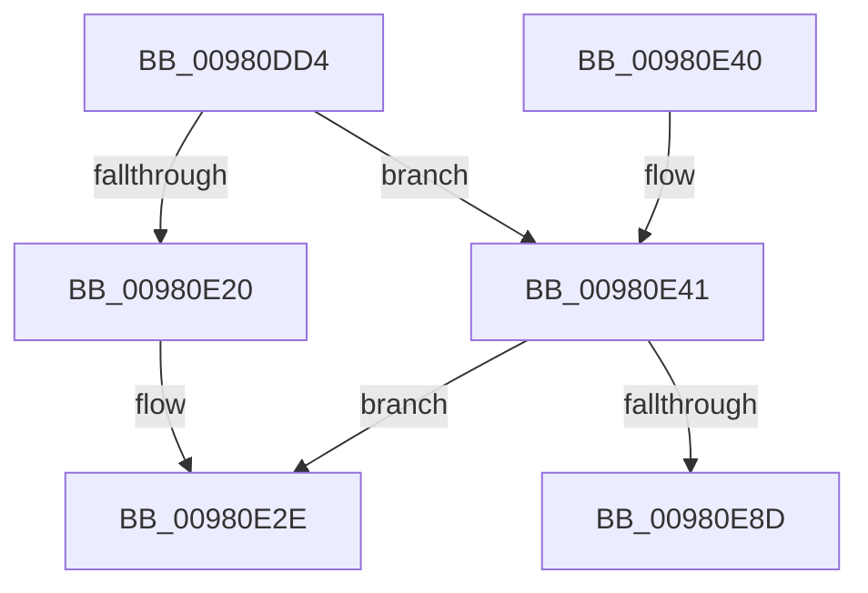

# ExpGetGlobalLocaleSection

- RVA: `0x00980DD4`–`0x00980E92` (길이 `190` bytes)
- VA: `0x0000000140980DD4`
- 실행 섹션: `PAGE`
- PDB 이름 있음: `예`; PDB Function 태그: `예`
- unwind 정보 RVA: `0x00097790`
- 디코드: `56`개 명령, `190/190` bytes 표시
- 미해석 바이트: `0` (있으면 어셈블리에 `.byte`로 보존)

> 이 문서는 커널 이미지의 기계어와 PDB 기호를 분석해 생성했습니다. 4번과 5번은 함수 원형과 자료형을 바이너리 사용 방식에서 추정한 C 해석이며 원본 소스 복구 결과는 아닙니다.

## 1. Dependencies

- 직접 호출 지점: **3**; 고유 호출 대상: **3**
- 직접 호출자로 확인된 함수: **1**
- RIP 상대 이미지 참조: **1**

### Outgoing calls
- `0x00980E0A` → [PsGetCurrentServerSiloGlobals](../../text/2F/PsGetCurrentServerSiloGlobals_function_002FE1F0.md) (function, `0x002FE1F0`)
- `0x00980E23` → [ObfReferenceObject](../../text/20/ObfReferenceObject_function_0020FA20.md) (function, `0x0020FA20`)
- `0x00980E84` → [ZwOpenFile](../../text/6A/ZwOpenFile_function_006AD730.md) (function, `0x006AD730`)

### Direct callers
- [NtInitializeNlsFiles](NtInitializeNlsFiles_function_00980C90.md) at `0x00980D10`

### Static image references
- `0x00980E46` → RVA `0x00B4BD98` (`NlsLocaleFilePathName`; read)

## 2. Other-region calls and transfers

- 다른 실행 섹션으로 향하는 call: **3**
  - `0x00980E0A` → [PsGetCurrentServerSiloGlobals](../../text/2F/PsGetCurrentServerSiloGlobals_function_002FE1F0.md) (`PAGE` → `.text`)
  - `0x00980E23` → [ObfReferenceObject](../../text/20/ObfReferenceObject_function_0020FA20.md) (`PAGE` → `.text`)
  - `0x00980E84` → [ZwOpenFile](../../text/6A/ZwOpenFile_function_006AD730.md) (`PAGE` → `.text`)
- call이 아닌 외부 분기/꼬리 이동: **1**
  - `0x00980E8D` → [sub_00B2A59A](../B2/Unknown_function_00B2A59A.md) (`tail-transfer`)

## 3. Assembly (complete function range)

```asm
00980DD4  48 89 54 24 10                  mov qword ptr [rsp + 0x10], rdx
00980DD9  55                              push rbp
00980DDA  53                              push rbx
00980DDB  56                              push rsi
00980DDC  57                              push rdi
00980DDD  41 54                           push r12
00980DDF  41 56                           push r14
00980DE1  41 57                           push r15
00980DE3  48 8B EC                        mov rbp, rsp
00980DE6  48 81 EC 80 00 00 00            sub rsp, 0x80
00980DED  33 C0                           xor eax, eax
00980DEF  0F 57 C0                        xorps xmm0, xmm0
00980DF2  21 45 EC                        and dword ptr [rbp - 0x14], eax
00980DF5  4C 8B E1                        mov r12, rcx
00980DF8  48 21 45 50                     and qword ptr [rbp + 0x50], rax
00980DFC  48 21 45 58                     and qword ptr [rbp + 0x58], rax
00980E00  89 45 D4                        mov dword ptr [rbp - 0x2c], eax
00980E03  21 45 D4                        and dword ptr [rbp - 0x2c], eax
00980E06  0F 11 45 C0                     movups xmmword ptr [rbp - 0x40], xmm0
00980E0A  E8 E1 D3 97 FF                  call 0x1402fe1f0
00980E0F  48 8B B0 00 04 00 00            mov rsi, qword ptr [rax + 0x400]
00980E16  4C 8B 76 08                     mov r14, qword ptr [rsi + 8]
00980E1A  49 83 FE 01                     cmp r14, 1
00980E1E  76 21                           jbe 0x140980e41
00980E20  49 8B CE                        mov rcx, r14
00980E23  E8 F8 EB 88 FF                  call 0x14020fa20
00980E28  4D 89 34 24                     mov qword ptr [r12], r14
00980E2C  33 C0                           xor eax, eax
00980E2E  48 81 C4 80 00 00 00            add rsp, 0x80
00980E35  41 5F                           pop r15
00980E37  41 5E                           pop r14
00980E39  41 5C                           pop r12
00980E3B  5F                              pop rdi
00980E3C  5E                              pop rsi
00980E3D  5B                              pop rbx
00980E3E  5D                              pop rbp
00980E3F  C3                              ret
00980E40  CC                              int3
00980E41  83 64 24 28 00                  and dword ptr [rsp + 0x28], 0
00980E46  48 8D 05 4B AF 1C 00            lea rax, [rip + 0x1caf4b]
00980E4D  48 83 65 D8 00                  and qword ptr [rbp - 0x28], 0
00980E52  4C 8D 4D C0                     lea r9, [rbp - 0x40]
00980E56  BB 30 00 00 00                  mov ebx, 0x30
00980E5B  48 89 45 E0                     mov qword ptr [rbp - 0x20], rax
00980E5F  BF 40 02 00 00                  mov edi, 0x240
00980E64  89 5D D0                        mov dword ptr [rbp - 0x30], ebx
00980E67  4C 8D 45 D0                     lea r8, [rbp - 0x30]
00980E6B  89 7D E8                        mov dword ptr [rbp - 0x18], edi
00980E6E  BA 00 00 10 00                  mov edx, 0x100000
00980E73  C7 44 24 20 01 00 00 00         mov dword ptr [rsp + 0x20], 1
00980E7B  48 8D 4D 50                     lea rcx, [rbp + 0x50]
00980E7F  F3 0F 7F 45 F0                  movdqu xmmword ptr [rbp - 0x10], xmm0
00980E84  E8 A7 C8 D2 FF                  call 0x1406ad730
00980E89  85 C0                           test eax, eax
00980E8B  78 A1                           js 0x140980e2e
00980E8D  E9 08 97 1A 00                  jmp 0x140b2a59a
```

## 4. C-style interpretation (structured pseudocode)

```c
__int64 __fastcall ExpGetGlobalLocaleSection(__int64 a1, __int64 a2)
{
    __int64 result;
    __int64 v_rsp;
    unsigned __int64 v_stack_m48;
    unsigned int v_stack_m4C;
    unsigned int v_stack_m50;
    unsigned __int64 v_stack_m58;
    unsigned __int64 v_stack_m60;
    unsigned int v_stack_m64;
    unsigned int v_stack_m68;
    unsigned __int64 v_stack_m78;
    unsigned __int64 v_stack_p10;
    unsigned __int64 v_stack_p18;
    unsigned __int64 v_stack_p20;
    unsigned int v_stack_p28;

    v_stack_p10 = a2;
    v_rsp = (v_rsp) - (128);
    result = 0;
    v_stack_m64 = 0;
    v_stack_m78 = v_xmm0;
    result = PsGetCurrentServerSiloGlobals(a1, a2, a3, a4);
    if ((*(unsigned __int64 *)(*(unsigned __int64 *)(result + 1024) + 8)) <= 1) goto loc_00980E41;
    result = ObfReferenceObject(*(unsigned __int64 *)(*(unsigned __int64 *)(result + 1024) + 8), a2, a3, a4);
    *(unsigned __int64 *)(a1) = *(unsigned __int64 *)(*(unsigned __int64 *)(result + 1024) + 8);
    result = 0;
loc_00980E2E:
    v_rsp = (v_rsp) + (128);
    return result;
loc_00980E41:
    v_stack_m58 = v_rip + 1879883;
    v_stack_m68 = 48;
    v_stack_m50 = 576;
    v_stack_p20 = 1;
    v_stack_m48 = v_xmm0;
    result = ZwOpenFile(v_stack_p18, (unsigned int)(0x100000ULL), v_stack_m68, v_stack_m78);
    if (sign_flag) goto loc_00980E2E;
}
```

## 5. (Beta) C Style

```c
int64_t ExpGetGlobalLocaleSection(void *Arg1, int64_t Arg2)
{
    uint8_t *arg1 = (uint8_t *)Arg1;

    int64_t result;
    int64_t local_rsp;
    uint64_t v_stack_m48;
    uint32_t v_stack_m4C;
    uint32_t v_stack_m50;
    uint64_t v_stack_m58;
    uint64_t v_stack_m60;
    uint32_t v_stack_m64;
    uint32_t v_stack_m68;
    uint64_t v_stack_m78;
    uint64_t v_stack_p10;
    uint64_t v_stack_p18;
    uint64_t v_stack_p20;
    uint32_t v_stack_p28;

    v_stack_p10 = Arg2;
    local_rsp = (local_rsp) - (128);
    result = 0;
    v_stack_m64 = 0;
    v_stack_m78 = v_xmm0;
    result = PsGetCurrentServerSiloGlobals(Arg1, Arg2, a3, a4);
    if ((*(uint64_t *)(*(uint64_t *)(result + 0x400) + 0x8)) <= 1) goto loc_00980E41;
    result = ObfReferenceObject(*(uint64_t *)(*(uint64_t *)(result + 0x400) + 0x8), Arg2, a3, a4);
    *(uint64_t *)(arg1) = *(uint64_t *)(*(uint64_t *)(result + 0x400) + 0x8);
    result = 0;
loc_00980E2E:
    local_rsp = (local_rsp) + (128);
    return result;
loc_00980E41:
    v_stack_m58 = v_rip + 1879883;
    v_stack_m68 = 48;
    v_stack_m50 = 576;
    v_stack_p20 = 1;
    v_stack_m48 = v_xmm0;
    result = ZwOpenFile(v_stack_p18, (uint32_t)(0x100000ULL), v_stack_m68, v_stack_m78);
    if (sign_flag) goto loc_00980E2E;
}
```

### 관측된 메모리 오프셋

구조체 형식이 확인되지 않은 접근은 인자 기준의 오프셋으로만 기록했습니다.

| 기준 인자 | 오프셋 표현 | 폭 (bit) | 접근 |
|---|---:|---:|---|
| `Arg1` | `+ 0x0` | `64` | `W` |

## 6. Execution-region graph

[열기: 2D/3D 그래프와 함수 탐색 컨트롤 패널](../../../control-panel.html?section=page&rva=0x00980DD4&view=graph)

- 2D 그래프는 위에서 아래로 흐르고, 3D 그래프는 빈 공간을 드래그해 회전합니다. Shift+드래그는 이동, 휠은 확대·축소, 함수 노드 선택은 대상 보고서 이동입니다.

### Static fallback


