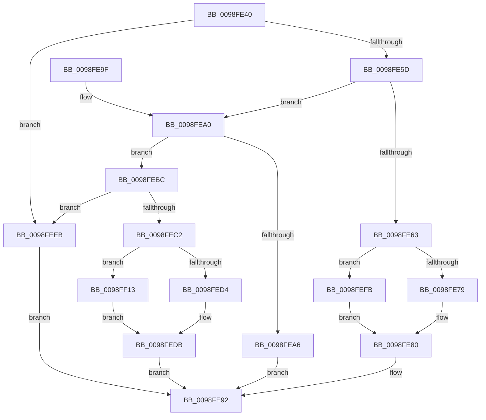

# ExpWnfGetCurrentScopeInstance

- RVA: `0x0098FE40`–`0x0098FF28` (길이 `232` bytes)
- VA: `0x000000014098FE40`
- 실행 섹션: `PAGE`
- PDB 이름 있음: `예`; PDB Function 태그: `아니요`
- unwind 정보 RVA: `0x00098B64`
- 디코드: `54`개 명령, `232/232` bytes 표시
- 미해석 바이트: `0` (있으면 어셈블리에 `.byte`로 보존)

> 이 문서는 커널 이미지의 기계어와 PDB 기호를 분석해 생성했습니다. 4번과 5번은 함수 원형과 자료형을 바이너리 사용 방식에서 추정한 C 해석이며 원본 소스 복구 결과는 아닙니다.

## 1. Dependencies

- 직접 호출 지점: **2**; 고유 호출 대상: **2**
- 직접 호출자로 확인된 함수: **1**
- RIP 상대 이미지 참조: **0**

### Outgoing calls
- `0x0098FE80` → [PsGetProcessSessionId](../../text/22/PsGetProcessSessionId_function_002233A0.md) (function, `0x002233A0`)
- `0x0098FEB3` → [ExpWnfQueryCurrentUserSID](ExpWnfQueryCurrentUserSID_function_0098FFB0.md) (function, `0x0098FFB0`)

### Direct callers
- [sub_0090B43E](../90/Unknown_function_0090B43E.md) at `0x0090B62F`
- [sub_0090B43E](../90/Unknown_function_0090B43E.md) at `0x0090B6D7`

### Static image references
- 디코드된 RIP-relative 메모리 참조가 없습니다.

## 2. Other-region calls and transfers

- 다른 실행 섹션으로 향하는 call: **1**
  - `0x0098FE80` → [PsGetProcessSessionId](../../text/22/PsGetProcessSessionId_function_002233A0.md) (`PAGE` → `.text`)
- 별도 외부 분기/꼬리 이동을 확인하지 못했습니다.

## 3. Assembly (complete function range)

```asm
0098FE40  48 89 5C 24 08                  mov qword ptr [rsp + 8], rbx
0098FE45  57                              push rdi
0098FE46  48 83 EC 30                     sub rsp, 0x30
0098FE4A  4C 8B 54 24 68                  mov r10, qword ptr [rsp + 0x68]
0098FE4F  33 DB                           xor ebx, ebx
0098FE51  49 8B F9                        mov rdi, r9
0098FE54  45 85 C0                        test r8d, r8d
0098FE57  0F 84 8E 00 00 00               je 0x14098feeb
0098FE5D  41 83 E8 01                     sub r8d, 1
0098FE61  75 3D                           jne 0x14098fea0
0098FE63  65 48 8B 04 25 88 01 00 00      mov rax, qword ptr gs:[0x188]
0098FE6C  80 B8 4A 02 00 00 01            cmp byte ptr [rax + 0x24a], 1
0098FE73  0F 84 82 00 00 00               je 0x14098fefb
0098FE79  41 C7 02 01 00 00 00            mov dword ptr [r10], 1
0098FE80  E8 1B 35 89 FF                  call 0x1402233a0
0098FE85  89 07                           mov dword ptr [rdi], eax
0098FE87  48 8B 44 24 60                  mov rax, qword ptr [rsp + 0x60]
0098FE8C  C7 00 04 00 00 00               mov dword ptr [rax], 4
0098FE92  8B C3                           mov eax, ebx
0098FE94  48 8B 5C 24 40                  mov rbx, qword ptr [rsp + 0x40]
0098FE99  48 83 C4 30                     add rsp, 0x30
0098FE9D  5F                              pop rdi
0098FE9E  C3                              ret
0098FE9F  CC                              int3
0098FEA0  41 83 E8 01                     sub r8d, 1
0098FEA4  75 16                           jne 0x14098febc
0098FEA6  4C 8B 4C 24 60                  mov r9, qword ptr [rsp + 0x60]
0098FEAB  4C 8B C7                        mov r8, rdi
0098FEAE  4C 89 54 24 20                  mov qword ptr [rsp + 0x20], r10
0098FEB3  E8 F8 00 00 00                  call 0x14098ffb0
0098FEB8  8B D8                           mov ebx, eax
0098FEBA  EB D6                           jmp 0x14098fe92
0098FEBC  41 83 E8 01                     sub r8d, 1
0098FEC0  75 29                           jne 0x14098feeb
0098FEC2  65 48 8B 04 25 88 01 00 00      mov rax, qword ptr gs:[0x188]
0098FECB  80 B8 4A 02 00 00 01            cmp byte ptr [rax + 0x24a], 1
0098FED2  74 3F                           je 0x14098ff13
0098FED4  41 C7 02 01 00 00 00            mov dword ptr [r10], 1
0098FEDB  48 8B 44 24 60                  mov rax, qword ptr [rsp + 0x60]
0098FEE0  49 89 09                        mov qword ptr [r9], rcx
0098FEE3  C7 00 08 00 00 00               mov dword ptr [rax], 8
0098FEE9  EB A7                           jmp 0x14098fe92
0098FEEB  48 8B 44 24 60                  mov rax, qword ptr [rsp + 0x60]
0098FEF0  41 C7 02 01 00 00 00            mov dword ptr [r10], 1
0098FEF7  89 18                           mov dword ptr [rax], ebx
0098FEF9  EB 97                           jmp 0x14098fe92
0098FEFB  65 48 8B 04 25 88 01 00 00      mov rax, qword ptr gs:[0x188]
0098FF04  41 89 1A                        mov dword ptr [r10], ebx
0098FF07  48 8B 88 B8 00 00 00            mov rcx, qword ptr [rax + 0xb8]
0098FF0E  E9 6D FF FF FF                  jmp 0x14098fe80
0098FF13  65 48 8B 04 25 88 01 00 00      mov rax, qword ptr gs:[0x188]
0098FF1C  41 89 1A                        mov dword ptr [r10], ebx
0098FF1F  48 8B 88 B8 00 00 00            mov rcx, qword ptr [rax + 0xb8]
0098FF26  EB B3                           jmp 0x14098fedb
```

## 4. C-style interpretation (structured pseudocode)

```c
__int64 __fastcall ExpWnfGetCurrentScopeInstance(__int64 a1, __int64 a2, int a3, __int64 a4, __int64 a5, __int64 a6)
{
    __int64 result;
    __int64 v_rbx;
    __int64 v_rsp;
    unsigned __int64 v_stack_p20;
    unsigned __int64 v_stack_p8;

    v_stack_p8 = v_rbx;
    v_rsp = (v_rsp) - (48);
    v_rbx = 0;
    if (a3 == 0) goto loc_0098FEEB;
    a3 = (unsigned int)((a3) - (1));
    if (condition_is_not_equal) goto loc_0098FEA0;
    if ((*(unsigned __int8 *)(*(unsigned __int64 *)(gs_base + (0 + 392)) + 586)) == 1) goto loc_0098FEFB;
    *(unsigned int *)(a6) = 1;
loc_0098FE80:
    result = PsGetProcessSessionId(a1, a2, a3, a4);
    *(unsigned int *)(a4) = (unsigned int)(result);
    *(unsigned int *)(a5) = 4;
loc_0098FE92:
    v_rsp = (v_rsp) + (48);
    return 0;
loc_0098FEA0:
    a3 = (unsigned int)((a3) - (1));
    if (condition_is_not_equal) goto loc_0098FEBC;
    v_stack_p20 = a6;
    result = ExpWnfQueryCurrentUserSID(a1, a2, a4, a5);
    goto loc_0098FE92;
loc_0098FEBC:
    a3 = (unsigned int)((a4) - (1));
    if (condition_is_not_equal) goto loc_0098FEEB;
    if ((*(unsigned __int8 *)(*(unsigned __int64 *)(gs_base + (0 + 392)) + 586)) == 1) goto loc_0098FF13;
    *(unsigned int *)(a6) = 1;
loc_0098FEDB:
    *(unsigned __int64 *)(a5) = a1;
    *(unsigned int *)(a5) = 8;
    goto loc_0098FE92;
loc_0098FEEB:
    *(unsigned int *)(a6) = 1;
    *(unsigned int *)(a5) = (unsigned int)((unsigned int)((unsigned int)(result)));
    goto loc_0098FE92;
loc_0098FEFB:
    *(unsigned int *)(a6) = (unsigned int)((unsigned int)((unsigned int)(result)));
    goto loc_0098FE80;
loc_0098FF13:
    *(unsigned int *)(a6) = (unsigned int)((unsigned int)((unsigned int)(result)));
    goto loc_0098FEDB;
}
```

## 5. (Beta) C Style

```c
int64_t ExpWnfGetCurrentScopeInstance(int64_t Arg1, int64_t Arg2, int32_t Arg3, void *Arg4, void *Arg5, void *Arg6)
{
    uint8_t *arg4 = (uint8_t *)Arg4;
    uint8_t *arg5 = (uint8_t *)Arg5;
    uint8_t *arg6 = (uint8_t *)Arg6;

    int64_t result;
    int64_t local_rbx;
    int64_t local_rsp;
    uint64_t v_stack_p20;
    uint64_t v_stack_p8;

    v_stack_p8 = local_rbx;
    local_rsp = (local_rsp) - (48);
    local_rbx = 0;
    if (Arg3 == 0) goto loc_0098FEEB;
    Arg3 = (uint32_t)((Arg3) - (1));
    if (condition_is_not_equal) goto loc_0098FEA0;
    if ((*(uint8_t *)(*(uint64_t *)(gs_base + (0 + 0x188)) + 0x24A)) == 1) goto loc_0098FEFB;
    *(uint32_t *)(arg6) = 1;
loc_0098FE80:
    result = PsGetProcessSessionId(Arg1, Arg2, Arg3, Arg4);
    *(uint32_t *)(arg4) = (uint32_t)(result);
    *(uint32_t *)(arg5) = 4;
loc_0098FE92:
    local_rsp = (local_rsp) + (48);
    return 0;
loc_0098FEA0:
    Arg3 = (uint32_t)((Arg3) - (1));
    if (condition_is_not_equal) goto loc_0098FEBC;
    v_stack_p20 = Arg6;
    result = ExpWnfQueryCurrentUserSID(Arg1, Arg2, Arg4, Arg5);
    goto loc_0098FE92;
loc_0098FEBC:
    Arg3 = (uint32_t)((Arg4) - (1));
    if (condition_is_not_equal) goto loc_0098FEEB;
    if ((*(uint8_t *)(*(uint64_t *)(gs_base + (0 + 0x188)) + 0x24A)) == 1) goto loc_0098FF13;
    *(uint32_t *)(arg6) = 1;
loc_0098FEDB:
    *(uint64_t *)(arg5) = Arg1;
    *(uint32_t *)(arg5) = 8;
    goto loc_0098FE92;
loc_0098FEEB:
    *(uint32_t *)(arg6) = 1;
    *(uint32_t *)(arg5) = (uint32_t)((uint32_t)((uint32_t)(result)));
    goto loc_0098FE92;
loc_0098FEFB:
    *(uint32_t *)(arg6) = (uint32_t)((uint32_t)((uint32_t)(result)));
    goto loc_0098FE80;
loc_0098FF13:
    *(uint32_t *)(arg6) = (uint32_t)((uint32_t)((uint32_t)(result)));
    goto loc_0098FEDB;
}
```

### 관측된 메모리 오프셋

구조체 형식이 확인되지 않은 접근은 인자 기준의 오프셋으로만 기록했습니다.

| 기준 인자 | 오프셋 표현 | 폭 (bit) | 접근 |
|---|---:|---:|---|
| `Arg4` | `+ 0x0` | `32` | `W` |
| `Arg4` | `+ 0x0` | `64` | `W` |
| `Arg5` | `+ 0x0` | `32` | `W` |
| `Arg6` | `+ 0x0` | `32` | `W` |

## 6. Execution-region graph

[열기: 2D/3D 그래프와 함수 탐색 컨트롤 패널](../../../control-panel.html?section=page&rva=0x0098FE40&view=graph)

- 2D 그래프는 위에서 아래로 흐르고, 3D 그래프는 빈 공간을 드래그해 회전합니다. Shift+드래그는 이동, 휠은 확대·축소, 함수 노드 선택은 대상 보고서 이동입니다.

### Static fallback


