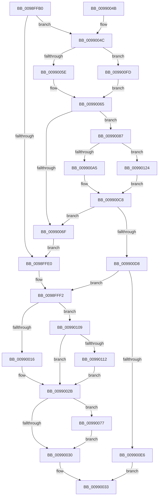

# ExpWnfQueryCurrentUserSID

- RVA: `0x0098FFB0`–`0x00990129` (길이 `377` bytes)
- VA: `0x000000014098FFB0`
- 실행 섹션: `PAGE`
- PDB 이름 있음: `예`; PDB Function 태그: `아니요`
- unwind 정보 RVA: `0x00098B84`
- 디코드: `98`개 명령, `377/377` bytes 표시
- 미해석 바이트: `0` (있으면 어셈블리에 `.byte`로 보존)

> 이 문서는 커널 이미지의 기계어와 PDB 기호를 분석해 생성했습니다. 4번과 5번은 함수 원형과 자료형을 바이너리 사용 방식에서 추정한 C 해석이며 원본 소스 복구 결과는 아닙니다.

## 1. Dependencies

- 직접 호출 지점: **8**; 고유 호출 대상: **7**
- 직접 호출자로 확인된 함수: **1**
- RIP 상대 이미지 참조: **0**

### Outgoing calls
- `0x0098FFE5` → [PsReferencePrimaryTokenWithTag](../../text/20/PsReferencePrimaryTokenWithTag_function_0020FF80.md) (function, `0x0020FF80`)
- `0x00990005` → [SeQueryUserSidToken](../99/SeQueryUserSidToken_function_00990950.md) (function, `0x00990950`)
- `0x00990026` → [ObFastDereferenceObject](../../text/3E/ObFastDereferenceObject_function_003ED5F0.md) (function, `0x003ED5F0`)
- `0x00990096` → [PspLockThreadSecurityShared](../../text/3C/PspLockThreadSecurityShared_function_003C4720.md) (function, `0x003C4720`)
- `0x009900B8` → [ObfReferenceObjectWithTag](../../text/21/ObfReferenceObjectWithTag_function_00210710.md) (function, `0x00210710`)
- `0x009900CE` → [PspUnlockThreadSecurityShared](../../text/3C/PspUnlockThreadSecurityShared_function_003C2E40.md) (function, `0x003C2E40`)
- `0x009900EE` → [ObfDereferenceObjectWithTag](../../text/2F/ObfDereferenceObjectWithTag_function_002F78E0.md) (function, `0x002F78E0`)
- `0x0099011A` → [ObfDereferenceObjectWithTag](../../text/2F/ObfDereferenceObjectWithTag_function_002F78E0.md) (function, `0x002F78E0`)

### Direct callers
- [ExpWnfGetCurrentScopeInstance](ExpWnfGetCurrentScopeInstance_function_0098FE40.md) at `0x0098FEB3`

### Static image references
- 디코드된 RIP-relative 메모리 참조가 없습니다.

## 2. Other-region calls and transfers

- 다른 실행 섹션으로 향하는 call: **7**
  - `0x0098FFE5` → [PsReferencePrimaryTokenWithTag](../../text/20/PsReferencePrimaryTokenWithTag_function_0020FF80.md) (`PAGE` → `.text`)
  - `0x00990026` → [ObFastDereferenceObject](../../text/3E/ObFastDereferenceObject_function_003ED5F0.md) (`PAGE` → `.text`)
  - `0x00990096` → [PspLockThreadSecurityShared](../../text/3C/PspLockThreadSecurityShared_function_003C4720.md) (`PAGE` → `.text`)
  - `0x009900B8` → [ObfReferenceObjectWithTag](../../text/21/ObfReferenceObjectWithTag_function_00210710.md) (`PAGE` → `.text`)
  - `0x009900CE` → [PspUnlockThreadSecurityShared](../../text/3C/PspUnlockThreadSecurityShared_function_003C2E40.md) (`PAGE` → `.text`)
  - `0x009900EE` → [ObfDereferenceObjectWithTag](../../text/2F/ObfDereferenceObjectWithTag_function_002F78E0.md) (`PAGE` → `.text`)
  - `0x0099011A` → [ObfDereferenceObjectWithTag](../../text/2F/ObfDereferenceObjectWithTag_function_002F78E0.md) (`PAGE` → `.text`)
- 별도 외부 분기/꼬리 이동을 확인하지 못했습니다.

## 3. Assembly (complete function range)

```asm
0098FFB0  48 8B C4                        mov rax, rsp
0098FFB3  48 89 58 08                     mov qword ptr [rax + 8], rbx
0098FFB7  48 89 70 10                     mov qword ptr [rax + 0x10], rsi
0098FFBB  4C 89 48 20                     mov qword ptr [rax + 0x20], r9
0098FFBF  4C 89 40 18                     mov qword ptr [rax + 0x18], r8
0098FFC3  57                              push rdi
0098FFC4  41 54                           push r12
0098FFC6  41 55                           push r13
0098FFC8  41 56                           push r14
0098FFCA  41 57                           push r15
0098FFCC  48 83 EC 20                     sub rsp, 0x20
0098FFD0  33 FF                           xor edi, edi
0098FFD2  48 8B F2                        mov rsi, rdx
0098FFD5  4C 8B E9                        mov r13, rcx
0098FFD8  44 8B FF                        mov r15d, edi
0098FFDB  48 85 D2                        test rdx, rdx
0098FFDE  75 6C                           jne 0x14099004c
0098FFE0  BA 53 68 72 74                  mov edx, 0x74726853
0098FFE5  E8 96 FF 87 FF                  call 0x14020ff80
0098FFEA  48 8B D8                        mov rbx, rax
0098FFED  BE 01 00 00 00                  mov esi, 1
0098FFF2  48 8B 44 24 68                  mov rax, qword ptr [rsp + 0x68]
0098FFF7  48 8B CB                        mov rcx, rbx
0098FFFA  48 8B 54 24 60                  mov rdx, qword ptr [rsp + 0x60]
0098FFFF  4C 8B C8                        mov r9, rax
00990002  44 8B 00                        mov r8d, dword ptr [rax]
00990005  E8 46 09 00 00                  call 0x140990950
0099000A  44 8B F0                        mov r14d, eax
0099000D  83 FE 01                        cmp esi, 1
00990010  0F 85 F3 00 00 00               jne 0x140990109
00990016  49 8D 8D 48 02 00 00            lea rcx, [r13 + 0x248]
0099001D  41 B8 53 68 72 74               mov r8d, 0x74726853
00990023  48 8B D3                        mov rdx, rbx
00990026  E8 C5 D5 A5 FF                  call 0x1403ed5f0
0099002B  45 85 F6                        test r14d, r14d
0099002E  79 47                           jns 0x140990077
00990030  41 8B C6                        mov eax, r14d
00990033  48 8B 5C 24 50                  mov rbx, qword ptr [rsp + 0x50]
00990038  48 8B 74 24 58                  mov rsi, qword ptr [rsp + 0x58]
0099003D  48 83 C4 20                     add rsp, 0x20
00990041  41 5F                           pop r15
00990043  41 5E                           pop r14
00990045  41 5D                           pop r13
00990047  41 5C                           pop r12
00990049  5F                              pop rdi
0099004A  C3                              ret
0099004B  CC                              int3
0099004C  65 48 8B 04 25 88 01 00 00      mov rax, qword ptr gs:[0x188]
00990055  48 3B F0                        cmp rsi, rax
00990058  0F 85 9F 00 00 00               jne 0x1409900fd
0099005E  4C 8B B0 B8 00 00 00            mov r14, qword ptr [rax + 0xb8]
00990065  8B 82 A0 05 00 00               mov eax, dword ptr [rdx + 0x5a0]
0099006B  A8 08                           test al, 8
0099006D  75 18                           jne 0x140990087
0099006F  49 8B CE                        mov rcx, r14
00990072  E9 69 FF FF FF                  jmp 0x14098ffe0
00990077  48 8B 44 24 70                  mov rax, qword ptr [rsp + 0x70]
0099007C  83 FE 01                        cmp esi, 1
0099007F  40 0F 94 C7                     sete dil
00990083  89 38                           mov dword ptr [rax], edi
00990085  EB A9                           jmp 0x140990030
00990087  65 4C 8B 24 25 88 01 00 00      mov r12, qword ptr gs:[0x188]
00990090  48 8B CE                        mov rcx, rsi
00990093  49 8B D4                        mov rdx, r12
00990096  E8 85 46 A3 FF                  call 0x1403c4720
0099009B  8B 86 A0 05 00 00               mov eax, dword ptr [rsi + 0x5a0]
009900A1  A8 08                           test al, 8
009900A3  74 7F                           je 0x140990124
009900A5  48 8B 9E 38 05 00 00            mov rbx, qword ptr [rsi + 0x538]
009900AC  BA 53 68 72 74                  mov edx, 0x74726853
009900B1  48 83 E3 F8                     and rbx, 0xfffffffffffffff8
009900B5  48 8B CB                        mov rcx, rbx
009900B8  E8 53 06 88 FF                  call 0x140210710
009900BD  44 8B BE 38 05 00 00            mov r15d, dword ptr [rsi + 0x538]
009900C4  41 83 E7 03                     and r15d, 3
009900C8  49 8B D4                        mov rdx, r12
009900CB  48 8B CE                        mov rcx, rsi
009900CE  E8 6D 2D A3 FF                  call 0x1403c2e40
009900D3  48 85 DB                        test rbx, rbx
009900D6  74 97                           je 0x14099006f
009900D8  BE 02 00 00 00                  mov esi, 2
009900DD  44 3B FE                        cmp r15d, esi
009900E0  0F 83 0C FF FF FF               jae 0x14098fff2
009900E6  BA 53 68 72 74                  mov edx, 0x74726853
009900EB  48 8B CB                        mov rcx, rbx
009900EE  E8 ED 77 96 FF                  call 0x1402f78e0
009900F3  B8 A5 00 00 C0                  mov eax, 0xc00000a5
009900F8  E9 36 FF FF FF                  jmp 0x140990033
009900FD  4C 8B B2 20 02 00 00            mov r14, qword ptr [rdx + 0x220]
00990104  E9 5C FF FF FF                  jmp 0x140990065
00990109  48 85 DB                        test rbx, rbx
0099010C  0F 84 19 FF FF FF               je 0x14099002b
00990112  BA 53 68 72 74                  mov edx, 0x74726853
00990117  48 8B CB                        mov rcx, rbx
0099011A  E8 C1 77 96 FF                  call 0x1402f78e0
0099011F  E9 07 FF FF FF                  jmp 0x14099002b
00990124  48 8B DF                        mov rbx, rdi
00990127  EB 9F                           jmp 0x1409900c8
```

## 4. C-style interpretation (structured pseudocode)

```c
__int64 __fastcall ExpWnfQueryCurrentUserSID(__int64 a1, __int64 a2, __int64 a3, __int64 a4, __int64 a5)
{
    __int64 result;
    __int64 v_r15;
    __int64 v_rbx;
    __int64 v_rdi;
    __int64 v_rsp;
    unsigned __int64 v_stack_p10;
    unsigned __int64 v_stack_p18;
    unsigned __int64 v_stack_p20;
    unsigned __int64 v_stack_p8;

    *(unsigned __int64 *)(v_rsp + 8) = v_rbx;
    *(unsigned __int64 *)(v_rsp + 16) = v_rsi;
    *(unsigned __int64 *)(v_rsp + 32) = a4;
    *(unsigned __int64 *)(v_rsp + 24) = a3;
    v_rsp = (v_rsp) - (32);
    v_rdi = 0;
    if (a2 != 0) goto loc_0099004C;
loc_0098FFE0:
    result = PsReferencePrimaryTokenWithTag(a1, (unsigned int)(0x74726853ULL), a3, a4);
loc_0098FFF2:
    result = SeQueryUserSidToken(result, v_stack_p18, (unsigned int)(*(unsigned int *)(v_stack_p20)), v_stack_p20);
    if (1 != 1) goto loc_00990109;
    result = ObFastDereferenceObject(a1 + 584, result, (unsigned int)(0x74726853ULL), v_stack_p20);
loc_0099002B:
    if (!sign_flag) goto loc_00990077;
loc_00990030:
loc_00990033:
    v_rsp = (v_rsp) + (32);
    return (unsigned int)((unsigned int)((unsigned int)((unsigned int)(result))));
loc_0099004C:
    if (v_stack_p10 != (*(unsigned __int64 *)(gs_base + (0 + 392)))) goto loc_009900FD;
loc_00990065:
    if ((((unsigned __int8)((unsigned int)(*(unsigned int *)(result + 1440)))) & (8)) != 0) goto loc_00990087;
loc_0099006F:
    goto loc_0098FFE0;
loc_00990077:
    v_rdi = (((unsigned int)(v_stack_p10)) == 1) ? 1 : 0;
    *(unsigned int *)(a5) = (unsigned int)(v_rdi);
    goto loc_00990030;
loc_00990087:
    result = PspLockThreadSecurityShared(v_stack_p10, *(unsigned __int64 *)(gs_base + (0 + 392)), (unsigned int)(0x74726853ULL), v_stack_p20);
    if ((((unsigned __int8)((unsigned int)(*(unsigned int *)(v_stack_p10 + 1440)))) & (8)) == 0) goto loc_00990124;
    v_rbx = (*(unsigned __int64 *)(v_stack_p10 + 1336)) & (-8);
    result = ObfReferenceObjectWithTag(v_rbx, (unsigned int)(0x74726853ULL), (unsigned int)(0x74726853ULL), v_stack_p20);
    v_r15 = (unsigned int)(((unsigned int)(*(unsigned int *)(v_stack_p10 + 1336))) & (3));
loc_009900C8:
    result = PspUnlockThreadSecurityShared(v_stack_p10, *(unsigned __int64 *)(gs_base + (0 + 392)), (unsigned int)(0x74726853ULL), v_stack_p20);
    if (v_rbx == 0) goto loc_0099006F;
    if (((unsigned int)(v_r15)) >= 2) goto loc_0098FFF2;
    result = ObfDereferenceObjectWithTag(v_rbx, (unsigned int)(0x74726853ULL), (unsigned int)(0x74726853ULL), v_stack_p20);
    goto loc_00990033;
loc_009900FD:
    goto loc_00990065;
loc_00990109:
    if (v_rbx == 0) goto loc_0099002B;
    result = ObfDereferenceObjectWithTag(v_rbx, (unsigned int)(0x74726853ULL), (unsigned int)(0x74726853ULL), v_stack_p20);
    goto loc_0099002B;
loc_00990124:
    goto loc_009900C8;
}
```

## 5. (Beta) C Style

```c
int64_t ExpWnfQueryCurrentUserSID(void *Arg1, int64_t Arg2, int64_t Arg3, int64_t Arg4, void *Arg5)
{
    uint8_t *arg1 = (uint8_t *)Arg1;
    uint8_t *arg5 = (uint8_t *)Arg5;

    int64_t result;
    int64_t local_r15;
    int64_t local_rbx;
    int64_t local_rdi;
    int64_t local_rsp;
    uint64_t v_stack_p10;
    uint64_t v_stack_p18;
    uint64_t v_stack_p20;
    uint64_t v_stack_p8;

    *(uint64_t *)(local_rsp + 0x8) = local_rbx;
    *(uint64_t *)(local_rsp + 0x10) = local_rsi;
    *(uint64_t *)(local_rsp + 0x20) = Arg4;
    *(uint64_t *)(local_rsp + 0x18) = Arg3;
    local_rsp = (local_rsp) - (32);
    local_rdi = 0;
    if (Arg2 != 0) goto loc_0099004C;
loc_0098FFE0:
    result = PsReferencePrimaryTokenWithTag(Arg1, (uint32_t)(0x74726853ULL), Arg3, Arg4);
loc_0098FFF2:
    result = SeQueryUserSidToken(result, v_stack_p18, (uint32_t)(*(uint32_t *)(v_stack_p20)), v_stack_p20);
    if (1 != 1) goto loc_00990109;
    result = ObFastDereferenceObject(Arg1 + 584, result, (uint32_t)(0x74726853ULL), v_stack_p20);
loc_0099002B:
    if (!sign_flag) goto loc_00990077;
loc_00990030:
loc_00990033:
    local_rsp = (local_rsp) + (32);
    return (uint32_t)((uint32_t)((uint32_t)((uint32_t)(result))));
loc_0099004C:
    if (v_stack_p10 != (*(uint64_t *)(gs_base + (0 + 0x188)))) goto loc_009900FD;
loc_00990065:
    if ((((uint8_t)((uint32_t)(*(uint32_t *)(result + 0x5A0)))) & (8)) != 0) goto loc_00990087;
loc_0099006F:
    goto loc_0098FFE0;
loc_00990077:
    local_rdi = (((uint32_t)(v_stack_p10)) == 1) ? 1 : 0;
    *(uint32_t *)(arg5) = (uint32_t)(local_rdi);
    goto loc_00990030;
loc_00990087:
    result = PspLockThreadSecurityShared(v_stack_p10, *(uint64_t *)(gs_base + (0 + 0x188)), (uint32_t)(0x74726853ULL), v_stack_p20);
    if ((((uint8_t)((uint32_t)(*(uint32_t *)(v_stack_p10 + 0x5A0)))) & (8)) == 0) goto loc_00990124;
    local_rbx = (*(uint64_t *)(v_stack_p10 + 0x538)) & (-8);
    result = ObfReferenceObjectWithTag(local_rbx, (uint32_t)(0x74726853ULL), (uint32_t)(0x74726853ULL), v_stack_p20);
    local_r15 = (uint32_t)(((uint32_t)(*(uint32_t *)(v_stack_p10 + 0x538))) & (3));
loc_009900C8:
    result = PspUnlockThreadSecurityShared(v_stack_p10, *(uint64_t *)(gs_base + (0 + 0x188)), (uint32_t)(0x74726853ULL), v_stack_p20);
    if (local_rbx == 0) goto loc_0099006F;
    if (((uint32_t)(local_r15)) >= 2) goto loc_0098FFF2;
    result = ObfDereferenceObjectWithTag(local_rbx, (uint32_t)(0x74726853ULL), (uint32_t)(0x74726853ULL), v_stack_p20);
    goto loc_00990033;
loc_009900FD:
    goto loc_00990065;
loc_00990109:
    if (local_rbx == 0) goto loc_0099002B;
    result = ObfDereferenceObjectWithTag(local_rbx, (uint32_t)(0x74726853ULL), (uint32_t)(0x74726853ULL), v_stack_p20);
    goto loc_0099002B;
loc_00990124:
    goto loc_009900C8;
}
```

### 관측된 메모리 오프셋

구조체 형식이 확인되지 않은 접근은 인자 기준의 오프셋으로만 기록했습니다.

| 기준 인자 | 오프셋 표현 | 폭 (bit) | 접근 |
|---|---:|---:|---|
| `Arg1` | `+ 0x248` | `64` | `R` |
| `Arg5` | `+ 0x0` | `32` | `W` |

## 6. Execution-region graph

[열기: 2D/3D 그래프와 함수 탐색 컨트롤 패널](../../../control-panel.html?section=page&rva=0x0098FFB0&view=graph)

- 2D 그래프는 위에서 아래로 흐르고, 3D 그래프는 빈 공간을 드래그해 회전합니다. Shift+드래그는 이동, 휠은 확대·축소, 함수 노드 선택은 대상 보고서 이동입니다.

### Static fallback


