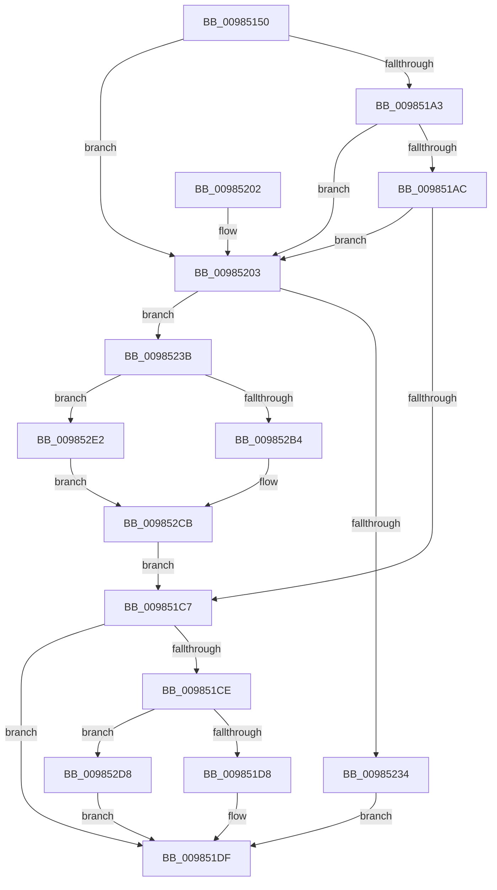

# FsRtlGetFileSize

- RVA: `0x00985150`–`0x009852EF` (길이 `415` bytes)
- VA: `0x0000000140985150`
- 실행 섹션: `PAGE`
- PDB 이름 있음: `예`; PDB Function 태그: `아니요`
- unwind 정보 RVA: `0x00097BEC`
- 디코드: `114`개 명령, `415/415` bytes 표시
- 미해석 바이트: `0` (있으면 어셈블리에 `.byte`로 보존)

> 이 문서는 커널 이미지의 기계어와 PDB 기호를 분석해 생성했습니다. 4번과 5번은 함수 원형과 자료형을 바이너리 사용 방식에서 추정한 C 해석이며 원본 소스 복구 결과는 아닙니다.

## 1. Dependencies

- 직접 호출 지점: **9**; 고유 호출 대상: **8**
- 직접 호출자로 확인된 함수: **7**
- RIP 상대 이미지 참조: **1**

### Outgoing calls
- `0x0098518E` → [IoGetRelatedDeviceObject](../../text/29/IoGetRelatedDeviceObject_function_0029B120.md) (function, `0x0029B120`)
- `0x009851BE` → [guard_dispatch_icall](../../text/6B/guard_dispatch_icall_function_006BAAD0.md) (function, `0x006BAAD0`)
- `0x009851E6` → [_security_check_cookie](../../text/6A/_security_check_cookie_function_006AC640.md) (function, `0x006AC640`)
- `0x00985219` → [KeInitializeEvent](../../text/40/KeInitializeEvent_function_0040DD10.md) (function, `0x0040DD10`)
- `0x00985227` → [IoAllocateIrpEx](../../text/20/IoAllocateIrpEx_function_00207510.md) (function, `0x00207510`)
- `0x0098523D` → [IoSetThreadHardErrorMode](../../text/46/IoSetThreadHardErrorMode_function_00466BF0.md) (function, `0x00466BF0`)
- `0x009852A6` → [IofCallDriver](../../text/29/IofCallDriver_function_0029B4B0.md) (function, `0x0029B4B0`)
- `0x009852C6` → [KeWaitForSingleObject](../../text/20/KeWaitForSingleObject_function_0020E6B0.md) (function, `0x0020E6B0`)
- `0x009852CE` → [IoSetThreadHardErrorMode](../../text/46/IoSetThreadHardErrorMode_function_00466BF0.md) (function, `0x00466BF0`)

### Direct callers
- [FsRtlCreateSectionForDataScan](../../text/45/FsRtlCreateSectionForDataScan_function_00453330.md) at `0x004533FD`
- [ExpQueryElamCertInfo](../7C/ExpQueryElamCertInfo_function_007C4564.md) at `0x007C4649`
- [MmExtendSection](MmExtendSection_function_00982C38.md) at `0x00982DFC`
- [MiCreateDataFileMap](MiCreateDataFileMap_function_00983494.md) at `0x0098375E`
- [MiShareExistingControlArea](MiShareExistingControlArea_function_00984FAC.md) at `0x00985015`
- [MiCreateImageFileMap](MiCreateImageFileMap_function_00986830.md) at `0x009868C1`
- [sub_00B4433C](../B4/Unknown_function_00B4433C.md) at `0x00B44356`

### Static image references
- `0x00985166` → RVA `0x00E0A740` (`.data`; read)

## 2. Other-region calls and transfers

- 다른 실행 섹션으로 향하는 call: **9**
  - `0x0098518E` → [IoGetRelatedDeviceObject](../../text/29/IoGetRelatedDeviceObject_function_0029B120.md) (`PAGE` → `.text`)
  - `0x009851BE` → [guard_dispatch_icall](../../text/6B/guard_dispatch_icall_function_006BAAD0.md) (`PAGE` → `.text`)
  - `0x009851E6` → [_security_check_cookie](../../text/6A/_security_check_cookie_function_006AC640.md) (`PAGE` → `.text`)
  - `0x00985219` → [KeInitializeEvent](../../text/40/KeInitializeEvent_function_0040DD10.md) (`PAGE` → `.text`)
  - `0x00985227` → [IoAllocateIrpEx](../../text/20/IoAllocateIrpEx_function_00207510.md) (`PAGE` → `.text`)
  - `0x0098523D` → [IoSetThreadHardErrorMode](../../text/46/IoSetThreadHardErrorMode_function_00466BF0.md) (`PAGE` → `.text`)
  - `0x009852A6` → [IofCallDriver](../../text/29/IofCallDriver_function_0029B4B0.md) (`PAGE` → `.text`)
  - `0x009852C6` → [KeWaitForSingleObject](../../text/20/KeWaitForSingleObject_function_0020E6B0.md) (`PAGE` → `.text`)
  - `0x009852CE` → [IoSetThreadHardErrorMode](../../text/46/IoSetThreadHardErrorMode_function_00466BF0.md) (`PAGE` → `.text`)
- 별도 외부 분기/꼬리 이동을 확인하지 못했습니다.

## 3. Assembly (complete function range)

```asm
00985150  48 89 5C 24 18                  mov qword ptr [rsp + 0x18], rbx
00985155  55                              push rbp
00985156  56                              push rsi
00985157  57                              push rdi
00985158  41 56                           push r14
0098515A  41 57                           push r15
0098515C  48 8B EC                        mov rbp, rsp
0098515F  48 81 EC 80 00 00 00            sub rsp, 0x80
00985166  48 8B 05 D3 55 48 00            mov rax, qword ptr [rip + 0x4855d3]
0098516D  48 33 C4                        xor rax, rsp
00985170  48 89 45 F0                     mov qword ptr [rbp - 0x10], rax
00985174  0F 57 C0                        xorps xmm0, xmm0
00985177  0F 57 C9                        xorps xmm1, xmm1
0098517A  33 C0                           xor eax, eax
0098517C  4C 8B FA                        mov r15, rdx
0098517F  0F 11 45 B0                     movups xmmword ptr [rbp - 0x50], xmm0
00985183  48 89 45 E8                     mov qword ptr [rbp - 0x18], rax
00985187  48 8B F1                        mov rsi, rcx
0098518A  0F 11 4D D8                     movups xmmword ptr [rbp - 0x28], xmm1
0098518E  E8 8D 5F 91 FF                  call 0x14029b120
00985193  48 8B F8                        mov rdi, rax
00985196  48 8B 48 08                     mov rcx, qword ptr [rax + 8]
0098519A  48 8B 41 50                     mov rax, qword ptr [rcx + 0x50]
0098519E  48 85 C0                        test rax, rax
009851A1  74 60                           je 0x140985203
009851A3  48 8B 40 28                     mov rax, qword ptr [rax + 0x28]
009851A7  48 85 C0                        test rax, rax
009851AA  74 57                           je 0x140985203
009851AC  4C 8D 4D B0                     lea r9, [rbp - 0x50]
009851B0  48 89 7C 24 20                  mov qword ptr [rsp + 0x20], rdi
009851B5  4C 8D 45 D8                     lea r8, [rbp - 0x28]
009851B9  B2 01                           mov dl, 1
009851BB  48 8B CE                        mov rcx, rsi
009851BE  E8 0D 59 D3 FF                  call 0x1406baad0
009851C3  84 C0                           test al, al
009851C5  74 3C                           je 0x140985203
009851C7  8B 45 B0                        mov eax, dword ptr [rbp - 0x50]
009851CA  85 C0                           test eax, eax
009851CC  78 11                           js 0x1409851df
009851CE  80 7D ED 00                     cmp byte ptr [rbp - 0x13], 0
009851D2  0F 85 00 01 00 00               jne 0x1409852d8
009851D8  48 8B 4D E0                     mov rcx, qword ptr [rbp - 0x20]
009851DC  49 89 0F                        mov qword ptr [r15], rcx
009851DF  48 8B 4D F0                     mov rcx, qword ptr [rbp - 0x10]
009851E3  48 33 CC                        xor rcx, rsp
009851E6  E8 55 74 D2 FF                  call 0x1406ac640
009851EB  48 8B 9C 24 C0 00 00 00         mov rbx, qword ptr [rsp + 0xc0]
009851F3  48 81 C4 80 00 00 00            add rsp, 0x80
009851FA  41 5F                           pop r15
009851FC  41 5E                           pop r14
009851FE  5F                              pop rdi
009851FF  5E                              pop rsi
00985200  5D                              pop rbp
00985201  C3                              ret
00985202  CC                              int3
00985203  0F 57 C0                        xorps xmm0, xmm0
00985206  48 8D 4D C0                     lea rcx, [rbp - 0x40]
0098520A  33 C0                           xor eax, eax
0098520C  45 33 C0                        xor r8d, r8d
0098520F  33 D2                           xor edx, edx
00985211  48 89 45 D0                     mov qword ptr [rbp - 0x30], rax
00985215  0F 11 45 C0                     movups xmmword ptr [rbp - 0x40], xmm0
00985219  E8 F2 8A A8 FF                  call 0x14040dd10
0098521E  8A 57 4C                        mov dl, byte ptr [rdi + 0x4c]
00985221  45 33 C0                        xor r8d, r8d
00985224  48 8B CF                        mov rcx, rdi
00985227  E8 E4 22 88 FF                  call 0x140207510
0098522C  48 8B D8                        mov rbx, rax
0098522F  48 85 C0                        test rax, rax
00985232  75 07                           jne 0x14098523b
00985234  B8 9A 00 00 C0                  mov eax, 0xc000009a
00985239  EB A4                           jmp 0x1409851df
0098523B  33 C9                           xor ecx, ecx
0098523D  E8 AE 19 AE FF                  call 0x140466bf0
00985242  48 8B 93 B8 00 00 00            mov rdx, qword ptr [rbx + 0xb8]
00985249  44 8A F0                        mov r14b, al
0098524C  C7 43 10 42 00 00 00            mov dword ptr [rbx + 0x10], 0x42
00985253  48 8D 45 B0                     lea rax, [rbp - 0x50]
00985257  48 89 43 48                     mov qword ptr [rbx + 0x48], rax
0098525B  48 8D 45 C0                     lea rax, [rbp - 0x40]
0098525F  48 89 43 50                     mov qword ptr [rbx + 0x50], rax
00985263  48 8D 45 D8                     lea rax, [rbp - 0x28]
00985267  C6 43 40 00                     mov byte ptr [rbx + 0x40], 0
0098526B  48 89 B3 C0 00 00 00            mov qword ptr [rbx + 0xc0], rsi
00985272  65 48 8B 0C 25 88 01 00 00      mov rcx, qword ptr gs:[0x188]
0098527B  48 89 8B 98 00 00 00            mov qword ptr [rbx + 0x98], rcx
00985282  48 8B CF                        mov rcx, rdi
00985285  48 89 43 18                     mov qword ptr [rbx + 0x18], rax
00985289  C6 42 B8 05                     mov byte ptr [rdx - 0x48], 5
0098528D  48 89 72 E8                     mov qword ptr [rdx - 0x18], rsi
00985291  48 89 7A E0                     mov qword ptr [rdx - 0x20], rdi
00985295  C7 42 C0 18 00 00 00            mov dword ptr [rdx - 0x40], 0x18
0098529C  C7 42 C8 05 00 00 00            mov dword ptr [rdx - 0x38], 5
009852A3  48 8B D3                        mov rdx, rbx
009852A6  E8 05 62 91 FF                  call 0x14029b4b0
009852AB  8B C8                           mov ecx, eax
009852AD  3D 03 01 00 00                  cmp eax, 0x103
009852B2  75 2E                           jne 0x1409852e2
009852B4  48 83 64 24 20 00               and qword ptr [rsp + 0x20], 0
009852BA  48 8D 4D C0                     lea rcx, [rbp - 0x40]
009852BE  45 33 C9                        xor r9d, r9d
009852C1  45 33 C0                        xor r8d, r8d
009852C4  33 D2                           xor edx, edx
009852C6  E8 E5 93 88 FF                  call 0x14020e6b0
009852CB  41 8A CE                        mov cl, r14b
009852CE  E8 1D 19 AE FF                  call 0x140466bf0
009852D3  E9 EF FE FF FF                  jmp 0x1409851c7
009852D8  B8 BA 00 00 C0                  mov eax, 0xc00000ba
009852DD  E9 FD FE FF FF                  jmp 0x1409851df
009852E2  8B 45 B0                        mov eax, dword ptr [rbp - 0x50]
009852E5  85 C9                           test ecx, ecx
009852E7  0F 48 C1                        cmovs eax, ecx
009852EA  89 45 B0                        mov dword ptr [rbp - 0x50], eax
009852ED  EB DC                           jmp 0x1409852cb
```

## 4. C-style interpretation (structured pseudocode)

```c
__int64 __fastcall FsRtlGetFileSize(__int64 a1, __int64 a2)
{
    __int64 result;
    __int64 v_rsp;
    unsigned __int64 v_stack_m38;
    unsigned __int8 v_stack_m3B;
    unsigned __int64 v_stack_m40;
    unsigned __int64 v_stack_m48;
    unsigned __int64 v_stack_m50;
    unsigned __int64 v_stack_m58;
    unsigned __int64 v_stack_m68;
    unsigned __int64 v_stack_m78;
    unsigned __int64 v_stack_m88;
    unsigned __int64 v_stack_p18;
    unsigned __int64 v_stack_p20;

    v_stack_p18 = v_rbx;
    v_rsp = (v_rsp) - (128);
    result = (*(unsigned __int64 *)(v_rip + 4740563)) ^ (v_rsp);
    v_stack_m38 = result;
    result = 0;
    v_stack_m78 = v_xmm0;
    v_stack_m40 = 0;
    v_stack_m50 = v_xmm1;
    result = IoGetRelatedDeviceObject(a1, a2, a3, a4);
    if (*(unsigned __int64 *)(*(unsigned __int64 *)(result + 8) + 80) == 0) goto loc_00985203;
    if (*(unsigned __int64 *)(*(unsigned __int64 *)(*(unsigned __int64 *)(result + 8) + 80) + 40) == 0) goto loc_00985203;
    v_stack_m88 = result;
    result = guard_dispatch_icall(a1, 1, v_stack_m50, v_stack_m78);
    if ((unsigned __int8)(result) == 0) goto loc_00985203;
loc_009851C7:
    if (sign_flag) goto loc_009851DF;
    if (v_stack_m3B != 0) goto loc_009852D8;
    *(unsigned __int64 *)(a2) = v_stack_m48;
loc_009851DF:
    a1 = (v_stack_m38) ^ (v_rsp);
    result = _security_check_cookie(a1, 1, v_stack_m50, v_stack_m78);
    v_rsp = (v_rsp) + (128);
    return result;
loc_00985203:
    result = 0;
    a3 = 0;
    a2 = 0;
    v_stack_m58 = 0;
    v_stack_m68 = v_xmm0;
    result = KeInitializeEvent(v_stack_m68, a2, a3, v_stack_m78);
    a3 = 0;
    result = IoAllocateIrpEx(result, *(unsigned __int8 *)(result + 76), a3, v_stack_m78);
    if (result != 0) goto loc_0098523B;
    goto loc_009851DF;
loc_0098523B:
    a1 = 0;
    result = IoSetThreadHardErrorMode(a1, *(unsigned __int8 *)(result + 76), a3, v_stack_m78);
    *(unsigned int *)(result + 16) = 66;
    *(unsigned __int64 *)(result + 72) = v_stack_m78;
    *(unsigned __int64 *)(result + 80) = v_stack_m68;
    *(unsigned __int8 *)(result + 64) = 0;
    *(unsigned __int64 *)(result + 192) = 0;
    *(unsigned __int64 *)(result + 152) = *(unsigned __int64 *)(gs_base + (0 + 392));
    *(unsigned __int64 *)(result + 24) = v_stack_m50;
    *(unsigned __int8 *)(*(unsigned __int64 *)(result + 184) - 72) = 5;
    *(unsigned __int64 *)(*(unsigned __int64 *)(result + 184) - 24) = 0;
    *(unsigned __int64 *)(*(unsigned __int64 *)(result + 184) - 32) = result;
    *(unsigned int *)(*(unsigned __int64 *)(result + 184) - 64) = 24;
    *(unsigned int *)(*(unsigned __int64 *)(result + 184) - 56) = 5;
    result = IofCallDriver(result, result, a3, v_stack_m78);
    if (((unsigned int)(result)) != 259) goto loc_009852E2;
    a4 = 0;
    a3 = 0;
    a2 = 0;
    result = KeWaitForSingleObject(v_stack_m68, a2, a3, a4);
loc_009852CB:
    result = IoSetThreadHardErrorMode((unsigned __int8)((unsigned __int8)(result)), a2, a3, a4);
    goto loc_009851C7;
loc_009852D8:
    goto loc_009851DF;
loc_009852E2:
    result = (unsigned int)(v_stack_m78);
    if (sign_flag) { result = (unsigned int)((unsigned __int8)((unsigned __int8)(result))); }
    v_stack_m78 = (unsigned int)(result);
    goto loc_009852CB;
}
```

## 5. (Beta) C Style

```c
int64_t FsRtlGetFileSize(int64_t Arg1, void *Arg2)
{
    uint8_t *arg2 = (uint8_t *)Arg2;

    int64_t result;
    int64_t local_rsp;
    uint64_t v_stack_m38;
    uint8_t v_stack_m3B;
    uint64_t v_stack_m40;
    uint64_t v_stack_m48;
    uint64_t v_stack_m50;
    uint64_t v_stack_m58;
    uint64_t v_stack_m68;
    uint64_t v_stack_m78;
    uint64_t v_stack_m88;
    uint64_t v_stack_p18;
    uint64_t v_stack_p20;

    v_stack_p18 = local_rbx;
    local_rsp = (local_rsp) - (128);
    result = (*(uint64_t *)(v_rip + 0x4855D3)) ^ (local_rsp);
    v_stack_m38 = result;
    result = 0;
    v_stack_m78 = v_xmm0;
    v_stack_m40 = 0;
    v_stack_m50 = v_xmm1;
    result = IoGetRelatedDeviceObject(Arg1, Arg2, a3, a4);
    if (*(uint64_t *)(*(uint64_t *)(result + 0x8) + 0x50) == 0) goto loc_00985203;
    if (*(uint64_t *)(*(uint64_t *)(*(uint64_t *)(result + 0x8) + 0x50) + 0x28) == 0) goto loc_00985203;
    v_stack_m88 = result;
    result = guard_dispatch_icall(Arg1, 1, v_stack_m50, v_stack_m78);
    if ((uint8_t)(result) == 0) goto loc_00985203;
loc_009851C7:
    if (sign_flag) goto loc_009851DF;
    if (v_stack_m3B != 0) goto loc_009852D8;
    *(uint64_t *)(arg2) = v_stack_m48;
loc_009851DF:
    Arg1 = (v_stack_m38) ^ (local_rsp);
    result = _security_check_cookie(Arg1, 1, v_stack_m50, v_stack_m78);
    local_rsp = (local_rsp) + (128);
    return result;
loc_00985203:
    result = 0;
    a3 = 0;
    Arg2 = 0;
    v_stack_m58 = 0;
    v_stack_m68 = v_xmm0;
    result = KeInitializeEvent(v_stack_m68, Arg2, a3, v_stack_m78);
    a3 = 0;
    result = IoAllocateIrpEx(result, *(uint8_t *)(result + 0x4C), a3, v_stack_m78);
    if (result != 0) goto loc_0098523B;
    goto loc_009851DF;
loc_0098523B:
    Arg1 = 0;
    result = IoSetThreadHardErrorMode(Arg1, *(uint8_t *)(result + 0x4C), a3, v_stack_m78);
    *(uint32_t *)(result + 0x10) = 66;
    *(uint64_t *)(result + 0x48) = v_stack_m78;
    *(uint64_t *)(result + 0x50) = v_stack_m68;
    *(uint8_t *)(result + 0x40) = 0;
    *(uint64_t *)(result + 0xC0) = 0;
    *(uint64_t *)(result + 0x98) = *(uint64_t *)(gs_base + (0 + 0x188));
    *(uint64_t *)(result + 0x18) = v_stack_m50;
    *(uint8_t *)(*(uint64_t *)(result + 0xB8) - 0x48) = 5;
    *(uint64_t *)(*(uint64_t *)(result + 0xB8) - 0x18) = 0;
    *(uint64_t *)(*(uint64_t *)(result + 0xB8) - 0x20) = result;
    *(uint32_t *)(*(uint64_t *)(result + 0xB8) - 0x40) = 24;
    *(uint32_t *)(*(uint64_t *)(result + 0xB8) - 0x38) = 5;
    result = IofCallDriver(result, result, a3, v_stack_m78);
    if (((uint32_t)(result)) != 259) goto loc_009852E2;
    a4 = 0;
    a3 = 0;
    Arg2 = 0;
    result = KeWaitForSingleObject(v_stack_m68, Arg2, a3, a4);
loc_009852CB:
    result = IoSetThreadHardErrorMode((uint8_t)((uint8_t)(result)), Arg2, a3, a4);
    goto loc_009851C7;
loc_009852D8:
    goto loc_009851DF;
loc_009852E2:
    result = (uint32_t)(v_stack_m78);
    if (sign_flag) { result = (uint32_t)((uint8_t)((uint8_t)(result))); }
    v_stack_m78 = (uint32_t)(result);
    goto loc_009852CB;
}
```

### 관측된 메모리 오프셋

구조체 형식이 확인되지 않은 접근은 인자 기준의 오프셋으로만 기록했습니다.

| 기준 인자 | 오프셋 표현 | 폭 (bit) | 접근 |
|---|---:|---:|---|
| `Arg2` | `+ 0x0` | `64` | `W` |

## 6. Execution-region graph

[열기: 2D/3D 그래프와 함수 탐색 컨트롤 패널](../../../control-panel.html?section=page&rva=0x00985150&view=graph)

- 2D 그래프는 위에서 아래로 흐르고, 3D 그래프는 빈 공간을 드래그해 회전합니다. Shift+드래그는 이동, 휠은 확대·축소, 함수 노드 선택은 대상 보고서 이동입니다.

### Static fallback


