# FsRtlReleaseFile

- RVA: `0x00985B70`–`0x00985DA7` (길이 `567` bytes)
- VA: `0x0000000140985B70`
- 실행 섹션: `PAGE`
- PDB 이름 있음: `예`; PDB Function 태그: `아니요`
- unwind 정보 RVA: `0x00097C48`
- 디코드: `149`개 명령, `567/567` bytes 표시
- 미해석 바이트: `0` (있으면 어셈블리에 `.byte`로 보존)

> 이 문서는 커널 이미지의 기계어와 PDB 기호를 분석해 생성했습니다. 4번과 5번은 함수 원형과 자료형을 바이너리 사용 방식에서 추정한 C 해석이며 원본 소스 복구 결과는 아닙니다.

## 1. Dependencies

- 직접 호출 지점: **13**; 고유 호출 대상: **13**
- 직접 호출자로 확인된 함수: **8**
- RIP 상대 이미지 참조: **1**

### Outgoing calls
- `0x00985BB1` → [memset](../../text/6C/memset_function_006C6C40.md) (function, `0x006C6C40`)
- `0x00985BC7` → [IoGetRelatedDeviceObject](../../text/29/IoGetRelatedDeviceObject_function_0029B120.md) (function, `0x0029B120`)
- `0x00985BD2` → [IoGetBaseFileSystemDeviceObject](../../text/29/IoGetBaseFileSystemDeviceObject_function_0029A2A0.md) (function, `0x0029A2A0`)
- `0x00985C2E` → [FsFilterCtrlInit](../../text/43/FsFilterCtrlInit_function_004364A0.md) (function, `0x004364A0`)
- `0x00985C42` → [FsFilterPerformCallbacks](../../text/29/FsFilterPerformCallbacks_function_00299590.md) (function, `0x00299590`)
- `0x00985CA7` → [guard_dispatch_icall](../../text/6B/guard_dispatch_icall_function_006BAAD0.md) (function, `0x006BAAD0`)
- `0x00985CD5` → [FsFilterPerformCompletionCallbacks](../../text/29/FsFilterPerformCompletionCallbacks_function_00299000.md) (function, `0x00299000`)
- `0x00985CDF` → [FsFilterCtrlFree](../../text/29/FsFilterCtrlFree_function_0029908C.md) (function, `0x0029908C`)
- `0x00985CED` → [KeLeaveCriticalRegionThread](../../text/25/KeLeaveCriticalRegionThread_function_0025EFF0.md) (function, `0x0025EFF0`)
- `0x00985CFD` → [_security_check_cookie](../../text/6A/_security_check_cookie_function_006AC640.md) (function, `0x006AC640`)
- `0x00985D44` → [ExReleaseResourceLite](../../text/25/ExReleaseResourceLite_function_0025FA10.md) (function, `0x0025FA10`)
- `0x00985D7A` → [IoGetDeviceAttachmentBaseRef](../../text/27/IoGetDeviceAttachmentBaseRef_function_00272710.md) (function, `0x00272710`)
- `0x00985D9D` → [ObfDereferenceObject](../../text/2F/ObfDereferenceObject_function_002F9350.md) (function, `0x002F9350`)

### Direct callers
- [MiReferenceControlArea](../../text/2B/MiReferenceControlArea_function_002BC198.md) at `0x002BC480`
- [MiReferenceControlArea](../../text/2B/MiReferenceControlArea_function_002BC198.md) at `0x002BC511`
- [CcDeleteSharedCacheMap](../../text/38/CcDeleteSharedCacheMap_function_0038A804.md) at `0x0038A9AC`
- [FsRtlCreateSectionForDataScan](../../text/45/FsRtlCreateSectionForDataScan_function_00453330.md) at `0x0045348A`
- [CcZeroEndOfLastPage](../../text/45/CcZeroEndOfLastPage_function_00453584.md) at `0x00453619`
- [sub_006E2B2A](../../text/6E/Unknown_function_006E2B2A.md) at `0x006E2B53`
- [MiCallCreateSectionFilters](MiCallCreateSectionFilters_function_00984EB8.md) at `0x00984F2E`
- [MiShareExistingControlArea](MiShareExistingControlArea_function_00984FAC.md) at `0x0098502B`
- [MiShareExistingControlArea](MiShareExistingControlArea_function_00984FAC.md) at `0x0098508C`
- [MiShareExistingControlArea](MiShareExistingControlArea_function_00984FAC.md) at `0x0098513B`
- [MiCreateNewSection](MiCreateNewSection_function_00985DB0.md) at `0x00985F7F`
- [MiCreateNewSection](MiCreateNewSection_function_00985DB0.md) at `0x00986260`
- [MiCreateNewSection](MiCreateNewSection_function_00985DB0.md) at `0x009862A5`
- [MiCreateNewSection](MiCreateNewSection_function_00985DB0.md) at `0x009862CB`

### Static image references
- `0x00985B8F` → RVA `0x00E0A740` (`.data`; read)

## 2. Other-region calls and transfers

- 다른 실행 섹션으로 향하는 call: **13**
  - `0x00985BB1` → [memset](../../text/6C/memset_function_006C6C40.md) (`PAGE` → `.text`)
  - `0x00985BC7` → [IoGetRelatedDeviceObject](../../text/29/IoGetRelatedDeviceObject_function_0029B120.md) (`PAGE` → `.text`)
  - `0x00985BD2` → [IoGetBaseFileSystemDeviceObject](../../text/29/IoGetBaseFileSystemDeviceObject_function_0029A2A0.md) (`PAGE` → `.text`)
  - `0x00985C2E` → [FsFilterCtrlInit](../../text/43/FsFilterCtrlInit_function_004364A0.md) (`PAGE` → `.text`)
  - `0x00985C42` → [FsFilterPerformCallbacks](../../text/29/FsFilterPerformCallbacks_function_00299590.md) (`PAGE` → `.text`)
  - `0x00985CA7` → [guard_dispatch_icall](../../text/6B/guard_dispatch_icall_function_006BAAD0.md) (`PAGE` → `.text`)
  - `0x00985CD5` → [FsFilterPerformCompletionCallbacks](../../text/29/FsFilterPerformCompletionCallbacks_function_00299000.md) (`PAGE` → `.text`)
  - `0x00985CDF` → [FsFilterCtrlFree](../../text/29/FsFilterCtrlFree_function_0029908C.md) (`PAGE` → `.text`)
  - `0x00985CED` → [KeLeaveCriticalRegionThread](../../text/25/KeLeaveCriticalRegionThread_function_0025EFF0.md) (`PAGE` → `.text`)
  - `0x00985CFD` → [_security_check_cookie](../../text/6A/_security_check_cookie_function_006AC640.md) (`PAGE` → `.text`)
  - `0x00985D44` → [ExReleaseResourceLite](../../text/25/ExReleaseResourceLite_function_0025FA10.md) (`PAGE` → `.text`)
  - `0x00985D7A` → [IoGetDeviceAttachmentBaseRef](../../text/27/IoGetDeviceAttachmentBaseRef_function_00272710.md) (`PAGE` → `.text`)
  - `0x00985D9D` → [ObfDereferenceObject](../../text/2F/ObfDereferenceObject_function_002F9350.md) (`PAGE` → `.text`)
- 별도 외부 분기/꼬리 이동을 확인하지 못했습니다.

## 3. Assembly (complete function range)

```asm
00985B70  48 89 5C 24 10                  mov qword ptr [rsp + 0x10], rbx
00985B75  48 89 6C 24 18                  mov qword ptr [rsp + 0x18], rbp
00985B7A  48 89 74 24 20                  mov qword ptr [rsp + 0x20], rsi
00985B7F  57                              push rdi
00985B80  41 54                           push r12
00985B82  41 55                           push r13
00985B84  41 56                           push r14
00985B86  41 57                           push r15
00985B88  48 81 EC 90 02 00 00            sub rsp, 0x290
00985B8F  48 8B 05 AA 4B 48 00            mov rax, qword ptr [rip + 0x484baa]
00985B96  48 33 C4                        xor rax, rsp
00985B99  48 89 84 24 80 02 00 00         mov qword ptr [rsp + 0x280], rax
00985BA1  4C 8B F1                        mov r14, rcx
00985BA4  33 D2                           xor edx, edx
00985BA6  48 8D 4C 24 40                  lea rcx, [rsp + 0x40]
00985BAB  41 B8 38 02 00 00               mov r8d, 0x238
00985BB1  E8 8A 10 D4 FF                  call 0x1406c6c40
00985BB6  33 ED                           xor ebp, ebp
00985BB8  48 8D 7C 24 40                  lea rdi, [rsp + 0x40]
00985BBD  49 8B CE                        mov rcx, r14
00985BC0  89 6C 24 30                     mov dword ptr [rsp + 0x30], ebp
00985BC4  45 32 E4                        xor r12b, r12b
00985BC7  E8 54 55 91 FF                  call 0x14029b120
00985BCC  49 8B CE                        mov rcx, r14
00985BCF  4C 8B F8                        mov r15, rax
00985BD2  E8 C9 46 91 FF                  call 0x14029a2a0
00985BD7  4C 8B E8                        mov r13, rax
00985BDA  48 8B 58 08                     mov rbx, qword ptr [rax + 8]
00985BDE  48 8B 73 50                     mov rsi, qword ptr [rbx + 0x50]
00985BE2  48 8B 5B 30                     mov rbx, qword ptr [rbx + 0x30]
00985BE6  48 8B 5B 30                     mov rbx, qword ptr [rbx + 0x30]
00985BEA  48 85 DB                        test rbx, rbx
00985BED  74 20                           je 0x140985c0f
00985BEF  8B 0B                           mov ecx, dword ptr [rbx]
00985BF1  83 F9 20                        cmp ecx, 0x20
00985BF4  72 0A                           jb 0x140985c00
00985BF6  48 39 6B 18                     cmp qword ptr [rbx + 0x18], rbp
00985BFA  0F 85 6E 01 00 00               jne 0x140985d6e
00985C00  83 F9 28                        cmp ecx, 0x28
00985C03  72 0A                           jb 0x140985c0f
00985C05  48 39 6B 20                     cmp qword ptr [rbx + 0x20], rbp
00985C09  0F 85 5F 01 00 00               jne 0x140985d6e
00985C0F  32 C0                           xor al, al
00985C11  4D 3B FD                        cmp r15, r13
00985C14  0F 84 36 01 00 00               je 0x140985d50
00985C1A  40 88 6C 24 28                  mov byte ptr [rsp + 0x28], bpl
00985C1F  48 8D 4C 24 40                  lea rcx, [rsp + 0x40]
00985C24  4D 8B C7                        mov r8, r15
00985C27  4C 89 74 24 20                  mov qword ptr [rsp + 0x20], r14
00985C2C  B2 FE                           mov dl, 0xfe
00985C2E  E8 6D 08 AB FF                  call 0x1404364a0
00985C33  4C 8D 4C 24 30                  lea r9, [rsp + 0x30]
00985C38  45 33 C0                        xor r8d, r8d
00985C3B  33 D2                           xor edx, edx
00985C3D  48 8D 4C 24 40                  lea rcx, [rsp + 0x40]
00985C42  E8 49 39 91 FF                  call 0x140299590
00985C47  8B E8                           mov ebp, eax
00985C49  85 C0                           test eax, eax
00985C4B  78 6D                           js 0x140985cba
00985C4D  0F 85 0C 01 00 00               jne 0x140985d5f
00985C53  F6 84 24 80 00 00 00 04         test byte ptr [rsp + 0x80], 4
00985C5B  4C 8B 74 24 50                  mov r14, qword ptr [rsp + 0x50]
00985C60  0F 85 0F 01 00 00               jne 0x140985d75
00985C66  48 85 DB                        test rbx, rbx
00985C69  74 1A                           je 0x140985c85
00985C6B  8B 03                           mov eax, dword ptr [rbx]
00985C6D  83 F8 20                        cmp eax, 0x20
00985C70  72 07                           jb 0x140985c79
00985C72  48 83 7B 18 00                  cmp qword ptr [rbx + 0x18], 0
00985C77  75 38                           jne 0x140985cb1
00985C79  83 F8 28                        cmp eax, 0x28
00985C7C  72 07                           jb 0x140985c85
00985C7E  48 83 7B 20 00                  cmp qword ptr [rbx + 0x20], 0
00985C83  75 2C                           jne 0x140985cb1
00985C85  48 85 F6                        test rsi, rsi
00985C88  0F 84 96 00 00 00               je 0x140985d24
00985C8E  83 3E 68                        cmp dword ptr [rsi], 0x68
00985C91  0F 82 8D 00 00 00               jb 0x140985d24
00985C97  48 8B 46 60                     mov rax, qword ptr [rsi + 0x60]
00985C9B  48 85 C0                        test rax, rax
00985C9E  0F 84 80 00 00 00               je 0x140985d24
00985CA4  49 8B CE                        mov rcx, r14
00985CA7  E8 24 4E D3 FF                  call 0x1406baad0
00985CAC  83 4C 24 30 01                  or dword ptr [rsp + 0x30], 1
00985CB1  45 84 E4                        test r12b, r12b
00985CB4  0F 85 E0 00 00 00               jne 0x140985d9a
00985CBA  81 FD 10 00 00 C0               cmp ebp, 0xc0000010
00985CC0  74 69                           je 0x140985d2b
00985CC2  48 85 FF                        test rdi, rdi
00985CC5  74 1D                           je 0x140985ce4
00985CC7  66 83 7F 4A 00                  cmp word ptr [rdi + 0x4a], 0
00985CCC  76 0C                           jbe 0x140985cda
00985CCE  8B D5                           mov edx, ebp
00985CD0  48 8D 4C 24 40                  lea rcx, [rsp + 0x40]
00985CD5  E8 26 33 91 FF                  call 0x140299000
00985CDA  48 8D 4C 24 40                  lea rcx, [rsp + 0x40]
00985CDF  E8 A8 33 91 FF                  call 0x14029908c
00985CE4  65 48 8B 0C 25 88 01 00 00      mov rcx, qword ptr gs:[0x188]
00985CED  E8 FE 92 8D FF                  call 0x14025eff0
00985CF2  48 8B 8C 24 80 02 00 00         mov rcx, qword ptr [rsp + 0x280]
00985CFA  48 33 CC                        xor rcx, rsp
00985CFD  E8 3E 69 D2 FF                  call 0x1406ac640
00985D02  4C 8D 9C 24 90 02 00 00         lea r11, [rsp + 0x290]
00985D0A  49 8B 5B 38                     mov rbx, qword ptr [r11 + 0x38]
00985D0E  49 8B 6B 40                     mov rbp, qword ptr [r11 + 0x40]
00985D12  49 8B 73 48                     mov rsi, qword ptr [r11 + 0x48]
00985D16  49 8B E3                        mov rsp, r11
00985D19  41 5F                           pop r15
00985D1B  41 5E                           pop r14
00985D1D  41 5D                           pop r13
00985D1F  41 5C                           pop r12
00985D21  5F                              pop rdi
00985D22  C3                              ret
00985D23  CC                              int3
00985D24  BD 10 00 00 C0                  mov ebp, 0xc0000010
00985D29  EB 81                           jmp 0x140985cac
00985D2B  F6 44 24 30 01                  test byte ptr [rsp + 0x30], 1
00985D30  74 90                           je 0x140985cc2
00985D32  49 8B 46 18                     mov rax, qword ptr [r14 + 0x18]
00985D36  48 85 C0                        test rax, rax
00985D39  74 0E                           je 0x140985d49
00985D3B  48 8B 48 08                     mov rcx, qword ptr [rax + 8]
00985D3F  48 85 C9                        test rcx, rcx
00985D42  74 05                           je 0x140985d49
00985D44  E8 C7 9C 8D FF                  call 0x14025fa10
00985D49  33 ED                           xor ebp, ebp
00985D4B  E9 72 FF FF FF                  jmp 0x140985cc2
00985D50  84 C0                           test al, al
00985D52  0F 85 C2 FE FF FF               jne 0x140985c1a
00985D58  33 FF                           xor edi, edi
00985D5A  E9 07 FF FF FF                  jmp 0x140985c66
00985D5F  33 ED                           xor ebp, ebp
00985D61  3D 26 01 00 00                  cmp eax, 0x126
00985D66  0F 45 E8                        cmovne ebp, eax
00985D69  E9 4C FF FF FF                  jmp 0x140985cba
00985D6E  B0 01                           mov al, 1
00985D70  E9 9C FE FF FF                  jmp 0x140985c11
00985D75  48 8B 4C 24 48                  mov rcx, qword ptr [rsp + 0x48]
00985D7A  E8 91 C9 8E FF                  call 0x140272710
00985D7F  4C 8B E8                        mov r13, rax
00985D82  41 B4 01                        mov r12b, 1
00985D85  48 8B 58 08                     mov rbx, qword ptr [rax + 8]
00985D89  48 8B 73 50                     mov rsi, qword ptr [rbx + 0x50]
00985D8D  48 8B 5B 30                     mov rbx, qword ptr [rbx + 0x30]
00985D91  48 8B 5B 30                     mov rbx, qword ptr [rbx + 0x30]
00985D95  E9 CC FE FF FF                  jmp 0x140985c66
00985D9A  49 8B CD                        mov rcx, r13
00985D9D  E8 AE 35 97 FF                  call 0x1402f9350
00985DA2  E9 13 FF FF FF                  jmp 0x140985cba
```

## 4. C-style interpretation (structured pseudocode)

```c
__int64 __fastcall FsRtlReleaseFile(__int64 a1, int a2)
{
    __int64 result;
    __int64 v_r12;
    __int64 v_rbp;
    __int64 v_rdi;
    __int64 v_rsp;
    unsigned __int8 v_stack_m238;
    unsigned __int64 v_stack_m248;
    unsigned __int8 v_stack_m260;
    unsigned __int64 v_stack_m268;
    unsigned __int64 v_stack_m278;
    unsigned __int64 v_stack_m28;
    unsigned int v_stack_m288;
    unsigned __int8 v_stack_m290;
    unsigned __int64 v_stack_m298;
    unsigned __int64 v_stack_m38;
    unsigned __int64 v_stack_p10;
    unsigned __int64 v_stack_p18;
    unsigned __int64 v_stack_p20;

    v_stack_p10 = v_rbx;
    v_stack_p18 = v_rbp;
    v_stack_p20 = v_rsi;
    v_rsp = (v_rsp) - (656);
    result = (*(unsigned __int64 *)(v_rip + 4737962)) ^ (v_rsp);
    v_stack_m38 = result;
    a2 = 0;
    result = memset(v_stack_m278, a2, 568, a4);
    v_rbp = 0;
    v_stack_m288 = 0;
    v_r12 = 0;
    result = IoGetRelatedDeviceObject(a1, a2, 568, a4);
    result = IoGetBaseFileSystemDeviceObject(a1, a2, 568, a4);
    if (*(unsigned __int64 *)(*(unsigned __int64 *)(*(unsigned __int64 *)(result + 8) + 48) + 48) == 0) goto loc_00985C0F;
    if (((unsigned int)((unsigned int)(*(unsigned int *)(*(unsigned __int64 *)(*(unsigned __int64 *)(*(unsigned __int64 *)(result + 8) + 48) + 48))))) < 32) goto loc_00985C00;
    if ((*(unsigned __int64 *)(*(unsigned __int64 *)(*(unsigned __int64 *)(*(unsigned __int64 *)(result + 8) + 48) + 48) + 24)) != 0) goto loc_00985D6E;
loc_00985C00:
    if (((unsigned int)((unsigned int)(*(unsigned int *)(*(unsigned __int64 *)(*(unsigned __int64 *)(*(unsigned __int64 *)(result + 8) + 48) + 48))))) < 40) goto loc_00985C0F;
    if ((*(unsigned __int64 *)(*(unsigned __int64 *)(*(unsigned __int64 *)(*(unsigned __int64 *)(result + 8) + 48) + 48) + 32)) != 0) goto loc_00985D6E;
loc_00985C0F:
    result = 0;
loc_00985C11:
    if (0 == 0) goto loc_00985D50;
loc_00985C1A:
    v_stack_m290 = 0;
    v_stack_m298 = a1;
    result = FsFilterCtrlInit(v_stack_m278, 254, 0, a4);
    a3 = 0;
    a2 = 0;
    result = FsFilterPerformCallbacks(v_stack_m278, a2, a3, v_stack_m288);
    if (sign_flag) goto loc_00985CBA;
    if ((unsigned int)(result) != 0) goto loc_00985D5F;
    if (((v_stack_m238) & (4)) != 0) goto loc_00985D75;
loc_00985C66:
    if (*(unsigned __int64 *)(*(unsigned __int64 *)(*(unsigned __int64 *)(result + 8) + 48) + 48) == 0) goto loc_00985C85;
    if (((unsigned int)((unsigned int)(*(unsigned int *)(*(unsigned __int64 *)(*(unsigned __int64 *)(*(unsigned __int64 *)(result + 8) + 48) + 48))))) < 32) goto loc_00985C79;
    if ((*(unsigned __int64 *)(*(unsigned __int64 *)(*(unsigned __int64 *)(*(unsigned __int64 *)(result + 8) + 48) + 48) + 24)) != 0) goto loc_00985CB1;
loc_00985C79:
    if (((unsigned int)((unsigned int)(*(unsigned int *)(*(unsigned __int64 *)(*(unsigned __int64 *)(*(unsigned __int64 *)(result + 8) + 48) + 48))))) < 40) goto loc_00985C85;
    if ((*(unsigned __int64 *)(*(unsigned __int64 *)(*(unsigned __int64 *)(*(unsigned __int64 *)(result + 8) + 48) + 48) + 32)) != 0) goto loc_00985CB1;
loc_00985C85:
    if (*(unsigned __int64 *)(*(unsigned __int64 *)(result + 8) + 80) == 0) goto loc_00985D24;
    if ((*(unsigned int *)(*(unsigned __int64 *)(*(unsigned __int64 *)(result + 8) + 80))) < 104) goto loc_00985D24;
    if (*(unsigned __int64 *)(*(unsigned __int64 *)(*(unsigned __int64 *)(result + 8) + 80) + 96) == 0) goto loc_00985D24;
    result = guard_dispatch_icall(v_stack_m268, a2, a3, v_stack_m288);
loc_00985CAC:
loc_00985CB1:
    if (0 != 0) goto loc_00985D9A;
loc_00985CBA:
    if (((unsigned int)((unsigned int)((unsigned int)(result)))) == 0xC0000010ULL) goto loc_00985D2B;
loc_00985CC2:
    if (v_stack_m278 == 0) goto loc_00985CE4;
    if ((*(unsigned __int16 *)(v_stack_m278 + 74)) >= = 0) {
        a2 = (unsigned int)((unsigned int)((unsigned int)(result)));
        a1 = v_stack_m278;
        result = FsFilterPerformCompletionCallbacks(a1, a2, a3, v_stack_m288);
    }
    result = FsFilterCtrlFree(v_stack_m278, a2, a3, v_stack_m288);
loc_00985CE4:
    result = KeLeaveCriticalRegionThread(*(unsigned __int64 *)(gs_base + (0 + 392)), a2, a3, v_stack_m288);
    a1 = (v_stack_m38) ^ (v_rsp);
    result = _security_check_cookie(a1, a2, a3, v_stack_m288);
    return result;
loc_00985D24:
    goto loc_00985CAC;
loc_00985D2B:
    if (((v_stack_m260) & (1)) == 0) goto loc_00985CC2;
    if (*(unsigned __int64 *)(v_stack_m268 + 24) == 0) goto loc_00985D49;
    result = *(unsigned __int64 *)(v_stack_m268 + 24);
    if (*(unsigned __int64 *)(*(unsigned __int64 *)(v_stack_m268 + 24) + 8) != 0) {
        result = ExReleaseResourceLite(*(unsigned __int64 *)(*(unsigned __int64 *)(v_stack_m268 + 24) + 8), a2, a3, v_stack_m288);
    }
    v_rbp = 0;
    goto loc_00985CC2;
loc_00985D50:
    if ((unsigned __int8)(result) != 0) goto loc_00985C1A;
    v_rdi = 0;
    goto loc_00985C66;
loc_00985D5F:
    v_rbp = 0;
    if (((unsigned int)(result)) != 294) { v_rbp = (unsigned int)(result); }
    goto loc_00985CBA;
loc_00985D6E:
    goto loc_00985C11;
loc_00985D75:
    result = IoGetDeviceAttachmentBaseRef(v_stack_m248, a2, a3, v_stack_m288);
    goto loc_00985C66;
loc_00985D9A:
    result = ObfDereferenceObject(result, a2, a3, v_stack_m288);
    goto loc_00985CBA;
}
```

## 5. (Beta) C Style

```c
int64_t FsRtlReleaseFile(int64_t Arg1, int32_t Arg2)
{
    int64_t result;
    int64_t local_r12;
    int64_t local_rbp;
    int64_t local_rdi;
    int64_t local_rsp;
    uint8_t v_stack_m238;
    uint64_t v_stack_m248;
    uint8_t v_stack_m260;
    uint64_t v_stack_m268;
    uint64_t v_stack_m278;
    uint64_t v_stack_m28;
    uint32_t v_stack_m288;
    uint8_t v_stack_m290;
    uint64_t v_stack_m298;
    uint64_t v_stack_m38;
    uint64_t v_stack_p10;
    uint64_t v_stack_p18;
    uint64_t v_stack_p20;

    v_stack_p10 = local_rbx;
    v_stack_p18 = local_rbp;
    v_stack_p20 = local_rsi;
    local_rsp = (local_rsp) - (656);
    result = (*(uint64_t *)(v_rip + 0x484BAA)) ^ (local_rsp);
    v_stack_m38 = result;
    Arg2 = 0;
    result = memset(v_stack_m278, Arg2, 568, a4);
    local_rbp = 0;
    v_stack_m288 = 0;
    local_r12 = 0;
    result = IoGetRelatedDeviceObject(Arg1, Arg2, 568, a4);
    result = IoGetBaseFileSystemDeviceObject(Arg1, Arg2, 568, a4);
    if (*(uint64_t *)(*(uint64_t *)(*(uint64_t *)(result + 0x8) + 0x30) + 0x30) == 0) goto loc_00985C0F;
    if (((uint32_t)((uint32_t)(*(uint32_t *)(*(uint64_t *)(*(uint64_t *)(*(uint64_t *)(result + 0x8) + 0x30) + 0x30))))) < 32) goto loc_00985C00;
    if ((*(uint64_t *)(*(uint64_t *)(*(uint64_t *)(*(uint64_t *)(result + 0x8) + 0x30) + 0x30) + 0x18)) != 0) goto loc_00985D6E;
loc_00985C00:
    if (((uint32_t)((uint32_t)(*(uint32_t *)(*(uint64_t *)(*(uint64_t *)(*(uint64_t *)(result + 0x8) + 0x30) + 0x30))))) < 40) goto loc_00985C0F;
    if ((*(uint64_t *)(*(uint64_t *)(*(uint64_t *)(*(uint64_t *)(result + 0x8) + 0x30) + 0x30) + 0x20)) != 0) goto loc_00985D6E;
loc_00985C0F:
    result = 0;
loc_00985C11:
    if (0 == 0) goto loc_00985D50;
loc_00985C1A:
    v_stack_m290 = 0;
    v_stack_m298 = Arg1;
    result = FsFilterCtrlInit(v_stack_m278, 254, 0, a4);
    a3 = 0;
    Arg2 = 0;
    result = FsFilterPerformCallbacks(v_stack_m278, Arg2, a3, v_stack_m288);
    if (sign_flag) goto loc_00985CBA;
    if ((uint32_t)(result) != 0) goto loc_00985D5F;
    if (((v_stack_m238) & (4)) != 0) goto loc_00985D75;
loc_00985C66:
    if (*(uint64_t *)(*(uint64_t *)(*(uint64_t *)(result + 0x8) + 0x30) + 0x30) == 0) goto loc_00985C85;
    if (((uint32_t)((uint32_t)(*(uint32_t *)(*(uint64_t *)(*(uint64_t *)(*(uint64_t *)(result + 0x8) + 0x30) + 0x30))))) < 32) goto loc_00985C79;
    if ((*(uint64_t *)(*(uint64_t *)(*(uint64_t *)(*(uint64_t *)(result + 0x8) + 0x30) + 0x30) + 0x18)) != 0) goto loc_00985CB1;
loc_00985C79:
    if (((uint32_t)((uint32_t)(*(uint32_t *)(*(uint64_t *)(*(uint64_t *)(*(uint64_t *)(result + 0x8) + 0x30) + 0x30))))) < 40) goto loc_00985C85;
    if ((*(uint64_t *)(*(uint64_t *)(*(uint64_t *)(*(uint64_t *)(result + 0x8) + 0x30) + 0x30) + 0x20)) != 0) goto loc_00985CB1;
loc_00985C85:
    if (*(uint64_t *)(*(uint64_t *)(result + 0x8) + 0x50) == 0) goto loc_00985D24;
    if ((*(uint32_t *)(*(uint64_t *)(*(uint64_t *)(result + 0x8) + 0x50))) < 104) goto loc_00985D24;
    if (*(uint64_t *)(*(uint64_t *)(*(uint64_t *)(result + 0x8) + 0x50) + 0x60) == 0) goto loc_00985D24;
    result = guard_dispatch_icall(v_stack_m268, Arg2, a3, v_stack_m288);
loc_00985CAC:
loc_00985CB1:
    if (0 != 0) goto loc_00985D9A;
loc_00985CBA:
    if (((uint32_t)((uint32_t)((uint32_t)(result)))) == 0xC0000010ULL) goto loc_00985D2B;
loc_00985CC2:
    if (v_stack_m278 == 0) goto loc_00985CE4;
    if ((*(uint16_t *)(v_stack_m278 + 0x4A)) >= = 0) {
        Arg2 = (uint32_t)((uint32_t)((uint32_t)(result)));
        Arg1 = v_stack_m278;
        result = FsFilterPerformCompletionCallbacks(Arg1, Arg2, a3, v_stack_m288);
    }
    result = FsFilterCtrlFree(v_stack_m278, Arg2, a3, v_stack_m288);
loc_00985CE4:
    result = KeLeaveCriticalRegionThread(*(uint64_t *)(gs_base + (0 + 0x188)), Arg2, a3, v_stack_m288);
    Arg1 = (v_stack_m38) ^ (local_rsp);
    result = _security_check_cookie(Arg1, Arg2, a3, v_stack_m288);
    return result;
loc_00985D24:
    goto loc_00985CAC;
loc_00985D2B:
    if (((v_stack_m260) & (1)) == 0) goto loc_00985CC2;
    if (*(uint64_t *)(v_stack_m268 + 0x18) == 0) goto loc_00985D49;
    result = *(uint64_t *)(v_stack_m268 + 0x18);
    if (*(uint64_t *)(*(uint64_t *)(v_stack_m268 + 0x18) + 0x8) != 0) {
        result = ExReleaseResourceLite(*(uint64_t *)(*(uint64_t *)(v_stack_m268 + 0x18) + 0x8), Arg2, a3, v_stack_m288);
    }
    local_rbp = 0;
    goto loc_00985CC2;
loc_00985D50:
    if ((uint8_t)(result) != 0) goto loc_00985C1A;
    local_rdi = 0;
    goto loc_00985C66;
loc_00985D5F:
    local_rbp = 0;
    if (((uint32_t)(result)) != 294) { local_rbp = (uint32_t)(result); }
    goto loc_00985CBA;
loc_00985D6E:
    goto loc_00985C11;
loc_00985D75:
    result = IoGetDeviceAttachmentBaseRef(v_stack_m248, Arg2, a3, v_stack_m288);
    goto loc_00985C66;
loc_00985D9A:
    result = ObfDereferenceObject(result, Arg2, a3, v_stack_m288);
    goto loc_00985CBA;
}
```

## 6. Execution-region graph

[열기: 2D/3D 그래프와 함수 탐색 컨트롤 패널](../../../control-panel.html?section=page&rva=0x00985B70&view=graph)

- 2D 그래프는 위에서 아래로 흐르고, 3D 그래프는 빈 공간을 드래그해 회전합니다. Shift+드래그는 이동, 휠은 확대·축소, 함수 노드 선택은 대상 보고서 이동입니다.

### Static fallback

```mermaid
flowchart TD
  bb_00985B70[BB_00985B70]
  bb_00985BEF[BB_00985BEF]
  bb_00985BF6[BB_00985BF6]
  bb_00985C00[BB_00985C00]
  bb_00985C05[BB_00985C05]
  bb_00985C0F[BB_00985C0F]
  bb_00985C11[BB_00985C11]
  bb_00985C1A[BB_00985C1A]
  bb_00985C4D[BB_00985C4D]
  bb_00985C53[BB_00985C53]
  bb_00985C66[BB_00985C66]
  bb_00985C6B[BB_00985C6B]
  bb_00985C72[BB_00985C72]
  bb_00985C79[BB_00985C79]
  bb_00985C7E[BB_00985C7E]
  bb_00985C85[BB_00985C85]
  bb_00985C8E[BB_00985C8E]
  bb_00985C97[BB_00985C97]
  bb_00985CA4[BB_00985CA4]
  bb_00985CAC[BB_00985CAC]
  bb_00985CB1[BB_00985CB1]
  bb_00985CBA[BB_00985CBA]
  bb_00985CC2[BB_00985CC2]
  bb_00985CC7[BB_00985CC7]
  bb_00985CCE[BB_00985CCE]
  bb_00985CDA[BB_00985CDA]
  bb_00985CE4[BB_00985CE4]
  bb_00985D23[BB_00985D23]
  bb_00985D24[BB_00985D24]
  bb_00985D2B[BB_00985D2B]
  bb_00985D32[BB_00985D32]
  bb_00985D3B[BB_00985D3B]
  bb_00985D44[BB_00985D44]
  bb_00985D49[BB_00985D49]
  bb_00985D50[BB_00985D50]
  bb_00985D58[BB_00985D58]
  bb_00985D5F[BB_00985D5F]
  bb_00985D6E[BB_00985D6E]
  bb_00985D75[BB_00985D75]
  bb_00985D9A[BB_00985D9A]
  bb_00985B70 -->|branch| bb_00985C0F
  bb_00985B70 -->|fallthrough| bb_00985BEF
  bb_00985BEF -->|branch| bb_00985C00
  bb_00985BEF -->|fallthrough| bb_00985BF6
  bb_00985BF6 -->|branch| bb_00985D6E
  bb_00985BF6 -->|fallthrough| bb_00985C00
  bb_00985C00 -->|branch| bb_00985C0F
  bb_00985C00 -->|fallthrough| bb_00985C05
  bb_00985C05 -->|branch| bb_00985D6E
  bb_00985C05 -->|fallthrough| bb_00985C0F
  bb_00985C0F -->|flow| bb_00985C11
  bb_00985C11 -->|branch| bb_00985D50
  bb_00985C11 -->|fallthrough| bb_00985C1A
  bb_00985C1A -->|branch| bb_00985CBA
  bb_00985C1A -->|fallthrough| bb_00985C4D
  bb_00985C4D -->|branch| bb_00985D5F
  bb_00985C4D -->|fallthrough| bb_00985C53
  bb_00985C53 -->|branch| bb_00985D75
  bb_00985C53 -->|fallthrough| bb_00985C66
  bb_00985C66 -->|branch| bb_00985C85
  bb_00985C66 -->|fallthrough| bb_00985C6B
  bb_00985C6B -->|branch| bb_00985C79
  bb_00985C6B -->|fallthrough| bb_00985C72
  bb_00985C72 -->|branch| bb_00985CB1
  bb_00985C72 -->|fallthrough| bb_00985C79
  bb_00985C79 -->|branch| bb_00985C85
  bb_00985C79 -->|fallthrough| bb_00985C7E
  bb_00985C7E -->|branch| bb_00985CB1
  bb_00985C7E -->|fallthrough| bb_00985C85
  bb_00985C85 -->|branch| bb_00985D24
  bb_00985C85 -->|fallthrough| bb_00985C8E
  bb_00985C8E -->|branch| bb_00985D24
  bb_00985C8E -->|fallthrough| bb_00985C97
  bb_00985C97 -->|branch| bb_00985D24
  bb_00985C97 -->|fallthrough| bb_00985CA4
  bb_00985CA4 -->|flow| bb_00985CAC
  bb_00985CAC -->|flow| bb_00985CB1
  bb_00985CB1 -->|branch| bb_00985D9A
  bb_00985CB1 -->|fallthrough| bb_00985CBA
  bb_00985CBA -->|branch| bb_00985D2B
  bb_00985CBA -->|fallthrough| bb_00985CC2
  bb_00985CC2 -->|branch| bb_00985CE4
  bb_00985CC2 -->|fallthrough| bb_00985CC7
  bb_00985CC7 -->|branch| bb_00985CDA
  bb_00985CC7 -->|fallthrough| bb_00985CCE
  bb_00985CCE -->|flow| bb_00985CDA
  bb_00985CDA -->|flow| bb_00985CE4
  bb_00985D23 -->|flow| bb_00985D24
  bb_00985D24 -->|branch| bb_00985CAC
  bb_00985D2B -->|branch| bb_00985CC2
  bb_00985D2B -->|fallthrough| bb_00985D32
  bb_00985D32 -->|branch| bb_00985D49
  bb_00985D32 -->|fallthrough| bb_00985D3B
  bb_00985D3B -->|branch| bb_00985D49
  bb_00985D3B -->|fallthrough| bb_00985D44
  bb_00985D44 -->|flow| bb_00985D49
  bb_00985D49 -->|branch| bb_00985CC2
  bb_00985D50 -->|branch| bb_00985C1A
  bb_00985D50 -->|fallthrough| bb_00985D58
  bb_00985D58 -->|branch| bb_00985C66
  bb_00985D5F -->|branch| bb_00985CBA
  bb_00985D6E -->|branch| bb_00985C11
  bb_00985D75 -->|branch| bb_00985C66
  bb_00985D9A -->|branch| bb_00985CBA
```


