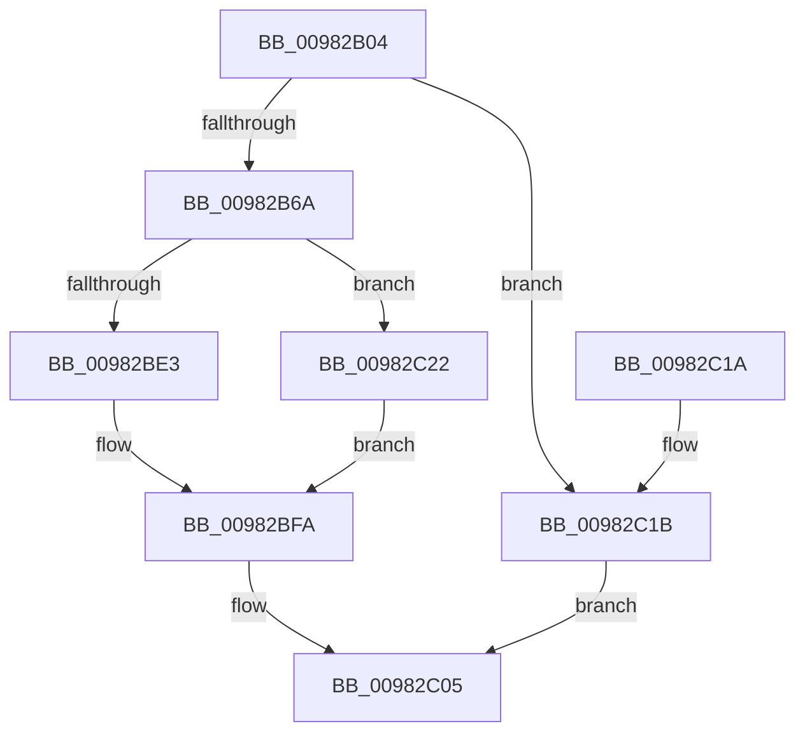

# FsRtlSetFileSize

- RVA: `0x00982B04`–`0x00982C2F` (길이 `299` bytes)
- VA: `0x0000000140982B04`
- 실행 섹션: `PAGE`
- PDB 이름 있음: `예`; PDB Function 태그: `아니요`
- unwind 정보 RVA: `0x00097998`
- 디코드: `81`개 명령, `299/299` bytes 표시
- 미해석 바이트: `0` (있으면 어셈블리에 `.byte`로 보존)

> 이 문서는 커널 이미지의 기계어와 PDB 기호를 분석해 생성했습니다. 4번과 5번은 함수 원형과 자료형을 바이너리 사용 방식에서 추정한 C 해석이며 원본 소스 복구 결과는 아닙니다.

## 1. Dependencies

- 직접 호출 지점: **7**; 고유 호출 대상: **6**
- 직접 호출자로 확인된 함수: **2**
- RIP 상대 이미지 참조: **0**

### Outgoing calls
- `0x00982B40` → [KeInitializeEvent](../../text/40/KeInitializeEvent_function_0040DD10.md) (function, `0x0040DD10`)
- `0x00982B48` → [IoGetRelatedDeviceObject](../../text/29/IoGetRelatedDeviceObject_function_0029B120.md) (function, `0x0029B120`)
- `0x00982B59` → [IoAllocateIrpEx](../../text/20/IoAllocateIrpEx_function_00207510.md) (function, `0x00207510`)
- `0x00982B6C` → [IoSetThreadHardErrorMode](../../text/46/IoSetThreadHardErrorMode_function_00466BF0.md) (function, `0x00466BF0`)
- `0x00982BD5` → [IofCallDriver](../../text/29/IofCallDriver_function_0029B4B0.md) (function, `0x0029B4B0`)
- `0x00982BF5` → [KeWaitForSingleObject](../../text/20/KeWaitForSingleObject_function_0020E6B0.md) (function, `0x0020E6B0`)
- `0x00982BFD` → [IoSetThreadHardErrorMode](../../text/46/IoSetThreadHardErrorMode_function_00466BF0.md) (function, `0x00466BF0`)

### Direct callers
- [MmExtendSection](MmExtendSection_function_00982C38.md) at `0x00982F36`
- [MiCreateDataFileMap](MiCreateDataFileMap_function_00983494.md) at `0x009837A7`

### Static image references
- 디코드된 RIP-relative 메모리 참조가 없습니다.

## 2. Other-region calls and transfers

- 다른 실행 섹션으로 향하는 call: **7**
  - `0x00982B40` → [KeInitializeEvent](../../text/40/KeInitializeEvent_function_0040DD10.md) (`PAGE` → `.text`)
  - `0x00982B48` → [IoGetRelatedDeviceObject](../../text/29/IoGetRelatedDeviceObject_function_0029B120.md) (`PAGE` → `.text`)
  - `0x00982B59` → [IoAllocateIrpEx](../../text/20/IoAllocateIrpEx_function_00207510.md) (`PAGE` → `.text`)
  - `0x00982B6C` → [IoSetThreadHardErrorMode](../../text/46/IoSetThreadHardErrorMode_function_00466BF0.md) (`PAGE` → `.text`)
  - `0x00982BD5` → [IofCallDriver](../../text/29/IofCallDriver_function_0029B4B0.md) (`PAGE` → `.text`)
  - `0x00982BF5` → [KeWaitForSingleObject](../../text/20/KeWaitForSingleObject_function_0020E6B0.md) (`PAGE` → `.text`)
  - `0x00982BFD` → [IoSetThreadHardErrorMode](../../text/46/IoSetThreadHardErrorMode_function_00466BF0.md) (`PAGE` → `.text`)
- 별도 외부 분기/꼬리 이동을 확인하지 못했습니다.

## 3. Assembly (complete function range)

```asm
00982B04  48 89 5C 24 08                  mov qword ptr [rsp + 8], rbx
00982B09  48 89 74 24 18                  mov qword ptr [rsp + 0x18], rsi
00982B0E  55                              push rbp
00982B0F  57                              push rdi
00982B10  41 56                           push r14
00982B12  48 8B EC                        mov rbp, rsp
00982B15  48 83 EC 60                     sub rsp, 0x60
00982B19  33 C0                           xor eax, eax
00982B1B  4C 8B F1                        mov r14, rcx
00982B1E  48 89 45 F0                     mov qword ptr [rbp - 0x10], rax
00982B22  48 8D 4D E0                     lea rcx, [rbp - 0x20]
00982B26  48 8B 02                        mov rax, qword ptr [rdx]
00982B29  0F 57 C0                        xorps xmm0, xmm0
00982B2C  0F 57 C9                        xorps xmm1, xmm1
00982B2F  48 89 45 28                     mov qword ptr [rbp + 0x28], rax
00982B33  33 D2                           xor edx, edx
00982B35  45 33 C0                        xor r8d, r8d
00982B38  0F 11 45 D0                     movups xmmword ptr [rbp - 0x30], xmm0
00982B3C  0F 11 4D E0                     movups xmmword ptr [rbp - 0x20], xmm1
00982B40  E8 CB B1 A8 FF                  call 0x14040dd10
00982B45  49 8B CE                        mov rcx, r14
00982B48  E8 D3 85 91 FF                  call 0x14029b120
00982B4D  45 33 C0                        xor r8d, r8d
00982B50  48 8B C8                        mov rcx, rax
00982B53  48 8B F0                        mov rsi, rax
00982B56  8A 50 4C                        mov dl, byte ptr [rax + 0x4c]
00982B59  E8 B2 49 88 FF                  call 0x140207510
00982B5E  48 8B D8                        mov rbx, rax
00982B61  48 85 C0                        test rax, rax
00982B64  0F 84 B1 00 00 00               je 0x140982c1b
00982B6A  33 C9                           xor ecx, ecx
00982B6C  E8 7F 40 AE FF                  call 0x140466bf0
00982B71  48 8B 93 B8 00 00 00            mov rdx, qword ptr [rbx + 0xb8]
00982B78  40 8A F8                        mov dil, al
00982B7B  C7 43 10 42 00 00 00            mov dword ptr [rbx + 0x10], 0x42
00982B82  48 8D 45 D0                     lea rax, [rbp - 0x30]
00982B86  48 89 43 48                     mov qword ptr [rbx + 0x48], rax
00982B8A  48 8D 45 E0                     lea rax, [rbp - 0x20]
00982B8E  48 89 43 50                     mov qword ptr [rbx + 0x50], rax
00982B92  48 8D 45 28                     lea rax, [rbp + 0x28]
00982B96  C6 43 40 00                     mov byte ptr [rbx + 0x40], 0
00982B9A  4C 89 B3 C0 00 00 00            mov qword ptr [rbx + 0xc0], r14
00982BA1  65 48 8B 0C 25 88 01 00 00      mov rcx, qword ptr gs:[0x188]
00982BAA  48 89 8B 98 00 00 00            mov qword ptr [rbx + 0x98], rcx
00982BB1  48 8B CE                        mov rcx, rsi
00982BB4  48 89 43 18                     mov qword ptr [rbx + 0x18], rax
00982BB8  C6 42 B8 06                     mov byte ptr [rdx - 0x48], 6
00982BBC  4C 89 72 E8                     mov qword ptr [rdx - 0x18], r14
00982BC0  48 89 72 E0                     mov qword ptr [rdx - 0x20], rsi
00982BC4  C7 42 C0 08 00 00 00            mov dword ptr [rdx - 0x40], 8
00982BCB  C7 42 C8 14 00 00 00            mov dword ptr [rdx - 0x38], 0x14
00982BD2  48 8B D3                        mov rdx, rbx
00982BD5  E8 D6 88 91 FF                  call 0x14029b4b0
00982BDA  8B C8                           mov ecx, eax
00982BDC  3D 03 01 00 00                  cmp eax, 0x103
00982BE1  75 3F                           jne 0x140982c22
00982BE3  48 83 64 24 20 00               and qword ptr [rsp + 0x20], 0
00982BE9  48 8D 4D E0                     lea rcx, [rbp - 0x20]
00982BED  45 33 C9                        xor r9d, r9d
00982BF0  45 33 C0                        xor r8d, r8d
00982BF3  33 D2                           xor edx, edx
00982BF5  E8 B6 BA 88 FF                  call 0x14020e6b0
00982BFA  40 8A CF                        mov cl, dil
00982BFD  E8 EE 3F AE FF                  call 0x140466bf0
00982C02  8B 45 D0                        mov eax, dword ptr [rbp - 0x30]
00982C05  4C 8D 5C 24 60                  lea r11, [rsp + 0x60]
00982C0A  49 8B 5B 20                     mov rbx, qword ptr [r11 + 0x20]
00982C0E  49 8B 73 30                     mov rsi, qword ptr [r11 + 0x30]
00982C12  49 8B E3                        mov rsp, r11
00982C15  41 5E                           pop r14
00982C17  5F                              pop rdi
00982C18  5D                              pop rbp
00982C19  C3                              ret
00982C1A  CC                              int3
00982C1B  B8 9A 00 00 C0                  mov eax, 0xc000009a
00982C20  EB E3                           jmp 0x140982c05
00982C22  8B 45 D0                        mov eax, dword ptr [rbp - 0x30]
00982C25  85 C9                           test ecx, ecx
00982C27  0F 48 C1                        cmovs eax, ecx
00982C2A  89 45 D0                        mov dword ptr [rbp - 0x30], eax
00982C2D  EB CB                           jmp 0x140982bfa
```

## 4. C-style interpretation (structured pseudocode)

```c
__int64 __fastcall FsRtlSetFileSize(__int64 a1, __int64 a2, int a3, int a4)
{
    __int64 result;
    __int64 v_rsp;
    unsigned __int64 v_stack_m18;
    unsigned __int64 v_stack_m28;
    unsigned __int64 v_stack_m38;
    unsigned __int64 v_stack_m48;
    unsigned __int64 v_stack_m58;
    unsigned __int64 v_stack_p10;
    unsigned __int64 v_stack_p18;
    unsigned __int64 v_stack_p8;

    v_stack_p8 = v_rbx;
    v_stack_p18 = v_rsi;
    v_rsp = (v_rsp) - (96);
    result = 0;
    v_stack_m28 = 0;
    v_stack_p10 = *(unsigned __int64 *)(a2);
    a2 = 0;
    a3 = 0;
    v_stack_m48 = v_xmm0;
    v_stack_m38 = v_xmm1;
    result = KeInitializeEvent(v_stack_m38, a2, a3, a4);
    result = IoGetRelatedDeviceObject(a1, a2, a3, a4);
    a3 = 0;
    result = IoAllocateIrpEx(result, *(unsigned __int8 *)(result + 76), a3, a4);
    if (result == 0) goto loc_00982C1B;
    a1 = 0;
    result = IoSetThreadHardErrorMode(a1, *(unsigned __int8 *)(result + 76), a3, a4);
    *(unsigned int *)(result + 16) = 66;
    *(unsigned __int64 *)(result + 72) = v_stack_m48;
    *(unsigned __int64 *)(result + 80) = v_stack_m38;
    *(unsigned __int8 *)(result + 64) = 0;
    *(unsigned __int64 *)(result + 192) = 0;
    *(unsigned __int64 *)(result + 152) = *(unsigned __int64 *)(gs_base + (0 + 392));
    *(unsigned __int64 *)(result + 24) = v_stack_p10;
    *(unsigned __int8 *)(*(unsigned __int64 *)(result + 184) - 72) = 6;
    *(unsigned __int64 *)(*(unsigned __int64 *)(result + 184) - 24) = 0;
    *(unsigned __int64 *)(*(unsigned __int64 *)(result + 184) - 32) = result;
    *(unsigned int *)(*(unsigned __int64 *)(result + 184) - 64) = 8;
    *(unsigned int *)(*(unsigned __int64 *)(result + 184) - 56) = 20;
    result = IofCallDriver(result, result, a3, a4);
    if (((unsigned int)(result)) != 259) goto loc_00982C22;
    a4 = 0;
    a3 = 0;
    a2 = 0;
    result = KeWaitForSingleObject(v_stack_m38, a2, a3, a4);
loc_00982BFA:
    result = IoSetThreadHardErrorMode((unsigned __int8)((unsigned __int8)(result)), a2, a3, a4);
loc_00982C05:
    return (unsigned int)(v_stack_m48);
loc_00982C1B:
    goto loc_00982C05;
loc_00982C22:
    result = (unsigned int)(v_stack_m48);
    if (sign_flag) { result = (unsigned int)((unsigned __int8)((unsigned __int8)(result))); }
    v_stack_m48 = (unsigned int)(result);
    goto loc_00982BFA;
}
```

## 5. (Beta) C Style

```c
int64_t FsRtlSetFileSize(int64_t Arg1, void *Arg2, int32_t Arg3, int32_t Arg4)
{
    uint8_t *arg2 = (uint8_t *)Arg2;

    int64_t result;
    int64_t local_rsp;
    uint64_t v_stack_m18;
    uint64_t v_stack_m28;
    uint64_t v_stack_m38;
    uint64_t v_stack_m48;
    uint64_t v_stack_m58;
    uint64_t v_stack_p10;
    uint64_t v_stack_p18;
    uint64_t v_stack_p8;

    v_stack_p8 = local_rbx;
    v_stack_p18 = local_rsi;
    local_rsp = (local_rsp) - (96);
    result = 0;
    v_stack_m28 = 0;
    v_stack_p10 = *(uint64_t *)(arg2);
    Arg2 = 0;
    Arg3 = 0;
    v_stack_m48 = v_xmm0;
    v_stack_m38 = v_xmm1;
    result = KeInitializeEvent(v_stack_m38, Arg2, Arg3, Arg4);
    result = IoGetRelatedDeviceObject(Arg1, Arg2, Arg3, Arg4);
    Arg3 = 0;
    result = IoAllocateIrpEx(result, *(uint8_t *)(result + 0x4C), Arg3, Arg4);
    if (result == 0) goto loc_00982C1B;
    Arg1 = 0;
    result = IoSetThreadHardErrorMode(Arg1, *(uint8_t *)(result + 0x4C), Arg3, Arg4);
    *(uint32_t *)(result + 0x10) = 66;
    *(uint64_t *)(result + 0x48) = v_stack_m48;
    *(uint64_t *)(result + 0x50) = v_stack_m38;
    *(uint8_t *)(result + 0x40) = 0;
    *(uint64_t *)(result + 0xC0) = 0;
    *(uint64_t *)(result + 0x98) = *(uint64_t *)(gs_base + (0 + 0x188));
    *(uint64_t *)(result + 0x18) = v_stack_p10;
    *(uint8_t *)(*(uint64_t *)(result + 0xB8) - 0x48) = 6;
    *(uint64_t *)(*(uint64_t *)(result + 0xB8) - 0x18) = 0;
    *(uint64_t *)(*(uint64_t *)(result + 0xB8) - 0x20) = result;
    *(uint32_t *)(*(uint64_t *)(result + 0xB8) - 0x40) = 8;
    *(uint32_t *)(*(uint64_t *)(result + 0xB8) - 0x38) = 20;
    result = IofCallDriver(result, result, Arg3, Arg4);
    if (((uint32_t)(result)) != 259) goto loc_00982C22;
    Arg4 = 0;
    Arg3 = 0;
    Arg2 = 0;
    result = KeWaitForSingleObject(v_stack_m38, Arg2, Arg3, Arg4);
loc_00982BFA:
    result = IoSetThreadHardErrorMode((uint8_t)((uint8_t)(result)), Arg2, Arg3, Arg4);
loc_00982C05:
    return (uint32_t)(v_stack_m48);
loc_00982C1B:
    goto loc_00982C05;
loc_00982C22:
    result = (uint32_t)(v_stack_m48);
    if (sign_flag) { result = (uint32_t)((uint8_t)((uint8_t)(result))); }
    v_stack_m48 = (uint32_t)(result);
    goto loc_00982BFA;
}
```

### 관측된 메모리 오프셋

구조체 형식이 확인되지 않은 접근은 인자 기준의 오프셋으로만 기록했습니다.

| 기준 인자 | 오프셋 표현 | 폭 (bit) | 접근 |
|---|---:|---:|---|
| `Arg2` | `+ 0x0` | `64` | `R` |

## 6. Execution-region graph

[열기: 2D/3D 그래프와 함수 탐색 컨트롤 패널](../../../control-panel.html?section=page&rva=0x00982B04&view=graph)

- 2D 그래프는 위에서 아래로 흐르고, 3D 그래프는 빈 공간을 드래그해 회전합니다. Shift+드래그는 이동, 휠은 확대·축소, 함수 노드 선택은 대상 보고서 이동입니다.

### Static fallback


