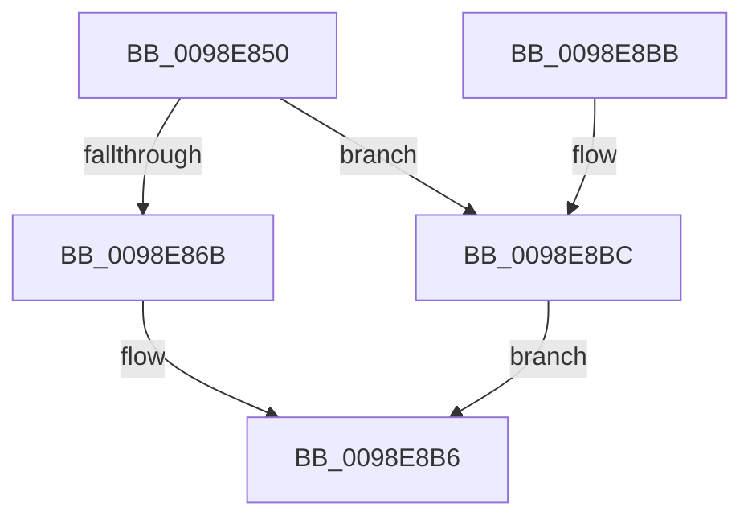

# LdrResFindResource

- RVA: `0x0098E850`–`0x0098E8C3` (길이 `115` bytes)
- VA: `0x000000014098E850`
- 실행 섹션: `PAGE`
- PDB 이름 있음: `예`; PDB Function 태그: `아니요`
- unwind 정보 RVA: `0x0009894C`
- 디코드: `25`개 명령, `115/115` bytes 표시
- 미해석 바이트: `0` (있으면 어셈블리에 `.byte`로 보존)

> 이 문서는 커널 이미지의 기계어와 PDB 기호를 분석해 생성했습니다. 4번과 5번은 함수 원형과 자료형을 바이너리 사용 방식에서 추정한 C 해석이며 원본 소스 복구 결과는 아닙니다.

## 1. Dependencies

- 직접 호출 지점: **1**; 고유 호출 대상: **1**
- 직접 호출자로 확인된 함수: **1**
- RIP 상대 이미지 참조: **0**

### Outgoing calls
- `0x0098E8B1` → [LdrResSearchResource](LdrResSearchResource_function_0098F7A0.md) (function, `0x0098F7A0`)

### Direct callers
- [sub_00BF16D0](../../init/BF/Unknown_function_00BF16D0.md) at `0x00BF18A1`

### Static image references
- 디코드된 RIP-relative 메모리 참조가 없습니다.

## 2. Other-region calls and transfers

- 다른 실행 섹션으로 향하는 call: **0**
- 별도 외부 분기/꼬리 이동을 확인하지 못했습니다.

## 3. Assembly (complete function range)

```asm
0098E850  4C 8B DC                        mov r11, rsp
0098E853  48 83 EC 68                     sub rsp, 0x68
0098E857  49 8B C1                        mov rax, r9
0098E85A  44 8B 8C 24 B0 00 00 00         mov r9d, dword ptr [rsp + 0xb0]
0098E862  41 F7 C1 02 0C 00 00            test r9d, 0xc02
0098E869  75 51                           jne 0x14098e8bc
0098E86B  49 89 43 E8                     mov qword ptr [r11 - 0x18], rax
0098E86F  48 8B 84 24 A8 00 00 00         mov rax, qword ptr [rsp + 0xa8]
0098E877  49 89 43 D0                     mov qword ptr [r11 - 0x30], rax
0098E87B  48 8B 84 24 A0 00 00 00         mov rax, qword ptr [rsp + 0xa0]
0098E883  49 89 43 C8                     mov qword ptr [r11 - 0x38], rax
0098E887  48 8B 84 24 98 00 00 00         mov rax, qword ptr [rsp + 0x98]
0098E88F  49 89 43 C0                     mov qword ptr [r11 - 0x40], rax
0098E893  48 8B 84 24 90 00 00 00         mov rax, qword ptr [rsp + 0x90]
0098E89B  49 89 53 D8                     mov qword ptr [r11 - 0x28], rdx
0098E89F  49 8D 53 D8                     lea rdx, [r11 - 0x28]
0098E8A3  4D 89 43 E0                     mov qword ptr [r11 - 0x20], r8
0098E8A7  41 B8 03 00 00 00               mov r8d, 3
0098E8AD  49 89 43 B8                     mov qword ptr [r11 - 0x48], rax
0098E8B1  E8 EA 0E 00 00                  call 0x14098f7a0
0098E8B6  48 83 C4 68                     add rsp, 0x68
0098E8BA  C3                              ret
0098E8BB  CC                              int3
0098E8BC  B8 0D 00 00 C0                  mov eax, 0xc000000d
0098E8C1  EB F3                           jmp 0x14098e8b6
```

## 4. C-style interpretation (structured pseudocode)

```c
__int64 __fastcall LdrResFindResource(__int64 a1, __int64 a2, __int64 a3, __int64 a4, __int64 a5, __int64 a6, __int64 a7, __int64 a8, unsigned int a9)
{
    __int64 result;
    __int64 v_rsp;

    v_rsp = (v_rsp) - (104);
    if ((((unsigned int)((unsigned int)(a9))) & (0xC02ULL)) != 0) goto loc_0098E8BC;
    *(unsigned __int64 *)(v_rsp - 24) = a4;
    *(unsigned __int64 *)(v_rsp - 48) = a8;
    *(unsigned __int64 *)(v_rsp - 56) = a7;
    *(unsigned __int64 *)(v_rsp - 64) = a6;
    *(unsigned __int64 *)(v_rsp - 40) = a2;
    *(unsigned __int64 *)(v_rsp - 32) = a3;
    *(unsigned __int64 *)(v_rsp - 72) = a5;
    result = LdrResSearchResource(a1, v_rsp - 40, 3, (unsigned int)(a9));
loc_0098E8B6:
    v_rsp = (v_rsp) + (104);
    return result;
loc_0098E8BC:
    goto loc_0098E8B6;
}
```

## 5. (Beta) C Style

```c
int64_t LdrResFindResource(int64_t Arg1, int64_t Arg2, int64_t Arg3, int64_t Arg4, int64_t Arg5, int64_t Arg6, int64_t Arg7, int64_t Arg8, uint32_t Arg9)
{
    int64_t result;
    int64_t local_rsp;

    local_rsp = (local_rsp) - (104);
    if ((((uint32_t)((uint32_t)(Arg9))) & (0xC02ULL)) != 0) goto loc_0098E8BC;
    *(uint64_t *)(local_rsp - 0x18) = Arg4;
    *(uint64_t *)(local_rsp - 0x30) = Arg8;
    *(uint64_t *)(local_rsp - 0x38) = Arg7;
    *(uint64_t *)(local_rsp - 0x40) = Arg6;
    *(uint64_t *)(local_rsp - 0x28) = Arg2;
    *(uint64_t *)(local_rsp - 0x20) = Arg3;
    *(uint64_t *)(local_rsp - 0x48) = Arg5;
    result = LdrResSearchResource(Arg1, local_rsp - 40, 3, (uint32_t)(Arg9));
loc_0098E8B6:
    local_rsp = (local_rsp) + (104);
    return result;
loc_0098E8BC:
    goto loc_0098E8B6;
}
```

## 6. Execution-region graph

[열기: 2D/3D 그래프와 함수 탐색 컨트롤 패널](../../../control-panel.html?section=page&rva=0x0098E850&view=graph)

- 2D 그래프는 위에서 아래로 흐르고, 3D 그래프는 빈 공간을 드래그해 회전합니다. Shift+드래그는 이동, 휠은 확대·축소, 함수 노드 선택은 대상 보고서 이동입니다.

### Static fallback


