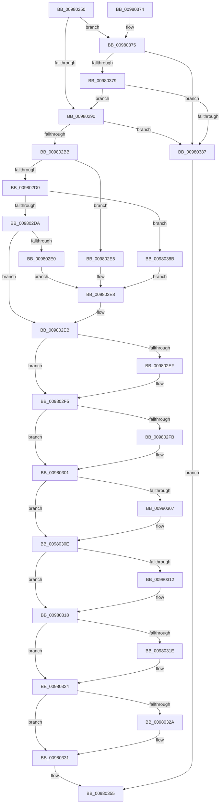

# MiAddSecureEntry

- RVA: `0x00980250`–`0x00980393` (길이 `323` bytes)
- VA: `0x0000000140980250`
- 실행 섹션: `PAGE`
- PDB 이름 있음: `예`; PDB Function 태그: `아니요`
- unwind 정보 RVA: `0x00097678`
- 디코드: `93`개 명령, `323/323` bytes 표시
- 미해석 바이트: `0` (있으면 어셈블리에 `.byte`로 보존)

> 이 문서는 커널 이미지의 기계어와 PDB 기호를 분석해 생성했습니다. 4번과 5번은 함수 원형과 자료형을 바이너리 사용 방식에서 추정한 C 해석이며 원본 소스 복구 결과는 아닙니다.

## 1. Dependencies

- 직접 호출 지점: **5**; 고유 호출 대상: **5**
- 직접 호출자로 확인된 함수: **7**
- RIP 상대 이미지 참조: **0**

### Outgoing calls
- `0x00980290` → [MmGetCurrentProcessorColor](../../text/41/MmGetCurrentProcessorColor_function_00418930.md) (function, `0x00418930`)
- `0x009802AA` → [ExAllocatePoolMm](../../text/35/ExAllocatePoolMm_function_0035B690.md) (function, `0x0035B690`)
- `0x0098033D` → [MiInsertVadEvent](../../text/43/MiInsertVadEvent_function_00430E74.md) (function, `0x00430E74`)
- `0x0098034D` → [MiSetVadFlags](../../text/43/MiSetVadFlags_function_004311FC.md) (function, `0x004311FC`)
- `0x00980379` → [MiLocateExclusiveSecure](../../text/48/MiLocateExclusiveSecure_function_0048C610.md) (function, `0x0048C610`)

### Direct callers
- [MiReserveUserMemory](../88/MiReserveUserMemory_function_00884498.md) at `0x00884A8C`
- [MmSecureVirtualMemoryAgainstWrites](../89/MmSecureVirtualMemoryAgainstWrites_function_00890164.md) at `0x008902CE`
- [MiAllocateVad](../8C/MiAllocateVad_function_008CF3F8.md) at `0x008CF51C`
- [MiCloneNoChange](../97/MiCloneNoChange_function_0097E848.md) at `0x0097E8F1`
- [MiMapViewOfImageSection](../97/MiMapViewOfImageSection_function_0097E92C.md) at `0x0097F370`
- [MiMapLockedPagesInUserSpace](../97/MiMapLockedPagesInUserSpace_function_0097FE04.md) at `0x0098016B`
- [MiAllocateNewSubAllocatedRegion](MiAllocateNewSubAllocatedRegion_function_00981EC0.md) at `0x0098208D`

### Static image references
- 디코드된 RIP-relative 메모리 참조가 없습니다.

## 2. Other-region calls and transfers

- 다른 실행 섹션으로 향하는 call: **5**
  - `0x00980290` → [MmGetCurrentProcessorColor](../../text/41/MmGetCurrentProcessorColor_function_00418930.md) (`PAGE` → `.text`)
  - `0x009802AA` → [ExAllocatePoolMm](../../text/35/ExAllocatePoolMm_function_0035B690.md) (`PAGE` → `.text`)
  - `0x0098033D` → [MiInsertVadEvent](../../text/43/MiInsertVadEvent_function_00430E74.md) (`PAGE` → `.text`)
  - `0x0098034D` → [MiSetVadFlags](../../text/43/MiSetVadFlags_function_004311FC.md) (`PAGE` → `.text`)
  - `0x00980379` → [MiLocateExclusiveSecure](../../text/48/MiLocateExclusiveSecure_function_0048C610.md) (`PAGE` → `.text`)
- 별도 외부 분기/꼬리 이동을 확인하지 못했습니다.

## 3. Assembly (complete function range)

```asm
00980250  48 89 5C 24 08                  mov qword ptr [rsp + 8], rbx
00980255  48 89 6C 24 10                  mov qword ptr [rsp + 0x10], rbp
0098025A  48 89 74 24 18                  mov qword ptr [rsp + 0x18], rsi
0098025F  48 89 7C 24 20                  mov qword ptr [rsp + 0x20], rdi
00980264  41 54                           push r12
00980266  41 56                           push r14
00980268  41 57                           push r15
0098026A  48 83 EC 20                     sub rsp, 0x20
0098026E  44 8B 74 24 60                  mov r14d, dword ptr [rsp + 0x60]
00980273  41 8B F1                        mov esi, r9d
00980276  8B 41 30                        mov eax, dword ptr [rcx + 0x30]
00980279  41 8B EE                        mov ebp, r14d
0098027C  83 E5 01                        and ebp, 1
0098027F  4D 8B E0                        mov r12, r8
00980282  48 8B DA                        mov rbx, rdx
00980285  4C 8B F9                        mov r15, rcx
00980288  A8 08                           test al, 8
0098028A  0F 85 E5 00 00 00               jne 0x140980375
00980290  E8 9B 86 A9 FF                  call 0x140418930
00980295  BA 58 00 00 00                  mov edx, 0x58
0098029A  0F BA E8 1F                     bts eax, 0x1f
0098029E  44 8B C8                        mov r9d, eax
009802A1  41 B8 4D 6D 53 65               mov r8d, 0x65536d4d
009802A7  8D 4A E8                        lea ecx, [rdx - 0x18]
009802AA  E8 E1 B3 9D FF                  call 0x14035b690
009802AF  48 8B F8                        mov rdi, rax
009802B2  48 85 C0                        test rax, rax
009802B5  0F 84 CC 00 00 00               je 0x140980387
009802BB  C7 40 50 02 00 00 00            mov dword ptr [rax + 0x50], 2
009802C2  48 89 58 08                     mov qword ptr [rax + 8], rbx
009802C6  4C 89 60 10                     mov qword ptr [rax + 0x10], r12
009802CA  40 F6 C6 01                     test sil, 1
009802CE  75 15                           jne 0x1409802e5
009802D0  40 F6 C6 04                     test sil, 4
009802D4  0F 85 B1 00 00 00               jne 0x14098038b
009802DA  40 F6 C6 02                     test sil, 2
009802DE  74 0B                           je 0x1409802eb
009802E0  83 CB 09                        or ebx, 9
009802E3  EB 03                           jmp 0x1409802e8
009802E5  83 CB 08                        or ebx, 8
009802E8  89 58 08                        mov dword ptr [rax + 8], ebx
009802EB  85 ED                           test ebp, ebp
009802ED  74 06                           je 0x1409802f5
009802EF  83 CB 20                        or ebx, 0x20
009802F2  89 58 08                        mov dword ptr [rax + 8], ebx
009802F5  41 F6 C6 04                     test r14b, 4
009802F9  74 06                           je 0x140980301
009802FB  83 CB 40                        or ebx, 0x40
009802FE  89 58 08                        mov dword ptr [rax + 8], ebx
00980301  41 F6 C6 08                     test r14b, 8
00980305  74 07                           je 0x14098030e
00980307  0F BA EB 07                     bts ebx, 7
0098030B  89 58 08                        mov dword ptr [rax + 8], ebx
0098030E  85 F6                           test esi, esi
00980310  79 06                           jns 0x140980318
00980312  83 CB 04                        or ebx, 4
00980315  89 58 08                        mov dword ptr [rax + 8], ebx
00980318  0F BA E6 1E                     bt esi, 0x1e
0098031C  73 06                           jae 0x140980324
0098031E  83 CB 10                        or ebx, 0x10
00980321  89 58 08                        mov dword ptr [rax + 8], ebx
00980324  0F BA E6 1D                     bt esi, 0x1d
00980328  73 07                           jae 0x140980331
0098032A  0F BA EB 08                     bts ebx, 8
0098032E  89 58 08                        mov dword ptr [rax + 8], ebx
00980331  41 B8 01 00 00 00               mov r8d, 1
00980337  48 8B D7                        mov rdx, rdi
0098033A  49 8B CF                        mov rcx, r15
0098033D  E8 32 0B AB FF                  call 0x140430e74
00980342  BA 01 00 00 00                  mov edx, 1
00980347  49 8B CF                        mov rcx, r15
0098034A  44 8B C2                        mov r8d, edx
0098034D  E8 AA 0E AB FF                  call 0x1404311fc
00980352  48 8B C7                        mov rax, rdi
00980355  48 8B 5C 24 40                  mov rbx, qword ptr [rsp + 0x40]
0098035A  48 8B 6C 24 48                  mov rbp, qword ptr [rsp + 0x48]
0098035F  48 8B 74 24 50                  mov rsi, qword ptr [rsp + 0x50]
00980364  48 8B 7C 24 58                  mov rdi, qword ptr [rsp + 0x58]
00980369  48 83 C4 20                     add rsp, 0x20
0098036D  41 5F                           pop r15
0098036F  41 5E                           pop r14
00980371  41 5C                           pop r12
00980373  C3                              ret
00980374  CC                              int3
00980375  85 ED                           test ebp, ebp
00980377  75 0E                           jne 0x140980387
00980379  E8 92 C2 B0 FF                  call 0x14048c610
0098037E  48 85 C0                        test rax, rax
00980381  0F 84 09 FF FF FF               je 0x140980290
00980387  33 C0                           xor eax, eax
00980389  EB CA                           jmp 0x140980355
0098038B  83 CB 0A                        or ebx, 0xa
0098038E  E9 55 FF FF FF                  jmp 0x1409802e8
```

## 4. C-style interpretation (structured pseudocode)

```c
__int64 __fastcall MiAddSecureEntry(__int64 a1, __int64 a2, __int64 a3, int a4, unsigned int a5)
{
    __int64 result;
    __int64 v_rbp;
    __int64 v_rbx;
    __int64 v_rsp;
    unsigned __int64 v_stack_p10;
    unsigned __int64 v_stack_p18;
    unsigned __int64 v_stack_p20;
    unsigned __int64 v_stack_p8;

    v_stack_p8 = v_rbx;
    v_stack_p10 = v_rbp;
    v_stack_p18 = v_rsi;
    v_stack_p20 = v_rdi;
    v_rsp = (v_rsp) - (32);
    v_rbp = (unsigned int)(((unsigned int)((unsigned int)((unsigned int)(a5)))) & (1));
    if ((((unsigned __int8)((unsigned int)(*(unsigned int *)(a1 + 48)))) & (8)) != 0) goto loc_00980375;
loc_00980290:
    result = MmGetCurrentProcessorColor(a1, a2, a3, a4);
    result = ExAllocatePoolMm(88 - 24, 88, (unsigned int)(0x65536D4DULL), (unsigned int)((unsigned int)(result)));
    if (result == 0) goto loc_00980387;
    *(unsigned int *)(result + 80) = 2;
    *(unsigned __int64 *)(result + 8) = a2;
    *(unsigned __int64 *)(result + 16) = a3;
    if ((((unsigned __int8)((unsigned int)(a4))) & (1)) != 0) goto loc_009802E5;
    if ((((unsigned __int8)((unsigned int)(a4))) & (4)) != 0) goto loc_0098038B;
    if ((((unsigned __int8)((unsigned int)(a4))) & (2)) == 0) goto loc_009802EB;
    v_rbx = (unsigned int)((a2) | (9));
    goto loc_009802E8;
loc_009802E5:
    v_rbx = (unsigned int)((v_rbx) | (8));
loc_009802E8:
    *(unsigned int *)(result + 8) = (unsigned int)(v_rbx);
loc_009802EB:
    if ((unsigned int)(v_rbp) != 0) {
        v_rbx = (unsigned int)((v_rbx) | (32));
        *(unsigned int *)(result + 8) = (unsigned int)(v_rbx);
    }
    if ((((unsigned __int8)((unsigned int)(a5))) & (4)) != 0) {
        v_rbx = (unsigned int)((v_rbx) | (64));
        *(unsigned int *)(result + 8) = (unsigned int)(v_rbx);
    }
    if ((((unsigned __int8)((unsigned int)(a5))) & (8)) != 0) {
        *(unsigned int *)(result + 8) = (unsigned int)(v_rbx);
    }
    if (sign_flag) {
        v_rbx = (unsigned int)((v_rbx) | (4));
        *(unsigned int *)(result + 8) = (unsigned int)(v_rbx);
    }
    if (!(condition_is_above_or_equal)) {
        v_rbx = (unsigned int)((v_rbx) | (16));
        *(unsigned int *)(result + 8) = (unsigned int)(v_rbx);
    }
    if (!(condition_is_above_or_equal)) {
        *(unsigned int *)(result + 8) = (unsigned int)(v_rbx);
    }
    result = MiInsertVadEvent(a1, result, 1, (unsigned int)((unsigned int)(result)));
    result = MiSetVadFlags(a1, 1, 1, (unsigned int)((unsigned int)(result)));
loc_00980355:
    v_rsp = (v_rsp) + (32);
    return result;
loc_00980375:
    if ((unsigned int)(v_stack_p10) != 0) goto loc_00980387;
    result = MiLocateExclusiveSecure(a1, 1, 1, (unsigned int)((unsigned int)(result)));
    if (result == 0) goto loc_00980290;
loc_00980387:
    result = 0;
    goto loc_00980355;
loc_0098038B:
    v_rbx = (unsigned int)((v_stack_p8) | (10));
    goto loc_009802E8;
}
```

## 5. (Beta) C Style

```c
int64_t MiAddSecureEntry(void *Arg1, int64_t Arg2, int64_t Arg3, int32_t Arg4, uint32_t Arg5)
{
    uint8_t *arg1 = (uint8_t *)Arg1;

    int64_t result;
    int64_t local_rbp;
    int64_t local_rbx;
    int64_t local_rsp;
    uint64_t v_stack_p10;
    uint64_t v_stack_p18;
    uint64_t v_stack_p20;
    uint64_t v_stack_p8;

    v_stack_p8 = local_rbx;
    v_stack_p10 = local_rbp;
    v_stack_p18 = local_rsi;
    v_stack_p20 = local_rdi;
    local_rsp = (local_rsp) - (32);
    local_rbp = (uint32_t)(((uint32_t)((uint32_t)((uint32_t)(Arg5)))) & (1));
    if ((((uint8_t)((uint32_t)(*(uint32_t *)(arg1 + 0x30)))) & (8)) != 0) goto loc_00980375;
loc_00980290:
    result = MmGetCurrentProcessorColor(Arg1, Arg2, Arg3, Arg4);
    result = ExAllocatePoolMm(88 - 24, 88, (uint32_t)(0x65536D4DULL), (uint32_t)((uint32_t)(result)));
    if (result == 0) goto loc_00980387;
    *(uint32_t *)(result + 0x50) = 2;
    *(uint64_t *)(result + 0x8) = Arg2;
    *(uint64_t *)(result + 0x10) = Arg3;
    if ((((uint8_t)((uint32_t)(Arg4))) & (1)) != 0) goto loc_009802E5;
    if ((((uint8_t)((uint32_t)(Arg4))) & (4)) != 0) goto loc_0098038B;
    if ((((uint8_t)((uint32_t)(Arg4))) & (2)) == 0) goto loc_009802EB;
    local_rbx = (uint32_t)((Arg2) | (9));
    goto loc_009802E8;
loc_009802E5:
    local_rbx = (uint32_t)((local_rbx) | (8));
loc_009802E8:
    *(uint32_t *)(result + 0x8) = (uint32_t)(local_rbx);
loc_009802EB:
    if ((uint32_t)(local_rbp) != 0) {
        local_rbx = (uint32_t)((local_rbx) | (32));
        *(uint32_t *)(result + 0x8) = (uint32_t)(local_rbx);
    }
    if ((((uint8_t)((uint32_t)(Arg5))) & (4)) != 0) {
        local_rbx = (uint32_t)((local_rbx) | (64));
        *(uint32_t *)(result + 0x8) = (uint32_t)(local_rbx);
    }
    if ((((uint8_t)((uint32_t)(Arg5))) & (8)) != 0) {
        *(uint32_t *)(result + 0x8) = (uint32_t)(local_rbx);
    }
    if (sign_flag) {
        local_rbx = (uint32_t)((local_rbx) | (4));
        *(uint32_t *)(result + 0x8) = (uint32_t)(local_rbx);
    }
    if (!(condition_is_above_or_equal)) {
        local_rbx = (uint32_t)((local_rbx) | (16));
        *(uint32_t *)(result + 0x8) = (uint32_t)(local_rbx);
    }
    if (!(condition_is_above_or_equal)) {
        *(uint32_t *)(result + 0x8) = (uint32_t)(local_rbx);
    }
    result = MiInsertVadEvent(Arg1, result, 1, (uint32_t)((uint32_t)(result)));
    result = MiSetVadFlags(Arg1, 1, 1, (uint32_t)((uint32_t)(result)));
loc_00980355:
    local_rsp = (local_rsp) + (32);
    return result;
loc_00980375:
    if ((uint32_t)(v_stack_p10) != 0) goto loc_00980387;
    result = MiLocateExclusiveSecure(Arg1, 1, 1, (uint32_t)((uint32_t)(result)));
    if (result == 0) goto loc_00980290;
loc_00980387:
    result = 0;
    goto loc_00980355;
loc_0098038B:
    local_rbx = (uint32_t)((v_stack_p8) | (10));
    goto loc_009802E8;
}
```

### 관측된 메모리 오프셋

구조체 형식이 확인되지 않은 접근은 인자 기준의 오프셋으로만 기록했습니다.

| 기준 인자 | 오프셋 표현 | 폭 (bit) | 접근 |
|---|---:|---:|---|
| `Arg1` | `+ 0x30` | `32` | `R` |

## 6. Execution-region graph

[열기: 2D/3D 그래프와 함수 탐색 컨트롤 패널](../../../control-panel.html?section=page&rva=0x00980250&view=graph)

- 2D 그래프는 위에서 아래로 흐르고, 3D 그래프는 빈 공간을 드래그해 회전합니다. Shift+드래그는 이동, 휠은 확대·축소, 함수 노드 선택은 대상 보고서 이동입니다.

### Static fallback


