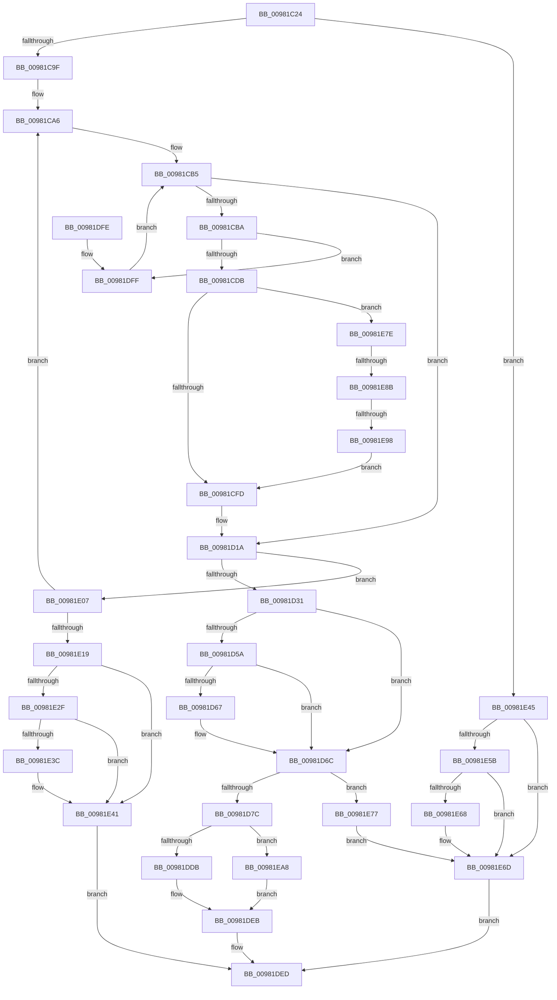

# MiAllocateFromSubAllocatedRegion

- RVA: `0x00981C24`–`0x00981EB8` (길이 `660` bytes)
- VA: `0x0000000140981C24`
- 실행 섹션: `PAGE`
- PDB 이름 있음: `예`; PDB Function 태그: `예`
- unwind 정보 RVA: `0x000978A4`
- 디코드: `176`개 명령, `660/660` bytes 표시
- 미해석 바이트: `0` (있으면 어셈블리에 `.byte`로 보존)

> 이 문서는 커널 이미지의 기계어와 PDB 기호를 분석해 생성했습니다. 4번과 5번은 함수 원형과 자료형을 바이너리 사용 방식에서 추정한 C 해석이며 원본 소스 복구 결과는 아닙니다.

## 1. Dependencies

- 직접 호출 지점: **18**; 고유 호출 대상: **13**
- 직접 호출자로 확인된 함수: **2**
- RIP 상대 이미지 참조: **0**

### Outgoing calls
- `0x00981C8B` → [LOCK_ADDRESS_SPACE](../../text/2A/LOCK_ADDRESS_SPACE_function_002A4944.md) (function, `0x002A4944`)
- `0x00981CAC` → [LOCK_PAGE_TABLE_COMMITMENT](../../text/2A/LOCK_PAGE_TABLE_COMMITMENT_function_002A6090.md) (function, `0x002A6090`)
- `0x00981CC9` → [RtlFindClearBitsAndSetEx](../../text/3B/RtlFindClearBitsAndSetEx_function_003B60F0.md) (function, `0x003B60F0`)
- `0x00981D20` → [UNLOCK_PAGE_TABLE_COMMITMENT](../../text/2E/UNLOCK_PAGE_TABLE_COMMITMENT_function_002E27D0.md) (function, `0x002E27D0`)
- `0x00981D34` → [MiReferenceVad](../../text/29/MiReferenceVad_function_00295890.md) (function, `0x00295890`)
- `0x00981D3F` → [UNLOCK_ADDRESS_SPACE](../../text/2A/UNLOCK_ADDRESS_SPACE_function_002A4844.md) (function, `0x002A4844`)
- `0x00981D4A` → [MiLockVad](../../text/29/MiLockVad_function_00295810.md) (function, `0x00295810`)
- `0x00981D67` → [KiCheckForKernelApcDelivery](../../text/2E/KiCheckForKernelApcDelivery_function_002E2C80.md) (function, `0x002E2C80`)
- `0x00981D6F` → [MiVadDeleted](../../text/43/MiVadDeleted_function_00431350.md) (function, `0x00431350`)
- `0x00981DC9` → [MiCommitExistingVad](../../text/32/MiCommitExistingVad_function_0032A860.md) (function, `0x0032A860`)
- `0x00981DDB` → [MiUnlockAndDereferenceVad](../../text/31/MiUnlockAndDereferenceVad_function_00316E60.md) (function, `0x00316E60`)
- `0x00981E0A` → [MiAllocateNewSubAllocatedRegion](MiAllocateNewSubAllocatedRegion_function_00981EC0.md) (function, `0x00981EC0`)
- `0x00981E1F` → [UNLOCK_ADDRESS_SPACE](../../text/2A/UNLOCK_ADDRESS_SPACE_function_002A4844.md) (function, `0x002A4844`)
- `0x00981E3C` → [KiCheckForKernelApcDelivery](../../text/2E/KiCheckForKernelApcDelivery_function_002E2C80.md) (function, `0x002E2C80`)
- `0x00981E4B` → [UNLOCK_ADDRESS_SPACE](../../text/2A/UNLOCK_ADDRESS_SPACE_function_002A4844.md) (function, `0x002A4844`)
- `0x00981E68` → [KiCheckForKernelApcDelivery](../../text/2E/KiCheckForKernelApcDelivery_function_002E2C80.md) (function, `0x002E2C80`)
- `0x00981E77` → [MiUnlockAndDereferenceVad](../../text/31/MiUnlockAndDereferenceVad_function_00316E60.md) (function, `0x00316E60`)
- `0x00981EAE` → [MiFreeToSubAllocatedRegion](../87/MiFreeToSubAllocatedRegion_function_0087FB7C.md) (function, `0x0087FB7C`)

### Direct callers
- [MiCreatePebOrTeb](MiCreatePebOrTeb_function_00981874.md) at `0x00981899`
- [MmCreateTeb](MmCreateTeb_function_009818E4.md) at `0x0098198B`

### Static image references
- 디코드된 RIP-relative 메모리 참조가 없습니다.

## 2. Other-region calls and transfers

- 다른 실행 섹션으로 향하는 call: **16**
  - `0x00981C8B` → [LOCK_ADDRESS_SPACE](../../text/2A/LOCK_ADDRESS_SPACE_function_002A4944.md) (`PAGE` → `.text`)
  - `0x00981CAC` → [LOCK_PAGE_TABLE_COMMITMENT](../../text/2A/LOCK_PAGE_TABLE_COMMITMENT_function_002A6090.md) (`PAGE` → `.text`)
  - `0x00981CC9` → [RtlFindClearBitsAndSetEx](../../text/3B/RtlFindClearBitsAndSetEx_function_003B60F0.md) (`PAGE` → `.text`)
  - `0x00981D20` → [UNLOCK_PAGE_TABLE_COMMITMENT](../../text/2E/UNLOCK_PAGE_TABLE_COMMITMENT_function_002E27D0.md) (`PAGE` → `.text`)
  - `0x00981D34` → [MiReferenceVad](../../text/29/MiReferenceVad_function_00295890.md) (`PAGE` → `.text`)
  - `0x00981D3F` → [UNLOCK_ADDRESS_SPACE](../../text/2A/UNLOCK_ADDRESS_SPACE_function_002A4844.md) (`PAGE` → `.text`)
  - `0x00981D4A` → [MiLockVad](../../text/29/MiLockVad_function_00295810.md) (`PAGE` → `.text`)
  - `0x00981D67` → [KiCheckForKernelApcDelivery](../../text/2E/KiCheckForKernelApcDelivery_function_002E2C80.md) (`PAGE` → `.text`)
  - `0x00981D6F` → [MiVadDeleted](../../text/43/MiVadDeleted_function_00431350.md) (`PAGE` → `.text`)
  - `0x00981DC9` → [MiCommitExistingVad](../../text/32/MiCommitExistingVad_function_0032A860.md) (`PAGE` → `.text`)
  - `0x00981DDB` → [MiUnlockAndDereferenceVad](../../text/31/MiUnlockAndDereferenceVad_function_00316E60.md) (`PAGE` → `.text`)
  - `0x00981E1F` → [UNLOCK_ADDRESS_SPACE](../../text/2A/UNLOCK_ADDRESS_SPACE_function_002A4844.md) (`PAGE` → `.text`)
  - `0x00981E3C` → [KiCheckForKernelApcDelivery](../../text/2E/KiCheckForKernelApcDelivery_function_002E2C80.md) (`PAGE` → `.text`)
  - `0x00981E4B` → [UNLOCK_ADDRESS_SPACE](../../text/2A/UNLOCK_ADDRESS_SPACE_function_002A4844.md) (`PAGE` → `.text`)
  - `0x00981E68` → [KiCheckForKernelApcDelivery](../../text/2E/KiCheckForKernelApcDelivery_function_002E2C80.md) (`PAGE` → `.text`)
  - `0x00981E77` → [MiUnlockAndDereferenceVad](../../text/31/MiUnlockAndDereferenceVad_function_00316E60.md) (`PAGE` → `.text`)
- call이 아닌 외부 분기/꼬리 이동: **2**
  - `0x00981E85` → [sub_00B2A724](../B2/Unknown_function_00B2A724.md) (`tail-transfer`)
  - `0x00981E92` → [sub_00B2A724](../B2/Unknown_function_00B2A724.md) (`tail-transfer`)

## 3. Assembly (complete function range)

```asm
00981C24  48 8B C4                        mov rax, rsp
00981C27  4C 89 48 20                     mov qword ptr [rax + 0x20], r9
00981C2B  4C 89 40 18                     mov qword ptr [rax + 0x18], r8
00981C2F  48 89 50 10                     mov qword ptr [rax + 0x10], rdx
00981C33  89 48 08                        mov dword ptr [rax + 8], ecx
00981C36  53                              push rbx
00981C37  55                              push rbp
00981C38  56                              push rsi
00981C39  57                              push rdi
00981C3A  41 54                           push r12
00981C3C  41 55                           push r13
00981C3E  41 56                           push r14
00981C40  41 57                           push r15
00981C42  48 83 EC 68                     sub rsp, 0x68
00981C46  45 33 FF                        xor r15d, r15d
00981C49  4C 8D A2 FF 0F 00 00            lea r12, [rdx + 0xfff]
00981C50  44 89 78 20                     mov dword ptr [rax + 0x20], r15d
00981C54  41 8B FF                        mov edi, r15d
00981C57  66 44 89 78 08                  mov word ptr [rax + 8], r15w
00981C5C  41 8B EF                        mov ebp, r15d
00981C5F  4D 89 38                        mov qword ptr [r8], r15
00981C62  65 48 8B 1C 25 88 01 00 00      mov rbx, qword ptr gs:[0x188]
00981C6B  48 8B CB                        mov rcx, rbx
00981C6E  49 C1 EC 0C                     shr r12, 0xc
00981C72  4C 8B B3 B8 00 00 00            mov r14, qword ptr [rbx + 0xb8]
00981C79  49 8B D6                        mov rdx, r14
00981C7C  49 8B B6 10 04 00 00            mov rsi, qword ptr [r14 + 0x410]
00981C83  66 FF 8B E6 01 00 00            dec word ptr [rbx + 0x1e6]
00981C8A  90                              nop
00981C8B  E8 B4 2C 92 FF                  call 0x1402a4944
00981C90  41 8B 86 F4 01 00 00            mov eax, dword ptr [r14 + 0x1f4]
00981C97  A8 20                           test al, 0x20
00981C99  0F 85 A6 01 00 00               jne 0x140981e45
00981C9F  4C 8D AE 08 04 00 00            lea r13, [rsi + 0x408]
00981CA6  49 8B D6                        mov rdx, r14
00981CA9  48 8B CB                        mov rcx, rbx
00981CAC  E8 DF 43 92 FF                  call 0x1402a6090
00981CB1  49 8B 75 00                     mov rsi, qword ptr [r13]
00981CB5  49 3B F5                        cmp rsi, r13
00981CB8  74 60                           je 0x140981d1a
00981CBA  44 8B 46 20                     mov r8d, dword ptr [rsi + 0x20]
00981CBE  48 8D 4E F0                     lea rcx, [rsi - 0x10]
00981CC2  49 C1 E8 02                     shr r8, 2
00981CC6  49 8B D4                        mov rdx, r12
00981CC9  E8 22 44 A3 FF                  call 0x1403b60f0
00981CCE  48 8B D0                        mov rdx, rax
00981CD1  48 83 F8 FF                     cmp rax, -1
00981CD5  0F 84 24 01 00 00               je 0x140981dff
00981CDB  44 01 66 18                     add dword ptr [rsi + 0x18], r12d
00981CDF  41 8D 0C 04                     lea ecx, [r12 + rax]
00981CE3  8B 46 20                        mov eax, dword ptr [rsi + 0x20]
00981CE6  83 E0 03                        and eax, 3
00981CE9  C1 E1 02                        shl ecx, 2
00981CEC  0B C8                           or ecx, eax
00981CEE  8B 46 18                        mov eax, dword ptr [rsi + 0x18]
00981CF1  89 4E 20                        mov dword ptr [rsi + 0x20], ecx
00981CF4  3B 46 1C                        cmp eax, dword ptr [rsi + 0x1c]
00981CF7  0F 83 81 01 00 00               jae 0x140981e7e
00981CFD  48 8B 7E 10                     mov rdi, qword ptr [rsi + 0x10]
00981D01  48 C1 E2 0C                     shl rdx, 0xc
00981D05  0F B6 6F 20                     movzx ebp, byte ptr [rdi + 0x20]
00981D09  8B 47 18                        mov eax, dword ptr [rdi + 0x18]
00981D0C  48 C1 E5 20                     shl rbp, 0x20
00981D10  48 0B E8                        or rbp, rax
00981D13  48 C1 E5 0C                     shl rbp, 0xc
00981D17  48 03 EA                        add rbp, rdx
00981D1A  49 8B D6                        mov rdx, r14
00981D1D  48 8B CB                        mov rcx, rbx
00981D20  E8 AB 0A 96 FF                  call 0x1402e27d0
00981D25  45 33 FF                        xor r15d, r15d
00981D28  48 85 FF                        test rdi, rdi
00981D2B  0F 84 D6 00 00 00               je 0x140981e07
00981D31  48 8B CF                        mov rcx, rdi
00981D34  E8 57 3B 91 FF                  call 0x140295890
00981D39  48 8B CB                        mov rcx, rbx
00981D3C  49 8B D6                        mov rdx, r14
00981D3F  E8 00 2B 92 FF                  call 0x1402a4844
00981D44  48 8B D7                        mov rdx, rdi
00981D47  48 8B CB                        mov rcx, rbx
00981D4A  E8 C1 3A 91 FF                  call 0x140295810
00981D4F  90                              nop
00981D50  66 83 83 E6 01 00 00 01         add word ptr [rbx + 0x1e6], 1
00981D58  75 12                           jne 0x140981d6c
00981D5A  48 8D 83 98 00 00 00            lea rax, [rbx + 0x98]
00981D61  90                              nop
00981D62  48 39 00                        cmp qword ptr [rax], rax
00981D65  74 05                           je 0x140981d6c
00981D67  E8 14 0F 96 FF                  call 0x1402e2c80
00981D6C  48 8B CF                        mov rcx, rdi
00981D6F  E8 DC F5 AA FF                  call 0x140431350
00981D74  85 C0                           test eax, eax
00981D76  0F 85 FB 00 00 00               jne 0x140981e77
00981D7C  44 8B 4F 30                     mov r9d, dword ptr [rdi + 0x30]
00981D80  48 8D 84 24 B0 00 00 00         lea rax, [rsp + 0xb0]
00981D88  48 8B B4 24 B8 00 00 00         mov rsi, qword ptr [rsp + 0xb8]
00981D90  48 8B D5                        mov rdx, rbp
00981D93  48 89 44 24 50                  mov qword ptr [rsp + 0x50], rax
00981D98  4C 8B C6                        mov r8, rsi
00981D9B  48 8D 84 24 C8 00 00 00         lea rax, [rsp + 0xc8]
00981DA3  41 C1 E9 07                     shr r9d, 7
00981DA7  48 89 44 24 48                  mov qword ptr [rsp + 0x48], rax
00981DAC  41 83 E1 1F                     and r9d, 0x1f
00981DB0  4C 89 7C 24 40                  mov qword ptr [rsp + 0x40], r15
00981DB5  44 88 7C 24 38                  mov byte ptr [rsp + 0x38], r15b
00981DBA  44 89 7C 24 30                  mov dword ptr [rsp + 0x30], r15d
00981DBF  4C 89 7C 24 28                  mov qword ptr [rsp + 0x28], r15
00981DC4  44 89 7C 24 20                  mov dword ptr [rsp + 0x20], r15d
00981DC9  E8 92 8A 9A FF                  call 0x14032a860
00981DCE  8B D8                           mov ebx, eax
00981DD0  48 8B CF                        mov rcx, rdi
00981DD3  85 C0                           test eax, eax
00981DD5  0F 88 CD 00 00 00               js 0x140981ea8
00981DDB  E8 80 50 99 FF                  call 0x140316e60
00981DE0  48 8B 84 24 C0 00 00 00         mov rax, qword ptr [rsp + 0xc0]
00981DE8  48 89 28                        mov qword ptr [rax], rbp
00981DEB  8B C3                           mov eax, ebx
00981DED  48 83 C4 68                     add rsp, 0x68
00981DF1  41 5F                           pop r15
00981DF3  41 5E                           pop r14
00981DF5  41 5D                           pop r13
00981DF7  41 5C                           pop r12
00981DF9  5F                              pop rdi
00981DFA  5E                              pop rsi
00981DFB  5D                              pop rbp
00981DFC  5B                              pop rbx
00981DFD  C3                              ret
00981DFE  CC                              int3
00981DFF  48 8B 36                        mov rsi, qword ptr [rsi]
00981E02  E9 AE FE FF FF                  jmp 0x140981cb5
00981E07  49 8B D4                        mov rdx, r12
00981E0A  E8 B1 00 00 00                  call 0x140981ec0
00981E0F  8B F0                           mov esi, eax
00981E11  85 C0                           test eax, eax
00981E13  0F 89 8D FE FF FF               jns 0x140981ca6
00981E19  49 8B D6                        mov rdx, r14
00981E1C  48 8B CB                        mov rcx, rbx
00981E1F  E8 20 2A 92 FF                  call 0x1402a4844
00981E24  90                              nop
00981E25  66 83 83 E6 01 00 00 01         add word ptr [rbx + 0x1e6], 1
00981E2D  75 12                           jne 0x140981e41
00981E2F  48 8D 83 98 00 00 00            lea rax, [rbx + 0x98]
00981E36  90                              nop
00981E37  48 39 00                        cmp qword ptr [rax], rax
00981E3A  74 05                           je 0x140981e41
00981E3C  E8 3F 0E 96 FF                  call 0x1402e2c80
00981E41  8B C6                           mov eax, esi
00981E43  EB A8                           jmp 0x140981ded
00981E45  49 8B D6                        mov rdx, r14
00981E48  48 8B CB                        mov rcx, rbx
00981E4B  E8 F4 29 92 FF                  call 0x1402a4844
00981E50  90                              nop
00981E51  66 83 83 E6 01 00 00 01         add word ptr [rbx + 0x1e6], 1
00981E59  75 12                           jne 0x140981e6d
00981E5B  48 8D 83 98 00 00 00            lea rax, [rbx + 0x98]
00981E62  90                              nop
00981E63  48 39 00                        cmp qword ptr [rax], rax
00981E66  74 05                           je 0x140981e6d
00981E68  E8 13 0E 96 FF                  call 0x1402e2c80
00981E6D  B8 0A 01 00 C0                  mov eax, 0xc000010a
00981E72  E9 76 FF FF FF                  jmp 0x140981ded
00981E77  E8 E4 4F 99 FF                  call 0x140316e60
00981E7C  EB EF                           jmp 0x140981e6d
00981E7E  48 8B 0E                        mov rcx, qword ptr [rsi]
00981E81  48 39 71 08                     cmp qword ptr [rcx + 8], rsi
00981E85  0F 85 99 88 1A 00               jne 0x140b2a724
00981E8B  48 8B 46 08                     mov rax, qword ptr [rsi + 8]
00981E8F  48 39 30                        cmp qword ptr [rax], rsi
00981E92  0F 85 8C 88 1A 00               jne 0x140b2a724
00981E98  48 89 08                        mov qword ptr [rax], rcx
00981E9B  48 89 41 08                     mov qword ptr [rcx + 8], rax
00981E9F  48 83 26 00                     and qword ptr [rsi], 0
00981EA3  E9 55 FE FF FF                  jmp 0x140981cfd
00981EA8  4C 8B CE                        mov r9, rsi
00981EAB  4C 8B C5                        mov r8, rbp
00981EAE  E8 C9 DC EF FF                  call 0x14087fb7c
00981EB3  E9 33 FF FF FF                  jmp 0x140981deb
```

## 4. C-style interpretation (structured pseudocode)

```c
__int64 __fastcall MiAllocateFromSubAllocatedRegion(int a1, __int64 a2, __int64 a3, __int64 a4)
{
    __int64 result;
    __int64 v_r12;
    __int64 v_r15;
    __int64 v_rbp;
    __int64 v_rsp;
    unsigned __int64 v_stack_m58;
    unsigned __int64 v_stack_m60;
    unsigned __int64 v_stack_m68;
    unsigned __int8 v_stack_m70;
    unsigned int v_stack_m78;
    unsigned __int64 v_stack_m80;
    unsigned int v_stack_m88;
    unsigned __int64 v_stack_p10;
    unsigned __int64 v_stack_p18;
    unsigned __int64 v_stack_p20;
    unsigned __int64 v_stack_p8;

    *(unsigned __int64 *)(v_rsp + 32) = a4;
    *(unsigned __int64 *)(v_rsp + 24) = a3;
    *(unsigned __int64 *)(v_rsp + 16) = a2;
    *(unsigned int *)(v_rsp + 8) = a1;
    v_rsp = (v_rsp) - (104);
    v_r15 = 0;
    *(unsigned int *)(v_rsp + 32) = 0;
    *(unsigned __int16 *)(v_rsp + 8) = 0;
    *(unsigned __int64 *)(a3) = 0;
    v_r12 = (a2 + 4095) >> (12);
    result = LOCK_ADDRESS_SPACE(*(unsigned __int64 *)(gs_base + (0 + 392)), *(unsigned __int64 *)(*(unsigned __int64 *)(gs_base + (0 + 392)) + 184), a3, a4);
    if ((((unsigned __int8)((unsigned int)(*(unsigned int *)(*(unsigned __int64 *)(*(unsigned __int64 *)(gs_base + (0 + 392)) + 184) + 500)))) & (32)) != 0) goto loc_00981E45;
loc_00981CA6:
    result = LOCK_PAGE_TABLE_COMMITMENT(*(unsigned __int64 *)(gs_base + (0 + 392)), *(unsigned __int64 *)(*(unsigned __int64 *)(gs_base + (0 + 392)) + 184), a3, a4);
loc_00981CB5:
    if ((*(unsigned __int64 *)(*(unsigned __int64 *)(*(unsigned __int64 *)(*(unsigned __int64 *)(gs_base + (0 + 392)) + 184) + 1040) + 1032)) == (*(unsigned __int64 *)(*(unsigned __int64 *)(*(unsigned __int64 *)(gs_base + (0 + 392)) + 184) + 1040) + 1032)) goto loc_00981D1A;
    a3 = ((unsigned int)(*(unsigned int *)(*(unsigned __int64 *)(*(unsigned __int64 *)(*(unsigned __int64 *)(*(unsigned __int64 *)(gs_base + (0 + 392)) + 184) + 1040) + 1032) + 32))) >> (2);
    result = RtlFindClearBitsAndSetEx(*(unsigned __int64 *)(*(unsigned __int64 *)(*(unsigned __int64 *)(*(unsigned __int64 *)(gs_base + (0 + 392)) + 184) + 1040) + 1032) - 16, v_r12, a3, a4);
    if (result == -1) goto loc_00981DFF;
    result = (unsigned int)(((unsigned int)(*(unsigned int *)(*(unsigned __int64 *)(*(unsigned __int64 *)(*(unsigned __int64 *)(*(unsigned __int64 *)(gs_base + (0 + 392)) + 184) + 1040) + 1032) + 32))) & (3));
    a1 = (unsigned int)((v_r12 + result * 1) << (2));
    a1 = (unsigned int)((a1) | ((unsigned int)(result)));
    *(unsigned int *)(*(unsigned __int64 *)(*(unsigned __int64 *)(*(unsigned __int64 *)(*(unsigned __int64 *)(gs_base + (0 + 392)) + 184) + 1040) + 1032) + 32) = a1;
    if (((unsigned int)((unsigned int)(*(unsigned int *)(*(unsigned __int64 *)(*(unsigned __int64 *)(*(unsigned __int64 *)(*(unsigned __int64 *)(gs_base + (0 + 392)) + 184) + 1040) + 1032) + 24)))) >= (*(unsigned int *)(*(unsigned __int64 *)(*(unsigned __int64 *)(*(unsigned __int64 *)(*(unsigned __int64 *)(gs_base + (0 + 392)) + 184) + 1040) + 1032) + 28))) goto loc_00981E7E;
loc_00981CFD:
    a2 = (result) << (12);
    v_rbp = (*(unsigned __int8 *)(*(unsigned __int64 *)(*(unsigned __int64 *)(*(unsigned __int64 *)(*(unsigned __int64 *)(*(unsigned __int64 *)(gs_base + (0 + 392)) + 184) + 1040) + 1032) + 16) + 32)) << (32);
    v_rbp = (v_rbp) | ((unsigned int)(*(unsigned int *)(*(unsigned __int64 *)(*(unsigned __int64 *)(*(unsigned __int64 *)(*(unsigned __int64 *)(*(unsigned __int64 *)(gs_base + (0 + 392)) + 184) + 1040) + 1032) + 16) + 24)));
    v_rbp = (v_rbp) << (12);
    v_rbp = (v_rbp) + (a2);
loc_00981D1A:
    result = UNLOCK_PAGE_TABLE_COMMITMENT(*(unsigned __int64 *)(gs_base + (0 + 392)), *(unsigned __int64 *)(*(unsigned __int64 *)(gs_base + (0 + 392)) + 184), a3, a4);
    v_r15 = 0;
    if (*(unsigned __int64 *)(*(unsigned __int64 *)(*(unsigned __int64 *)(*(unsigned __int64 *)(*(unsigned __int64 *)(gs_base + (0 + 392)) + 184) + 1040) + 1032) + 16) == 0) goto loc_00981E07;
    result = MiReferenceVad(*(unsigned __int64 *)(*(unsigned __int64 *)(*(unsigned __int64 *)(*(unsigned __int64 *)(*(unsigned __int64 *)(gs_base + (0 + 392)) + 184) + 1040) + 1032) + 16), *(unsigned __int64 *)(*(unsigned __int64 *)(gs_base + (0 + 392)) + 184), a3, a4);
    result = UNLOCK_ADDRESS_SPACE(*(unsigned __int64 *)(gs_base + (0 + 392)), *(unsigned __int64 *)(*(unsigned __int64 *)(gs_base + (0 + 392)) + 184), a3, a4);
    result = MiLockVad(*(unsigned __int64 *)(gs_base + (0 + 392)), *(unsigned __int64 *)(*(unsigned __int64 *)(*(unsigned __int64 *)(*(unsigned __int64 *)(*(unsigned __int64 *)(gs_base + (0 + 392)) + 184) + 1040) + 1032) + 16), a3, a4);
    if (*(unsigned __int64 *)(*(unsigned __int64 *)(*(unsigned __int64 *)(*(unsigned __int64 *)(*(unsigned __int64 *)(gs_base + (0 + 392)) + 184) + 1040) + 1032) + 16) != 0) goto loc_00981D6C;
    result = *(unsigned __int64 *)(gs_base + (0 + 392)) + 152;
    if ((*(unsigned __int64 *)(*(unsigned __int64 *)(gs_base + (0 + 392)) + 152)) != (*(unsigned __int64 *)(gs_base + (0 + 392)) + 152)) {
        result = KiCheckForKernelApcDelivery(*(unsigned __int64 *)(gs_base + (0 + 392)), *(unsigned __int64 *)(*(unsigned __int64 *)(*(unsigned __int64 *)(*(unsigned __int64 *)(*(unsigned __int64 *)(gs_base + (0 + 392)) + 184) + 1040) + 1032) + 16), a3, a4);
    }
    result = MiVadDeleted(*(unsigned __int64 *)(*(unsigned __int64 *)(*(unsigned __int64 *)(*(unsigned __int64 *)(*(unsigned __int64 *)(gs_base + (0 + 392)) + 184) + 1040) + 1032) + 16), *(unsigned __int64 *)(*(unsigned __int64 *)(*(unsigned __int64 *)(*(unsigned __int64 *)(*(unsigned __int64 *)(gs_base + (0 + 392)) + 184) + 1040) + 1032) + 16), a3, a4);
    if ((unsigned int)(result) != 0) goto loc_00981E77;
    v_stack_m58 = v_stack_p8;
    a4 = (unsigned int)(((unsigned int)(*(unsigned int *)(*(unsigned __int64 *)(*(unsigned __int64 *)(*(unsigned __int64 *)(*(unsigned __int64 *)(*(unsigned __int64 *)(gs_base + (0 + 392)) + 184) + 1040) + 1032) + 16) + 48))) >> (7));
    v_stack_m60 = v_stack_p20;
    a4 = (unsigned int)((a4) & (31));
    v_stack_m68 = 0;
    v_stack_m70 = 0;
    v_stack_m78 = 0;
    v_stack_m80 = 0;
    v_stack_m88 = 0;
    result = MiCommitExistingVad(*(unsigned __int64 *)(*(unsigned __int64 *)(*(unsigned __int64 *)(*(unsigned __int64 *)(*(unsigned __int64 *)(gs_base + (0 + 392)) + 184) + 1040) + 1032) + 16), v_rbp, v_stack_p10, a4);
    if (sign_flag) goto loc_00981EA8;
    result = MiUnlockAndDereferenceVad(*(unsigned __int64 *)(*(unsigned __int64 *)(*(unsigned __int64 *)(*(unsigned __int64 *)(*(unsigned __int64 *)(gs_base + (0 + 392)) + 184) + 1040) + 1032) + 16), v_rbp, v_stack_p10, a4);
    *(unsigned __int64 *)(v_stack_p18) = v_rbp;
loc_00981DEB:
loc_00981DED:
    v_rsp = (v_rsp) + (104);
    return (unsigned int)((unsigned int)((unsigned int)((unsigned int)(result))));
loc_00981DFF:
    goto loc_00981CB5;
loc_00981E07:
    result = MiAllocateNewSubAllocatedRegion(*(unsigned __int64 *)(*(unsigned __int64 *)(*(unsigned __int64 *)(*(unsigned __int64 *)(*(unsigned __int64 *)(gs_base + (0 + 392)) + 184) + 1040) + 1032) + 16), v_r12, v_stack_p10, a4);
    if (!sign_flag) goto loc_00981CA6;
    result = UNLOCK_ADDRESS_SPACE((unsigned int)((unsigned int)(result)), *(unsigned __int64 *)(*(unsigned __int64 *)(gs_base + (0 + 392)) + 184), v_stack_p10, a4);
    if ((unsigned int)(result) != 0) goto loc_00981E41;
    result = (unsigned int)((unsigned int)(result)) + 152;
    if ((*(unsigned __int64 *)((unsigned int)((unsigned int)(result)) + 152)) != ((unsigned int)((unsigned int)(result)) + 152)) {
        result = KiCheckForKernelApcDelivery((unsigned int)((unsigned int)(result)), *(unsigned __int64 *)(*(unsigned __int64 *)(gs_base + (0 + 392)) + 184), v_stack_p10, a4);
    }
    goto loc_00981DED;
loc_00981E45:
    result = UNLOCK_ADDRESS_SPACE((unsigned int)((unsigned int)(result)), *(unsigned __int64 *)(*(unsigned __int64 *)(gs_base + (0 + 392)) + 184), v_stack_p10, a4);
    if ((*(unsigned __int64 *)((unsigned int)((unsigned int)(result)) + 152)) != ((unsigned int)((unsigned int)(result)) + 152)) goto loc_00981E6D;
    result = (unsigned int)((unsigned int)(result)) + 152;
    if ((*(unsigned __int64 *)((unsigned int)((unsigned int)(result)) + 152)) != ((unsigned int)((unsigned int)(result)) + 152)) {
        result = KiCheckForKernelApcDelivery((unsigned int)((unsigned int)(result)), *(unsigned __int64 *)(*(unsigned __int64 *)(gs_base + (0 + 392)) + 184), v_stack_p10, a4);
    }
    goto loc_00981DED;
loc_00981E77:
    result = MiUnlockAndDereferenceVad((unsigned int)((unsigned int)(result)), *(unsigned __int64 *)(*(unsigned __int64 *)(gs_base + (0 + 392)) + 184), v_stack_p10, a4);
    goto loc_00981E6D;
loc_00981E7E:
    *(unsigned __int64 *)(*(unsigned __int64 *)((unsigned int)((unsigned int)(result)) + 8)) = *(unsigned __int64 *)((unsigned int)((unsigned int)(result)));
    *(unsigned __int64 *)(*(unsigned __int64 *)((unsigned int)((unsigned int)(result))) + 8) = *(unsigned __int64 *)((unsigned int)((unsigned int)(result)) + 8);
    goto loc_00981CFD;
loc_00981EA8:
    result = MiFreeToSubAllocatedRegion(*(unsigned __int64 *)((unsigned int)((unsigned int)(result))), *(unsigned __int64 *)(*(unsigned __int64 *)(gs_base + (0 + 392)) + 184), v_rbp, (unsigned int)((unsigned int)(result)));
    goto loc_00981DEB;
}
```

## 5. (Beta) C Style

```c
int64_t MiAllocateFromSubAllocatedRegion(int32_t Arg1, void *Arg2, void *Arg3, int64_t Arg4)
{
    uint8_t *arg2 = (uint8_t *)Arg2;
    uint8_t *arg3 = (uint8_t *)Arg3;

    int64_t result;
    int64_t local_r12;
    int64_t local_r15;
    int64_t local_rbp;
    int64_t local_rsp;
    uint64_t v_stack_m58;
    uint64_t v_stack_m60;
    uint64_t v_stack_m68;
    uint8_t v_stack_m70;
    uint32_t v_stack_m78;
    uint64_t v_stack_m80;
    uint32_t v_stack_m88;
    uint64_t v_stack_p10;
    uint64_t v_stack_p18;
    uint64_t v_stack_p20;
    uint64_t v_stack_p8;

    *(uint64_t *)(local_rsp + 0x20) = Arg4;
    *(void **)(local_rsp + 0x18) = Arg3;
    *(void **)(local_rsp + 0x10) = Arg2;
    *(uint32_t *)(local_rsp + 0x8) = Arg1;
    local_rsp = (local_rsp) - (104);
    local_r15 = 0;
    *(uint32_t *)(local_rsp + 0x20) = 0;
    *(uint16_t *)(local_rsp + 0x8) = 0;
    *(uint64_t *)(arg3) = 0;
    local_r12 = (Arg2 + 4095) >> (12);
    result = LOCK_ADDRESS_SPACE(*(uint64_t *)(gs_base + (0 + 0x188)), *(uint64_t *)(*(uint64_t *)(gs_base + (0 + 0x188)) + 0xB8), Arg3, Arg4);
    if ((((uint8_t)((uint32_t)(*(uint32_t *)(*(uint64_t *)(*(uint64_t *)(gs_base + (0 + 0x188)) + 0xB8) + 0x1F4)))) & (32)) != 0) goto loc_00981E45;
loc_00981CA6:
    result = LOCK_PAGE_TABLE_COMMITMENT(*(uint64_t *)(gs_base + (0 + 0x188)), *(uint64_t *)(*(uint64_t *)(gs_base + (0 + 0x188)) + 0xB8), Arg3, Arg4);
loc_00981CB5:
    if ((*(uint64_t *)(*(uint64_t *)(*(uint64_t *)(*(uint64_t *)(gs_base + (0 + 0x188)) + 0xB8) + 0x410) + 0x408)) == (*(uint64_t *)(*(uint64_t *)(*(uint64_t *)(gs_base + (0 + 0x188)) + 0xB8) + 0x410) + 1032)) goto loc_00981D1A;
    Arg3 = ((uint32_t)(*(uint32_t *)(*(uint64_t *)(*(uint64_t *)(*(uint64_t *)(*(uint64_t *)(gs_base + (0 + 0x188)) + 0xB8) + 0x410) + 0x408) + 0x20))) >> (2);
    result = RtlFindClearBitsAndSetEx(*(uint64_t *)(*(uint64_t *)(*(uint64_t *)(*(uint64_t *)(gs_base + (0 + 0x188)) + 0xB8) + 0x410) + 0x408) - 16, local_r12, Arg3, Arg4);
    if (result == -1) goto loc_00981DFF;
    result = (uint32_t)(((uint32_t)(*(uint32_t *)(*(uint64_t *)(*(uint64_t *)(*(uint64_t *)(*(uint64_t *)(gs_base + (0 + 0x188)) + 0xB8) + 0x410) + 0x408) + 0x20))) & (3));
    Arg1 = (uint32_t)((local_r12 + result * 1) << (2));
    Arg1 = (uint32_t)((Arg1) | ((uint32_t)(result)));
    *(uint32_t *)(*(uint64_t *)(*(uint64_t *)(*(uint64_t *)(*(uint64_t *)(gs_base + (0 + 0x188)) + 0xB8) + 0x410) + 0x408) + 0x20) = Arg1;
    if (((uint32_t)((uint32_t)(*(uint32_t *)(*(uint64_t *)(*(uint64_t *)(*(uint64_t *)(*(uint64_t *)(gs_base + (0 + 0x188)) + 0xB8) + 0x410) + 0x408) + 0x18)))) >= (*(uint32_t *)(*(uint64_t *)(*(uint64_t *)(*(uint64_t *)(*(uint64_t *)(gs_base + (0 + 0x188)) + 0xB8) + 0x410) + 0x408) + 0x1C))) goto loc_00981E7E;
loc_00981CFD:
    Arg2 = (result) << (12);
    local_rbp = (*(uint8_t *)(*(uint64_t *)(*(uint64_t *)(*(uint64_t *)(*(uint64_t *)(*(uint64_t *)(gs_base + (0 + 0x188)) + 0xB8) + 0x410) + 0x408) + 0x10) + 0x20)) << (32);
    local_rbp = (local_rbp) | ((uint32_t)(*(uint32_t *)(*(uint64_t *)(*(uint64_t *)(*(uint64_t *)(*(uint64_t *)(*(uint64_t *)(gs_base + (0 + 0x188)) + 0xB8) + 0x410) + 0x408) + 0x10) + 0x18)));
    local_rbp = (local_rbp) << (12);
    local_rbp = (local_rbp) + (Arg2);
loc_00981D1A:
    result = UNLOCK_PAGE_TABLE_COMMITMENT(*(uint64_t *)(gs_base + (0 + 0x188)), *(uint64_t *)(*(uint64_t *)(gs_base + (0 + 0x188)) + 0xB8), Arg3, Arg4);
    local_r15 = 0;
    if (*(uint64_t *)(*(uint64_t *)(*(uint64_t *)(*(uint64_t *)(*(uint64_t *)(gs_base + (0 + 0x188)) + 0xB8) + 0x410) + 0x408) + 0x10) == 0) goto loc_00981E07;
    result = MiReferenceVad(*(uint64_t *)(*(uint64_t *)(*(uint64_t *)(*(uint64_t *)(*(uint64_t *)(gs_base + (0 + 0x188)) + 0xB8) + 0x410) + 0x408) + 0x10), *(uint64_t *)(*(uint64_t *)(gs_base + (0 + 0x188)) + 0xB8), Arg3, Arg4);
    result = UNLOCK_ADDRESS_SPACE(*(uint64_t *)(gs_base + (0 + 0x188)), *(uint64_t *)(*(uint64_t *)(gs_base + (0 + 0x188)) + 0xB8), Arg3, Arg4);
    result = MiLockVad(*(uint64_t *)(gs_base + (0 + 0x188)), *(uint64_t *)(*(uint64_t *)(*(uint64_t *)(*(uint64_t *)(*(uint64_t *)(gs_base + (0 + 0x188)) + 0xB8) + 0x410) + 0x408) + 0x10), Arg3, Arg4);
    if (*(uint64_t *)(*(uint64_t *)(*(uint64_t *)(*(uint64_t *)(*(uint64_t *)(gs_base + (0 + 0x188)) + 0xB8) + 0x410) + 0x408) + 0x10) != 0) goto loc_00981D6C;
    result = *(uint64_t *)(gs_base + (0 + 0x188)) + 152;
    if ((*(uint64_t *)(*(uint64_t *)(gs_base + (0 + 0x188)) + 0x98)) != (*(uint64_t *)(gs_base + (0 + 0x188)) + 152)) {
        result = KiCheckForKernelApcDelivery(*(uint64_t *)(gs_base + (0 + 0x188)), *(uint64_t *)(*(uint64_t *)(*(uint64_t *)(*(uint64_t *)(*(uint64_t *)(gs_base + (0 + 0x188)) + 0xB8) + 0x410) + 0x408) + 0x10), Arg3, Arg4);
    }
    result = MiVadDeleted(*(uint64_t *)(*(uint64_t *)(*(uint64_t *)(*(uint64_t *)(*(uint64_t *)(gs_base + (0 + 0x188)) + 0xB8) + 0x410) + 0x408) + 0x10), *(uint64_t *)(*(uint64_t *)(*(uint64_t *)(*(uint64_t *)(*(uint64_t *)(gs_base + (0 + 0x188)) + 0xB8) + 0x410) + 0x408) + 0x10), Arg3, Arg4);
    if ((uint32_t)(result) != 0) goto loc_00981E77;
    v_stack_m58 = v_stack_p8;
    Arg4 = (uint32_t)(((uint32_t)(*(uint32_t *)(*(uint64_t *)(*(uint64_t *)(*(uint64_t *)(*(uint64_t *)(*(uint64_t *)(gs_base + (0 + 0x188)) + 0xB8) + 0x410) + 0x408) + 0x10) + 0x30))) >> (7));
    v_stack_m60 = v_stack_p20;
    Arg4 = (uint32_t)((Arg4) & (31));
    v_stack_m68 = 0;
    v_stack_m70 = 0;
    v_stack_m78 = 0;
    v_stack_m80 = 0;
    v_stack_m88 = 0;
    result = MiCommitExistingVad(*(uint64_t *)(*(uint64_t *)(*(uint64_t *)(*(uint64_t *)(*(uint64_t *)(gs_base + (0 + 0x188)) + 0xB8) + 0x410) + 0x408) + 0x10), local_rbp, v_stack_p10, Arg4);
    if (sign_flag) goto loc_00981EA8;
    result = MiUnlockAndDereferenceVad(*(uint64_t *)(*(uint64_t *)(*(uint64_t *)(*(uint64_t *)(*(uint64_t *)(gs_base + (0 + 0x188)) + 0xB8) + 0x410) + 0x408) + 0x10), local_rbp, v_stack_p10, Arg4);
    *(uint64_t *)(v_stack_p18) = local_rbp;
loc_00981DEB:
loc_00981DED:
    local_rsp = (local_rsp) + (104);
    return (uint32_t)((uint32_t)((uint32_t)((uint32_t)(result))));
loc_00981DFF:
    goto loc_00981CB5;
loc_00981E07:
    result = MiAllocateNewSubAllocatedRegion(*(uint64_t *)(*(uint64_t *)(*(uint64_t *)(*(uint64_t *)(*(uint64_t *)(gs_base + (0 + 0x188)) + 0xB8) + 0x410) + 0x408) + 0x10), local_r12, v_stack_p10, Arg4);
    if (!sign_flag) goto loc_00981CA6;
    result = UNLOCK_ADDRESS_SPACE((uint32_t)((uint32_t)(result)), *(uint64_t *)(*(uint64_t *)(gs_base + (0 + 0x188)) + 0xB8), v_stack_p10, Arg4);
    if ((uint32_t)(result) != 0) goto loc_00981E41;
    result = (uint32_t)((uint32_t)(result)) + 152;
    if ((*(uint64_t *)((uint32_t)((uint32_t)(result)) + 0x98)) != ((uint32_t)((uint32_t)(result)) + 152)) {
        result = KiCheckForKernelApcDelivery((uint32_t)((uint32_t)(result)), *(uint64_t *)(*(uint64_t *)(gs_base + (0 + 0x188)) + 0xB8), v_stack_p10, Arg4);
    }
    goto loc_00981DED;
loc_00981E45:
    result = UNLOCK_ADDRESS_SPACE((uint32_t)((uint32_t)(result)), *(uint64_t *)(*(uint64_t *)(gs_base + (0 + 0x188)) + 0xB8), v_stack_p10, Arg4);
    if ((*(uint64_t *)((uint32_t)((uint32_t)(result)) + 0x98)) != ((uint32_t)((uint32_t)(result)) + 152)) goto loc_00981E6D;
    result = (uint32_t)((uint32_t)(result)) + 152;
    if ((*(uint64_t *)((uint32_t)((uint32_t)(result)) + 0x98)) != ((uint32_t)((uint32_t)(result)) + 152)) {
        result = KiCheckForKernelApcDelivery((uint32_t)((uint32_t)(result)), *(uint64_t *)(*(uint64_t *)(gs_base + (0 + 0x188)) + 0xB8), v_stack_p10, Arg4);
    }
    goto loc_00981DED;
loc_00981E77:
    result = MiUnlockAndDereferenceVad((uint32_t)((uint32_t)(result)), *(uint64_t *)(*(uint64_t *)(gs_base + (0 + 0x188)) + 0xB8), v_stack_p10, Arg4);
    goto loc_00981E6D;
loc_00981E7E:
    *(uint64_t *)(*(uint64_t *)((uint32_t)((uint32_t)(result)) + 0x8)) = *(uint64_t *)((uint32_t)((uint32_t)(result)));
    *(uint64_t *)(*(uint64_t *)((uint32_t)((uint32_t)(result))) + 0x8) = *(uint64_t *)((uint32_t)((uint32_t)(result)) + 0x8);
    goto loc_00981CFD;
loc_00981EA8:
    result = MiFreeToSubAllocatedRegion(*(uint64_t *)((uint32_t)((uint32_t)(result))), *(uint64_t *)(*(uint64_t *)(gs_base + (0 + 0x188)) + 0xB8), local_rbp, (uint32_t)((uint32_t)(result)));
    goto loc_00981DEB;
}
```

### 관측된 메모리 오프셋

구조체 형식이 확인되지 않은 접근은 인자 기준의 오프셋으로만 기록했습니다.

| 기준 인자 | 오프셋 표현 | 폭 (bit) | 접근 |
|---|---:|---:|---|
| `Arg2` | `+ 0xFFF` | `64` | `R` |
| `Arg3` | `+ 0x0` | `64` | `W` |

## 6. Execution-region graph

[열기: 2D/3D 그래프와 함수 탐색 컨트롤 패널](../../../control-panel.html?section=page&rva=0x00981C24&view=graph)

- 2D 그래프는 위에서 아래로 흐르고, 3D 그래프는 빈 공간을 드래그해 회전합니다. Shift+드래그는 이동, 휠은 확대·축소, 함수 노드 선택은 대상 보고서 이동입니다.

### Static fallback


