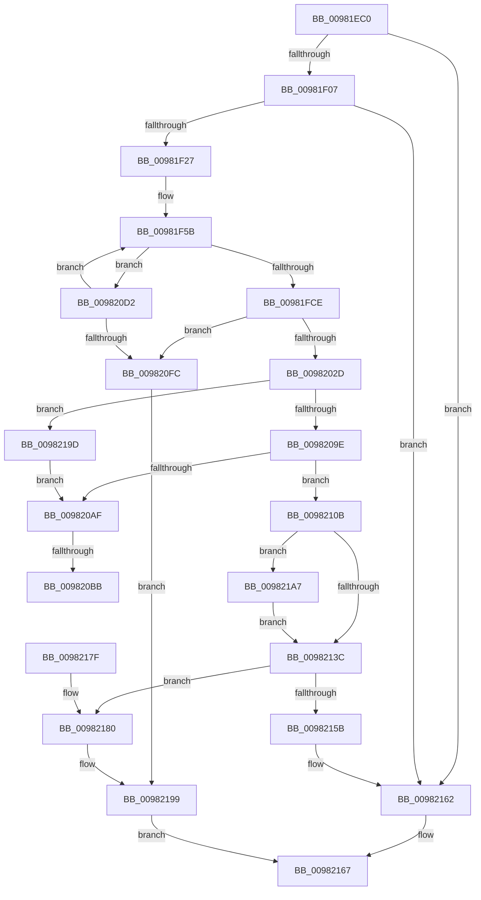

# MiAllocateNewSubAllocatedRegion

- RVA: `0x00981EC0`–`0x009821B4` (길이 `756` bytes)
- VA: `0x0000000140981EC0`
- 실행 섹션: `PAGE`
- PDB 이름 있음: `예`; PDB Function 태그: `예`
- unwind 정보 RVA: `0x000978D0`
- 디코드: `191`개 명령, `756/756` bytes 표시
- 미해석 바이트: `0` (있으면 어셈블리에 `.byte`로 보존)

> 이 문서는 커널 이미지의 기계어와 PDB 기호를 분석해 생성했습니다. 4번과 5번은 함수 원형과 자료형을 바이너리 사용 방식에서 추정한 C 해석이며 원본 소스 복구 결과는 아닙니다.

## 1. Dependencies

- 직접 호출 지점: **17**; 고유 호출 대상: **17**
- 직접 호출자로 확인된 함수: **1**
- RIP 상대 이미지 참조: **0**

### Outgoing calls
- `0x00981F16` → [MiAllocatePool](../../text/35/MiAllocatePool_function_0035B540.md) (function, `0x0035B540`)
- `0x00981F4B` → [MiGetUserReservationHighestAddress](MiGetUserReservationHighestAddress_function_00982430.md) (function, `0x00982430`)
- `0x00981FBF` → [MiSelectUserAddress](../88/MiSelectUserAddress_function_00885C40.md) (function, `0x00885C40`)
- `0x00981FF2` → [MiUpdateVadStartVpn](../../text/45/MiUpdateVadStartVpn_function_00450ED4.md) (function, `0x00450ED4`)
- `0x0098201E` → [MiCreateVadEventBitmap](MiCreateVadEventBitmap_function_009803FC.md) (function, `0x009803FC`)
- `0x00982035` → [MiLocateLockedVadEvent](../../text/2A/MiLocateLockedVadEvent_function_002A7A0C.md) (function, `0x002A7A0C`)
- `0x00982046` → [ExGenRandom](../../text/41/ExGenRandom_function_0041B010.md) (function, `0x0041B010`)
- `0x0098208D` → [MiAddSecureEntry](MiAddSecureEntry_function_00980250.md) (function, `0x00980250`)
- `0x009820A4` → [MiInsertVadCharges](../88/MiInsertVadCharges_function_00886AA8.md) (function, `0x00886AA8`)
- `0x009820C7` → [MiFreeVadEventBitmap](../AD/MiFreeVadEventBitmap_function_00ADB6B8.md) (function, `0x00ADB6B8`)
- `0x00982101` → [ExFreePoolWithTag](../../poolcode/B8/ExFreePoolWithTag_function_00B82870.md) (function, `0x00B82870`)
- `0x00982111` → [MiLockVad](../../text/29/MiLockVad_function_00295810.md) (function, `0x00295810`)
- `0x0098211F` → [MiInsertVad](../../text/26/MiInsertVad_function_00265540.md) (function, `0x00265540`)
- `0x0098212A` → [MiUnlockVad](../../text/2A/MiUnlockVad_function_002A59C8.md) (function, `0x002A59C8`)
- `0x00982142` → [LOCK_PAGE_TABLE_COMMITMENT](../../text/2A/LOCK_PAGE_TABLE_COMMITMENT_function_002A6090.md) (function, `0x002A6090`)
- `0x00982194` → [UNLOCK_PAGE_TABLE_COMMITMENT](../../text/2E/UNLOCK_PAGE_TABLE_COMMITMENT_function_002E27D0.md) (function, `0x002E27D0`)
- `0x009821AD` → [MiAdvanceVadHint](../88/MiAdvanceVadHint_function_00886C40.md) (function, `0x00886C40`)

### Direct callers
- [MiAllocateFromSubAllocatedRegion](MiAllocateFromSubAllocatedRegion_function_00981C24.md) at `0x00981E0A`

### Static image references
- 디코드된 RIP-relative 메모리 참조가 없습니다.

## 2. Other-region calls and transfers

- 다른 실행 섹션으로 향하는 call: **10**
  - `0x00981F16` → [MiAllocatePool](../../text/35/MiAllocatePool_function_0035B540.md) (`PAGE` → `.text`)
  - `0x00981FF2` → [MiUpdateVadStartVpn](../../text/45/MiUpdateVadStartVpn_function_00450ED4.md) (`PAGE` → `.text`)
  - `0x00982035` → [MiLocateLockedVadEvent](../../text/2A/MiLocateLockedVadEvent_function_002A7A0C.md) (`PAGE` → `.text`)
  - `0x00982046` → [ExGenRandom](../../text/41/ExGenRandom_function_0041B010.md) (`PAGE` → `.text`)
  - `0x00982101` → [ExFreePoolWithTag](../../poolcode/B8/ExFreePoolWithTag_function_00B82870.md) (`PAGE` → `POOLCODE`)
  - `0x00982111` → [MiLockVad](../../text/29/MiLockVad_function_00295810.md) (`PAGE` → `.text`)
  - `0x0098211F` → [MiInsertVad](../../text/26/MiInsertVad_function_00265540.md) (`PAGE` → `.text`)
  - `0x0098212A` → [MiUnlockVad](../../text/2A/MiUnlockVad_function_002A59C8.md) (`PAGE` → `.text`)
  - `0x00982142` → [LOCK_PAGE_TABLE_COMMITMENT](../../text/2A/LOCK_PAGE_TABLE_COMMITMENT_function_002A6090.md) (`PAGE` → `.text`)
  - `0x00982194` → [UNLOCK_PAGE_TABLE_COMMITMENT](../../text/2E/UNLOCK_PAGE_TABLE_COMMITMENT_function_002E27D0.md) (`PAGE` → `.text`)
- call이 아닌 외부 분기/꼬리 이동: **2**
  - `0x009820B5` → [sub_00B2A72C](../B2/Unknown_function_00B2A72C.md) (`tail-transfer`)
  - `0x009820CD` → [sub_00B2A72C](../B2/Unknown_function_00B2A72C.md) (`tail-transfer`)

## 3. Assembly (complete function range)

```asm
00981EC0  48 8B C4                        mov rax, rsp
00981EC3  48 89 58 08                     mov qword ptr [rax + 8], rbx
00981EC7  55                              push rbp
00981EC8  56                              push rsi
00981EC9  57                              push rdi
00981ECA  41 54                           push r12
00981ECC  41 55                           push r13
00981ECE  41 56                           push r14
00981ED0  41 57                           push r15
00981ED2  48 83 EC 70                     sub rsp, 0x70
00981ED6  65 48 8B 2C 25 88 01 00 00      mov rbp, qword ptr gs:[0x188]
00981EDF  41 BE 00 02 00 00               mov r14d, 0x200
00981EE5  48 83 60 10 00                  and qword ptr [rax + 0x10], 0
00981EEA  48 8B BD B8 00 00 00            mov rdi, qword ptr [rbp + 0xb8]
00981EF1  48 8B 87 10 04 00 00            mov rax, qword ptr [rdi + 0x410]
00981EF8  48 89 44 24 60                  mov qword ptr [rsp + 0x60], rax
00981EFD  48 83 FA 10                     cmp rdx, 0x10
00981F01  0F 87 5B 02 00 00               ja 0x140982162
00981F07  B8 40 00 00 00                  mov eax, 0x40
00981F0C  41 B8 56 61 64 53               mov r8d, 0x53646156
00981F12  8B D0                           mov edx, eax
00981F14  8B C8                           mov ecx, eax
00981F16  E8 25 96 9D FF                  call 0x14035b540
00981F1B  48 8B D8                        mov rbx, rax
00981F1E  48 85 C0                        test rax, rax
00981F21  0F 84 3B 02 00 00               je 0x140982162
00981F27  8B 48 30                        mov ecx, dword ptr [rax + 0x30]
00981F2A  33 D2                           xor edx, edx
00981F2C  48 83 60 28 00                  and qword ptr [rax + 0x28], 0
00981F31  81 E1 7F F2 FF FF               and ecx, 0xfffff27f
00981F37  81 C9 00 02 20 00               or ecx, 0x200200
00981F3D  48 C7 40 10 FE FF FF FF         mov qword ptr [rax + 0x10], 0xfffffffffffffffe
00981F45  89 48 30                        mov dword ptr [rax + 0x30], ecx
00981F48  48 8B CF                        mov rcx, rdi
00981F4B  E8 E0 04 00 00                  call 0x140982430
00981F50  48 89 44 24 50                  mov qword ptr [rsp + 0x50], rax
00981F55  41 BF 00 00 20 00               mov r15d, 0x200000
00981F5B  8B 4B 30                        mov ecx, dword ptr [rbx + 0x30]
00981F5E  48 8D 94 24 B8 00 00 00         lea rdx, [rsp + 0xb8]
00981F66  48 83 A4 24 C0 00 00 00 00      and qword ptr [rsp + 0xc0], 0
00981F6F  4D 8B E6                        mov r12, r14
00981F72  48 89 54 24 48                  mov qword ptr [rsp + 0x48], rdx
00981F77  4C 8B C0                        mov r8, rax
00981F7A  C1 E9 07                        shr ecx, 7
00981F7D  48 8D 94 24 C0 00 00 00         lea rdx, [rsp + 0xc0]
00981F85  48 89 54 24 40                  mov qword ptr [rsp + 0x40], rdx
00981F8A  83 E1 1F                        and ecx, 0x1f
00981F8D  C7 44 24 38 00 00 00 80         mov dword ptr [rsp + 0x38], 0x80000000
00981F95  33 D2                           xor edx, edx
00981F97  89 4C 24 30                     mov dword ptr [rsp + 0x30], ecx
00981F9B  4D 8B EE                        mov r13, r14
00981F9E  48 83 64 24 28 00               and qword ptr [rsp + 0x28], 0
00981FA4  33 C9                           xor ecx, ecx
00981FA6  49 C1 E4 0C                     shl r12, 0xc
00981FAA  4D 8B CC                        mov r9, r12
00981FAD  4C 89 7C 24 20                  mov qword ptr [rsp + 0x20], r15
00981FB2  4C 89 74 24 58                  mov qword ptr [rsp + 0x58], r14
00981FB7  4C 89 BC 24 C8 00 00 00         mov qword ptr [rsp + 0xc8], r15
00981FBF  E8 7C 3C F0 FF                  call 0x140885c40
00981FC4  8B F0                           mov esi, eax
00981FC6  85 C0                           test eax, eax
00981FC8  0F 88 04 01 00 00               js 0x1409820d2
00981FCE  48 8B 84 24 B8 00 00 00         mov rax, qword ptr [rsp + 0xb8]
00981FD6  48 8B CB                        mov rcx, rbx
00981FD9  4C 8B E8                        mov r13, rax
00981FDC  49 C1 ED 0C                     shr r13, 0xc
00981FE0  49 8B D5                        mov rdx, r13
00981FE3  4C 8D 40 FF                     lea r8, [rax - 1]
00981FE7  4D 03 C4                        add r8, r12
00981FEA  4C 89 84 24 C8 00 00 00         mov qword ptr [rsp + 0xc8], r8
00981FF2  E8 DD EE AC FF                  call 0x140450ed4
00981FF7  4D 8B F8                        mov r15, r8
00981FFA  41 B9 40 00 00 00               mov r9d, 0x40
00982000  49 C1 EF 0C                     shr r15, 0xc
00982004  4D 8B C6                        mov r8, r14
00982007  49 8B C7                        mov rax, r15
0098200A  44 89 7B 1C                     mov dword ptr [rbx + 0x1c], r15d
0098200E  48 C1 E8 20                     shr rax, 0x20
00982012  48 8B D3                        mov rdx, rbx
00982015  48 8B CF                        mov rcx, rdi
00982018  88 43 21                        mov byte ptr [rbx + 0x21], al
0098201B  4D 8B E6                        mov r12, r14
0098201E  E8 D9 E3 FF FF                  call 0x1409803fc
00982023  8B F0                           mov esi, eax
00982025  85 C0                           test eax, eax
00982027  0F 88 CF 00 00 00               js 0x1409820fc
0098202D  BA 40 00 00 00                  mov edx, 0x40
00982032  48 8B CB                        mov rcx, rbx
00982035  E8 D2 59 92 FF                  call 0x1402a7a0c
0098203A  8D 4A C1                        lea ecx, [rdx - 0x3f]
0098203D  48 8D 70 08                     lea rsi, [rax + 8]
00982041  48 89 74 24 58                  mov qword ptr [rsp + 0x58], rsi
00982046  E8 C5 8F A9 FF                  call 0x14041b010
0098204B  4C 8B 84 24 C8 00 00 00         mov r8, qword ptr [rsp + 0xc8]
00982053  4C 8D 76 10                     lea r14, [rsi + 0x10]
00982057  33 D2                           xor edx, edx
00982059  8B C0                           mov eax, eax
0098205B  49 F7 F4                        div r12
0098205E  33 C0                           xor eax, eax
00982060  48 89 5E 20                     mov qword ptr [rsi + 0x20], rbx
00982064  C1 E2 02                        shl edx, 2
00982067  41 B9 01 00 00 80               mov r9d, 0x80000001
0098206D  89 56 30                        mov dword ptr [rsi + 0x30], edx
00982070  48 8B CB                        mov rcx, rbx
00982073  48 8B 94 24 B8 00 00 00         mov rdx, qword ptr [rsp + 0xb8]
0098207B  49 89 06                        mov qword ptr [r14], rax
0098207E  48 89 46 18                     mov qword ptr [rsi + 0x18], rax
00982082  89 46 28                        mov dword ptr [rsi + 0x28], eax
00982085  44 89 66 2C                     mov dword ptr [rsi + 0x2c], r12d
00982089  89 44 24 20                     mov dword ptr [rsp + 0x20], eax
0098208D  E8 BE E1 FF FF                  call 0x140980250
00982092  4C 8B E0                        mov r12, rax
00982095  48 85 C0                        test rax, rax
00982098  0F 84 FF 00 00 00               je 0x14098219d
0098209E  48 8B D7                        mov rdx, rdi
009820A1  48 8B CB                        mov rcx, rbx
009820A4  E8 FF 49 F0 FF                  call 0x140886aa8
009820A9  8B F0                           mov esi, eax
009820AB  85 C0                           test eax, eax
009820AD  79 5C                           jns 0x14098210b
009820AF  48 83 7C 24 58 00               cmp qword ptr [rsp + 0x58], 0
009820B5  0F 84 71 86 1A 00               je 0x140b2a72c
009820BB  41 B8 40 00 00 00               mov r8d, 0x40
009820C1  48 8B D3                        mov rdx, rbx
009820C4  48 8B CF                        mov rcx, rdi
009820C7  E8 EC 95 15 00                  call 0x140adb6b8
009820CC  90                              nop
009820CD  E9 5A 86 1A 00                  jmp 0x140b2a72c
009820D2  B8 00 00 01 00                  mov eax, 0x10000
009820D7  4C 3B F8                        cmp r15, rax
009820DA  4C 0F 45 F8                     cmovne r15, rax
009820DE  49 D1 EE                        shr r14, 1
009820E1  48 39 84 24 C8 00 00 00         cmp qword ptr [rsp + 0xc8], rax
009820E9  48 8B 44 24 50                  mov rax, qword ptr [rsp + 0x50]
009820EE  4D 0F 45 F5                     cmovne r14, r13
009820F2  49 83 FE 10                     cmp r14, 0x10
009820F6  0F 83 5F FE FF FF               jae 0x140981f5b
009820FC  33 D2                           xor edx, edx
009820FE  48 8B CB                        mov rcx, rbx
00982101  E8 6A 07 20 00                  call 0x140b82870
00982106  E9 8E 00 00 00                  jmp 0x140982199
0098210B  48 8B D3                        mov rdx, rbx
0098210E  48 8B CD                        mov rcx, rbp
00982111  E8 FA 36 91 FF                  call 0x140295810
00982116  45 33 C0                        xor r8d, r8d
00982119  48 8B D7                        mov rdx, rdi
0098211C  48 8B CB                        mov rcx, rbx
0098211F  E8 1C 34 8E FF                  call 0x140265540
00982124  48 8B D3                        mov rdx, rbx
00982127  48 8B CD                        mov rcx, rbp
0098212A  E8 99 38 92 FF                  call 0x1402a59c8
0098212F  4C 8B 84 24 C0 00 00 00         mov r8, qword ptr [rsp + 0xc0]
00982137  4D 85 C0                        test r8, r8
0098213A  75 6B                           jne 0x1409821a7
0098213C  48 8B D7                        mov rdx, rdi
0098213F  48 8B CD                        mov rcx, rbp
00982142  E8 49 3F 92 FF                  call 0x1402a6090
00982147  48 8B 44 24 60                  mov rax, qword ptr [rsp + 0x60]
0098214C  48 05 08 04 00 00               add rax, 0x408
00982152  48 8B 08                        mov rcx, qword ptr [rax]
00982155  48 39 41 08                     cmp qword ptr [rcx + 8], rax
00982159  74 25                           je 0x140982180
0098215B  B9 03 00 00 00                  mov ecx, 3
00982160  CD 29                           int 0x29
00982162  B8 17 00 00 C0                  mov eax, 0xc0000017
00982167  48 8B 9C 24 B0 00 00 00         mov rbx, qword ptr [rsp + 0xb0]
0098216F  48 83 C4 70                     add rsp, 0x70
00982173  41 5F                           pop r15
00982175  41 5E                           pop r14
00982177  41 5D                           pop r13
00982179  41 5C                           pop r12
0098217B  5F                              pop rdi
0098217C  5E                              pop rsi
0098217D  5D                              pop rbp
0098217E  C3                              ret
0098217F  CC                              int3
00982180  49 89 0E                        mov qword ptr [r14], rcx
00982183  48 8B D7                        mov rdx, rdi
00982186  49 89 46 08                     mov qword ptr [r14 + 8], rax
0098218A  4C 89 71 08                     mov qword ptr [rcx + 8], r14
0098218E  48 8B CD                        mov rcx, rbp
00982191  4C 89 30                        mov qword ptr [rax], r14
00982194  E8 37 06 96 FF                  call 0x1402e27d0
00982199  8B C6                           mov eax, esi
0098219B  EB CA                           jmp 0x140982167
0098219D  BE 9A 00 00 C0                  mov esi, 0xc000009a
009821A2  E9 08 FF FF FF                  jmp 0x1409820af
009821A7  49 8B D7                        mov rdx, r15
009821AA  49 8B CD                        mov rcx, r13
009821AD  E8 8E 4A F0 FF                  call 0x140886c40
009821B2  EB 88                           jmp 0x14098213c
```

## 4. C-style interpretation (structured pseudocode)

```c
__int64 __fastcall MiAllocateNewSubAllocatedRegion(__int64 a1, __int64 a2)
{
    __int64 result;
    __int64 v_r12;
    __int64 v_r13;
    __int64 v_r14;
    __int64 v_r15;
    __int64 v_rsp;
    unsigned __int64 v_stack_m48;
    unsigned __int64 v_stack_m50;
    unsigned __int64 v_stack_m58;
    unsigned __int64 v_stack_m60;
    unsigned __int64 v_stack_m68;
    unsigned int v_stack_m70;
    unsigned int v_stack_m78;
    unsigned __int64 v_stack_m80;
    unsigned __int64 v_stack_m88;
    unsigned __int64 v_stack_p10;
    unsigned __int64 v_stack_p18;
    unsigned __int64 v_stack_p20;
    unsigned __int64 v_stack_p8;

    *(unsigned __int64 *)(v_rsp + 8) = v_rbx;
    v_rsp = (v_rsp) - (112);
    v_stack_m48 = *(unsigned __int64 *)(*(unsigned __int64 *)(*(unsigned __int64 *)(gs_base + (0 + 392)) + 184) + 1040);
    if (a2 > 16) goto loc_00982162;
    result = MiAllocatePool(64, 64, (unsigned int)(0x53646156ULL), a4);
    if (result == 0) goto loc_00982162;
    a2 = 0;
    a1 = (unsigned int)(((unsigned int)(*(unsigned int *)(result + 48))) & (0xFFFFF27FULL));
    a1 = (unsigned int)((a1) | (0x200200ULL));
    *(unsigned __int64 *)(result + 16) = -2;
    *(unsigned int *)(result + 48) = (unsigned int)(a1);
    result = MiGetUserReservationHighestAddress(*(unsigned __int64 *)(*(unsigned __int64 *)(gs_base + (0 + 392)) + 184), a2, (unsigned int)(0x53646156ULL), a4);
    v_stack_m58 = result;
loc_00981F5B:
    v_stack_m60 = v_stack_p10;
    a1 = (unsigned int)(((unsigned int)(*(unsigned int *)(result + 48))) >> (7));
    v_stack_m68 = v_stack_p18;
    a1 = (unsigned int)((a1) & (31));
    v_stack_m70 = 0x80000000ULL;
    a2 = 0;
    v_stack_m78 = (unsigned int)(a1);
    a1 = 0;
    v_r12 = (512) << (12);
    v_stack_m88 = (unsigned int)(0x200000ULL);
    v_stack_m50 = 512;
    v_stack_p20 = (unsigned int)(0x200000ULL);
    result = MiSelectUserAddress(a1, a2, result, v_r12);
    if (sign_flag) goto loc_009820D2;
    v_r13 = (v_stack_p10) >> (12);
    a3 = (v_stack_p10 - 1) + (v_r12);
    v_stack_p20 = a3;
    result = MiUpdateVadStartVpn(result, v_r13, a3, v_r12);
    v_r15 = (a3) >> (12);
    *(unsigned int *)(result + 28) = (unsigned int)(v_r15);
    result = (v_r15) >> (32);
    *(unsigned __int8 *)(result + 33) = (unsigned __int8)(result);
    result = MiCreateVadEventBitmap(*(unsigned __int64 *)(*(unsigned __int64 *)(gs_base + (0 + 392)) + 184), result, 512, 64);
    if (sign_flag) goto loc_009820FC;
    result = MiLocateLockedVadEvent(result, 64, 512, 64);
    v_stack_m50 = result + 8;
    result = ExGenRandom(64 - 63, 64, 512, 64);
    a2 = 0;
    result = 0;
    *(unsigned __int64 *)(result + 8 + 32) = 0;
    a2 = (unsigned int)((a2) << (2));
    *(unsigned int *)(result + 8 + 48) = (unsigned int)(a2);
    *(unsigned __int64 *)(result + 8 + 16) = 0;
    *(unsigned __int64 *)(result + 8 + 24) = 0;
    *(unsigned int *)(result + 8 + 40) = 0;
    *(unsigned int *)(result + 8 + 44) = 512;
    v_stack_m88 = 0;
    result = MiAddSecureEntry(0, v_stack_p10, v_stack_p20, (unsigned int)(0x80000001ULL));
    if (result == 0) goto loc_0098219D;
    result = MiInsertVadCharges(result, *(unsigned __int64 *)(*(unsigned __int64 *)(gs_base + (0 + 392)) + 184), v_stack_p20, (unsigned int)(0x80000001ULL));
    if (!sign_flag) goto loc_0098210B;
loc_009820AF:
    result = MiFreeVadEventBitmap(*(unsigned __int64 *)(*(unsigned __int64 *)(gs_base + (0 + 392)) + 184), result, 64, (unsigned int)(0x80000001ULL));
loc_009820D2:
    if (v_r15 != ((unsigned int)(0x10000ULL))) { v_r15 = (unsigned int)(0x10000ULL); }
    v_r14 = (result + 8 + 16) >> (1);
    if (v_stack_p20 != ((unsigned int)(0x10000ULL))) { v_r14 = v_r13; }
    if (v_r14 >= 16) goto loc_00981F5B;
loc_009820FC:
    a2 = 0;
    result = ExFreePoolWithTag(result, a2, 64, (unsigned int)(0x80000001ULL));
    goto loc_00982199;
loc_0098210B:
    result = MiLockVad(*(unsigned __int64 *)(gs_base + (0 + 392)), result, 64, (unsigned int)(0x80000001ULL));
    a3 = 0;
    result = MiInsertVad(result, *(unsigned __int64 *)(*(unsigned __int64 *)(gs_base + (0 + 392)) + 184), a3, (unsigned int)(0x80000001ULL));
    result = MiUnlockVad(*(unsigned __int64 *)(gs_base + (0 + 392)), result, a3, (unsigned int)(0x80000001ULL));
    if (v_stack_p18 != 0) goto loc_009821A7;
loc_0098213C:
    result = LOCK_PAGE_TABLE_COMMITMENT(*(unsigned __int64 *)(gs_base + (0 + 392)), *(unsigned __int64 *)(*(unsigned __int64 *)(gs_base + (0 + 392)) + 184), v_stack_p18, (unsigned int)(0x80000001ULL));
    result = (v_stack_m48) + (0x408ULL);
    if ((*(unsigned __int64 *)(*(unsigned __int64 *)(result) + 8)) == result) goto loc_00982180;
loc_00982162:
loc_00982167:
    v_rsp = (v_rsp) + (112);
    return (unsigned int)(0xC0000017ULL);
loc_00982180:
    *(unsigned __int64 *)(v_r14) = 3;
    *(unsigned __int64 *)(v_r14 + 8) = (unsigned int)(0xC0000017ULL);
    *(unsigned __int64 *)(3 + 8) = v_r14;
    *(unsigned __int64 *)((unsigned int)(0xC0000017ULL)) = v_r14;
    result = UNLOCK_PAGE_TABLE_COMMITMENT(*(unsigned __int64 *)(gs_base + (0 + 392)), *(unsigned __int64 *)(*(unsigned __int64 *)(gs_base + (0 + 392)) + 184), v_stack_p18, (unsigned int)(0x80000001ULL));
loc_00982199:
    goto loc_00982167;
loc_0098219D:
    goto loc_009820AF;
loc_009821A7:
    result = MiAdvanceVadHint(v_r13, v_r15, v_stack_p18, (unsigned int)(0x80000001ULL));
    goto loc_0098213C;
}
```

## 5. (Beta) C Style

```c
int64_t MiAllocateNewSubAllocatedRegion(int64_t Arg1, int64_t Arg2)
{
    int64_t result;
    int64_t local_r12;
    int64_t local_r13;
    int64_t local_r14;
    int64_t local_r15;
    int64_t local_rsp;
    uint64_t v_stack_m48;
    uint64_t v_stack_m50;
    uint64_t v_stack_m58;
    uint64_t v_stack_m60;
    uint64_t v_stack_m68;
    uint32_t v_stack_m70;
    uint32_t v_stack_m78;
    uint64_t v_stack_m80;
    uint64_t v_stack_m88;
    uint64_t v_stack_p10;
    uint64_t v_stack_p18;
    uint64_t v_stack_p20;
    uint64_t v_stack_p8;

    *(uint64_t *)(local_rsp + 0x8) = local_rbx;
    local_rsp = (local_rsp) - (112);
    v_stack_m48 = *(uint64_t *)(*(uint64_t *)(*(uint64_t *)(gs_base + (0 + 0x188)) + 0xB8) + 0x410);
    if (Arg2 > 16) goto loc_00982162;
    result = MiAllocatePool(64, 64, (uint32_t)(0x53646156ULL), a4);
    if (result == 0) goto loc_00982162;
    Arg2 = 0;
    Arg1 = (uint32_t)(((uint32_t)(*(uint32_t *)(result + 0x30))) & (0xFFFFF27FULL));
    Arg1 = (uint32_t)((Arg1) | (0x200200ULL));
    *(uint64_t *)(result + 0x10) = -2;
    *(uint32_t *)(result + 0x30) = (uint32_t)(Arg1);
    result = MiGetUserReservationHighestAddress(*(uint64_t *)(*(uint64_t *)(gs_base + (0 + 0x188)) + 0xB8), Arg2, (uint32_t)(0x53646156ULL), a4);
    v_stack_m58 = result;
loc_00981F5B:
    v_stack_m60 = v_stack_p10;
    Arg1 = (uint32_t)(((uint32_t)(*(uint32_t *)(result + 0x30))) >> (7));
    v_stack_m68 = v_stack_p18;
    Arg1 = (uint32_t)((Arg1) & (31));
    v_stack_m70 = 0x80000000ULL;
    Arg2 = 0;
    v_stack_m78 = (uint32_t)(Arg1);
    Arg1 = 0;
    local_r12 = (512) << (12);
    v_stack_m88 = (uint32_t)(0x200000ULL);
    v_stack_m50 = 512;
    v_stack_p20 = (uint32_t)(0x200000ULL);
    result = MiSelectUserAddress(Arg1, Arg2, result, local_r12);
    if (sign_flag) goto loc_009820D2;
    local_r13 = (v_stack_p10) >> (12);
    a3 = (v_stack_p10 - 1) + (local_r12);
    v_stack_p20 = a3;
    result = MiUpdateVadStartVpn(result, local_r13, a3, local_r12);
    local_r15 = (a3) >> (12);
    *(uint32_t *)(result + 0x1C) = (uint32_t)(local_r15);
    result = (local_r15) >> (32);
    *(uint8_t *)(result + 0x21) = (uint8_t)(result);
    result = MiCreateVadEventBitmap(*(uint64_t *)(*(uint64_t *)(gs_base + (0 + 0x188)) + 0xB8), result, 512, 64);
    if (sign_flag) goto loc_009820FC;
    result = MiLocateLockedVadEvent(result, 64, 512, 64);
    v_stack_m50 = result + 8;
    result = ExGenRandom(64 - 63, 64, 512, 64);
    Arg2 = 0;
    result = 0;
    *(uint64_t *)(result + 0x8 + 0x20) = 0;
    Arg2 = (uint32_t)((Arg2) << (2));
    *(uint32_t *)(result + 0x8 + 0x30) = (uint32_t)(Arg2);
    *(uint64_t *)(result + 0x8 + 0x10) = 0;
    *(uint64_t *)(result + 0x8 + 0x18) = 0;
    *(uint32_t *)(result + 0x8 + 0x28) = 0;
    *(uint32_t *)(result + 0x8 + 0x2C) = 512;
    v_stack_m88 = 0;
    result = MiAddSecureEntry(0, v_stack_p10, v_stack_p20, (uint32_t)(0x80000001ULL));
    if (result == 0) goto loc_0098219D;
    result = MiInsertVadCharges(result, *(uint64_t *)(*(uint64_t *)(gs_base + (0 + 0x188)) + 0xB8), v_stack_p20, (uint32_t)(0x80000001ULL));
    if (!sign_flag) goto loc_0098210B;
loc_009820AF:
    result = MiFreeVadEventBitmap(*(uint64_t *)(*(uint64_t *)(gs_base + (0 + 0x188)) + 0xB8), result, 64, (uint32_t)(0x80000001ULL));
loc_009820D2:
    if (local_r15 != ((uint32_t)(0x10000ULL))) { local_r15 = (uint32_t)(0x10000ULL); }
    local_r14 = (result + 8 + 16) >> (1);
    if (v_stack_p20 != ((uint32_t)(0x10000ULL))) { local_r14 = local_r13; }
    if (local_r14 >= 16) goto loc_00981F5B;
loc_009820FC:
    Arg2 = 0;
    result = ExFreePoolWithTag(result, Arg2, 64, (uint32_t)(0x80000001ULL));
    goto loc_00982199;
loc_0098210B:
    result = MiLockVad(*(uint64_t *)(gs_base + (0 + 0x188)), result, 64, (uint32_t)(0x80000001ULL));
    a3 = 0;
    result = MiInsertVad(result, *(uint64_t *)(*(uint64_t *)(gs_base + (0 + 0x188)) + 0xB8), a3, (uint32_t)(0x80000001ULL));
    result = MiUnlockVad(*(uint64_t *)(gs_base + (0 + 0x188)), result, a3, (uint32_t)(0x80000001ULL));
    if (v_stack_p18 != 0) goto loc_009821A7;
loc_0098213C:
    result = LOCK_PAGE_TABLE_COMMITMENT(*(uint64_t *)(gs_base + (0 + 0x188)), *(uint64_t *)(*(uint64_t *)(gs_base + (0 + 0x188)) + 0xB8), v_stack_p18, (uint32_t)(0x80000001ULL));
    result = (v_stack_m48) + (0x408ULL);
    if ((*(uint64_t *)(*(uint64_t *)(result) + 0x8)) == result) goto loc_00982180;
loc_00982162:
loc_00982167:
    local_rsp = (local_rsp) + (112);
    return (uint32_t)(0xC0000017ULL);
loc_00982180:
    *(uint64_t *)(local_r14) = 3;
    *(uint64_t *)(local_r14 + 0x8) = (uint32_t)(0xC0000017ULL);
    *(uint64_t *)(3 + 0x8) = local_r14;
    *(uint64_t *)((uint32_t)(0xC0000017ULL)) = local_r14;
    result = UNLOCK_PAGE_TABLE_COMMITMENT(*(uint64_t *)(gs_base + (0 + 0x188)), *(uint64_t *)(*(uint64_t *)(gs_base + (0 + 0x188)) + 0xB8), v_stack_p18, (uint32_t)(0x80000001ULL));
loc_00982199:
    goto loc_00982167;
loc_0098219D:
    goto loc_009820AF;
loc_009821A7:
    result = MiAdvanceVadHint(local_r13, local_r15, v_stack_p18, (uint32_t)(0x80000001ULL));
    goto loc_0098213C;
}
```

## 6. Execution-region graph

[열기: 2D/3D 그래프와 함수 탐색 컨트롤 패널](../../../control-panel.html?section=page&rva=0x00981EC0&view=graph)

- 2D 그래프는 위에서 아래로 흐르고, 3D 그래프는 빈 공간을 드래그해 회전합니다. Shift+드래그는 이동, 휠은 확대·축소, 함수 노드 선택은 대상 보고서 이동입니다.

### Static fallback


