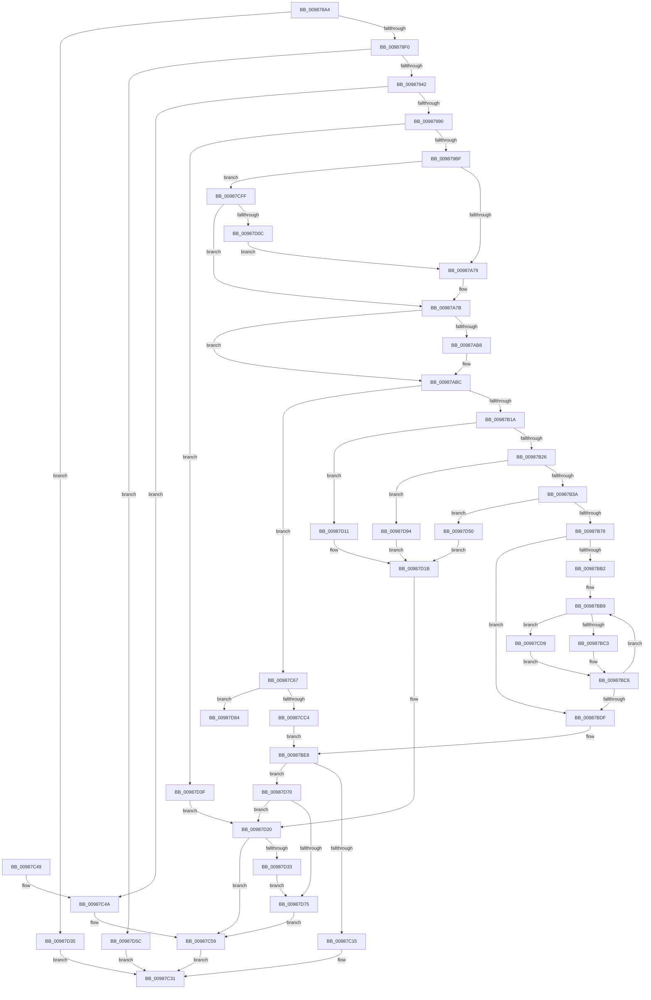

# MiBuildImageControlArea

- RVA: `0x009878A4`–`0x00987DA3` (길이 `1,279` bytes)
- VA: `0x00000001409878A4`
- 실행 섹션: `PAGE`
- PDB 이름 있음: `예`; PDB Function 태그: `예`
- unwind 정보 RVA: `0x00097D20`
- 디코드: `309`개 명령, `1,279/1,279` bytes 표시
- 미해석 바이트: `0` (있으면 어셈블리에 `.byte`로 보존)

> 이 문서는 커널 이미지의 기계어와 PDB 기호를 분석해 생성했습니다. 4번과 5번은 함수 원형과 자료형을 바이너리 사용 방식에서 추정한 C 해석이며 원본 소스 복구 결과는 아닙니다.

## 1. Dependencies

- 직접 호출 지점: **12**; 고유 호출 대상: **7**
- 직접 호출자로 확인된 함수: **1**
- RIP 상대 이미지 참조: **2**

### Outgoing calls
- `0x00987931` → [MiAllocatePool](../../text/35/MiAllocatePool_function_0035B540.md) (function, `0x0035B540`)
- `0x0098797F` → [MiAllocatePool](../../text/35/MiAllocatePool_function_0035B540.md) (function, `0x0035B540`)
- `0x00987998` → [memset](../../text/6C/memset_function_006C6C40.md) (function, `0x006C6C40`)
- `0x009879AB` → [MiAllocatePool](../../text/35/MiAllocatePool_function_0035B540.md) (function, `0x0035B540`)
- `0x00987BA0` → [MiMakeSubsectionPte](../../text/47/MiMakeSubsectionPte_function_0047B4F0.md) (function, `0x0047B4F0`)
- `0x00987C06` → [MiParseImageSectionHeaders](MiParseImageSectionHeaders_function_00987F70.md) (function, `0x00987F70`)
- `0x00987C1F` → [MiUpdateSystemProtoPtesTree](../../text/29/MiUpdateSystemProtoPtesTree_function_00295F0C.md) (function, `0x00295F0C`)
- `0x00987C5E` → [ExFreePoolWithTag](../../poolcode/B8/ExFreePoolWithTag_function_00B82870.md) (function, `0x00B82870`)
- `0x00987CA7` → [MiMakeSubsectionPte](../../text/47/MiMakeSubsectionPte_function_0047B4F0.md) (function, `0x0047B4F0`)
- `0x00987CB4` → [MiMakeDemandZeroPte](../../text/33/MiMakeDemandZeroPte_function_00337A00.md) (function, `0x00337A00`)
- `0x00987D25` → [ExFreePoolWithTag](../../poolcode/B8/ExFreePoolWithTag_function_00B82870.md) (function, `0x00B82870`)
- `0x00987D7A` → [ExFreePoolWithTag](../../poolcode/B8/ExFreePoolWithTag_function_00B82870.md) (function, `0x00B82870`)

### Direct callers
- [MiCreateImageFileMap](MiCreateImageFileMap_function_00986830.md) at `0x00986B11`

### Static image references
- `0x00987BB2` → RVA `0x00010880` (`.rdata`; read)
- `0x00987C4A` → RVA `0x00E2D7F8` (`.data`; write)

## 2. Other-region calls and transfers

- 다른 실행 섹션으로 향하는 call: **11**
  - `0x00987931` → [MiAllocatePool](../../text/35/MiAllocatePool_function_0035B540.md) (`PAGE` → `.text`)
  - `0x0098797F` → [MiAllocatePool](../../text/35/MiAllocatePool_function_0035B540.md) (`PAGE` → `.text`)
  - `0x00987998` → [memset](../../text/6C/memset_function_006C6C40.md) (`PAGE` → `.text`)
  - `0x009879AB` → [MiAllocatePool](../../text/35/MiAllocatePool_function_0035B540.md) (`PAGE` → `.text`)
  - `0x00987BA0` → [MiMakeSubsectionPte](../../text/47/MiMakeSubsectionPte_function_0047B4F0.md) (`PAGE` → `.text`)
  - `0x00987C1F` → [MiUpdateSystemProtoPtesTree](../../text/29/MiUpdateSystemProtoPtesTree_function_00295F0C.md) (`PAGE` → `.text`)
  - `0x00987C5E` → [ExFreePoolWithTag](../../poolcode/B8/ExFreePoolWithTag_function_00B82870.md) (`PAGE` → `POOLCODE`)
  - `0x00987CA7` → [MiMakeSubsectionPte](../../text/47/MiMakeSubsectionPte_function_0047B4F0.md) (`PAGE` → `.text`)
  - `0x00987CB4` → [MiMakeDemandZeroPte](../../text/33/MiMakeDemandZeroPte_function_00337A00.md) (`PAGE` → `.text`)
  - `0x00987D25` → [ExFreePoolWithTag](../../poolcode/B8/ExFreePoolWithTag_function_00B82870.md) (`PAGE` → `POOLCODE`)
  - `0x00987D7A` → [ExFreePoolWithTag](../../poolcode/B8/ExFreePoolWithTag_function_00B82870.md) (`PAGE` → `POOLCODE`)
- call이 아닌 외부 분기/꼬리 이동: **1**
  - `0x00987D8F` → [sub_00B2B47A](../B2/Unknown_function_00B2B47A.md) (`tail-transfer`)

## 3. Assembly (complete function range)

```asm
009878A4  48 89 5C 24 08                  mov qword ptr [rsp + 8], rbx
009878A9  4C 89 4C 24 20                  mov qword ptr [rsp + 0x20], r9
009878AE  48 89 54 24 10                  mov qword ptr [rsp + 0x10], rdx
009878B3  55                              push rbp
009878B4  56                              push rsi
009878B5  57                              push rdi
009878B6  41 54                           push r12
009878B8  41 55                           push r13
009878BA  41 56                           push r14
009878BC  41 57                           push r15
009878BE  48 83 EC 40                     sub rsp, 0x40
009878C2  41 8B 40 10                     mov eax, dword ptr [r8 + 0x10]
009878C6  BD 00 00 00 00                  mov ebp, 0
009878CB  A9 FF 0F 00 00                  test eax, 0xfff
009878D0  8B D9                           mov ebx, ecx
009878D2  41 0F B7 49 02                  movzx ecx, word ptr [r9 + 2]
009878D7  4D 8B F8                        mov r15, r8
009878DA  40 0F 95 C5                     setne bpl
009878DE  89 8C 24 90 00 00 00            mov dword ptr [rsp + 0x90], ecx
009878E5  C1 E8 0C                        shr eax, 0xc
009878E8  03 E8                           add ebp, eax
009878EA  0F 84 45 04 00 00               je 0x140987d35
009878F0  8B BC 24 A0 00 00 00            mov edi, dword ptr [rsp + 0xa0]
009878F7  FF C1                           inc ecx
009878F9  B8 01 00 00 00                  mov eax, 1
009878FE  44 8B EF                        mov r13d, edi
00987901  41 81 E5 00 00 10 00            and r13d, 0x100000
00987908  0F 44 C1                        cmove eax, ecx
0098790B  B9 40 00 00 00                  mov ecx, 0x40
00987910  4C 6B F0 38                     imul r14, rax, 0x38
00987914  41 8B C5                        mov eax, r13d
00987917  F7 D8                           neg eax
00987919  45 1B C0                        sbb r8d, r8d
0098791C  41 81 E0 00 00 00 F8            and r8d, 0xf8000000
00987923  49 8D 96 C8 00 00 00            lea rdx, [r14 + 0xc8]
0098792A  41 81 C0 4D 6D 43 69            add r8d, 0x69436d4d
00987931  E8 0A 3C 9D FF                  call 0x14035b540
00987936  48 8B F0                        mov rsi, rax
00987939  48 85 C0                        test rax, rax
0098793C  0F 84 1A 04 00 00               je 0x140987d5c
00987942  83 48 38 20                     or dword ptr [rax + 0x38], 0x20
00987946  49 8D 8E 80 00 00 00            lea rcx, [r14 + 0x80]
0098794D  48 03 C8                        add rcx, rax
00987950  4C 8D 24 ED 00 00 00 00         lea r12, [rbp*8]
00987958  48 89 48 60                     mov qword ptr [rax + 0x60], rcx
0098795C  41 B8 4D 6D 53 74               mov r8d, 0x74536d4d
00987962  48 89 4C 24 30                  mov qword ptr [rsp + 0x30], rcx
00987967  49 8B D4                        mov rdx, r12
0098796A  48 8B 41 18                     mov rax, qword ptr [rcx + 0x18]
0098796E  48 83 E0 FA                     and rax, 0xfffffffffffffffa
00987972  48 83 C8 02                     or rax, 2
00987976  48 89 41 18                     mov qword ptr [rcx + 0x18], rax
0098797A  B9 12 01 00 00                  mov ecx, 0x112
0098797F  E8 BC 3B 9D FF                  call 0x14035b540
00987984  4C 8B F0                        mov r14, rax
00987987  48 85 C0                        test rax, rax
0098798A  0F 84 BA 02 00 00               je 0x140987c4a
00987990  4D 8B C4                        mov r8, r12
00987993  33 D2                           xor edx, edx
00987995  48 8B C8                        mov rcx, rax
00987998  E8 A3 F2 D3 FF                  call 0x1406c6c40
0098799D  BA 98 00 00 00                  mov edx, 0x98
009879A2  41 B8 4D 53 65 67               mov r8d, 0x6765534d
009879A8  8D 4A 68                        lea ecx, [rdx + 0x68]
009879AB  E8 90 3B 9D FF                  call 0x14035b540
009879B0  45 33 C9                        xor r9d, r9d
009879B3  4C 8B E0                        mov r12, rax
009879B6  48 85 C0                        test rax, rax
009879B9  0F 84 80 03 00 00               je 0x140987d3f
009879BF  48 8B 8C 24 98 00 00 00         mov rcx, qword ptr [rsp + 0x98]
009879C7  4D 8D 44 24 48                  lea r8, [r12 + 0x48]
009879CC  48 8B 94 24 A8 00 00 00         mov rdx, qword ptr [rsp + 0xa8]
009879D4  4C 89 48 28                     mov qword ptr [rax + 0x28], r9
009879D8  4C 89 70 40                     mov qword ptr [rax + 0x40], r14
009879DC  48 89 30                        mov qword ptr [rax], rsi
009879DF  89 68 08                        mov dword ptr [rax + 8], ebp
009879E2  4D 89 44 24 38                  mov qword ptr [r12 + 0x38], r8
009879E7  8B C5                           mov eax, ebp
009879E9  48 C1 E0 0C                     shl rax, 0xc
009879ED  49 89 44 24 18                  mov qword ptr [r12 + 0x18], rax
009879F2  41 8B 47 18                     mov eax, dword ptr [r15 + 0x18]
009879F6  41 89 40 40                     mov dword ptr [r8 + 0x40], eax
009879FA  41 8B 47 10                     mov eax, dword ptr [r15 + 0x10]
009879FE  41 89 40 44                     mov dword ptr [r8 + 0x44], eax
00987A02  8B 41 04                        mov eax, dword ptr [rcx + 4]
00987A05  41 89 40 48                     mov dword ptr [r8 + 0x48], eax
00987A09  8B 02                           mov eax, dword ptr [rdx]
00987A0B  41 89 40 38                     mov dword ptr [r8 + 0x38], eax
00987A0F  41 8B 47 1C                     mov eax, dword ptr [r15 + 0x1c]
00987A13  49 03 07                        add rax, qword ptr [r15]
00987A16  49 89 00                        mov qword ptr [r8], rax
00987A19  49 8B 47 20                     mov rax, qword ptr [r15 + 0x20]
00987A1D  49 89 40 10                     mov qword ptr [r8 + 0x10], rax
00987A21  49 8B 47 28                     mov rax, qword ptr [r15 + 0x28]
00987A25  49 89 40 18                     mov qword ptr [r8 + 0x18], rax
00987A29  41 0F B7 47 32                  movzx eax, word ptr [r15 + 0x32]
00987A2E  41 89 40 20                     mov dword ptr [r8 + 0x20], eax
00987A32  41 0F B7 47 34                  movzx eax, word ptr [r15 + 0x34]
00987A37  66 41 89 40 26                  mov word ptr [r8 + 0x26], ax
00987A3C  41 0F B7 47 36                  movzx eax, word ptr [r15 + 0x36]
00987A41  66 41 89 40 24                  mov word ptr [r8 + 0x24], ax
00987A46  41 0F B7 47 38                  movzx eax, word ptr [r15 + 0x38]
00987A4B  66 41 89 40 28                  mov word ptr [r8 + 0x28], ax
00987A50  41 0F B7 47 3A                  movzx eax, word ptr [r15 + 0x3a]
00987A55  66 41 89 40 2A                  mov word ptr [r8 + 0x2a], ax
00987A5A  41 0F B7 47 3C                  movzx eax, word ptr [r15 + 0x3c]
00987A5F  66 41 89 40 2E                  mov word ptr [r8 + 0x2e], ax
00987A64  41 8B 47 40                     mov eax, dword ptr [r15 + 0x40]
00987A68  41 89 40 3C                     mov dword ptr [r8 + 0x3c], eax
00987A6C  44 8B DD                        mov r11d, ebp
00987A6F  45 39 4F 44                     cmp dword ptr [r15 + 0x44], r9d
00987A73  0F 84 86 02 00 00               je 0x140987cff
00987A79  B0 01                           mov al, 1
00987A7B  41 88 40 32                     mov byte ptr [r8 + 0x32], al
00987A7F  0F B7 41 12                     movzx eax, word ptr [rcx + 0x12]
00987A83  66 41 89 40 2C                  mov word ptr [r8 + 0x2c], ax
00987A88  0F B7 01                        movzx eax, word ptr [rcx]
00987A8B  66 41 89 40 30                  mov word ptr [r8 + 0x30], ax
00987A90  41 8B 47 14                     mov eax, dword ptr [r15 + 0x14]
00987A94  41 89 40 34                     mov dword ptr [r8 + 0x34], eax
00987A98  48 8D 46 08                     lea rax, [rsi + 8]
00987A9C  4C 89 26                        mov qword ptr [rsi], r12
00987A9F  48 89 40 08                     mov qword ptr [rax + 8], rax
00987AA3  48 89 00                        mov qword ptr [rax], rax
00987AA6  B8 01 00 00 00                  mov eax, 1
00987AAB  48 89 46 70                     mov qword ptr [rsi + 0x70], rax
00987AAF  48 89 46 18                     mov qword ptr [rsi + 0x18], rax
00987AB3  40 84 F8                        test al, dil
00987AB6  75 04                           jne 0x140987abc
00987AB8  48 89 46 30                     mov qword ptr [rsi + 0x30], rax
00987ABC  83 4E 58 FF                     or dword ptr [rsi + 0x58], 0xffffffff
00987AC0  45 8B D1                        mov r10d, r9d
00987AC3  8B 46 38                        mov eax, dword ptr [rsi + 0x38]
00987AC6  0D 82 00 00 00                  or eax, 0x82
00987ACB  4C 89 4E 68                     mov qword ptr [rsi + 0x68], r9
00987ACF  C1 E3 14                        shl ebx, 0x14
00987AD2  33 D8                           xor ebx, eax
00987AD4  81 E3 00 00 F0 07               and ebx, 0x7f00000
00987ADA  33 D8                           xor ebx, eax
00987ADC  89 5E 38                        mov dword ptr [rsi + 0x38], ebx
00987ADF  48 8D 9E 80 00 00 00            lea rbx, [rsi + 0x80]
00987AE6  41 8B 47 68                     mov eax, dword ptr [r15 + 0x68]
00987AEA  F7 D8                           neg eax
00987AEC  41 8A 44 24 0E                  mov al, byte ptr [r12 + 0xe]
00987AF1  1A C9                           sbb cl, cl
00987AF3  24 DF                           and al, 0xdf
00987AF5  80 E1 20                        and cl, 0x20
00987AF8  0A C8                           or cl, al
00987AFA  41 88 4C 24 0E                  mov byte ptr [r12 + 0xe], cl
00987AFF  48 89 33                        mov qword ptr [rbx], rsi
00987B02  49 8B 07                        mov rax, qword ptr [r15]
00987B05  49 89 44 24 20                  mov qword ptr [r12 + 0x20], rax
00987B0A  4C 89 B6 88 00 00 00            mov qword ptr [rsi + 0x88], r14
00987B11  45 85 ED                        test r13d, r13d
00987B14  0F 85 4D 01 00 00               jne 0x140987c67
00987B1A  41 8B 47 18                     mov eax, dword ptr [r15 + 0x18]
00987B1E  85 C0                           test eax, eax
00987B20  0F 84 EB 01 00 00               je 0x140987d11
00987B26  45 8B 47 0C                     mov r8d, dword ptr [r15 + 0xc]
00987B2A  45 8D 48 FF                     lea r9d, [r8 - 1]
00987B2E  44 03 C8                        add r9d, eax
00987B31  44 3B C8                        cmp r9d, eax
00987B34  0F 86 5A 02 00 00               jbe 0x140987d94
00987B3A  49 8D 48 FF                     lea rcx, [r8 - 1]
00987B3E  48 F7 D1                        not rcx
00987B41  48 8D 50 FF                     lea rdx, [rax - 1]
00987B45  49 03 D0                        add rdx, r8
00987B48  48 C1 E9 0C                     shr rcx, 0xc
00987B4C  41 F7 D8                        neg r8d
00987B4F  48 C1 EA 0C                     shr rdx, 0xc
00987B53  45 23 C1                        and r8d, r9d
00987B56  B8 FF 0F 00 00                  mov eax, 0xfff
00987B5B  44 23 C0                        and r8d, eax
00987B5E  23 CA                           and ecx, edx
00987B60  44 03 C0                        add r8d, eax
00987B63  41 C1 E8 0C                     shr r8d, 0xc
00987B67  41 03 C8                        add ecx, r8d
00987B6A  89 8E AC 00 00 00               mov dword ptr [rsi + 0xac], ecx
00987B70  3B CD                           cmp ecx, ebp
00987B72  0F 87 D8 01 00 00               ja 0x140987d50
00987B78  41 8B 47 18                     mov eax, dword ptr [r15 + 0x18]
00987B7C  2B E9                           sub ebp, ecx
00987B7E  C1 E8 09                        shr eax, 9
00987B81  48 8B CB                        mov rcx, rbx
00987B84  89 86 A8 00 00 00               mov dword ptr [rsi + 0xa8], eax
00987B8A  41 0F B7 47 18                  movzx eax, word ptr [r15 + 0x18]
00987B8F  25 FF 01 00 00                  and eax, 0x1ff
00987B94  C1 E0 14                        shl eax, 0x14
00987B97  83 C8 02                        or eax, 2
00987B9A  89 86 A0 00 00 00               mov dword ptr [rsi + 0xa0], eax
00987BA0  E8 4B 39 AF FF                  call 0x14047b4f0
00987BA5  8B 96 AC 00 00 00               mov edx, dword ptr [rsi + 0xac]
00987BAB  45 33 C9                        xor r9d, r9d
00987BAE  85 D2                           test edx, edx
00987BB0  74 2D                           je 0x140987bdf
00987BB2  48 8B 0D C7 8C 68 FF            mov rcx, qword ptr [rip - 0x977339]
00987BB9  45 3B 57 18                     cmp r10d, dword ptr [r15 + 0x18]
00987BBD  0F 83 16 01 00 00               jae 0x140987cd9
00987BC3  49 89 06                        mov qword ptr [r14], rax
00987BC6  8B 96 AC 00 00 00               mov edx, dword ptr [rsi + 0xac]
00987BCC  41 81 C2 00 10 00 00            add r10d, 0x1000
00987BD3  49 83 C6 08                     add r14, 8
00987BD7  41 FF C1                        inc r9d
00987BDA  44 3B CA                        cmp r9d, edx
00987BDD  72 DA                           jb 0x140987bb9
00987BDF  8B C2                           mov eax, edx
00987BE1  48 F7 D8                        neg rax
00987BE4  4D 8D 34 C6                     lea r14, [r14 + rax*8]
00987BE8  44 8B 8C 24 90 00 00 00         mov r9d, dword ptr [rsp + 0x90]
00987BF0  48 8B D6                        mov rdx, rsi
00987BF3  4C 8B 84 24 88 00 00 00         mov r8, qword ptr [rsp + 0x88]
00987BFB  8B CF                           mov ecx, edi
00987BFD  89 6C 24 28                     mov dword ptr [rsp + 0x28], ebp
00987C01  4C 89 7C 24 20                  mov qword ptr [rsp + 0x20], r15
00987C06  E8 65 03 00 00                  call 0x140987f70
00987C0B  8B D8                           mov ebx, eax
00987C0D  85 C0                           test eax, eax
00987C0F  0F 88 5B 01 00 00               js 0x140987d70
00987C15  48 8B 4C 24 30                  mov rcx, qword ptr [rsp + 0x30]
00987C1A  BA 01 00 00 00                  mov edx, 1
00987C1F  E8 E8 E2 90 FF                  call 0x140295f0c
00987C24  48 8B 84 24 B0 00 00 00         mov rax, qword ptr [rsp + 0xb0]
00987C2C  48 89 30                        mov qword ptr [rax], rsi
00987C2F  33 C0                           xor eax, eax
00987C31  48 8B 9C 24 80 00 00 00         mov rbx, qword ptr [rsp + 0x80]
00987C39  48 83 C4 40                     add rsp, 0x40
00987C3D  41 5F                           pop r15
00987C3F  41 5E                           pop r14
00987C41  41 5D                           pop r13
00987C43  41 5C                           pop r12
00987C45  5F                              pop rdi
00987C46  5E                              pop rsi
00987C47  5D                              pop rbp
00987C48  C3                              ret
00987C49  CC                              int3
00987C4A  C7 05 A4 5B 4A 00 1B 00 00 00   mov dword ptr [rip + 0x4a5ba4], 0x1b
00987C54  BB 9A 00 00 C0                  mov ebx, 0xc000009a
00987C59  33 D2                           xor edx, edx
00987C5B  48 8B CE                        mov rcx, rsi
00987C5E  E8 0D AC 1F 00                  call 0x140b82870
00987C63  8B C3                           mov eax, ebx
00987C65  EB CA                           jmp 0x140987c31
00987C67  89 AE AC 00 00 00               mov dword ptr [rsi + 0xac], ebp
00987C6D  48 8B CB                        mov rcx, rbx
00987C70  48 8B 12                        mov rdx, qword ptr [rdx]
00987C73  41 8B 47 10                     mov eax, dword ptr [r15 + 0x10]
00987C77  48 3B C2                        cmp rax, rdx
00987C7A  48 0F 46 D0                     cmovbe rdx, rax
00987C7E  48 8B C2                        mov rax, rdx
00987C81  81 E2 FF 01 00 00               and edx, 0x1ff
00987C87  48 C1 E8 09                     shr rax, 9
00987C8B  89 86 A8 00 00 00               mov dword ptr [rsi + 0xa8], eax
00987C91  41 80 48 33 08                  or byte ptr [r8 + 0x33], 8
00987C96  41 C6 40 32 01                  mov byte ptr [r8 + 0x32], 1
00987C9B  C1 E2 14                        shl edx, 0x14
00987C9E  83 CA 0E                        or edx, 0xe
00987CA1  89 96 A0 00 00 00               mov dword ptr [rsi + 0xa0], edx
00987CA7  E8 44 38 AF FF                  call 0x14047b4f0
00987CAC  B9 07 00 00 00                  mov ecx, 7
00987CB1  48 8B D0                        mov rdx, rax
00987CB4  E8 47 FD 9A FF                  call 0x140337a00
00987CB9  45 8B C1                        mov r8d, r9d
00987CBC  85 ED                           test ebp, ebp
00987CBE  0F 85 C0 00 00 00               jne 0x140987d84
00987CC4  48 8D 04 ED 00 00 00 00         lea rax, [rbp*8]
00987CCC  4D 89 5C 24 30                  mov qword ptr [r12 + 0x30], r11
00987CD1  4C 2B F0                        sub r14, rax
00987CD4  E9 0F FF FF FF                  jmp 0x140987be8
00987CD9  49 89 0E                        mov qword ptr [r14], rcx
00987CDC  8B 96 B4 00 00 00               mov edx, dword ptr [rsi + 0xb4]
00987CE2  44 8D 42 01                     lea r8d, [rdx + 1]
00987CE6  44 33 C2                        xor r8d, edx
00987CE9  41 81 E0 FF FF FF 3F            and r8d, 0x3fffffff
00987CF0  44 33 C2                        xor r8d, edx
00987CF3  44 89 86 B4 00 00 00            mov dword ptr [rsi + 0xb4], r8d
00987CFA  E9 C7 FE FF FF                  jmp 0x140987bc6
00987CFF  41 8A C1                        mov al, r9b
00987D02  45 39 4F 1C                     cmp dword ptr [r15 + 0x1c], r9d
00987D06  0F 84 6F FD FF FF               je 0x140987a7b
00987D0C  E9 68 FD FF FF                  jmp 0x140987a79
00987D11  C7 05 DD 5A 4A 00 1D 00 00 00   mov dword ptr [rip + 0x4a5add], 0x1d
00987D1B  BB 7B 00 00 C0                  mov ebx, 0xc000007b
00987D20  33 D2                           xor edx, edx
00987D22  49 8B CE                        mov rcx, r14
00987D25  E8 46 AB 1F 00                  call 0x140b82870
00987D2A  4D 85 E4                        test r12, r12
00987D2D  0F 84 26 FF FF FF               je 0x140987c59
00987D33  EB 40                           jmp 0x140987d75
00987D35  B8 7B 00 00 C0                  mov eax, 0xc000007b
00987D3A  E9 F2 FE FF FF                  jmp 0x140987c31
00987D3F  C7 05 AF 5A 4A 00 1C 00 00 00   mov dword ptr [rip + 0x4a5aaf], 0x1c
00987D49  BB 9A 00 00 C0                  mov ebx, 0xc000009a
00987D4E  EB D0                           jmp 0x140987d20
00987D50  C7 05 9E 5A 4A 00 1F 00 00 00   mov dword ptr [rip + 0x4a5a9e], 0x1f
00987D5A  EB BF                           jmp 0x140987d1b
00987D5C  C7 05 92 5A 4A 00 1A 00 00 00   mov dword ptr [rip + 0x4a5a92], 0x1a
00987D66  B8 9A 00 00 C0                  mov eax, 0xc000009a
00987D6B  E9 C1 FE FF FF                  jmp 0x140987c31
00987D70  4D 85 F6                        test r14, r14
00987D73  75 AB                           jne 0x140987d20
00987D75  33 D2                           xor edx, edx
00987D77  49 8B CC                        mov rcx, r12
00987D7A  E8 F1 AA 1F 00                  call 0x140b82870
00987D7F  E9 D5 FE FF FF                  jmp 0x140987c59
00987D84  4C 8B 94 24 A8 00 00 00         mov r10, qword ptr [rsp + 0xa8]
00987D8C  4D 8B CB                        mov r9, r11
00987D8F  E9 E6 36 1A 00                  jmp 0x140b2b47a
00987D94  C7 05 5A 5A 4A 00 1E 00 00 00   mov dword ptr [rip + 0x4a5a5a], 0x1e
00987D9E  E9 78 FF FF FF                  jmp 0x140987d1b
```

## 4. C-style interpretation (structured pseudocode)

```c
__int64 __fastcall MiBuildImageControlArea(int a1, __int64 a2, __int64 a3, __int64 a4, unsigned int a5, __int64 a6, __int64 a7)
{
    __int64 result;
    __int64 v_r10;
    __int64 v_r13;
    __int64 v_r14;
    __int64 v_rbp;
    __int64 v_rbx;
    __int64 v_rsp;
    unsigned __int64 v_stack_m48;
    unsigned int v_stack_m50;
    unsigned __int64 v_stack_m58;
    unsigned __int64 v_stack_p10;
    unsigned int v_stack_p18;
    unsigned __int64 v_stack_p20;
    unsigned __int64 v_stack_p8;

    v_stack_p8 = v_rbx;
    v_stack_p20 = a4;
    v_stack_p10 = a2;
    v_rsp = (v_rsp) - (64);
    v_rbp = ((((unsigned int)((unsigned int)(*(unsigned int *)(a3 + 16)))) & (0xFFFULL)) != 0) ? 1 : 0;
    v_stack_p18 = (unsigned int)(*(unsigned __int16 *)(a4 + 2));
    result = (unsigned int)(((unsigned int)(*(unsigned int *)(a3 + 16))) >> (12));
    v_rbp = (unsigned int)((v_rbp) + ((unsigned int)(result)));
    if (condition_is_equal) goto loc_00987D35;
    a1 = (unsigned int)((*(unsigned __int16 *)(a4 + 2)) + 1);
    v_r13 = (unsigned int)(((unsigned int)((unsigned int)((unsigned int)(a5)))) & (0x100000ULL));
    result = 1;
    if (condition_is_equal) { result = a1; }
    v_r14 = (v_r14) * (result);
    result = (unsigned int)(-((unsigned int)((unsigned int)(v_r13))));
    a3 = (unsigned int)((a3) & (0xF8000000ULL));
    a3 = (unsigned int)((a3) + (0x69436D4DULL));
    result = MiAllocatePool(64, v_r14 + 200, a3, a4);
    if (result == 0) goto loc_00987D5C;
    a1 = (v_r14 + 128) + (result);
    *(unsigned __int64 *)(result + 96) = a1;
    v_stack_m48 = a1;
    result = (*(unsigned __int64 *)(a1 + 24)) & (-6);
    result = (result) | (2);
    *(unsigned __int64 *)(a1 + 24) = result;
    result = MiAllocatePool(274, v_rbp * 8, (unsigned int)(0x74536D4DULL), a4);
    if (result == 0) goto loc_00987C4A;
    a2 = 0;
    result = memset(result, a2, v_rbp * 8, a4);
    result = MiAllocatePool(152 + 104, 152, (unsigned int)(0x6765534DULL), a4);
    a4 = 0;
    if (result == 0) goto loc_00987D3F;
    *(unsigned __int64 *)(result + 40) = 0;
    *(unsigned __int64 *)(result + 64) = result;
    *(unsigned __int64 *)(result) = result;
    *(unsigned int *)(result + 8) = (unsigned int)(v_rbp);
    *(unsigned __int64 *)(result + 56) = result + 72;
    result = ((unsigned int)((unsigned int)(v_rbp))) << (12);
    *(unsigned __int64 *)(result + 24) = result;
    *(unsigned int *)(result + 72 + 64) = (unsigned int)((unsigned int)(*(unsigned int *)(a3 + 24)));
    *(unsigned int *)(result + 72 + 68) = (unsigned int)((unsigned int)(*(unsigned int *)(a3 + 16)));
    *(unsigned int *)(result + 72 + 72) = (unsigned int)((unsigned int)(*(unsigned int *)(v_stack_p20 + 4)));
    *(unsigned int *)(result + 72 + 56) = (unsigned int)((unsigned int)(*(unsigned int *)(a6)));
    result = ((unsigned int)(*(unsigned int *)(a3 + 28))) + (*(unsigned __int64 *)(a3));
    *(unsigned __int64 *)(result + 72) = result;
    *(unsigned __int64 *)(result + 72 + 16) = *(unsigned __int64 *)(a3 + 32);
    *(unsigned __int64 *)(result + 72 + 24) = *(unsigned __int64 *)(a3 + 40);
    *(unsigned int *)(result + 72 + 32) = (unsigned int)(*(unsigned __int16 *)(a3 + 50));
    *(unsigned __int16 *)(result + 72 + 38) = (unsigned __int16)(*(unsigned __int16 *)(a3 + 52));
    *(unsigned __int16 *)(result + 72 + 36) = (unsigned __int16)(*(unsigned __int16 *)(a3 + 54));
    *(unsigned __int16 *)(result + 72 + 40) = (unsigned __int16)(*(unsigned __int16 *)(a3 + 56));
    *(unsigned __int16 *)(result + 72 + 42) = (unsigned __int16)(*(unsigned __int16 *)(a3 + 58));
    *(unsigned __int16 *)(result + 72 + 46) = (unsigned __int16)(*(unsigned __int16 *)(a3 + 60));
    *(unsigned int *)(result + 72 + 60) = (unsigned int)((unsigned int)(*(unsigned int *)(a3 + 64)));
    if ((*(unsigned int *)(a3 + 68)) == 0) goto loc_00987CFF;
loc_00987A79:
loc_00987A7B:
    *(unsigned __int8 *)(result + 72 + 50) = 1;
    *(unsigned __int16 *)(result + 72 + 44) = (unsigned __int16)(*(unsigned __int16 *)(v_stack_p20 + 18));
    *(unsigned __int16 *)(result + 72 + 48) = (unsigned __int16)(*(unsigned __int16 *)(v_stack_p20));
    *(unsigned int *)(result + 72 + 52) = (unsigned int)((unsigned int)(*(unsigned int *)(a3 + 20)));
    *(unsigned __int64 *)(result) = result;
    *(unsigned __int64 *)(result + 8 + 8) = result + 8;
    *(unsigned __int64 *)(result + 8) = result + 8;
    *(unsigned __int64 *)(result + 112) = 1;
    *(unsigned __int64 *)(result + 24) = 1;
    if (((1) & ((unsigned __int8)((unsigned int)(a5)))) == 0) {
        *(unsigned __int64 *)(result + 48) = 1;
    }
    result = (unsigned int)(((unsigned int)(*(unsigned int *)(result + 56))) | (130));
    *(unsigned __int64 *)(result + 104) = 0;
    v_rbx = (unsigned int)(((unsigned int)(a1)) << (20));
    v_rbx = (unsigned int)((v_rbx) ^ ((unsigned int)(result)));
    v_rbx = (unsigned int)((v_rbx) & (0x7F00000ULL));
    v_rbx = (unsigned int)((v_rbx) ^ ((unsigned int)(result)));
    *(unsigned int *)(result + 56) = (unsigned int)(v_rbx);
    result = (unsigned int)(-((unsigned int)(*(unsigned int *)(a3 + 104))));
    result = (unsigned __int8)((*(unsigned __int8 *)(result + 14)) & (223));
    a1 = (unsigned __int8)((v_stack_p20) & (32));
    a1 = (unsigned __int8)((a1) | ((unsigned __int8)(result)));
    *(unsigned __int8 *)(result + 14) = (unsigned __int8)(a1);
    *(unsigned __int64 *)(result + 128) = result;
    *(unsigned __int64 *)(result + 32) = *(unsigned __int64 *)(a3);
    *(unsigned __int64 *)(result + 136) = result;
    if ((unsigned int)(v_r13) != 0) goto loc_00987C67;
    if ((unsigned int)((unsigned int)(*(unsigned int *)(a3 + 24))) == 0) goto loc_00987D11;
    a4 = (unsigned int)(((unsigned int)(*(unsigned int *)(a3 + 12)) - 1) + ((unsigned int)((unsigned int)(*(unsigned int *)(a3 + 24)))));
    if (((unsigned int)(a4)) <= ((unsigned int)((unsigned int)(*(unsigned int *)(a3 + 24))))) goto loc_00987D94;
    a1 = ~((unsigned int)(*(unsigned int *)(a3 + 12)) - 1);
    a2 = ((unsigned int)(*(unsigned int *)(a3 + 24)) - 1) + ((unsigned int)(*(unsigned int *)(a3 + 12)));
    a1 = (a1) >> (12);
    a3 = (unsigned int)(-((unsigned int)(*(unsigned int *)(a3 + 12))));
    a2 = (a2) >> (12);
    a3 = (unsigned int)((a3) & ((unsigned int)(a4)));
    a3 = (unsigned int)((a3) & ((unsigned int)((unsigned int)(0xFFFULL))));
    a1 = (unsigned int)((a1) & ((unsigned int)(a2)));
    a3 = (unsigned int)((a3) + ((unsigned int)((unsigned int)(0xFFFULL))));
    a3 = (unsigned int)((a3) >> (12));
    a1 = (unsigned int)((a1) + ((unsigned int)(a3)));
    *(unsigned int *)(result + 172) = a1;
    if (a1 > ((unsigned int)(v_rbp))) goto loc_00987D50;
    v_rbp = (unsigned int)((v_rbp) - (a1));
    result = (unsigned int)(((unsigned int)(*(unsigned int *)(a3 + 24))) >> (9));
    *(unsigned int *)(result + 168) = (unsigned int)(result);
    result = (unsigned int)((*(unsigned __int16 *)(a3 + 24)) & (511));
    result = (unsigned int)((result) << (20));
    result = (unsigned int)((result) | (2));
    *(unsigned int *)(result + 160) = (unsigned int)(result);
    result = MiMakeSubsectionPte(result + 128, a2, a3, a4);
    a4 = 0;
    if ((unsigned int)((unsigned int)(*(unsigned int *)(result + 172))) == 0) goto loc_00987BDF;
loc_00987BB9:
    if (0 >= (*(unsigned int *)(a3 + 24))) goto loc_00987CD9;
    *(unsigned __int64 *)(result) = result;
loc_00987BC6:
    v_r10 = (unsigned int)((0) + (0x1000ULL));
    v_r14 = (result) + (8);
    a4 = (unsigned int)((a4) + 1);
    if (((unsigned int)(a4)) < ((unsigned int)((unsigned int)(*(unsigned int *)(result + 172))))) goto loc_00987BB9;
loc_00987BDF:
    result = -((unsigned int)((unsigned int)((unsigned int)(*(unsigned int *)(result + 172)))));
loc_00987BE8:
    v_stack_m50 = (unsigned int)(v_rbp);
    v_stack_m58 = a3;
    result = MiParseImageSectionHeaders((unsigned int)((unsigned int)((unsigned int)(a5))), result, v_stack_p10, (unsigned int)(v_stack_p18));
    if (sign_flag) goto loc_00987D70;
    result = MiUpdateSystemProtoPtesTree(v_stack_m48, 1, v_stack_p10, (unsigned int)(v_stack_p18));
    *(unsigned __int64 *)(a7) = result;
    result = 0;
loc_00987C31:
    v_rsp = (v_rsp) + (64);
    return result;
loc_00987C4A:
    *(unsigned int *)(v_rip + 4873124) = 27;
loc_00987C59:
    a2 = 0;
    result = ExFreePoolWithTag(0, a2, v_stack_p10, (unsigned int)(v_stack_p18));
    goto loc_00987C31;
loc_00987C67:
    *(unsigned int *)(result + 172) = (unsigned int)(v_rbp);
    a2 = *(unsigned __int64 *)(a2);
    if (((unsigned int)(*(unsigned int *)(a3 + 16))) <= (*(unsigned __int64 *)(a2))) { a2 = (unsigned int)(*(unsigned int *)(a3 + 16)); }
    a2 = (unsigned int)((a2) & (511));
    result = (a2) >> (9);
    *(unsigned int *)(result + 168) = (unsigned int)(result);
    *(unsigned __int8 *)(v_stack_p10 + 50) = 1;
    a2 = (unsigned int)((a2) << (20));
    a2 = (unsigned int)((a2) | (14));
    *(unsigned int *)(result + 160) = (unsigned int)(a2);
    result = MiMakeSubsectionPte((unsigned int)(0xC000009AULL), a2, v_stack_p10, (unsigned int)(v_stack_p18));
    result = MiMakeDemandZeroPte(7, result, v_stack_p10, (unsigned int)(v_stack_p18));
    if ((unsigned int)(v_rbp) != 0) goto loc_00987D84;
    *(unsigned __int64 *)(result + 48) = (unsigned int)((unsigned int)(v_rbp));
    v_r14 = (v_r14 + result * 8) - (v_rbp * 8);
    goto loc_00987BE8;
loc_00987CD9:
    *(unsigned __int64 *)(v_r14) = 7;
    a3 = (unsigned int)(((unsigned int)(*(unsigned int *)(result + 180)) + 1) ^ ((unsigned int)((unsigned int)(*(unsigned int *)(result + 180)))));
    a3 = (unsigned int)((a3) & (0x3FFFFFFFULL));
    a3 = (unsigned int)((a3) ^ ((unsigned int)((unsigned int)(*(unsigned int *)(result + 180)))));
    *(unsigned int *)(result + 180) = (unsigned int)(a3);
    goto loc_00987BC6;
loc_00987CFF:
    if ((*(unsigned int *)(a3 + 28)) == ((unsigned int)((unsigned int)(v_stack_p18)))) goto loc_00987A7B;
    goto loc_00987A79;
loc_00987D11:
    *(unsigned int *)(v_rip + 4872925) = 29;
loc_00987D1B:
loc_00987D20:
    a2 = 0;
    result = ExFreePoolWithTag(v_r14, a2, a3, (unsigned int)(v_stack_p18));
    if (result == 0) goto loc_00987C59;
    goto loc_00987D75;
loc_00987D35:
    goto loc_00987C31;
loc_00987D3F:
    *(unsigned int *)(v_rip + 4872879) = 28;
    goto loc_00987D20;
loc_00987D50:
    *(unsigned int *)(v_rip + 4872862) = 31;
    goto loc_00987D1B;
loc_00987D5C:
    *(unsigned int *)(v_rip + 4872850) = 26;
    goto loc_00987C31;
loc_00987D70:
    if (v_r14 != 0) goto loc_00987D20;
loc_00987D75:
    a2 = 0;
    result = ExFreePoolWithTag(result, a2, a3, (unsigned int)(v_stack_p18));
    goto loc_00987C59;
loc_00987D84:
loc_00987D94:
    *(unsigned int *)(v_rip + 4872794) = 30;
    goto loc_00987D1B;
}
```

## 5. (Beta) C Style

```c
int64_t MiBuildImageControlArea(int32_t Arg1, int64_t Arg2, void *Arg3, void *Arg4, uint32_t Arg5, void *Arg6, void *Arg7)
{
    uint8_t *arg3 = (uint8_t *)Arg3;
    uint8_t *arg4 = (uint8_t *)Arg4;
    uint8_t *arg6 = (uint8_t *)Arg6;
    uint8_t *arg7 = (uint8_t *)Arg7;

    int64_t result;
    int64_t local_r10;
    int64_t local_r13;
    int64_t local_r14;
    int64_t local_rbp;
    int64_t local_rbx;
    int64_t local_rsp;
    uint64_t v_stack_m48;
    uint32_t v_stack_m50;
    uint64_t v_stack_m58;
    uint64_t v_stack_p10;
    uint32_t v_stack_p18;
    uint64_t v_stack_p20;
    uint64_t v_stack_p8;

    v_stack_p8 = local_rbx;
    v_stack_p20 = Arg4;
    v_stack_p10 = Arg2;
    local_rsp = (local_rsp) - (64);
    local_rbp = ((((uint32_t)((uint32_t)(*(uint32_t *)(arg3 + 0x10)))) & (0xFFFULL)) != 0) ? 1 : 0;
    v_stack_p18 = (uint32_t)(*(uint16_t *)(arg4 + 0x2));
    result = (uint32_t)(((uint32_t)(*(uint32_t *)(arg3 + 0x10))) >> (12));
    local_rbp = (uint32_t)((local_rbp) + ((uint32_t)(result)));
    if (condition_is_equal) goto loc_00987D35;
    Arg1 = (uint32_t)((*(uint16_t *)(arg4 + 0x2)) + 1);
    local_r13 = (uint32_t)(((uint32_t)((uint32_t)((uint32_t)(Arg5)))) & (0x100000ULL));
    result = 1;
    if (condition_is_equal) { result = Arg1; }
    local_r14 = (local_r14) * (result);
    result = (uint32_t)(-((uint32_t)((uint32_t)(local_r13))));
    Arg3 = (uint32_t)((Arg3) & (0xF8000000ULL));
    Arg3 = (uint32_t)((Arg3) + (0x69436D4DULL));
    result = MiAllocatePool(64, local_r14 + 200, Arg3, Arg4);
    if (result == 0) goto loc_00987D5C;
    Arg1 = (local_r14 + 128) + (result);
    *(uint64_t *)(result + 0x60) = Arg1;
    v_stack_m48 = Arg1;
    result = (*(uint64_t *)(Arg1 + 0x18)) & (-6);
    result = (result) | (2);
    *(uint64_t *)(Arg1 + 0x18) = result;
    result = MiAllocatePool(274, local_rbp * 8, (uint32_t)(0x74536D4DULL), Arg4);
    if (result == 0) goto loc_00987C4A;
    Arg2 = 0;
    result = memset(result, Arg2, local_rbp * 8, Arg4);
    result = MiAllocatePool(152 + 104, 152, (uint32_t)(0x6765534DULL), Arg4);
    Arg4 = 0;
    if (result == 0) goto loc_00987D3F;
    *(uint64_t *)(result + 0x28) = 0;
    *(uint64_t *)(result + 0x40) = result;
    *(uint64_t *)(result) = result;
    *(uint32_t *)(result + 0x8) = (uint32_t)(local_rbp);
    *(uint64_t *)(result + 0x38) = result + 72;
    result = ((uint32_t)((uint32_t)(local_rbp))) << (12);
    *(uint64_t *)(result + 0x18) = result;
    *(uint32_t *)(result + 0x48 + 0x40) = (uint32_t)((uint32_t)(*(uint32_t *)(arg3 + 0x18)));
    *(uint32_t *)(result + 0x48 + 0x44) = (uint32_t)((uint32_t)(*(uint32_t *)(arg3 + 0x10)));
    *(uint32_t *)(result + 0x48 + 0x48) = (uint32_t)((uint32_t)(*(uint32_t *)(v_stack_p20 + 0x4)));
    *(uint32_t *)(result + 0x48 + 0x38) = (uint32_t)((uint32_t)(*(uint32_t *)(arg6)));
    result = ((uint32_t)(*(uint32_t *)(arg3 + 0x1C))) + (*(uint64_t *)(arg3));
    *(uint64_t *)(result + 0x48) = result;
    *(uint64_t *)(result + 0x48 + 0x10) = *(uint64_t *)(arg3 + 0x20);
    *(uint64_t *)(result + 0x48 + 0x18) = *(uint64_t *)(arg3 + 0x28);
    *(uint32_t *)(result + 0x48 + 0x20) = (uint32_t)(*(uint16_t *)(arg3 + 0x32));
    *(uint16_t *)(result + 0x48 + 0x26) = (uint16_t)(*(uint16_t *)(arg3 + 0x34));
    *(uint16_t *)(result + 0x48 + 0x24) = (uint16_t)(*(uint16_t *)(arg3 + 0x36));
    *(uint16_t *)(result + 0x48 + 0x28) = (uint16_t)(*(uint16_t *)(arg3 + 0x38));
    *(uint16_t *)(result + 0x48 + 0x2A) = (uint16_t)(*(uint16_t *)(arg3 + 0x3A));
    *(uint16_t *)(result + 0x48 + 0x2E) = (uint16_t)(*(uint16_t *)(arg3 + 0x3C));
    *(uint32_t *)(result + 0x48 + 0x3C) = (uint32_t)((uint32_t)(*(uint32_t *)(arg3 + 0x40)));
    if ((*(uint32_t *)(arg3 + 0x44)) == 0) goto loc_00987CFF;
loc_00987A79:
loc_00987A7B:
    *(uint8_t *)(result + 0x48 + 0x32) = 1;
    *(uint16_t *)(result + 0x48 + 0x2C) = (uint16_t)(*(uint16_t *)(v_stack_p20 + 0x12));
    *(uint16_t *)(result + 0x48 + 0x30) = (uint16_t)(*(uint16_t *)(v_stack_p20));
    *(uint32_t *)(result + 0x48 + 0x34) = (uint32_t)((uint32_t)(*(uint32_t *)(arg3 + 0x14)));
    *(uint64_t *)(result) = result;
    *(uint64_t *)(result + 0x8 + 0x8) = result + 8;
    *(uint64_t *)(result + 0x8) = result + 8;
    *(uint64_t *)(result + 0x70) = 1;
    *(uint64_t *)(result + 0x18) = 1;
    if (((1) & ((uint8_t)((uint32_t)(Arg5)))) == 0) {
        *(uint64_t *)(result + 0x30) = 1;
    }
    result = (uint32_t)(((uint32_t)(*(uint32_t *)(result + 0x38))) | (130));
    *(uint64_t *)(result + 0x68) = 0;
    local_rbx = (uint32_t)(((uint32_t)(Arg1)) << (20));
    local_rbx = (uint32_t)((local_rbx) ^ ((uint32_t)(result)));
    local_rbx = (uint32_t)((local_rbx) & (0x7F00000ULL));
    local_rbx = (uint32_t)((local_rbx) ^ ((uint32_t)(result)));
    *(uint32_t *)(result + 0x38) = (uint32_t)(local_rbx);
    result = (uint32_t)(-((uint32_t)(*(uint32_t *)(arg3 + 0x68))));
    result = (uint8_t)((*(uint8_t *)(result + 0xE)) & (223));
    Arg1 = (uint8_t)((v_stack_p20) & (32));
    Arg1 = (uint8_t)((Arg1) | ((uint8_t)(result)));
    *(uint8_t *)(result + 0xE) = (uint8_t)(Arg1);
    *(uint64_t *)(result + 0x80) = result;
    *(uint64_t *)(result + 0x20) = *(uint64_t *)(arg3);
    *(uint64_t *)(result + 0x88) = result;
    if ((uint32_t)(local_r13) != 0) goto loc_00987C67;
    if ((uint32_t)((uint32_t)(*(uint32_t *)(arg3 + 0x18))) == 0) goto loc_00987D11;
    Arg4 = (uint32_t)(((uint32_t)(*(uint32_t *)(arg3 + 0xC)) - 1) + ((uint32_t)((uint32_t)(*(uint32_t *)(arg3 + 0x18)))));
    if (((uint32_t)(Arg4)) <= ((uint32_t)((uint32_t)(*(uint32_t *)(arg3 + 0x18))))) goto loc_00987D94;
    Arg1 = ~((uint32_t)(*(uint32_t *)(arg3 + 0xC)) - 1);
    Arg2 = ((uint32_t)(*(uint32_t *)(arg3 + 0x18)) - 1) + ((uint32_t)(*(uint32_t *)(arg3 + 0xC)));
    Arg1 = (Arg1) >> (12);
    Arg3 = (uint32_t)(-((uint32_t)(*(uint32_t *)(arg3 + 0xC))));
    Arg2 = (Arg2) >> (12);
    Arg3 = (uint32_t)((Arg3) & ((uint32_t)(Arg4)));
    Arg3 = (uint32_t)((Arg3) & ((uint32_t)((uint32_t)(0xFFFULL))));
    Arg1 = (uint32_t)((Arg1) & ((uint32_t)(Arg2)));
    Arg3 = (uint32_t)((Arg3) + ((uint32_t)((uint32_t)(0xFFFULL))));
    Arg3 = (uint32_t)((Arg3) >> (12));
    Arg1 = (uint32_t)((Arg1) + ((uint32_t)(Arg3)));
    *(uint32_t *)(result + 0xAC) = Arg1;
    if (Arg1 > ((uint32_t)(local_rbp))) goto loc_00987D50;
    local_rbp = (uint32_t)((local_rbp) - (Arg1));
    result = (uint32_t)(((uint32_t)(*(uint32_t *)(arg3 + 0x18))) >> (9));
    *(uint32_t *)(result + 0xA8) = (uint32_t)(result);
    result = (uint32_t)((*(uint16_t *)(arg3 + 0x18)) & (511));
    result = (uint32_t)((result) << (20));
    result = (uint32_t)((result) | (2));
    *(uint32_t *)(result + 0xA0) = (uint32_t)(result);
    result = MiMakeSubsectionPte(result + 128, Arg2, Arg3, Arg4);
    Arg4 = 0;
    if ((uint32_t)((uint32_t)(*(uint32_t *)(result + 0xAC))) == 0) goto loc_00987BDF;
loc_00987BB9:
    if (0 >= (*(uint32_t *)(arg3 + 0x18))) goto loc_00987CD9;
    *(uint64_t *)(result) = result;
loc_00987BC6:
    local_r10 = (uint32_t)((0) + (0x1000ULL));
    local_r14 = (result) + (8);
    Arg4 = (uint32_t)((Arg4) + 1);
    if (((uint32_t)(Arg4)) < ((uint32_t)((uint32_t)(*(uint32_t *)(result + 0xAC))))) goto loc_00987BB9;
loc_00987BDF:
    result = -((uint32_t)((uint32_t)((uint32_t)(*(uint32_t *)(result + 0xAC)))));
loc_00987BE8:
    v_stack_m50 = (uint32_t)(local_rbp);
    v_stack_m58 = Arg3;
    result = MiParseImageSectionHeaders((uint32_t)((uint32_t)((uint32_t)(Arg5))), result, v_stack_p10, (uint32_t)(v_stack_p18));
    if (sign_flag) goto loc_00987D70;
    result = MiUpdateSystemProtoPtesTree(v_stack_m48, 1, v_stack_p10, (uint32_t)(v_stack_p18));
    *(uint64_t *)(arg7) = result;
    result = 0;
loc_00987C31:
    local_rsp = (local_rsp) + (64);
    return result;
loc_00987C4A:
    *(uint32_t *)(v_rip + 0x4A5BA4) = 27;
loc_00987C59:
    Arg2 = 0;
    result = ExFreePoolWithTag(0, Arg2, v_stack_p10, (uint32_t)(v_stack_p18));
    goto loc_00987C31;
loc_00987C67:
    *(uint32_t *)(result + 0xAC) = (uint32_t)(local_rbp);
    Arg2 = *(uint64_t *)(Arg2);
    if (((uint32_t)(*(uint32_t *)(arg3 + 0x10))) <= (*(uint64_t *)(Arg2))) { Arg2 = (uint32_t)(*(uint32_t *)(arg3 + 0x10)); }
    Arg2 = (uint32_t)((Arg2) & (511));
    result = (Arg2) >> (9);
    *(uint32_t *)(result + 0xA8) = (uint32_t)(result);
    *(uint8_t *)(v_stack_p10 + 0x32) = 1;
    Arg2 = (uint32_t)((Arg2) << (20));
    Arg2 = (uint32_t)((Arg2) | (14));
    *(uint32_t *)(result + 0xA0) = (uint32_t)(Arg2);
    result = MiMakeSubsectionPte((uint32_t)(0xC000009AULL), Arg2, v_stack_p10, (uint32_t)(v_stack_p18));
    result = MiMakeDemandZeroPte(7, result, v_stack_p10, (uint32_t)(v_stack_p18));
    if ((uint32_t)(local_rbp) != 0) goto loc_00987D84;
    *(uint64_t *)(result + 0x30) = (uint32_t)((uint32_t)(local_rbp));
    local_r14 = (local_r14 + result * 8) - (local_rbp * 8);
    goto loc_00987BE8;
loc_00987CD9:
    *(uint64_t *)(local_r14) = 7;
    Arg3 = (uint32_t)(((uint32_t)(*(uint32_t *)(result + 0xB4)) + 1) ^ ((uint32_t)((uint32_t)(*(uint32_t *)(result + 0xB4)))));
    Arg3 = (uint32_t)((Arg3) & (0x3FFFFFFFULL));
    Arg3 = (uint32_t)((Arg3) ^ ((uint32_t)((uint32_t)(*(uint32_t *)(result + 0xB4)))));
    *(uint32_t *)(result + 0xB4) = (uint32_t)(Arg3);
    goto loc_00987BC6;
loc_00987CFF:
    if ((*(uint32_t *)(arg3 + 0x1C)) == ((uint32_t)((uint32_t)(v_stack_p18)))) goto loc_00987A7B;
    goto loc_00987A79;
loc_00987D11:
    *(uint32_t *)(v_rip + 0x4A5ADD) = 29;
loc_00987D1B:
loc_00987D20:
    Arg2 = 0;
    result = ExFreePoolWithTag(local_r14, Arg2, Arg3, (uint32_t)(v_stack_p18));
    if (result == 0) goto loc_00987C59;
    goto loc_00987D75;
loc_00987D35:
    goto loc_00987C31;
loc_00987D3F:
    *(uint32_t *)(v_rip + 0x4A5AAF) = 28;
    goto loc_00987D20;
loc_00987D50:
    *(uint32_t *)(v_rip + 0x4A5A9E) = 31;
    goto loc_00987D1B;
loc_00987D5C:
    *(uint32_t *)(v_rip + 0x4A5A92) = 26;
    goto loc_00987C31;
loc_00987D70:
    if (local_r14 != 0) goto loc_00987D20;
loc_00987D75:
    Arg2 = 0;
    result = ExFreePoolWithTag(result, Arg2, Arg3, (uint32_t)(v_stack_p18));
    goto loc_00987C59;
loc_00987D84:
loc_00987D94:
    *(uint32_t *)(v_rip + 0x4A5A5A) = 30;
    goto loc_00987D1B;
}
```

### 관측된 메모리 오프셋

구조체 형식이 확인되지 않은 접근은 인자 기준의 오프셋으로만 기록했습니다.

| 기준 인자 | 오프셋 표현 | 폭 (bit) | 접근 |
|---|---:|---:|---|
| `Arg3` | `+ 0x0` | `64` | `R` |
| `Arg3` | `+ 0xC` | `32` | `R` |
| `Arg3` | `+ 0x10` | `32` | `R` |
| `Arg3` | `+ 0x14` | `32` | `R` |
| `Arg3` | `+ 0x18` | `16` | `R` |
| `Arg3` | `+ 0x18` | `32` | `R` |
| `Arg3` | `+ 0x1C` | `32` | `R` |
| `Arg3` | `+ 0x20` | `64` | `R` |
| `Arg3` | `+ 0x28` | `64` | `R` |
| `Arg3` | `+ 0x32` | `16` | `R` |
| `Arg3` | `+ 0x34` | `16` | `R` |
| `Arg3` | `+ 0x36` | `16` | `R` |
| `Arg3` | `+ 0x38` | `16` | `R` |
| `Arg3` | `+ 0x3A` | `16` | `R` |
| `Arg3` | `+ 0x3C` | `16` | `R` |
| `Arg3` | `+ 0x40` | `32` | `R` |
| `Arg3` | `+ 0x44` | `32` | `R` |
| `Arg3` | `+ 0x68` | `32` | `R` |
| `Arg4` | `+ 0x2` | `16` | `R` |
| `Arg6` | `+ 0x0` | `32` | `R` |
| `Arg6` | `+ 0x0` | `64` | `R` |
| `Arg7` | `+ 0x0` | `64` | `W` |

## 6. Execution-region graph

[열기: 2D/3D 그래프와 함수 탐색 컨트롤 패널](../../../control-panel.html?section=page&rva=0x009878A4&view=graph)

- 2D 그래프는 위에서 아래로 흐르고, 3D 그래프는 빈 공간을 드래그해 회전합니다. Shift+드래그는 이동, 휠은 확대·축소, 함수 노드 선택은 대상 보고서 이동입니다.

### Static fallback


