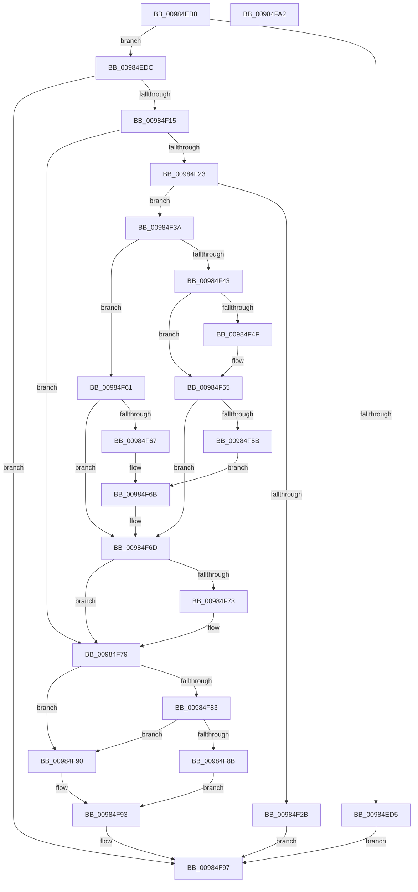

# MiCallCreateSectionFilters

- RVA: `0x00984EB8`–`0x00984FA3` (길이 `235` bytes)
- VA: `0x0000000140984EB8`
- 실행 섹션: `PAGE`
- PDB 이름 있음: `예`; PDB Function 태그: `아니요`
- unwind 정보 RVA: `0x00097BC4`
- 디코드: `71`개 명령, `235/235` bytes 표시
- 미해석 바이트: `0` (있으면 어셈블리에 `.byte`로 보존)

> 이 문서는 커널 이미지의 기계어와 PDB 기호를 분석해 생성했습니다. 4번과 5번은 함수 원형과 자료형을 바이너리 사용 방식에서 추정한 C 해석이며 원본 소스 복구 결과는 아닙니다.

## 1. Dependencies

- 직접 호출 지점: **3**; 고유 호출 대상: **3**
- 직접 호출자로 확인된 함수: **1**
- RIP 상대 이미지 참조: **0**

### Outgoing calls
- `0x00984EE0` → [Feature_Servicing_SecImageNoExecuteFlag__private_IsEnabledDeviceUsageNoInline](../../text/67/Feature_Servicing_SecImageNoExecuteFlag__private_IsEnabledDeviceUsageNoInline_function_00678EFC.md) (function, `0x00678EFC`)
- `0x00984F06` → [FsRtlAcquireToCreateMappedSection](../9D/FsRtlAcquireToCreateMappedSection_function_009D8D48.md) (function, `0x009D8D48`)
- `0x00984F2E` → [FsRtlReleaseFile](FsRtlReleaseFile_function_00985B70.md) (function, `0x00985B70`)

### Direct callers
- [sub_009848DC](Unknown_function_009848DC.md) at `0x009849CA`

### Static image references
- 디코드된 RIP-relative 메모리 참조가 없습니다.

## 2. Other-region calls and transfers

- 다른 실행 섹션으로 향하는 call: **1**
  - `0x00984EE0` → [Feature_Servicing_SecImageNoExecuteFlag__private_IsEnabledDeviceUsageNoInline](../../text/67/Feature_Servicing_SecImageNoExecuteFlag__private_IsEnabledDeviceUsageNoInline_function_00678EFC.md) (`PAGE` → `.text`)
- 별도 외부 분기/꼬리 이동을 확인하지 못했습니다.

## 3. Assembly (complete function range)

```asm
00984EB8  48 89 5C 24 18                  mov qword ptr [rsp + 0x18], rbx
00984EBD  57                              push rdi
00984EBE  48 83 EC 30                     sub rsp, 0x30
00984EC2  83 64 24 40 00                  and dword ptr [rsp + 0x40], 0
00984EC7  48 8B D9                        mov rbx, rcx
00984ECA  83 64 24 48 00                  and dword ptr [rsp + 0x48], 0
00984ECF  8B 01                           mov eax, dword ptr [rcx]
00984ED1  A8 01                           test al, 1
00984ED3  74 07                           je 0x140984edc
00984ED5  33 C0                           xor eax, eax
00984ED7  E9 BB 00 00 00                  jmp 0x140984f97
00984EDC  48 8B 79 38                     mov rdi, qword ptr [rcx + 0x38]
00984EE0  E8 17 40 CF FF                  call 0x140678efc
00984EE5  44 8B 4B 10                     mov r9d, dword ptr [rbx + 0x10]
00984EE9  48 8D 44 24 48                  lea rax, [rsp + 0x48]
00984EEE  8B 53 1C                        mov edx, dword ptr [rbx + 0x1c]
00984EF1  45 33 C0                        xor r8d, r8d
00984EF4  48 89 44 24 28                  mov qword ptr [rsp + 0x28], rax
00984EF9  48 8B CF                        mov rcx, rdi
00984EFC  48 8D 44 24 40                  lea rax, [rsp + 0x40]
00984F01  48 89 44 24 20                  mov qword ptr [rsp + 0x20], rax
00984F06  E8 3D 3E 05 00                  call 0x1409d8d48
00984F0B  8B C8                           mov ecx, eax
00984F0D  85 C0                           test eax, eax
00984F0F  0F 88 82 00 00 00               js 0x140984f97
00984F15  44 8B 44 24 40                  mov r8d, dword ptr [rsp + 0x40]
00984F1A  45 8B C8                        mov r9d, r8d
00984F1D  41 83 E1 06                     and r9d, 6
00984F21  74 56                           je 0x140984f79
00984F23  8B 13                           mov edx, dword ptr [rbx]
00984F25  0F BA E2 19                     bt edx, 0x19
00984F29  73 0F                           jae 0x140984f3a
00984F2B  48 8B CF                        mov rcx, rdi
00984F2E  E8 3D 0C 00 00                  call 0x140985b70
00984F33  B8 11 09 00 C0                  mov eax, 0xc0000911
00984F38  EB 5D                           jmp 0x140984f97
00984F3A  F7 43 10 00 00 00 01            test dword ptr [rbx + 0x10], 0x1000000
00984F41  74 1E                           je 0x140984f61
00984F43  0F BA EA 0E                     bts edx, 0xe
00984F47  89 13                           mov dword ptr [rbx], edx
00984F49  41 F6 C0 04                     test r8b, 4
00984F4D  75 06                           jne 0x140984f55
00984F4F  0F BA EA 10                     bts edx, 0x10
00984F53  89 13                           mov dword ptr [rbx], edx
00984F55  41 F6 C0 08                     test r8b, 8
00984F59  75 12                           jne 0x140984f6d
00984F5B  0F BA EA 11                     bts edx, 0x11
00984F5F  EB 0A                           jmp 0x140984f6b
00984F61  41 F6 C0 02                     test r8b, 2
00984F65  74 06                           je 0x140984f6d
00984F67  0F BA EA 0E                     bts edx, 0xe
00984F6B  89 13                           mov dword ptr [rbx], edx
00984F6D  41 83 F9 06                     cmp r9d, 6
00984F71  75 06                           jne 0x140984f79
00984F73  0F BA EA 0F                     bts edx, 0xf
00984F77  89 13                           mov dword ptr [rbx], edx
00984F79  8B 03                           mov eax, dword ptr [rbx]
00984F7B  81 F9 2A 01 00 00               cmp ecx, 0x12a
00984F81  74 0D                           je 0x140984f90
00984F83  81 F9 2B 01 00 00               cmp ecx, 0x12b
00984F89  75 05                           jne 0x140984f90
00984F8B  83 C8 40                        or eax, 0x40
00984F8E  EB 03                           jmp 0x140984f93
00984F90  83 E0 BF                        and eax, 0xffffffbf
00984F93  89 03                           mov dword ptr [rbx], eax
00984F95  8B C1                           mov eax, ecx
00984F97  48 8B 5C 24 50                  mov rbx, qword ptr [rsp + 0x50]
00984F9C  48 83 C4 30                     add rsp, 0x30
00984FA0  5F                              pop rdi
00984FA1  C3                              ret
00984FA2  CC                              int3
```

## 4. C-style interpretation (structured pseudocode)

```c
__int64 __fastcall MiCallCreateSectionFilters(__int64 a1, __int64 a2, int a3)
{
    __int64 result;
    __int64 v_rsp;
    unsigned __int64 v_stack_m10;
    unsigned __int64 v_stack_m18;
    unsigned int v_stack_p10;
    unsigned __int64 v_stack_p18;
    unsigned int v_stack_p8;

    v_stack_p18 = v_rbx;
    v_rsp = (v_rsp) - (48);
    if ((((unsigned __int8)((unsigned int)(*(unsigned int *)(a1)))) & (1)) == 0) goto loc_00984EDC;
    result = 0;
    goto loc_00984F97;
loc_00984EDC:
    result = Feature_Servicing_SecImageNoExecuteFlag__private_IsEnabledDeviceUsageNoInline(a1, a2, a3, a4);
    a3 = 0;
    v_stack_m10 = v_stack_p10;
    v_stack_m18 = v_stack_p8;
    result = FsRtlAcquireToCreateMappedSection(*(unsigned __int64 *)(a1 + 56), (unsigned int)(*(unsigned int *)(a1 + 28)), a3, (unsigned int)(*(unsigned int *)(a1 + 16)));
    if (sign_flag) goto loc_00984F97;
    a4 = (unsigned int)(((unsigned int)((unsigned int)((unsigned int)(v_stack_p8)))) & (6));
    if (condition_is_equal) goto loc_00984F79;
    if (condition_is_above_or_equal) goto loc_00984F3A;
    result = FsRtlReleaseFile(*(unsigned __int64 *)(a1 + 56), (unsigned int)(*(unsigned int *)(a1)), (unsigned int)(v_stack_p8), a4);
    goto loc_00984F97;
loc_00984F3A:
    if (((*(unsigned int *)(a1 + 16)) & (0x1000000ULL)) == 0) goto loc_00984F61;
    *(unsigned int *)(a1) = (unsigned int)((unsigned int)(*(unsigned int *)(a1)));
    if ((((unsigned __int8)((unsigned int)(v_stack_p8))) & (4)) == 0) {
        *(unsigned int *)(a1) = (unsigned int)((unsigned int)(*(unsigned int *)(a1)));
    }
    if ((((unsigned __int8)((unsigned int)(v_stack_p8))) & (8)) != 0) goto loc_00984F6D;
    goto loc_00984F6B;
loc_00984F61:
    if ((((unsigned __int8)((unsigned int)(v_stack_p8))) & (2)) == 0) goto loc_00984F6D;
loc_00984F6B:
    *(unsigned int *)(a1) = (unsigned int)((unsigned int)(*(unsigned int *)(a1)));
loc_00984F6D:
    if (((unsigned int)(a4)) == 6) {
        *(unsigned int *)(a1) = (unsigned int)((unsigned int)(*(unsigned int *)(a1)));
    }
    if (((unsigned int)(*(unsigned __int64 *)(a1 + 56))) == 298) goto loc_00984F90;
    if (((unsigned int)(*(unsigned __int64 *)(a1 + 56))) != 299) goto loc_00984F90;
    result = (unsigned int)(((unsigned int)(*(unsigned int *)(a1))) | (64));
    goto loc_00984F93;
loc_00984F90:
    result = (unsigned int)((result) & (0xFFFFFFBFULL));
loc_00984F93:
    *(unsigned int *)(a1) = (unsigned int)(result);
loc_00984F97:
    v_rsp = (v_rsp) + (48);
    return (unsigned int)((unsigned int)(*(unsigned __int64 *)(a1 + 56)));
}
```

## 5. (Beta) C Style

```c
int64_t MiCallCreateSectionFilters(void *Arg1, int64_t Arg2, int32_t Arg3)
{
    uint8_t *arg1 = (uint8_t *)Arg1;

    int64_t result;
    int64_t local_rsp;
    uint64_t v_stack_m10;
    uint64_t v_stack_m18;
    uint32_t v_stack_p10;
    uint64_t v_stack_p18;
    uint32_t v_stack_p8;

    v_stack_p18 = local_rbx;
    local_rsp = (local_rsp) - (48);
    if ((((uint8_t)((uint32_t)(*(uint32_t *)(arg1)))) & (1)) == 0) goto loc_00984EDC;
    result = 0;
    goto loc_00984F97;
loc_00984EDC:
    result = Feature_Servicing_SecImageNoExecuteFlag__private_IsEnabledDeviceUsageNoInline(Arg1, Arg2, Arg3, a4);
    Arg3 = 0;
    v_stack_m10 = v_stack_p10;
    v_stack_m18 = v_stack_p8;
    result = FsRtlAcquireToCreateMappedSection(*(uint64_t *)(arg1 + 0x38), (uint32_t)(*(uint32_t *)(arg1 + 0x1C)), Arg3, (uint32_t)(*(uint32_t *)(arg1 + 0x10)));
    if (sign_flag) goto loc_00984F97;
    a4 = (uint32_t)(((uint32_t)((uint32_t)((uint32_t)(v_stack_p8)))) & (6));
    if (condition_is_equal) goto loc_00984F79;
    if (condition_is_above_or_equal) goto loc_00984F3A;
    result = FsRtlReleaseFile(*(uint64_t *)(arg1 + 0x38), (uint32_t)(*(uint32_t *)(arg1)), (uint32_t)(v_stack_p8), a4);
    goto loc_00984F97;
loc_00984F3A:
    if (((*(uint32_t *)(arg1 + 0x10)) & (0x1000000ULL)) == 0) goto loc_00984F61;
    *(uint32_t *)(arg1) = (uint32_t)((uint32_t)(*(uint32_t *)(arg1)));
    if ((((uint8_t)((uint32_t)(v_stack_p8))) & (4)) == 0) {
        *(uint32_t *)(arg1) = (uint32_t)((uint32_t)(*(uint32_t *)(arg1)));
    }
    if ((((uint8_t)((uint32_t)(v_stack_p8))) & (8)) != 0) goto loc_00984F6D;
    goto loc_00984F6B;
loc_00984F61:
    if ((((uint8_t)((uint32_t)(v_stack_p8))) & (2)) == 0) goto loc_00984F6D;
loc_00984F6B:
    *(uint32_t *)(arg1) = (uint32_t)((uint32_t)(*(uint32_t *)(arg1)));
loc_00984F6D:
    if (((uint32_t)(a4)) == 6) {
        *(uint32_t *)(arg1) = (uint32_t)((uint32_t)(*(uint32_t *)(arg1)));
    }
    if (((uint32_t)(*(uint64_t *)(arg1 + 0x38))) == 298) goto loc_00984F90;
    if (((uint32_t)(*(uint64_t *)(arg1 + 0x38))) != 299) goto loc_00984F90;
    result = (uint32_t)(((uint32_t)(*(uint32_t *)(arg1))) | (64));
    goto loc_00984F93;
loc_00984F90:
    result = (uint32_t)((result) & (0xFFFFFFBFULL));
loc_00984F93:
    *(uint32_t *)(arg1) = (uint32_t)(result);
loc_00984F97:
    local_rsp = (local_rsp) + (48);
    return (uint32_t)((uint32_t)(*(uint64_t *)(arg1 + 0x38)));
}
```

### 관측된 메모리 오프셋

구조체 형식이 확인되지 않은 접근은 인자 기준의 오프셋으로만 기록했습니다.

| 기준 인자 | 오프셋 표현 | 폭 (bit) | 접근 |
|---|---:|---:|---|
| `Arg1` | `+ 0x0` | `32` | `R` |
| `Arg1` | `+ 0x0` | `32` | `W` |
| `Arg1` | `+ 0x10` | `32` | `R` |
| `Arg1` | `+ 0x1C` | `32` | `R` |
| `Arg1` | `+ 0x38` | `64` | `R` |

## 6. Execution-region graph

[열기: 2D/3D 그래프와 함수 탐색 컨트롤 패널](../../../control-panel.html?section=page&rva=0x00984EB8&view=graph)

- 2D 그래프는 위에서 아래로 흐르고, 3D 그래프는 빈 공간을 드래그해 회전합니다. Shift+드래그는 이동, 휠은 확대·축소, 함수 노드 선택은 대상 보고서 이동입니다.

### Static fallback


