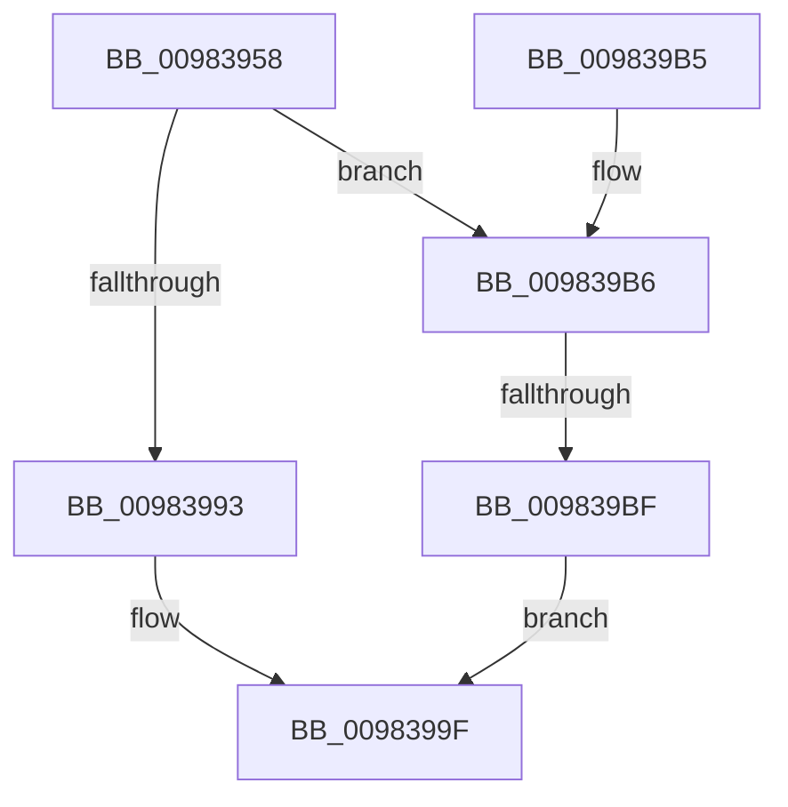

# MiCaptureSectionCreateExtendedParameters

- RVA: `0x00983958`–`0x009839C6` (길이 `110` bytes)
- VA: `0x0000000140983958`
- 실행 섹션: `PAGE`
- PDB 이름 있음: `예`; PDB Function 태그: `예`
- unwind 정보 RVA: `0x00097A34`
- 디코드: `35`개 명령, `110/110` bytes 표시
- 미해석 바이트: `0` (있으면 어셈블리에 `.byte`로 보존)

> 이 문서는 커널 이미지의 기계어와 PDB 기호를 분석해 생성했습니다. 4번과 5번은 함수 원형과 자료형을 바이너리 사용 방식에서 추정한 C 해석이며 원본 소스 복구 결과는 아닙니다.

## 1. Dependencies

- 직접 호출 지점: **0**; 고유 호출 대상: **0**
- 직접 호출자로 확인된 함수: **2**
- RIP 상대 이미지 참조: **0**

### Outgoing calls
- 직접 디코드된 call 명령이 없습니다.

### Direct callers
- [MiCreateSectionCommon](../8A/MiCreateSectionCommon_function_008A9AA4.md) at `0x008A9BD4`
- [MmCreateSectionEx](MmCreateSectionEx_function_009839CC.md) at `0x00983A23`

### Static image references
- 디코드된 RIP-relative 메모리 참조가 없습니다.

## 2. Other-region calls and transfers

- 다른 실행 섹션으로 향하는 call: **0**
- call이 아닌 외부 분기/꼬리 이동: **1**
  - `0x009839B9` → [sub_00B2A9C6](../B2/Unknown_function_00B2A9C6.md) (`tail-transfer`)

## 3. Assembly (complete function range)

```asm
00983958  48 8B C4                        mov rax, rsp
0098395B  48 89 58 08                     mov qword ptr [rax + 8], rbx
0098395F  48 89 70 10                     mov qword ptr [rax + 0x10], rsi
00983963  44 89 40 18                     mov dword ptr [rax + 0x18], r8d
00983967  57                              push rdi
00983968  41 56                           push r14
0098396A  41 57                           push r15
0098396C  48 83 EC 50                     sub rsp, 0x50
00983970  45 8A F9                        mov r15b, r9b
00983973  48 8B D9                        mov rbx, rcx
00983976  48 83 60 C8 00                  and qword ptr [rax - 0x38], 0
0098397B  0F 57 C0                        xorps xmm0, xmm0
0098397E  33 C0                           xor eax, eax
00983980  48 8B BC 24 90 00 00 00         mov rdi, qword ptr [rsp + 0x90]
00983988  0F 11 07                        movups xmmword ptr [rdi], xmm0
0098398B  48 89 47 10                     mov qword ptr [rdi + 0x10], rax
0098398F  85 D2                           test edx, edx
00983991  75 23                           jne 0x1409839b6
00983993  48 F7 DB                        neg rbx
00983996  1B C0                           sbb eax, eax
00983998  B9 0D 00 00 C0                  mov ecx, 0xc000000d
0098399D  23 C8                           and ecx, eax
0098399F  8B C1                           mov eax, ecx
009839A1  48 8B 5C 24 70                  mov rbx, qword ptr [rsp + 0x70]
009839A6  48 8B 74 24 78                  mov rsi, qword ptr [rsp + 0x78]
009839AB  48 83 C4 50                     add rsp, 0x50
009839AF  41 5F                           pop r15
009839B1  41 5E                           pop r14
009839B3  5F                              pop rdi
009839B4  C3                              ret
009839B5  CC                              int3
009839B6  48 85 DB                        test rbx, rbx
009839B9  0F 85 07 70 1A 00               jne 0x140b2a9c6
009839BF  B9 0D 00 00 C0                  mov ecx, 0xc000000d
009839C4  EB D9                           jmp 0x14098399f
```

## 4. C-style interpretation (structured pseudocode)

```c
__int64 __fastcall MiCaptureSectionCreateExtendedParameters(__int64 a1, int a2, int a3, unsigned __int8 a4, __int64 a5)
{
    __int64 result;
    __int64 v_rbx;
    __int64 v_rsp;
    unsigned __int64 v_stack_p10;
    unsigned __int64 v_stack_p8;

    *(unsigned __int64 *)(v_rsp + 8) = v_rbx;
    *(unsigned __int64 *)(v_rsp + 16) = v_rsi;
    *(unsigned int *)(v_rsp + 24) = a3;
    v_rsp = (v_rsp) - (80);
    result = 0;
    *(unsigned __int64 *)(a5) = v_xmm0;
    *(unsigned __int64 *)(a5 + 16) = 0;
    if (a2 != 0) goto loc_009839B6;
    v_rbx = -(a1);
    a1 = (unsigned int)(((unsigned int)(0xC000000DULL)) & (0));
loc_0098399F:
    v_rsp = (v_rsp) + (80);
    return (unsigned int)((unsigned int)(a1));
loc_009839B6:
    goto loc_0098399F;
}
```

## 5. (Beta) C Style

```c
int64_t MiCaptureSectionCreateExtendedParameters(int64_t Arg1, int32_t Arg2, int32_t Arg3, uint8_t Arg4, void *Arg5)
{
    uint8_t *arg5 = (uint8_t *)Arg5;

    int64_t result;
    int64_t local_rbx;
    int64_t local_rsp;
    uint64_t v_stack_p10;
    uint64_t v_stack_p8;

    *(uint64_t *)(local_rsp + 0x8) = local_rbx;
    *(uint64_t *)(local_rsp + 0x10) = local_rsi;
    *(uint32_t *)(local_rsp + 0x18) = Arg3;
    local_rsp = (local_rsp) - (80);
    result = 0;
    *(uint64_t *)(arg5) = v_xmm0;
    *(uint64_t *)(arg5 + 0x10) = 0;
    if (Arg2 != 0) goto loc_009839B6;
    local_rbx = -(Arg1);
    Arg1 = (uint32_t)(((uint32_t)(0xC000000DULL)) & (0));
loc_0098399F:
    local_rsp = (local_rsp) + (80);
    return (uint32_t)((uint32_t)(Arg1));
loc_009839B6:
    goto loc_0098399F;
}
```

### 관측된 메모리 오프셋

구조체 형식이 확인되지 않은 접근은 인자 기준의 오프셋으로만 기록했습니다.

| 기준 인자 | 오프셋 표현 | 폭 (bit) | 접근 |
|---|---:|---:|---|
| `Arg5` | `+ 0x0` | `128` | `R` |
| `Arg5` | `+ 0x10` | `64` | `W` |

## 6. Execution-region graph

[열기: 2D/3D 그래프와 함수 탐색 컨트롤 패널](../../../control-panel.html?section=page&rva=0x00983958&view=graph)

- 2D 그래프는 위에서 아래로 흐르고, 3D 그래프는 빈 공간을 드래그해 회전합니다. Shift+드래그는 이동, 휠은 확대·축소, 함수 노드 선택은 대상 보고서 이동입니다.

### Static fallback


