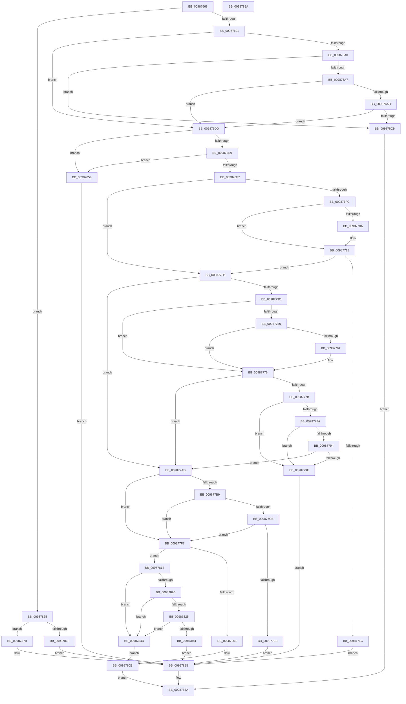

# MiComputeBadImageHeaderType

- RVA: `0x00987668`–`0x0098789B` (길이 `563` bytes)
- VA: `0x0000000140987668`
- 실행 섹션: `PAGE`
- PDB 이름 있음: `예`; PDB Function 태그: `아니요`
- unwind 정보 RVA: `0x00060BC4`
- 디코드: `135`개 명령, `563/563` bytes 표시
- 미해석 바이트: `0` (있으면 어셈블리에 `.byte`로 보존)

> 이 문서는 커널 이미지의 기계어와 PDB 기호를 분석해 생성했습니다. 4번과 5번은 함수 원형과 자료형을 바이너리 사용 방식에서 추정한 C 해석이며 원본 소스 복구 결과는 아닙니다.

## 1. Dependencies

- 직접 호출 지점: **3**; 고유 호출 대상: **2**
- 직접 호출자로 확인된 함수: **1**
- RIP 상대 이미지 참조: **3**

### Outgoing calls
- `0x00987697` → [MiCheckDosCalls](../7F/MiCheckDosCalls_function_007FCC30.md) (function, `0x007FCC30`)
- `0x009877DF` → [memcmp](../../text/6C/memcmp_function_006C6B10.md) (function, `0x006C6B10`)
- `0x00987838` → [memcmp](../../text/6C/memcmp_function_006C6B10.md) (function, `0x006C6B10`)

### Direct callers
- [MiVerifyImageHeader](MiVerifyImageHeader_function_009870DC.md) at `0x00987376`

### Static image references
- `0x009876C9` → RVA `0x00E2D7F8` (`.data`; write)
- `0x009877D8` → RVA `0x00B09F60` (` ?? ::NNGAKEGL::`string'`; read)
- `0x00987828` → RVA `0x00B09FB0` (` ?? ::NNGAKEGL::`string'`; read)

## 2. Other-region calls and transfers

- 다른 실행 섹션으로 향하는 call: **2**
  - `0x009877DF` → [memcmp](../../text/6C/memcmp_function_006C6B10.md) (`PAGE` → `.text`)
  - `0x00987838` → [memcmp](../../text/6C/memcmp_function_006C6B10.md) (`PAGE` → `.text`)
- 별도 외부 분기/꼬리 이동을 확인하지 못했습니다.

## 3. Assembly (complete function range)

```asm
00987668  48 89 5C 24 08                  mov qword ptr [rsp + 8], rbx
0098766D  48 89 74 24 10                  mov qword ptr [rsp + 0x10], rsi
00987672  57                              push rdi
00987673  48 83 EC 20                     sub rsp, 0x20
00987677  0F B7 01                        movzx eax, word ptr [rcx]
0098767A  48 8B D9                        mov rbx, rcx
0098767D  B9 4E 45 00 00                  mov ecx, 0x454e
00987682  49 8B F0                        mov rsi, r8
00987685  48 8B FA                        mov rdi, rdx
00987688  66 3B C1                        cmp ax, cx
0098768B  0F 85 D4 01 00 00               jne 0x140987865
00987691  49 8B D0                        mov rdx, r8
00987694  48 8B CB                        mov rcx, rbx
00987697  E8 94 55 E7 FF                  call 0x1407fcc30
0098769C  85 C0                           test eax, eax
0098769E  75 3D                           jne 0x1409876dd
009876A0  8A 43 36                        mov al, byte ptr [rbx + 0x36]
009876A3  3C 02                           cmp al, 2
009876A5  74 22                           je 0x1409876c9
009876A7  84 C0                           test al, al
009876A9  75 32                           jne 0x1409876dd
009876AB  0F B7 43 3E                     movzx eax, word ptr [rbx + 0x3e]
009876AF  B9 00 FF 00 00                  mov ecx, 0xff00
009876B4  66 23 C1                        and ax, cx
009876B7  B9 00 02 00 00                  mov ecx, 0x200
009876BC  66 2B C1                        sub ax, cx
009876BF  B9 FF FE 00 00                  mov ecx, 0xfeff
009876C4  66 85 C1                        test cx, ax
009876C7  75 14                           jne 0x1409876dd
009876C9  C7 05 25 61 4A 00 3C 00 00 00   mov dword ptr [rip + 0x4a6125], 0x3c
009876D3  B8 31 01 00 C0                  mov eax, 0xc0000131
009876D8  E9 AD 01 00 00                  jmp 0x14098788a
009876DD  8A 4B 36                        mov cl, byte ptr [rbx + 0x36]
009876E0  80 F9 05                        cmp cl, 5
009876E3  0F 84 70 01 00 00               je 0x140987859
009876E9  0F B7 43 2A                     movzx eax, word ptr [rbx + 0x2a]
009876ED  66 39 43 04                     cmp word ptr [rbx + 4], ax
009876F1  0F 84 62 01 00 00               je 0x140987859
009876F7  80 F9 01                        cmp cl, 1
009876FA  75 2F                           jne 0x14098772b
009876FC  8B 8F 00 02 00 00               mov ecx, dword ptr [rdi + 0x200]
00987702  81 E9 31 36 53 54               sub ecx, 0x54533631
00987708  75 0E                           jne 0x140987718
0098770A  0F B7 8F 04 02 00 00            movzx ecx, word ptr [rdi + 0x204]
00987711  B8 55 42 00 00                  mov eax, 0x4255
00987716  2B C8                           sub ecx, eax
00987718  85 C9                           test ecx, ecx
0098771A  75 0F                           jne 0x14098772b
0098771C  C7 05 D2 60 4A 00 3E 00 00 00   mov dword ptr [rip + 0x4a60d2], 0x3e
00987726  E9 5A 01 00 00                  jmp 0x140987885
0098772B  0F B7 4F 08                     movzx ecx, word ptr [rdi + 8]
0098772F  48 C1 E1 04                     shl rcx, 4
00987733  48 81 F9 C6 0F 00 00            cmp rcx, 0xfc6
0098773A  77 71                           ja 0x1409877ad
0098773C  48 8B 44 39 18                  mov rax, qword ptr [rcx + rdi + 0x18]
00987741  48 BA 50 68 61 72 20 4C 61 70   movabs rdx, 0x70614c2072616850
0098774B  48 2B C2                        sub rax, rdx
0098774E  75 26                           jne 0x140987776
00987750  48 8B 44 39 20                  mov rax, qword ptr [rcx + rdi + 0x20]
00987755  48 BA 20 53 6F 66 74 77 61 72   movabs rdx, 0x72617774666f5320
0098775F  48 2B C2                        sub rax, rdx
00987762  75 12                           jne 0x140987776
00987764  48 8B 44 39 28                  mov rax, qword ptr [rcx + rdi + 0x28]
00987769  48 BA 65 2C 20 49 6E 63 2E 00   movabs rdx, 0x2e636e49202c65
00987773  48 2B C2                        sub rax, rdx
00987776  48 85 C0                        test rax, rax
00987779  75 32                           jne 0x1409877ad
0098777B  0F B7 44 39 38                  movzx eax, word ptr [rcx + rdi + 0x38]
00987780  BA 50 4B 00 00                  mov edx, 0x4b50
00987785  66 3B C2                        cmp ax, dx
00987788  74 14                           je 0x14098779e
0098778A  BA 50 4F 00 00                  mov edx, 0x4f50
0098778F  66 3B C2                        cmp ax, dx
00987792  74 0A                           je 0x14098779e
00987794  BA 50 56 00 00                  mov edx, 0x5650
00987799  66 3B C2                        cmp ax, dx
0098779C  75 0F                           jne 0x1409877ad
0098779E  C7 05 50 60 4A 00 3F 00 00 00   mov dword ptr [rip + 0x4a6050], 0x3f
009877A8  E9 D8 00 00 00                  jmp 0x140987885
009877AD  48 8D 41 32                     lea rax, [rcx + 0x32]
009877B1  48 3D 00 10 00 00               cmp rax, 0x1000
009877B7  77 3E                           ja 0x1409877f7
009877B9  48 8D 14 39                     lea rdx, [rcx + rdi]
009877BD  44 0F B7 42 30                  movzx r8d, word ptr [rdx + 0x30]
009877C2  49 8D 04 08                     lea rax, [r8 + rcx]
009877C6  48 3D DC 0F 00 00               cmp rax, 0xfdc
009877CC  77 29                           ja 0x1409877f7
009877CE  49 8D 0C 10                     lea rcx, [r8 + rdx]
009877D2  41 B8 24 00 00 00               mov r8d, 0x24
009877D8  48 8D 15 81 27 18 00            lea rdx, [rip + 0x182781]
009877DF  E8 2C F3 D3 FF                  call 0x1406c6b10
009877E4  85 C0                           test eax, eax
009877E6  75 0F                           jne 0x1409877f7
009877E8  C7 05 06 60 4A 00 40 00 00 00   mov dword ptr [rip + 0x4a6006], 0x40
009877F2  E9 8E 00 00 00                  jmp 0x140987885
009877F7  8B 43 2C                        mov eax, dword ptr [rbx + 0x2c]
009877FA  8B 4F 3C                        mov ecx, dword ptr [rdi + 0x3c]
009877FD  3B C1                           cmp eax, ecx
009877FF  77 11                           ja 0x140987812
00987801  C7 05 ED 5F 4A 00 41 00 00 00   mov dword ptr [rip + 0x4a5fed], 0x41
0098780B  B8 1B 01 00 C0                  mov eax, 0xc000011b
00987810  EB 78                           jmp 0x14098788a
00987812  2B C1                           sub eax, ecx
00987814  48 63 C8                        movsxd rcx, eax
00987817  48 8D 41 10                     lea rax, [rcx + 0x10]
0098781B  48 3B C1                        cmp rax, rcx
0098781E  76 2D                           jbe 0x14098784d
00987820  48 3B C6                        cmp rax, rsi
00987823  73 28                           jae 0x14098784d
00987825  48 FF C1                        inc rcx
00987828  48 8D 15 81 27 18 00            lea rdx, [rip + 0x182781]
0098782F  48 03 CB                        add rcx, rbx
00987832  41 B8 0F 00 00 00               mov r8d, 0xf
00987838  E8 D3 F2 D3 FF                  call 0x1406c6b10
0098783D  85 C0                           test eax, eax
0098783F  75 0C                           jne 0x14098784d
00987841  C7 05 AD 5F 4A 00 42 00 00 00   mov dword ptr [rip + 0x4a5fad], 0x42
0098784B  EB 38                           jmp 0x140987885
0098784D  C7 05 A1 5F 4A 00 43 00 00 00   mov dword ptr [rip + 0x4a5fa1], 0x43
00987857  EB B2                           jmp 0x14098780b
00987859  C7 05 95 5F 4A 00 3D 00 00 00   mov dword ptr [rip + 0x4a5f95], 0x3d
00987863  EB 20                           jmp 0x140987885
00987865  B9 4C 45 00 00                  mov ecx, 0x454c
0098786A  66 3B C1                        cmp ax, cx
0098786D  75 0C                           jne 0x14098787b
0098786F  C7 05 7F 5F 4A 00 44 00 00 00   mov dword ptr [rip + 0x4a5f7f], 0x44
00987879  EB 0A                           jmp 0x140987885
0098787B  C7 05 73 5F 4A 00 45 00 00 00   mov dword ptr [rip + 0x4a5f73], 0x45
00987885  B8 30 01 00 C0                  mov eax, 0xc0000130
0098788A  48 8B 5C 24 30                  mov rbx, qword ptr [rsp + 0x30]
0098788F  48 8B 74 24 38                  mov rsi, qword ptr [rsp + 0x38]
00987894  48 83 C4 20                     add rsp, 0x20
00987898  5F                              pop rdi
00987899  C3                              ret
0098789A  CC                              int3
```

## 4. C-style interpretation (structured pseudocode)

```c
__int64 __fastcall MiComputeBadImageHeaderType(__int64 a1, __int64 a2, __int64 a3)
{
    __int64 result;
    __int64 v_rsp;
    unsigned __int64 v_stack_p10;
    unsigned __int64 v_stack_p8;

    v_stack_p8 = v_rbx;
    v_stack_p10 = v_rsi;
    v_rsp = (v_rsp) - (32);
    if (((unsigned __int16)(*(unsigned __int16 *)(a1))) != ((unsigned __int16)((unsigned int)(0x454EULL)))) goto loc_00987865;
    result = MiCheckDosCalls(a1, a3, a3, a4);
    if ((unsigned int)(result) != 0) goto loc_009876DD;
    if (((unsigned __int8)(*(unsigned __int8 *)(a1 + 54))) == 2) goto loc_009876C9;
    if ((unsigned __int8)(*(unsigned __int8 *)(a1 + 54)) != 0) goto loc_009876DD;
    result = (unsigned __int16)((*(unsigned __int16 *)(a1 + 62)) & ((unsigned __int16)((unsigned int)(0xFF00ULL))));
    result = (unsigned __int16)((result) - (512));
    if ((((unsigned __int16)((unsigned int)(0xFEFFULL))) & ((unsigned __int16)(result))) != 0) goto loc_009876DD;
loc_009876C9:
    *(unsigned int *)(v_rip + 4874533) = 60;
    goto loc_0098788A;
loc_009876DD:
    if (((unsigned __int8)(*(unsigned __int8 *)(a1 + 54))) == 5) goto loc_00987859;
    if ((*(unsigned __int16 *)(a1 + 4)) == ((unsigned __int16)(*(unsigned __int16 *)(a1 + 42)))) goto loc_00987859;
    if (((unsigned __int8)(*(unsigned __int8 *)(a1 + 54))) != 1) goto loc_0098772B;
    a1 = (unsigned int)(((unsigned int)(*(unsigned int *)(a2 + 512))) - (0x54533631ULL));
    result = *(unsigned __int16 *)(a1 + 42);
    if (!(condition_is_not_equal)) {
        a1 = *(unsigned __int16 *)(a2 + 516);
        result = 0x4255ULL;
        a1 = (unsigned int)((a1) - ((unsigned int)(result)));
    }
    if ((unsigned int)(a1) != 0) goto loc_0098772B;
    *(unsigned int *)(v_rip + 4874450) = 62;
    goto loc_00987885;
loc_0098772B:
    a1 = (*(unsigned __int16 *)(a2 + 8)) << (4);
    if (a1 > 0xFC6ULL) goto loc_009877AD;
    result = (*(unsigned __int64 *)(a1 + a2 * 1 + 24)) - (a3);
    if (condition_is_not_equal) goto loc_00987776;
    result = (*(unsigned __int64 *)(a1 + a2 * 1 + 32)) - (a3);
    if (!(condition_is_not_equal)) {
        result = *(unsigned __int64 *)(a1 + a2 * 1 + 40);
        result = (result) - (a3);
    }
    if (result != 0) goto loc_009877AD;
    if (((unsigned __int16)(*(unsigned __int16 *)(a1 + a2 * 1 + 56))) == ((unsigned __int16)((unsigned int)(0x4B50ULL)))) goto loc_0098779E;
    if (((unsigned __int16)(*(unsigned __int16 *)(a1 + a2 * 1 + 56))) == ((unsigned __int16)((unsigned int)(0x4F50ULL)))) goto loc_0098779E;
    if (((unsigned __int16)(*(unsigned __int16 *)(a1 + a2 * 1 + 56))) != ((unsigned __int16)((unsigned int)(0x5650ULL)))) goto loc_009877AD;
loc_0098779E:
    *(unsigned int *)(v_rip + 4874320) = 63;
    goto loc_00987885;
loc_009877AD:
    if ((a1 + 50) > 0x1000ULL) goto loc_009877F7;
    if ((*(unsigned __int16 *)(a1 + a2 * 1 + 48) + a1 * 1) > 0xFDCULL) goto loc_009877F7;
    result = memcmp(*(unsigned __int16 *)(a1 + a2 * 1 + 48) + a1 + a2 * 1 * 1, v_rip + 1582977, 36, a4);
    if ((unsigned int)(result) != 0) goto loc_009877F7;
    *(unsigned int *)(v_rip + 4874246) = 64;
    goto loc_00987885;
loc_009877F7:
    if (((unsigned int)((unsigned int)(*(unsigned int *)(a1 + 44)))) > ((unsigned int)((unsigned int)(*(unsigned int *)(a2 + 60))))) goto loc_00987812;
    *(unsigned int *)(v_rip + 4874221) = 65;
loc_0098780B:
    goto loc_0098788A;
loc_00987812:
    result = (unsigned int)(((unsigned int)(0xC000011BULL)) - ((unsigned int)((unsigned int)(*(unsigned int *)(a2 + 60)))));
    if (((int)((unsigned int)(result)) + 16) <= ((int)((unsigned int)(result)))) goto loc_0098784D;
    if (((int)((unsigned int)(result)) + 16) >= a3) goto loc_0098784D;
    a1 = ((int)((unsigned int)(result))) + 1;
    a1 = (a1) + (a1);
    result = memcmp(a1, v_rip + 1582977, 15, a4);
    if ((unsigned int)(result) != 0) goto loc_0098784D;
    *(unsigned int *)(v_rip + 4874157) = 66;
    goto loc_00987885;
loc_0098784D:
    *(unsigned int *)(v_rip + 4874145) = 67;
    goto loc_0098780B;
loc_00987859:
    *(unsigned int *)(v_rip + 4874133) = 61;
    goto loc_00987885;
loc_00987865:
    if (((unsigned __int16)(result)) != ((unsigned __int16)((unsigned int)(0x454CULL)))) goto loc_0098787B;
    *(unsigned int *)(v_rip + 4874111) = 68;
    goto loc_00987885;
loc_0098787B:
    *(unsigned int *)(v_rip + 4874099) = 69;
loc_00987885:
loc_0098788A:
    v_rsp = (v_rsp) + (32);
    return (unsigned int)(0xC0000130ULL);
}
```

## 5. (Beta) C Style

```c
int64_t MiComputeBadImageHeaderType(void *Arg1, void *Arg2, int64_t Arg3)
{
    uint8_t *arg1 = (uint8_t *)Arg1;
    uint8_t *arg2 = (uint8_t *)Arg2;

    int64_t result;
    int64_t local_rsp;
    uint64_t v_stack_p10;
    uint64_t v_stack_p8;

    v_stack_p8 = local_rbx;
    v_stack_p10 = local_rsi;
    local_rsp = (local_rsp) - (32);
    if (((uint16_t)(*(uint16_t *)(arg1))) != ((uint16_t)((uint32_t)(0x454EULL)))) goto loc_00987865;
    result = MiCheckDosCalls(Arg1, Arg3, Arg3, a4);
    if ((uint32_t)(result) != 0) goto loc_009876DD;
    if (((uint8_t)(*(uint8_t *)(arg1 + 0x36))) == 2) goto loc_009876C9;
    if ((uint8_t)(*(uint8_t *)(arg1 + 0x36)) != 0) goto loc_009876DD;
    result = (uint16_t)((*(uint16_t *)(arg1 + 0x3E)) & ((uint16_t)((uint32_t)(0xFF00ULL))));
    result = (uint16_t)((result) - (512));
    if ((((uint16_t)((uint32_t)(0xFEFFULL))) & ((uint16_t)(result))) != 0) goto loc_009876DD;
loc_009876C9:
    *(uint32_t *)(v_rip + 0x4A6125) = 60;
    goto loc_0098788A;
loc_009876DD:
    if (((uint8_t)(*(uint8_t *)(arg1 + 0x36))) == 5) goto loc_00987859;
    if ((*(uint16_t *)(arg1 + 0x4)) == ((uint16_t)(*(uint16_t *)(arg1 + 0x2A)))) goto loc_00987859;
    if (((uint8_t)(*(uint8_t *)(arg1 + 0x36))) != 1) goto loc_0098772B;
    Arg1 = (uint32_t)(((uint32_t)(*(uint32_t *)(arg2 + 0x200))) - (0x54533631ULL));
    result = *(uint16_t *)(arg1 + 0x2A);
    if (!(condition_is_not_equal)) {
        Arg1 = *(uint16_t *)(arg2 + 0x204);
        result = 0x4255ULL;
        Arg1 = (uint32_t)((Arg1) - ((uint32_t)(result)));
    }
    if ((uint32_t)(Arg1) != 0) goto loc_0098772B;
    *(uint32_t *)(v_rip + 0x4A60D2) = 62;
    goto loc_00987885;
loc_0098772B:
    Arg1 = (*(uint16_t *)(arg2 + 0x8)) << (4);
    if (Arg1 > 0xFC6ULL) goto loc_009877AD;
    result = (*(uint64_t *)(arg1 + arg2 * 1 + 0x18)) - (Arg3);
    if (condition_is_not_equal) goto loc_00987776;
    result = (*(uint64_t *)(arg1 + arg2 * 1 + 0x20)) - (Arg3);
    if (!(condition_is_not_equal)) {
        result = *(uint64_t *)(arg1 + arg2 * 1 + 0x28);
        result = (result) - (Arg3);
    }
    if (result != 0) goto loc_009877AD;
    if (((uint16_t)(*(uint16_t *)(arg1 + arg2 * 1 + 0x38))) == ((uint16_t)((uint32_t)(0x4B50ULL)))) goto loc_0098779E;
    if (((uint16_t)(*(uint16_t *)(arg1 + arg2 * 1 + 0x38))) == ((uint16_t)((uint32_t)(0x4F50ULL)))) goto loc_0098779E;
    if (((uint16_t)(*(uint16_t *)(arg1 + arg2 * 1 + 0x38))) != ((uint16_t)((uint32_t)(0x5650ULL)))) goto loc_009877AD;
loc_0098779E:
    *(uint32_t *)(v_rip + 0x4A6050) = 63;
    goto loc_00987885;
loc_009877AD:
    if ((Arg1 + 50) > 0x1000ULL) goto loc_009877F7;
    if ((*(uint16_t *)(arg1 + arg2 * 1 + 0x30) + Arg1 * 1) > 0xFDCULL) goto loc_009877F7;
    result = memcmp(*(uint16_t *)(arg1 + arg2 * 1 + 0x30) + Arg1 + Arg2 * 1 * 1, v_rip + 1582977, 36, a4);
    if ((uint32_t)(result) != 0) goto loc_009877F7;
    *(uint32_t *)(v_rip + 0x4A6006) = 64;
    goto loc_00987885;
loc_009877F7:
    if (((uint32_t)((uint32_t)(*(uint32_t *)(arg1 + 0x2C)))) > ((uint32_t)((uint32_t)(*(uint32_t *)(arg2 + 0x3C))))) goto loc_00987812;
    *(uint32_t *)(v_rip + 0x4A5FED) = 65;
loc_0098780B:
    goto loc_0098788A;
loc_00987812:
    result = (uint32_t)(((uint32_t)(0xC000011BULL)) - ((uint32_t)((uint32_t)(*(uint32_t *)(arg2 + 0x3C)))));
    if (((int32_t)((uint32_t)(result)) + 16) <= ((int32_t)((uint32_t)(result)))) goto loc_0098784D;
    if (((int32_t)((uint32_t)(result)) + 16) >= Arg3) goto loc_0098784D;
    Arg1 = ((int32_t)((uint32_t)(result))) + 1;
    Arg1 = (Arg1) + (Arg1);
    result = memcmp(Arg1, v_rip + 1582977, 15, a4);
    if ((uint32_t)(result) != 0) goto loc_0098784D;
    *(uint32_t *)(v_rip + 0x4A5FAD) = 66;
    goto loc_00987885;
loc_0098784D:
    *(uint32_t *)(v_rip + 0x4A5FA1) = 67;
    goto loc_0098780B;
loc_00987859:
    *(uint32_t *)(v_rip + 0x4A5F95) = 61;
    goto loc_00987885;
loc_00987865:
    if (((uint16_t)(result)) != ((uint16_t)((uint32_t)(0x454CULL)))) goto loc_0098787B;
    *(uint32_t *)(v_rip + 0x4A5F7F) = 68;
    goto loc_00987885;
loc_0098787B:
    *(uint32_t *)(v_rip + 0x4A5F73) = 69;
loc_00987885:
loc_0098788A:
    local_rsp = (local_rsp) + (32);
    return (uint32_t)(0xC0000130ULL);
}
```

### 관측된 메모리 오프셋

구조체 형식이 확인되지 않은 접근은 인자 기준의 오프셋으로만 기록했습니다.

| 기준 인자 | 오프셋 표현 | 폭 (bit) | 접근 |
|---|---:|---:|---|
| `Arg1` | `+ 0x0` | `16` | `R` |
| `Arg1` | `+ 0x4` | `16` | `R` |
| `Arg1` | `+ 0x2A` | `16` | `R` |
| `Arg1` | `+ 0x2C` | `32` | `R` |
| `Arg1` | `+ 0x36` | `8` | `R` |
| `Arg1` | `+ 0x3E` | `16` | `R` |
| `Arg2` | `+ 0x8` | `16` | `R` |
| `Arg2` | `+ 0x3C` | `32` | `R` |
| `Arg2` | `+ 0x200` | `32` | `R` |
| `Arg2` | `+ 0x204` | `16` | `R` |

## 6. Execution-region graph

[열기: 2D/3D 그래프와 함수 탐색 컨트롤 패널](../../../control-panel.html?section=page&rva=0x00987668&view=graph)

- 2D 그래프는 위에서 아래로 흐르고, 3D 그래프는 빈 공간을 드래그해 회전합니다. Shift+드래그는 이동, 휠은 확대·축소, 함수 노드 선택은 대상 보고서 이동입니다.

### Static fallback


