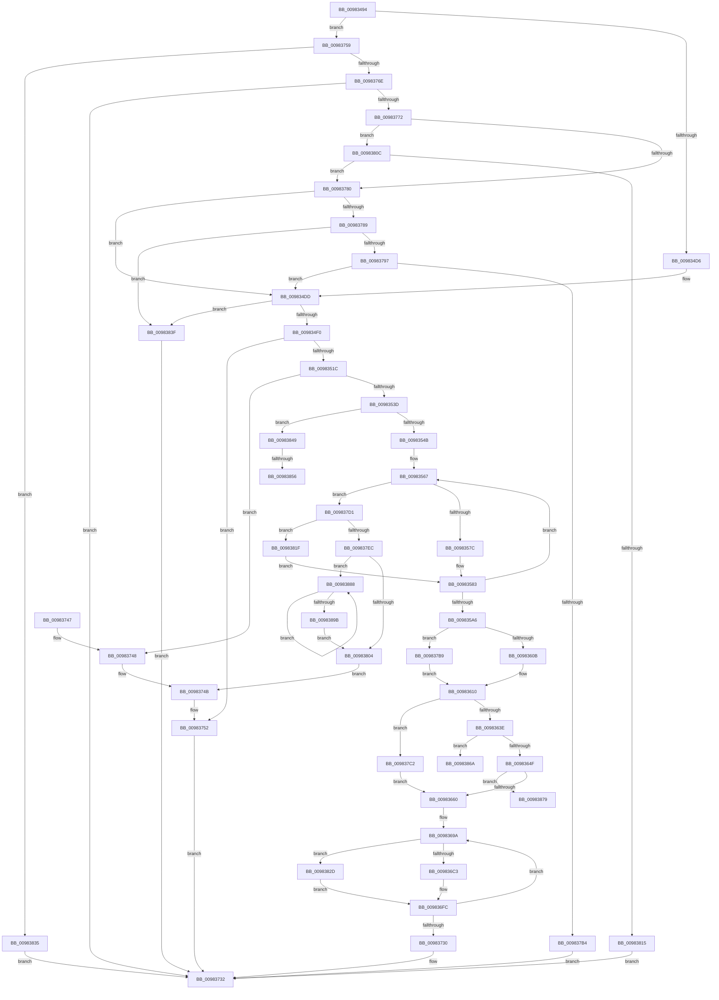

# MiCreateDataFileMap

- RVA: `0x00983494`–`0x009838A0` (길이 `1,036` bytes)
- VA: `0x0000000140983494`
- 실행 섹션: `PAGE`
- PDB 이름 있음: `예`; PDB Function 태그: `예`
- unwind 정보 RVA: `0x000979F8`
- 디코드: `260`개 명령, `1,036/1,036` bytes 표시
- 미해석 바이트: `0` (있으면 어셈블리에 `.byte`로 보존)

> 이 문서는 커널 이미지의 기계어와 PDB 기호를 분석해 생성했습니다. 4번과 5번은 함수 원형과 자료형을 바이너리 사용 방식에서 추정한 C 해석이며 원본 소스 복구 결과는 아닙니다.

## 1. Dependencies

- 직접 호출 지점: **11**; 고유 호출 대상: **7**
- 직접 호출자로 확인된 함수: **1**
- RIP 상대 이미지 참조: **0**

### Outgoing calls
- `0x0098350B` → [MiAllocatePool](../../text/35/MiAllocatePool_function_0035B540.md) (function, `0x0035B540`)
- `0x0098352C` → [MiAllocatePool](../../text/35/MiAllocatePool_function_0035B540.md) (function, `0x0035B540`)
- `0x009836A3` → [Mi4KStartForSubsection](../../text/46/Mi4KStartForSubsection_function_0046C358.md) (function, `0x0046C358`)
- `0x0098371F` → [MiInsertSubsectionNode](../../text/26/MiInsertSubsectionNode_function_00265C7C.md) (function, `0x00265C7C`)
- `0x0098374D` → [ExFreePoolWithTag](../../poolcode/B8/ExFreePoolWithTag_function_00B82870.md) (function, `0x00B82870`)
- `0x0098375E` → [FsRtlGetFileSize](FsRtlGetFileSize_function_00985150.md) (function, `0x00985150`)
- `0x009837A7` → [FsRtlSetFileSize](FsRtlSetFileSize_function_00982B04.md) (function, `0x00982B04`)
- `0x009837DF` → [MiAllocatePool](../../text/35/MiAllocatePool_function_0035B540.md) (function, `0x0035B540`)
- `0x009837EF` → [ExFreePoolWithTag](../../poolcode/B8/ExFreePoolWithTag_function_00B82870.md) (function, `0x00B82870`)
- `0x00983859` → [MiComputeIdealFirstSubsection](../80/MiComputeIdealFirstSubsection_function_00800B0C.md) (function, `0x00800B0C`)
- `0x0098388E` → [ExFreePoolWithTag](../../poolcode/B8/ExFreePoolWithTag_function_00B82870.md) (function, `0x00B82870`)

### Direct callers
- [MiCreateNewSection](MiCreateNewSection_function_00985DB0.md) at `0x00985EB5`

### Static image references
- 디코드된 RIP-relative 메모리 참조가 없습니다.

## 2. Other-region calls and transfers

- 다른 실행 섹션으로 향하는 call: **8**
  - `0x0098350B` → [MiAllocatePool](../../text/35/MiAllocatePool_function_0035B540.md) (`PAGE` → `.text`)
  - `0x0098352C` → [MiAllocatePool](../../text/35/MiAllocatePool_function_0035B540.md) (`PAGE` → `.text`)
  - `0x009836A3` → [Mi4KStartForSubsection](../../text/46/Mi4KStartForSubsection_function_0046C358.md) (`PAGE` → `.text`)
  - `0x0098371F` → [MiInsertSubsectionNode](../../text/26/MiInsertSubsectionNode_function_00265C7C.md) (`PAGE` → `.text`)
  - `0x0098374D` → [ExFreePoolWithTag](../../poolcode/B8/ExFreePoolWithTag_function_00B82870.md) (`PAGE` → `POOLCODE`)
  - `0x009837DF` → [MiAllocatePool](../../text/35/MiAllocatePool_function_0035B540.md) (`PAGE` → `.text`)
  - `0x009837EF` → [ExFreePoolWithTag](../../poolcode/B8/ExFreePoolWithTag_function_00B82870.md) (`PAGE` → `POOLCODE`)
  - `0x0098388E` → [ExFreePoolWithTag](../../poolcode/B8/ExFreePoolWithTag_function_00B82870.md) (`PAGE` → `POOLCODE`)
- call이 아닌 외부 분기/꼬리 이동: **4**
  - `0x00983850` → [sub_00B2A9B2](../B2/Unknown_function_00B2A9B2.md) (`tail-transfer`)
  - `0x00983865` → [sub_00B2A9B2](../B2/Unknown_function_00B2A9B2.md) (`tail-transfer`)
  - `0x00983874` → [sub_00B2A9B2 + 0xB](../B2/Unknown_function_00B2A9B2.md) (`tail-transfer`)
  - `0x00983883` → [sub_00B2A9B2 + 0xB](../B2/Unknown_function_00B2A9B2.md) (`tail-transfer`)

## 3. Assembly (complete function range)

```asm
00983494  4C 8B DC                        mov r11, rsp
00983497  49 89 5B 08                     mov qword ptr [r11 + 8], rbx
0098349B  4D 89 43 18                     mov qword ptr [r11 + 0x18], r8
0098349F  49 89 53 10                     mov qword ptr [r11 + 0x10], rdx
009834A3  55                              push rbp
009834A4  56                              push rsi
009834A5  57                              push rdi
009834A6  41 54                           push r12
009834A8  41 55                           push r13
009834AA  41 56                           push r14
009834AC  41 57                           push r15
009834AE  48 83 EC 30                     sub rsp, 0x30
009834B2  8B 9C 24 A8 00 00 00            mov ebx, dword ptr [rsp + 0xa8]
009834B9  49 8B F9                        mov rdi, r9
009834BC  49 83 63 B8 00                  and qword ptr [r11 - 0x48], 0
009834C1  8B C3                           mov eax, ebx
009834C3  83 E0 01                        and eax, 1
009834C6  4C 8B F1                        mov r14, rcx
009834C9  89 84 24 A8 00 00 00            mov dword ptr [rsp + 0xa8], eax
009834D0  0F 84 83 02 00 00               je 0x140983759
009834D6  49 8B E9                        mov rbp, r9
009834D9  4D 89 4B B8                     mov qword ptr [r11 - 0x48], r9
009834DD  48 B8 00 00 00 00 00 00 40 00   movabs rax, 0x40000000000000
009834E7  48 3B E8                        cmp rbp, rax
009834EA  0F 87 4F 03 00 00               ja 0x14098383f
009834F0  4C 8D BD FF 0F 00 00            lea r15, [rbp + 0xfff]
009834F7  BA 30 00 00 00                  mov edx, 0x30
009834FC  B9 00 01 00 00                  mov ecx, 0x100
00983501  49 C1 EF 0C                     shr r15, 0xc
00983505  41 B8 4D 6D 53 6D               mov r8d, 0x6d536d4d
0098350B  E8 30 80 9D FF                  call 0x14035b540
00983510  48 8B F0                        mov rsi, rax
00983513  48 85 C0                        test rax, rax
00983516  0F 84 36 02 00 00               je 0x140983752
0098351C  BA 30 01 00 00                  mov edx, 0x130
00983521  B9 40 00 00 00                  mov ecx, 0x40
00983526  41 B8 4D 6D 43 61               mov r8d, 0x61436d4d
0098352C  E8 0F 80 9D FF                  call 0x14035b540
00983531  48 8B F8                        mov rdi, rax
00983534  48 85 C0                        test rax, rax
00983537  0F 84 0B 02 00 00               je 0x140983748
0098353D  33 C9                           xor ecx, ecx
0098353F  81 E3 00 40 00 00               and ebx, 0x4000
00983545  0F 85 FE 02 00 00               jne 0x140983849
0098354B  41 BC 00 00 10 00               mov r12d, 0x100000
00983551  33 D2                           xor edx, edx
00983553  4E 8D 2C FD 00 00 00 00         lea r13, [r15*8]
0098355B  48 21 54 24 28                  and qword ptr [rsp + 0x28], rdx
00983560  48 85 C9                        test rcx, rcx
00983563  41 0F 44 CC                     cmove ecx, r12d
00983567  8B C1                           mov eax, ecx
00983569  45 8B F5                        mov r14d, r13d
0098356C  4C 3B E8                        cmp r13, rax
0098356F  44 0F 43 F1                     cmovae r14d, ecx
00983573  48 85 D2                        test rdx, rdx
00983576  0F 85 55 02 00 00               jne 0x1409837d1
0098357C  48 8D 97 80 00 00 00            lea rdx, [rdi + 0x80]
00983583  41 8B CE                        mov ecx, r14d
00983586  48 89 54 24 28                  mov qword ptr [rsp + 0x28], rdx
0098358B  C1 E9 03                        shr ecx, 3
0098358E  89 4A 2C                        mov dword ptr [rdx + 0x2c], ecx
00983591  41 8B CE                        mov ecx, r14d
00983594  4C 2B E9                        sub r13, rcx
00983597  45 3B F4                        cmp r14d, r12d
0098359A  45 0F 42 F4                     cmovb r14d, r12d
0098359E  41 8B CE                        mov ecx, r14d
009835A1  4D 85 ED                        test r13, r13
009835A4  75 C1                           jne 0x140983567
009835A6  48 8B 84 24 80 00 00 00         mov rax, qword ptr [rsp + 0x80]
009835AE  45 8D 45 01                     lea r8d, [r13 + 1]
009835B2  48 8B 54 24 78                  mov rdx, qword ptr [rsp + 0x78]
009835B7  0F 57 C0                        xorps xmm0, xmm0
009835BA  0F 11 06                        movups xmmword ptr [rsi], xmm0
009835BD  41 BA FF 03 00 00               mov r10d, 0x3ff
009835C3  0F 11 46 10                     movups xmmword ptr [rsi + 0x10], xmm0
009835C7  48 89 30                        mov qword ptr [rax], rsi
009835CA  48 8D 47 08                     lea rax, [rdi + 8]
009835CE  0F 11 46 20                     movups xmmword ptr [rsi + 0x20], xmm0
009835D2  48 89 37                        mov qword ptr [rdi], rsi
009835D5  48 89 40 08                     mov qword ptr [rax + 8], rax
009835D9  48 89 00                        mov qword ptr [rax], rax
009835DC  0F B7 47 3C                     movzx eax, word ptr [rdi + 0x3c]
009835E0  0F B7 C8                        movzx ecx, ax
009835E3  4C 89 47 70                     mov qword ptr [rdi + 0x70], r8
009835E7  4C 89 47 18                     mov qword ptr [rdi + 0x18], r8
009835EB  66 33 0A                        xor cx, word ptr [rdx]
009835EE  4C 21 6F 68                     and qword ptr [rdi + 0x68], r13
009835F2  66 41 23 CA                     and cx, r10w
009835F6  66 33 C8                        xor cx, ax
009835F9  66 89 4F 3C                     mov word ptr [rdi + 0x3c], cx
009835FD  44 39 AC 24 A8 00 00 00         cmp dword ptr [rsp + 0xa8], r13d
00983605  0F 84 AE 01 00 00               je 0x1409837b9
0098360B  0F BA 6F 38 0F                  bts dword ptr [rdi + 0x38], 0xf
00983610  83 4F 38 02                     or dword ptr [rdi + 0x38], 2
00983614  BA 06 00 00 00                  mov edx, 6
00983619  8B 4F 38                        mov ecx, dword ptr [rdi + 0x38]
0098361C  8B 84 24 A0 00 00 00            mov eax, dword ptr [rsp + 0xa0]
00983623  0F BA E9 07                     bts ecx, 7
00983627  C1 E0 14                        shl eax, 0x14
0098362A  33 C1                           xor eax, ecx
0098362C  25 00 00 F0 07                  and eax, 0x7f00000
00983631  33 C1                           xor eax, ecx
00983633  89 47 38                        mov dword ptr [rdi + 0x38], eax
00983636  85 DB                           test ebx, ebx
00983638  0F 85 84 01 00 00               jne 0x1409837c2
0098363E  F7 84 24 98 00 00 00 00 00 00 10  test dword ptr [rsp + 0x98], 0x10000000
00983649  0F 85 1B 02 00 00               jne 0x14098386a
0098364F  F7 84 24 98 00 00 00 00 00 00 40  test dword ptr [rsp + 0x98], 0x40000000
0098365A  0F 85 19 02 00 00               jne 0x140983879
00983660  0F B7 46 0C                     movzx eax, word ptr [rsi + 0xc]
00983664  4C 8D 8F 80 00 00 00            lea r9, [rdi + 0x80]
0098366B  49 8B CF                        mov rcx, r15
0098366E  48 89 6E 18                     mov qword ptr [rsi + 0x18], rbp
00983672  48 C1 E9 20                     shr rcx, 0x20
00983676  8D 2C 12                        lea ebp, [rdx + rdx]
00983679  66 33 C8                        xor cx, ax
0098367C  48 89 3E                        mov qword ptr [rsi], rdi
0098367F  66 41 23 CA                     and cx, r10w
00983683  44 89 7E 08                     mov dword ptr [rsi + 8], r15d
00983687  66 33 C8                        xor cx, ax
0098368A  8A 46 0E                        mov al, byte ptr [rsi + 0xe]
0098368D  24 E0                           and al, 0xe0
0098368F  66 89 4E 0C                     mov word ptr [rsi + 0xc], cx
00983693  0A C2                           or al, dl
00983695  88 46 0E                        mov byte ptr [rsi + 0xe], al
00983698  33 DB                           xor ebx, ebx
0098369A  48 8B D3                        mov rdx, rbx
0098369D  49 89 39                        mov qword ptr [r9], rdi
009836A0  49 8B C9                        mov rcx, r9
009836A3  E8 B0 8C AE FF                  call 0x14046c358
009836A8  41 8B 41 20                     mov eax, dword ptr [r9 + 0x20]
009836AC  49 8D 71 10                     lea rsi, [r9 + 0x10]
009836B0  45 8B 51 2C                     mov r10d, dword ptr [r9 + 0x2c]
009836B4  83 E0 C1                        and eax, 0xffffffc1
009836B7  0B C5                           or eax, ebp
009836B9  48 83 3E 00                     cmp qword ptr [rsi], 0
009836BD  0F 85 6A 01 00 00               jne 0x14098382d
009836C3  4C 8B 44 24 20                  mov r8, qword ptr [rsp + 0x20]
009836C8  8B C8                           mov ecx, eax
009836CA  41 0F B7 D0                     movzx edx, r8w
009836CE  81 E1 FF FF 0F 00               and ecx, 0xfffff
009836D4  C1 E2 14                        shl edx, 0x14
009836D7  8B C2                           mov eax, edx
009836D9  49 C1 E8 0C                     shr r8, 0xc
009836DD  0B C1                           or eax, ecx
009836DF  8B D3                           mov edx, ebx
009836E1  41 8B 49 34                     mov ecx, dword ptr [r9 + 0x34]
009836E5  41 2B D7                        sub edx, r15d
009836E8  41 03 D2                        add edx, r10d
009836EB  33 D1                           xor edx, ecx
009836ED  81 E2 FF FF FF 3F               and edx, 0x3fffffff
009836F3  33 D1                           xor edx, ecx
009836F5  41 89 51 34                     mov dword ptr [r9 + 0x34], edx
009836F9  44 2B C3                        sub r8d, ebx
009836FC  45 89 41 28                     mov dword ptr [r9 + 0x28], r8d
00983700  49 8B D1                        mov rdx, r9
00983703  41 89 41 20                     mov dword ptr [r9 + 0x20], eax
00983707  45 33 C0                        xor r8d, r8d
0098370A  41 8B 41 2C                     mov eax, dword ptr [r9 + 0x2c]
0098370E  48 8B CF                        mov rcx, rdi
00983711  48 03 D8                        add rbx, rax
00983714  49 8D 41 58                     lea rax, [r9 + 0x58]
00983718  48 89 40 08                     mov qword ptr [rax + 8], rax
0098371C  48 89 00                        mov qword ptr [rax], rax
0098371F  E8 58 25 8E FF                  call 0x140265c7c
00983724  4C 8B 0E                        mov r9, qword ptr [rsi]
00983727  4D 85 C9                        test r9, r9
0098372A  0F 85 6A FF FF FF               jne 0x14098369a
00983730  33 C0                           xor eax, eax
00983732  48 8B 5C 24 70                  mov rbx, qword ptr [rsp + 0x70]
00983737  48 83 C4 30                     add rsp, 0x30
0098373B  41 5F                           pop r15
0098373D  41 5E                           pop r14
0098373F  41 5D                           pop r13
00983741  41 5C                           pop r12
00983743  5F                              pop rdi
00983744  5E                              pop rsi
00983745  5D                              pop rbp
00983746  C3                              ret
00983747  CC                              int3
00983748  48 8B CE                        mov rcx, rsi
0098374B  33 D2                           xor edx, edx
0098374D  E8 1E F1 1F 00                  call 0x140b82870
00983752  B8 9A 00 00 C0                  mov eax, 0xc000009a
00983757  EB D9                           jmp 0x140983732
00983759  48 8D 54 24 20                  lea rdx, [rsp + 0x20]
0098375E  E8 ED 19 00 00                  call 0x140985150
00983763  3D BA 00 00 C0                  cmp eax, 0xc00000ba
00983768  0F 84 C7 00 00 00               je 0x140983835
0098376E  85 C0                           test eax, eax
00983770  78 C0                           js 0x140983732
00983772  48 8B 6C 24 20                  mov rbp, qword ptr [rsp + 0x20]
00983777  48 85 ED                        test rbp, rbp
0098377A  0F 84 8C 00 00 00               je 0x14098380c
00983780  48 3B FD                        cmp rdi, rbp
00983783  0F 86 54 FD FF FF               jbe 0x1409834dd
00983789  F6 84 24 90 00 00 00 44         test byte ptr [rsp + 0x90], 0x44
00983791  0F 84 A8 00 00 00               je 0x14098383f
00983797  48 8D 54 24 20                  lea rdx, [rsp + 0x20]
0098379C  48 89 7C 24 20                  mov qword ptr [rsp + 0x20], rdi
009837A1  49 8B CE                        mov rcx, r14
009837A4  48 8B EF                        mov rbp, rdi
009837A7  E8 58 F3 FF FF                  call 0x140982b04
009837AC  85 C0                           test eax, eax
009837AE  0F 89 29 FD FF FF               jns 0x1409834dd
009837B4  E9 79 FF FF FF                  jmp 0x140983732
009837B9  4C 89 47 30                     mov qword ptr [rdi + 0x30], r8
009837BD  E9 4E FE FF FF                  jmp 0x140983610
009837C2  8A 47 3E                        mov al, byte ptr [rdi + 0x3e]
009837C5  24 F7                           and al, 0xf7
009837C7  0C 04                           or al, 4
009837C9  88 47 3E                        mov byte ptr [rdi + 0x3e], al
009837CC  E9 8F FE FF FF                  jmp 0x140983660
009837D1  BA 98 00 00 00                  mov edx, 0x98
009837D6  41 B8 4D 6D 53 63               mov r8d, 0x63536d4d
009837DC  8D 4A A8                        lea ecx, [rdx - 0x58]
009837DF  E8 5C 7D 9D FF                  call 0x14035b540
009837E4  48 8B D0                        mov rdx, rax
009837E7  48 85 C0                        test rax, rax
009837EA  75 33                           jne 0x14098381f
009837EC  48 8B CE                        mov rcx, rsi
009837EF  E8 7C F0 1F 00                  call 0x140b82870
009837F4  48 8B 8F 90 00 00 00            mov rcx, qword ptr [rdi + 0x90]
009837FB  48 85 C9                        test rcx, rcx
009837FE  0F 85 84 00 00 00               jne 0x140983888
00983804  48 8B CF                        mov rcx, rdi
00983807  E9 3F FF FF FF                  jmp 0x14098374b
0098380C  48 85 FF                        test rdi, rdi
0098380F  0F 85 6B FF FF FF               jne 0x140983780
00983815  B8 1E 01 00 C0                  mov eax, 0xc000011e
0098381A  E9 13 FF FF FF                  jmp 0x140983732
0098381F  48 8B 44 24 28                  mov rax, qword ptr [rsp + 0x28]
00983824  48 89 50 10                     mov qword ptr [rax + 0x10], rdx
00983828  E9 56 FD FF FF                  jmp 0x140983583
0098382D  45 8B C2                        mov r8d, r10d
00983830  E9 C7 FE FF FF                  jmp 0x1409836fc
00983835  B8 20 00 00 C0                  mov eax, 0xc0000020
0098383A  E9 F3 FE FF FF                  jmp 0x140983732
0098383F  B8 40 00 00 C0                  mov eax, 0xc0000040
00983844  E9 E9 FE FF FF                  jmp 0x140983732
00983849  49 81 FF 00 02 00 00            cmp r15, 0x200
00983850  0F 86 5C 71 1A 00               jbe 0x140b2a9b2
00983856  49 8B CE                        mov rcx, r14
00983859  E8 AE D2 E7 FF                  call 0x140800b0c
0098385E  48 8B C8                        mov rcx, rax
00983861  48 C1 E1 03                     shl rcx, 3
00983865  E9 48 71 1A 00                  jmp 0x140b2a9b2
0098386A  B8 00 20 00 00                  mov eax, 0x2000
0098386F  BA 0E 00 00 00                  mov edx, 0xe
00983874  E9 44 71 1A 00                  jmp 0x140b2a9bd
00983879  B8 00 10 00 00                  mov eax, 0x1000
0098387E  BA 1E 00 00 00                  mov edx, 0x1e
00983883  E9 35 71 1A 00                  jmp 0x140b2a9bd
00983888  48 8B 59 10                     mov rbx, qword ptr [rcx + 0x10]
0098388C  33 D2                           xor edx, edx
0098388E  E8 DD EF 1F 00                  call 0x140b82870
00983893  48 8B CB                        mov rcx, rbx
00983896  48 85 DB                        test rbx, rbx
00983899  75 ED                           jne 0x140983888
0098389B  E9 64 FF FF FF                  jmp 0x140983804
```

## 4. C-style interpretation (structured pseudocode)

```c
__int64 __fastcall MiCreateDataFileMap(__int64 a1, __int64 a2, __int64 a3, __int64 a4, unsigned __int8 a5, unsigned int a6, unsigned int a7, unsigned int a8)
{
    __int64 result;
    __int64 v_r13;
    __int64 v_r14;
    __int64 v_r15;
    __int64 v_rbx;
    __int64 v_rsp;
    unsigned __int64 v_stack_m40;
    unsigned __int64 v_stack_m48;
    unsigned __int64 v_stack_p10;
    unsigned __int64 v_stack_p18;
    unsigned __int64 v_stack_p20;
    unsigned __int64 v_stack_p28;
    unsigned int v_stack_p40;
    unsigned __int64 v_stack_p8;

    *(unsigned __int64 *)(v_rsp + 8) = v_rbx;
    *(unsigned __int64 *)(v_rsp + 24) = a3;
    *(unsigned __int64 *)(v_rsp + 16) = a2;
    v_rsp = (v_rsp) - (48);
    result = (unsigned int)(((unsigned int)((unsigned int)((unsigned int)(a8)))) & (1));
    v_stack_p40 = (unsigned int)(result);
    if (condition_is_equal) goto loc_00983759;
    *(unsigned __int64 *)(v_rsp - 72) = a4;
loc_009834DD:
    if (a4 > result) goto loc_0098383F;
    v_r15 = (a4 + 4095) >> (12);
    result = MiAllocatePool(256, 48, (unsigned int)(0x6D536D4DULL), a4);
    if (result == 0) goto loc_00983752;
    result = MiAllocatePool(64, 304, (unsigned int)(0x61436D4DULL), a4);
    if (result == 0) goto loc_00983748;
    a1 = 0;
    v_rbx = (unsigned int)(((unsigned int)(a8)) & (0x4000ULL));
    if (condition_is_not_equal) goto loc_00983849;
    a2 = 0;
    if (0 == 0) { a1 = (unsigned int)((unsigned int)(0x100000ULL)); }
loc_00983567:
    v_r14 = (unsigned int)((unsigned int)(v_r15 * 8));
    if ((v_r15 * 8) >= ((unsigned int)((unsigned int)(a1)))) { v_r14 = (unsigned int)(a1); }
    if (0 != 0) goto loc_009837D1;
loc_00983583:
    v_stack_m40 = result + 128;
    a1 = (unsigned int)(((unsigned int)((unsigned int)(v_r14))) >> (3));
    *(unsigned int *)(result + 128 + 44) = (unsigned int)(a1);
    v_r13 = (v_r15 * 8) - ((unsigned int)((unsigned int)(v_r14)));
    if (((unsigned int)(v_r14)) < ((unsigned int)((unsigned int)(0x100000ULL)))) { v_r14 = (unsigned int)((unsigned int)(0x100000ULL)); }
    if (v_r13 != 0) goto loc_00983567;
    *(unsigned __int64 *)(result) = v_xmm0;
    *(unsigned __int64 *)(result + 16) = v_xmm0;
    *(unsigned __int64 *)(v_stack_p18) = result;
    *(unsigned __int64 *)(result + 32) = v_xmm0;
    *(unsigned __int64 *)(result) = result;
    *(unsigned __int64 *)(result + 8 + 8) = result + 8;
    *(unsigned __int64 *)(result + 8) = result + 8;
    *(unsigned __int64 *)(result + 112) = v_r13 + 1;
    *(unsigned __int64 *)(result + 24) = v_r13 + 1;
    a1 = (unsigned __int16)(((unsigned __int16)(*(unsigned __int16 *)(result + 60))) ^ (*(unsigned __int16 *)(v_stack_p10)));
    a1 = (unsigned __int16)((a1) & ((unsigned __int16)((unsigned int)(0x3FFULL))));
    a1 = (unsigned __int16)((a1) ^ ((unsigned __int16)(*(unsigned __int16 *)(result + 60))));
    *(unsigned __int16 *)(result + 60) = (unsigned __int16)(a1);
    if (a8 == ((unsigned int)(v_r13))) goto loc_009837B9;
loc_00983610:
    result = (unsigned int)(((unsigned int)(a7)) << (20));
    result = (unsigned int)((result) ^ ((unsigned int)((unsigned int)(*(unsigned int *)(result + 56)))));
    result = (unsigned int)((result) & (0x7F00000ULL));
    result = (unsigned int)((result) ^ ((unsigned int)((unsigned int)(*(unsigned int *)(result + 56)))));
    *(unsigned int *)(result + 56) = (unsigned int)(result);
    if ((unsigned int)(v_rbx) != 0) goto loc_009837C2;
    if (((a6) & (0x10000000ULL)) != 0) goto loc_0098386A;
    if (((a6) & (0x40000000ULL)) != 0) goto loc_00983879;
loc_00983660:
    *(unsigned __int64 *)(result + 24) = a4;
    a1 = (v_r15) >> (32);
    a1 = (unsigned __int16)((a1) ^ ((unsigned __int16)(*(unsigned __int16 *)(result + 12))));
    *(unsigned __int64 *)(result) = result;
    a1 = (unsigned __int16)((a1) & ((unsigned __int16)((unsigned int)(0x3FFULL))));
    *(unsigned int *)(result + 8) = (unsigned int)(v_r15);
    a1 = (unsigned __int16)((a1) ^ ((unsigned __int16)(*(unsigned __int16 *)(result + 12))));
    result = (unsigned __int8)((*(unsigned __int8 *)(result + 14)) & (224));
    *(unsigned __int16 *)(result + 12) = (unsigned __int16)(a1);
    result = (unsigned __int8)((result) | (6));
    *(unsigned __int8 *)(result + 14) = (unsigned __int8)(result);
    v_rbx = 0;
loc_0098369A:
    *(unsigned __int64 *)(result + 128) = result;
    result = Mi4KStartForSubsection(result + 128, 0, v_r13 + 1, result + 128);
    result = (unsigned int)(((unsigned int)(*(unsigned int *)(result + 128 + 32))) & (0xFFFFFFC1ULL));
    result = (unsigned int)((result) | ((unsigned int)(6 + 6 * 1)));
    if ((*(unsigned __int64 *)(result + 128 + 16)) != 0) goto loc_0098382D;
    a1 = (unsigned int)(((unsigned int)((unsigned int)(result))) & (0xFFFFFULL));
    a2 = (unsigned int)(((unsigned __int16)(v_stack_m48)) << (20));
    a3 = (v_stack_m48) >> (12);
    result = (unsigned int)(((unsigned int)((unsigned int)(a2))) | ((unsigned int)(a1)));
    a2 = (unsigned int)((0) - ((unsigned int)(v_r15)));
    a2 = (unsigned int)((a2) + ((unsigned int)((unsigned int)(*(unsigned int *)(result + 128 + 44)))));
    a2 = (unsigned int)((a2) ^ ((unsigned int)((unsigned int)(*(unsigned int *)(result + 128 + 52)))));
    a2 = (unsigned int)((a2) & (0x3FFFFFFFULL));
    a2 = (unsigned int)((a2) ^ ((unsigned int)((unsigned int)(*(unsigned int *)(result + 128 + 52)))));
    *(unsigned int *)(result + 128 + 52) = (unsigned int)(a2);
    a3 = (unsigned int)((a3) - (0));
loc_009836FC:
    *(unsigned int *)(result + 128 + 40) = (unsigned int)(a3);
    *(unsigned int *)(result + 128 + 32) = (unsigned int)(result);
    a3 = 0;
    v_rbx = (v_rbx) + ((unsigned int)(*(unsigned int *)(result + 128 + 44)));
    *(unsigned __int64 *)(result + 128 + 88 + 8) = result + 128 + 88;
    *(unsigned __int64 *)(result + 128 + 88) = result + 128 + 88;
    result = MiInsertSubsectionNode(result, result + 128, a3, result + 128);
    if (*(unsigned __int64 *)(result + 128 + 16) != 0) goto loc_0098369A;
    result = 0;
loc_00983732:
    v_rsp = (v_rsp) + (48);
    return result;
loc_00983748:
loc_0098374B:
    a2 = 0;
    result = ExFreePoolWithTag(result + 128 + 16, a2, a3, *(unsigned __int64 *)(result + 128 + 16));
loc_00983752:
    goto loc_00983732;
loc_00983759:
    result = FsRtlGetFileSize(result + 128 + 16, v_stack_p20, a3, *(unsigned __int64 *)(result + 128 + 16));
    if (((unsigned int)(result)) == 0xC00000BAULL) goto loc_00983835;
    if (sign_flag) goto loc_00983732;
    if (v_stack_p20 == 0) goto loc_0098380C;
loc_00983780:
    if (result <= v_stack_p20) goto loc_009834DD;
    if (((a5) & (68)) == 0) goto loc_0098383F;
    v_stack_p20 = result;
    result = FsRtlSetFileSize(v_r14, v_stack_p20, a3, *(unsigned __int64 *)(result + 128 + 16));
    if (!sign_flag) goto loc_009834DD;
    goto loc_00983732;
loc_009837B9:
    *(unsigned __int64 *)(result + 48) = 0;
    goto loc_00983610;
loc_009837C2:
    result = (unsigned __int8)((*(unsigned __int8 *)(result + 62)) & (247));
    result = (unsigned __int8)((result) | (4));
    *(unsigned __int8 *)(result + 62) = (unsigned __int8)(result);
    goto loc_00983660;
loc_009837D1:
    result = MiAllocatePool(152 - 88, 152, (unsigned int)(0x63536D4DULL), *(unsigned __int64 *)(result + 128 + 16));
    if (result != 0) goto loc_0098381F;
    result = ExFreePoolWithTag(result + 128 + 16, result, (unsigned int)(0x63536D4DULL), *(unsigned __int64 *)(result + 128 + 16));
    if (*(unsigned __int64 *)(result + 144) != 0) goto loc_00983888;
loc_00983804:
    goto loc_0098374B;
loc_0098380C:
    if (result != 0) goto loc_00983780;
    goto loc_00983732;
loc_0098381F:
    *(unsigned __int64 *)(v_stack_p28 + 16) = result;
    goto loc_00983583;
loc_0098382D:
    goto loc_009836FC;
loc_00983835:
    goto loc_00983732;
loc_0098383F:
    goto loc_00983732;
loc_00983849:
    result = MiComputeIdealFirstSubsection(v_r14, result, (unsigned int)((unsigned int)((unsigned int)(*(unsigned int *)(result + 128 + 44)))), *(unsigned __int64 *)(result + 128 + 16));
    a1 = (result) << (3);
loc_0098386A:
loc_00983879:
loc_00983888:
    a2 = 0;
    result = ExFreePoolWithTag(a1, a2, (unsigned int)((unsigned int)((unsigned int)(*(unsigned int *)(result + 128 + 44)))), *(unsigned __int64 *)(result + 128 + 16));
    if (*(unsigned __int64 *)(a1 + 16) != 0) goto loc_00983888;
    goto loc_00983804;
}
```

## 5. (Beta) C Style

```c
int64_t MiCreateDataFileMap(int64_t Arg1, int64_t Arg2, int64_t Arg3, int64_t Arg4, uint8_t Arg5, uint32_t Arg6, uint32_t Arg7, uint32_t Arg8)
{
    int64_t result;
    int64_t local_r13;
    int64_t local_r14;
    int64_t local_r15;
    int64_t local_rbx;
    int64_t local_rsp;
    uint64_t v_stack_m40;
    uint64_t v_stack_m48;
    uint64_t v_stack_p10;
    uint64_t v_stack_p18;
    uint64_t v_stack_p20;
    uint64_t v_stack_p28;
    uint32_t v_stack_p40;
    uint64_t v_stack_p8;

    *(uint64_t *)(local_rsp + 0x8) = local_rbx;
    *(uint64_t *)(local_rsp + 0x18) = Arg3;
    *(uint64_t *)(local_rsp + 0x10) = Arg2;
    local_rsp = (local_rsp) - (48);
    result = (uint32_t)(((uint32_t)((uint32_t)((uint32_t)(Arg8)))) & (1));
    v_stack_p40 = (uint32_t)(result);
    if (condition_is_equal) goto loc_00983759;
    *(uint64_t *)(local_rsp - 0x48) = Arg4;
loc_009834DD:
    if (Arg4 > result) goto loc_0098383F;
    local_r15 = (Arg4 + 4095) >> (12);
    result = MiAllocatePool(256, 48, (uint32_t)(0x6D536D4DULL), Arg4);
    if (result == 0) goto loc_00983752;
    result = MiAllocatePool(64, 304, (uint32_t)(0x61436D4DULL), Arg4);
    if (result == 0) goto loc_00983748;
    Arg1 = 0;
    local_rbx = (uint32_t)(((uint32_t)(Arg8)) & (0x4000ULL));
    if (condition_is_not_equal) goto loc_00983849;
    Arg2 = 0;
    if (0 == 0) { Arg1 = (uint32_t)((uint32_t)(0x100000ULL)); }
loc_00983567:
    local_r14 = (uint32_t)((uint32_t)(local_r15 * 8));
    if ((local_r15 * 8) >= ((uint32_t)((uint32_t)(Arg1)))) { local_r14 = (uint32_t)(Arg1); }
    if (0 != 0) goto loc_009837D1;
loc_00983583:
    v_stack_m40 = result + 128;
    Arg1 = (uint32_t)(((uint32_t)((uint32_t)(local_r14))) >> (3));
    *(uint32_t *)(result + 0x80 + 0x2C) = (uint32_t)(Arg1);
    local_r13 = (local_r15 * 8) - ((uint32_t)((uint32_t)(local_r14)));
    if (((uint32_t)(local_r14)) < ((uint32_t)((uint32_t)(0x100000ULL)))) { local_r14 = (uint32_t)((uint32_t)(0x100000ULL)); }
    if (local_r13 != 0) goto loc_00983567;
    *(uint64_t *)(result) = v_xmm0;
    *(uint64_t *)(result + 0x10) = v_xmm0;
    *(uint64_t *)(v_stack_p18) = result;
    *(uint64_t *)(result + 0x20) = v_xmm0;
    *(uint64_t *)(result) = result;
    *(uint64_t *)(result + 0x8 + 0x8) = result + 8;
    *(uint64_t *)(result + 0x8) = result + 8;
    *(uint64_t *)(result + 0x70) = local_r13 + 1;
    *(uint64_t *)(result + 0x18) = local_r13 + 1;
    Arg1 = (uint16_t)(((uint16_t)(*(uint16_t *)(result + 0x3C))) ^ (*(uint16_t *)(v_stack_p10)));
    Arg1 = (uint16_t)((Arg1) & ((uint16_t)((uint32_t)(0x3FFULL))));
    Arg1 = (uint16_t)((Arg1) ^ ((uint16_t)(*(uint16_t *)(result + 0x3C))));
    *(uint16_t *)(result + 0x3C) = (uint16_t)(Arg1);
    if (Arg8 == ((uint32_t)(local_r13))) goto loc_009837B9;
loc_00983610:
    result = (uint32_t)(((uint32_t)(Arg7)) << (20));
    result = (uint32_t)((result) ^ ((uint32_t)((uint32_t)(*(uint32_t *)(result + 0x38)))));
    result = (uint32_t)((result) & (0x7F00000ULL));
    result = (uint32_t)((result) ^ ((uint32_t)((uint32_t)(*(uint32_t *)(result + 0x38)))));
    *(uint32_t *)(result + 0x38) = (uint32_t)(result);
    if ((uint32_t)(local_rbx) != 0) goto loc_009837C2;
    if (((Arg6) & (0x10000000ULL)) != 0) goto loc_0098386A;
    if (((Arg6) & (0x40000000ULL)) != 0) goto loc_00983879;
loc_00983660:
    *(uint64_t *)(result + 0x18) = Arg4;
    Arg1 = (local_r15) >> (32);
    Arg1 = (uint16_t)((Arg1) ^ ((uint16_t)(*(uint16_t *)(result + 0xC))));
    *(uint64_t *)(result) = result;
    Arg1 = (uint16_t)((Arg1) & ((uint16_t)((uint32_t)(0x3FFULL))));
    *(uint32_t *)(result + 0x8) = (uint32_t)(local_r15);
    Arg1 = (uint16_t)((Arg1) ^ ((uint16_t)(*(uint16_t *)(result + 0xC))));
    result = (uint8_t)((*(uint8_t *)(result + 0xE)) & (224));
    *(uint16_t *)(result + 0xC) = (uint16_t)(Arg1);
    result = (uint8_t)((result) | (6));
    *(uint8_t *)(result + 0xE) = (uint8_t)(result);
    local_rbx = 0;
loc_0098369A:
    *(uint64_t *)(result + 0x80) = result;
    result = Mi4KStartForSubsection(result + 128, 0, local_r13 + 1, result + 128);
    result = (uint32_t)(((uint32_t)(*(uint32_t *)(result + 0x80 + 0x20))) & (0xFFFFFFC1ULL));
    result = (uint32_t)((result) | ((uint32_t)(6 + 6 * 1)));
    if ((*(uint64_t *)(result + 0x80 + 0x10)) != 0) goto loc_0098382D;
    Arg1 = (uint32_t)(((uint32_t)((uint32_t)(result))) & (0xFFFFFULL));
    Arg2 = (uint32_t)(((uint16_t)(v_stack_m48)) << (20));
    Arg3 = (v_stack_m48) >> (12);
    result = (uint32_t)(((uint32_t)((uint32_t)(Arg2))) | ((uint32_t)(Arg1)));
    Arg2 = (uint32_t)((0) - ((uint32_t)(local_r15)));
    Arg2 = (uint32_t)((Arg2) + ((uint32_t)((uint32_t)(*(uint32_t *)(result + 0x80 + 0x2C)))));
    Arg2 = (uint32_t)((Arg2) ^ ((uint32_t)((uint32_t)(*(uint32_t *)(result + 0x80 + 0x34)))));
    Arg2 = (uint32_t)((Arg2) & (0x3FFFFFFFULL));
    Arg2 = (uint32_t)((Arg2) ^ ((uint32_t)((uint32_t)(*(uint32_t *)(result + 0x80 + 0x34)))));
    *(uint32_t *)(result + 0x80 + 0x34) = (uint32_t)(Arg2);
    Arg3 = (uint32_t)((Arg3) - (0));
loc_009836FC:
    *(uint32_t *)(result + 0x80 + 0x28) = (uint32_t)(Arg3);
    *(uint32_t *)(result + 0x80 + 0x20) = (uint32_t)(result);
    Arg3 = 0;
    local_rbx = (local_rbx) + ((uint32_t)(*(uint32_t *)(result + 0x80 + 0x2C)));
    *(uint64_t *)(result + 0x80 + 0x58 + 0x8) = result + 128 + 88;
    *(uint64_t *)(result + 0x80 + 0x58) = result + 128 + 88;
    result = MiInsertSubsectionNode(result, result + 128, Arg3, result + 128);
    if (*(uint64_t *)(result + 0x80 + 0x10) != 0) goto loc_0098369A;
    result = 0;
loc_00983732:
    local_rsp = (local_rsp) + (48);
    return result;
loc_00983748:
loc_0098374B:
    Arg2 = 0;
    result = ExFreePoolWithTag(result + 128 + 16, Arg2, Arg3, *(uint64_t *)(result + 0x80 + 0x10));
loc_00983752:
    goto loc_00983732;
loc_00983759:
    result = FsRtlGetFileSize(result + 128 + 16, v_stack_p20, Arg3, *(uint64_t *)(result + 0x80 + 0x10));
    if (((uint32_t)(result)) == 0xC00000BAULL) goto loc_00983835;
    if (sign_flag) goto loc_00983732;
    if (v_stack_p20 == 0) goto loc_0098380C;
loc_00983780:
    if (result <= v_stack_p20) goto loc_009834DD;
    if (((Arg5) & (68)) == 0) goto loc_0098383F;
    v_stack_p20 = result;
    result = FsRtlSetFileSize(local_r14, v_stack_p20, Arg3, *(uint64_t *)(result + 0x80 + 0x10));
    if (!sign_flag) goto loc_009834DD;
    goto loc_00983732;
loc_009837B9:
    *(uint64_t *)(result + 0x30) = 0;
    goto loc_00983610;
loc_009837C2:
    result = (uint8_t)((*(uint8_t *)(result + 0x3E)) & (247));
    result = (uint8_t)((result) | (4));
    *(uint8_t *)(result + 0x3E) = (uint8_t)(result);
    goto loc_00983660;
loc_009837D1:
    result = MiAllocatePool(152 - 88, 152, (uint32_t)(0x63536D4DULL), *(uint64_t *)(result + 0x80 + 0x10));
    if (result != 0) goto loc_0098381F;
    result = ExFreePoolWithTag(result + 128 + 16, result, (uint32_t)(0x63536D4DULL), *(uint64_t *)(result + 0x80 + 0x10));
    if (*(uint64_t *)(result + 0x90) != 0) goto loc_00983888;
loc_00983804:
    goto loc_0098374B;
loc_0098380C:
    if (result != 0) goto loc_00983780;
    goto loc_00983732;
loc_0098381F:
    *(uint64_t *)(v_stack_p28 + 0x10) = result;
    goto loc_00983583;
loc_0098382D:
    goto loc_009836FC;
loc_00983835:
    goto loc_00983732;
loc_0098383F:
    goto loc_00983732;
loc_00983849:
    result = MiComputeIdealFirstSubsection(local_r14, result, (uint32_t)((uint32_t)((uint32_t)(*(uint32_t *)(result + 0x80 + 0x2C)))), *(uint64_t *)(result + 0x80 + 0x10));
    Arg1 = (result) << (3);
loc_0098386A:
loc_00983879:
loc_00983888:
    Arg2 = 0;
    result = ExFreePoolWithTag(Arg1, Arg2, (uint32_t)((uint32_t)((uint32_t)(*(uint32_t *)(result + 0x80 + 0x2C)))), *(uint64_t *)(result + 0x80 + 0x10));
    if (*(uint64_t *)(Arg1 + 0x10) != 0) goto loc_00983888;
    goto loc_00983804;
}
```

## 6. Execution-region graph

[열기: 2D/3D 그래프와 함수 탐색 컨트롤 패널](../../../control-panel.html?section=page&rva=0x00983494&view=graph)

- 2D 그래프는 위에서 아래로 흐르고, 3D 그래프는 빈 공간을 드래그해 회전합니다. Shift+드래그는 이동, 휠은 확대·축소, 함수 노드 선택은 대상 보고서 이동입니다.

### Static fallback


