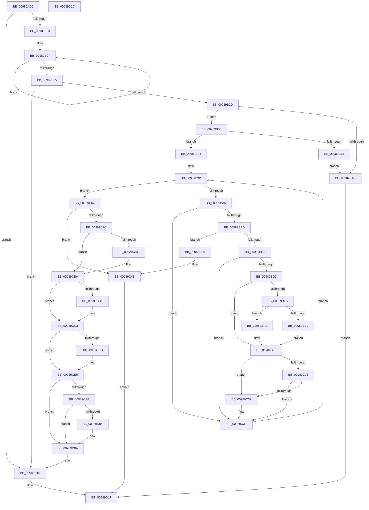

# MiCreateFileOnlyImageFixupList

- RVA: `0x00989AD0`–`0x00989D2D` (길이 `605` bytes)
- VA: `0x0000000140989AD0`
- 실행 섹션: `PAGE`
- PDB 이름 있음: `예`; PDB Function 태그: `아니요`
- unwind 정보 RVA: `0x00097FE8`
- 디코드: `174`개 명령, `605/605` bytes 표시
- 미해석 바이트: `0` (있으면 어셈블리에 `.byte`로 보존)

> 이 문서는 커널 이미지의 기계어와 PDB 기호를 분석해 생성했습니다. 4번과 5번은 함수 원형과 자료형을 바이너리 사용 방식에서 추정한 C 해석이며 원본 소스 복구 결과는 아닙니다.

## 1. Dependencies

- 직접 호출 지점: **15**; 고유 호출 대상: **13**
- 직접 호출자로 확인된 함수: **1**
- RIP 상대 이미지 참조: **1**

### Outgoing calls
- `0x00989B0F` → [MiPageHasRelocations](../93/MiPageHasRelocations_function_0093EEC0.md) (function, `0x0093EEC0`)
- `0x00989B3F` → [MiAllocatePool](../../text/35/MiAllocatePool_function_0035B540.md) (function, `0x0035B540`)
- `0x00989B59` → [MiGetControlAreaPartition](../../text/43/MiGetControlAreaPartition_function_0043E560.md) (function, `0x0043E560`)
- `0x00989B6F` → [MiChargeCommit](../../text/28/MiChargeCommit_function_00286EB0.md) (function, `0x00286EB0`)
- `0x00989B7D` → [ExFreePoolWithTag](../../poolcode/B8/ExFreePoolWithTag_function_00B82870.md) (function, `0x00B82870`)
- `0x00989BB0` → [MiPageHasRelocations](../93/MiPageHasRelocations_function_0093EEC0.md) (function, `0x0093EEC0`)
- `0x00989C29` → [MiGetSubsectionFromPte](../../text/41/MiGetSubsectionFromPte_function_0041C6E0.md) (function, `0x0041C6E0`)
- `0x00989C56` → [MiReturnCommit](../../text/24/MiReturnCommit_function_00248410.md) (function, `0x00248410`)
- `0x00989C60` → [ExFreePoolWithTag](../../poolcode/B8/ExFreePoolWithTag_function_00B82870.md) (function, `0x00B82870`)
- `0x00989C9C` → [KeAbPreAcquire](../../text/21/KeAbPreAcquire_function_00210230.md) (function, `0x00210230`)
- `0x00989CB5` → [ExfAcquirePushLockExclusiveEx](../../text/20/ExfAcquirePushLockExclusiveEx_function_0020FC90.md) (function, `0x0020FC90`)
- `0x00989CC9` → [MiUpdateControlAreaCommitCount](../../text/45/MiUpdateControlAreaCommitCount_function_004588E8.md) (function, `0x004588E8`)
- `0x00989CE0` → [ExfTryToWakePushLock](../../text/26/ExfTryToWakePushLock_function_00265DD0.md) (function, `0x00265DD0`)
- `0x00989CE8` → [KeAbPostRelease](../../text/2E/KeAbPostRelease_function_002E1600.md) (function, `0x002E1600`)
- `0x00989D05` → [KiCheckForKernelApcDelivery](../../text/2E/KiCheckForKernelApcDelivery_function_002E2C80.md) (function, `0x002E2C80`)

### Direct callers
- [MiRelocateImage](MiRelocateImage_function_00988E14.md) at `0x009893B6`

### Static image references
- `0x00989BD9` → RVA `0x00E2DC80` (`.data`; read)

## 2. Other-region calls and transfers

- 다른 실행 섹션으로 향하는 call: **13**
  - `0x00989B3F` → [MiAllocatePool](../../text/35/MiAllocatePool_function_0035B540.md) (`PAGE` → `.text`)
  - `0x00989B59` → [MiGetControlAreaPartition](../../text/43/MiGetControlAreaPartition_function_0043E560.md) (`PAGE` → `.text`)
  - `0x00989B6F` → [MiChargeCommit](../../text/28/MiChargeCommit_function_00286EB0.md) (`PAGE` → `.text`)
  - `0x00989B7D` → [ExFreePoolWithTag](../../poolcode/B8/ExFreePoolWithTag_function_00B82870.md) (`PAGE` → `POOLCODE`)
  - `0x00989C29` → [MiGetSubsectionFromPte](../../text/41/MiGetSubsectionFromPte_function_0041C6E0.md) (`PAGE` → `.text`)
  - `0x00989C56` → [MiReturnCommit](../../text/24/MiReturnCommit_function_00248410.md) (`PAGE` → `.text`)
  - `0x00989C60` → [ExFreePoolWithTag](../../poolcode/B8/ExFreePoolWithTag_function_00B82870.md) (`PAGE` → `POOLCODE`)
  - `0x00989C9C` → [KeAbPreAcquire](../../text/21/KeAbPreAcquire_function_00210230.md) (`PAGE` → `.text`)
  - `0x00989CB5` → [ExfAcquirePushLockExclusiveEx](../../text/20/ExfAcquirePushLockExclusiveEx_function_0020FC90.md) (`PAGE` → `.text`)
  - `0x00989CC9` → [MiUpdateControlAreaCommitCount](../../text/45/MiUpdateControlAreaCommitCount_function_004588E8.md) (`PAGE` → `.text`)
  - `0x00989CE0` → [ExfTryToWakePushLock](../../text/26/ExfTryToWakePushLock_function_00265DD0.md) (`PAGE` → `.text`)
  - `0x00989CE8` → [KeAbPostRelease](../../text/2E/KeAbPostRelease_function_002E1600.md) (`PAGE` → `.text`)
  - `0x00989D05` → [KiCheckForKernelApcDelivery](../../text/2E/KiCheckForKernelApcDelivery_function_002E2C80.md) (`PAGE` → `.text`)
- 별도 외부 분기/꼬리 이동을 확인하지 못했습니다.

## 3. Assembly (complete function range)

```asm
00989AD0  48 89 5C 24 08                  mov qword ptr [rsp + 8], rbx
00989AD5  4C 89 44 24 18                  mov qword ptr [rsp + 0x18], r8
00989ADA  55                              push rbp
00989ADB  56                              push rsi
00989ADC  57                              push rdi
00989ADD  41 54                           push r12
00989ADF  41 55                           push r13
00989AE1  41 56                           push r14
00989AE3  41 57                           push r15
00989AE5  48 83 EC 30                     sub rsp, 0x30
00989AE9  33 DB                           xor ebx, ebx
00989AEB  4C 8B FA                        mov r15, rdx
00989AEE  49 89 18                        mov qword ptr [r8], rbx
00989AF1  4C 8B E9                        mov r13, rcx
00989AF4  8B 6A 38                        mov ebp, dword ptr [rdx + 0x38]
00989AF7  8B FB                           mov edi, ebx
00989AF9  8B F3                           mov esi, ebx
00989AFB  85 ED                           test ebp, ebp
00989AFD  0F 84 12 02 00 00               je 0x140989d15
00989B03  44 8D 73 01                     lea r14d, [rbx + 1]
00989B07  45 8B C6                        mov r8d, r14d
00989B0A  8B D6                           mov edx, esi
00989B0C  49 8B CF                        mov rcx, r15
00989B0F  E8 AC 53 FB FF                  call 0x14093eec0
00989B14  85 C0                           test eax, eax
00989B16  8D 4F 01                        lea ecx, [rdi + 1]
00989B19  0F 44 CF                        cmove ecx, edi
00989B1C  41 03 F6                        add esi, r14d
00989B1F  8B F9                           mov edi, ecx
00989B21  3B F5                           cmp esi, ebp
00989B23  72 E2                           jb 0x140989b07
00989B25  85 C9                           test ecx, ecx
00989B27  0F 84 E8 01 00 00               je 0x140989d15
00989B2D  8D 51 01                        lea edx, [rcx + 1]
00989B30  41 B8 4D 69 52 70               mov r8d, 0x7052694d
00989B36  48 C1 E2 03                     shl rdx, 3
00989B3A  B9 40 00 00 00                  mov ecx, 0x40
00989B3F  E8 FC 19 9D FF                  call 0x14035b540
00989B44  4C 8B F0                        mov r14, rax
00989B47  48 85 C0                        test rax, rax
00989B4A  75 0A                           jne 0x140989b56
00989B4C  B8 9A 00 00 C0                  mov eax, 0xc000009a
00989B51  E9 C1 01 00 00                  jmp 0x140989d17
00989B56  49 8B CD                        mov rcx, r13
00989B59  E8 02 4A AB FF                  call 0x14043e560
00989B5E  48 8B D7                        mov rdx, rdi
00989B61  48 89 44 24 20                  mov qword ptr [rsp + 0x20], rax
00989B66  48 8B C8                        mov rcx, rax
00989B69  45 33 C0                        xor r8d, r8d
00989B6C  4C 8B E7                        mov r12, rdi
00989B6F  E8 3C D3 8F FF                  call 0x140286eb0
00989B74  85 C0                           test eax, eax
00989B76  75 0C                           jne 0x140989b84
00989B78  33 D2                           xor edx, edx
00989B7A  49 8B CE                        mov rcx, r14
00989B7D  E8 EE 8C 1F 00                  call 0x140b82870
00989B82  EB C8                           jmp 0x140989b4c
00989B84  49 8B 4D 00                     mov rcx, qword ptr [r13]
00989B88  8B F3                           mov esi, ebx
00989B8A  48 89 8C 24 88 00 00 00         mov qword ptr [rsp + 0x88], rcx
00989B92  8B FB                           mov edi, ebx
00989B94  48 8B 41 40                     mov rax, qword ptr [rcx + 0x40]
00989B98  48 89 44 24 78                  mov qword ptr [rsp + 0x78], rax
00989B9D  3B FD                           cmp edi, ebp
00989B9F  0F 83 C7 00 00 00               jae 0x140989c6c
00989BA5  41 B8 01 00 00 00               mov r8d, 1
00989BAB  8B D7                           mov edx, edi
00989BAD  49 8B CF                        mov rcx, r15
00989BB0  E8 0B 53 FB FF                  call 0x14093eec0
00989BB5  85 C0                           test eax, eax
00989BB7  0F 84 82 00 00 00               je 0x140989c3f
00989BBD  48 8B 4C 24 78                  mov rcx, qword ptr [rsp + 0x78]
00989BC2  8B C7                           mov eax, edi
00989BC4  48 8D 14 C1                     lea rdx, [rcx + rax*8]
00989BC8  48 8B 02                        mov rax, qword ptr [rdx]
00989BCB  48 0F BA E0 0A                  bt rax, 0xa
00989BD0  72 74                           jb 0x140989c46
00989BD2  48 0F BA E0 0B                  bt rax, 0xb
00989BD7  73 66                           jae 0x140989c3f
00989BD9  48 8B 0D A0 40 4A 00            mov rcx, qword ptr [rip + 0x4a40a0]
00989BE0  48 85 C9                        test rcx, rcx
00989BE3  74 10                           je 0x140989bf5
00989BE5  A8 10                           test al, 0x10
00989BE7  75 08                           jne 0x140989bf1
00989BE9  48 F7 D1                        not rcx
00989BEC  48 23 C1                        and rax, rcx
00989BEF  EB 04                           jmp 0x140989bf5
00989BF1  48 83 E0 EF                     and rax, 0xffffffffffffffef
00989BF5  48 B9 FF FF FF FF FF 00 00 00   movabs rcx, 0xffffffffff
00989BFF  48 C1 E8 0C                     shr rax, 0xc
00989C03  48 23 C1                        and rax, rcx
00989C06  48 8D 0C 40                     lea rcx, [rax + rax*2]
00989C0A  48 C1 E1 04                     shl rcx, 4
00989C0E  48 B8 00 00 00 00 00 DE FF FF   movabs rax, 0xffffde0000000000
00989C18  48 03 C8                        add rcx, rax
00989C1B  8B 41 10                        mov eax, dword ptr [rcx + 0x10]
00989C1E  48 0F BA E0 0A                  bt rax, 0xa
00989C23  73 12                           jae 0x140989c37
00989C25  48 8B 49 10                     mov rcx, qword ptr [rcx + 0x10]
00989C29  E8 B2 2A A9 FF                  call 0x14041c6e0
00989C2E  8B 40 20                        mov eax, dword ptr [rax + 0x20]
00989C31  0F BA E0 11                     bt eax, 0x11
00989C35  72 08                           jb 0x140989c3f
00989C37  8B C6                           mov eax, esi
00989C39  FF C6                           inc esi
00989C3B  49 89 14 C6                     mov qword ptr [r14 + rax*8], rdx
00989C3F  FF C7                           inc edi
00989C41  E9 57 FF FF FF                  jmp 0x140989b9d
00989C46  BB 09 07 00 C0                  mov ebx, 0xc0000709
00989C4B  48 8B 4C 24 20                  mov rcx, qword ptr [rsp + 0x20]
00989C50  45 33 C0                        xor r8d, r8d
00989C53  49 8B D4                        mov rdx, r12
00989C56  E8 B5 E7 8B FF                  call 0x140248410
00989C5B  33 D2                           xor edx, edx
00989C5D  49 8B CE                        mov rcx, r14
00989C60  E8 0B 8C 1F 00                  call 0x140b82870
00989C65  8B C3                           mov eax, ebx
00989C67  E9 AB 00 00 00                  jmp 0x140989d17
00989C6C  85 F6                           test esi, esi
00989C6E  74 DB                           je 0x140989c4b
00989C70  65 48 8B 34 25 88 01 00 00      mov rsi, qword ptr gs:[0x188]
00989C79  41 BF 01 00 00 00               mov r15d, 1
00989C7F  48 8B BC 24 88 00 00 00         mov rdi, qword ptr [rsp + 0x88]
00989C87  45 33 C0                        xor r8d, r8d
00989C8A  48 83 C7 28                     add rdi, 0x28
00989C8E  33 D2                           xor edx, edx
00989C90  48 8B CF                        mov rcx, rdi
00989C93  66 44 29 BE E6 01 00 00         sub word ptr [rsi + 0x1e6], r15w
00989C9B  90                              nop
00989C9C  E8 8F 65 88 FF                  call 0x140210230
00989CA1  F0 48 0F BA 2F 00               lock bts qword ptr [rdi], 0
00989CA7  48 8B E8                        mov rbp, rax
00989CAA  73 0E                           jae 0x140989cba
00989CAC  4C 8B C7                        mov r8, rdi
00989CAF  48 8B D0                        mov rdx, rax
00989CB2  48 8B CF                        mov rcx, rdi
00989CB5  E8 D6 5F 88 FF                  call 0x14020fc90
00989CBA  48 85 ED                        test rbp, rbp
00989CBD  74 04                           je 0x140989cc3
00989CBF  44 88 7D 0A                     mov byte ptr [rbp + 0xa], r15b
00989CC3  49 8B D4                        mov rdx, r12
00989CC6  49 8B CD                        mov rcx, r13
00989CC9  E8 1A EC AC FF                  call 0x1404588e8
00989CCE  48 83 C8 FF                     or rax, 0xffffffffffffffff
00989CD2  F0 48 0F C1 07                  lock xadd qword ptr [rdi], rax
00989CD7  24 06                           and al, 6
00989CD9  3C 02                           cmp al, 2
00989CDB  75 08                           jne 0x140989ce5
00989CDD  48 8B CF                        mov rcx, rdi
00989CE0  E8 EB C0 8D FF                  call 0x140265dd0
00989CE5  48 8B CF                        mov rcx, rdi
00989CE8  E8 13 79 95 FF                  call 0x1402e1600
00989CED  90                              nop
00989CEE  66 44 01 BE E6 01 00 00         add word ptr [rsi + 0x1e6], r15w
00989CF6  75 12                           jne 0x140989d0a
00989CF8  48 8D 86 98 00 00 00            lea rax, [rsi + 0x98]
00989CFF  90                              nop
00989D00  48 39 00                        cmp qword ptr [rax], rax
00989D03  74 05                           je 0x140989d0a
00989D05  E8 76 8F 95 FF                  call 0x1402e2c80
00989D0A  48 8B 84 24 80 00 00 00         mov rax, qword ptr [rsp + 0x80]
00989D12  4C 89 30                        mov qword ptr [rax], r14
00989D15  33 C0                           xor eax, eax
00989D17  48 8B 5C 24 70                  mov rbx, qword ptr [rsp + 0x70]
00989D1C  48 83 C4 30                     add rsp, 0x30
00989D20  41 5F                           pop r15
00989D22  41 5E                           pop r14
00989D24  41 5D                           pop r13
00989D26  41 5C                           pop r12
00989D28  5F                              pop rdi
00989D29  5E                              pop rsi
00989D2A  5D                              pop rbp
00989D2B  C3                              ret
00989D2C  CC                              int3
```

## 4. C-style interpretation (structured pseudocode)

```c
__int64 __fastcall MiCreateFileOnlyImageFixupList(__int64 a1, __int64 a2, __int64 a3)
{
    __int64 result;
    __int64 v_rbx;
    __int64 v_rdi;
    __int64 v_rsi;
    __int64 v_rsp;
    unsigned __int64 v_stack_m48;
    unsigned __int64 v_stack_p10;
    unsigned __int64 v_stack_p18;
    unsigned __int64 v_stack_p20;
    unsigned __int64 v_stack_p8;

    v_stack_p8 = v_rbx;
    v_stack_p18 = a3;
    v_rsp = (v_rsp) - (48);
    v_rbx = 0;
    *(unsigned __int64 *)(a3) = 0;
    if ((unsigned int)((unsigned int)(*(unsigned int *)(a2 + 56))) == 0) goto loc_00989D15;
loc_00989B07:
    result = MiPageHasRelocations(a2, 0, (unsigned int)((unsigned int)(v_rbx + 1)), a4);
    a1 = 0 + 1;
    if ((unsigned int)(result) == 0) { a1 = 0; }
    v_rsi = (unsigned int)((0) + ((unsigned int)(v_rbx + 1)));
    if (((unsigned int)(v_rsi)) < ((unsigned int)((unsigned int)(*(unsigned int *)(a2 + 56))))) goto loc_00989B07;
    if ((unsigned int)(a1) == 0) goto loc_00989D15;
    a2 = (a1 + 1) << (3);
    result = MiAllocatePool(64, a2, (unsigned int)(0x7052694DULL), a4);
    if (result != 0) goto loc_00989B56;
loc_00989B4C:
    goto loc_00989D17;
loc_00989B56:
    result = MiGetControlAreaPartition(a1, a2, (unsigned int)(0x7052694DULL), a4);
    v_stack_m48 = result;
    a3 = 0;
    result = MiChargeCommit(result, (unsigned int)((unsigned int)(a1)), a3, a4);
    if ((unsigned int)(result) != 0) goto loc_00989B84;
    a2 = 0;
    result = ExFreePoolWithTag(result, a2, a3, a4);
    goto loc_00989B4C;
loc_00989B84:
    v_stack_p20 = *(unsigned __int64 *)(a1);
    v_stack_p10 = *(unsigned __int64 *)(*(unsigned __int64 *)(a1) + 64);
loc_00989B9D:
    if (0 >= ((unsigned int)((unsigned int)(*(unsigned int *)(a2 + 56))))) goto loc_00989C6C;
    result = MiPageHasRelocations(0, 0, 1, a4);
    if ((unsigned int)(result) == 0) goto loc_00989C3F;
    if (condition_is_below) goto loc_00989C46;
    if (condition_is_above_or_equal) goto loc_00989C3F;
    if (*(unsigned __int64 *)(v_rip + 4866208) == 0) goto loc_00989BF5;
    if ((((unsigned __int8)(*(unsigned __int64 *)(v_stack_p10 + 0 * 8))) & (16)) != 0) goto loc_00989BF1;
    a1 = ~(*(unsigned __int64 *)(v_rip + 4866208));
    result = (*(unsigned __int64 *)(v_stack_p10 + 0 * 8)) & (a1);
    goto loc_00989BF5;
loc_00989BF1:
    result = (result) & (-17);
loc_00989BF5:
    result = (result) >> (12);
    result = (result) & (a1);
    a1 = (result + result * 2) << (4);
    a1 = (a1) + (result);
    if (condition_is_above_or_equal) goto loc_00989C37;
    result = MiGetSubsectionFromPte(*(unsigned __int64 *)(a1 + 16), v_stack_p10 + 0 * 8, 1, a4);
    result = (unsigned int)(*(unsigned int *)(result + 32));
    v_rsi = 0;
    if (!(condition_is_below)) {
        result = 0;
        v_rsi = (unsigned int)((0) + 1);
        *(unsigned __int64 *)(result + result * 8) = v_stack_p10 + 0 * 8;
    }
    v_rdi = (unsigned int)((0) + 1);
    goto loc_00989B9D;
loc_00989C46:
loc_00989C4B:
    a3 = 0;
    result = MiReturnCommit(v_stack_m48, (unsigned int)((unsigned int)(a1)), a3, a4);
    a2 = 0;
    result = ExFreePoolWithTag(result, a2, a3, a4);
    goto loc_00989D17;
loc_00989C6C:
    if ((unsigned int)(v_rsi) == 0) goto loc_00989C4B;
    a3 = 0;
    v_rdi = (v_stack_p20) + (40);
    a2 = 0;
    result = KeAbPreAcquire(v_rdi, a2, a3, a4);
    if (!(condition_is_above_or_equal)) {
        a3 = v_rdi;
        a2 = result;
        a1 = v_rdi;
        result = ExfAcquirePushLockExclusiveEx(a1, a2, a3, a4);
    }
    if (result != 0) {
        *(unsigned __int8 *)(result + 10) = 1;
    }
    result = MiUpdateControlAreaCommitCount(a1, (unsigned int)((unsigned int)(a1)), a3, a4);
    result = (result) | (-1);
    result = (unsigned __int8)((result) & (6));
    if (((unsigned __int8)(result)) == 2) {
        a1 = v_rdi;
        result = ExfTryToWakePushLock(a1, (unsigned int)((unsigned int)(a1)), a3, a4);
    }
    result = KeAbPostRelease(v_rdi, (unsigned int)((unsigned int)(a1)), a3, a4);
    if (((unsigned __int8)(result)) != 2) goto loc_00989D0A;
    result = *(unsigned __int64 *)(gs_base + (0 + 392)) + 152;
    if ((*(unsigned __int64 *)(*(unsigned __int64 *)(gs_base + (0 + 392)) + 152)) != (*(unsigned __int64 *)(gs_base + (0 + 392)) + 152)) {
        result = KiCheckForKernelApcDelivery(v_rdi, (unsigned int)((unsigned int)(a1)), a3, a4);
    }
    *(unsigned __int64 *)(v_stack_p18) = result;
loc_00989D15:
    result = 0;
loc_00989D17:
    v_rsp = (v_rsp) + (48);
    return result;
}
```

## 5. (Beta) C Style

```c
int64_t MiCreateFileOnlyImageFixupList(void *Arg1, void *Arg2, void *Arg3)
{
    uint8_t *arg1 = (uint8_t *)Arg1;
    uint8_t *arg2 = (uint8_t *)Arg2;
    uint8_t *arg3 = (uint8_t *)Arg3;

    int64_t result;
    int64_t local_rbx;
    int64_t local_rdi;
    int64_t local_rsi;
    int64_t local_rsp;
    uint64_t v_stack_m48;
    uint64_t v_stack_p10;
    uint64_t v_stack_p18;
    uint64_t v_stack_p20;
    uint64_t v_stack_p8;

    v_stack_p8 = local_rbx;
    v_stack_p18 = Arg3;
    local_rsp = (local_rsp) - (48);
    local_rbx = 0;
    *(uint64_t *)(arg3) = 0;
    if ((uint32_t)((uint32_t)(*(uint32_t *)(arg2 + 0x38))) == 0) goto loc_00989D15;
loc_00989B07:
    result = MiPageHasRelocations(Arg2, 0, (uint32_t)((uint32_t)(local_rbx + 1)), a4);
    Arg1 = 0 + 1;
    if ((uint32_t)(result) == 0) { Arg1 = 0; }
    local_rsi = (uint32_t)((0) + ((uint32_t)(local_rbx + 1)));
    if (((uint32_t)(local_rsi)) < ((uint32_t)((uint32_t)(*(uint32_t *)(arg2 + 0x38))))) goto loc_00989B07;
    if ((uint32_t)(Arg1) == 0) goto loc_00989D15;
    Arg2 = (Arg1 + 1) << (3);
    result = MiAllocatePool(64, Arg2, (uint32_t)(0x7052694DULL), a4);
    if (result != 0) goto loc_00989B56;
loc_00989B4C:
    goto loc_00989D17;
loc_00989B56:
    result = MiGetControlAreaPartition(Arg1, Arg2, (uint32_t)(0x7052694DULL), a4);
    v_stack_m48 = result;
    Arg3 = 0;
    result = MiChargeCommit(result, (uint32_t)((uint32_t)(Arg1)), Arg3, a4);
    if ((uint32_t)(result) != 0) goto loc_00989B84;
    Arg2 = 0;
    result = ExFreePoolWithTag(result, Arg2, Arg3, a4);
    goto loc_00989B4C;
loc_00989B84:
    v_stack_p20 = *(uint64_t *)(arg1);
    v_stack_p10 = *(uint64_t *)(*(uint64_t *)(arg1) + 0x40);
loc_00989B9D:
    if (0 >= ((uint32_t)((uint32_t)(*(uint32_t *)(arg2 + 0x38))))) goto loc_00989C6C;
    result = MiPageHasRelocations(0, 0, 1, a4);
    if ((uint32_t)(result) == 0) goto loc_00989C3F;
    if (condition_is_below) goto loc_00989C46;
    if (condition_is_above_or_equal) goto loc_00989C3F;
    if (*(uint64_t *)(v_rip + 0x4A40A0) == 0) goto loc_00989BF5;
    if ((((uint8_t)(*(uint64_t *)(v_stack_p10 + 0x0 * 8))) & (16)) != 0) goto loc_00989BF1;
    Arg1 = ~(*(uint64_t *)(v_rip + 0x4A40A0));
    result = (*(uint64_t *)(v_stack_p10 + 0x0 * 8)) & (Arg1);
    goto loc_00989BF5;
loc_00989BF1:
    result = (result) & (-17);
loc_00989BF5:
    result = (result) >> (12);
    result = (result) & (Arg1);
    Arg1 = (result + result * 2) << (4);
    Arg1 = (Arg1) + (result);
    if (condition_is_above_or_equal) goto loc_00989C37;
    result = MiGetSubsectionFromPte(*(uint64_t *)(arg1 + 0x10), v_stack_p10 + 0 * 8, 1, a4);
    result = (uint32_t)(*(uint32_t *)(result + 0x20));
    local_rsi = 0;
    if (!(condition_is_below)) {
        result = 0;
        local_rsi = (uint32_t)((0) + 1);
        *(uint64_t *)(result + result * 8) = v_stack_p10 + 0 * 8;
    }
    local_rdi = (uint32_t)((0) + 1);
    goto loc_00989B9D;
loc_00989C46:
loc_00989C4B:
    Arg3 = 0;
    result = MiReturnCommit(v_stack_m48, (uint32_t)((uint32_t)(Arg1)), Arg3, a4);
    Arg2 = 0;
    result = ExFreePoolWithTag(result, Arg2, Arg3, a4);
    goto loc_00989D17;
loc_00989C6C:
    if ((uint32_t)(local_rsi) == 0) goto loc_00989C4B;
    Arg3 = 0;
    local_rdi = (v_stack_p20) + (40);
    Arg2 = 0;
    result = KeAbPreAcquire(local_rdi, Arg2, Arg3, a4);
    if (!(condition_is_above_or_equal)) {
        Arg3 = local_rdi;
        Arg2 = result;
        Arg1 = local_rdi;
        result = ExfAcquirePushLockExclusiveEx(Arg1, Arg2, Arg3, a4);
    }
    if (result != 0) {
        *(uint8_t *)(result + 0xA) = 1;
    }
    result = MiUpdateControlAreaCommitCount(Arg1, (uint32_t)((uint32_t)(Arg1)), Arg3, a4);
    result = (result) | (-1);
    result = (uint8_t)((result) & (6));
    if (((uint8_t)(result)) == 2) {
        Arg1 = local_rdi;
        result = ExfTryToWakePushLock(Arg1, (uint32_t)((uint32_t)(Arg1)), Arg3, a4);
    }
    result = KeAbPostRelease(local_rdi, (uint32_t)((uint32_t)(Arg1)), Arg3, a4);
    if (((uint8_t)(result)) != 2) goto loc_00989D0A;
    result = *(uint64_t *)(gs_base + (0 + 0x188)) + 152;
    if ((*(uint64_t *)(*(uint64_t *)(gs_base + (0 + 0x188)) + 0x98)) != (*(uint64_t *)(gs_base + (0 + 0x188)) + 152)) {
        result = KiCheckForKernelApcDelivery(local_rdi, (uint32_t)((uint32_t)(Arg1)), Arg3, a4);
    }
    *(uint64_t *)(v_stack_p18) = result;
loc_00989D15:
    result = 0;
loc_00989D17:
    local_rsp = (local_rsp) + (48);
    return result;
}
```

### 관측된 메모리 오프셋

구조체 형식이 확인되지 않은 접근은 인자 기준의 오프셋으로만 기록했습니다.

| 기준 인자 | 오프셋 표현 | 폭 (bit) | 접근 |
|---|---:|---:|---|
| `Arg1` | `+ 0x0` | `64` | `R` |
| `Arg2` | `+ 0x38` | `32` | `R` |
| `Arg3` | `+ 0x0` | `64` | `W` |

## 6. Execution-region graph

[열기: 2D/3D 그래프와 함수 탐색 컨트롤 패널](../../../control-panel.html?section=page&rva=0x00989AD0&view=graph)

- 2D 그래프는 위에서 아래로 흐르고, 3D 그래프는 빈 공간을 드래그해 회전합니다. Shift+드래그는 이동, 휠은 확대·축소, 함수 노드 선택은 대상 보고서 이동입니다.

### Static fallback


