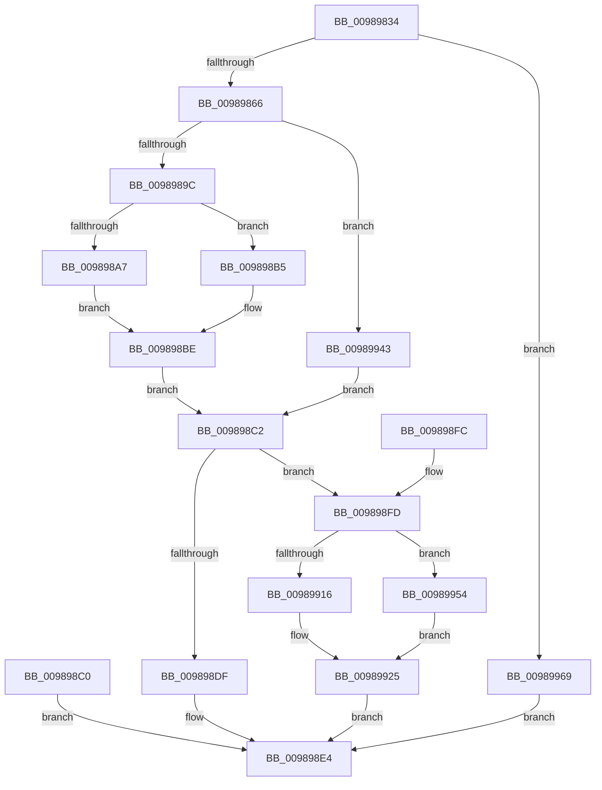

# MiCreateFixupRecord

- RVA: `0x00989834`–`0x00989973` (길이 `319` bytes)
- VA: `0x0000000140989834`
- 실행 섹션: `PAGE`
- PDB 이름 있음: `예`; PDB Function 태그: `아니요`
- unwind 정보 RVA: `0x00097F84`
- 디코드: `87`개 명령, `319/319` bytes 표시
- 미해석 바이트: `0` (있으면 어셈블리에 `.byte`로 보존)

> 이 문서는 커널 이미지의 기계어와 PDB 기호를 분석해 생성했습니다. 4번과 5번은 함수 원형과 자료형을 바이너리 사용 방식에서 추정한 C 해석이며 원본 소스 복구 결과는 아닙니다.

## 1. Dependencies

- 직접 호출 지점: **1**; 고유 호출 대상: **1**
- 직접 호출자로 확인된 함수: **1**
- RIP 상대 이미지 참조: **0**

### Outgoing calls
- `0x009898D2` → [MiAllocatePool](../../text/35/MiAllocatePool_function_0035B540.md) (function, `0x0035B540`)

### Direct callers
- [MiScanRelocationPage](MiScanRelocationPage_function_00989670.md) at `0x0098979E`

### Static image references
- 디코드된 RIP-relative 메모리 참조가 없습니다.

## 2. Other-region calls and transfers

- 다른 실행 섹션으로 향하는 call: **1**
  - `0x009898D2` → [MiAllocatePool](../../text/35/MiAllocatePool_function_0035B540.md) (`PAGE` → `.text`)
- 별도 외부 분기/꼬리 이동을 확인하지 못했습니다.

## 3. Assembly (complete function range)

```asm
00989834  48 89 5C 24 10                  mov qword ptr [rsp + 0x10], rbx
00989839  48 89 74 24 18                  mov qword ptr [rsp + 0x18], rsi
0098983E  57                              push rdi
0098983F  41 54                           push r12
00989841  41 55                           push r13
00989843  41 56                           push r14
00989845  41 57                           push r15
00989847  48 83 EC 20                     sub rsp, 0x20
0098984B  41 8B F8                        mov edi, r8d
0098984E  44 8D 97 00 10 00 00            lea r10d, [rdi + 0x1000]
00989855  41 C1 EA 0C                     shr r10d, 0xc
00989859  48 8B 01                        mov rax, qword ptr [rcx]
0098985C  44 3B 50 08                     cmp r10d, dword ptr [rax + 8]
00989860  0F 83 03 01 00 00               jae 0x140989969
00989866  33 DB                           xor ebx, ebx
00989868  48 89 5C 24 50                  mov qword ptr [rsp + 0x50], rbx
0098986D  48 8B 4C 24 78                  mov rcx, qword ptr [rsp + 0x78]
00989872  0F B7 01                        movzx eax, word ptr [rcx]
00989875  44 0F B7 E8                     movzx r13d, ax
00989879  66 41 C1 ED 0C                  shr r13w, 0xc
0098987E  44 8B FF                        mov r15d, edi
00989881  41 B8 FF 0F 00 00               mov r8d, 0xfff
00989887  45 23 F8                        and r15d, r8d
0098988A  45 8D 60 01                     lea r12d, [r8 + 1]
0098988E  45 2B E1                        sub r12d, r9d
00989891  8B F7                           mov esi, edi
00989893  45 3B FC                        cmp r15d, r12d
00989896  0F 83 A7 00 00 00               jae 0x140989943
0098989C  44 8B 74 24 70                  mov r14d, dword ptr [rsp + 0x70]
009898A1  41 83 FE 04                     cmp r14d, 4
009898A5  75 0E                           jne 0x1409898b5
009898A7  8B 04 17                        mov eax, dword ptr [rdi + rdx]
009898AA  89 44 24 50                     mov dword ptr [rsp + 0x50], eax
009898AE  48 8B 5C 24 50                  mov rbx, qword ptr [rsp + 0x50]
009898B3  EB 09                           jmp 0x1409898be
009898B5  48 8B 1C 17                     mov rbx, qword ptr [rdi + rdx]
009898B9  48 89 5C 24 50                  mov qword ptr [rsp + 0x50], rbx
009898BE  EB 02                           jmp 0x1409898c2
009898C0  EB 22                           jmp 0x1409898e4
009898C2  BA 20 00 00 00                  mov edx, 0x20
009898C7  B9 00 01 00 00                  mov ecx, 0x100
009898CC  41 B8 4D 6D 46 72               mov r8d, 0x72466d4d
009898D2  E8 69 1C 9D FF                  call 0x14035b540
009898D7  48 8B D0                        mov rdx, rax
009898DA  48 85 C0                        test rax, rax
009898DD  75 1E                           jne 0x1409898fd
009898DF  B8 9A 00 00 C0                  mov eax, 0xc000009a
009898E4  48 8B 5C 24 58                  mov rbx, qword ptr [rsp + 0x58]
009898E9  48 8B 74 24 60                  mov rsi, qword ptr [rsp + 0x60]
009898EE  48 83 C4 20                     add rsp, 0x20
009898F2  41 5F                           pop r15
009898F4  41 5E                           pop r14
009898F6  41 5D                           pop r13
009898F8  41 5C                           pop r12
009898FA  5F                              pop rdi
009898FB  C3                              ret
009898FC  CC                              int3
009898FD  66 44 89 68 10                  mov word ptr [rax + 0x10], r13w
00989902  42 8D 04 37                     lea eax, [rdi + r14]
00989906  89 42 0C                        mov dword ptr [rdx + 0xc], eax
00989909  4C 8B 84 24 80 00 00 00         mov r8, qword ptr [rsp + 0x80]
00989911  45 3B FC                        cmp r15d, r12d
00989914  72 3E                           jb 0x140989954
00989916  81 E7 00 F0 FF FF               and edi, 0xfffff000
0098991C  81 C7 00 10 00 00               add edi, 0x1000
00989922  89 7A 08                        mov dword ptr [rdx + 8], edi
00989925  8B 4A 0C                        mov ecx, dword ptr [rdx + 0xc]
00989928  48 C1 E9 0C                     shr rcx, 0xc
0098992C  49 8B 00                        mov rax, qword ptr [r8]
0098992F  48 83 0C C8 01                  or qword ptr [rax + rcx*8], 1
00989934  49 8B 40 10                     mov rax, qword ptr [r8 + 0x10]
00989938  48 89 02                        mov qword ptr [rdx], rax
0098993B  49 89 50 10                     mov qword ptr [r8 + 0x10], rdx
0098993F  33 C0                           xor eax, eax
00989941  EB A1                           jmp 0x1409898e4
00989943  66 41 23 C0                     and ax, r8w
00989947  66 89 01                        mov word ptr [rcx], ax
0098994A  44 8B 74 24 70                  mov r14d, dword ptr [rsp + 0x70]
0098994F  E9 6E FF FF FF                  jmp 0x1409898c2
00989954  89 7A 08                        mov dword ptr [rdx + 8], edi
00989957  48 89 5A 18                     mov qword ptr [rdx + 0x18], rbx
0098995B  48 C1 EE 0C                     shr rsi, 0xc
0098995F  49 8B 00                        mov rax, qword ptr [r8]
00989962  48 83 0C F0 01                  or qword ptr [rax + rsi*8], 1
00989967  EB BC                           jmp 0x140989925
00989969  B8 05 00 00 C0                  mov eax, 0xc0000005
0098996E  E9 71 FF FF FF                  jmp 0x1409898e4
```

## 4. C-style interpretation (structured pseudocode)

```c
__int64 __fastcall MiCreateFixupRecord(__int64 a1, __int64 a2, int a3, int a4, unsigned int a5, __int64 a6, __int64 a7)
{
    __int64 result;
    __int64 v_r10;
    __int64 v_r12;
    __int64 v_r13;
    __int64 v_r15;
    __int64 v_rbx;
    __int64 v_rdi;
    __int64 v_rsi;
    __int64 v_rsp;
    unsigned __int64 v_stack_p10;
    unsigned __int64 v_stack_p18;
    unsigned __int64 v_stack_p8;

    v_stack_p10 = v_rbx;
    v_stack_p18 = v_rsi;
    v_rsp = (v_rsp) - (32);
    v_r10 = (unsigned int)(((unsigned int)(a3) + 4096) >> (12));
    if (((unsigned int)(v_r10)) >= (*(unsigned int *)(*(unsigned __int64 *)(a1) + 8))) goto loc_00989969;
    v_rbx = 0;
    v_stack_p8 = 0;
    v_r13 = (unsigned __int16)(((unsigned __int16)(*(unsigned __int16 *)(a6))) >> (12));
    v_r15 = (unsigned int)(((unsigned int)((unsigned int)((unsigned int)(a3)))) & ((unsigned int)((unsigned int)(0xFFFULL))));
    v_r12 = (unsigned int)(((unsigned int)(0xFFFULL) + 1) - (a4));
    if (((unsigned int)(v_r15)) >= ((unsigned int)(v_r12))) goto loc_00989943;
    if (((unsigned int)((unsigned int)(a5))) != 4) goto loc_009898B5;
    v_stack_p8 = (unsigned int)((unsigned int)(*(unsigned int *)((unsigned int)(a3) + a2 * 1)));
    goto loc_009898BE;
loc_009898B5:
    v_stack_p8 = *(unsigned __int64 *)((unsigned int)(a3) + a2 * 1);
loc_009898BE:
    goto loc_009898C2;
loc_009898C2:
    result = MiAllocatePool(256, 32, (unsigned int)(0x72466D4DULL), a4);
    if (result != 0) goto loc_009898FD;
loc_009898E4:
    v_rsp = (v_rsp) + (32);
    return (unsigned int)(0xC000009AULL);
loc_009898FD:
    *(unsigned __int16 *)((unsigned int)(0xC000009AULL) + 16) = (unsigned __int16)(v_r13);
    *(unsigned int *)(result + 12) = (unsigned int)((unsigned int)(a3) + (unsigned int)(a5) * 1);
    if (((unsigned int)(v_r15)) < ((unsigned int)(v_r12))) goto loc_00989954;
    v_rdi = (unsigned int)(((unsigned int)(a3)) & (0xFFFFF000ULL));
    v_rdi = (unsigned int)((v_rdi) + (0x1000ULL));
    *(unsigned int *)(result + 8) = (unsigned int)(v_rdi);
loc_00989925:
    a1 = ((unsigned int)(*(unsigned int *)(result + 12))) >> (12);
    *(unsigned __int64 *)(result) = *(unsigned __int64 *)(a7 + 16);
    *(unsigned __int64 *)(a7 + 16) = result;
    result = 0;
    goto loc_009898E4;
loc_00989943:
    result = (unsigned __int16)((result) & ((unsigned __int16)(a7)));
    *(unsigned __int16 *)(a1) = (unsigned __int16)(result);
    goto loc_009898C2;
loc_00989954:
    *(unsigned int *)(result + 8) = (unsigned int)(v_rdi);
    *(unsigned __int64 *)(result + 24) = v_stack_p10;
    v_rsi = (v_stack_p18) >> (12);
    goto loc_00989925;
loc_00989969:
    goto loc_009898E4;
}
```

## 5. (Beta) C Style

```c
int64_t MiCreateFixupRecord(void *Arg1, int64_t Arg2, void *Arg3, int32_t Arg4, uint32_t Arg5, void *Arg6, void *Arg7)
{
    uint8_t *arg1 = (uint8_t *)Arg1;
    uint8_t *arg3 = (uint8_t *)Arg3;
    uint8_t *arg6 = (uint8_t *)Arg6;
    uint8_t *arg7 = (uint8_t *)Arg7;

    int64_t result;
    int64_t local_r10;
    int64_t local_r12;
    int64_t local_r13;
    int64_t local_r15;
    int64_t local_rbx;
    int64_t local_rdi;
    int64_t local_rsi;
    int64_t local_rsp;
    uint64_t v_stack_p10;
    uint64_t v_stack_p18;
    uint64_t v_stack_p8;

    v_stack_p10 = local_rbx;
    v_stack_p18 = local_rsi;
    local_rsp = (local_rsp) - (32);
    local_r10 = (uint32_t)(((uint32_t)(Arg3) + 4096) >> (12));
    if (((uint32_t)(local_r10)) >= (*(uint32_t *)(*(uint64_t *)(arg1) + 0x8))) goto loc_00989969;
    local_rbx = 0;
    v_stack_p8 = 0;
    local_r13 = (uint16_t)(((uint16_t)(*(uint16_t *)(arg6))) >> (12));
    local_r15 = (uint32_t)(((uint32_t)((uint32_t)((uint32_t)(Arg3)))) & ((uint32_t)((uint32_t)(0xFFFULL))));
    local_r12 = (uint32_t)(((uint32_t)(0xFFFULL) + 1) - (Arg4));
    if (((uint32_t)(local_r15)) >= ((uint32_t)(local_r12))) goto loc_00989943;
    if (((uint32_t)((uint32_t)(Arg5))) != 4) goto loc_009898B5;
    v_stack_p8 = (uint32_t)((uint32_t)(*(uint32_t *)((uint32_t)(arg3) + Arg2 * 1)));
    goto loc_009898BE;
loc_009898B5:
    v_stack_p8 = *(uint64_t *)((uint32_t)(arg3) + Arg2 * 1);
loc_009898BE:
    goto loc_009898C2;
loc_009898C2:
    result = MiAllocatePool(256, 32, (uint32_t)(0x72466D4DULL), Arg4);
    if (result != 0) goto loc_009898FD;
loc_009898E4:
    local_rsp = (local_rsp) + (32);
    return (uint32_t)(0xC000009AULL);
loc_009898FD:
    *(uint16_t *)((uint32_t)(0xC000009AULL) + 0x10) = (uint16_t)(local_r13);
    *(uint32_t *)(result + 0xC) = (uint32_t)((uint32_t)(Arg3) + (uint32_t)(Arg5) * 1);
    if (((uint32_t)(local_r15)) < ((uint32_t)(local_r12))) goto loc_00989954;
    local_rdi = (uint32_t)(((uint32_t)(Arg3)) & (0xFFFFF000ULL));
    local_rdi = (uint32_t)((local_rdi) + (0x1000ULL));
    *(uint32_t *)(result + 0x8) = (uint32_t)(local_rdi);
loc_00989925:
    Arg1 = ((uint32_t)(*(uint32_t *)(result + 0xC))) >> (12);
    *(uint64_t *)(result) = *(uint64_t *)(arg7 + 0x10);
    *(uint64_t *)(arg7 + 0x10) = result;
    result = 0;
    goto loc_009898E4;
loc_00989943:
    result = (uint16_t)((result) & ((uint16_t)(Arg7)));
    *(uint16_t *)(arg1) = (uint16_t)(result);
    goto loc_009898C2;
loc_00989954:
    *(uint32_t *)(result + 0x8) = (uint32_t)(local_rdi);
    *(uint64_t *)(result + 0x18) = v_stack_p10;
    local_rsi = (v_stack_p18) >> (12);
    goto loc_00989925;
loc_00989969:
    goto loc_009898E4;
}
```

### 관측된 메모리 오프셋

구조체 형식이 확인되지 않은 접근은 인자 기준의 오프셋으로만 기록했습니다.

| 기준 인자 | 오프셋 표현 | 폭 (bit) | 접근 |
|---|---:|---:|---|
| `Arg1` | `+ 0x0` | `64` | `R` |
| `Arg3` | `+ 0x0 + r14*1` | `32` | `R` |
| `Arg3` | `+ 0x0 + rdx*1` | `32` | `R` |
| `Arg3` | `+ 0x0 + rdx*1` | `64` | `R` |
| `Arg3` | `+ 0x1000` | `32` | `R` |
| `Arg6` | `+ 0x0` | `16` | `R` |
| `Arg6` | `+ 0x0` | `16` | `W` |
| `Arg7` | `+ 0x0` | `64` | `R` |
| `Arg7` | `+ 0x10` | `64` | `R` |
| `Arg7` | `+ 0x10` | `64` | `W` |

## 6. Execution-region graph

[열기: 2D/3D 그래프와 함수 탐색 컨트롤 패널](../../../control-panel.html?section=page&rva=0x00989834&view=graph)

- 2D 그래프는 위에서 아래로 흐르고, 3D 그래프는 빈 공간을 드래그해 회전합니다. Shift+드래그는 이동, 휠은 확대·축소, 함수 노드 선택은 대상 보고서 이동입니다.

### Static fallback


