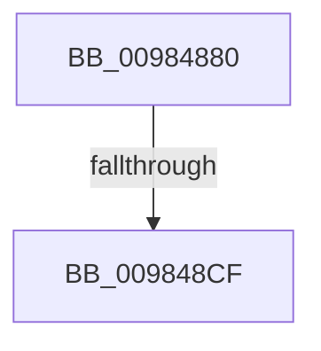

# MiCreateImageOrDataSection

- RVA: `0x00984880`–`0x009848DC` (길이 `92` bytes)
- VA: `0x0000000140984880`
- 실행 섹션: `PAGE`
- PDB 이름 있음: `예`; PDB Function 태그: `아니요`
- unwind 정보 RVA: `0x00097B40`
- 디코드: `25`개 명령, `92/92` bytes 표시
- 미해석 바이트: `0` (있으면 어셈블리에 `.byte`로 보존)

> 이 문서는 커널 이미지의 기계어와 PDB 기호를 분석해 생성했습니다. 4번과 5번은 함수 원형과 자료형을 바이너리 사용 방식에서 추정한 C 해석이며 원본 소스 복구 결과는 아닙니다.

## 1. Dependencies

- 직접 호출 지점: **1**; 고유 호출 대상: **1**
- 직접 호출자로 확인된 함수: **3**
- RIP 상대 이미지 참조: **0**

### Outgoing calls
- `0x009848AE` → [memset](../../text/6C/memset_function_006C6C40.md) (function, `0x006C6C40`)

### Direct callers
- [MmCreateSectionEx](MmCreateSectionEx_function_009839CC.md) at `0x00983B36`
- [MmCreateCacheManagerSection](MmCreateCacheManagerSection_function_00983CB8.md) at `0x00983D66`
- [MiCreateSection](MiCreateSection_function_00983EC0.md) at `0x00983FB3`

### Static image references
- 디코드된 RIP-relative 메모리 참조가 없습니다.

## 2. Other-region calls and transfers

- 다른 실행 섹션으로 향하는 call: **1**
  - `0x009848AE` → [memset](../../text/6C/memset_function_006C6C40.md) (`PAGE` → `.text`)
- call이 아닌 외부 분기/꼬리 이동: **2**
  - `0x009848C9` → [sub_00984D21](Unknown_function_00984D21.md) (`tail-transfer`)
  - `0x009848D6` → [sub_00984D21](Unknown_function_00984D21.md) (`tail-transfer`)

## 3. Assembly (complete function range)

```asm
00984880  40 55                           push rbp
00984882  53                              push rbx
00984883  56                              push rsi
00984884  57                              push rdi
00984885  41 54                           push r12
00984887  41 56                           push r14
00984889  48 8D 6C 24 D1                  lea rbp, [rsp - 0x2f]
0098488E  48 81 EC E8 00 00 00            sub rsp, 0xe8
00984895  48 8B F9                        mov rdi, rcx
00984898  33 DB                           xor ebx, ebx
0098489A  48 8D 4D 97                     lea rcx, [rbp - 0x69]
0098489E  48 89 5D 87                     mov qword ptr [rbp - 0x79], rbx
009848A2  33 D2                           xor edx, edx
009848A4  48 89 5D 77                     mov qword ptr [rbp + 0x77], rbx
009848A8  41 B8 80 00 00 00               mov r8d, 0x80
009848AE  E8 8D 23 D4 FF                  call 0x1406c6c40
009848B3  41 BC 01 00 00 00               mov r12d, 1
009848B9  48 89 5D 6F                     mov qword ptr [rbp + 0x6f], rbx
009848BD  8B F3                           mov esi, ebx
009848BF  44 89 65 67                     mov dword ptr [rbp + 0x67], r12d
009848C3  38 9F C0 00 00 00               cmp byte ptr [rdi + 0xc0], bl
009848C9  0F 85 52 04 00 00               jne 0x140984d21
009848CF  8B 47 10                        mov eax, dword ptr [rdi + 0x10]
009848D2  0F BA E0 13                     bt eax, 0x13
009848D6  0F 82 45 04 00 00               jb 0x140984d21
```

## 4. C-style interpretation (structured pseudocode)

```c
__int64 __fastcall MiCreateImageOrDataSection(__int64 a1, int a2)
{
    __int64 result;
    __int64 v_rbx;
    __int64 v_rsp;
    unsigned __int64 v_stack_m5F;
    unsigned __int64 v_stack_mC8;
    unsigned __int64 v_stack_mD8;
    unsigned __int64 v_stack_p10;
    unsigned __int64 v_stack_p18;
    unsigned int v_stack_p8;

    v_rsp = (v_rsp) - (232);
    v_rbx = 0;
    v_stack_mD8 = 0;
    a2 = 0;
    v_stack_p18 = 0;
    result = memset(v_stack_mC8, a2, 128, a4);
    v_stack_p10 = 0;
    v_stack_p8 = 1;
}
```

## 5. (Beta) C Style

```c
int64_t MiCreateImageOrDataSection(void *Arg1, int32_t Arg2)
{
    uint8_t *arg1 = (uint8_t *)Arg1;

    int64_t result;
    int64_t local_rbx;
    int64_t local_rsp;
    uint64_t v_stack_m5F;
    uint64_t v_stack_mC8;
    uint64_t v_stack_mD8;
    uint64_t v_stack_p10;
    uint64_t v_stack_p18;
    uint32_t v_stack_p8;

    local_rsp = (local_rsp) - (232);
    local_rbx = 0;
    v_stack_mD8 = 0;
    Arg2 = 0;
    v_stack_p18 = 0;
    result = memset(v_stack_mC8, Arg2, 128, a4);
    v_stack_p10 = 0;
    v_stack_p8 = 1;
}
```

### 관측된 메모리 오프셋

구조체 형식이 확인되지 않은 접근은 인자 기준의 오프셋으로만 기록했습니다.

| 기준 인자 | 오프셋 표현 | 폭 (bit) | 접근 |
|---|---:|---:|---|
| `Arg1` | `+ 0x10` | `32` | `R` |
| `Arg1` | `+ 0xC0` | `8` | `R` |

## 6. Execution-region graph

[열기: 2D/3D 그래프와 함수 탐색 컨트롤 패널](../../../control-panel.html?section=page&rva=0x00984880&view=graph)

- 2D 그래프는 위에서 아래로 흐르고, 3D 그래프는 빈 공간을 드래그해 회전합니다. Shift+드래그는 이동, 휠은 확대·축소, 함수 노드 선택은 대상 보고서 이동입니다.

### Static fallback


