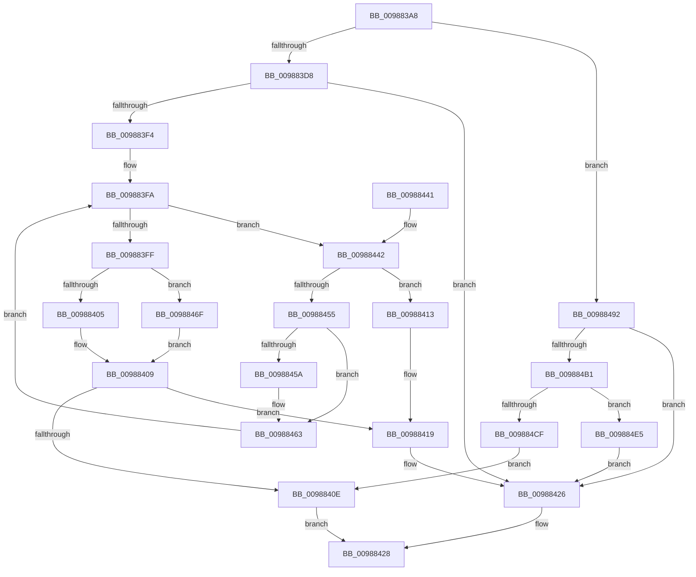

# MiCreateMdl

- RVA: `0x009883A8`–`0x009884F4` (길이 `332` bytes)
- VA: `0x00000001409883A8`
- 실행 섹션: `PAGE`
- PDB 이름 있음: `예`; PDB Function 태그: `아니요`
- unwind 정보 RVA: `0x00097DA0`
- 디코드: `97`개 명령, `332/332` bytes 표시
- 미해석 바이트: `0` (있으면 어셈블리에 `.byte`로 보존)

> 이 문서는 커널 이미지의 기계어와 PDB 기호를 분석해 생성했습니다. 4번과 5번은 함수 원형과 자료형을 바이너리 사용 방식에서 추정한 C 해석이며 원본 소스 복구 결과는 아닙니다.

## 1. Dependencies

- 직접 호출 지점: **8**; 고유 호출 대상: **7**
- 직접 호출자로 확인된 함수: **2**
- RIP 상대 이미지 참조: **0**

### Outgoing calls
- `0x009883E7` → [IoAllocateMdl](../../text/29/IoAllocateMdl_function_0029EBF0.md) (function, `0x0029EBF0`)
- `0x00988421` → [MiDeleteImageCreationMdls](MiDeleteImageCreationMdls_function_009884FC.md) (function, `0x009884FC`)
- `0x0098844A` → [MiGetPageForHeader](../../text/2A/MiGetPageForHeader_function_002AC120.md) (function, `0x002AC120`)
- `0x00988488` → [MmMapLockedPagesSpecifyCache](../../text/31/MmMapLockedPagesSpecifyCache_function_00318800.md) (function, `0x00318800`)
- `0x009884A0` → [MiAllocatePool](../../text/35/MiAllocatePool_function_0035B540.md) (function, `0x0035B540`)
- `0x009884C2` → [IoAllocateMdl](../../text/29/IoAllocateMdl_function_0029EBF0.md) (function, `0x0029EBF0`)
- `0x009884D2` → [MmBuildMdlForNonPagedPool](../../text/23/MmBuildMdlForNonPagedPool_function_0023A870.md) (function, `0x0023A870`)
- `0x009884EA` → [ExFreePoolWithTag](../../poolcode/B8/ExFreePoolWithTag_function_00B82870.md) (function, `0x00B82870`)

### Direct callers
- [MiCreateImageFileMap](MiCreateImageFileMap_function_00986830.md) at `0x00986906`
- [MiCreateImageFileMap](MiCreateImageFileMap_function_00986830.md) at `0x00986DBA`
- [sub_00B2B0A8](../B2/Unknown_function_00B2B0A8.md) at `0x00B2B0FA`
- [sub_00B2B0A8](../B2/Unknown_function_00B2B0A8.md) at `0x00B2B24E`

### Static image references
- 디코드된 RIP-relative 메모리 참조가 없습니다.

## 2. Other-region calls and transfers

- 다른 실행 섹션으로 향하는 call: **7**
  - `0x009883E7` → [IoAllocateMdl](../../text/29/IoAllocateMdl_function_0029EBF0.md) (`PAGE` → `.text`)
  - `0x0098844A` → [MiGetPageForHeader](../../text/2A/MiGetPageForHeader_function_002AC120.md) (`PAGE` → `.text`)
  - `0x00988488` → [MmMapLockedPagesSpecifyCache](../../text/31/MmMapLockedPagesSpecifyCache_function_00318800.md) (`PAGE` → `.text`)
  - `0x009884A0` → [MiAllocatePool](../../text/35/MiAllocatePool_function_0035B540.md) (`PAGE` → `.text`)
  - `0x009884C2` → [IoAllocateMdl](../../text/29/IoAllocateMdl_function_0029EBF0.md) (`PAGE` → `.text`)
  - `0x009884D2` → [MmBuildMdlForNonPagedPool](../../text/23/MmBuildMdlForNonPagedPool_function_0023A870.md) (`PAGE` → `.text`)
  - `0x009884EA` → [ExFreePoolWithTag](../../poolcode/B8/ExFreePoolWithTag_function_00B82870.md) (`PAGE` → `POOLCODE`)
- 별도 외부 분기/꼬리 이동을 확인하지 못했습니다.

## 3. Assembly (complete function range)

```asm
009883A8  48 8B C4                        mov rax, rsp
009883AB  48 89 58 08                     mov qword ptr [rax + 8], rbx
009883AF  48 89 68 10                     mov qword ptr [rax + 0x10], rbp
009883B3  48 89 70 18                     mov qword ptr [rax + 0x18], rsi
009883B7  57                              push rdi
009883B8  41 56                           push r14
009883BA  41 57                           push r15
009883BC  48 83 EC 30                     sub rsp, 0x30
009883C0  49 8B E8                        mov rbp, r8
009883C3  49 8B F8                        mov rdi, r8
009883C6  48 C1 ED 0C                     shr rbp, 0xc
009883CA  8B DA                           mov ebx, edx
009883CC  4C 8B F9                        mov r15, rcx
009883CF  45 85 C9                        test r9d, r9d
009883D2  0F 84 BA 00 00 00               je 0x140988492
009883D8  48 83 60 D8 00                  and qword ptr [rax - 0x28], 0
009883DD  45 33 C9                        xor r9d, r9d
009883E0  45 33 C0                        xor r8d, r8d
009883E3  8B D7                           mov edx, edi
009883E5  33 C9                           xor ecx, ecx
009883E7  E8 04 68 91 FF                  call 0x14029ebf0
009883EC  48 8B F8                        mov rdi, rax
009883EF  48 85 C0                        test rax, rax
009883F2  74 32                           je 0x140988426
009883F4  4C 8D 70 30                     lea r14, [rax + 0x30]
009883F8  33 F6                           xor esi, esi
009883FA  48 3B F5                        cmp rsi, rbp
009883FD  72 43                           jb 0x140988442
009883FF  F6 47 0A 05                     test byte ptr [rdi + 0xa], 5
00988403  74 6A                           je 0x14098846f
00988405  48 8B 47 18                     mov rax, qword ptr [rdi + 0x18]
00988409  48 85 C0                        test rax, rax
0098840C  74 0B                           je 0x140988419
0098840E  48 8B C7                        mov rax, rdi
00988411  EB 15                           jmp 0x140988428
00988413  C1 E6 0C                        shl esi, 0xc
00988416  89 77 28                        mov dword ptr [rdi + 0x28], esi
00988419  BA 01 00 00 00                  mov edx, 1
0098841E  48 8B CF                        mov rcx, rdi
00988421  E8 D6 00 00 00                  call 0x1409884fc
00988426  33 C0                           xor eax, eax
00988428  48 8B 5C 24 50                  mov rbx, qword ptr [rsp + 0x50]
0098842D  48 8B 6C 24 58                  mov rbp, qword ptr [rsp + 0x58]
00988432  48 8B 74 24 60                  mov rsi, qword ptr [rsp + 0x60]
00988437  48 83 C4 30                     add rsp, 0x30
0098843B  41 5F                           pop r15
0098843D  41 5E                           pop r14
0098843F  5F                              pop rdi
00988440  C3                              ret
00988441  CC                              int3
00988442  45 33 C0                        xor r8d, r8d
00988445  8B D3                           mov edx, ebx
00988447  49 8B CF                        mov rcx, r15
0098844A  E8 D1 3C 92 FF                  call 0x1402ac120
0098844F  48 83 F8 FF                     cmp rax, -1
00988453  74 BE                           je 0x140988413
00988455  48 85 F6                        test rsi, rsi
00988458  75 09                           jne 0x140988463
0098845A  B9 02 40 00 00                  mov ecx, 0x4002
0098845F  66 09 4F 0A                     or word ptr [rdi + 0xa], cx
00988463  49 89 06                        mov qword ptr [r14], rax
00988466  49 83 C6 08                     add r14, 8
0098846A  48 FF C6                        inc rsi
0098846D  EB 8B                           jmp 0x1409883fa
0098846F  45 33 C9                        xor r9d, r9d
00988472  C7 44 24 28 20 00 00 40         mov dword ptr [rsp + 0x28], 0x40000020
0098847A  83 64 24 20 00                  and dword ptr [rsp + 0x20], 0
0098847F  33 D2                           xor edx, edx
00988481  48 8B CF                        mov rcx, rdi
00988484  45 8D 41 01                     lea r8d, [r9 + 1]
00988488  E8 73 03 99 FF                  call 0x140318800
0098848D  E9 77 FF FF FF                  jmp 0x140988409
00988492  41 B8 4D 6D 78 78               mov r8d, 0x78786d4d
00988498  48 8B D7                        mov rdx, rdi
0098849B  B9 40 00 00 00                  mov ecx, 0x40
009884A0  E8 9B 30 9D FF                  call 0x14035b540
009884A5  48 8B D8                        mov rbx, rax
009884A8  48 85 C0                        test rax, rax
009884AB  0F 84 75 FF FF FF               je 0x140988426
009884B1  48 83 64 24 20 00               and qword ptr [rsp + 0x20], 0
009884B7  45 33 C9                        xor r9d, r9d
009884BA  45 33 C0                        xor r8d, r8d
009884BD  8B D7                           mov edx, edi
009884BF  48 8B C8                        mov rcx, rax
009884C2  E8 29 67 91 FF                  call 0x14029ebf0
009884C7  48 8B F8                        mov rdi, rax
009884CA  48 85 C0                        test rax, rax
009884CD  74 16                           je 0x1409884e5
009884CF  48 8B C8                        mov rcx, rax
009884D2  E8 99 23 8B FF                  call 0x14023a870
009884D7  B8 00 40 00 00                  mov eax, 0x4000
009884DC  66 09 47 0A                     or word ptr [rdi + 0xa], ax
009884E0  E9 29 FF FF FF                  jmp 0x14098840e
009884E5  33 D2                           xor edx, edx
009884E7  48 8B CB                        mov rcx, rbx
009884EA  E8 81 A3 1F 00                  call 0x140b82870
009884EF  E9 32 FF FF FF                  jmp 0x140988426
```

## 4. C-style interpretation (structured pseudocode)

```c
__int64 __fastcall MiCreateMdl(__int64 a1, int a2, __int64 a3, int a4)
{
    __int64 result;
    __int64 v_r14;
    __int64 v_rbp;
    __int64 v_rsi;
    __int64 v_rsp;
    unsigned __int64 v_stack_p10;
    unsigned __int64 v_stack_p18;
    unsigned int v_stack_p20;
    unsigned int v_stack_p28;
    unsigned __int64 v_stack_p8;

    *(unsigned __int64 *)(v_rsp + 8) = v_rbx;
    *(unsigned __int64 *)(v_rsp + 16) = v_rbp;
    *(unsigned __int64 *)(v_rsp + 24) = v_rsi;
    v_rsp = (v_rsp) - (48);
    v_rbp = (a3) >> (12);
    if (a4 == 0) goto loc_00988492;
    a4 = 0;
    a3 = 0;
    a1 = 0;
    result = IoAllocateMdl(a1, 0, a3, a4);
    if (result == 0) goto loc_00988426;
    v_rsi = 0;
loc_009883FA:
    if (0 < v_rbp) goto loc_00988442;
    if (((*(unsigned __int8 *)(result + 10)) & (5)) == 0) goto loc_0098846F;
loc_00988409:
    if (*(unsigned __int64 *)(result + 24) == 0) goto loc_00988419;
loc_0098840E:
    goto loc_00988428;
loc_00988413:
    v_rsi = (unsigned int)((v_rsi) << (12));
    *(unsigned int *)(result + 40) = (unsigned int)(v_rsi);
loc_00988419:
    result = MiDeleteImageCreationMdls(result, 1, a3, a4);
loc_00988426:
    result = 0;
loc_00988428:
    v_rsp = (v_rsp) + (48);
    return result;
loc_00988442:
    a3 = 0;
    result = MiGetPageForHeader(0, (unsigned int)((unsigned int)(v_stack_p8)), a3, a4);
    if (result == -1) goto loc_00988413;
    if (v_stack_p18 == 0) {
        a1 = 0x4002ULL;
    }
    *(unsigned __int64 *)(result + 48) = result;
    v_r14 = (result + 48) + (8);
    v_rsi = (v_stack_p18) + 1;
    goto loc_009883FA;
loc_0098846F:
    a4 = 0;
    v_stack_p28 = 0x40000020ULL;
    a2 = 0;
    result = MmMapLockedPagesSpecifyCache(result, a2, a4 + 1, a4);
    goto loc_00988409;
loc_00988492:
    result = MiAllocatePool(64, result, (unsigned int)(0x78786D4DULL), a4);
    if (result == 0) goto loc_00988426;
    a4 = 0;
    a3 = 0;
    result = IoAllocateMdl(result, (unsigned int)((unsigned int)(result)), a3, a4);
    if (result == 0) goto loc_009884E5;
    result = MmBuildMdlForNonPagedPool(result, (unsigned int)((unsigned int)(result)), a3, a4);
    goto loc_0098840E;
loc_009884E5:
    a2 = 0;
    result = ExFreePoolWithTag(result, a2, a3, a4);
    goto loc_00988426;
}
```

## 5. (Beta) C Style

```c
int64_t MiCreateMdl(int64_t Arg1, int32_t Arg2, int64_t Arg3, int32_t Arg4)
{
    int64_t result;
    int64_t local_r14;
    int64_t local_rbp;
    int64_t local_rsi;
    int64_t local_rsp;
    uint64_t v_stack_p10;
    uint64_t v_stack_p18;
    uint32_t v_stack_p20;
    uint32_t v_stack_p28;
    uint64_t v_stack_p8;

    *(uint64_t *)(local_rsp + 0x8) = local_rbx;
    *(uint64_t *)(local_rsp + 0x10) = local_rbp;
    *(uint64_t *)(local_rsp + 0x18) = local_rsi;
    local_rsp = (local_rsp) - (48);
    local_rbp = (Arg3) >> (12);
    if (Arg4 == 0) goto loc_00988492;
    Arg4 = 0;
    Arg3 = 0;
    Arg1 = 0;
    result = IoAllocateMdl(Arg1, 0, Arg3, Arg4);
    if (result == 0) goto loc_00988426;
    local_rsi = 0;
loc_009883FA:
    if (0 < local_rbp) goto loc_00988442;
    if (((*(uint8_t *)(result + 0xA)) & (5)) == 0) goto loc_0098846F;
loc_00988409:
    if (*(uint64_t *)(result + 0x18) == 0) goto loc_00988419;
loc_0098840E:
    goto loc_00988428;
loc_00988413:
    local_rsi = (uint32_t)((local_rsi) << (12));
    *(uint32_t *)(result + 0x28) = (uint32_t)(local_rsi);
loc_00988419:
    result = MiDeleteImageCreationMdls(result, 1, Arg3, Arg4);
loc_00988426:
    result = 0;
loc_00988428:
    local_rsp = (local_rsp) + (48);
    return result;
loc_00988442:
    Arg3 = 0;
    result = MiGetPageForHeader(0, (uint32_t)((uint32_t)(v_stack_p8)), Arg3, Arg4);
    if (result == -1) goto loc_00988413;
    if (v_stack_p18 == 0) {
        Arg1 = 0x4002ULL;
    }
    *(uint64_t *)(result + 0x30) = result;
    local_r14 = (result + 48) + (8);
    local_rsi = (v_stack_p18) + 1;
    goto loc_009883FA;
loc_0098846F:
    Arg4 = 0;
    v_stack_p28 = 0x40000020ULL;
    Arg2 = 0;
    result = MmMapLockedPagesSpecifyCache(result, Arg2, Arg4 + 1, Arg4);
    goto loc_00988409;
loc_00988492:
    result = MiAllocatePool(64, result, (uint32_t)(0x78786D4DULL), Arg4);
    if (result == 0) goto loc_00988426;
    Arg4 = 0;
    Arg3 = 0;
    result = IoAllocateMdl(result, (uint32_t)((uint32_t)(result)), Arg3, Arg4);
    if (result == 0) goto loc_009884E5;
    result = MmBuildMdlForNonPagedPool(result, (uint32_t)((uint32_t)(result)), Arg3, Arg4);
    goto loc_0098840E;
loc_009884E5:
    Arg2 = 0;
    result = ExFreePoolWithTag(result, Arg2, Arg3, Arg4);
    goto loc_00988426;
}
```

## 6. Execution-region graph

[열기: 2D/3D 그래프와 함수 탐색 컨트롤 패널](../../../control-panel.html?section=page&rva=0x009883A8&view=graph)

- 2D 그래프는 위에서 아래로 흐르고, 3D 그래프는 빈 공간을 드래그해 회전합니다. Shift+드래그는 이동, 휠은 확대·축소, 함수 노드 선택은 대상 보고서 이동입니다.

### Static fallback


