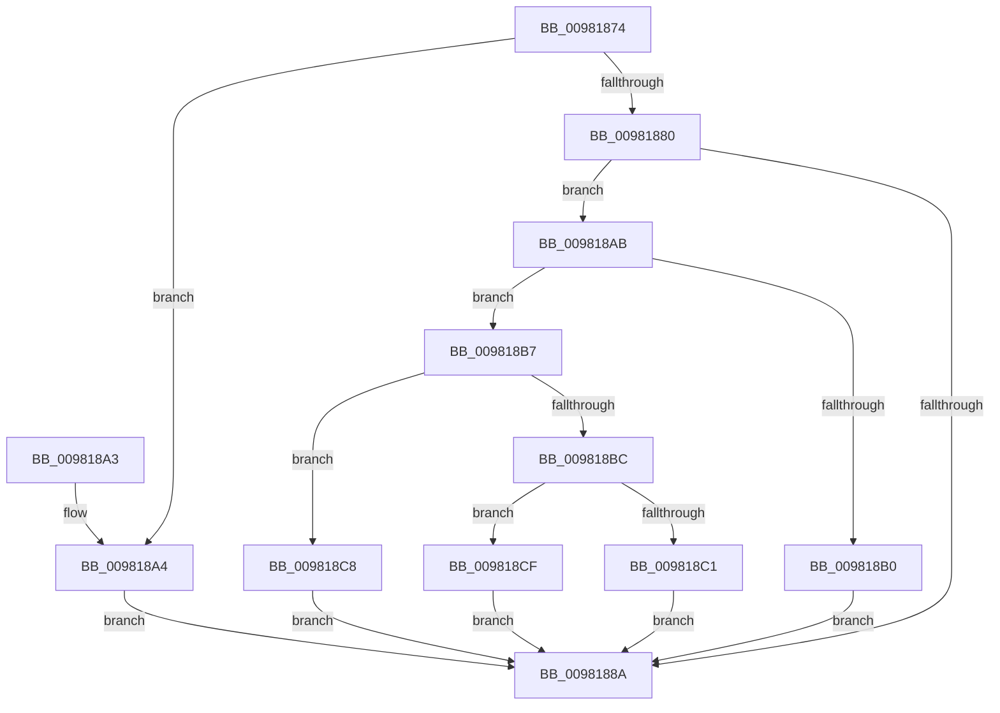

# MiCreatePebOrTeb

- RVA: `0x00981874`–`0x009818DD` (길이 `105` bytes)
- VA: `0x0000000140981874`
- 실행 섹션: `PAGE`
- PDB 이름 있음: `예`; PDB Function 태그: `아니요`
- unwind 정보 RVA: `0x0007FBE8`
- 디코드: `32`개 명령, `105/105` bytes 표시
- 미해석 바이트: `0` (있으면 어셈블리에 `.byte`로 보존)

> 이 문서는 커널 이미지의 기계어와 PDB 기호를 분석해 생성했습니다. 4번과 5번은 함수 원형과 자료형을 바이너리 사용 방식에서 추정한 C 해석이며 원본 소스 복구 결과는 아닙니다.

## 1. Dependencies

- 직접 호출 지점: **1**; 고유 호출 대상: **1**
- 직접 호출자로 확인된 함수: **2**
- RIP 상대 이미지 참조: **0**

### Outgoing calls
- `0x00981899` → [MiAllocateFromSubAllocatedRegion](MiAllocateFromSubAllocatedRegion_function_00981C24.md) (function, `0x00981C24`)

### Direct callers
- [MiInitializeWowPeb](MiInitializeWowPeb_function_0098079C.md) at `0x009807F9`
- [MmCreatePeb](MmCreatePeb_function_00980FB4.md) at `0x009810FA`

### Static image references
- 디코드된 RIP-relative 메모리 참조가 없습니다.

## 2. Other-region calls and transfers

- 다른 실행 섹션으로 향하는 call: **0**
- 별도 외부 분기/꼬리 이동을 확인하지 못했습니다.

## 3. Assembly (complete function range)

```asm
00981874  48 83 EC 28                     sub rsp, 0x28
00981878  49 83 20 00                     and qword ptr [r8], 0
0098187C  85 C9                           test ecx, ecx
0098187E  74 24                           je 0x1409818a4
00981880  BA 78 18 00 00                  mov edx, 0x1878
00981885  83 F9 04                        cmp ecx, 4
00981888  75 21                           jne 0x1409818ab
0098188A  48 81 C2 FF 0F 00 00            add rdx, 0xfff
00981891  B8 00 F0 FF FF                  mov eax, 0xfffff000
00981896  48 23 D0                        and rdx, rax
00981899  E8 86 03 00 00                  call 0x140981c24
0098189E  48 83 C4 28                     add rsp, 0x28
009818A2  C3                              ret
009818A3  CC                              int3
009818A4  BA D8 07 00 00                  mov edx, 0x7d8
009818A9  EB DF                           jmp 0x14098188a
009818AB  83 F9 05                        cmp ecx, 5
009818AE  75 07                           jne 0x1409818b7
009818B0  BA 38 30 00 00                  mov edx, 0x3038
009818B5  EB D3                           jmp 0x14098188a
009818B7  83 F9 06                        cmp ecx, 6
009818BA  74 0C                           je 0x1409818c8
009818BC  83 F9 01                        cmp ecx, 1
009818BF  75 0E                           jne 0x1409818cf
009818C1  BA B8 04 00 00                  mov edx, 0x4b8
009818C6  EB C2                           jmp 0x14098188a
009818C8  BA 78 38 00 00                  mov edx, 0x3878
009818CD  EB BB                           jmp 0x14098188a
009818CF  83 F9 02                        cmp ecx, 2
009818D2  B8 00 08 00 00                  mov eax, 0x800
009818D7  48 0F 44 D0                     cmove rdx, rax
009818DB  EB AD                           jmp 0x14098188a
```

## 4. C-style interpretation (structured pseudocode)

```c
__int64 __fastcall MiCreatePebOrTeb(int a1, __int64 a2, __int64 a3)
{
    __int64 result;
    __int64 v_rsp;

    v_rsp = (v_rsp) - (40);
    if (a1 == 0) goto loc_009818A4;
    if (a1 != 4) goto loc_009818AB;
loc_0098188A:
    a2 = ((unsigned int)(0x1878ULL)) + (0xFFFULL);
    a2 = (a2) & ((unsigned int)(0xFFFFF000ULL));
    result = MiAllocateFromSubAllocatedRegion(a1, a2, a3, a4);
    v_rsp = (v_rsp) + (40);
    return result;
loc_009818A4:
    goto loc_0098188A;
loc_009818AB:
    if (a1 != 5) goto loc_009818B7;
    goto loc_0098188A;
loc_009818B7:
    if (a1 == 6) goto loc_009818C8;
    if (a1 != 1) goto loc_009818CF;
    goto loc_0098188A;
loc_009818C8:
    goto loc_0098188A;
loc_009818CF:
    a2 = (unsigned int)(0x3878ULL);
    if (a1 == 2) { a2 = (unsigned int)(0x800ULL); }
    goto loc_0098188A;
}
```

## 5. (Beta) C Style

```c
int64_t MiCreatePebOrTeb(int32_t Arg1, int64_t Arg2, void *Arg3)
{
    uint8_t *arg3 = (uint8_t *)Arg3;

    int64_t result;
    int64_t local_rsp;

    local_rsp = (local_rsp) - (40);
    if (Arg1 == 0) goto loc_009818A4;
    if (Arg1 != 4) goto loc_009818AB;
loc_0098188A:
    Arg2 = ((uint32_t)(0x1878ULL)) + (0xFFFULL);
    Arg2 = (Arg2) & ((uint32_t)(0xFFFFF000ULL));
    result = MiAllocateFromSubAllocatedRegion(Arg1, Arg2, Arg3, a4);
    local_rsp = (local_rsp) + (40);
    return result;
loc_009818A4:
    goto loc_0098188A;
loc_009818AB:
    if (Arg1 != 5) goto loc_009818B7;
    goto loc_0098188A;
loc_009818B7:
    if (Arg1 == 6) goto loc_009818C8;
    if (Arg1 != 1) goto loc_009818CF;
    goto loc_0098188A;
loc_009818C8:
    goto loc_0098188A;
loc_009818CF:
    Arg2 = (uint32_t)(0x3878ULL);
    if (Arg1 == 2) { Arg2 = (uint32_t)(0x800ULL); }
    goto loc_0098188A;
}
```

### 관측된 메모리 오프셋

구조체 형식이 확인되지 않은 접근은 인자 기준의 오프셋으로만 기록했습니다.

| 기준 인자 | 오프셋 표현 | 폭 (bit) | 접근 |
|---|---:|---:|---|
| `Arg3` | `+ 0x0` | `64` | `R/W` |

## 6. Execution-region graph

[열기: 2D/3D 그래프와 함수 탐색 컨트롤 패널](../../../control-panel.html?section=page&rva=0x00981874&view=graph)

- 2D 그래프는 위에서 아래로 흐르고, 3D 그래프는 빈 공간을 드래그해 회전합니다. Shift+드래그는 이동, 휠은 확대·축소, 함수 노드 선택은 대상 보고서 이동입니다.

### Static fallback


