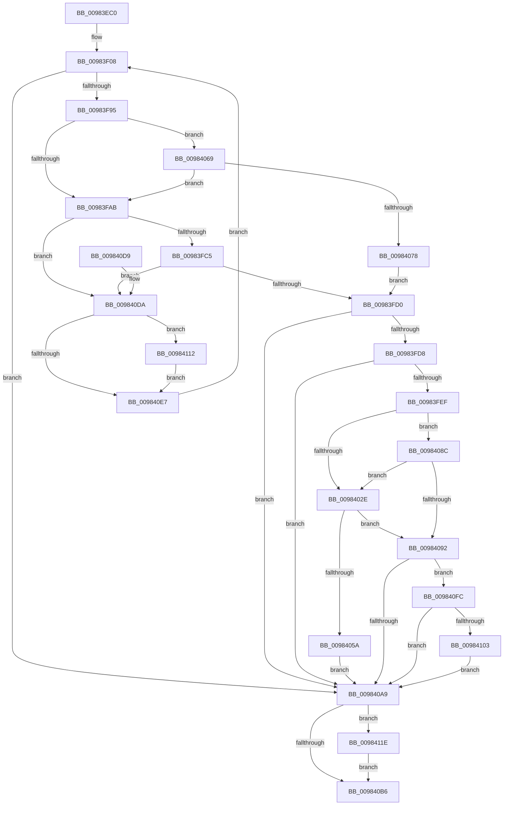

# MiCreateSection

- RVA: `0x00983EC0`–`0x0098412A` (길이 `618` bytes)
- VA: `0x0000000140983EC0`
- 실행 섹션: `PAGE`
- PDB 이름 있음: `예`; PDB Function 태그: `아니요`
- unwind 정보 RVA: `0x00097AC4`
- 디코드: `137`개 명령, `618/618` bytes 표시
- 미해석 바이트: `0` (있으면 어셈블리에 `.byte`로 보존)

> 이 문서는 커널 이미지의 기계어와 PDB 기호를 분석해 생성했습니다. 4번과 5번은 함수 원형과 자료형을 바이너리 사용 방식에서 추정한 C 해석이며 원본 소스 복구 결과는 아닙니다.

## 1. Dependencies

- 직접 호출 지점: **10**; 고유 호출 대상: **9**
- 직접 호출자로 확인된 함수: **3**
- RIP 상대 이미지 참조: **1**

### Outgoing calls
- `0x00983F18` → [memset](../../text/6C/memset_function_006C6C40.md) (function, `0x006C6C40`)
- `0x00983F86` → [MiInitializeCreateSectionPacket](MiInitializeCreateSectionPacket_function_00984130.md) (function, `0x00984130`)
- `0x00983FB3` → [MiCreateImageOrDataSection](MiCreateImageOrDataSection_function_00984880.md) (function, `0x00984880`)
- `0x00983FE0` → [MiFinishCreateSection](MiFinishCreateSection_function_009844FC.md) (function, `0x009844FC`)
- `0x0098404F` → [MmExtendSection](MmExtendSection_function_00982C38.md) (function, `0x00982C38`)
- `0x00984062` → [ObfDereferenceObjectWithTag](../../text/2F/ObfDereferenceObjectWithTag_function_002F78E0.md) (function, `0x002F78E0`)
- `0x00984080` → [MiCreatePagingFileMap](MiCreatePagingFileMap_function_009852F8.md) (function, `0x009852F8`)
- `0x0098410B` → [MiLogSectionObjectEvent](../7F/MiLogSectionObjectEvent_function_007FCF28.md) (function, `0x007FCF28`)
- `0x00984117` → [PsDereferencePartition](../../text/34/PsDereferencePartition_function_00342E70.md) (function, `0x00342E70`)
- `0x00984123` → [PsDereferencePartition](../../text/34/PsDereferencePartition_function_00342E70.md) (function, `0x00342E70`)

### Direct callers
- [MiCreateSystemSection](../../text/45/MiCreateSystemSection_function_00453158.md) at `0x004531F5`
- [MiCreateSectionCommon](../8A/MiCreateSectionCommon_function_008A9AA4.md) at `0x008A9CA4`
- [MmCreateSpecialImageSection](../AB/MmCreateSpecialImageSection_function_00AB7360.md) at `0x00AB742F`

### Static image references
- `0x0098409D` → RVA `0x00FC6B04` (`ALMOSTRO`; read)

## 2. Other-region calls and transfers

- 다른 실행 섹션으로 향하는 call: **4**
  - `0x00983F18` → [memset](../../text/6C/memset_function_006C6C40.md) (`PAGE` → `.text`)
  - `0x00984062` → [ObfDereferenceObjectWithTag](../../text/2F/ObfDereferenceObjectWithTag_function_002F78E0.md) (`PAGE` → `.text`)
  - `0x00984117` → [PsDereferencePartition](../../text/34/PsDereferencePartition_function_00342E70.md) (`PAGE` → `.text`)
  - `0x00984123` → [PsDereferencePartition](../../text/34/PsDereferencePartition_function_00342E70.md) (`PAGE` → `.text`)
- 별도 외부 분기/꼬리 이동을 확인하지 못했습니다.

## 3. Assembly (complete function range)

```asm
00983EC0  48 89 5C 24 10                  mov qword ptr [rsp + 0x10], rbx
00983EC5  48 89 6C 24 18                  mov qword ptr [rsp + 0x18], rbp
00983ECA  48 89 74 24 20                  mov qword ptr [rsp + 0x20], rsi
00983ECF  48 89 4C 24 08                  mov qword ptr [rsp + 8], rcx
00983ED4  57                              push rdi
00983ED5  41 54                           push r12
00983ED7  41 55                           push r13
00983ED9  41 56                           push r14
00983EDB  41 57                           push r15
00983EDD  48 81 EC 50 01 00 00            sub rsp, 0x150
00983EE4  4C 8B BC 24 E0 01 00 00         mov r15, qword ptr [rsp + 0x1e0]
00983EEC  41 8B F1                        mov esi, r9d
00983EEF  44 8B A4 24 D8 01 00 00         mov r12d, dword ptr [rsp + 0x1d8]
00983EF7  49 8B E8                        mov rbp, r8
00983EFA  44 0F B6 AC 24 D0 01 00 00      movzx r13d, byte ptr [rsp + 0x1d0]
00983F03  4C 8B F2                        mov r14, rdx
00983F06  33 DB                           xor ebx, ebx
00983F08  33 D2                           xor edx, edx
00983F0A  48 8D 8C 24 80 00 00 00         lea rcx, [rsp + 0x80]
00983F12  41 B8 C8 00 00 00               mov r8d, 0xc8
00983F18  E8 23 2D D4 FF                  call 0x1406c6c40
00983F1D  48 8B 84 24 C8 01 00 00         mov rax, qword ptr [rsp + 0x1c8]
00983F25  48 8D 8C 24 80 00 00 00         lea rcx, [rsp + 0x80]
00983F2D  4C 89 7C 24 60                  mov qword ptr [rsp + 0x60], r15
00983F32  44 8B CE                        mov r9d, esi
00983F35  44 89 64 24 58                  mov dword ptr [rsp + 0x58], r12d
00983F3A  4C 8B C5                        mov r8, rbp
00983F3D  44 88 6C 24 50                  mov byte ptr [rsp + 0x50], r13b
00983F42  49 8B D6                        mov rdx, r14
00983F45  48 89 44 24 48                  mov qword ptr [rsp + 0x48], rax
00983F4A  48 8B 84 24 C0 01 00 00         mov rax, qword ptr [rsp + 0x1c0]
00983F52  48 89 44 24 40                  mov qword ptr [rsp + 0x40], rax
00983F57  0F B6 84 24 B8 01 00 00         movzx eax, byte ptr [rsp + 0x1b8]
00983F5F  88 44 24 38                     mov byte ptr [rsp + 0x38], al
00983F63  48 8B 84 24 B0 01 00 00         mov rax, qword ptr [rsp + 0x1b0]
00983F6B  48 89 44 24 30                  mov qword ptr [rsp + 0x30], rax
00983F70  8B 84 24 A8 01 00 00            mov eax, dword ptr [rsp + 0x1a8]
00983F77  89 44 24 28                     mov dword ptr [rsp + 0x28], eax
00983F7B  8B 84 24 A0 01 00 00            mov eax, dword ptr [rsp + 0x1a0]
00983F82  89 44 24 20                     mov dword ptr [rsp + 0x20], eax
00983F86  E8 A5 01 00 00                  call 0x140984130
00983F8B  8B F8                           mov edi, eax
00983F8D  85 C0                           test eax, eax
00983F8F  0F 88 14 01 00 00               js 0x1409840a9
00983F95  09 9C 24 80 00 00 00            or dword ptr [rsp + 0x80], ebx
00983F9C  48 83 BC 24 A8 00 00 00 00      cmp qword ptr [rsp + 0xa8], 0
00983FA5  0F 84 BE 00 00 00               je 0x140984069
00983FAB  48 8D 8C 24 80 00 00 00         lea rcx, [rsp + 0x80]
00983FB3  E8 C8 08 00 00                  call 0x140984880
00983FB8  8B F8                           mov edi, eax
00983FBA  3D 54 00 00 C0                  cmp eax, 0xc0000054
00983FBF  0F 84 15 01 00 00               je 0x1409840da
00983FC5  3D 76 04 00 C0                  cmp eax, 0xc0000476
00983FCA  0F 84 0A 01 00 00               je 0x1409840da
00983FD0  85 FF                           test edi, edi
00983FD2  0F 88 D1 00 00 00               js 0x1409840a9
00983FD8  48 8D 8C 24 80 00 00 00         lea rcx, [rsp + 0x80]
00983FE0  E8 17 05 00 00                  call 0x1409844fc
00983FE5  8B F8                           mov edi, eax
00983FE7  85 C0                           test eax, eax
00983FE9  0F 88 BA 00 00 00               js 0x1409840a9
00983FEF  48 8B B4 24 C0 00 00 00         mov rsi, qword ptr [rsp + 0xc0]
00983FF7  48 C7 C2 FF FF FF FF            mov rdx, 0xffffffffffffffff
00983FFE  48 8B 9C 24 10 01 00 00         mov rbx, qword ptr [rsp + 0x110]
00984006  48 8B C2                        mov rax, rdx
00984009  48 8B 0E                        mov rcx, qword ptr [rsi]
0098400C  F0 48 0F B1 51 18               lock cmpxchg qword ptr [rcx + 0x18], rdx
00984012  F6 84 24 80 00 00 00 09         test byte ptr [rsp + 0x80], 9
0098401A  4C 8B C8                        mov r9, rax
0098401D  0F 94 C2                        sete dl
00984020  F7 46 38 00 80 00 00            test dword ptr [rsi + 0x38], 0x8000
00984027  0F 95 C1                        setne cl
0098402A  84 D1                           test cl, dl
0098402C  74 5E                           je 0x14098408c
0098402E  48 8B 43 30                     mov rax, qword ptr [rbx + 0x30]
00984032  48 8D 54 24 70                  lea rdx, [rsp + 0x70]
00984037  4C 89 4B 30                     mov qword ptr [rbx + 0x30], r9
0098403B  48 8B CB                        mov rcx, rbx
0098403E  44 8B 84 24 80 00 00 00         mov r8d, dword ptr [rsp + 0x80]
00984046  41 83 E0 01                     and r8d, 1
0098404A  48 89 44 24 70                  mov qword ptr [rsp + 0x70], rax
0098404F  E8 E4 EB FF FF                  call 0x140982c38
00984054  8B F8                           mov edi, eax
00984056  85 C0                           test eax, eax
00984058  79 38                           jns 0x140984092
0098405A  BA 4D 6D 53 43                  mov edx, 0x43536d4d
0098405F  48 8B CB                        mov rcx, rbx
00984062  E8 79 38 97 FF                  call 0x1402f78e0
00984067  EB 40                           jmp 0x1409840a9
00984069  48 83 BC 24 B0 00 00 00 00      cmp qword ptr [rsp + 0xb0], 0
00984072  0F 85 33 FF FF FF               jne 0x140983fab
00984078  48 8D 8C 24 80 00 00 00         lea rcx, [rsp + 0x80]
00984080  E8 73 12 00 00                  call 0x1409852f8
00984085  8B F8                           mov edi, eax
00984087  E9 44 FF FF FF                  jmp 0x140983fd0
0098408C  4C 39 4B 30                     cmp qword ptr [rbx + 0x30], r9
00984090  77 9C                           ja 0x14098402e
00984092  48 8B 84 24 80 01 00 00         mov rax, qword ptr [rsp + 0x180]
0098409A  48 89 18                        mov qword ptr [rax], rbx
0098409D  F7 05 5D 2A 64 00 01 00 40 00   test dword ptr [rip + 0x642a5d], 0x400001
009840A7  75 53                           jne 0x1409840fc
009840A9  48 8B 8C 24 30 01 00 00         mov rcx, qword ptr [rsp + 0x130]
009840B1  48 85 C9                        test rcx, rcx
009840B4  75 68                           jne 0x14098411e
009840B6  4C 8D 9C 24 50 01 00 00         lea r11, [rsp + 0x150]
009840BE  8B C7                           mov eax, edi
009840C0  49 8B 5B 38                     mov rbx, qword ptr [r11 + 0x38]
009840C4  49 8B 6B 40                     mov rbp, qword ptr [r11 + 0x40]
009840C8  49 8B 73 48                     mov rsi, qword ptr [r11 + 0x48]
009840CC  49 8B E3                        mov rsp, r11
009840CF  41 5F                           pop r15
009840D1  41 5E                           pop r14
009840D3  41 5D                           pop r13
009840D5  41 5C                           pop r12
009840D7  5F                              pop rdi
009840D8  C3                              ret
009840D9  CC                              int3
009840DA  48 8B 8C 24 30 01 00 00         mov rcx, qword ptr [rsp + 0x130]
009840E2  48 85 C9                        test rcx, rcx
009840E5  75 2B                           jne 0x140984112
009840E7  8B 9C 24 80 00 00 00            mov ebx, dword ptr [rsp + 0x80]
009840EE  C1 EB 18                        shr ebx, 0x18
009840F1  83 E3 01                        and ebx, 1
009840F4  C1 E3 18                        shl ebx, 0x18
009840F7  E9 0C FE FF FF                  jmp 0x140983f08
009840FC  48 83 7E 40 00                  cmp qword ptr [rsi + 0x40], 0
00984101  75 A6                           jne 0x1409840a9
00984103  BA 01 00 00 00                  mov edx, 1
00984108  48 8B CB                        mov rcx, rbx
0098410B  E8 18 8E E7 FF                  call 0x1407fcf28
00984110  EB 97                           jmp 0x1409840a9
00984112  BA 4D 4D 43 70                  mov edx, 0x70434d4d
00984117  E8 54 ED 9B FF                  call 0x140342e70
0098411C  EB C9                           jmp 0x1409840e7
0098411E  BA 4D 4D 43 70                  mov edx, 0x70434d4d
00984123  E8 48 ED 9B FF                  call 0x140342e70
00984128  EB 8C                           jmp 0x1409840b6
```

## 4. C-style interpretation (structured pseudocode)

```c
__int64 __fastcall MiCreateSection(__int64 a1, __int64 a2, __int64 a3, int a4, unsigned int a5, unsigned int a6, __int64 a7, unsigned __int8 a8, __int64 a9, __int64 a10, unsigned __int8 a11, unsigned int a12, __int64 a13)
{
    __int64 result;
    __int64 v_rbx;
    __int64 v_rsp;
    unsigned __int64 v_stack_m108;
    unsigned __int64 v_stack_m118;
    unsigned int v_stack_m120;
    unsigned __int8 v_stack_m128;
    unsigned __int64 v_stack_m130;
    unsigned __int64 v_stack_m138;
    unsigned __int8 v_stack_m140;
    unsigned __int64 v_stack_m148;
    unsigned int v_stack_m150;
    unsigned int v_stack_m158;
    unsigned __int64 v_stack_m20;
    unsigned __int64 v_stack_m28;
    unsigned __int64 v_stack_m48;
    unsigned __int64 v_stack_m68;
    unsigned __int64 v_stack_mB8;
    unsigned __int64 v_stack_mC8;
    unsigned __int64 v_stack_mD0;
    unsigned __int64 v_stack_mF8;
    unsigned __int64 v_stack_p10;
    unsigned __int64 v_stack_p18;
    unsigned __int64 v_stack_p20;
    unsigned __int64 v_stack_p8;

    v_stack_p10 = v_rbx;
    v_stack_p18 = v_rbp;
    v_stack_p20 = v_rsi;
    v_stack_p8 = a1;
    v_rsp = (v_rsp) - (336);
    v_rbx = 0;
loc_00983F08:
    a2 = 0;
    result = memset(v_stack_mF8, a2, 200, a4);
    v_stack_m118 = a13;
    v_stack_m120 = (unsigned int)((unsigned int)(a12));
    v_stack_m128 = a11;
    v_stack_m130 = a10;
    v_stack_m138 = a9;
    v_stack_m140 = a8;
    v_stack_m148 = a7;
    v_stack_m150 = (unsigned int)((unsigned int)(a6));
    v_stack_m158 = (unsigned int)((unsigned int)(a5));
    result = MiInitializeCreateSectionPacket(v_stack_mF8, 0, a3, (unsigned int)((unsigned int)((unsigned int)(a4))));
    if (sign_flag) goto loc_009840A9;
    if (v_stack_mD0 == 0) goto loc_00984069;
loc_00983FAB:
    result = MiCreateImageOrDataSection(v_stack_mF8, 0, a3, (unsigned int)((unsigned int)((unsigned int)(a4))));
    if (((unsigned int)(result)) == 0xC0000054ULL) goto loc_009840DA;
    if (((unsigned int)(result)) == 0xC0000476ULL) goto loc_009840DA;
loc_00983FD0:
    if (sign_flag) goto loc_009840A9;
    result = MiFinishCreateSection(v_stack_mF8, 0, a3, (unsigned int)((unsigned int)((unsigned int)(a4))));
    if (sign_flag) goto loc_009840A9;
    a2 = (((v_stack_mF8) & (9)) == 0) ? 1 : 0;
    a1 = (((*(unsigned int *)(v_stack_mB8 + 56)) & (0x8000ULL)) != 0) ? 1 : 0;
    if ((((unsigned __int8)(a1)) & ((unsigned __int8)(a2))) == 0) goto loc_0098408C;
loc_0098402E:
    *(unsigned __int64 *)(v_stack_m68 + 48) = -1;
    a3 = (unsigned int)(((unsigned int)(v_stack_mF8)) & (1));
    v_stack_m108 = *(unsigned __int64 *)(v_stack_m68 + 48);
    result = MmExtendSection(v_stack_m68, v_stack_m108, a3, -1);
    if (!sign_flag) goto loc_00984092;
    result = ObfDereferenceObjectWithTag(v_stack_m68, (unsigned int)(0x43536D4DULL), a3, -1);
    goto loc_009840A9;
loc_00984069:
    if (v_stack_mC8 != 0) goto loc_00983FAB;
    result = MiCreatePagingFileMap(v_stack_mF8, (unsigned int)(0x43536D4DULL), a3, -1);
    goto loc_00983FD0;
loc_0098408C:
    if ((*(unsigned __int64 *)(v_stack_m68 + 48)) > -1) goto loc_0098402E;
loc_00984092:
    *(unsigned __int64 *)(v_stack_p8) = v_stack_m68;
    if (((*(unsigned int *)(v_rip + 6564445)) & (0x400001ULL)) != 0) goto loc_009840FC;
loc_009840A9:
    if (v_stack_m48 != 0) goto loc_0098411E;
loc_009840B6:
    return (unsigned int)((unsigned int)((unsigned int)((unsigned int)(result))));
loc_009840DA:
    if (v_stack_m20 != 0) goto loc_00984112;
loc_009840E7:
    v_rbx = (unsigned int)(((unsigned int)(v_stack_mD0)) >> (24));
    v_rbx = (unsigned int)((v_rbx) & (1));
    v_rbx = (unsigned int)((v_rbx) << (24));
    goto loc_00983F08;
loc_009840FC:
    if ((*(unsigned __int64 *)(*(unsigned __int64 *)(v_stack_m28 + 72) + 64)) != 0) goto loc_009840A9;
    result = MiLogSectionObjectEvent(v_rbx, 1, a3, -1);
    goto loc_009840A9;
loc_00984112:
    result = PsDereferencePartition(v_rbx, (unsigned int)(0x70434D4DULL), a3, -1);
    goto loc_009840E7;
loc_0098411E:
    result = PsDereferencePartition(v_rbx, (unsigned int)(0x70434D4DULL), a3, -1);
    goto loc_009840B6;
}
```

## 5. (Beta) C Style

```c
int64_t MiCreateSection(int64_t Arg1, int64_t Arg2, int64_t Arg3, int32_t Arg4, uint32_t Arg5, uint32_t Arg6, int64_t Arg7, uint8_t Arg8, int64_t Arg9, int64_t Arg10, uint8_t Arg11, uint32_t Arg12, int64_t Arg13)
{
    int64_t result;
    int64_t local_rbx;
    int64_t local_rsp;
    uint64_t v_stack_m108;
    uint64_t v_stack_m118;
    uint32_t v_stack_m120;
    uint8_t v_stack_m128;
    uint64_t v_stack_m130;
    uint64_t v_stack_m138;
    uint8_t v_stack_m140;
    uint64_t v_stack_m148;
    uint32_t v_stack_m150;
    uint32_t v_stack_m158;
    uint64_t v_stack_m20;
    uint64_t v_stack_m28;
    uint64_t v_stack_m48;
    uint64_t v_stack_m68;
    uint64_t v_stack_mB8;
    uint64_t v_stack_mC8;
    uint64_t v_stack_mD0;
    uint64_t v_stack_mF8;
    uint64_t v_stack_p10;
    uint64_t v_stack_p18;
    uint64_t v_stack_p20;
    uint64_t v_stack_p8;

    v_stack_p10 = local_rbx;
    v_stack_p18 = local_rbp;
    v_stack_p20 = local_rsi;
    v_stack_p8 = Arg1;
    local_rsp = (local_rsp) - (336);
    local_rbx = 0;
loc_00983F08:
    Arg2 = 0;
    result = memset(v_stack_mF8, Arg2, 200, Arg4);
    v_stack_m118 = Arg13;
    v_stack_m120 = (uint32_t)((uint32_t)(Arg12));
    v_stack_m128 = Arg11;
    v_stack_m130 = Arg10;
    v_stack_m138 = Arg9;
    v_stack_m140 = Arg8;
    v_stack_m148 = Arg7;
    v_stack_m150 = (uint32_t)((uint32_t)(Arg6));
    v_stack_m158 = (uint32_t)((uint32_t)(Arg5));
    result = MiInitializeCreateSectionPacket(v_stack_mF8, 0, Arg3, (uint32_t)((uint32_t)((uint32_t)(Arg4))));
    if (sign_flag) goto loc_009840A9;
    if (v_stack_mD0 == 0) goto loc_00984069;
loc_00983FAB:
    result = MiCreateImageOrDataSection(v_stack_mF8, 0, Arg3, (uint32_t)((uint32_t)((uint32_t)(Arg4))));
    if (((uint32_t)(result)) == 0xC0000054ULL) goto loc_009840DA;
    if (((uint32_t)(result)) == 0xC0000476ULL) goto loc_009840DA;
loc_00983FD0:
    if (sign_flag) goto loc_009840A9;
    result = MiFinishCreateSection(v_stack_mF8, 0, Arg3, (uint32_t)((uint32_t)((uint32_t)(Arg4))));
    if (sign_flag) goto loc_009840A9;
    Arg2 = (((v_stack_mF8) & (9)) == 0) ? 1 : 0;
    Arg1 = (((*(uint32_t *)(v_stack_mB8 + 0x38)) & (0x8000ULL)) != 0) ? 1 : 0;
    if ((((uint8_t)(Arg1)) & ((uint8_t)(Arg2))) == 0) goto loc_0098408C;
loc_0098402E:
    *(uint64_t *)(v_stack_m68 + 0x30) = -1;
    Arg3 = (uint32_t)(((uint32_t)(v_stack_mF8)) & (1));
    v_stack_m108 = *(uint64_t *)(v_stack_m68 + 0x30);
    result = MmExtendSection(v_stack_m68, v_stack_m108, Arg3, -1);
    if (!sign_flag) goto loc_00984092;
    result = ObfDereferenceObjectWithTag(v_stack_m68, (uint32_t)(0x43536D4DULL), Arg3, -1);
    goto loc_009840A9;
loc_00984069:
    if (v_stack_mC8 != 0) goto loc_00983FAB;
    result = MiCreatePagingFileMap(v_stack_mF8, (uint32_t)(0x43536D4DULL), Arg3, -1);
    goto loc_00983FD0;
loc_0098408C:
    if ((*(uint64_t *)(v_stack_m68 + 0x30)) > -1) goto loc_0098402E;
loc_00984092:
    *(uint64_t *)(v_stack_p8) = v_stack_m68;
    if (((*(uint32_t *)(v_rip + 0x642A5D)) & (0x400001ULL)) != 0) goto loc_009840FC;
loc_009840A9:
    if (v_stack_m48 != 0) goto loc_0098411E;
loc_009840B6:
    return (uint32_t)((uint32_t)((uint32_t)((uint32_t)(result))));
loc_009840DA:
    if (v_stack_m20 != 0) goto loc_00984112;
loc_009840E7:
    local_rbx = (uint32_t)(((uint32_t)(v_stack_mD0)) >> (24));
    local_rbx = (uint32_t)((local_rbx) & (1));
    local_rbx = (uint32_t)((local_rbx) << (24));
    goto loc_00983F08;
loc_009840FC:
    if ((*(uint64_t *)(*(uint64_t *)(v_stack_m28 + 0x48) + 0x40)) != 0) goto loc_009840A9;
    result = MiLogSectionObjectEvent(local_rbx, 1, Arg3, -1);
    goto loc_009840A9;
loc_00984112:
    result = PsDereferencePartition(local_rbx, (uint32_t)(0x70434D4DULL), Arg3, -1);
    goto loc_009840E7;
loc_0098411E:
    result = PsDereferencePartition(local_rbx, (uint32_t)(0x70434D4DULL), Arg3, -1);
    goto loc_009840B6;
}
```

## 6. Execution-region graph

[열기: 2D/3D 그래프와 함수 탐색 컨트롤 패널](../../../control-panel.html?section=page&rva=0x00983EC0&view=graph)

- 2D 그래프는 위에서 아래로 흐르고, 3D 그래프는 빈 공간을 드래그해 회전합니다. Shift+드래그는 이동, 휠은 확대·축소, 함수 노드 선택은 대상 보고서 이동입니다.

### Static fallback


