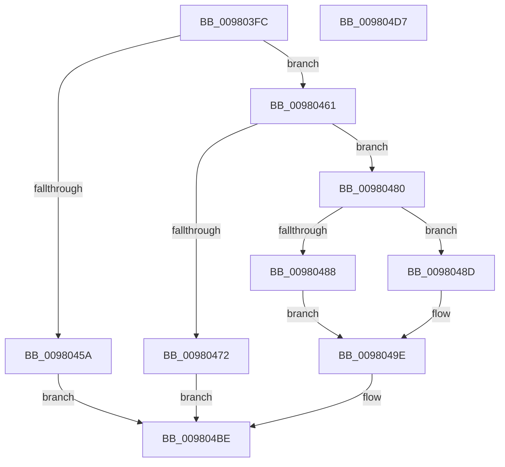

# MiCreateVadEventBitmap

- RVA: `0x009803FC`–`0x009804D8` (길이 `220` bytes)
- VA: `0x00000001409803FC`
- 실행 섹션: `PAGE`
- PDB 이름 있음: `예`; PDB Function 태그: `아니요`
- unwind 정보 RVA: `0x00060300`
- 디코드: `67`개 명령, `220/220` bytes 표시
- 미해석 바이트: `0` (있으면 어셈블리에 `.byte`로 보존)

> 이 문서는 커널 이미지의 기계어와 PDB 기호를 분석해 생성했습니다. 4번과 5번은 함수 원형과 자료형을 바이너리 사용 방식에서 추정한 C 해석이며 원본 소스 복구 결과는 아닙니다.

## 1. Dependencies

- 직접 호출 지점: **4**; 고유 호출 대상: **4**
- 직접 호출자로 확인된 함수: **3**
- RIP 상대 이미지 참조: **0**

### Outgoing calls
- `0x0098044D` → [MiAllocatePool](../../text/35/MiAllocatePool_function_0035B540.md) (function, `0x0035B540`)
- `0x00980467` → [PsChargeProcessNonPagedPoolQuota](../../text/2A/PsChargeProcessNonPagedPoolQuota_function_002A7B80.md) (function, `0x002A7B80`)
- `0x00980477` → [ExFreePoolWithTag](../../poolcode/B8/ExFreePoolWithTag_function_00B82870.md) (function, `0x00B82870`)
- `0x009804B7` → [MiInsertVadEvent](../../text/43/MiInsertVadEvent_function_00430E74.md) (function, `0x00430E74`)

### Direct callers
- [MiCreateWriteWatchView](MiCreateWriteWatchView_function_0098039C.md) at `0x009803D8`
- [MiAllocateNewSubAllocatedRegion](MiAllocateNewSubAllocatedRegion_function_00981EC0.md) at `0x0098201E`
- [MiCreateUserPhysicalView](../AD/MiCreateUserPhysicalView_function_00ADA4B4.md) at `0x00ADA688`

### Static image references
- 디코드된 RIP-relative 메모리 참조가 없습니다.

## 2. Other-region calls and transfers

- 다른 실행 섹션으로 향하는 call: **4**
  - `0x0098044D` → [MiAllocatePool](../../text/35/MiAllocatePool_function_0035B540.md) (`PAGE` → `.text`)
  - `0x00980467` → [PsChargeProcessNonPagedPoolQuota](../../text/2A/PsChargeProcessNonPagedPoolQuota_function_002A7B80.md) (`PAGE` → `.text`)
  - `0x00980477` → [ExFreePoolWithTag](../../poolcode/B8/ExFreePoolWithTag_function_00B82870.md) (`PAGE` → `POOLCODE`)
  - `0x009804B7` → [MiInsertVadEvent](../../text/43/MiInsertVadEvent_function_00430E74.md) (`PAGE` → `.text`)
- 별도 외부 분기/꼬리 이동을 확인하지 못했습니다.

## 3. Assembly (complete function range)

```asm
009803FC  48 89 5C 24 08                  mov qword ptr [rsp + 8], rbx
00980401  48 89 6C 24 10                  mov qword ptr [rsp + 0x10], rbp
00980406  48 89 74 24 18                  mov qword ptr [rsp + 0x18], rsi
0098040B  57                              push rdi
0098040C  41 56                           push r14
0098040E  41 57                           push r15
00980410  48 83 EC 20                     sub rsp, 0x20
00980414  41 8A C0                        mov al, r8b
00980417  49 8B E8                        mov rbp, r8
0098041A  24 3F                           and al, 0x3f
0098041C  4C 8B FA                        mov r15, rdx
0098041F  F6 D8                           neg al
00980421  4C 8B F1                        mov r14, rcx
00980424  49 8B C0                        mov rax, r8
00980427  B9 40 00 00 00                  mov ecx, 0x40
0098042C  48 1B F6                        sbb rsi, rsi
0098042F  41 B8 4D 6D 77 77               mov r8d, 0x77776d4d
00980435  48 F7 DE                        neg rsi
00980438  48 C1 E8 06                     shr rax, 6
0098043C  48 83 C6 0B                     add rsi, 0xb
00980440  41 8B F9                        mov edi, r9d
00980443  48 03 F0                        add rsi, rax
00980446  48 C1 E6 03                     shl rsi, 3
0098044A  48 8B D6                        mov rdx, rsi
0098044D  E8 EE B0 9D FF                  call 0x14035b540
00980452  48 8B D8                        mov rbx, rax
00980455  48 85 C0                        test rax, rax
00980458  75 07                           jne 0x140980461
0098045A  B8 9A 00 00 C0                  mov eax, 0xc000009a
0098045F  EB 5D                           jmp 0x1409804be
00980461  48 8B D6                        mov rdx, rsi
00980464  49 8B CE                        mov rcx, r14
00980467  E8 14 77 92 FF                  call 0x1402a7b80
0098046C  8B F0                           mov esi, eax
0098046E  85 C0                           test eax, eax
00980470  79 0E                           jns 0x140980480
00980472  33 D2                           xor edx, edx
00980474  48 8B CB                        mov rcx, rbx
00980477  E8 F4 23 20 00                  call 0x140b82870
0098047C  8B C6                           mov eax, esi
0098047E  EB 3E                           jmp 0x1409804be
00980480  89 7B 50                        mov dword ptr [rbx + 0x50], edi
00980483  83 FF 40                        cmp edi, 0x40
00980486  75 05                           jne 0x14098048d
00980488  8D 4F C8                        lea ecx, [rdi - 0x38]
0098048B  EB 11                           jmp 0x14098049e
0098048D  B9 10 00 00 00                  mov ecx, 0x10
00980492  81 FF 00 01 00 00               cmp edi, 0x100
00980498  8D 41 28                        lea eax, [rcx + 0x28]
0098049B  0F 44 C8                        cmove ecx, eax
0098049E  48 8D 43 58                     lea rax, [rbx + 0x58]
009804A2  48 89 2C 0B                     mov qword ptr [rbx + rcx], rbp
009804A6  48 89 44 0B 08                  mov qword ptr [rbx + rcx + 8], rax
009804AB  41 B8 01 00 00 00               mov r8d, 1
009804B1  49 8B CF                        mov rcx, r15
009804B4  48 8B D3                        mov rdx, rbx
009804B7  E8 B8 09 AB FF                  call 0x140430e74
009804BC  33 C0                           xor eax, eax
009804BE  48 8B 5C 24 40                  mov rbx, qword ptr [rsp + 0x40]
009804C3  48 8B 6C 24 48                  mov rbp, qword ptr [rsp + 0x48]
009804C8  48 8B 74 24 50                  mov rsi, qword ptr [rsp + 0x50]
009804CD  48 83 C4 20                     add rsp, 0x20
009804D1  41 5F                           pop r15
009804D3  41 5E                           pop r14
009804D5  5F                              pop rdi
009804D6  C3                              ret
009804D7  CC                              int3
```

## 4. C-style interpretation (structured pseudocode)

```c
__int64 __fastcall MiCreateVadEventBitmap(__int64 a1, __int64 a2, __int64 a3, int a4)
{
    __int64 result;
    __int64 v_rsi;
    __int64 v_rsp;
    unsigned __int64 v_stack_p10;
    unsigned __int64 v_stack_p18;
    unsigned __int64 v_stack_p8;

    v_stack_p8 = v_rbx;
    v_stack_p10 = v_rbp;
    v_stack_p18 = v_rsi;
    v_rsp = (v_rsp) - (32);
    result = (unsigned __int8)(((unsigned __int8)(a3)) & (63));
    result = (unsigned __int8)(-(result));
    v_rsi = -(v_rsi);
    result = (a3) >> (6);
    v_rsi = (v_rsi) + (11);
    v_rsi = (v_rsi) + (result);
    v_rsi = (v_rsi) << (3);
    result = MiAllocatePool(64, v_rsi, (unsigned int)(0x77776D4DULL), a4);
    if (result != 0) goto loc_00980461;
    goto loc_009804BE;
loc_00980461:
    result = PsChargeProcessNonPagedPoolQuota(a1, v_rsi, (unsigned int)(0x77776D4DULL), a4);
    if (!sign_flag) goto loc_00980480;
    a2 = 0;
    result = ExFreePoolWithTag(result, a2, (unsigned int)(0x77776D4DULL), a4);
    goto loc_009804BE;
loc_00980480:
    *(unsigned int *)(result + 80) = (unsigned int)((unsigned int)(a4));
    if (((unsigned int)((unsigned int)(a4))) != 64) goto loc_0098048D;
    goto loc_0098049E;
loc_0098048D:
    a1 = 16;
    if (((unsigned int)((unsigned int)(a4))) == 256) { a1 = (unsigned int)(16 + 40); }
loc_0098049E:
    *(unsigned __int64 *)(result + a1 * 1) = a3;
    *(unsigned __int64 *)(result + a1 * 1 + 8) = result + 88;
    result = MiInsertVadEvent(0, result, 1, a4);
    result = 0;
loc_009804BE:
    v_rsp = (v_rsp) + (32);
    return result;
}
```

## 5. (Beta) C Style

```c
int64_t MiCreateVadEventBitmap(int64_t Arg1, int64_t Arg2, int64_t Arg3, int32_t Arg4)
{
    int64_t result;
    int64_t local_rsi;
    int64_t local_rsp;
    uint64_t v_stack_p10;
    uint64_t v_stack_p18;
    uint64_t v_stack_p8;

    v_stack_p8 = local_rbx;
    v_stack_p10 = local_rbp;
    v_stack_p18 = local_rsi;
    local_rsp = (local_rsp) - (32);
    result = (uint8_t)(((uint8_t)(Arg3)) & (63));
    result = (uint8_t)(-(result));
    local_rsi = -(local_rsi);
    result = (Arg3) >> (6);
    local_rsi = (local_rsi) + (11);
    local_rsi = (local_rsi) + (result);
    local_rsi = (local_rsi) << (3);
    result = MiAllocatePool(64, local_rsi, (uint32_t)(0x77776D4DULL), Arg4);
    if (result != 0) goto loc_00980461;
    goto loc_009804BE;
loc_00980461:
    result = PsChargeProcessNonPagedPoolQuota(Arg1, local_rsi, (uint32_t)(0x77776D4DULL), Arg4);
    if (!sign_flag) goto loc_00980480;
    Arg2 = 0;
    result = ExFreePoolWithTag(result, Arg2, (uint32_t)(0x77776D4DULL), Arg4);
    goto loc_009804BE;
loc_00980480:
    *(uint32_t *)(result + 0x50) = (uint32_t)((uint32_t)(Arg4));
    if (((uint32_t)((uint32_t)(Arg4))) != 64) goto loc_0098048D;
    goto loc_0098049E;
loc_0098048D:
    Arg1 = 16;
    if (((uint32_t)((uint32_t)(Arg4))) == 256) { Arg1 = (uint32_t)(16 + 40); }
loc_0098049E:
    *(uint64_t *)(result + Arg1 * 1) = Arg3;
    *(uint64_t *)(result + Arg1 * 1 + 0x8) = result + 88;
    result = MiInsertVadEvent(0, result, 1, Arg4);
    result = 0;
loc_009804BE:
    local_rsp = (local_rsp) + (32);
    return result;
}
```

## 6. Execution-region graph

[열기: 2D/3D 그래프와 함수 탐색 컨트롤 패널](../../../control-panel.html?section=page&rva=0x009803FC&view=graph)

- 2D 그래프는 위에서 아래로 흐르고, 3D 그래프는 빈 공간을 드래그해 회전합니다. Shift+드래그는 이동, 휠은 확대·축소, 함수 노드 선택은 대상 보고서 이동입니다.

### Static fallback


