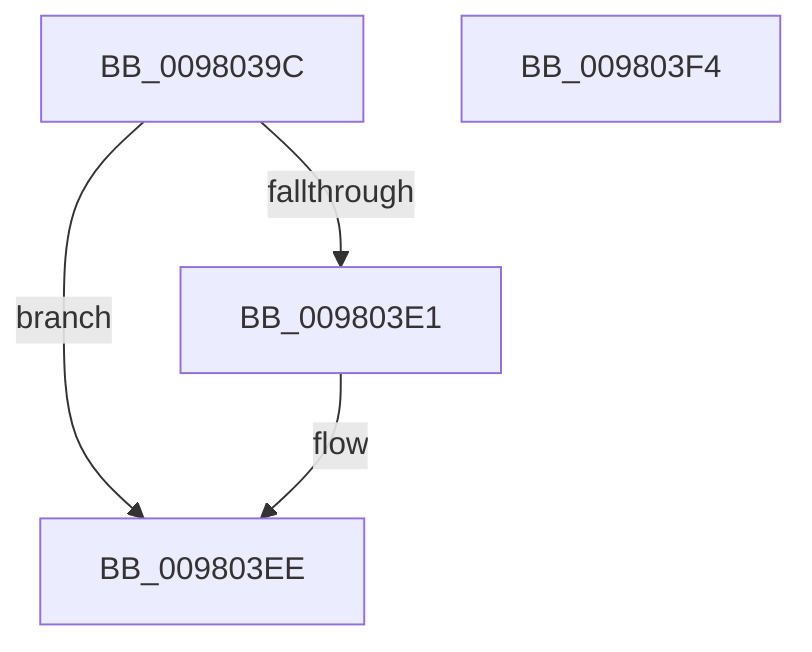

# MiCreateWriteWatchView

- RVA: `0x0098039C`–`0x009803F5` (길이 `89` bytes)
- VA: `0x000000014098039C`
- 실행 섹션: `PAGE`
- PDB 이름 있음: `예`; PDB Function 태그: `아니요`
- unwind 정보 RVA: `0x0005CF00`
- 디코드: `27`개 명령, `89/89` bytes 표시
- 미해석 바이트: `0` (있으면 어셈블리에 `.byte`로 보존)

> 이 문서는 커널 이미지의 기계어와 PDB 기호를 분석해 생성했습니다. 4번과 5번은 함수 원형과 자료형을 바이너리 사용 방식에서 추정한 C 해석이며 원본 소스 복구 결과는 아닙니다.

## 1. Dependencies

- 직접 호출 지점: **2**; 고유 호출 대상: **2**
- 직접 호출자로 확인된 함수: **2**
- RIP 상대 이미지 참조: **0**

### Outgoing calls
- `0x009803AB` → [MiGetVadMandatoryPageSize](../../text/2A/MiGetVadMandatoryPageSize_function_002A85F0.md) (function, `0x002A85F0`)
- `0x009803D8` → [MiCreateVadEventBitmap](MiCreateVadEventBitmap_function_009803FC.md) (function, `0x009803FC`)

### Direct callers
- [MiReserveUserMemory](../88/MiReserveUserMemory_function_00884498.md) at `0x00884BEF`
- [sub_00B2A0A2](../B2/Unknown_function_00B2A0A2.md) at `0x00B2A0E2`

### Static image references
- 디코드된 RIP-relative 메모리 참조가 없습니다.

## 2. Other-region calls and transfers

- 다른 실행 섹션으로 향하는 call: **1**
  - `0x009803AB` → [MiGetVadMandatoryPageSize](../../text/2A/MiGetVadMandatoryPageSize_function_002A85F0.md) (`PAGE` → `.text`)
- 별도 외부 분기/꼬리 이동을 확인하지 못했습니다.

## 3. Assembly (complete function range)

```asm
0098039C  40 53                           push rbx
0098039E  48 83 EC 20                     sub rsp, 0x20
009803A2  48 8B D9                        mov rbx, rcx
009803A5  4C 8B D2                        mov r10, rdx
009803A8  48 8B CA                        mov rcx, rdx
009803AB  E8 40 82 92 FF                  call 0x1402a85f0
009803B0  4C 8B C8                        mov r9, rax
009803B3  33 D2                           xor edx, edx
009803B5  49 8D 40 FF                     lea rax, [r8 - 1]
009803B9  48 8B CB                        mov rcx, rbx
009803BC  49 03 C1                        add rax, r9
009803BF  4D 8D 41 FF                     lea r8, [r9 - 1]
009803C3  49 F7 D0                        not r8
009803C6  49 23 C0                        and rax, r8
009803C9  49 F7 F1                        div r9
009803CC  41 B9 04 00 00 00               mov r9d, 4
009803D2  49 8B D2                        mov rdx, r10
009803D5  4C 8B C0                        mov r8, rax
009803D8  E8 1F 00 00 00                  call 0x1409803fc
009803DD  85 C0                           test eax, eax
009803DF  78 0D                           js 0x1409803ee
009803E1  F0 81 8B F4 01 00 00 00 80 00 00  lock or dword ptr [rbx + 0x1f4], 0x8000
009803EC  33 C0                           xor eax, eax
009803EE  48 83 C4 20                     add rsp, 0x20
009803F2  5B                              pop rbx
009803F3  C3                              ret
009803F4  CC                              int3
```

## 4. C-style interpretation (structured pseudocode)

```c
__int64 __fastcall MiCreateWriteWatchView(__int64 a1, __int64 a2, __int64 a3)
{
    __int64 result;
    __int64 v_rsp;

    v_rsp = (v_rsp) - (32);
    result = MiGetVadMandatoryPageSize(a2, a2, a3, a4);
    a2 = 0;
    result = (a3 - 1) + (result);
    a3 = ~(result - 1);
    result = (result) & (a3);
    result = MiCreateVadEventBitmap(a1, 0, result, 4);
    if (!(sign_flag)) {
        result = 0;
    }
    v_rsp = (v_rsp) + (32);
    return result;
}
```

## 5. (Beta) C Style

```c
int64_t MiCreateWriteWatchView(void *Arg1, int64_t Arg2, int64_t Arg3)
{
    uint8_t *arg1 = (uint8_t *)Arg1;

    int64_t result;
    int64_t local_rsp;

    local_rsp = (local_rsp) - (32);
    result = MiGetVadMandatoryPageSize(Arg2, Arg2, Arg3, a4);
    Arg2 = 0;
    result = (Arg3 - 1) + (result);
    Arg3 = ~(result - 1);
    result = (result) & (Arg3);
    result = MiCreateVadEventBitmap(Arg1, 0, result, 4);
    if (!(sign_flag)) {
        result = 0;
    }
    local_rsp = (local_rsp) + (32);
    return result;
}
```

### 관측된 메모리 오프셋

구조체 형식이 확인되지 않은 접근은 인자 기준의 오프셋으로만 기록했습니다.

| 기준 인자 | 오프셋 표현 | 폭 (bit) | 접근 |
|---|---:|---:|---|
| `Arg1` | `+ 0x1F4` | `32` | `R/W` |

## 6. Execution-region graph

[열기: 2D/3D 그래프와 함수 탐색 컨트롤 패널](../../../control-panel.html?section=page&rva=0x0098039C&view=graph)

- 2D 그래프는 위에서 아래로 흐르고, 3D 그래프는 빈 공간을 드래그해 회전합니다. Shift+드래그는 이동, 휠은 확대·축소, 함수 노드 선택은 대상 보고서 이동입니다.

### Static fallback


