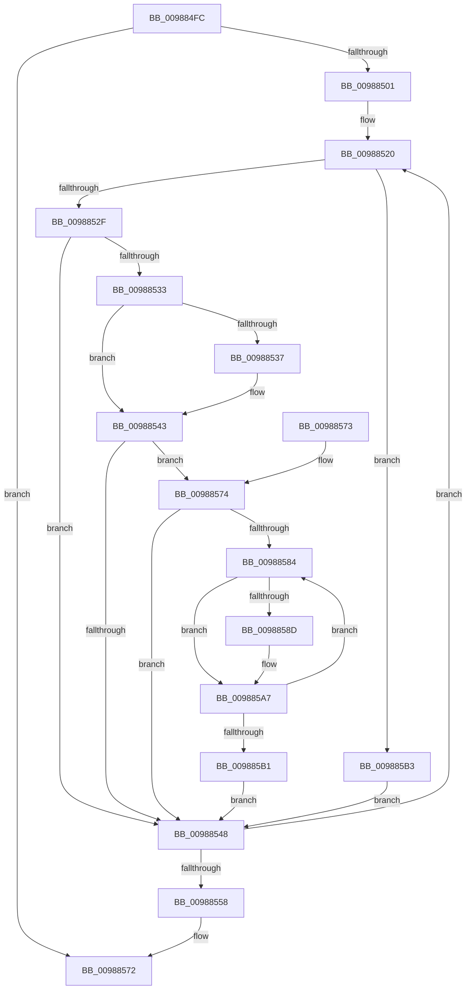

# MiDeleteImageCreationMdls

- RVA: `0x009884FC`–`0x009885C0` (길이 `196` bytes)
- VA: `0x00000001409884FC`
- 실행 섹션: `PAGE`
- PDB 이름 있음: `예`; PDB Function 태그: `아니요`
- unwind 정보 RVA: `0x00097DBC`
- 디코드: `58`개 명령, `196/196` bytes 표시
- 미해석 바이트: `0` (있으면 어셈블리에 `.byte`로 보존)

> 이 문서는 커널 이미지의 기계어와 PDB 기호를 분석해 생성했습니다. 4번과 5번은 함수 원형과 자료형을 바이너리 사용 방식에서 추정한 C 해석이며 원본 소스 복구 결과는 아닙니다.

## 1. Dependencies

- 직접 호출 지점: **4**; 고유 호출 대상: **4**
- 직접 호출자로 확인된 함수: **4**
- RIP 상대 이미지 참조: **0**

### Outgoing calls
- `0x0098853E` → [MmUnmapLockedPages](../../text/24/MmUnmapLockedPages_function_00246E60.md) (function, `0x00246E60`)
- `0x0098854B` → [IoFreeMdl](../../text/29/IoFreeMdl_function_0029EA80.md) (function, `0x0029EA80`)
- `0x009885A2` → [MiReturnPfnReferenceCount](../../text/2A/MiReturnPfnReferenceCount_function_002AA824.md) (function, `0x002AA824`)
- `0x009885B9` → [ExFreePoolWithTag](../../poolcode/B8/ExFreePoolWithTag_function_00B82870.md) (function, `0x00B82870`)

### Direct callers
- [MiCreateImageFileMap](MiCreateImageFileMap_function_00986830.md) at `0x00986DD7`
- [MiCreateImageFileMap](MiCreateImageFileMap_function_00986830.md) at `0x00986E34`
- [MiCreateMdl](MiCreateMdl_function_009883A8.md) at `0x00988421`
- [sub_00B2AF8E](../B2/Unknown_function_00B2AF8E.md) at `0x00B2AFC4`
- [sub_00B2B0A8](../B2/Unknown_function_00B2B0A8.md) at `0x00B2B41D`

### Static image references
- 디코드된 RIP-relative 메모리 참조가 없습니다.

## 2. Other-region calls and transfers

- 다른 실행 섹션으로 향하는 call: **4**
  - `0x0098853E` → [MmUnmapLockedPages](../../text/24/MmUnmapLockedPages_function_00246E60.md) (`PAGE` → `.text`)
  - `0x0098854B` → [IoFreeMdl](../../text/29/IoFreeMdl_function_0029EA80.md) (`PAGE` → `.text`)
  - `0x009885A2` → [MiReturnPfnReferenceCount](../../text/2A/MiReturnPfnReferenceCount_function_002AA824.md) (`PAGE` → `.text`)
  - `0x009885B9` → [ExFreePoolWithTag](../../poolcode/B8/ExFreePoolWithTag_function_00B82870.md) (`PAGE` → `POOLCODE`)
- 별도 외부 분기/꼬리 이동을 확인하지 못했습니다.

## 3. Assembly (complete function range)

```asm
009884FC  48 85 C9                        test rcx, rcx
009884FF  74 71                           je 0x140988572
00988501  48 8B C4                        mov rax, rsp
00988504  48 89 58 08                     mov qword ptr [rax + 8], rbx
00988508  48 89 68 10                     mov qword ptr [rax + 0x10], rbp
0098850C  48 89 70 18                     mov qword ptr [rax + 0x18], rsi
00988510  48 89 78 20                     mov qword ptr [rax + 0x20], rdi
00988514  41 56                           push r14
00988516  48 83 EC 20                     sub rsp, 0x20
0098851A  44 8B F2                        mov r14d, edx
0098851D  48 8B D9                        mov rbx, rcx
00988520  0F B7 43 0A                     movzx eax, word ptr [rbx + 0xa]
00988524  48 8B 2B                        mov rbp, qword ptr [rbx]
00988527  A8 04                           test al, 4
00988529  0F 85 84 00 00 00               jne 0x1409885b3
0098852F  A8 02                           test al, 2
00988531  74 15                           je 0x140988548
00988533  A8 01                           test al, 1
00988535  74 0C                           je 0x140988543
00988537  48 8B 4B 18                     mov rcx, qword ptr [rbx + 0x18]
0098853B  48 8B D3                        mov rdx, rbx
0098853E  E8 1D E9 8B FF                  call 0x140246e60
00988543  45 85 F6                        test r14d, r14d
00988546  75 2C                           jne 0x140988574
00988548  48 8B CB                        mov rcx, rbx
0098854B  E8 30 65 91 FF                  call 0x14029ea80
00988550  48 8B DD                        mov rbx, rbp
00988553  48 85 ED                        test rbp, rbp
00988556  75 C8                           jne 0x140988520
00988558  48 8B 5C 24 30                  mov rbx, qword ptr [rsp + 0x30]
0098855D  48 8B 6C 24 38                  mov rbp, qword ptr [rsp + 0x38]
00988562  48 8B 74 24 40                  mov rsi, qword ptr [rsp + 0x40]
00988567  48 8B 7C 24 48                  mov rdi, qword ptr [rsp + 0x48]
0098856C  48 83 C4 20                     add rsp, 0x20
00988570  41 5E                           pop r14
00988572  C3                              ret
00988573  CC                              int3
00988574  8B 7B 28                        mov edi, dword ptr [rbx + 0x28]
00988577  48 8D 73 30                     lea rsi, [rbx + 0x30]
0098857B  48 C1 EF 0C                     shr rdi, 0xc
0098857F  48 85 FF                        test rdi, rdi
00988582  74 C4                           je 0x140988548
00988584  48 8B 06                        mov rax, qword ptr [rsi]
00988587  48 83 F8 FF                     cmp rax, -1
0098858B  74 1A                           je 0x1409885a7
0098858D  48 8D 0C 40                     lea rcx, [rax + rax*2]
00988591  48 C1 E1 04                     shl rcx, 4
00988595  48 B8 00 00 00 00 00 DE FF FF   movabs rax, 0xffffde0000000000
0098859F  48 03 C8                        add rcx, rax
009885A2  E8 7D 22 92 FF                  call 0x1402aa824
009885A7  48 83 C6 08                     add rsi, 8
009885AB  48 83 EF 01                     sub rdi, 1
009885AF  75 D3                           jne 0x140988584
009885B1  EB 95                           jmp 0x140988548
009885B3  48 8B 4B 20                     mov rcx, qword ptr [rbx + 0x20]
009885B7  33 D2                           xor edx, edx
009885B9  E8 B2 A2 1F 00                  call 0x140b82870
009885BE  EB 88                           jmp 0x140988548
```

## 4. C-style interpretation (structured pseudocode)

```c
__int64 __fastcall MiDeleteImageCreationMdls(__int64 a1, int a2)
{
    __int64 result;
    __int64 v_rdi;
    __int64 v_rsi;
    __int64 v_rsp;
    unsigned __int64 v_stack_p10;
    unsigned __int64 v_stack_p18;
    unsigned __int64 v_stack_p20;
    unsigned __int64 v_stack_p8;

    if (a1 == 0) goto loc_00988572;
    *(unsigned __int64 *)(v_rsp + 8) = v_rbx;
    *(unsigned __int64 *)(v_rsp + 16) = v_rbp;
    *(unsigned __int64 *)(v_rsp + 24) = v_rsi;
    *(unsigned __int64 *)(v_rsp + 32) = v_rdi;
    v_rsp = (v_rsp) - (32);
loc_00988520:
    if ((((unsigned __int8)(*(unsigned __int16 *)(a1 + 10))) & (4)) != 0) goto loc_009885B3;
    if ((((unsigned __int8)(*(unsigned __int16 *)(a1 + 10))) & (2)) == 0) goto loc_00988548;
    result = *(unsigned __int16 *)(a1 + 10);
    if ((((unsigned __int8)(*(unsigned __int16 *)(a1 + 10))) & (1)) != 0) {
        a1 = *(unsigned __int64 *)(a1 + 24);
        a2 = a1;
        result = MmUnmapLockedPages(a1, a2, a3, a4);
    }
    if ((unsigned int)((unsigned int)(a2)) != 0) goto loc_00988574;
loc_00988548:
    result = IoFreeMdl(a1, a2, a3, a4);
    if (*(unsigned __int64 *)(a1) != 0) goto loc_00988520;
    v_rsp = (v_rsp) + (32);
loc_00988572:
    return result;
loc_00988574:
    v_rdi = ((unsigned int)(*(unsigned int *)(v_stack_p8 + 40))) >> (12);
    if (v_rdi == 0) goto loc_00988548;
loc_00988584:
    result = *(unsigned __int64 *)(v_stack_p8 + 48);
    if ((*(unsigned __int64 *)(v_stack_p8 + 48)) != -1) {
        a1 = *(unsigned __int64 *)(v_stack_p8 + 48) + *(unsigned __int64 *)(v_stack_p8 + 48) * 2;
        a1 = (a1) << (4);
        a1 = (a1) + (*(unsigned __int64 *)(v_stack_p8 + 48));
        result = MiReturnPfnReferenceCount(a1, a2, a3, a4);
    }
    v_rsi = (v_stack_p8 + 48) + (8);
    v_rdi = (v_rdi) - (1);
    if (condition_is_not_equal) goto loc_00988584;
    goto loc_00988548;
loc_009885B3:
    a2 = 0;
    result = ExFreePoolWithTag(*(unsigned __int64 *)(v_stack_p8 + 32), a2, a3, a4);
    goto loc_00988548;
}
```

## 5. (Beta) C Style

```c
int64_t MiDeleteImageCreationMdls(int64_t Arg1, int32_t Arg2)
{
    int64_t result;
    int64_t local_rdi;
    int64_t local_rsi;
    int64_t local_rsp;
    uint64_t v_stack_p10;
    uint64_t v_stack_p18;
    uint64_t v_stack_p20;
    uint64_t v_stack_p8;

    if (Arg1 == 0) goto loc_00988572;
    *(uint64_t *)(local_rsp + 0x8) = local_rbx;
    *(uint64_t *)(local_rsp + 0x10) = local_rbp;
    *(uint64_t *)(local_rsp + 0x18) = local_rsi;
    *(uint64_t *)(local_rsp + 0x20) = local_rdi;
    local_rsp = (local_rsp) - (32);
loc_00988520:
    if ((((uint8_t)(*(uint16_t *)(Arg1 + 0xA))) & (4)) != 0) goto loc_009885B3;
    if ((((uint8_t)(*(uint16_t *)(Arg1 + 0xA))) & (2)) == 0) goto loc_00988548;
    result = *(uint16_t *)(Arg1 + 0xA);
    if ((((uint8_t)(*(uint16_t *)(Arg1 + 0xA))) & (1)) != 0) {
        Arg1 = *(uint64_t *)(Arg1 + 0x18);
        Arg2 = Arg1;
        result = MmUnmapLockedPages(Arg1, Arg2, a3, a4);
    }
    if ((uint32_t)((uint32_t)(Arg2)) != 0) goto loc_00988574;
loc_00988548:
    result = IoFreeMdl(Arg1, Arg2, a3, a4);
    if (*(uint64_t *)(Arg1) != 0) goto loc_00988520;
    local_rsp = (local_rsp) + (32);
loc_00988572:
    return result;
loc_00988574:
    local_rdi = ((uint32_t)(*(uint32_t *)(v_stack_p8 + 0x28))) >> (12);
    if (local_rdi == 0) goto loc_00988548;
loc_00988584:
    result = *(uint64_t *)(v_stack_p8 + 0x30);
    if ((*(uint64_t *)(v_stack_p8 + 0x30)) != -1) {
        Arg1 = *(uint64_t *)(v_stack_p8 + 0x30) + *(uint64_t *)(v_stack_p8 + 0x30) * 2;
        Arg1 = (Arg1) << (4);
        Arg1 = (Arg1) + (*(uint64_t *)(v_stack_p8 + 0x30));
        result = MiReturnPfnReferenceCount(Arg1, Arg2, a3, a4);
    }
    local_rsi = (v_stack_p8 + 48) + (8);
    local_rdi = (local_rdi) - (1);
    if (condition_is_not_equal) goto loc_00988584;
    goto loc_00988548;
loc_009885B3:
    Arg2 = 0;
    result = ExFreePoolWithTag(*(uint64_t *)(v_stack_p8 + 0x20), Arg2, a3, a4);
    goto loc_00988548;
}
```

## 6. Execution-region graph

[열기: 2D/3D 그래프와 함수 탐색 컨트롤 패널](../../../control-panel.html?section=page&rva=0x009884FC&view=graph)

- 2D 그래프는 위에서 아래로 흐르고, 3D 그래프는 빈 공간을 드래그해 회전합니다. Shift+드래그는 이동, 휠은 확대·축소, 함수 노드 선택은 대상 보고서 이동입니다.

### Static fallback


