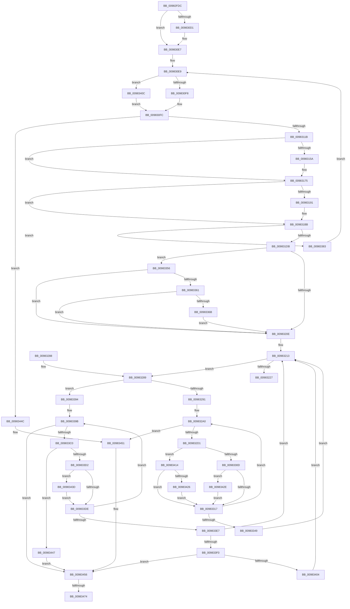

# MiExtendSection

- RVA: `0x00982FDC`–`0x0098348B` (길이 `1,199` bytes)
- VA: `0x0000000140982FDC`
- 실행 섹션: `PAGE`
- PDB 이름 있음: `예`; PDB Function 태그: `예`
- unwind 정보 RVA: `0x000979CC`
- 디코드: `305`개 명령, `1,199/1,199` bytes 표시
- 미해석 바이트: `0` (있으면 어셈블리에 `.byte`로 보존)

> 이 문서는 커널 이미지의 기계어와 PDB 기호를 분석해 생성했습니다. 4번과 5번은 함수 원형과 자료형을 바이너리 사용 방식에서 추정한 C 해석이며 원본 소스 복구 결과는 아닙니다.

## 1. Dependencies

- 직접 호출 지점: **15**; 고유 호출 대상: **13**
- 직접 호출자로 확인된 함수: **1**
- RIP 상대 이미지 참조: **0**

### Outgoing calls
- `0x0098310A` → [MiAllocatePool](../../text/35/MiAllocatePool_function_0035B540.md) (function, `0x0035B540`)
- `0x009831C8` → [Mi4KStartForSubsection](../../text/46/Mi4KStartForSubsection_function_0046C358.md) (function, `0x0046C358`)
- `0x0098321E` → [MiAppendSubsectionChain](../../text/48/MiAppendSubsectionChain_function_00480228.md) (function, `0x00480228`)
- `0x009832C0` → [MiAllocatePool](../../text/35/MiAllocatePool_function_0035B540.md) (function, `0x0035B540`)
- `0x009832F6` → [MiInitializePrototypePtes](MiInitializePrototypePtes_function_009829AC.md) (function, `0x009829AC`)
- `0x00983324` → [MiSetSubsectionBase](../../text/49/MiSetSubsectionBase_function_0049CE98.md) (function, `0x0049CE98`)
- `0x00983332` → [MiUpdateSystemProtoPtesTree](../../text/29/MiUpdateSystemProtoPtesTree_function_00295F0C.md) (function, `0x00295F0C`)
- `0x0098336E` → [MiSubsectionNeedsExtents](../../text/67/MiSubsectionNeedsExtents_function_0067EFF8.md) (function, `0x0067EFF8`)
- `0x009833B1` → [MiGetSubsectionCharges](../../text/45/MiGetSubsectionCharges_function_00458A04.md) (function, `0x00458A04`)
- `0x009833C8` → [MiIncrementSubsectionViewCount](../../text/24/MiIncrementSubsectionViewCount_function_00249440.md) (function, `0x00249440`)
- `0x009833F9` → [MiGetSubsectionCharges](../../text/45/MiGetSubsectionCharges_function_00458A04.md) (function, `0x00458A04`)
- `0x00983433` → [MiDecrementSubsectionViewCount](../../text/29/MiDecrementSubsectionViewCount_function_00298E90.md) (function, `0x00298E90`)
- `0x00983440` → [MiUpdateSubsectionCrossPartitionRefs](../../text/4F/MiUpdateSubsectionCrossPartitionRefs_function_004FB5DC.md) (function, `0x004FB5DC`)
- `0x0098345E` → [MiGetControlAreaPartition](../../text/43/MiGetControlAreaPartition_function_0043E560.md) (function, `0x0043E560`)
- `0x0098347F` → [MiReturnCrossPartitionSectionCharges](../../text/4B/MiReturnCrossPartitionSectionCharges_function_004BA61C.md) (function, `0x004BA61C`)

### Direct callers
- [MmExtendSection](MmExtendSection_function_00982C38.md) at `0x00982D41`

### Static image references
- 디코드된 RIP-relative 메모리 참조가 없습니다.

## 2. Other-region calls and transfers

- 다른 실행 섹션으로 향하는 call: **14**
  - `0x0098310A` → [MiAllocatePool](../../text/35/MiAllocatePool_function_0035B540.md) (`PAGE` → `.text`)
  - `0x009831C8` → [Mi4KStartForSubsection](../../text/46/Mi4KStartForSubsection_function_0046C358.md) (`PAGE` → `.text`)
  - `0x0098321E` → [MiAppendSubsectionChain](../../text/48/MiAppendSubsectionChain_function_00480228.md) (`PAGE` → `.text`)
  - `0x009832C0` → [MiAllocatePool](../../text/35/MiAllocatePool_function_0035B540.md) (`PAGE` → `.text`)
  - `0x00983324` → [MiSetSubsectionBase](../../text/49/MiSetSubsectionBase_function_0049CE98.md) (`PAGE` → `.text`)
  - `0x00983332` → [MiUpdateSystemProtoPtesTree](../../text/29/MiUpdateSystemProtoPtesTree_function_00295F0C.md) (`PAGE` → `.text`)
  - `0x0098336E` → [MiSubsectionNeedsExtents](../../text/67/MiSubsectionNeedsExtents_function_0067EFF8.md) (`PAGE` → `.text`)
  - `0x009833B1` → [MiGetSubsectionCharges](../../text/45/MiGetSubsectionCharges_function_00458A04.md) (`PAGE` → `.text`)
  - `0x009833C8` → [MiIncrementSubsectionViewCount](../../text/24/MiIncrementSubsectionViewCount_function_00249440.md) (`PAGE` → `.text`)
  - `0x009833F9` → [MiGetSubsectionCharges](../../text/45/MiGetSubsectionCharges_function_00458A04.md) (`PAGE` → `.text`)
  - `0x00983433` → [MiDecrementSubsectionViewCount](../../text/29/MiDecrementSubsectionViewCount_function_00298E90.md) (`PAGE` → `.text`)
  - `0x00983440` → [MiUpdateSubsectionCrossPartitionRefs](../../text/4F/MiUpdateSubsectionCrossPartitionRefs_function_004FB5DC.md) (`PAGE` → `.text`)
  - `0x0098345E` → [MiGetControlAreaPartition](../../text/43/MiGetControlAreaPartition_function_0043E560.md) (`PAGE` → `.text`)
  - `0x0098347F` → [MiReturnCrossPartitionSectionCharges](../../text/4B/MiReturnCrossPartitionSectionCharges_function_004BA61C.md) (`PAGE` → `.text`)
- call이 아닌 외부 분기/꼬리 이동: **2**
  - `0x0098346E` → [sub_00B2A916](../B2/Unknown_function_00B2A916.md) (`tail-transfer`)
  - `0x00983486` → [sub_00B2A916](../B2/Unknown_function_00B2A916.md) (`tail-transfer`)

## 3. Assembly (complete function range)

```asm
00982FDC  4C 89 4C 24 20                  mov qword ptr [rsp + 0x20], r9
00982FE1  44 89 44 24 18                  mov dword ptr [rsp + 0x18], r8d
00982FE6  48 89 54 24 10                  mov qword ptr [rsp + 0x10], rdx
00982FEB  53                              push rbx
00982FEC  55                              push rbp
00982FED  56                              push rsi
00982FEE  57                              push rdi
00982FEF  41 54                           push r12
00982FF1  41 55                           push r13
00982FF3  41 56                           push r14
00982FF5  41 57                           push r15
00982FF7  48 81 EC E8 00 00 00            sub rsp, 0xe8
00982FFE  4C 8B 19                        mov r11, qword ptr [rcx]
00983001  4A 8D 14 CD 00 00 00 00         lea rdx, [r9*8]
00983009  48 8B 84 24 50 01 00 00         mov rax, qword ptr [rsp + 0x150]
00983011  4C 8D 74 24 40                  lea r14, [rsp + 0x40]
00983016  4C 8B F9                        mov r15, rcx
00983019  4C 89 9C 24 30 01 00 00         mov qword ptr [rsp + 0x130], r11
00983021  48 8D 4C 24 40                  lea rcx, [rsp + 0x40]
00983026  41 B9 80 00 00 00               mov r9d, 0x80
0098302C  45 8B E0                        mov r12d, r8d
0098302F  48 81 C2 FF 0F 00 00            add rdx, 0xfff
00983036  48 83 20 00                     and qword ptr [rax], 0
0098303A  48 81 E2 00 F0 FF FF            and rdx, 0xfffffffffffff000
00983041  49 8B 03                        mov rax, qword ptr [r11]
00983044  41 0F 10 07                     movups xmm0, xmmword ptr [r15]
00983048  48 89 44 24 30                  mov qword ptr [rsp + 0x30], rax
0098304D  41 0F 10 4F 10                  movups xmm1, xmmword ptr [r15 + 0x10]
00983052  41 8A 43 3E                     mov al, byte ptr [r11 + 0x3e]
00983056  0F 11 01                        movups xmmword ptr [rcx], xmm0
00983059  24 0C                           and al, 0xc
0098305B  48 89 54 24 20                  mov qword ptr [rsp + 0x20], rdx
00983060  41 0F 10 47 20                  movups xmm0, xmmword ptr [r15 + 0x20]
00983065  F6 D8                           neg al
00983067  0F 11 49 10                     movups xmmword ptr [rcx + 0x10], xmm1
0098306B  4D 1B C0                        sbb r8, r8
0098306E  B8 00 00 10 00                  mov eax, 0x100000
00983073  41 0F 10 4F 30                  movups xmm1, xmmword ptr [r15 + 0x30]
00983078  4C 23 C0                        and r8, rax
0098307B  33 ED                           xor ebp, ebp
0098307D  0F 11 41 20                     movups xmmword ptr [rcx + 0x20], xmm0
00983081  4C 03 C0                        add r8, rax
00983084  4B 8B 44 0F 10                  mov rax, qword ptr [r15 + r9 + 0x10]
00983089  41 0F 10 47 40                  movups xmm0, xmmword ptr [r15 + 0x40]
0098308E  33 F6                           xor esi, esi
00983090  45 33 ED                        xor r13d, r13d
00983093  4C 89 44 24 28                  mov qword ptr [rsp + 0x28], r8
00983098  0F 11 49 30                     movups xmmword ptr [rcx + 0x30], xmm1
0098309C  41 0F 10 4F 50                  movups xmm1, xmmword ptr [r15 + 0x50]
009830A1  0F 11 41 40                     movups xmmword ptr [rcx + 0x40], xmm0
009830A5  41 0F 10 47 60                  movups xmm0, xmmword ptr [r15 + 0x60]
009830AA  0F 11 49 50                     movups xmmword ptr [rcx + 0x50], xmm1
009830AE  43 0F 10 0C 0F                  movups xmm1, xmmword ptr [r15 + r9]
009830B3  0F 11 41 60                     movups xmmword ptr [rcx + 0x60], xmm0
009830B7  41 0F 10 47 70                  movups xmm0, xmmword ptr [r15 + 0x70]
009830BC  42 0F 11 44 09 F0               movups xmmword ptr [rcx + r9 - 0x10], xmm0
009830C2  42 0F 11 0C 09                  movups xmmword ptr [rcx + r9], xmm1
009830C7  4A 89 44 09 10                  mov qword ptr [rcx + r9 + 0x10], rax
009830CC  45 85 E4                        test r12d, r12d
009830CF  74 16                           je 0x1409830e7
009830D1  8B 4C 24 74                     mov ecx, dword ptr [rsp + 0x74]
009830D5  8B C1                           mov eax, ecx
009830D7  41 2B C4                        sub eax, r12d
009830DA  33 C1                           xor eax, ecx
009830DC  25 FF FF FF 3F                  and eax, 0x3fffffff
009830E1  33 C8                           xor ecx, eax
009830E3  89 4C 24 74                     mov dword ptr [rsp + 0x74], ecx
009830E7  33 FF                           xor edi, edi
009830E9  48 8B C2                        mov rax, rdx
009830EC  48 2B C5                        sub rax, rbp
009830EF  49 3B C0                        cmp rax, r8
009830F2  0F 87 14 03 00 00               ja 0x14098340c
009830F8  8B DA                           mov ebx, edx
009830FA  2B DD                           sub ebx, ebp
009830FC  BA 98 00 00 00                  mov edx, 0x98
00983101  41 B8 4D 6D 53 64               mov r8d, 0x64536d4d
00983107  8D 4A A8                        lea ecx, [rdx - 0x58]
0098310A  E8 31 84 9D FF                  call 0x14035b540
0098310F  4C 8B C8                        mov r9, rax
00983112  48 85 C0                        test rax, rax
00983115  0F 84 31 03 00 00               je 0x14098344c
0098311B  4C 8B 9C 24 30 01 00 00         mov r11, qword ptr [rsp + 0x130]
00983123  48 8D 48 58                     lea rcx, [rax + 0x58]
00983127  48 89 49 08                     mov qword ptr [rcx + 8], rcx
0098312B  44 8B D3                        mov r10d, ebx
0098312E  48 89 09                        mov qword ptr [rcx], rcx
00983131  49 89 46 10                     mov qword ptr [r14 + 0x10], rax
00983135  41 C1 EA 03                     shr r10d, 3
00983139  4C 89 18                        mov qword ptr [rax], r11
0098313C  44 89 50 2C                     mov dword ptr [rax + 0x2c], r10d
00983140  8B C3                           mov eax, ebx
00983142  48 8B 9C 24 48 01 00 00         mov rbx, qword ptr [rsp + 0x148]
0098314A  48 03 E8                        add rbp, rax
0098314D  48 8D 04 DD 00 00 00 00         lea rax, [rbx*8]
00983155  48 3B E8                        cmp rbp, rax
00983158  76 1B                           jbe 0x140983175
0098315A  41 8B 41 34                     mov eax, dword ptr [r9 + 0x34]
0098315E  48 8B CD                        mov rcx, rbp
00983161  48 C1 E9 03                     shr rcx, 3
00983165  2B CB                           sub ecx, ebx
00983167  33 C8                           xor ecx, eax
00983169  81 E1 FF FF FF 3F               and ecx, 0x3fffffff
0098316F  33 C8                           xor ecx, eax
00983171  41 89 49 34                     mov dword ptr [r9 + 0x34], ecx
00983175  48 8B 44 24 30                  mov rax, qword ptr [rsp + 0x30]
0098317A  0F B6 40 0E                     movzx eax, byte ptr [rax + 0xe]
0098317E  83 E0 1F                        and eax, 0x1f
00983181  03 C0                           add eax, eax
00983183  41 89 41 20                     mov dword ptr [r9 + 0x20], eax
00983187  48 8D 44 24 40                  lea rax, [rsp + 0x40]
0098318C  4C 3B F0                        cmp r14, rax
0098318F  75 2A                           jne 0x1409831bb
00983191  41 8B 46 2C                     mov eax, dword ptr [r14 + 0x2c]
00983195  41 89 46 28                     mov dword ptr [r14 + 0x28], eax
00983199  41 8B 46 20                     mov eax, dword ptr [r14 + 0x20]
0098319D  25 FF FF 0F 00                  and eax, 0xfffff
009831A2  41 89 46 20                     mov dword ptr [r14 + 0x20], eax
009831A6  41 8B 7E 20                     mov edi, dword ptr [r14 + 0x20]
009831AA  41 8B 46 24                     mov eax, dword ptr [r14 + 0x24]
009831AE  81 E7 C0 FF 00 00               and edi, 0xffc0
009831B4  48 C1 E7 1A                     shl rdi, 0x1a
009831B8  48 0B F8                        or rdi, rax
009831BB  41 8B 46 28                     mov eax, dword ptr [r14 + 0x28]
009831BF  49 8B C9                        mov rcx, r9
009831C2  48 03 F8                        add rdi, rax
009831C5  48 8B D7                        mov rdx, rdi
009831C8  E8 8B 91 AE FF                  call 0x14046c358
009831CD  48 8B 54 24 20                  mov rdx, qword ptr [rsp + 0x20]
009831D2  48 3B EA                        cmp rbp, rdx
009831D5  0F 82 A8 01 00 00               jb 0x140983383
009831DB  48 8B 8C 24 38 01 00 00         mov rcx, qword ptr [rsp + 0x138]
009831E3  48 8B 01                        mov rax, qword ptr [rcx]
009831E6  48 C1 E8 0C                     shr rax, 0xc
009831EA  2B C7                           sub eax, edi
009831EC  41 89 41 28                     mov dword ptr [r9 + 0x28], eax
009831F0  41 8B 41 20                     mov eax, dword ptr [r9 + 0x20]
009831F4  0F B7 09                        movzx ecx, word ptr [rcx]
009831F7  25 FF FF 0F 00                  and eax, 0xfffff
009831FC  C1 E1 14                        shl ecx, 0x14
009831FF  0B C8                           or ecx, eax
00983201  41 89 49 20                     mov dword ptr [r9 + 0x20], ecx
00983205  45 85 E4                        test r12d, r12d
00983208  0F 85 48 01 00 00               jne 0x140983356
0098320E  48 8B 5C 24 50                  mov rbx, qword ptr [rsp + 0x50]
00983213  45 8B C5                        mov r8d, r13d
00983216  48 8D 54 24 40                  lea rdx, [rsp + 0x40]
0098321B  49 8B CF                        mov rcx, r15
0098321E  E8 05 D0 AF FF                  call 0x140480228
00983223  85 C0                           test eax, eax
00983225  75 62                           jne 0x140983289
00983227  4C 8B 4C 24 30                  mov r9, qword ptr [rsp + 0x30]
0098322C  41 BA FF 03 00 00               mov r10d, 0x3ff
00983232  41 8B D4                        mov edx, r12d
00983235  45 0F B7 41 0C                  movzx r8d, word ptr [r9 + 0xc]
0098323A  41 8B 41 08                     mov eax, dword ptr [r9 + 8]
0098323E  41 8B C8                        mov ecx, r8d
00983241  49 23 CA                        and rcx, r10
00983244  48 C1 E1 20                     shl rcx, 0x20
00983248  48 0B C8                        or rcx, rax
0098324B  48 8B 84 24 48 01 00 00         mov rax, qword ptr [rsp + 0x148]
00983253  48 03 C1                        add rax, rcx
00983256  48 03 D0                        add rdx, rax
00983259  41 89 51 08                     mov dword ptr [r9 + 8], edx
0098325D  48 C1 EA 20                     shr rdx, 0x20
00983261  66 41 33 D0                     xor dx, r8w
00983265  66 41 23 D2                     and dx, r10w
00983269  66 41 33 D0                     xor dx, r8w
0098326D  66 41 89 51 0C                  mov word ptr [r9 + 0xc], dx
00983272  33 C0                           xor eax, eax
00983274  48 81 C4 E8 00 00 00            add rsp, 0xe8
0098327B  41 5F                           pop r15
0098327D  41 5E                           pop r14
0098327F  41 5D                           pop r13
00983281  41 5C                           pop r12
00983283  5F                              pop rdi
00983284  5E                              pop rsi
00983285  5D                              pop rbp
00983286  5B                              pop rbx
00983287  C3                              ret
00983288  CC                              int3
00983289  A8 01                           test al, 1
0098328B  0F 84 03 01 00 00               je 0x140983394
00983291  48 8B 44 24 20                  mov rax, qword ptr [rsp + 0x20]
00983296  41 83 CD 01                     or r13d, 1
0098329A  45 33 F6                        xor r14d, r14d
0098329D  48 8B FB                        mov rdi, rbx
009832A0  49 2B C6                        sub rax, r14
009832A3  41 B8 4D 6D 53 74               mov r8d, 0x74536d4d
009832A9  48 3B 44 24 28                  cmp rax, qword ptr [rsp + 0x28]
009832AE  B9 12 01 00 00                  mov ecx, 0x112
009832B3  48 0F 47 44 24 28               cmova rax, qword ptr [rsp + 0x28]
009832B9  8B E8                           mov ebp, eax
009832BB  8B D0                           mov edx, eax
009832BD  4C 03 F5                        add r14, rbp
009832C0  E8 7B 82 9D FF                  call 0x14035b540
009832C5  4C 8B E0                        mov r12, rax
009832C8  48 85 C0                        test rax, rax
009832CB  0F 84 80 01 00 00               je 0x140983451
009832D1  48 8B 84 24 30 01 00 00         mov rax, qword ptr [rsp + 0x130]
009832D9  45 33 C9                        xor r9d, r9d
009832DC  4C 8B C7                        mov r8, rdi
009832DF  8A 48 3E                        mov cl, byte ptr [rax + 0x3e]
009832E2  80 E1 0C                        and cl, 0xc
009832E5  80 F9 04                        cmp cl, 4
009832E8  49 8B CC                        mov rcx, r12
009832EB  41 0F 95 C1                     setne r9b
009832EF  48 C1 ED 03                     shr rbp, 3
009832F3  48 8B D5                        mov rdx, rbp
009832F6  E8 B1 F6 FF FF                  call 0x1409829ac
009832FB  48 8B 8C 24 30 01 00 00         mov rcx, qword ptr [rsp + 0x130]
00983303  F6 41 3E 0C                     test byte ptr [rcx + 0x3e], 0xc
00983307  0F 85 07 01 00 00               jne 0x140983414
0098330D  41 F6 C5 02                     test r13b, 2
00983311  0F 85 17 01 00 00               jne 0x14098342e
00983317  45 33 C9                        xor r9d, r9d
0098331A  49 8B D4                        mov rdx, r12
0098331D  48 8B CF                        mov rcx, rdi
00983320  45 8D 41 03                     lea r8d, [r9 + 3]
00983324  E8 6F 9B B1 FF                  call 0x14049ce98
00983329  48 8D 4F 78                     lea rcx, [rdi + 0x78]
0098332D  BA 01 00 00 00                  mov edx, 1
00983332  E8 D5 2B 91 FF                  call 0x140295f0c
00983337  48 8B 44 24 20                  mov rax, qword ptr [rsp + 0x20]
0098333C  48 8B 7F 10                     mov rdi, qword ptr [rdi + 0x10]
00983340  4C 3B F0                        cmp r14, rax
00983343  0F 82 57 FF FF FF               jb 0x1409832a0
00983349  44 8B A4 24 40 01 00 00         mov r12d, dword ptr [rsp + 0x140]
00983351  E9 BD FE FF FF                  jmp 0x140983213
00983356  41 F6 43 3E 0C                  test byte ptr [r11 + 0x3e], 0xc
0098335B  0F 84 AD FE FF FF               je 0x14098320e
00983361  49 39 77 08                     cmp qword ptr [r15 + 8], rsi
00983365  0F 84 A3 FE FF FF               je 0x14098320e
0098336B  49 8B CF                        mov rcx, r15
0098336E  E8 85 BC CF FF                  call 0x14067eff8
00983373  48 8B 84 24 50 01 00 00         mov rax, qword ptr [rsp + 0x150]
0098337B  4C 89 38                        mov qword ptr [rax], r15
0098337E  E9 8B FE FF FF                  jmp 0x14098320e
00983383  4C 8B 44 24 28                  mov r8, qword ptr [rsp + 0x28]
00983388  4D 8B F1                        mov r14, r9
0098338B  45 89 51 28                     mov dword ptr [r9 + 0x28], r10d
0098338F  E9 55 FD FF FF                  jmp 0x1409830e9
00983394  41 83 CD 02                     or r13d, 2
00983398  48 8B EB                        mov rbp, rbx
0098339B  8B 4D 34                        mov ecx, dword ptr [rbp + 0x34]
0098339E  8B 45 2C                        mov eax, dword ptr [rbp + 0x2c]
009833A1  81 E1 FF FF FF 3F               and ecx, 0x3fffffff
009833A7  2B C1                           sub eax, ecx
009833A9  48 8B CD                        mov rcx, rbp
009833AC  8B D0                           mov edx, eax
009833AE  44 8B F0                        mov r14d, eax
009833B1  E8 4E 56 AD FF                  call 0x140458a04
009833B6  8B F8                           mov edi, eax
009833B8  85 C0                           test eax, eax
009833BA  0F 88 96 00 00 00               js 0x140983456
009833C0  BA 38 00 00 00                  mov edx, 0x38
009833C5  48 8B CD                        mov rcx, rbp
009833C8  E8 73 60 8C FF                  call 0x140249440
009833CD  83 F8 01                        cmp eax, 1
009833D0  7E 75                           jle 0x140983447
009833D2  41 8B 57 30                     mov edx, dword ptr [r15 + 0x30]
009833D6  81 E2 FF FF FF 3F               and edx, 0x3fffffff
009833DC  75 5F                           jne 0x14098343d
009833DE  48 8B 6D 10                     mov rbp, qword ptr [rbp + 0x10]
009833E2  48 85 ED                        test rbp, rbp
009833E5  75 B4                           jne 0x14098339b
009833E7  45 85 E4                        test r12d, r12d
009833EA  0F 84 23 FE FF FF               je 0x140983213
009833F0  41 8B D4                        mov edx, r12d
009833F3  49 8B CF                        mov rcx, r15
009833F6  41 8B EC                        mov ebp, r12d
009833F9  E8 06 56 AD FF                  call 0x140458a04
009833FE  8B F8                           mov edi, eax
00983400  85 C0                           test eax, eax
00983402  78 52                           js 0x140983456
00983404  48 03 F5                        add rsi, rbp
00983407  E9 07 FE FF FF                  jmp 0x140983213
0098340C  41 8B D8                        mov ebx, r8d
0098340F  E9 E8 FC FF FF                  jmp 0x1409830fc
00983414  48 8B 84 24 50 01 00 00         mov rax, qword ptr [rsp + 0x150]
0098341C  48 83 38 00                     cmp qword ptr [rax], 0
00983420  0F 85 F1 FE FF FF               jne 0x140983317
00983426  48 89 38                        mov qword ptr [rax], rdi
00983429  E9 E9 FE FF FF                  jmp 0x140983317
0098342E  33 D2                           xor edx, edx
00983430  48 8B CF                        mov rcx, rdi
00983433  E8 58 5A 91 FF                  call 0x140298e90
00983438  E9 DA FE FF FF                  jmp 0x140983317
0098343D  48 8B CD                        mov rcx, rbp
00983440  E8 97 81 B7 FF                  call 0x1404fb5dc
00983445  EB 97                           jmp 0x1409833de
00983447  49 03 F6                        add rsi, r14
0098344A  EB 0A                           jmp 0x140983456
0098344C  48 8B 5C 24 50                  mov rbx, qword ptr [rsp + 0x50]
00983451  BF 9A 00 00 C0                  mov edi, 0xc000009a
00983456  48 8B 8C 24 30 01 00 00         mov rcx, qword ptr [rsp + 0x130]
0098345E  E8 FD B0 AB FF                  call 0x14043e560
00983463  48 89 84 24 50 01 00 00         mov qword ptr [rsp + 0x150], rax
0098346B  48 85 F6                        test rsi, rsi
0098346E  0F 84 A2 74 1A 00               je 0x140b2a916
00983474  4C 8B C6                        mov r8, rsi
00983477  BA 01 00 00 00                  mov edx, 1
0098347C  48 8B C8                        mov rcx, rax
0098347F  E8 98 71 B3 FF                  call 0x1404ba61c
00983484  33 F6                           xor esi, esi
00983486  E9 8B 74 1A 00                  jmp 0x140b2a916
```

## 4. C-style interpretation (structured pseudocode)

```c
__int64 __fastcall MiExtendSection(__int64 a1, __int64 a2, __int64 a3, __int64 a4, __int64 a5)
{
    __int64 result;
    __int64 v_r10;
    __int64 v_r13;
    __int64 v_r14;
    __int64 v_rbp;
    __int64 v_rbx;
    __int64 v_rdi;
    __int64 v_rsi;
    __int64 v_rsp;
    unsigned __int64 v_stack_m100;
    unsigned __int64 v_stack_m108;
    unsigned int v_stack_mB4;
    unsigned __int64 v_stack_mD8;
    unsigned __int64 v_stack_mE8;
    unsigned __int64 v_stack_mF8;
    unsigned __int64 v_stack_p10;
    unsigned __int64 v_stack_p130;
    unsigned int v_stack_p140;
    unsigned __int64 v_stack_p150;
    unsigned int v_stack_p18;
    unsigned __int64 v_stack_p20;
    unsigned __int64 v_stack_p28;
    unsigned __int64 v_stack_p50;
    unsigned __int64 v_stack_p8;

    v_stack_p20 = a4;
    v_stack_p18 = (unsigned int)(a3);
    v_stack_p10 = a2;
    v_rsp = (v_rsp) - (232);
    v_stack_p8 = *(unsigned __int64 *)(a1);
    a2 = (a4 * 8) + (0xFFFULL);
    a2 = (a2) & (0xFFFFFFFFFFFFF000ULL);
    v_stack_mF8 = *(unsigned __int64 *)(*(unsigned __int64 *)(a1));
    *(unsigned __int64 *)(v_stack_mE8) = v_xmm0;
    result = (unsigned __int8)((*(unsigned __int8 *)(*(unsigned __int64 *)(a1) + 62)) & (12));
    v_stack_m108 = a2;
    result = (unsigned __int8)(-(result));
    *(unsigned __int64 *)(v_stack_mE8 + 16) = v_xmm1;
    a3 = (a3) & ((unsigned int)(0x100000ULL));
    v_rbp = 0;
    *(unsigned __int64 *)(v_stack_mE8 + 32) = v_xmm0;
    a3 = (a3) + ((unsigned int)(0x100000ULL));
    v_rsi = 0;
    v_r13 = 0;
    v_stack_m100 = a3;
    *(unsigned __int64 *)(v_stack_mE8 + 48) = v_xmm1;
    *(unsigned __int64 *)(v_stack_mE8 + 64) = v_xmm0;
    *(unsigned __int64 *)(v_stack_mE8 + 80) = v_xmm1;
    *(unsigned __int64 *)(v_stack_mE8 + 96) = v_xmm0;
    *(unsigned __int64 *)(v_stack_mE8 + 128 * 1 - 16) = v_xmm0;
    *(unsigned __int64 *)(v_stack_mE8 + 128 * 1) = v_xmm1;
    *(unsigned __int64 *)(v_stack_mE8 + 128 * 1 + 16) = *(unsigned __int64 *)(a1 + 128 * 1 + 16);
    result = *(unsigned __int64 *)(a1 + 128 * 1 + 16);
    if ((unsigned int)((unsigned int)((unsigned int)(a3))) != 0) {
        a1 = v_stack_mB4;
        result = (unsigned int)(a1);
        result = (unsigned int)((result) - ((unsigned int)((unsigned int)((unsigned int)(a3)))));
        result = (unsigned int)((result) ^ ((unsigned int)(a1)));
        result = (unsigned int)((result) & (0x3FFFFFFFULL));
        a1 = (unsigned int)((a1) ^ ((unsigned int)(result)));
        v_stack_mB4 = (unsigned int)(a1);
    }
    v_rdi = 0;
loc_009830E9:
    result = (a2) - (0);
    if (result > a3) goto loc_0098340C;
    v_rbx = (unsigned int)(((unsigned int)((unsigned int)(a2))) - (0));
loc_009830FC:
    result = MiAllocatePool(152 - 88, 152, (unsigned int)(0x64536D4DULL), 128);
    if (result == 0) goto loc_0098344C;
    *(unsigned __int64 *)(result + 88 + 8) = result + 88;
    *(unsigned __int64 *)(result + 88) = result + 88;
    *(unsigned __int64 *)(v_stack_mE8 + 16) = result;
    v_r10 = (unsigned int)(((unsigned int)((unsigned int)(v_rbx))) >> (3));
    *(unsigned __int64 *)(result) = v_stack_p8;
    *(unsigned int *)(result + 44) = (unsigned int)(v_r10);
    v_rbp = (v_rbp) + ((unsigned int)((unsigned int)(v_rbx)));
    result = v_stack_p20 * 8;
    if (v_rbp >= = (v_stack_p20 * 8)) {
        result = *(unsigned int *)(result + 52);
        a1 = v_rbp;
        a1 = (a1) >> (3);
        a1 = (unsigned int)((a1) - ((unsigned int)(v_stack_p20)));
        a1 = (unsigned int)((a1) ^ ((unsigned int)(result)));
        a1 = (unsigned int)((a1) & (0x3FFFFFFFULL));
        a1 = (unsigned int)((a1) ^ ((unsigned int)(result)));
        *(unsigned int *)(result + 52) = (unsigned int)(a1);
    }
    result = (unsigned int)((*(unsigned __int8 *)(v_stack_mF8 + 14)) & (31));
    result = (unsigned int)((result) + ((unsigned int)(result)));
    *(unsigned int *)(result + 32) = (unsigned int)(result);
    result = v_stack_mE8;
    if (v_stack_mE8 == v_stack_mE8) {
        result = *(unsigned int *)(v_stack_mE8 + 44);
        *(unsigned int *)(v_stack_mE8 + 40) = (unsigned int)(result);
        result = *(unsigned int *)(v_stack_mE8 + 32);
        result = (unsigned int)((result) & (0xFFFFFULL));
        *(unsigned int *)(v_stack_mE8 + 32) = (unsigned int)(result);
        v_rdi = *(unsigned int *)(v_stack_mE8 + 32);
        result = *(unsigned int *)(v_stack_mE8 + 36);
        v_rdi = (unsigned int)((v_rdi) & (0xFFC0ULL));
        v_rdi = (v_rdi) << (26);
        v_rdi = (v_rdi) | (result);
    }
    v_rdi = (v_rdi) + ((unsigned int)(*(unsigned int *)(v_stack_mE8 + 40)));
    result = Mi4KStartForSubsection(result, v_rdi, (unsigned int)(0x64536D4DULL), result);
    if (v_rbp < v_stack_m108) goto loc_00983383;
    result = (*(unsigned __int64 *)(v_stack_p10)) >> (12);
    result = (unsigned int)((result) - ((unsigned int)(v_rdi)));
    *(unsigned int *)(result + 40) = (unsigned int)(result);
    result = (unsigned int)(((unsigned int)(*(unsigned int *)(result + 32))) & (0xFFFFFULL));
    a1 = (unsigned int)((*(unsigned __int16 *)(v_stack_p10)) << (20));
    a1 = (unsigned int)((a1) | ((unsigned int)(result)));
    *(unsigned int *)(result + 32) = (unsigned int)(a1);
    if ((unsigned int)((unsigned int)((unsigned int)(a3))) != 0) goto loc_00983356;
loc_0098320E:
loc_00983213:
    result = MiAppendSubsectionChain(a1, v_stack_mE8, 0, result);
    if ((unsigned int)(result) != 0) goto loc_00983289;
    a1 = ((unsigned int)((unsigned int)(*(unsigned __int16 *)(v_stack_mF8 + 12)))) & ((unsigned int)(0x3FFULL));
    a1 = (a1) << (32);
    a1 = (a1) | ((unsigned int)(*(unsigned int *)(v_stack_mF8 + 8)));
    result = (v_stack_p20) + (a1);
    a2 = ((unsigned int)((unsigned int)((unsigned int)((unsigned int)(a3))))) + (result);
    *(unsigned int *)(v_stack_mF8 + 8) = (unsigned int)(a2);
    a2 = (a2) >> (32);
    a2 = (unsigned __int16)((a2) ^ ((unsigned __int16)(*(unsigned __int16 *)(v_stack_mF8 + 12))));
    a2 = (unsigned __int16)((a2) & ((unsigned __int16)((unsigned int)(0x3FFULL))));
    a2 = (unsigned __int16)((a2) ^ ((unsigned __int16)(*(unsigned __int16 *)(v_stack_mF8 + 12))));
    *(unsigned __int16 *)(v_stack_mF8 + 12) = (unsigned __int16)(a2);
    result = 0;
    v_rsp = (v_rsp) + (232);
    return result;
loc_00983289:
    if (((0) & (1)) == 0) goto loc_00983394;
    v_r13 = (unsigned int)((v_r13) | (1));
    v_r14 = 0;
loc_009832A0:
    result = (v_stack_p20) - (0);
    if (result > v_stack_p28) { result = v_stack_p28; }
    v_r14 = (v_r14) + ((unsigned int)((unsigned int)(result)));
    result = MiAllocatePool(274, (unsigned int)((unsigned int)(result)), (unsigned int)(0x74536D4DULL), v_stack_mF8);
    if (result == 0) goto loc_00983451;
    a4 = 0;
    a1 = (unsigned __int8)((*(unsigned __int8 *)(v_stack_p130 + 62)) & (12));
    a4 = (((unsigned __int8)(a1)) != 4) ? 1 : 0;
    v_rbp = ((unsigned int)((unsigned int)(result))) >> (3);
    result = MiInitializePrototypePtes(result, v_rbp, v_stack_mD8, a4);
    if (((*(unsigned __int8 *)(v_stack_p130 + 62)) & (12)) != 0) goto loc_00983414;
    if ((((unsigned __int8)(v_r13)) & (2)) != 0) goto loc_0098342E;
loc_00983317:
    a4 = 0;
    result = MiSetSubsectionBase(v_stack_mD8, result, a4 + 3, a4);
    result = MiUpdateSystemProtoPtesTree(v_stack_mD8 + 120, 1, a4 + 3, a4);
    if (v_r14 < v_stack_p20) goto loc_009832A0;
    goto loc_00983213;
loc_00983356:
    if (((*(unsigned __int8 *)(v_stack_p8 + 62)) & (12)) == 0) goto loc_0098320E;
    if ((*(unsigned __int64 *)(a1 + 8)) == 0) goto loc_0098320E;
    result = MiSubsectionNeedsExtents(a1, 1, a4 + 3, a4);
    *(unsigned __int64 *)(a5) = a1;
    goto loc_0098320E;
loc_00983383:
    *(unsigned int *)(a4 + 40) = (unsigned int)((unsigned int)(0x3FFULL));
    goto loc_009830E9;
loc_00983394:
    v_r13 = (unsigned int)((v_r13) | (2));
loc_0098339B:
    a1 = (unsigned int)(((unsigned int)(*(unsigned int *)(v_stack_mD8 + 52))) & (0x3FFFFFFFULL));
    result = (unsigned int)(((unsigned int)(*(unsigned int *)(v_stack_mD8 + 44))) - ((unsigned int)(a1)));
    result = MiGetSubsectionCharges(v_stack_mD8, (unsigned int)((unsigned int)(result)), v_stack_p28, a4);
    if (sign_flag) goto loc_00983456;
    result = MiIncrementSubsectionViewCount(v_stack_mD8, 56, v_stack_p28, a4);
    if (((unsigned int)(result)) <= 1) goto loc_00983447;
    a2 = (unsigned int)(((unsigned int)(*(unsigned int *)(a1 + 48))) & (0x3FFFFFFFULL));
    if (condition_is_not_equal) goto loc_0098343D;
loc_009833DE:
    if (*(unsigned __int64 *)(v_stack_mD8 + 16) != 0) goto loc_0098339B;
    if ((unsigned int)((unsigned int)(v_stack_p140)) == 0) goto loc_00983213;
    result = MiGetSubsectionCharges(a1, (unsigned int)((unsigned int)((unsigned int)(v_stack_p140))), v_stack_p28, a4);
    if (sign_flag) goto loc_00983456;
    v_rsi = (v_rsi) + ((unsigned int)((unsigned int)((unsigned int)(v_stack_p140))));
    goto loc_00983213;
loc_0098340C:
    goto loc_009830FC;
loc_00983414:
    if ((*(unsigned __int64 *)(a5)) != 0) goto loc_00983317;
    *(unsigned __int64 *)(a5) = (unsigned int)((unsigned int)(result));
    goto loc_00983317;
loc_0098342E:
    a2 = 0;
    result = MiDecrementSubsectionViewCount((unsigned int)((unsigned int)(result)), a2, v_stack_p28, a4);
    goto loc_00983317;
loc_0098343D:
    result = MiUpdateSubsectionCrossPartitionRefs((unsigned int)((unsigned int)((unsigned int)(v_stack_p140))), a2, v_stack_p28, a4);
    goto loc_009833DE;
loc_00983447:
    v_rsi = (v_rsi) + ((unsigned int)((unsigned int)(result)));
    goto loc_00983456;
loc_0098344C:
loc_00983451:
loc_00983456:
    result = MiGetControlAreaPartition(v_stack_p130, a2, v_stack_p28, a4);
    v_stack_p150 = result;
    result = MiReturnCrossPartitionSectionCharges(result, 1, v_rsi, a4);
    v_rsi = 0;
}
```

## 5. (Beta) C Style

```c
int64_t MiExtendSection(void *Arg1, int64_t Arg2, int64_t Arg3, int64_t Arg4, void *Arg5)
{
    uint8_t *arg1 = (uint8_t *)Arg1;
    uint8_t *arg5 = (uint8_t *)Arg5;

    int64_t result;
    int64_t local_r10;
    int64_t local_r13;
    int64_t local_r14;
    int64_t local_rbp;
    int64_t local_rbx;
    int64_t local_rdi;
    int64_t local_rsi;
    int64_t local_rsp;
    uint64_t v_stack_m100;
    uint64_t v_stack_m108;
    uint32_t v_stack_mB4;
    uint64_t v_stack_mD8;
    uint64_t v_stack_mE8;
    uint64_t v_stack_mF8;
    uint64_t v_stack_p10;
    uint64_t v_stack_p130;
    uint32_t v_stack_p140;
    uint64_t v_stack_p150;
    uint32_t v_stack_p18;
    uint64_t v_stack_p20;
    uint64_t v_stack_p28;
    uint64_t v_stack_p50;
    uint64_t v_stack_p8;

    v_stack_p20 = Arg4;
    v_stack_p18 = (uint32_t)(Arg3);
    v_stack_p10 = Arg2;
    local_rsp = (local_rsp) - (232);
    v_stack_p8 = *(uint64_t *)(arg1);
    Arg2 = (Arg4 * 8) + (0xFFFULL);
    Arg2 = (Arg2) & (0xFFFFFFFFFFFFF000ULL);
    v_stack_mF8 = *(uint64_t *)(*(uint64_t *)(arg1));
    *(uint64_t *)(v_stack_mE8) = v_xmm0;
    result = (uint8_t)((*(uint8_t *)(*(uint64_t *)(arg1) + 0x3E)) & (12));
    v_stack_m108 = Arg2;
    result = (uint8_t)(-(result));
    *(uint64_t *)(v_stack_mE8 + 0x10) = v_xmm1;
    Arg3 = (Arg3) & ((uint32_t)(0x100000ULL));
    local_rbp = 0;
    *(uint64_t *)(v_stack_mE8 + 0x20) = v_xmm0;
    Arg3 = (Arg3) + ((uint32_t)(0x100000ULL));
    local_rsi = 0;
    local_r13 = 0;
    v_stack_m100 = Arg3;
    *(uint64_t *)(v_stack_mE8 + 0x30) = v_xmm1;
    *(uint64_t *)(v_stack_mE8 + 0x40) = v_xmm0;
    *(uint64_t *)(v_stack_mE8 + 0x50) = v_xmm1;
    *(uint64_t *)(v_stack_mE8 + 0x60) = v_xmm0;
    *(uint64_t *)(v_stack_mE8 + 0x80 * 1 - 0x10) = v_xmm0;
    *(uint64_t *)(v_stack_mE8 + 0x80 * 1) = v_xmm1;
    *(uint64_t *)(v_stack_mE8 + 0x80 * 1 + 0x10) = *(uint64_t *)(arg1 + 0x80 * 1 + 0x10);
    result = *(uint64_t *)(arg1 + 0x80 * 1 + 0x10);
    if ((uint32_t)((uint32_t)((uint32_t)(Arg3))) != 0) {
        Arg1 = v_stack_mB4;
        result = (uint32_t)(Arg1);
        result = (uint32_t)((result) - ((uint32_t)((uint32_t)((uint32_t)(Arg3)))));
        result = (uint32_t)((result) ^ ((uint32_t)(Arg1)));
        result = (uint32_t)((result) & (0x3FFFFFFFULL));
        Arg1 = (uint32_t)((Arg1) ^ ((uint32_t)(result)));
        v_stack_mB4 = (uint32_t)(Arg1);
    }
    local_rdi = 0;
loc_009830E9:
    result = (Arg2) - (0);
    if (result > Arg3) goto loc_0098340C;
    local_rbx = (uint32_t)(((uint32_t)((uint32_t)(Arg2))) - (0));
loc_009830FC:
    result = MiAllocatePool(152 - 88, 152, (uint32_t)(0x64536D4DULL), 128);
    if (result == 0) goto loc_0098344C;
    *(uint64_t *)(result + 0x58 + 0x8) = result + 88;
    *(uint64_t *)(result + 0x58) = result + 88;
    *(uint64_t *)(v_stack_mE8 + 0x10) = result;
    local_r10 = (uint32_t)(((uint32_t)((uint32_t)(local_rbx))) >> (3));
    *(uint64_t *)(result) = v_stack_p8;
    *(uint32_t *)(result + 0x2C) = (uint32_t)(local_r10);
    local_rbp = (local_rbp) + ((uint32_t)((uint32_t)(local_rbx)));
    result = v_stack_p20 * 8;
    if (local_rbp >= = (v_stack_p20 * 8)) {
        result = *(uint32_t *)(result + 0x34);
        Arg1 = local_rbp;
        Arg1 = (Arg1) >> (3);
        Arg1 = (uint32_t)((Arg1) - ((uint32_t)(v_stack_p20)));
        Arg1 = (uint32_t)((Arg1) ^ ((uint32_t)(result)));
        Arg1 = (uint32_t)((Arg1) & (0x3FFFFFFFULL));
        Arg1 = (uint32_t)((Arg1) ^ ((uint32_t)(result)));
        *(uint32_t *)(result + 0x34) = (uint32_t)(Arg1);
    }
    result = (uint32_t)((*(uint8_t *)(v_stack_mF8 + 0xE)) & (31));
    result = (uint32_t)((result) + ((uint32_t)(result)));
    *(uint32_t *)(result + 0x20) = (uint32_t)(result);
    result = v_stack_mE8;
    if (v_stack_mE8 == v_stack_mE8) {
        result = *(uint32_t *)(v_stack_mE8 + 0x2C);
        *(uint32_t *)(v_stack_mE8 + 0x28) = (uint32_t)(result);
        result = *(uint32_t *)(v_stack_mE8 + 0x20);
        result = (uint32_t)((result) & (0xFFFFFULL));
        *(uint32_t *)(v_stack_mE8 + 0x20) = (uint32_t)(result);
        local_rdi = *(uint32_t *)(v_stack_mE8 + 0x20);
        result = *(uint32_t *)(v_stack_mE8 + 0x24);
        local_rdi = (uint32_t)((local_rdi) & (0xFFC0ULL));
        local_rdi = (local_rdi) << (26);
        local_rdi = (local_rdi) | (result);
    }
    local_rdi = (local_rdi) + ((uint32_t)(*(uint32_t *)(v_stack_mE8 + 0x28)));
    result = Mi4KStartForSubsection(result, local_rdi, (uint32_t)(0x64536D4DULL), result);
    if (local_rbp < v_stack_m108) goto loc_00983383;
    result = (*(uint64_t *)(v_stack_p10)) >> (12);
    result = (uint32_t)((result) - ((uint32_t)(local_rdi)));
    *(uint32_t *)(result + 0x28) = (uint32_t)(result);
    result = (uint32_t)(((uint32_t)(*(uint32_t *)(result + 0x20))) & (0xFFFFFULL));
    Arg1 = (uint32_t)((*(uint16_t *)(v_stack_p10)) << (20));
    Arg1 = (uint32_t)((Arg1) | ((uint32_t)(result)));
    *(uint32_t *)(result + 0x20) = (uint32_t)(Arg1);
    if ((uint32_t)((uint32_t)((uint32_t)(Arg3))) != 0) goto loc_00983356;
loc_0098320E:
loc_00983213:
    result = MiAppendSubsectionChain(Arg1, v_stack_mE8, 0, result);
    if ((uint32_t)(result) != 0) goto loc_00983289;
    Arg1 = ((uint32_t)((uint32_t)(*(uint16_t *)(v_stack_mF8 + 0xC)))) & ((uint32_t)(0x3FFULL));
    Arg1 = (Arg1) << (32);
    Arg1 = (Arg1) | ((uint32_t)(*(uint32_t *)(v_stack_mF8 + 0x8)));
    result = (v_stack_p20) + (Arg1);
    Arg2 = ((uint32_t)((uint32_t)((uint32_t)((uint32_t)(Arg3))))) + (result);
    *(uint32_t *)(v_stack_mF8 + 0x8) = (uint32_t)(Arg2);
    Arg2 = (Arg2) >> (32);
    Arg2 = (uint16_t)((Arg2) ^ ((uint16_t)(*(uint16_t *)(v_stack_mF8 + 0xC))));
    Arg2 = (uint16_t)((Arg2) & ((uint16_t)((uint32_t)(0x3FFULL))));
    Arg2 = (uint16_t)((Arg2) ^ ((uint16_t)(*(uint16_t *)(v_stack_mF8 + 0xC))));
    *(uint16_t *)(v_stack_mF8 + 0xC) = (uint16_t)(Arg2);
    result = 0;
    local_rsp = (local_rsp) + (232);
    return result;
loc_00983289:
    if (((0) & (1)) == 0) goto loc_00983394;
    local_r13 = (uint32_t)((local_r13) | (1));
    local_r14 = 0;
loc_009832A0:
    result = (v_stack_p20) - (0);
    if (result > v_stack_p28) { result = v_stack_p28; }
    local_r14 = (local_r14) + ((uint32_t)((uint32_t)(result)));
    result = MiAllocatePool(274, (uint32_t)((uint32_t)(result)), (uint32_t)(0x74536D4DULL), v_stack_mF8);
    if (result == 0) goto loc_00983451;
    Arg4 = 0;
    Arg1 = (uint8_t)((*(uint8_t *)(v_stack_p130 + 0x3E)) & (12));
    Arg4 = (((uint8_t)(Arg1)) != 4) ? 1 : 0;
    local_rbp = ((uint32_t)((uint32_t)(result))) >> (3);
    result = MiInitializePrototypePtes(result, local_rbp, v_stack_mD8, Arg4);
    if (((*(uint8_t *)(v_stack_p130 + 0x3E)) & (12)) != 0) goto loc_00983414;
    if ((((uint8_t)(local_r13)) & (2)) != 0) goto loc_0098342E;
loc_00983317:
    Arg4 = 0;
    result = MiSetSubsectionBase(v_stack_mD8, result, Arg4 + 3, Arg4);
    result = MiUpdateSystemProtoPtesTree(v_stack_mD8 + 120, 1, Arg4 + 3, Arg4);
    if (local_r14 < v_stack_p20) goto loc_009832A0;
    goto loc_00983213;
loc_00983356:
    if (((*(uint8_t *)(v_stack_p8 + 0x3E)) & (12)) == 0) goto loc_0098320E;
    if ((*(uint64_t *)(arg1 + 0x8)) == 0) goto loc_0098320E;
    result = MiSubsectionNeedsExtents(Arg1, 1, Arg4 + 3, Arg4);
    *(void **)(arg5) = Arg1;
    goto loc_0098320E;
loc_00983383:
    *(uint32_t *)(Arg4 + 0x28) = (uint32_t)((uint32_t)(0x3FFULL));
    goto loc_009830E9;
loc_00983394:
    local_r13 = (uint32_t)((local_r13) | (2));
loc_0098339B:
    Arg1 = (uint32_t)(((uint32_t)(*(uint32_t *)(v_stack_mD8 + 0x34))) & (0x3FFFFFFFULL));
    result = (uint32_t)(((uint32_t)(*(uint32_t *)(v_stack_mD8 + 0x2C))) - ((uint32_t)(Arg1)));
    result = MiGetSubsectionCharges(v_stack_mD8, (uint32_t)((uint32_t)(result)), v_stack_p28, Arg4);
    if (sign_flag) goto loc_00983456;
    result = MiIncrementSubsectionViewCount(v_stack_mD8, 56, v_stack_p28, Arg4);
    if (((uint32_t)(result)) <= 1) goto loc_00983447;
    Arg2 = (uint32_t)(((uint32_t)(*(uint32_t *)(arg1 + 0x30))) & (0x3FFFFFFFULL));
    if (condition_is_not_equal) goto loc_0098343D;
loc_009833DE:
    if (*(uint64_t *)(v_stack_mD8 + 0x10) != 0) goto loc_0098339B;
    if ((uint32_t)((uint32_t)(v_stack_p140)) == 0) goto loc_00983213;
    result = MiGetSubsectionCharges(Arg1, (uint32_t)((uint32_t)((uint32_t)(v_stack_p140))), v_stack_p28, Arg4);
    if (sign_flag) goto loc_00983456;
    local_rsi = (local_rsi) + ((uint32_t)((uint32_t)((uint32_t)(v_stack_p140))));
    goto loc_00983213;
loc_0098340C:
    goto loc_009830FC;
loc_00983414:
    if ((*(uint64_t *)(arg5)) != 0) goto loc_00983317;
    *(uint64_t *)(arg5) = (uint32_t)((uint32_t)(result));
    goto loc_00983317;
loc_0098342E:
    Arg2 = 0;
    result = MiDecrementSubsectionViewCount((uint32_t)((uint32_t)(result)), Arg2, v_stack_p28, Arg4);
    goto loc_00983317;
loc_0098343D:
    result = MiUpdateSubsectionCrossPartitionRefs((uint32_t)((uint32_t)((uint32_t)(v_stack_p140))), Arg2, v_stack_p28, Arg4);
    goto loc_009833DE;
loc_00983447:
    local_rsi = (local_rsi) + ((uint32_t)((uint32_t)(result)));
    goto loc_00983456;
loc_0098344C:
loc_00983451:
loc_00983456:
    result = MiGetControlAreaPartition(v_stack_p130, Arg2, v_stack_p28, Arg4);
    v_stack_p150 = result;
    result = MiReturnCrossPartitionSectionCharges(result, 1, local_rsi, Arg4);
    local_rsi = 0;
}
```

### 관측된 메모리 오프셋

구조체 형식이 확인되지 않은 접근은 인자 기준의 오프셋으로만 기록했습니다.

| 기준 인자 | 오프셋 표현 | 폭 (bit) | 접근 |
|---|---:|---:|---|
| `Arg1` | `+ 0x0` | `64` | `R` |
| `Arg1` | `+ 0x0` | `128` | `R` |
| `Arg1` | `+ 0x0 + r9*1` | `128` | `R` |
| `Arg1` | `+ 0x8` | `64` | `R` |
| `Arg1` | `+ 0x10` | `128` | `R` |
| `Arg1` | `+ 0x10 + r9*1` | `64` | `R` |
| `Arg1` | `+ 0x20` | `128` | `R` |
| `Arg1` | `+ 0x30` | `32` | `R` |
| `Arg1` | `+ 0x30` | `128` | `R` |
| `Arg1` | `+ 0x40` | `128` | `R` |
| `Arg1` | `+ 0x50` | `128` | `R` |
| `Arg1` | `+ 0x60` | `128` | `R` |
| `Arg1` | `+ 0x70` | `128` | `R` |
| `Arg5` | `+ 0x0` | `64` | `R` |
| `Arg5` | `+ 0x0` | `64` | `R/W` |
| `Arg5` | `+ 0x0` | `64` | `W` |

## 6. Execution-region graph

[열기: 2D/3D 그래프와 함수 탐색 컨트롤 패널](../../../control-panel.html?section=page&rva=0x00982FDC&view=graph)

- 2D 그래프는 위에서 아래로 흐르고, 3D 그래프는 빈 공간을 드래그해 회전합니다. Shift+드래그는 이동, 휠은 확대·축소, 함수 노드 선택은 대상 보고서 이동입니다.

### Static fallback


