# MiFinishCreateSection

- RVA: `0x009844FC`–`0x0098486F` (길이 `883` bytes)
- VA: `0x00000001409844FC`
- 실행 섹션: `PAGE`
- PDB 이름 있음: `예`; PDB Function 태그: `예`
- unwind 정보 RVA: `0x00097B14`
- 디코드: `217`개 명령, `883/883` bytes 표시
- 미해석 바이트: `0` (있으면 어셈블리에 `.byte`로 보존)

> 이 문서는 커널 이미지의 기계어와 PDB 기호를 분석해 생성했습니다. 4번과 5번은 함수 원형과 자료형을 바이너리 사용 방식에서 추정한 C 해석이며 원본 소스 복구 결과는 아닙니다.

## 1. Dependencies

- 직접 호출 지점: **10**; 고유 호출 대상: **7**
- 직접 호출자로 확인된 함수: **3**
- RIP 상대 이미지 참조: **3**

### Outgoing calls
- `0x0098459B` → [ObCheckActiveHandles](ObCheckActiveHandles_function_009828EC.md) (function, `0x009828EC`)
- `0x009845CC` → [ObfDereferenceObjectWithTag](../../text/2F/ObfDereferenceObjectWithTag_function_002F78E0.md) (function, `0x002F78E0`)
- `0x0098463F` → [ObCreateObjectEx](../89/ObCreateObjectEx_function_0089B1E0.md) (function, `0x0089B1E0`)
- `0x009846F1` → [ObfDereferenceObjectWithTag](../../text/2F/ObfDereferenceObjectWithTag_function_002F78E0.md) (function, `0x002F78E0`)
- `0x00984796` → [ObfDereferenceObjectWithTag](../../text/2F/ObfDereferenceObjectWithTag_function_002F78E0.md) (function, `0x002F78E0`)
- `0x009847A3` → [MiDereferenceFailedControlArea](../A9/MiDereferenceFailedControlArea_function_00A99228.md) (function, `0x00A99228`)
- `0x009847B8` → [MiCreatePerSessionProtos](../A6/MiCreatePerSessionProtos_function_00A666D8.md) (function, `0x00A666D8`)
- `0x009847F5` → [ObfDereferenceObjectWithTag](../../text/2F/ObfDereferenceObjectWithTag_function_002F78E0.md) (function, `0x002F78E0`)
- `0x00984846` → [KeAbPreAcquire](../../text/21/KeAbPreAcquire_function_00210230.md) (function, `0x00210230`)
- `0x00984864` → [ExfAcquirePushLockExclusiveEx](../../text/20/ExfAcquirePushLockExclusiveEx_function_0020FC90.md) (function, `0x0020FC90`)

### Direct callers
- [MmCreateSectionEx](MmCreateSectionEx_function_009839CC.md) at `0x00983B5F`
- [MmCreateCacheManagerSection](MmCreateCacheManagerSection_function_00983CB8.md) at `0x00983D8F`
- [MiCreateSection](MiCreateSection_function_00983EC0.md) at `0x00983FE0`

### Static image references
- `0x00984619` → RVA `0x00FC6BD8` (`ALMOSTRO`; read)
- `0x009846D9` → RVA `0x00E2D530` (`.data`; read)
- `0x0098482B` → RVA `0x00E2CD10` (`.data`; read)

## 2. Other-region calls and transfers

- 다른 실행 섹션으로 향하는 call: **6**
  - `0x009845CC` → [ObfDereferenceObjectWithTag](../../text/2F/ObfDereferenceObjectWithTag_function_002F78E0.md) (`PAGE` → `.text`)
  - `0x009846F1` → [ObfDereferenceObjectWithTag](../../text/2F/ObfDereferenceObjectWithTag_function_002F78E0.md) (`PAGE` → `.text`)
  - `0x00984796` → [ObfDereferenceObjectWithTag](../../text/2F/ObfDereferenceObjectWithTag_function_002F78E0.md) (`PAGE` → `.text`)
  - `0x009847F5` → [ObfDereferenceObjectWithTag](../../text/2F/ObfDereferenceObjectWithTag_function_002F78E0.md) (`PAGE` → `.text`)
  - `0x00984846` → [KeAbPreAcquire](../../text/21/KeAbPreAcquire_function_00210230.md) (`PAGE` → `.text`)
  - `0x00984864` → [ExfAcquirePushLockExclusiveEx](../../text/20/ExfAcquirePushLockExclusiveEx_function_0020FC90.md) (`PAGE` → `.text`)
- call이 아닌 외부 분기/꼬리 이동: **4**
  - `0x00984806` → [sub_00B2AB7A](../B2/Unknown_function_00B2AB7A.md) (`tail-transfer`)
  - `0x00984815` → [sub_00B2AB7A + 0x21](../B2/Unknown_function_00B2AB7A.md) (`tail-transfer`)
  - `0x00984855` → [sub_00B2AB7A + 0x3C](../B2/Unknown_function_00B2AB7A.md) (`tail-transfer`)
  - `0x0098486A` → [sub_00B2AB7A + 0x3C](../B2/Unknown_function_00B2AB7A.md) (`tail-transfer`)

## 3. Assembly (complete function range)

```asm
009844FC  48 8B C4                        mov rax, rsp
009844FF  48 89 58 18                     mov qword ptr [rax + 0x18], rbx
00984503  55                              push rbp
00984504  56                              push rsi
00984505  57                              push rdi
00984506  41 54                           push r12
00984508  41 55                           push r13
0098450A  41 56                           push r14
0098450C  41 57                           push r15
0098450E  48 83 EC 50                     sub rsp, 0x50
00984512  4C 8B 71 40                     mov r14, qword ptr [rcx + 0x40]
00984516  48 8B F9                        mov rdi, rcx
00984519  33 F6                           xor esi, esi
0098451B  48 89 70 10                     mov qword ptr [rax + 0x10], rsi
0098451F  48 89 70 08                     mov qword ptr [rax + 8], rsi
00984523  4D 8B 3E                        mov r15, qword ptr [r14]
00984526  4C 89 71 78                     mov qword ptr [rcx + 0x78], r14
0098452A  8D 5E 01                        lea ebx, [rsi + 1]
0098452D  41 8B 56 38                     mov edx, dword ptr [r14 + 0x38]
00984531  8B 89 8C 00 00 00               mov ecx, dword ptr [rcx + 0x8c]
00984537  0F BA F2 13                     btr edx, 0x13
0098453B  0F BA F1 1F                     btr ecx, 0x1f
0098453F  89 97 88 00 00 00               mov dword ptr [rdi + 0x88], edx
00984545  F7 47 10 00 00 00 01            test dword ptr [rdi + 0x10], 0x1000000
0098454C  89 8F 8C 00 00 00               mov dword ptr [rdi + 0x8c], ecx
00984552  0F 85 BB 01 00 00               jne 0x140984713
00984558  45 8B 46 38                     mov r8d, dword ptr [r14 + 0x38]
0098455C  41 B5 20                        mov r13b, 0x20
0098455F  41 0F BA E0 1B                  bt r8d, 0x1b
00984564  0F 82 45 02 00 00               jb 0x1409847af
0098456A  48 39 77 30                     cmp qword ptr [rdi + 0x30], rsi
0098456E  75 38                           jne 0x1409845a8
00984570  8B 47 1C                        mov eax, dword ptr [rdi + 0x1c]
00984573  A8 44                           test al, 0x44
00984575  0F 95 C1                        setne cl
00984578  45 84 C5                        test r13b, r8b
0098457B  0F 94 C0                        sete al
0098457E  84 C8                           test al, cl
00984580  74 26                           je 0x1409845a8
00984582  49 39 76 40                     cmp qword ptr [r14 + 0x40], rsi
00984586  74 20                           je 0x1409845a8
00984588  0F BA EA 1C                     bts edx, 0x1c
0098458C  89 97 88 00 00 00               mov dword ptr [rdi + 0x88], edx
00984592  F0 41 01 5E 5C                  lock add dword ptr [r14 + 0x5c], ebx
00984597  48 8B 4F 38                     mov rcx, qword ptr [rdi + 0x38]
0098459B  E8 4C E3 FF FF                  call 0x1409828ec
009845A0  84 C0                           test al, al
009845A2  0F 84 DC 01 00 00               je 0x140984784
009845A8  4C 8B 47 38                     mov r8, qword ptr [rdi + 0x38]
009845AC  40 8A EE                        mov bpl, sil
009845AF  4D 85 C0                        test r8, r8
009845B2  74 1D                           je 0x1409845d1
009845B4  49 8B 40 08                     mov rax, qword ptr [r8 + 8]
009845B8  8B 48 34                        mov ecx, dword ptr [rax + 0x34]
009845BB  F6 C1 10                        test cl, 0x10
009845BE  0F 85 96 01 00 00               jne 0x14098475a
009845C4  BA 4D 6D 53 43                  mov edx, 0x43536d4d
009845C9  49 8B C8                        mov rcx, r8
009845CC  E8 0F 33 97 FF                  call 0x1402f78e0
009845D1  41 8B 46 38                     mov eax, dword ptr [r14 + 0x38]
009845D5  41 B9 80 00 00 00               mov r9d, 0x80
009845DB  41 84 C5                        test r13b, al
009845DE  75 0A                           jne 0x1409845ea
009845E0  49 39 76 40                     cmp qword ptr [r14 + 0x40], rsi
009845E4  0F 85 11 01 00 00               jne 0x1409846fb
009845EA  41 8B 47 08                     mov eax, dword ptr [r15 + 8]
009845EE  44 8D 14 C5 40 00 00 00         lea r10d, [rax*8 + 0x40]
009845F6  49 8D 86 80 00 00 00            lea rax, [r14 + 0x80]
009845FD  48 8B 40 10                     mov rax, qword ptr [rax + 0x10]
00984601  41 83 C1 38                     add r9d, 0x38
00984605  48 85 C0                        test rax, rax
00984608  75 F3                           jne 0x1409845fd
0098460A  8A 4F 48                        mov cl, byte ptr [rdi + 0x48]
0098460D  48 8D 84 24 90 00 00 00         lea rax, [rsp + 0x90]
00984615  4C 8B 47 08                     mov r8, qword ptr [rdi + 8]
00984619  48 8B 15 B8 25 64 00            mov rdx, qword ptr [rip + 0x6425b8]
00984620  48 89 74 24 48                  mov qword ptr [rsp + 0x48], rsi
00984625  48 89 44 24 40                  mov qword ptr [rsp + 0x40], rax
0098462A  44 89 4C 24 38                  mov dword ptr [rsp + 0x38], r9d
0098462F  44 8A C9                        mov r9b, cl
00984632  44 89 54 24 30                  mov dword ptr [rsp + 0x30], r10d
00984637  C7 44 24 28 40 00 00 00         mov dword ptr [rsp + 0x28], 0x40
0098463F  E8 9C 6B F1 FF                  call 0x14089b1e0
00984644  44 8B E0                        mov r12d, eax
00984647  85 C0                           test eax, eax
00984649  0F 88 AD 01 00 00               js 0x1409847fc
0098464F  48 8B 8C 24 90 00 00 00         mov rcx, qword ptr [rsp + 0x90]
00984657  0F 10 47 50                     movups xmm0, xmmword ptr [rdi + 0x50]
0098465B  0F 11 01                        movups xmmword ptr [rcx], xmm0
0098465E  0F 10 4F 60                     movups xmm1, xmmword ptr [rdi + 0x60]
00984662  0F 11 49 10                     movups xmmword ptr [rcx + 0x10], xmm1
00984666  0F 10 47 70                     movups xmm0, xmmword ptr [rdi + 0x70]
0098466A  0F 11 41 20                     movups xmmword ptr [rcx + 0x20], xmm0
0098466E  0F 10 8F 80 00 00 00            movups xmm1, xmmword ptr [rdi + 0x80]
00984675  0F 11 49 30                     movups xmmword ptr [rcx + 0x30], xmm1
00984679  48 89 71 18                     mov qword ptr [rcx + 0x18], rsi
0098467D  40 84 ED                        test bpl, bpl
00984680  0F 85 DC 00 00 00               jne 0x140984762
00984686  8B 07                           mov eax, dword ptr [rdi]
00984688  84 C3                           test bl, al
0098468A  74 23                           je 0x1409846af
0098468C  48 89 8F 90 00 00 00            mov qword ptr [rdi + 0x90], rcx
00984693  41 8B C4                        mov eax, r12d
00984696  48 8B 9C 24 A0 00 00 00         mov rbx, qword ptr [rsp + 0xa0]
0098469E  48 83 C4 50                     add rsp, 0x50
009846A2  41 5F                           pop r15
009846A4  41 5E                           pop r14
009846A6  41 5D                           pop r13
009846A8  41 5C                           pop r12
009846AA  5F                              pop rdi
009846AB  5E                              pop rsi
009846AC  5D                              pop rbp
009846AD  C3                              ret
009846AE  CC                              int3
009846AF  8B 51 38                        mov edx, dword ptr [rcx + 0x38]
009846B2  0F BA EA 10                     bts edx, 0x10
009846B6  89 51 38                        mov dword ptr [rcx + 0x38], edx
009846B9  F7 47 10 00 00 40 00            test dword ptr [rdi + 0x10], 0x400000
009846C0  0F 85 88 00 00 00               jne 0x14098474e
009846C6  F7 47 10 00 00 20 00            test dword ptr [rdi + 0x10], 0x200000
009846CD  74 BD                           je 0x14098468c
009846CF  83 CA 40                        or edx, 0x40
009846D2  89 51 38                        mov dword ptr [rcx + 0x38], edx
009846D5  4C 8B 79 30                     mov r15, qword ptr [rcx + 0x30]
009846D9  4C 3B 3D 50 8E 4A 00            cmp r15, qword ptr [rip + 0x4a8e50]
009846E0  0F 86 3C 01 00 00               jbe 0x140984822
009846E6  41 BE 17 00 00 C0               mov r14d, 0xc0000017
009846EC  BA 4D 6D 53 43                  mov edx, 0x43536d4d
009846F1  E8 EA 31 97 FF                  call 0x1402f78e0
009846F6  41 8B C6                        mov eax, r14d
009846F9  EB 9B                           jmp 0x140984696
009846FB  41 8B 86 20 01 00 00            mov eax, dword ptr [r14 + 0x120]
00984702  44 8B D6                        mov r10d, esi
00984705  03 C3                           add eax, ebx
00984707  44 69 C8 98 00 00 00            imul r9d, eax, 0x98
0098470E  E9 F7 FE FF FF                  jmp 0x14098460a
00984713  44 8B 07                        mov r8d, dword ptr [rdi]
00984716  8B C2                           mov eax, edx
00984718  41 0F BA E0 09                  bt r8d, 9
0098471D  72 0A                           jb 0x140984729
0098471F  0F BA E8 13                     bts eax, 0x13
00984723  89 87 88 00 00 00               mov dword ptr [rdi + 0x88], eax
00984729  8B D0                           mov edx, eax
0098472B  38 5F 18                        cmp byte ptr [rdi + 0x18], bl
0098472E  0F 87 24 FE FF FF               ja 0x140984558
00984734  41 0F BA E0 12                  bt r8d, 0x12
00984739  0F 82 19 FE FF FF               jb 0x140984558
0098473F  0F BA E9 1F                     bts ecx, 0x1f
00984743  89 8F 8C 00 00 00               mov dword ptr [rdi + 0x8c], ecx
00984749  E9 0A FE FF FF                  jmp 0x140984558
0098474E  0F BA EA 0E                     bts edx, 0xe
00984752  89 51 38                        mov dword ptr [rcx + 0x38], edx
00984755  E9 6C FF FF FF                  jmp 0x1409846c6
0098475A  40 8A EB                        mov bpl, bl
0098475D  E9 6F FE FF FF                  jmp 0x1409845d1
00984762  48 8B 57 38                     mov rdx, qword ptr [rdi + 0x38]
00984766  48 89 51 28                     mov qword ptr [rcx + 0x28], rdx
0098476A  41 8B 46 38                     mov eax, dword ptr [r14 + 0x38]
0098476E  41 84 C5                        test r13b, al
00984771  0F 85 A3 00 00 00               jne 0x14098481a
00984777  48 83 CA 02                     or rdx, 2
0098477B  48 89 51 28                     mov qword ptr [rcx + 0x28], rdx
0098477F  E9 02 FF FF FF                  jmp 0x140984686
00984784  48 83 CB FF                     or rbx, 0xffffffffffffffff
00984788  F0 41 01 5E 5C                  lock add dword ptr [r14 + 0x5c], ebx
0098478D  48 8B 4F 38                     mov rcx, qword ptr [rdi + 0x38]
00984791  BA 4D 6D 53 43                  mov edx, 0x43536d4d
00984796  E8 45 31 97 FF                  call 0x1402f78e0
0098479B  BB 24 00 00 C0                  mov ebx, 0xc0000024
009847A0  48 8B CF                        mov rcx, rdi
009847A3  E8 80 4A 11 00                  call 0x140a99228
009847A8  8B C3                           mov eax, ebx
009847AA  E9 E7 FE FF FF                  jmp 0x140984696
009847AF  8B 97 A8 00 00 00               mov edx, dword ptr [rdi + 0xa8]
009847B5  49 8B CE                        mov rcx, r14
009847B8  E8 1B 1F 0E 00                  call 0x140a666d8
009847BD  8B D8                           mov ebx, eax
009847BF  85 C0                           test eax, eax
009847C1  78 29                           js 0x1409847ec
009847C3  8B 87 8C 00 00 00               mov eax, dword ptr [rdi + 0x8c]
009847C9  BB 01 00 00 00                  mov ebx, 1
009847CE  8B 8F A8 00 00 00               mov ecx, dword ptr [rdi + 0xa8]
009847D4  C1 E1 0C                        shl ecx, 0xc
009847D7  33 C8                           xor ecx, eax
009847D9  81 E1 00 F0 FF 7F               and ecx, 0x7ffff000
009847DF  33 C8                           xor ecx, eax
009847E1  89 8F 8C 00 00 00               mov dword ptr [rdi + 0x8c], ecx
009847E7  E9 BC FD FF FF                  jmp 0x1409845a8
009847EC  48 8B 4F 38                     mov rcx, qword ptr [rdi + 0x38]
009847F0  BA 4D 6D 53 43                  mov edx, 0x43536d4d
009847F5  E8 E6 30 97 FF                  call 0x1402f78e0
009847FA  EB A4                           jmp 0x1409847a0
009847FC  F7 87 88 00 00 00 00 00 00 10   test dword ptr [rdi + 0x88], 0x10000000
00984806  0F 84 6E 63 1A 00               je 0x140b2ab7a
0098480C  48 83 CB FF                     or rbx, 0xffffffffffffffff
00984810  F0 41 01 5E 5C                  lock add dword ptr [r14 + 0x5c], ebx
00984815  E9 81 63 1A 00                  jmp 0x140b2ab9b
0098481A  48 0B D3                        or rdx, rbx
0098481D  E9 59 FF FF FF                  jmp 0x14098477b
00984822  65 48 8B 2C 25 88 01 00 00      mov rbp, qword ptr gs:[0x188]
0098482B  4C 8D 2D DE 84 4A 00            lea r13, [rip + 0x4a84de]
00984832  48 83 CB FF                     or rbx, 0xffffffffffffffff
00984836  45 33 C0                        xor r8d, r8d
00984839  33 D2                           xor edx, edx
0098483B  49 8B CD                        mov rcx, r13
0098483E  66 01 9D E6 01 00 00            add word ptr [rbp + 0x1e6], bx
00984845  90                              nop
00984846  E8 E5 B9 88 FF                  call 0x140210230
0098484B  F0 49 0F BA 6D 00 00            lock bts qword ptr [r13], 0
00984852  4C 8B F0                        mov r14, rax
00984855  0F 83 5B 63 1A 00               jae 0x140b2abb6
0098485B  4D 8B C5                        mov r8, r13
0098485E  48 8B D0                        mov rdx, rax
00984861  49 8B CD                        mov rcx, r13
00984864  E8 27 B4 88 FF                  call 0x14020fc90
00984869  90                              nop
0098486A  E9 47 63 1A 00                  jmp 0x140b2abb6
```

## 4. C-style interpretation (structured pseudocode)

```c
__int64 __fastcall MiFinishCreateSection(__int64 a1)
{
    __int64 result;
    __int64 v_rbx;
    __int64 v_rsi;
    __int64 v_rsp;
    unsigned __int64 v_stack_m40;
    unsigned __int64 v_stack_m48;
    unsigned int v_stack_m50;
    unsigned int v_stack_m58;
    unsigned int v_stack_m60;
    unsigned __int64 v_stack_p18;
    unsigned __int64 v_stack_p8;

    *(unsigned __int64 *)(v_rsp + 24) = v_rbx;
    v_rsp = (v_rsp) - (80);
    v_rsi = 0;
    *(unsigned __int64 *)(v_rsp + 16) = 0;
    *(unsigned __int64 *)(v_rsp + 8) = 0;
    *(unsigned __int64 *)(a1 + 120) = *(unsigned __int64 *)(a1 + 64);
    *(unsigned int *)(a1 + 136) = (unsigned int)((unsigned int)(*(unsigned int *)(*(unsigned __int64 *)(a1 + 64) + 56)));
    *(unsigned int *)(a1 + 140) = (unsigned int)((unsigned int)(*(unsigned int *)(a1 + 140)));
    if (((*(unsigned int *)(a1 + 16)) & (0x1000000ULL)) != 0) goto loc_00984713;
loc_00984558:
    if (condition_is_below) goto loc_009847AF;
    if ((*(unsigned __int64 *)(a1 + 48)) != 0) goto loc_009845A8;
    a1 = ((((unsigned __int8)((unsigned int)(*(unsigned int *)(a1 + 28)))) & (68)) != 0) ? 1 : 0;
    result = (((32) & ((unsigned __int8)((unsigned int)(*(unsigned int *)(*(unsigned __int64 *)(a1 + 64) + 56))))) == 0) ? 1 : 0;
    if ((((unsigned __int8)(result)) & ((unsigned __int8)(a1))) == 0) goto loc_009845A8;
    if ((*(unsigned __int64 *)(*(unsigned __int64 *)(a1 + 64) + 64)) == 0) goto loc_009845A8;
    *(unsigned int *)(a1 + 136) = (unsigned int)((unsigned int)(*(unsigned int *)(*(unsigned __int64 *)(a1 + 64) + 56)));
    result = ObCheckActiveHandles(*(unsigned __int64 *)(a1 + 56), (unsigned int)(*(unsigned int *)(*(unsigned __int64 *)(a1 + 64) + 56)), (unsigned int)(*(unsigned int *)(*(unsigned __int64 *)(a1 + 64) + 56)), a4);
    if ((unsigned __int8)(result) == 0) goto loc_00984784;
loc_009845A8:
    if (*(unsigned __int64 *)(a1 + 56) == 0) goto loc_009845D1;
    if ((((unsigned __int8)((unsigned int)(*(unsigned int *)(*(unsigned __int64 *)(*(unsigned __int64 *)(a1 + 56) + 8) + 52)))) & (16)) != 0) goto loc_0098475A;
    result = ObfDereferenceObjectWithTag(*(unsigned __int64 *)(a1 + 56), (unsigned int)(0x43536D4DULL), *(unsigned __int64 *)(a1 + 56), a4);
loc_009845D1:
    if (((32) & ((unsigned __int8)((unsigned int)(*(unsigned int *)(*(unsigned __int64 *)(a1 + 64) + 56))))) != 0) goto loc_009845EA;
    if ((*(unsigned __int64 *)(*(unsigned __int64 *)(a1 + 64) + 64)) != 0) goto loc_009846FB;
loc_009845EA:
loc_009845FD:
    a4 = (unsigned int)((128) + (56));
    if (*(unsigned __int64 *)(*(unsigned __int64 *)(a1 + 64) + 128 + 16) != 0) goto loc_009845FD;
loc_0098460A:
    v_stack_m40 = 0;
    v_stack_m48 = v_stack_p8;
    v_stack_m50 = (unsigned int)(a4);
    v_stack_m58 = (unsigned int)((unsigned int)(*(unsigned int *)(*(unsigned __int64 *)(*(unsigned __int64 *)(a1 + 64)) + 8)) * 8 + 64);
    v_stack_m60 = 64;
    result = ObCreateObjectEx(*(unsigned __int8 *)(a1 + 72), *(unsigned __int64 *)(v_rip + 6563256), *(unsigned __int64 *)(a1 + 8), (unsigned __int8)(*(unsigned __int8 *)(a1 + 72)));
    if (sign_flag) goto loc_009847FC;
    *(unsigned __int64 *)(v_stack_p8) = v_xmm0;
    *(unsigned __int64 *)(v_stack_p8 + 16) = v_xmm1;
    *(unsigned __int64 *)(v_stack_p8 + 32) = v_xmm0;
    *(unsigned __int64 *)(v_stack_p8 + 48) = v_xmm1;
    *(unsigned __int64 *)(v_stack_p8 + 24) = 0;
    if (0 != 0) goto loc_00984762;
loc_00984686:
    if ((((unsigned __int8)(v_rsi + 1)) & ((unsigned __int8)((unsigned int)(*(unsigned int *)(a1))))) == 0) goto loc_009846AF;
loc_0098468C:
    *(unsigned __int64 *)(a1 + 144) = v_stack_p8;
loc_00984696:
    v_rsp = (v_rsp) + (80);
    return (unsigned int)((unsigned int)((unsigned int)((unsigned int)(result))));
loc_009846AF:
    *(unsigned int *)(v_stack_p8 + 56) = (unsigned int)((unsigned int)(*(unsigned int *)(v_stack_p8 + 56)));
    if (((*(unsigned int *)(a1 + 16)) & (0x400000ULL)) != 0) goto loc_0098474E;
loc_009846C6:
    if (((*(unsigned int *)(a1 + 16)) & (0x200000ULL)) == 0) goto loc_0098468C;
    a2 = (unsigned int)(((unsigned int)(*(unsigned int *)(v_stack_p8 + 56))) | (64));
    *(unsigned int *)(v_stack_p8 + 56) = (unsigned int)(a2);
    if ((*(unsigned __int64 *)(v_stack_p8 + 48)) <= (*(unsigned __int64 *)(v_rip + 4886096))) goto loc_00984822;
    result = ObfDereferenceObjectWithTag(v_stack_p8, (unsigned int)(0x43536D4DULL), *(unsigned __int64 *)(a1 + 8), (unsigned __int8)(*(unsigned __int8 *)(a1 + 72)));
    goto loc_00984696;
loc_009846FB:
    result = (unsigned int)(((unsigned int)(*(unsigned int *)((unsigned int)(0xC0000017ULL) + 288))) + ((unsigned int)(v_stack_p18)));
    a4 = (unsigned int)(((unsigned __int8)(*(unsigned __int8 *)(a1 + 72))) * ((unsigned int)(result)));
    goto loc_0098460A;
loc_00984713:
    if (!(condition_is_below)) {
        *(unsigned int *)(a1 + 136) = (unsigned int)((unsigned int)((unsigned int)((unsigned int)(0x43536D4DULL))));
    }
    if ((*(unsigned __int8 *)(a1 + 24)) > ((unsigned __int8)(v_stack_p18))) goto loc_00984558;
    if ((*(unsigned __int8 *)(a1 + 24)) < ((unsigned __int8)(v_stack_p18))) goto loc_00984558;
    *(unsigned int *)(a1 + 140) = (unsigned int)(v_stack_p8);
    goto loc_00984558;
loc_0098474E:
    *(unsigned int *)(v_stack_p8 + 56) = (unsigned int)((unsigned int)((unsigned int)((unsigned int)((unsigned int)((unsigned int)(0x43536D4DULL))))));
    goto loc_009846C6;
loc_0098475A:
    goto loc_009845D1;
loc_00984762:
    *(unsigned __int64 *)(v_stack_p8 + 40) = *(unsigned __int64 *)(a1 + 56);
    if (((32) & ((unsigned __int8)((unsigned int)(*(unsigned int *)((unsigned int)(0xC0000017ULL) + 56))))) != 0) goto loc_0098481A;
    a2 = (*(unsigned __int64 *)(a1 + 56)) | (2);
loc_0098477B:
    *(unsigned __int64 *)(v_stack_p8 + 40) = a2;
    goto loc_00984686;
loc_00984784:
    v_rbx = (v_stack_p18) | (-1);
    result = ObfDereferenceObjectWithTag(*(unsigned __int64 *)(a1 + 56), (unsigned int)(0x43536D4DULL), (unsigned int)(*(unsigned int *)(a1)), a4);
loc_009847A0:
    result = MiDereferenceFailedControlArea(a1, (unsigned int)(0x43536D4DULL), (unsigned int)(*(unsigned int *)(a1)), a4);
    goto loc_00984696;
loc_009847AF:
    result = MiCreatePerSessionProtos((unsigned int)(0xC0000017ULL), (unsigned int)(*(unsigned int *)(a1 + 168)), (unsigned int)(*(unsigned int *)(a1)), a4);
    if (sign_flag) goto loc_009847EC;
    a1 = (unsigned int)(((unsigned int)(*(unsigned int *)(a1 + 168))) << (12));
    a1 = (unsigned int)((a1) ^ ((unsigned int)((unsigned int)(*(unsigned int *)(a1 + 140)))));
    a1 = (unsigned int)((a1) & (0x7FFFF000ULL));
    a1 = (unsigned int)((a1) ^ ((unsigned int)((unsigned int)(*(unsigned int *)(a1 + 140)))));
    *(unsigned int *)(a1 + 140) = (unsigned int)(a1);
    goto loc_009845A8;
loc_009847EC:
    result = ObfDereferenceObjectWithTag(*(unsigned __int64 *)(a1 + 56), (unsigned int)(0x43536D4DULL), (unsigned int)(*(unsigned int *)(a1)), a4);
    goto loc_009847A0;
loc_009847FC:
    v_rbx = (1) | (-1);
loc_0098481A:
    a2 = ((unsigned int)(0x43536D4DULL)) | (v_rbx);
    goto loc_0098477B;
loc_00984822:
    v_rbx = (v_rbx) | (-1);
    a3 = 0;
    a2 = 0;
    result = KeAbPreAcquire(v_rip + 4883678, a2, a3, a4);
    result = ExfAcquirePushLockExclusiveEx(v_rip + 4883678, result, v_rip + 4883678, a4);
}
```

## 5. (Beta) C Style

```c
int64_t MiFinishCreateSection(void *Arg1)
{
    uint8_t *arg1 = (uint8_t *)Arg1;

    int64_t result;
    int64_t local_rbx;
    int64_t local_rsi;
    int64_t local_rsp;
    uint64_t v_stack_m40;
    uint64_t v_stack_m48;
    uint32_t v_stack_m50;
    uint32_t v_stack_m58;
    uint32_t v_stack_m60;
    uint64_t v_stack_p18;
    uint64_t v_stack_p8;

    *(uint64_t *)(local_rsp + 0x18) = local_rbx;
    local_rsp = (local_rsp) - (80);
    local_rsi = 0;
    *(uint64_t *)(local_rsp + 0x10) = 0;
    *(uint64_t *)(local_rsp + 0x8) = 0;
    *(uint64_t *)(arg1 + 0x78) = *(uint64_t *)(arg1 + 0x40);
    *(uint32_t *)(arg1 + 0x88) = (uint32_t)((uint32_t)(*(uint32_t *)(*(uint64_t *)(arg1 + 0x40) + 0x38)));
    *(uint32_t *)(arg1 + 0x8C) = (uint32_t)((uint32_t)(*(uint32_t *)(arg1 + 0x8C)));
    if (((*(uint32_t *)(arg1 + 0x10)) & (0x1000000ULL)) != 0) goto loc_00984713;
loc_00984558:
    if (condition_is_below) goto loc_009847AF;
    if ((*(uint64_t *)(arg1 + 0x30)) != 0) goto loc_009845A8;
    Arg1 = ((((uint8_t)((uint32_t)(*(uint32_t *)(arg1 + 0x1C)))) & (68)) != 0) ? 1 : 0;
    result = (((32) & ((uint8_t)((uint32_t)(*(uint32_t *)(*(uint64_t *)(arg1 + 0x40) + 0x38))))) == 0) ? 1 : 0;
    if ((((uint8_t)(result)) & ((uint8_t)(Arg1))) == 0) goto loc_009845A8;
    if ((*(uint64_t *)(*(uint64_t *)(arg1 + 0x40) + 0x40)) == 0) goto loc_009845A8;
    *(uint32_t *)(arg1 + 0x88) = (uint32_t)((uint32_t)(*(uint32_t *)(*(uint64_t *)(arg1 + 0x40) + 0x38)));
    result = ObCheckActiveHandles(*(uint64_t *)(arg1 + 0x38), (uint32_t)(*(uint32_t *)(*(uint64_t *)(arg1 + 0x40) + 0x38)), (uint32_t)(*(uint32_t *)(*(uint64_t *)(arg1 + 0x40) + 0x38)), a4);
    if ((uint8_t)(result) == 0) goto loc_00984784;
loc_009845A8:
    if (*(uint64_t *)(arg1 + 0x38) == 0) goto loc_009845D1;
    if ((((uint8_t)((uint32_t)(*(uint32_t *)(*(uint64_t *)(*(uint64_t *)(arg1 + 0x38) + 0x8) + 0x34)))) & (16)) != 0) goto loc_0098475A;
    result = ObfDereferenceObjectWithTag(*(uint64_t *)(arg1 + 0x38), (uint32_t)(0x43536D4DULL), *(uint64_t *)(arg1 + 0x38), a4);
loc_009845D1:
    if (((32) & ((uint8_t)((uint32_t)(*(uint32_t *)(*(uint64_t *)(arg1 + 0x40) + 0x38))))) != 0) goto loc_009845EA;
    if ((*(uint64_t *)(*(uint64_t *)(arg1 + 0x40) + 0x40)) != 0) goto loc_009846FB;
loc_009845EA:
loc_009845FD:
    a4 = (uint32_t)((128) + (56));
    if (*(uint64_t *)(*(uint64_t *)(arg1 + 0x40) + 0x80 + 0x10) != 0) goto loc_009845FD;
loc_0098460A:
    v_stack_m40 = 0;
    v_stack_m48 = v_stack_p8;
    v_stack_m50 = (uint32_t)(a4);
    v_stack_m58 = (uint32_t)((uint32_t)(*(uint32_t *)(*(uint64_t *)(*(uint64_t *)(arg1 + 0x40)) + 0x8)) * 8 + 64);
    v_stack_m60 = 64;
    result = ObCreateObjectEx(*(uint8_t *)(arg1 + 0x48), *(uint64_t *)(v_rip + 0x6425B8), *(uint64_t *)(arg1 + 0x8), (uint8_t)(*(uint8_t *)(arg1 + 0x48)));
    if (sign_flag) goto loc_009847FC;
    *(uint64_t *)(v_stack_p8) = v_xmm0;
    *(uint64_t *)(v_stack_p8 + 0x10) = v_xmm1;
    *(uint64_t *)(v_stack_p8 + 0x20) = v_xmm0;
    *(uint64_t *)(v_stack_p8 + 0x30) = v_xmm1;
    *(uint64_t *)(v_stack_p8 + 0x18) = 0;
    if (0 != 0) goto loc_00984762;
loc_00984686:
    if ((((uint8_t)(local_rsi + 1)) & ((uint8_t)((uint32_t)(*(uint32_t *)(arg1))))) == 0) goto loc_009846AF;
loc_0098468C:
    *(uint64_t *)(arg1 + 0x90) = v_stack_p8;
loc_00984696:
    local_rsp = (local_rsp) + (80);
    return (uint32_t)((uint32_t)((uint32_t)((uint32_t)(result))));
loc_009846AF:
    *(uint32_t *)(v_stack_p8 + 0x38) = (uint32_t)((uint32_t)(*(uint32_t *)(v_stack_p8 + 0x38)));
    if (((*(uint32_t *)(arg1 + 0x10)) & (0x400000ULL)) != 0) goto loc_0098474E;
loc_009846C6:
    if (((*(uint32_t *)(arg1 + 0x10)) & (0x200000ULL)) == 0) goto loc_0098468C;
    a2 = (uint32_t)(((uint32_t)(*(uint32_t *)(v_stack_p8 + 0x38))) | (64));
    *(uint32_t *)(v_stack_p8 + 0x38) = (uint32_t)(a2);
    if ((*(uint64_t *)(v_stack_p8 + 0x30)) <= (*(uint64_t *)(v_rip + 0x4A8E50))) goto loc_00984822;
    result = ObfDereferenceObjectWithTag(v_stack_p8, (uint32_t)(0x43536D4DULL), *(uint64_t *)(arg1 + 0x8), (uint8_t)(*(uint8_t *)(arg1 + 0x48)));
    goto loc_00984696;
loc_009846FB:
    result = (uint32_t)(((uint32_t)(*(uint32_t *)((uint32_t)(0xC0000017ULL) + 0x120))) + ((uint32_t)(v_stack_p18)));
    a4 = (uint32_t)(((uint8_t)(*(uint8_t *)(arg1 + 0x48))) * ((uint32_t)(result)));
    goto loc_0098460A;
loc_00984713:
    if (!(condition_is_below)) {
        *(uint32_t *)(arg1 + 0x88) = (uint32_t)((uint32_t)((uint32_t)((uint32_t)(0x43536D4DULL))));
    }
    if ((*(uint8_t *)(arg1 + 0x18)) > ((uint8_t)(v_stack_p18))) goto loc_00984558;
    if ((*(uint8_t *)(arg1 + 0x18)) < ((uint8_t)(v_stack_p18))) goto loc_00984558;
    *(uint32_t *)(arg1 + 0x8C) = (uint32_t)(v_stack_p8);
    goto loc_00984558;
loc_0098474E:
    *(uint32_t *)(v_stack_p8 + 0x38) = (uint32_t)((uint32_t)((uint32_t)((uint32_t)((uint32_t)((uint32_t)(0x43536D4DULL))))));
    goto loc_009846C6;
loc_0098475A:
    goto loc_009845D1;
loc_00984762:
    *(uint64_t *)(v_stack_p8 + 0x28) = *(uint64_t *)(arg1 + 0x38);
    if (((32) & ((uint8_t)((uint32_t)(*(uint32_t *)((uint32_t)(0xC0000017ULL) + 0x38))))) != 0) goto loc_0098481A;
    a2 = (*(uint64_t *)(arg1 + 0x38)) | (2);
loc_0098477B:
    *(uint64_t *)(v_stack_p8 + 0x28) = a2;
    goto loc_00984686;
loc_00984784:
    local_rbx = (v_stack_p18) | (-1);
    result = ObfDereferenceObjectWithTag(*(uint64_t *)(arg1 + 0x38), (uint32_t)(0x43536D4DULL), (uint32_t)(*(uint32_t *)(arg1)), a4);
loc_009847A0:
    result = MiDereferenceFailedControlArea(Arg1, (uint32_t)(0x43536D4DULL), (uint32_t)(*(uint32_t *)(arg1)), a4);
    goto loc_00984696;
loc_009847AF:
    result = MiCreatePerSessionProtos((uint32_t)(0xC0000017ULL), (uint32_t)(*(uint32_t *)(arg1 + 0xA8)), (uint32_t)(*(uint32_t *)(arg1)), a4);
    if (sign_flag) goto loc_009847EC;
    Arg1 = (uint32_t)(((uint32_t)(*(uint32_t *)(arg1 + 0xA8))) << (12));
    Arg1 = (uint32_t)((Arg1) ^ ((uint32_t)((uint32_t)(*(uint32_t *)(arg1 + 0x8C)))));
    Arg1 = (uint32_t)((Arg1) & (0x7FFFF000ULL));
    Arg1 = (uint32_t)((Arg1) ^ ((uint32_t)((uint32_t)(*(uint32_t *)(arg1 + 0x8C)))));
    *(uint32_t *)(arg1 + 0x8C) = (uint32_t)(Arg1);
    goto loc_009845A8;
loc_009847EC:
    result = ObfDereferenceObjectWithTag(*(uint64_t *)(arg1 + 0x38), (uint32_t)(0x43536D4DULL), (uint32_t)(*(uint32_t *)(arg1)), a4);
    goto loc_009847A0;
loc_009847FC:
    local_rbx = (1) | (-1);
loc_0098481A:
    a2 = ((uint32_t)(0x43536D4DULL)) | (local_rbx);
    goto loc_0098477B;
loc_00984822:
    local_rbx = (local_rbx) | (-1);
    a3 = 0;
    a2 = 0;
    result = KeAbPreAcquire(v_rip + 4883678, a2, a3, a4);
    result = ExfAcquirePushLockExclusiveEx(v_rip + 4883678, result, v_rip + 4883678, a4);
}
```

### 관측된 메모리 오프셋

구조체 형식이 확인되지 않은 접근은 인자 기준의 오프셋으로만 기록했습니다.

| 기준 인자 | 오프셋 표현 | 폭 (bit) | 접근 |
|---|---:|---:|---|
| `Arg1` | `+ 0x0` | `32` | `R` |
| `Arg1` | `+ 0x8` | `64` | `R` |
| `Arg1` | `+ 0x10` | `32` | `R` |
| `Arg1` | `+ 0x18` | `8` | `R` |
| `Arg1` | `+ 0x1C` | `32` | `R` |
| `Arg1` | `+ 0x30` | `64` | `R` |
| `Arg1` | `+ 0x38` | `64` | `R` |
| `Arg1` | `+ 0x40` | `64` | `R` |
| `Arg1` | `+ 0x48` | `8` | `R` |
| `Arg1` | `+ 0x50` | `128` | `R` |
| `Arg1` | `+ 0x60` | `128` | `R` |
| `Arg1` | `+ 0x70` | `128` | `R` |
| `Arg1` | `+ 0x78` | `64` | `W` |
| `Arg1` | `+ 0x80` | `128` | `R` |
| `Arg1` | `+ 0x88` | `32` | `R` |
| `Arg1` | `+ 0x88` | `32` | `W` |
| `Arg1` | `+ 0x8C` | `32` | `R` |
| `Arg1` | `+ 0x8C` | `32` | `W` |
| `Arg1` | `+ 0x90` | `64` | `W` |
| `Arg1` | `+ 0xA8` | `32` | `R` |

## 6. Execution-region graph

[열기: 2D/3D 그래프와 함수 탐색 컨트롤 패널](../../../control-panel.html?section=page&rva=0x009844FC&view=graph)

- 2D 그래프는 위에서 아래로 흐르고, 3D 그래프는 빈 공간을 드래그해 회전합니다. Shift+드래그는 이동, 휠은 확대·축소, 함수 노드 선택은 대상 보고서 이동입니다.

### Static fallback

```mermaid
flowchart TD
  bb_009844FC[BB_009844FC]
  bb_00984558[BB_00984558]
  bb_0098456A[BB_0098456A]
  bb_00984570[BB_00984570]
  bb_00984582[BB_00984582]
  bb_00984588[BB_00984588]
  bb_009845A8[BB_009845A8]
  bb_009845B4[BB_009845B4]
  bb_009845C4[BB_009845C4]
  bb_009845D1[BB_009845D1]
  bb_009845E0[BB_009845E0]
  bb_009845EA[BB_009845EA]
  bb_009845FD[BB_009845FD]
  bb_0098460A[BB_0098460A]
  bb_0098464F[BB_0098464F]
  bb_00984686[BB_00984686]
  bb_0098468C[BB_0098468C]
  bb_00984696[BB_00984696]
  bb_009846AE[BB_009846AE]
  bb_009846AF[BB_009846AF]
  bb_009846C6[BB_009846C6]
  bb_009846CF[BB_009846CF]
  bb_009846E6[BB_009846E6]
  bb_009846FB[BB_009846FB]
  bb_00984713[BB_00984713]
  bb_0098471F[BB_0098471F]
  bb_00984729[BB_00984729]
  bb_00984734[BB_00984734]
  bb_0098473F[BB_0098473F]
  bb_0098474E[BB_0098474E]
  bb_0098475A[BB_0098475A]
  bb_00984762[BB_00984762]
  bb_00984777[BB_00984777]
  bb_0098477B[BB_0098477B]
  bb_00984784[BB_00984784]
  bb_009847A0[BB_009847A0]
  bb_009847AF[BB_009847AF]
  bb_009847C3[BB_009847C3]
  bb_009847EC[BB_009847EC]
  bb_009847FC[BB_009847FC]
  bb_0098480C[BB_0098480C]
  bb_0098481A[BB_0098481A]
  bb_00984822[BB_00984822]
  bb_0098485B[BB_0098485B]
  bb_009844FC -->|branch| bb_00984713
  bb_009844FC -->|fallthrough| bb_00984558
  bb_00984558 -->|branch| bb_009847AF
  bb_00984558 -->|fallthrough| bb_0098456A
  bb_0098456A -->|branch| bb_009845A8
  bb_0098456A -->|fallthrough| bb_00984570
  bb_00984570 -->|branch| bb_009845A8
  bb_00984570 -->|fallthrough| bb_00984582
  bb_00984582 -->|branch| bb_009845A8
  bb_00984582 -->|fallthrough| bb_00984588
  bb_00984588 -->|branch| bb_00984784
  bb_00984588 -->|fallthrough| bb_009845A8
  bb_009845A8 -->|branch| bb_009845D1
  bb_009845A8 -->|fallthrough| bb_009845B4
  bb_009845B4 -->|branch| bb_0098475A
  bb_009845B4 -->|fallthrough| bb_009845C4
  bb_009845C4 -->|flow| bb_009845D1
  bb_009845D1 -->|branch| bb_009845EA
  bb_009845D1 -->|fallthrough| bb_009845E0
  bb_009845E0 -->|branch| bb_009846FB
  bb_009845E0 -->|fallthrough| bb_009845EA
  bb_009845EA -->|flow| bb_009845FD
  bb_009845FD -->|branch| bb_009845FD
  bb_009845FD -->|fallthrough| bb_0098460A
  bb_0098460A -->|branch| bb_009847FC
  bb_0098460A -->|fallthrough| bb_0098464F
  bb_0098464F -->|branch| bb_00984762
  bb_0098464F -->|fallthrough| bb_00984686
  bb_00984686 -->|branch| bb_009846AF
  bb_00984686 -->|fallthrough| bb_0098468C
  bb_0098468C -->|flow| bb_00984696
  bb_009846AE -->|flow| bb_009846AF
  bb_009846AF -->|branch| bb_0098474E
  bb_009846AF -->|fallthrough| bb_009846C6
  bb_009846C6 -->|branch| bb_0098468C
  bb_009846C6 -->|fallthrough| bb_009846CF
  bb_009846CF -->|branch| bb_00984822
  bb_009846CF -->|fallthrough| bb_009846E6
  bb_009846E6 -->|branch| bb_00984696
  bb_009846FB -->|branch| bb_0098460A
  bb_00984713 -->|branch| bb_00984729
  bb_00984713 -->|fallthrough| bb_0098471F
  bb_0098471F -->|flow| bb_00984729
  bb_00984729 -->|branch| bb_00984558
  bb_00984729 -->|fallthrough| bb_00984734
  bb_00984734 -->|branch| bb_00984558
  bb_00984734 -->|fallthrough| bb_0098473F
  bb_0098473F -->|branch| bb_00984558
  bb_0098474E -->|branch| bb_009846C6
  bb_0098475A -->|branch| bb_009845D1
  bb_00984762 -->|branch| bb_0098481A
  bb_00984762 -->|fallthrough| bb_00984777
  bb_00984777 -->|flow| bb_0098477B
  bb_0098477B -->|branch| bb_00984686
  bb_00984784 -->|flow| bb_009847A0
  bb_009847A0 -->|branch| bb_00984696
  bb_009847AF -->|branch| bb_009847EC
  bb_009847AF -->|fallthrough| bb_009847C3
  bb_009847C3 -->|branch| bb_009845A8
  bb_009847EC -->|branch| bb_009847A0
  bb_009847FC -->|fallthrough| bb_0098480C
  bb_0098481A -->|branch| bb_0098477B
  bb_00984822 -->|fallthrough| bb_0098485B
```


