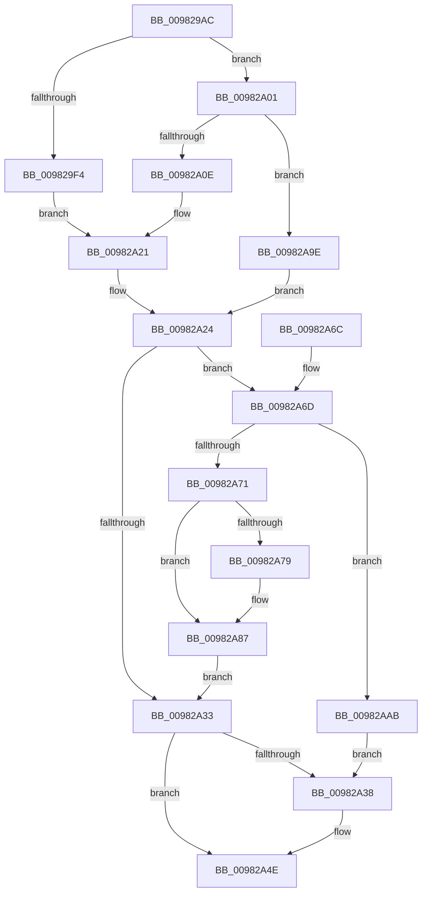

# MiInitializePrototypePtes

- RVA: `0x009829AC`–`0x00982AFE` (길이 `338` bytes)
- VA: `0x00000001409829AC`
- 실행 섹션: `PAGE`
- PDB 이름 있음: `예`; PDB Function 태그: `아니요`
- unwind 정보 RVA: `0x00097978`
- 디코드: `87`개 명령, `338/338` bytes 표시
- 미해석 바이트: `0` (있으면 어셈블리에 `.byte`로 보존)

> 이 문서는 커널 이미지의 기계어와 PDB 기호를 분석해 생성했습니다. 4번과 5번은 함수 원형과 자료형을 바이너리 사용 방식에서 추정한 C 해석이며 원본 소스 복구 결과는 아닙니다.

## 1. Dependencies

- 직접 호출 지점: **7**; 고유 호출 대상: **6**
- 직접 호출자로 확인된 함수: **3**
- RIP 상대 이미지 참조: **0**

### Outgoing calls
- `0x009829DF` → [memset](../../text/6C/memset_function_006C6C40.md) (function, `0x006C6C40`)
- `0x009829F7` → [MiMakeSubsectionPte](../../text/47/MiMakeSubsectionPte_function_0047B4F0.md) (function, `0x0047B4F0`)
- `0x00982A16` → [MiMakeDemandZeroPte](../../text/33/MiMakeDemandZeroPte_function_00337A00.md) (function, `0x00337A00`)
- `0x00982A7C` → [MiMakeDemandZeroPte](../../text/33/MiMakeDemandZeroPte_function_00337A00.md) (function, `0x00337A00`)
- `0x00982A90` → [MiEncodeProtoFill](../../text/22/MiEncodeProtoFill_function_0022F3B0.md) (function, `0x0022F3B0`)
- `0x00982AD0` → [MiInitializeFaultVaListCore](../../text/43/MiInitializeFaultVaListCore_function_0043E810.md) (function, `0x0043E810`)
- `0x00982AF4` → [MmAccessFault](../../text/27/MmAccessFault_function_0027EE80.md) (function, `0x0027EE80`)

### Direct callers
- [MiCreatePrototypePtes](../../text/29/MiCreatePrototypePtes_function_002950FC.md) at `0x002951C4`
- [MiExtendSection](MiExtendSection_function_00982FDC.md) at `0x009832F6`
- [MiCreatePagingFileMap](MiCreatePagingFileMap_function_009852F8.md) at `0x00985703`

### Static image references
- 디코드된 RIP-relative 메모리 참조가 없습니다.

## 2. Other-region calls and transfers

- 다른 실행 섹션으로 향하는 call: **7**
  - `0x009829DF` → [memset](../../text/6C/memset_function_006C6C40.md) (`PAGE` → `.text`)
  - `0x009829F7` → [MiMakeSubsectionPte](../../text/47/MiMakeSubsectionPte_function_0047B4F0.md) (`PAGE` → `.text`)
  - `0x00982A16` → [MiMakeDemandZeroPte](../../text/33/MiMakeDemandZeroPte_function_00337A00.md) (`PAGE` → `.text`)
  - `0x00982A7C` → [MiMakeDemandZeroPte](../../text/33/MiMakeDemandZeroPte_function_00337A00.md) (`PAGE` → `.text`)
  - `0x00982A90` → [MiEncodeProtoFill](../../text/22/MiEncodeProtoFill_function_0022F3B0.md) (`PAGE` → `.text`)
  - `0x00982AD0` → [MiInitializeFaultVaListCore](../../text/43/MiInitializeFaultVaListCore_function_0043E810.md) (`PAGE` → `.text`)
  - `0x00982AF4` → [MmAccessFault](../../text/27/MmAccessFault_function_0027EE80.md) (`PAGE` → `.text`)
- 별도 외부 분기/꼬리 이동을 확인하지 못했습니다.

## 3. Assembly (complete function range)

```asm
009829AC  48 8B C4                        mov rax, rsp
009829AF  48 89 58 08                     mov qword ptr [rax + 8], rbx
009829B3  48 89 68 10                     mov qword ptr [rax + 0x10], rbp
009829B7  48 89 70 18                     mov qword ptr [rax + 0x18], rsi
009829BB  48 89 78 20                     mov qword ptr [rax + 0x20], rdi
009829BF  41 56                           push r14
009829C1  48 81 EC B0 00 00 00            sub rsp, 0xb0
009829C8  48 8B F2                        mov rsi, rdx
009829CB  49 8B D8                        mov rbx, r8
009829CE  33 D2                           xor edx, edx
009829D0  4C 8B F1                        mov r14, rcx
009829D3  48 8D 4C 24 30                  lea rcx, [rsp + 0x30]
009829D8  41 8B E9                        mov ebp, r9d
009829DB  44 8D 42 78                     lea r8d, [rdx + 0x78]
009829DF  E8 5C 42 D4 FF                  call 0x1406c6c40
009829E4  48 8B 3B                        mov rdi, qword ptr [rbx]
009829E7  41 BB 02 00 00 00               mov r11d, 2
009829ED  48 83 7F 40 00                  cmp qword ptr [rdi + 0x40], 0
009829F2  74 0D                           je 0x140982a01
009829F4  48 8B CB                        mov rcx, rbx
009829F7  E8 F4 8A AF FF                  call 0x14047b4f0
009829FC  45 8B C3                        mov r8d, r11d
009829FF  EB 20                           jmp 0x140982a21
00982A01  F7 47 38 00 10 00 00            test dword ptr [rdi + 0x38], 0x1000
00982A08  0F 85 90 00 00 00               jne 0x140982a9e
00982A0E  8B 4B 20                        mov ecx, dword ptr [rbx + 0x20]
00982A11  D1 E9                           shr ecx, 1
00982A13  83 E1 1F                        and ecx, 0x1f
00982A16  E8 E5 4F 9B FF                  call 0x140337a00
00982A1B  41 B8 02 04 00 00               mov r8d, 0x402
00982A21  48 8B D8                        mov rbx, rax
00982A24  41 BA 38 00 00 00               mov r10d, 0x38
00982A2A  48 81 FE 00 02 00 00            cmp rsi, 0x200
00982A31  73 3A                           jae 0x140982a6d
00982A33  48 85 F6                        test rsi, rsi
00982A36  74 16                           je 0x140982a4e
00982A38  48 B9 FF FF FF FF FF FF FF 1F   movabs rcx, 0x1fffffffffffffff
00982A42  49 8B FE                        mov rdi, r14
00982A45  48 23 CE                        and rcx, rsi
00982A48  48 8B C3                        mov rax, rbx
00982A4B  F3 48 AB                        rep stosq qword ptr [rdi], rax
00982A4E  4C 8D 9C 24 B0 00 00 00         lea r11, [rsp + 0xb0]
00982A56  49 8B 5B 10                     mov rbx, qword ptr [r11 + 0x10]
00982A5A  49 8B 6B 18                     mov rbp, qword ptr [r11 + 0x18]
00982A5E  49 8B 73 20                     mov rsi, qword ptr [r11 + 0x20]
00982A62  49 8B 7B 28                     mov rdi, qword ptr [r11 + 0x28]
00982A66  49 8B E3                        mov rsp, r11
00982A69  41 5E                           pop r14
00982A6B  C3                              ret
00982A6C  CC                              int3
00982A6D  85 ED                           test ebp, ebp
00982A6F  74 3A                           je 0x140982aab
00982A71  48 8B C3                        mov rax, rbx
00982A74  48 85 DB                        test rbx, rbx
00982A77  75 0E                           jne 0x140982a87
00982A79  8D 4B 04                        lea ecx, [rbx + 4]
00982A7C  E8 7F 4F 9B FF                  call 0x140337a00
00982A81  48 25 1F FC FF FF               and rax, 0xfffffffffffffc1f
00982A87  4C 0B C0                        or r8, rax
00982A8A  48 8B D6                        mov rdx, rsi
00982A8D  49 8B CE                        mov rcx, r14
00982A90  E8 1B C9 8A FF                  call 0x14022f3b0
00982A95  48 2B F0                        sub rsi, rax
00982A98  4D 8D 34 C6                     lea r14, [r14 + rax*8]
00982A9C  EB 95                           jmp 0x140982a33
00982A9E  33 DB                           xor ebx, ebx
00982AA0  41 B8 02 04 00 00               mov r8d, 0x402
00982AA6  E9 79 FF FF FF                  jmp 0x140982a24
00982AAB  48 8D 04 F5 00 00 00 00         lea rax, [rsi*8]
00982AB3  4C 89 74 24 20                  mov qword ptr [rsp + 0x20], r14
00982AB8  45 8A CB                        mov r9b, r11b
00982ABB  48 89 44 24 28                  mov qword ptr [rsp + 0x28], rax
00982AC0  41 B8 01 00 00 00               mov r8d, 1
00982AC6  48 8D 54 24 20                  lea rdx, [rsp + 0x20]
00982ACB  48 8D 4C 24 30                  lea rcx, [rsp + 0x30]
00982AD0  E8 3B BD AB FF                  call 0x14043e810
00982AD5  41 8B 14 3A                     mov edx, dword ptr [r10 + rdi]
00982AD9  4C 8D 4C 24 30                  lea r9, [rsp + 0x30]
00982ADE  C1 EA 14                        shr edx, 0x14
00982AE1  4D 0B C8                        or r9, r8
00982AE4  83 E2 7F                        and edx, 0x7f
00982AE7  45 33 C0                        xor r8d, r8d
00982AEA  89 54 24 58                     mov dword ptr [rsp + 0x58], edx
00982AEE  49 8B CB                        mov rcx, r11
00982AF1  49 8B D6                        mov rdx, r14
00982AF4  E8 87 C3 8F FF                  call 0x14027ee80
00982AF9  E9 3A FF FF FF                  jmp 0x140982a38
```

## 4. C-style interpretation (structured pseudocode)

```c
__int64 __fastcall MiInitializePrototypePtes(__int64 a1, __int64 a2, __int64 a3, int a4)
{
    __int64 result;
    __int64 v_rbx;
    __int64 v_rdi;
    __int64 v_rsi;
    __int64 v_rsp;
    unsigned int v_stack_m58;
    unsigned __int64 v_stack_m8;
    unsigned __int64 v_stack_m80;
    unsigned __int64 v_stack_m88;
    unsigned __int64 v_stack_m90;

    *(unsigned __int64 *)(v_rsp + 8) = v_rbx;
    *(unsigned __int64 *)(v_rsp + 16) = v_rbp;
    *(unsigned __int64 *)(v_rsp + 24) = v_rsi;
    *(unsigned __int64 *)(v_rsp + 32) = v_rdi;
    v_rsp = (v_rsp) - (176);
    a2 = 0;
    result = memset(v_stack_m88, a2, a2 + 120, a4);
    if ((*(unsigned __int64 *)(*(unsigned __int64 *)(a3) + 64)) == 0) goto loc_00982A01;
    result = MiMakeSubsectionPte(a3, a2, a2 + 120, a4);
    goto loc_00982A21;
loc_00982A01:
    if (((*(unsigned int *)(*(unsigned __int64 *)(a3) + 56)) & (0x1000ULL)) != 0) goto loc_00982A9E;
    a1 = (unsigned int)(((unsigned int)(*(unsigned int *)(a3 + 32))) >> (1));
    a1 = (unsigned int)((a1) & (31));
    result = MiMakeDemandZeroPte(a1, a2, 2, a4);
loc_00982A21:
loc_00982A24:
    if (0 >= 512) goto loc_00982A6D;
loc_00982A33:
    v_rdi = *(unsigned __int64 *)(a3);
    if (0 != 0) {
        v_rdi = a1;
        a1 = (a1) & (0);
        result = result;
    }
    return result;
loc_00982A6D:
    if ((unsigned int)(*(unsigned __int64 *)(v_stack_m8 + 24)) == 0) goto loc_00982AAB;
    result = *(unsigned __int64 *)(v_stack_m8 + 16);
    if (*(unsigned __int64 *)(v_stack_m8 + 16) == 0) {
        a1 = *(unsigned __int64 *)(v_stack_m8 + 16) + 4;
        result = MiMakeDemandZeroPte(a1, a2, (unsigned int)(0x402ULL), a4);
        result = (result) & (-993);
    }
    a3 = ((unsigned int)(0x402ULL)) | (result);
    result = MiEncodeProtoFill(a1, *(unsigned __int64 *)(v_stack_m8 + 32), a3, a4);
    v_rsi = (*(unsigned __int64 *)(v_stack_m8 + 32)) - (result);
    goto loc_00982A33;
loc_00982A9E:
    v_rbx = 0;
    goto loc_00982A24;
loc_00982AAB:
    v_stack_m90 = a1 + result * 8;
    v_stack_m88 = v_rsi * 8;
    result = MiInitializeFaultVaListCore(v_stack_m80, v_stack_m90, 1, (unsigned __int8)(v_stack_m8));
    a2 = (unsigned int)(((unsigned int)(*(unsigned int *)(56 + *(unsigned __int64 *)(v_stack_m8 + 40) * 1))) >> (20));
    a4 = (v_stack_m80) | (1);
    a2 = (unsigned int)((a2) & (127));
    a3 = 0;
    v_stack_m58 = (unsigned int)(a2);
    result = MmAccessFault(v_stack_m8, a1 + result * 8, a3, a4);
    goto loc_00982A38;
}
```

## 5. (Beta) C Style

```c
int64_t MiInitializePrototypePtes(void *Arg1, int64_t Arg2, void *Arg3, int32_t Arg4)
{
    uint8_t *arg1 = (uint8_t *)Arg1;
    uint8_t *arg3 = (uint8_t *)Arg3;

    int64_t result;
    int64_t local_rbx;
    int64_t local_rdi;
    int64_t local_rsi;
    int64_t local_rsp;
    uint32_t v_stack_m58;
    uint64_t v_stack_m8;
    uint64_t v_stack_m80;
    uint64_t v_stack_m88;
    uint64_t v_stack_m90;

    *(uint64_t *)(local_rsp + 0x8) = local_rbx;
    *(uint64_t *)(local_rsp + 0x10) = local_rbp;
    *(uint64_t *)(local_rsp + 0x18) = local_rsi;
    *(uint64_t *)(local_rsp + 0x20) = local_rdi;
    local_rsp = (local_rsp) - (176);
    Arg2 = 0;
    result = memset(v_stack_m88, Arg2, Arg2 + 120, Arg4);
    if ((*(uint64_t *)(*(uint64_t *)(arg3) + 0x40)) == 0) goto loc_00982A01;
    result = MiMakeSubsectionPte(Arg3, Arg2, Arg2 + 120, Arg4);
    goto loc_00982A21;
loc_00982A01:
    if (((*(uint32_t *)(*(uint64_t *)(arg3) + 0x38)) & (0x1000ULL)) != 0) goto loc_00982A9E;
    Arg1 = (uint32_t)(((uint32_t)(*(uint32_t *)(arg3 + 0x20))) >> (1));
    Arg1 = (uint32_t)((Arg1) & (31));
    result = MiMakeDemandZeroPte(Arg1, Arg2, 2, Arg4);
loc_00982A21:
loc_00982A24:
    if (0 >= 512) goto loc_00982A6D;
loc_00982A33:
    local_rdi = *(uint64_t *)(arg3);
    if (0 != 0) {
        local_rdi = Arg1;
        Arg1 = (Arg1) & (0);
        result = result;
    }
    return result;
loc_00982A6D:
    if ((uint32_t)(*(uint64_t *)(v_stack_m8 + 0x18)) == 0) goto loc_00982AAB;
    result = *(uint64_t *)(v_stack_m8 + 0x10);
    if (*(uint64_t *)(v_stack_m8 + 0x10) == 0) {
        Arg1 = *(uint64_t *)(v_stack_m8 + 0x10) + 4;
        result = MiMakeDemandZeroPte(Arg1, Arg2, (uint32_t)(0x402ULL), Arg4);
        result = (result) & (-993);
    }
    Arg3 = ((uint32_t)(0x402ULL)) | (result);
    result = MiEncodeProtoFill(Arg1, *(uint64_t *)(v_stack_m8 + 0x20), Arg3, Arg4);
    local_rsi = (*(uint64_t *)(v_stack_m8 + 0x20)) - (result);
    goto loc_00982A33;
loc_00982A9E:
    local_rbx = 0;
    goto loc_00982A24;
loc_00982AAB:
    v_stack_m90 = Arg1 + result * 8;
    v_stack_m88 = local_rsi * 8;
    result = MiInitializeFaultVaListCore(v_stack_m80, v_stack_m90, 1, (uint8_t)(v_stack_m8));
    Arg2 = (uint32_t)(((uint32_t)(*(uint32_t *)(56 + *(uint64_t *)(v_stack_m8 + 0x28) * 1))) >> (20));
    Arg4 = (v_stack_m80) | (1);
    Arg2 = (uint32_t)((Arg2) & (127));
    Arg3 = 0;
    v_stack_m58 = (uint32_t)(Arg2);
    result = MmAccessFault(v_stack_m8, Arg1 + result * 8, Arg3, Arg4);
    goto loc_00982A38;
}
```

### 관측된 메모리 오프셋

구조체 형식이 확인되지 않은 접근은 인자 기준의 오프셋으로만 기록했습니다.

| 기준 인자 | 오프셋 표현 | 폭 (bit) | 접근 |
|---|---:|---:|---|
| `Arg1` | `+ 0x0` | `64` | `W` |
| `Arg1` | `+ 0x0 + rax*8` | `64` | `R` |
| `Arg3` | `+ 0x0` | `64` | `R` |
| `Arg3` | `+ 0x20` | `32` | `R` |

## 6. Execution-region graph

[열기: 2D/3D 그래프와 함수 탐색 컨트롤 패널](../../../control-panel.html?section=page&rva=0x009829AC&view=graph)

- 2D 그래프는 위에서 아래로 흐르고, 3D 그래프는 빈 공간을 드래그해 회전합니다. Shift+드래그는 이동, 휠은 확대·축소, 함수 노드 선택은 대상 보고서 이동입니다.

### Static fallback


