# MiInitializeWowPeb

- RVA: `0x0098079C`–`0x00980C7B` (길이 `1,247` bytes)
- VA: `0x000000014098079C`
- 실행 섹션: `PAGE`
- PDB 이름 있음: `예`; PDB Function 태그: `아니요`
- unwind 정보 RVA: `0x000976E4`
- 디코드: `287`개 명령, `1,247/1,247` bytes 표시
- 미해석 바이트: `0` (있으면 어셈블리에 `.byte`로 보존)

> 이 문서는 커널 이미지의 기계어와 PDB 기호를 분석해 생성했습니다. 4번과 5번은 함수 원형과 자료형을 바이너리 사용 방식에서 추정한 C 해석이며 원본 소스 복구 결과는 아닙니다.

## 1. Dependencies

- 직접 호출 지점: **4**; 고유 호출 대상: **4**
- 직접 호출자로 확인된 함수: **1**
- RIP 상대 이미지 참조: **8**

### Outgoing calls
- `0x009807F9` → [MiCreatePebOrTeb](MiCreatePebOrTeb_function_00981874.md) (function, `0x00981874`)
- `0x00980B15` → [MiSectionControlArea](../../text/29/MiSectionControlArea_function_00294CB0.md) (function, `0x00294CB0`)
- `0x00980B45` → [RtlImageDirectoryEntryToData](../../text/43/RtlImageDirectoryEntryToData_function_004328D0.md) (function, `0x004328D0`)
- `0x00980B6B` → [ExRaiseDatatypeMisalignment](../89/ExRaiseDatatypeMisalignment_function_00899FD0.md) (function, `0x00899FD0`)

### Direct callers
- [MmCreatePeb](MmCreatePeb_function_00980FB4.md) at `0x0098162F`

### Static image references
- `0x0098088E` → RVA `0x00FC6A80` (`ALMOSTRO`; read)
- `0x00980897` → RVA `0x00FC42C0` (`.data`; read)
- `0x009808A0` → RVA `0x00FC43C0` (`.data`; read)
- `0x009808AC` → RVA `0x00E2DB50` (`.data`; read)
- `0x009808B7` → RVA `0x00FC5218` (`ALMOSTRO`; read)
- `0x009808C3` → RVA `0x00FC5228` (`ALMOSTRO`; read)
- `0x009808D0` → RVA `0x00FC5220` (`ALMOSTRO`; read)
- `0x00980C4A` → RVA `0x00FC7128` (`ALMOSTRO`; read)

## 2. Other-region calls and transfers

- 다른 실행 섹션으로 향하는 call: **2**
  - `0x00980B15` → [MiSectionControlArea](../../text/29/MiSectionControlArea_function_00294CB0.md) (`PAGE` → `.text`)
  - `0x00980B45` → [RtlImageDirectoryEntryToData](../../text/43/RtlImageDirectoryEntryToData_function_004328D0.md) (`PAGE` → `.text`)
- 별도 외부 분기/꼬리 이동을 확인하지 못했습니다.

## 3. Assembly (complete function range)

```asm
0098079C  48 8B C4                        mov rax, rsp
0098079F  48 89 58 08                     mov qword ptr [rax + 8], rbx
009807A3  48 89 70 10                     mov qword ptr [rax + 0x10], rsi
009807A7  4C 89 48 20                     mov qword ptr [rax + 0x20], r9
009807AB  57                              push rdi
009807AC  41 54                           push r12
009807AE  41 55                           push r13
009807B0  41 56                           push r14
009807B2  41 57                           push r15
009807B4  48 83 EC 40                     sub rsp, 0x40
009807B8  49 8B F0                        mov rsi, r8
009807BB  4C 8B EA                        mov r13, rdx
009807BE  48 8B D9                        mov rbx, rcx
009807C1  45 33 C0                        xor r8d, r8d
009807C4  4C 89 40 C8                     mov qword ptr [rax - 0x38], r8
009807C8  4C 89 40 C0                     mov qword ptr [rax - 0x40], r8
009807CC  4C 8D B6 EC 06 00 00            lea r14, [rsi + 0x6ec]
009807D3  41 BC 4C 01 00 00               mov r12d, 0x14c
009807D9  45 8D 7C 24 78                  lea r15d, [r12 + 0x78]
009807DE  4C 39 86 10 03 00 00            cmp qword ptr [rsi + 0x310], r8
009807E5  0F 85 B4 02 00 00               jne 0x140980a9f
009807EB  41 8D 78 01                     lea edi, [r8 + 1]
009807EF  B9 02 00 00 00                  mov ecx, 2
009807F4  4C 8D 44 24 30                  lea r8, [rsp + 0x30]
009807F9  E8 76 10 00 00                  call 0x140981874
009807FE  33 C9                           xor ecx, ecx
00980800  85 C0                           test eax, eax
00980802  0F 88 7E 02 00 00               js 0x140980a86
00980808  48 8B 86 10 03 00 00            mov rax, qword ptr [rsi + 0x310]
0098080F  48 8B 54 24 30                  mov rdx, qword ptr [rsp + 0x30]
00980814  48 89 10                        mov qword ptr [rax], rdx
00980817  48 39 8E 10 03 00 00            cmp qword ptr [rsi + 0x310], rcx
0098081E  0F 85 9B 02 00 00               jne 0x140980abf
00980824  48 39 8E 10 03 00 00            cmp qword ptr [rsi + 0x310], rcx
0098082B  74 18                           je 0x140980845
0098082D  0F B7 86 EC 06 00 00            movzx eax, word ptr [rsi + 0x6ec]
00980834  66 41 3B C4                     cmp ax, r12w
00980838  0F 85 31 02 00 00               jne 0x140980a6f
0098083E  40 8A C7                        mov al, dil
00980841  84 C0                           test al, al
00980843  75 03                           jne 0x140980848
00980845  40 8A F9                        mov dil, cl
00980848  8B 43 0C                        mov eax, dword ptr [rbx + 0xc]
0098084B  40 84 FF                        test dil, dil
0098084E  0F 84 01 01 00 00               je 0x140980955
00980854  89 82 A4 00 00 00               mov dword ptr [rdx + 0xa4], eax
0098085A  8B 43 10                        mov eax, dword ptr [rbx + 0x10]
0098085D  89 82 A8 00 00 00               mov dword ptr [rdx + 0xa8], eax
00980863  0F B7 43 18                     movzx eax, word ptr [rbx + 0x18]
00980867  66 89 82 AC 00 00 00            mov word ptr [rdx + 0xac], ax
0098086E  8B 43 14                        mov eax, dword ptr [rbx + 0x14]
00980871  89 82 B0 00 00 00               mov dword ptr [rdx + 0xb0], eax
00980877  0F B7 43 1A                     movzx eax, word ptr [rbx + 0x1a]
0098087B  66 89 82 AE 00 00 00            mov word ptr [rdx + 0xae], ax
00980882  8B 43 20                        mov eax, dword ptr [rbx + 0x20]
00980885  89 42 78                        mov dword ptr [rdx + 0x78], eax
00980888  8B 43 28                        mov eax, dword ptr [rbx + 0x28]
0098088B  89 42 7C                        mov dword ptr [rdx + 0x7c], eax
0098088E  8B 05 EC 61 64 00               mov eax, dword ptr [rip + 0x6461ec]
00980894  89 42 64                        mov dword ptr [rdx + 0x64], eax
00980897  8B 05 23 3A 64 00               mov eax, dword ptr [rip + 0x643a23]
0098089D  89 42 68                        mov dword ptr [rdx + 0x68], eax
009808A0  8B 05 1A 3B 64 00               mov eax, dword ptr [rip + 0x643b1a]
009808A6  89 82 78 04 00 00               mov dword ptr [rdx + 0x478], eax
009808AC  48 8B 05 9D D2 4A 00            mov rax, qword ptr [rip + 0x4ad29d]
009808B3  48 89 42 70                     mov qword ptr [rdx + 0x70], rax
009808B7  8B 05 5B 49 64 00               mov eax, dword ptr [rip + 0x64495b]
009808BD  89 82 08 02 00 00               mov dword ptr [rdx + 0x208], eax
009808C3  48 8B 05 5E 49 64 00            mov rax, qword ptr [rip + 0x64495e]
009808CA  89 82 80 00 00 00               mov dword ptr [rdx + 0x80], eax
009808D0  48 8B 05 49 49 64 00            mov rax, qword ptr [rip + 0x644949]
009808D7  89 82 84 00 00 00               mov dword ptr [rdx + 0x84], eax
009808DD  8B 43 3C                        mov eax, dword ptr [rbx + 0x3c]
009808E0  89 82 D4 01 00 00               mov dword ptr [rdx + 0x1d4], eax
009808E6  8B 03                           mov eax, dword ptr [rbx]
009808E8  89 82 B4 00 00 00               mov dword ptr [rdx + 0xb4], eax
009808EE  8B 43 04                        mov eax, dword ptr [rbx + 4]
009808F1  89 82 B8 00 00 00               mov dword ptr [rdx + 0xb8], eax
009808F7  8B 43 08                        mov eax, dword ptr [rbx + 8]
009808FA  89 82 BC 00 00 00               mov dword ptr [rdx + 0xbc], eax
00980900  8A 43 60                        mov al, byte ptr [rbx + 0x60]
00980903  88 02                           mov byte ptr [rdx], al
00980905  8A 43 61                        mov al, byte ptr [rbx + 0x61]
00980908  88 42 03                        mov byte ptr [rdx + 3], al
0098090B  8B 43 68                        mov eax, dword ptr [rbx + 0x68]
0098090E  89 42 04                        mov dword ptr [rdx + 4], eax
00980911  8B 43 70                        mov eax, dword ptr [rbx + 0x70]
00980914  89 42 08                        mov dword ptr [rdx + 8], eax
00980917  0F B7 43 78                     movzx eax, word ptr [rbx + 0x78]
0098091B  66 89 82 28 02 00 00            mov word ptr [rdx + 0x228], ax
00980922  0F B7 43 7A                     movzx eax, word ptr [rbx + 0x7a]
00980926  66 89 82 2A 02 00 00            mov word ptr [rdx + 0x22a], ax
0098092D  0F B7 43 7C                     movzx eax, word ptr [rbx + 0x7c]
00980931  66 89 82 2C 02 00 00            mov word ptr [rdx + 0x22c], ax
00980938  8B 83 80 00 00 00               mov eax, dword ptr [rbx + 0x80]
0098093E  89 82 70 04 00 00               mov dword ptr [rdx + 0x470], eax
00980944  8B 83 88 00 00 00               mov eax, dword ptr [rbx + 0x88]
0098094A  89 82 74 04 00 00               mov dword ptr [rdx + 0x474], eax
00980950  E9 2B 01 00 00                  jmp 0x140980a80
00980955  89 82 18 01 00 00               mov dword ptr [rdx + 0x118], eax
0098095B  8B 43 10                        mov eax, dword ptr [rbx + 0x10]
0098095E  89 82 1C 01 00 00               mov dword ptr [rdx + 0x11c], eax
00980964  0F B7 43 18                     movzx eax, word ptr [rbx + 0x18]
00980968  66 89 82 20 01 00 00            mov word ptr [rdx + 0x120], ax
0098096F  8B 43 14                        mov eax, dword ptr [rbx + 0x14]
00980972  89 82 24 01 00 00               mov dword ptr [rdx + 0x124], eax
00980978  0F B7 43 1A                     movzx eax, word ptr [rbx + 0x1a]
0098097C  66 89 82 22 01 00 00            mov word ptr [rdx + 0x122], ax
00980983  48 8B 43 20                     mov rax, qword ptr [rbx + 0x20]
00980987  48 89 82 C8 00 00 00            mov qword ptr [rdx + 0xc8], rax
0098098E  48 8B 43 28                     mov rax, qword ptr [rbx + 0x28]
00980992  48 89 82 D0 00 00 00            mov qword ptr [rdx + 0xd0], rax
00980999  8B 05 E1 60 64 00               mov eax, dword ptr [rip + 0x6460e1]
0098099F  89 82 B8 00 00 00               mov dword ptr [rdx + 0xb8], eax
009809A5  8B 05 15 39 64 00               mov eax, dword ptr [rip + 0x643915]
009809AB  89 82 BC 00 00 00               mov dword ptr [rdx + 0xbc], eax
009809B1  8B 05 09 3A 64 00               mov eax, dword ptr [rip + 0x643a09]
009809B7  89 82 C4 07 00 00               mov dword ptr [rdx + 0x7c4], eax
009809BD  48 8B 05 8C D1 4A 00            mov rax, qword ptr [rip + 0x4ad18c]
009809C4  48 89 82 C0 00 00 00            mov qword ptr [rdx + 0xc0], rax
009809CB  8B 05 47 48 64 00               mov eax, dword ptr [rip + 0x644847]
009809D1  48 89 82 18 03 00 00            mov qword ptr [rdx + 0x318], rax
009809D8  48 8B 05 49 48 64 00            mov rax, qword ptr [rip + 0x644849]
009809DF  48 89 82 D8 00 00 00            mov qword ptr [rdx + 0xd8], rax
009809E6  48 8B 05 33 48 64 00            mov rax, qword ptr [rip + 0x644833]
009809ED  48 89 82 E0 00 00 00            mov qword ptr [rdx + 0xe0], rax
009809F4  8B 43 3C                        mov eax, dword ptr [rbx + 0x3c]
009809F7  89 82 C0 02 00 00               mov dword ptr [rdx + 0x2c0], eax
009809FD  8B 03                           mov eax, dword ptr [rbx]
009809FF  89 82 28 01 00 00               mov dword ptr [rdx + 0x128], eax
00980A05  8B 43 04                        mov eax, dword ptr [rbx + 4]
00980A08  89 82 2C 01 00 00               mov dword ptr [rdx + 0x12c], eax
00980A0E  8B 43 08                        mov eax, dword ptr [rbx + 8]
00980A11  89 82 30 01 00 00               mov dword ptr [rdx + 0x130], eax
00980A17  8A 43 60                        mov al, byte ptr [rbx + 0x60]
00980A1A  88 02                           mov byte ptr [rdx], al
00980A1C  8A 43 61                        mov al, byte ptr [rbx + 0x61]
00980A1F  88 42 03                        mov byte ptr [rdx + 3], al
00980A22  48 8B 43 68                     mov rax, qword ptr [rbx + 0x68]
00980A26  48 89 42 08                     mov qword ptr [rdx + 8], rax
00980A2A  48 8B 43 70                     mov rax, qword ptr [rbx + 0x70]
00980A2E  48 89 42 10                     mov qword ptr [rdx + 0x10], rax
00980A32  0F B7 43 78                     movzx eax, word ptr [rbx + 0x78]
00980A36  66 89 82 4C 03 00 00            mov word ptr [rdx + 0x34c], ax
00980A3D  0F B7 43 7A                     movzx eax, word ptr [rbx + 0x7a]
00980A41  66 89 82 4E 03 00 00            mov word ptr [rdx + 0x34e], ax
00980A48  0F B7 43 7C                     movzx eax, word ptr [rbx + 0x7c]
00980A4C  66 89 82 50 03 00 00            mov word ptr [rdx + 0x350], ax
00980A53  48 8B 83 80 00 00 00            mov rax, qword ptr [rbx + 0x80]
00980A5A  48 89 82 B8 07 00 00            mov qword ptr [rdx + 0x7b8], rax
00980A61  8B 83 88 00 00 00               mov eax, dword ptr [rbx + 0x88]
00980A67  89 82 C0 07 00 00               mov dword ptr [rdx + 0x7c0], eax
00980A6D  EB 11                           jmp 0x140980a80
00980A6F  66 41 3B C7                     cmp ax, r15w
00980A73  8A C1                           mov al, cl
00980A75  0F 85 C6 FD FF FF               jne 0x140980841
00980A7B  E9 BE FD FF FF                  jmp 0x14098083e
00980A80  EB 02                           jmp 0x140980a84
00980A82  EB 02                           jmp 0x140980a86
00980A84  33 C0                           xor eax, eax
00980A86  48 8B 5C 24 70                  mov rbx, qword ptr [rsp + 0x70]
00980A8B  48 8B 74 24 78                  mov rsi, qword ptr [rsp + 0x78]
00980A90  48 83 C4 40                     add rsp, 0x40
00980A94  41 5F                           pop r15
00980A96  41 5E                           pop r14
00980A98  41 5D                           pop r13
00980A9A  41 5C                           pop r12
00980A9C  5F                              pop rdi
00980A9D  C3                              ret
00980A9E  CC                              int3
00980A9F  41 0F B7 06                     movzx eax, word ptr [r14]
00980AA3  66 41 3B C4                     cmp ax, r12w
00980AA7  0F 85 69 01 00 00               jne 0x140980c16
00980AAD  BF 01 00 00 00                  mov edi, 1
00980AB2  40 8A C7                        mov al, dil
00980AB5  84 C0                           test al, al
00980AB7  0F 84 32 FD FF FF               je 0x1409807ef
00980ABD  EB 46                           jmp 0x140980b05
00980ABF  41 0F B7 06                     movzx eax, word ptr [r14]
00980AC3  66 41 3B C4                     cmp ax, r12w
00980AC7  0F 85 60 01 00 00               jne 0x140980c2d
00980ACD  40 8A C7                        mov al, dil
00980AD0  84 C0                           test al, al
00980AD2  0F 84 4C FD FF FF               je 0x140980824
00980AD8  48 8B 4B 20                     mov rcx, qword ptr [rbx + 0x20]
00980ADC  48 81 F9 00 00 00 40            cmp rcx, 0x40000000
00980AE3  0F 87 84 01 00 00               ja 0x140980c6d
00980AE9  48 8B 43 28                     mov rax, qword ptr [rbx + 0x28]
00980AED  41 B8 00 20 00 00               mov r8d, 0x2000
00980AF3  48 3B C1                        cmp rax, rcx
00980AF6  49 0F 47 C0                     cmova rax, r8
00980AFA  48 89 43 28                     mov qword ptr [rbx + 0x28], rax
00980AFE  33 C9                           xor ecx, ecx
00980B00  E9 1F FD FF FF                  jmp 0x140980824
00980B05  48 8B 8E A8 02 00 00            mov rcx, qword ptr [rsi + 0x2a8]
00980B0C  48 85 C9                        test rcx, rcx
00980B0F  0F 84 F7 00 00 00               je 0x140980c0c
00980B15  E8 96 41 91 FF                  call 0x140294cb0
00980B1A  8B 48 38                        mov ecx, dword ptr [rax + 0x38]
00980B1D  F6 C1 20                        test cl, 0x20
00980B20  0F 84 E6 00 00 00               je 0x140980c0c
00980B26  4C 39 80 90 00 00 00            cmp qword ptr [rax + 0x90], r8
00980B2D  0F 95 C2                        setne dl
00980B30  48 8B 8E B0 02 00 00            mov rcx, qword ptr [rsi + 0x2b0]
00980B37  41 B8 0A 00 00 00               mov r8d, 0xa
00980B3D  4C 8D 8C 24 80 00 00 00         lea r9, [rsp + 0x80]
00980B45  E8 86 1D AB FF                  call 0x1404328d0
00980B4A  48 8B C8                        mov rcx, rax
00980B4D  48 89 44 24 28                  mov qword ptr [rsp + 0x28], rax
00980B52  EB 0A                           jmp 0x140980b5e
00980B54  B8 30 01 00 C0                  mov eax, 0xc0000130
00980B59  E9 28 FF FF FF                  jmp 0x140980a86
00980B5E  45 33 C0                        xor r8d, r8d
00980B61  48 85 C9                        test rcx, rcx
00980B64  74 3A                           je 0x140980ba0
00980B66  F6 C1 03                        test cl, 3
00980B69  74 06                           je 0x140980b71
00980B6B  E8 60 94 F1 FF                  call 0x140899fd0
00980B70  CC                              int3
00980B71  48 B8 00 00 FF FF FF 7F 00 00   movabs rax, 0x7fffffff0000
00980B7B  48 3B C8                        cmp rcx, rax
00980B7E  48 0F 43 C8                     cmovae rcx, rax
00980B82  90                              nop
00980B83  8A 01                           mov al, byte ptr [rcx]
00980B85  48 8B 44 24 28                  mov rax, qword ptr [rsp + 0x28]
00980B8A  8B 48 30                        mov ecx, dword ptr [rax + 0x30]
00980B8D  89 4C 24 20                     mov dword ptr [rsp + 0x20], ecx
00980B91  E9 A8 00 00 00                  jmp 0x140980c3e
00980B96  B8 30 01 00 C0                  mov eax, 0xc0000130
00980B9B  E9 E6 FE FF FF                  jmp 0x140980a86
00980BA0  41 0F B7 45 5C                  movzx eax, word ptr [r13 + 0x5c]
00980BA5  89 03                           mov dword ptr [rbx], eax
00980BA7  41 0F B7 45 48                  movzx eax, word ptr [r13 + 0x48]
00980BAC  89 43 04                        mov dword ptr [rbx + 4], eax
00980BAF  41 0F B7 45 4A                  movzx eax, word ptr [r13 + 0x4a]
00980BB4  89 43 08                        mov dword ptr [rbx + 8], eax
00980BB7  45 39 45 4C                     cmp dword ptr [r13 + 0x4c], r8d
00980BBB  74 3C                           je 0x140980bf9
00980BBD  48 85 C9                        test rcx, rcx
00980BC0  74 0D                           je 0x140980bcf
00980BC2  0F B7 41 34                     movzx eax, word ptr [rcx + 0x34]
00980BC6  66 85 C0                        test ax, ax
00980BC9  74 04                           je 0x140980bcf
00980BCB  66 89 43 1A                     mov word ptr [rbx + 0x1a], ax
00980BCF  41 8B 4D 4C                     mov ecx, dword ptr [r13 + 0x4c]
00980BD3  0F B6 C1                        movzx eax, cl
00980BD6  89 43 0C                        mov dword ptr [rbx + 0xc], eax
00980BD9  8B C1                           mov eax, ecx
00980BDB  C1 E8 08                        shr eax, 8
00980BDE  0F B6 C0                        movzx eax, al
00980BE1  89 43 10                        mov dword ptr [rbx + 0x10], eax
00980BE4  8B C1                           mov eax, ecx
00980BE6  C1 E8 10                        shr eax, 0x10
00980BE9  66 89 43 18                     mov word ptr [rbx + 0x18], ax
00980BED  81 F1 FF FF FF BF               xor ecx, 0xbfffffff
00980BF3  C1 E9 1E                        shr ecx, 0x1e
00980BF6  89 4B 14                        mov dword ptr [rbx + 0x14], ecx
00980BF9  EB 0A                           jmp 0x140980c05
00980BFB  B8 30 01 00 C0                  mov eax, 0xc0000130
00980C00  E9 81 FE FF FF                  jmp 0x140980a86
00980C05  8B CF                           mov ecx, edi
00980C07  E9 E8 FB FF FF                  jmp 0x1409807f4
00980C0C  B8 05 00 00 C0                  mov eax, 0xc0000005
00980C11  E9 70 FE FF FF                  jmp 0x140980a86
00980C16  66 41 3B C7                     cmp ax, r15w
00980C1A  0F 84 8D FE FF FF               je 0x140980aad
00980C20  41 8A C0                        mov al, r8b
00980C23  BF 01 00 00 00                  mov edi, 1
00980C28  E9 88 FE FF FF                  jmp 0x140980ab5
00980C2D  66 41 3B C7                     cmp ax, r15w
00980C31  8A C1                           mov al, cl
00980C33  0F 85 97 FE FF FF               jne 0x140980ad0
00980C39  E9 8F FE FF FF                  jmp 0x140980acd
00980C3E  48 8B 94 24 88 00 00 00         mov rdx, qword ptr [rsp + 0x88]
00980C46  0F B7 42 08                     movzx eax, word ptr [rdx + 8]
00980C4A  48 8D 0D D7 64 64 00            lea rcx, [rip + 0x6464d7]
00980C51  8B 0C C1                        mov ecx, dword ptr [rcx + rax*8]
00980C54  8B 44 24 20                     mov eax, dword ptr [rsp + 0x20]
00980C58  23 C8                           and ecx, eax
00980C5A  3B C8                           cmp ecx, eax
00980C5C  41 0F 45 C0                     cmovne eax, r8d
00980C60  48 89 02                        mov qword ptr [rdx], rax
00980C63  48 8B 4C 24 28                  mov rcx, qword ptr [rsp + 0x28]
00980C68  E9 33 FF FF FF                  jmp 0x140980ba0
00980C6D  B9 00 00 10 00                  mov ecx, 0x100000
00980C72  48 89 4B 20                     mov qword ptr [rbx + 0x20], rcx
00980C76  E9 6E FE FF FF                  jmp 0x140980ae9
```

## 4. C-style interpretation (structured pseudocode)

```c
__int64 __fastcall MiInitializeWowPeb(__int64 a1, __int64 a2, __int64 a3, __int64 a4)
{
    __int64 result;
    __int64 v_rdi;
    __int64 v_rsp;
    unsigned __int64 v_stack_m38;
    unsigned __int64 v_stack_p10;
    unsigned int v_stack_p20;
    unsigned __int64 v_stack_p28;
    unsigned __int64 v_stack_p8;
    unsigned __int64 v_stack_p80;
    unsigned __int64 v_stack_p88;

    *(unsigned __int64 *)(v_rsp + 8) = v_rbx;
    *(unsigned __int64 *)(v_rsp + 16) = v_rsi;
    *(unsigned __int64 *)(v_rsp + 32) = a4;
    v_rsp = (v_rsp) - (64);
    a3 = 0;
    *(unsigned __int64 *)(v_rsp - 56) = 0;
    *(unsigned __int64 *)(v_rsp - 64) = 0;
    if ((*(unsigned __int64 *)(a3 + 784)) != 0) goto loc_00980A9F;
loc_009807EF:
loc_009807F4:
    result = MiCreatePebOrTeb(2, a2, v_stack_m38, a4);
    a1 = 0;
    if (sign_flag) goto loc_00980A86;
    *(unsigned __int64 *)(*(unsigned __int64 *)(a3 + 784)) = v_stack_m38;
    if ((*(unsigned __int64 *)(a3 + 784)) != 0) goto loc_00980ABF;
loc_00980824:
    if ((*(unsigned __int64 *)(a3 + 784)) == 0) goto loc_00980845;
    if (((unsigned __int16)(*(unsigned __int16 *)(a3 + 1772))) != 332) goto loc_00980A6F;
loc_0098083E:
loc_00980841:
    v_rdi = a3 + 1;
    if ((unsigned __int8)((unsigned __int8)(a3 + 1)) == 0) {
        v_rdi = 0;
    }
    if ((unsigned __int8)(v_rdi) == 0) goto loc_00980955;
    *(unsigned int *)(v_stack_m38 + 164) = (unsigned int)((unsigned int)(*(unsigned int *)(a1 + 12)));
    *(unsigned int *)(v_stack_m38 + 168) = (unsigned int)((unsigned int)(*(unsigned int *)(a1 + 16)));
    *(unsigned __int16 *)(v_stack_m38 + 172) = (unsigned __int16)(*(unsigned __int16 *)(a1 + 24));
    *(unsigned int *)(v_stack_m38 + 176) = (unsigned int)((unsigned int)(*(unsigned int *)(a1 + 20)));
    *(unsigned __int16 *)(v_stack_m38 + 174) = (unsigned __int16)(*(unsigned __int16 *)(a1 + 26));
    *(unsigned int *)(v_stack_m38 + 120) = (unsigned int)((unsigned int)(*(unsigned int *)(a1 + 32)));
    *(unsigned int *)(v_stack_m38 + 124) = (unsigned int)((unsigned int)(*(unsigned int *)(a1 + 40)));
    *(unsigned int *)(v_stack_m38 + 100) = (unsigned int)((unsigned int)(*(unsigned int *)(v_rip + 6578668)));
    *(unsigned int *)(v_stack_m38 + 104) = (unsigned int)((unsigned int)(*(unsigned int *)(v_rip + 6568483)));
    *(unsigned int *)(v_stack_m38 + 1144) = (unsigned int)((unsigned int)(*(unsigned int *)(v_rip + 6568730)));
    *(unsigned __int64 *)(v_stack_m38 + 112) = *(unsigned __int64 *)(v_rip + 4903581);
    *(unsigned int *)(v_stack_m38 + 520) = (unsigned int)((unsigned int)(*(unsigned int *)(v_rip + 6572379)));
    *(unsigned int *)(v_stack_m38 + 128) = (unsigned int)(*(unsigned __int64 *)(v_rip + 6572382));
    *(unsigned int *)(v_stack_m38 + 132) = (unsigned int)(*(unsigned __int64 *)(v_rip + 6572361));
    *(unsigned int *)(v_stack_m38 + 468) = (unsigned int)((unsigned int)(*(unsigned int *)(a1 + 60)));
    *(unsigned int *)(v_stack_m38 + 180) = (unsigned int)((unsigned int)(*(unsigned int *)(a1)));
    *(unsigned int *)(v_stack_m38 + 184) = (unsigned int)((unsigned int)(*(unsigned int *)(a1 + 4)));
    *(unsigned int *)(v_stack_m38 + 188) = (unsigned int)((unsigned int)(*(unsigned int *)(a1 + 8)));
    *(unsigned __int8 *)(v_stack_m38) = (unsigned __int8)(*(unsigned __int8 *)(a1 + 96));
    *(unsigned __int8 *)(v_stack_m38 + 3) = (unsigned __int8)(*(unsigned __int8 *)(a1 + 97));
    *(unsigned int *)(v_stack_m38 + 4) = (unsigned int)((unsigned int)(*(unsigned int *)(a1 + 104)));
    *(unsigned int *)(v_stack_m38 + 8) = (unsigned int)((unsigned int)(*(unsigned int *)(a1 + 112)));
    *(unsigned __int16 *)(v_stack_m38 + 552) = (unsigned __int16)(*(unsigned __int16 *)(a1 + 120));
    *(unsigned __int16 *)(v_stack_m38 + 554) = (unsigned __int16)(*(unsigned __int16 *)(a1 + 122));
    *(unsigned __int16 *)(v_stack_m38 + 556) = (unsigned __int16)(*(unsigned __int16 *)(a1 + 124));
    *(unsigned int *)(v_stack_m38 + 1136) = (unsigned int)((unsigned int)(*(unsigned int *)(a1 + 128)));
    *(unsigned int *)(v_stack_m38 + 1140) = (unsigned int)((unsigned int)(*(unsigned int *)(a1 + 136)));
    goto loc_00980A80;
loc_00980955:
    *(unsigned int *)(v_stack_m38 + 280) = (unsigned int)((unsigned int)(*(unsigned int *)(a1 + 136)));
    *(unsigned int *)(v_stack_m38 + 284) = (unsigned int)((unsigned int)(*(unsigned int *)(a1 + 16)));
    *(unsigned __int16 *)(v_stack_m38 + 288) = (unsigned __int16)(*(unsigned __int16 *)(a1 + 24));
    *(unsigned int *)(v_stack_m38 + 292) = (unsigned int)((unsigned int)(*(unsigned int *)(a1 + 20)));
    *(unsigned __int16 *)(v_stack_m38 + 290) = (unsigned __int16)(*(unsigned __int16 *)(a1 + 26));
    *(unsigned __int64 *)(v_stack_m38 + 200) = *(unsigned __int64 *)(a1 + 32);
    *(unsigned __int64 *)(v_stack_m38 + 208) = *(unsigned __int64 *)(a1 + 40);
    *(unsigned int *)(v_stack_m38 + 184) = (unsigned int)((unsigned int)(*(unsigned int *)(v_rip + 6578401)));
    *(unsigned int *)(v_stack_m38 + 188) = (unsigned int)((unsigned int)(*(unsigned int *)(v_rip + 6568213)));
    *(unsigned int *)(v_stack_m38 + 1988) = (unsigned int)((unsigned int)(*(unsigned int *)(v_rip + 6568457)));
    *(unsigned __int64 *)(v_stack_m38 + 192) = *(unsigned __int64 *)(v_rip + 4903308);
    *(unsigned __int64 *)(v_stack_m38 + 792) = (unsigned int)(*(unsigned int *)(v_rip + 6572103));
    *(unsigned __int64 *)(v_stack_m38 + 216) = *(unsigned __int64 *)(v_rip + 6572105);
    *(unsigned __int64 *)(v_stack_m38 + 224) = *(unsigned __int64 *)(v_rip + 6572083);
    *(unsigned int *)(v_stack_m38 + 704) = (unsigned int)((unsigned int)(*(unsigned int *)(a1 + 60)));
    *(unsigned int *)(v_stack_m38 + 296) = (unsigned int)((unsigned int)(*(unsigned int *)(a1)));
    *(unsigned int *)(v_stack_m38 + 300) = (unsigned int)((unsigned int)(*(unsigned int *)(a1 + 4)));
    *(unsigned int *)(v_stack_m38 + 304) = (unsigned int)((unsigned int)(*(unsigned int *)(a1 + 8)));
    *(unsigned __int8 *)(v_stack_m38) = (unsigned __int8)(*(unsigned __int8 *)(a1 + 96));
    *(unsigned __int8 *)(v_stack_m38 + 3) = (unsigned __int8)(*(unsigned __int8 *)(a1 + 97));
    *(unsigned __int64 *)(v_stack_m38 + 8) = *(unsigned __int64 *)(a1 + 104);
    *(unsigned __int64 *)(v_stack_m38 + 16) = *(unsigned __int64 *)(a1 + 112);
    *(unsigned __int16 *)(v_stack_m38 + 844) = (unsigned __int16)(*(unsigned __int16 *)(a1 + 120));
    *(unsigned __int16 *)(v_stack_m38 + 846) = (unsigned __int16)(*(unsigned __int16 *)(a1 + 122));
    *(unsigned __int16 *)(v_stack_m38 + 848) = (unsigned __int16)(*(unsigned __int16 *)(a1 + 124));
    *(unsigned __int64 *)(v_stack_m38 + 1976) = *(unsigned __int64 *)(a1 + 128);
    *(unsigned int *)(v_stack_m38 + 1984) = (unsigned int)((unsigned int)(*(unsigned int *)(a1 + 136)));
    goto loc_00980A80;
loc_00980A6F:
    if (((unsigned __int16)((unsigned int)(*(unsigned int *)(a1 + 136)))) != ((unsigned __int16)(332 + 120))) goto loc_00980841;
    goto loc_0098083E;
loc_00980A80:
    goto loc_00980A84;
loc_00980A84:
    result = 0;
loc_00980A86:
    v_rsp = (v_rsp) + (64);
    return result;
loc_00980A9F:
    if (((unsigned __int16)(*(unsigned __int16 *)(a3 + 1772))) != 332) goto loc_00980C16;
loc_00980AAD:
loc_00980AB5:
    if (1 == 0) goto loc_009807EF;
    goto loc_00980B05;
loc_00980ABF:
    if (((unsigned __int16)(*(unsigned __int16 *)(a3 + 1772))) != 332) goto loc_00980C2D;
loc_00980ACD:
loc_00980AD0:
    if (1 == 0) goto loc_00980824;
    if ((*(unsigned __int64 *)(v_stack_p8 + 32)) > 0x40000000ULL) goto loc_00980C6D;
loc_00980AE9:
    result = *(unsigned __int64 *)(v_stack_p8 + 40);
    if ((*(unsigned __int64 *)(v_stack_p8 + 40)) > (*(unsigned __int64 *)(v_stack_p8 + 32))) { result = (unsigned int)(0x2000ULL); }
    *(unsigned __int64 *)(v_stack_p8 + 40) = result;
    a1 = 0;
    goto loc_00980824;
loc_00980B05:
    if (*(unsigned __int64 *)(v_stack_p10 + 680) == 0) goto loc_00980C0C;
    result = MiSectionControlArea(*(unsigned __int64 *)(v_stack_p10 + 680), v_stack_m38, (unsigned int)(0x2000ULL), a4);
    if ((((unsigned __int8)((unsigned int)(*(unsigned int *)(result + 56)))) & (32)) == 0) goto loc_00980C0C;
    a2 = ((*(unsigned __int64 *)(result + 144)) != ((unsigned int)(0x2000ULL))) ? 1 : 0;
    result = RtlImageDirectoryEntryToData(*(unsigned __int64 *)(v_stack_p10 + 688), a2, 10, v_stack_p80);
    v_stack_p28 = result;
    goto loc_00980B5E;
loc_00980B5E:
    a3 = 0;
    if (result == 0) goto loc_00980BA0;
    if ((((unsigned __int8)(result)) & (3)) != 0) {
        result = ExRaiseDatatypeMisalignment(result, a2, a3, v_stack_p80);
    }
    a1 = result;
    if (result >= result) { a1 = result; }
    v_stack_p20 = (unsigned int)((unsigned int)(*(unsigned int *)(v_stack_p28 + 48)));
    goto loc_00980C3E;
loc_00980BA0:
    *(unsigned int *)(v_stack_p8) = (unsigned int)(*(unsigned __int16 *)(a2 + 92));
    *(unsigned int *)(v_stack_p8 + 4) = (unsigned int)(*(unsigned __int16 *)(a2 + 72));
    *(unsigned int *)(v_stack_p8 + 8) = (unsigned int)(*(unsigned __int16 *)(a2 + 74));
    if ((*(unsigned int *)(a2 + 76)) == 0) goto loc_00980BF9;
    if ((unsigned int)(*(unsigned int *)(v_stack_p28 + 48)) == 0) goto loc_00980BCF;
    if ((unsigned __int16)(*(unsigned __int16 *)((unsigned int)(*(unsigned int *)(v_stack_p28 + 48)) + 52)) != 0) {
        *(unsigned __int16 *)(v_stack_p8 + 26) = (unsigned __int16)(*(unsigned __int16 *)((unsigned int)(*(unsigned int *)(v_stack_p28 + 48)) + 52));
    }
    *(unsigned int *)(v_stack_p8 + 12) = (unsigned int)((unsigned __int8)((unsigned int)(*(unsigned int *)(a2 + 76))));
    result = (unsigned int)(((unsigned int)((unsigned int)((unsigned int)(*(unsigned int *)(a2 + 76))))) >> (8));
    *(unsigned int *)(v_stack_p8 + 16) = (unsigned int)((unsigned __int8)(result));
    result = (unsigned int)(((unsigned int)((unsigned int)((unsigned int)(*(unsigned int *)(a2 + 76))))) >> (16));
    *(unsigned __int16 *)(v_stack_p8 + 24) = (unsigned __int16)(result);
    a1 = (unsigned int)(((unsigned int)(*(unsigned int *)(a2 + 76))) ^ (0xBFFFFFFFULL));
    a1 = (unsigned int)((a1) >> (30));
    *(unsigned int *)(v_stack_p8 + 20) = (unsigned int)(a1);
loc_00980BF9:
    goto loc_00980C05;
loc_00980C05:
    goto loc_009807F4;
loc_00980C0C:
    goto loc_00980A86;
loc_00980C16:
    if (((unsigned __int16)((unsigned int)(0xC0000005ULL))) == ((unsigned __int16)(332 + 120))) goto loc_00980AAD;
    goto loc_00980AB5;
loc_00980C2D:
    if (0 != ((unsigned __int16)(332 + 120))) goto loc_00980AD0;
    goto loc_00980ACD;
loc_00980C3E:
    a1 = (unsigned int)(((unsigned int)(*(unsigned int *)(v_rip + 6579415 + *(unsigned __int16 *)(v_stack_p88 + 8) * 8))) & ((unsigned int)((unsigned int)(v_stack_p20))));
    result = (unsigned int)(v_stack_p20);
    if (((unsigned int)(a1)) != ((unsigned int)((unsigned int)(v_stack_p20)))) { result = 0; }
    *(unsigned __int64 *)(v_stack_p88) = result;
    goto loc_00980BA0;
loc_00980C6D:
    *(unsigned __int64 *)(v_stack_p8 + 32) = (unsigned int)(0x100000ULL);
    goto loc_00980AE9;
}
```

## 5. (Beta) C Style

```c
int64_t MiInitializeWowPeb(void *Arg1, void *Arg2, void *Arg3, int64_t Arg4)
{
    uint8_t *arg1 = (uint8_t *)Arg1;
    uint8_t *arg2 = (uint8_t *)Arg2;
    uint8_t *arg3 = (uint8_t *)Arg3;

    int64_t result;
    int64_t local_rdi;
    int64_t local_rsp;
    uint64_t v_stack_m38;
    uint64_t v_stack_p10;
    uint32_t v_stack_p20;
    uint64_t v_stack_p28;
    uint64_t v_stack_p8;
    uint64_t v_stack_p80;
    uint64_t v_stack_p88;

    *(uint64_t *)(local_rsp + 0x8) = local_rbx;
    *(uint64_t *)(local_rsp + 0x10) = local_rsi;
    *(uint64_t *)(local_rsp + 0x20) = Arg4;
    local_rsp = (local_rsp) - (64);
    Arg3 = 0;
    *(uint64_t *)(local_rsp - 0x38) = 0;
    *(uint64_t *)(local_rsp - 0x40) = 0;
    if ((*(uint64_t *)(arg3 + 0x310)) != 0) goto loc_00980A9F;
loc_009807EF:
loc_009807F4:
    result = MiCreatePebOrTeb(2, Arg2, v_stack_m38, Arg4);
    Arg1 = 0;
    if (sign_flag) goto loc_00980A86;
    *(uint64_t *)(*(uint64_t *)(arg3 + 0x310)) = v_stack_m38;
    if ((*(uint64_t *)(arg3 + 0x310)) != 0) goto loc_00980ABF;
loc_00980824:
    if ((*(uint64_t *)(arg3 + 0x310)) == 0) goto loc_00980845;
    if (((uint16_t)(*(uint16_t *)(arg3 + 0x6EC))) != 332) goto loc_00980A6F;
loc_0098083E:
loc_00980841:
    local_rdi = Arg3 + 1;
    if ((uint8_t)((uint8_t)(Arg3 + 1)) == 0) {
        local_rdi = 0;
    }
    if ((uint8_t)(local_rdi) == 0) goto loc_00980955;
    *(uint32_t *)(v_stack_m38 + 0xA4) = (uint32_t)((uint32_t)(*(uint32_t *)(arg1 + 0xC)));
    *(uint32_t *)(v_stack_m38 + 0xA8) = (uint32_t)((uint32_t)(*(uint32_t *)(arg1 + 0x10)));
    *(uint16_t *)(v_stack_m38 + 0xAC) = (uint16_t)(*(uint16_t *)(arg1 + 0x18));
    *(uint32_t *)(v_stack_m38 + 0xB0) = (uint32_t)((uint32_t)(*(uint32_t *)(arg1 + 0x14)));
    *(uint16_t *)(v_stack_m38 + 0xAE) = (uint16_t)(*(uint16_t *)(arg1 + 0x1A));
    *(uint32_t *)(v_stack_m38 + 0x78) = (uint32_t)((uint32_t)(*(uint32_t *)(arg1 + 0x20)));
    *(uint32_t *)(v_stack_m38 + 0x7C) = (uint32_t)((uint32_t)(*(uint32_t *)(arg1 + 0x28)));
    *(uint32_t *)(v_stack_m38 + 0x64) = (uint32_t)((uint32_t)(*(uint32_t *)(v_rip + 0x6461EC)));
    *(uint32_t *)(v_stack_m38 + 0x68) = (uint32_t)((uint32_t)(*(uint32_t *)(v_rip + 0x643A23)));
    *(uint32_t *)(v_stack_m38 + 0x478) = (uint32_t)((uint32_t)(*(uint32_t *)(v_rip + 0x643B1A)));
    *(uint64_t *)(v_stack_m38 + 0x70) = *(uint64_t *)(v_rip + 0x4AD29D);
    *(uint32_t *)(v_stack_m38 + 0x208) = (uint32_t)((uint32_t)(*(uint32_t *)(v_rip + 0x64495B)));
    *(uint32_t *)(v_stack_m38 + 0x80) = (uint32_t)(*(uint64_t *)(v_rip + 0x64495E));
    *(uint32_t *)(v_stack_m38 + 0x84) = (uint32_t)(*(uint64_t *)(v_rip + 0x644949));
    *(uint32_t *)(v_stack_m38 + 0x1D4) = (uint32_t)((uint32_t)(*(uint32_t *)(arg1 + 0x3C)));
    *(uint32_t *)(v_stack_m38 + 0xB4) = (uint32_t)((uint32_t)(*(uint32_t *)(arg1)));
    *(uint32_t *)(v_stack_m38 + 0xB8) = (uint32_t)((uint32_t)(*(uint32_t *)(arg1 + 0x4)));
    *(uint32_t *)(v_stack_m38 + 0xBC) = (uint32_t)((uint32_t)(*(uint32_t *)(arg1 + 0x8)));
    *(uint8_t *)(v_stack_m38) = (uint8_t)(*(uint8_t *)(arg1 + 0x60));
    *(uint8_t *)(v_stack_m38 + 0x3) = (uint8_t)(*(uint8_t *)(arg1 + 0x61));
    *(uint32_t *)(v_stack_m38 + 0x4) = (uint32_t)((uint32_t)(*(uint32_t *)(arg1 + 0x68)));
    *(uint32_t *)(v_stack_m38 + 0x8) = (uint32_t)((uint32_t)(*(uint32_t *)(arg1 + 0x70)));
    *(uint16_t *)(v_stack_m38 + 0x228) = (uint16_t)(*(uint16_t *)(arg1 + 0x78));
    *(uint16_t *)(v_stack_m38 + 0x22A) = (uint16_t)(*(uint16_t *)(arg1 + 0x7A));
    *(uint16_t *)(v_stack_m38 + 0x22C) = (uint16_t)(*(uint16_t *)(arg1 + 0x7C));
    *(uint32_t *)(v_stack_m38 + 0x470) = (uint32_t)((uint32_t)(*(uint32_t *)(arg1 + 0x80)));
    *(uint32_t *)(v_stack_m38 + 0x474) = (uint32_t)((uint32_t)(*(uint32_t *)(arg1 + 0x88)));
    goto loc_00980A80;
loc_00980955:
    *(uint32_t *)(v_stack_m38 + 0x118) = (uint32_t)((uint32_t)(*(uint32_t *)(arg1 + 0x88)));
    *(uint32_t *)(v_stack_m38 + 0x11C) = (uint32_t)((uint32_t)(*(uint32_t *)(arg1 + 0x10)));
    *(uint16_t *)(v_stack_m38 + 0x120) = (uint16_t)(*(uint16_t *)(arg1 + 0x18));
    *(uint32_t *)(v_stack_m38 + 0x124) = (uint32_t)((uint32_t)(*(uint32_t *)(arg1 + 0x14)));
    *(uint16_t *)(v_stack_m38 + 0x122) = (uint16_t)(*(uint16_t *)(arg1 + 0x1A));
    *(uint64_t *)(v_stack_m38 + 0xC8) = *(uint64_t *)(arg1 + 0x20);
    *(uint64_t *)(v_stack_m38 + 0xD0) = *(uint64_t *)(arg1 + 0x28);
    *(uint32_t *)(v_stack_m38 + 0xB8) = (uint32_t)((uint32_t)(*(uint32_t *)(v_rip + 0x6460E1)));
    *(uint32_t *)(v_stack_m38 + 0xBC) = (uint32_t)((uint32_t)(*(uint32_t *)(v_rip + 0x643915)));
    *(uint32_t *)(v_stack_m38 + 0x7C4) = (uint32_t)((uint32_t)(*(uint32_t *)(v_rip + 0x643A09)));
    *(uint64_t *)(v_stack_m38 + 0xC0) = *(uint64_t *)(v_rip + 0x4AD18C);
    *(uint64_t *)(v_stack_m38 + 0x318) = (uint32_t)(*(uint32_t *)(v_rip + 0x644847));
    *(uint64_t *)(v_stack_m38 + 0xD8) = *(uint64_t *)(v_rip + 0x644849);
    *(uint64_t *)(v_stack_m38 + 0xE0) = *(uint64_t *)(v_rip + 0x644833);
    *(uint32_t *)(v_stack_m38 + 0x2C0) = (uint32_t)((uint32_t)(*(uint32_t *)(arg1 + 0x3C)));
    *(uint32_t *)(v_stack_m38 + 0x128) = (uint32_t)((uint32_t)(*(uint32_t *)(arg1)));
    *(uint32_t *)(v_stack_m38 + 0x12C) = (uint32_t)((uint32_t)(*(uint32_t *)(arg1 + 0x4)));
    *(uint32_t *)(v_stack_m38 + 0x130) = (uint32_t)((uint32_t)(*(uint32_t *)(arg1 + 0x8)));
    *(uint8_t *)(v_stack_m38) = (uint8_t)(*(uint8_t *)(arg1 + 0x60));
    *(uint8_t *)(v_stack_m38 + 0x3) = (uint8_t)(*(uint8_t *)(arg1 + 0x61));
    *(uint64_t *)(v_stack_m38 + 0x8) = *(uint64_t *)(arg1 + 0x68);
    *(uint64_t *)(v_stack_m38 + 0x10) = *(uint64_t *)(arg1 + 0x70);
    *(uint16_t *)(v_stack_m38 + 0x34C) = (uint16_t)(*(uint16_t *)(arg1 + 0x78));
    *(uint16_t *)(v_stack_m38 + 0x34E) = (uint16_t)(*(uint16_t *)(arg1 + 0x7A));
    *(uint16_t *)(v_stack_m38 + 0x350) = (uint16_t)(*(uint16_t *)(arg1 + 0x7C));
    *(uint64_t *)(v_stack_m38 + 0x7B8) = *(uint64_t *)(arg1 + 0x80);
    *(uint32_t *)(v_stack_m38 + 0x7C0) = (uint32_t)((uint32_t)(*(uint32_t *)(arg1 + 0x88)));
    goto loc_00980A80;
loc_00980A6F:
    if (((uint16_t)((uint32_t)(*(uint32_t *)(arg1 + 0x88)))) != ((uint16_t)(332 + 120))) goto loc_00980841;
    goto loc_0098083E;
loc_00980A80:
    goto loc_00980A84;
loc_00980A84:
    result = 0;
loc_00980A86:
    local_rsp = (local_rsp) + (64);
    return result;
loc_00980A9F:
    if (((uint16_t)(*(uint16_t *)(arg3 + 0x6EC))) != 332) goto loc_00980C16;
loc_00980AAD:
loc_00980AB5:
    if (1 == 0) goto loc_009807EF;
    goto loc_00980B05;
loc_00980ABF:
    if (((uint16_t)(*(uint16_t *)(arg3 + 0x6EC))) != 332) goto loc_00980C2D;
loc_00980ACD:
loc_00980AD0:
    if (1 == 0) goto loc_00980824;
    if ((*(uint64_t *)(v_stack_p8 + 0x20)) > 0x40000000ULL) goto loc_00980C6D;
loc_00980AE9:
    result = *(uint64_t *)(v_stack_p8 + 0x28);
    if ((*(uint64_t *)(v_stack_p8 + 0x28)) > (*(uint64_t *)(v_stack_p8 + 0x20))) { result = (uint32_t)(0x2000ULL); }
    *(uint64_t *)(v_stack_p8 + 0x28) = result;
    Arg1 = 0;
    goto loc_00980824;
loc_00980B05:
    if (*(uint64_t *)(v_stack_p10 + 0x2A8) == 0) goto loc_00980C0C;
    result = MiSectionControlArea(*(uint64_t *)(v_stack_p10 + 0x2A8), v_stack_m38, (uint32_t)(0x2000ULL), Arg4);
    if ((((uint8_t)((uint32_t)(*(uint32_t *)(result + 0x38)))) & (32)) == 0) goto loc_00980C0C;
    Arg2 = ((*(uint64_t *)(result + 0x90)) != ((uint32_t)(0x2000ULL))) ? 1 : 0;
    result = RtlImageDirectoryEntryToData(*(uint64_t *)(v_stack_p10 + 0x2B0), Arg2, 10, v_stack_p80);
    v_stack_p28 = result;
    goto loc_00980B5E;
loc_00980B5E:
    Arg3 = 0;
    if (result == 0) goto loc_00980BA0;
    if ((((uint8_t)(result)) & (3)) != 0) {
        result = ExRaiseDatatypeMisalignment(result, Arg2, Arg3, v_stack_p80);
    }
    Arg1 = result;
    if (result >= result) { Arg1 = result; }
    v_stack_p20 = (uint32_t)((uint32_t)(*(uint32_t *)(v_stack_p28 + 0x30)));
    goto loc_00980C3E;
loc_00980BA0:
    *(uint32_t *)(v_stack_p8) = (uint32_t)(*(uint16_t *)(arg2 + 0x5C));
    *(uint32_t *)(v_stack_p8 + 0x4) = (uint32_t)(*(uint16_t *)(arg2 + 0x48));
    *(uint32_t *)(v_stack_p8 + 0x8) = (uint32_t)(*(uint16_t *)(arg2 + 0x4A));
    if ((*(uint32_t *)(arg2 + 0x4C)) == 0) goto loc_00980BF9;
    if ((uint32_t)(*(uint32_t *)(v_stack_p28 + 0x30)) == 0) goto loc_00980BCF;
    if ((uint16_t)(*(uint16_t *)((uint32_t)(*(uint32_t *)(v_stack_p28 + 0x30)) + 0x34)) != 0) {
        *(uint16_t *)(v_stack_p8 + 0x1A) = (uint16_t)(*(uint16_t *)((uint32_t)(*(uint32_t *)(v_stack_p28 + 0x30)) + 0x34));
    }
    *(uint32_t *)(v_stack_p8 + 0xC) = (uint32_t)((uint8_t)((uint32_t)(*(uint32_t *)(arg2 + 0x4C))));
    result = (uint32_t)(((uint32_t)((uint32_t)((uint32_t)(*(uint32_t *)(arg2 + 0x4C))))) >> (8));
    *(uint32_t *)(v_stack_p8 + 0x10) = (uint32_t)((uint8_t)(result));
    result = (uint32_t)(((uint32_t)((uint32_t)((uint32_t)(*(uint32_t *)(arg2 + 0x4C))))) >> (16));
    *(uint16_t *)(v_stack_p8 + 0x18) = (uint16_t)(result);
    Arg1 = (uint32_t)(((uint32_t)(*(uint32_t *)(arg2 + 0x4C))) ^ (0xBFFFFFFFULL));
    Arg1 = (uint32_t)((Arg1) >> (30));
    *(uint32_t *)(v_stack_p8 + 0x14) = (uint32_t)(Arg1);
loc_00980BF9:
    goto loc_00980C05;
loc_00980C05:
    goto loc_009807F4;
loc_00980C0C:
    goto loc_00980A86;
loc_00980C16:
    if (((uint16_t)((uint32_t)(0xC0000005ULL))) == ((uint16_t)(332 + 120))) goto loc_00980AAD;
    goto loc_00980AB5;
loc_00980C2D:
    if (0 != ((uint16_t)(332 + 120))) goto loc_00980AD0;
    goto loc_00980ACD;
loc_00980C3E:
    Arg1 = (uint32_t)(((uint32_t)(*(uint32_t *)(v_rip + 0x6464D7 + *(uint16_t *)(v_stack_p88 + 0x8) * 8))) & ((uint32_t)((uint32_t)(v_stack_p20))));
    result = (uint32_t)(v_stack_p20);
    if (((uint32_t)(Arg1)) != ((uint32_t)((uint32_t)(v_stack_p20)))) { result = 0; }
    *(uint64_t *)(v_stack_p88) = result;
    goto loc_00980BA0;
loc_00980C6D:
    *(uint64_t *)(v_stack_p8 + 0x20) = (uint32_t)(0x100000ULL);
    goto loc_00980AE9;
}
```

### 관측된 메모리 오프셋

구조체 형식이 확인되지 않은 접근은 인자 기준의 오프셋으로만 기록했습니다.

| 기준 인자 | 오프셋 표현 | 폭 (bit) | 접근 |
|---|---:|---:|---|
| `Arg1` | `+ 0x0` | `32` | `R` |
| `Arg1` | `+ 0x0` | `32` | `W` |
| `Arg1` | `+ 0x4` | `32` | `R` |
| `Arg1` | `+ 0x4` | `32` | `W` |
| `Arg1` | `+ 0x8` | `32` | `R` |
| `Arg1` | `+ 0x8` | `32` | `W` |
| `Arg1` | `+ 0xC` | `32` | `R` |
| `Arg1` | `+ 0xC` | `32` | `W` |
| `Arg1` | `+ 0x10` | `32` | `R` |
| `Arg1` | `+ 0x10` | `32` | `W` |
| `Arg1` | `+ 0x14` | `32` | `R` |
| `Arg1` | `+ 0x14` | `32` | `W` |
| `Arg1` | `+ 0x18` | `16` | `R` |
| `Arg1` | `+ 0x18` | `16` | `W` |
| `Arg1` | `+ 0x1A` | `16` | `R` |
| `Arg1` | `+ 0x1A` | `16` | `W` |
| `Arg1` | `+ 0x20` | `32` | `R` |
| `Arg1` | `+ 0x20` | `64` | `R` |
| `Arg1` | `+ 0x20` | `64` | `W` |
| `Arg1` | `+ 0x28` | `32` | `R` |
| `Arg1` | `+ 0x28` | `64` | `R` |
| `Arg1` | `+ 0x28` | `64` | `W` |
| `Arg1` | `+ 0x3C` | `32` | `R` |
| `Arg1` | `+ 0x60` | `8` | `R` |
| `Arg1` | `+ 0x61` | `8` | `R` |
| `Arg1` | `+ 0x68` | `32` | `R` |
| `Arg1` | `+ 0x68` | `64` | `R` |
| `Arg1` | `+ 0x70` | `32` | `R` |
| `Arg1` | `+ 0x70` | `64` | `R` |
| `Arg1` | `+ 0x78` | `16` | `R` |
| `Arg1` | `+ 0x7A` | `16` | `R` |
| `Arg1` | `+ 0x7C` | `16` | `R` |

추가 오프셋 13개는 표에서 생략했습니다.

## 6. Execution-region graph

[열기: 2D/3D 그래프와 함수 탐색 컨트롤 패널](../../../control-panel.html?section=page&rva=0x0098079C&view=graph)

- 2D 그래프는 위에서 아래로 흐르고, 3D 그래프는 빈 공간을 드래그해 회전합니다. Shift+드래그는 이동, 휠은 확대·축소, 함수 노드 선택은 대상 보고서 이동입니다.

### Static fallback

```mermaid
flowchart TD
  bb_0098079C[BB_0098079C]
  bb_009807EB[BB_009807EB]
  bb_009807EF[BB_009807EF]
  bb_009807F4[BB_009807F4]
  bb_00980808[BB_00980808]
  bb_00980824[BB_00980824]
  bb_0098082D[BB_0098082D]
  bb_0098083E[BB_0098083E]
  bb_00980841[BB_00980841]
  bb_00980845[BB_00980845]
  bb_00980848[BB_00980848]
  bb_00980854[BB_00980854]
  bb_00980955[BB_00980955]
  bb_00980A6F[BB_00980A6F]
  bb_00980A7B[BB_00980A7B]
  bb_00980A80[BB_00980A80]
  bb_00980A82[BB_00980A82]
  bb_00980A84[BB_00980A84]
  bb_00980A86[BB_00980A86]
  bb_00980A9E[BB_00980A9E]
  bb_00980A9F[BB_00980A9F]
  bb_00980AAD[BB_00980AAD]
  bb_00980AB5[BB_00980AB5]
  bb_00980ABD[BB_00980ABD]
  bb_00980ABF[BB_00980ABF]
  bb_00980ACD[BB_00980ACD]
  bb_00980AD0[BB_00980AD0]
  bb_00980AD8[BB_00980AD8]
  bb_00980AE9[BB_00980AE9]
  bb_00980B05[BB_00980B05]
  bb_00980B15[BB_00980B15]
  bb_00980B26[BB_00980B26]
  bb_00980B54[BB_00980B54]
  bb_00980B5E[BB_00980B5E]
  bb_00980B66[BB_00980B66]
  bb_00980B6B[BB_00980B6B]
  bb_00980B71[BB_00980B71]
  bb_00980B96[BB_00980B96]
  bb_00980BA0[BB_00980BA0]
  bb_00980BBD[BB_00980BBD]
  bb_00980BC2[BB_00980BC2]
  bb_00980BCB[BB_00980BCB]
  bb_00980BCF[BB_00980BCF]
  bb_00980BF9[BB_00980BF9]
  bb_00980BFB[BB_00980BFB]
  bb_00980C05[BB_00980C05]
  bb_00980C0C[BB_00980C0C]
  bb_00980C16[BB_00980C16]
  bb_00980C20[BB_00980C20]
  bb_00980C2D[BB_00980C2D]
  bb_00980C39[BB_00980C39]
  bb_00980C3E[BB_00980C3E]
  bb_00980C6D[BB_00980C6D]
  bb_0098079C -->|branch| bb_00980A9F
  bb_0098079C -->|fallthrough| bb_009807EB
  bb_009807EB -->|flow| bb_009807EF
  bb_009807EF -->|flow| bb_009807F4
  bb_009807F4 -->|branch| bb_00980A86
  bb_009807F4 -->|fallthrough| bb_00980808
  bb_00980808 -->|branch| bb_00980ABF
  bb_00980808 -->|fallthrough| bb_00980824
  bb_00980824 -->|branch| bb_00980845
  bb_00980824 -->|fallthrough| bb_0098082D
  bb_0098082D -->|branch| bb_00980A6F
  bb_0098082D -->|fallthrough| bb_0098083E
  bb_0098083E -->|flow| bb_00980841
  bb_00980841 -->|branch| bb_00980848
  bb_00980841 -->|fallthrough| bb_00980845
  bb_00980845 -->|flow| bb_00980848
  bb_00980848 -->|branch| bb_00980955
  bb_00980848 -->|fallthrough| bb_00980854
  bb_00980854 -->|branch| bb_00980A80
  bb_00980955 -->|branch| bb_00980A80
  bb_00980A6F -->|branch| bb_00980841
  bb_00980A6F -->|fallthrough| bb_00980A7B
  bb_00980A7B -->|branch| bb_0098083E
  bb_00980A80 -->|branch| bb_00980A84
  bb_00980A82 -->|branch| bb_00980A86
  bb_00980A84 -->|flow| bb_00980A86
  bb_00980A9E -->|flow| bb_00980A9F
  bb_00980A9F -->|branch| bb_00980C16
  bb_00980A9F -->|fallthrough| bb_00980AAD
  bb_00980AAD -->|flow| bb_00980AB5
  bb_00980AB5 -->|branch| bb_009807EF
  bb_00980AB5 -->|fallthrough| bb_00980ABD
  bb_00980ABD -->|branch| bb_00980B05
  bb_00980ABF -->|branch| bb_00980C2D
  bb_00980ABF -->|fallthrough| bb_00980ACD
  bb_00980ACD -->|flow| bb_00980AD0
  bb_00980AD0 -->|branch| bb_00980824
  bb_00980AD0 -->|fallthrough| bb_00980AD8
  bb_00980AD8 -->|branch| bb_00980C6D
  bb_00980AD8 -->|fallthrough| bb_00980AE9
  bb_00980AE9 -->|branch| bb_00980824
  bb_00980B05 -->|branch| bb_00980C0C
  bb_00980B05 -->|fallthrough| bb_00980B15
  bb_00980B15 -->|branch| bb_00980C0C
  bb_00980B15 -->|fallthrough| bb_00980B26
  bb_00980B26 -->|branch| bb_00980B5E
  bb_00980B54 -->|branch| bb_00980A86
  bb_00980B5E -->|branch| bb_00980BA0
  bb_00980B5E -->|fallthrough| bb_00980B66
  bb_00980B66 -->|branch| bb_00980B71
  bb_00980B66 -->|fallthrough| bb_00980B6B
  bb_00980B6B -->|flow| bb_00980B71
  bb_00980B71 -->|branch| bb_00980C3E
  bb_00980B96 -->|branch| bb_00980A86
  bb_00980BA0 -->|branch| bb_00980BF9
  bb_00980BA0 -->|fallthrough| bb_00980BBD
  bb_00980BBD -->|branch| bb_00980BCF
  bb_00980BBD -->|fallthrough| bb_00980BC2
  bb_00980BC2 -->|branch| bb_00980BCF
  bb_00980BC2 -->|fallthrough| bb_00980BCB
  bb_00980BCB -->|flow| bb_00980BCF
  bb_00980BCF -->|flow| bb_00980BF9
  bb_00980BF9 -->|branch| bb_00980C05
  bb_00980BFB -->|branch| bb_00980A86
  bb_00980C05 -->|branch| bb_009807F4
  bb_00980C0C -->|branch| bb_00980A86
  bb_00980C16 -->|branch| bb_00980AAD
  bb_00980C16 -->|fallthrough| bb_00980C20
  bb_00980C20 -->|branch| bb_00980AB5
  bb_00980C2D -->|branch| bb_00980AD0
  bb_00980C2D -->|fallthrough| bb_00980C39
  bb_00980C39 -->|branch| bb_00980ACD
  bb_00980C3E -->|branch| bb_00980BA0
  bb_00980C6D -->|branch| bb_00980AE9
```


