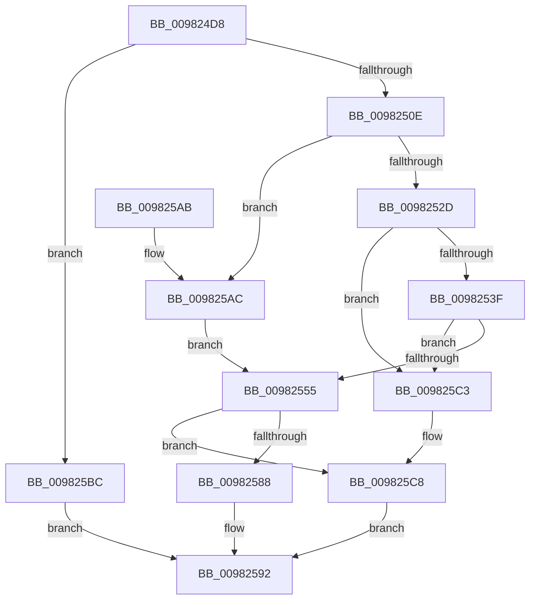

# MiMapViewInSystemSpace

- RVA: `0x009824D8`–`0x009825D4` (길이 `252` bytes)
- VA: `0x00000001409824D8`
- 실행 섹션: `PAGE`
- PDB 이름 있음: `예`; PDB Function 태그: `아니요`
- unwind 정보 RVA: `0x00097940`
- 디코드: `71`개 명령, `252/252` bytes 표시
- 미해석 바이트: `0` (있으면 어셈블리에 `.byte`로 보존)

> 이 문서는 커널 이미지의 기계어와 PDB 기호를 분석해 생성했습니다. 4번과 5번은 함수 원형과 자료형을 바이너리 사용 방식에서 추정한 C 해석이며 원본 소스 복구 결과는 아닙니다.

## 1. Dependencies

- 직접 호출 지점: **4**; 고유 호출 대상: **4**
- 직접 호출자로 확인된 함수: **3**
- RIP 상대 이미지 참조: **0**

### Outgoing calls
- `0x00982515` → [MiSectionControlArea](../../text/29/MiSectionControlArea_function_00294CB0.md) (function, `0x00294CB0`)
- `0x00982520` → [MiCheckPurgeAndUpMapCount](../../text/41/MiCheckPurgeAndUpMapCount_function_004186B0.md) (function, `0x004186B0`)
- `0x0098257D` → [MiInsertInSystemSpace](../../text/3B/MiInsertInSystemSpace_function_003B2F5C.md) (function, `0x003B2F5C`)
- `0x009825CB` → [MiDereferenceControlArea](../../text/47/MiDereferenceControlArea_function_00479A20.md) (function, `0x00479A20`)

### Direct callers
- [MmMapViewInSessionSpace](MmMapViewInSessionSpace_function_00982480.md) at `0x00982499`
- [MmMapViewInSessionSpaceEx](MmMapViewInSessionSpaceEx_function_009824B0.md) at `0x009824C4`
- [PspSchedulerSharedDataRegionCreate](PspSchedulerSharedDataRegionCreate_function_009825DC.md) at `0x0098276A`

### Static image references
- 디코드된 RIP-relative 메모리 참조가 없습니다.

## 2. Other-region calls and transfers

- 다른 실행 섹션으로 향하는 call: **4**
  - `0x00982515` → [MiSectionControlArea](../../text/29/MiSectionControlArea_function_00294CB0.md) (`PAGE` → `.text`)
  - `0x00982520` → [MiCheckPurgeAndUpMapCount](../../text/41/MiCheckPurgeAndUpMapCount_function_004186B0.md) (`PAGE` → `.text`)
  - `0x0098257D` → [MiInsertInSystemSpace](../../text/3B/MiInsertInSystemSpace_function_003B2F5C.md) (`PAGE` → `.text`)
  - `0x009825CB` → [MiDereferenceControlArea](../../text/47/MiDereferenceControlArea_function_00479A20.md) (`PAGE` → `.text`)
- 별도 외부 분기/꼬리 이동을 확인하지 못했습니다.

## 3. Assembly (complete function range)

```asm
009824D8  48 8B C4                        mov rax, rsp
009824DB  48 89 58 08                     mov qword ptr [rax + 8], rbx
009824DF  48 89 68 10                     mov qword ptr [rax + 0x10], rbp
009824E3  48 89 70 18                     mov qword ptr [rax + 0x18], rsi
009824E7  57                              push rdi
009824E8  41 56                           push r14
009824EA  41 57                           push r15
009824EC  48 83 EC 40                     sub rsp, 0x40
009824F0  48 F7 84 24 80 00 00 00 FE FF FF FF  test qword ptr [rsp + 0x80], -2
009824FC  49 8B D9                        mov rbx, r9
009824FF  49 8B F8                        mov rdi, r8
00982502  4C 8B F2                        mov r14, rdx
00982505  48 8B F1                        mov rsi, rcx
00982508  0F 85 AE 00 00 00               jne 0x1409825bc
0098250E  45 33 FF                        xor r15d, r15d
00982511  4C 89 78 D8                     mov qword ptr [rax - 0x28], r15
00982515  E8 96 27 91 FF                  call 0x140294cb0
0098251A  48 8B C8                        mov rcx, rax
0098251D  48 8B E8                        mov rbp, rax
00982520  E8 8B 61 A9 FF                  call 0x1404186b0
00982525  48 8B 17                        mov rdx, qword ptr [rdi]
00982528  48 85 D2                        test rdx, rdx
0098252B  74 7F                           je 0x1409825ac
0098252D  8B 03                           mov eax, dword ptr [rbx]
0098252F  0F B7 C8                        movzx ecx, ax
00982532  48 8D 04 0A                     lea rax, [rdx + rcx]
00982536  48 3B C1                        cmp rax, rcx
00982539  0F 82 84 00 00 00               jb 0x1409825c3
0098253F  48 89 07                        mov qword ptr [rdi], rax
00982542  66 44 89 3B                     mov word ptr [rbx], r15w
00982546  48 8B 4E 30                     mov rcx, qword ptr [rsi + 0x30]
0098254A  48 2B 0B                        sub rcx, qword ptr [rbx]
0098254D  4C 8B 17                        mov r10, qword ptr [rdi]
00982550  4C 3B D1                        cmp r10, rcx
00982553  77 6E                           ja 0x1409825c3
00982555  4C 8B 8C 24 80 00 00 00         mov r9, qword ptr [rsp + 0x80]
0098255D  48 8D 44 24 30                  lea rax, [rsp + 0x30]
00982562  48 89 44 24 28                  mov qword ptr [rsp + 0x28], rax
00982567  4C 8B C3                        mov r8, rbx
0098256A  48 8B 84 24 88 00 00 00         mov rax, qword ptr [rsp + 0x88]
00982572  48 8B D6                        mov rdx, rsi
00982575  49 8B CA                        mov rcx, r10
00982578  48 89 44 24 20                  mov qword ptr [rsp + 0x20], rax
0098257D  E8 DA 09 A3 FF                  call 0x1403b2f5c
00982582  8B D8                           mov ebx, eax
00982584  85 C0                           test eax, eax
00982586  78 40                           js 0x1409825c8
00982588  48 8B 44 24 30                  mov rax, qword ptr [rsp + 0x30]
0098258D  49 89 06                        mov qword ptr [r14], rax
00982590  33 C0                           xor eax, eax
00982592  48 8B 5C 24 60                  mov rbx, qword ptr [rsp + 0x60]
00982597  48 8B 6C 24 68                  mov rbp, qword ptr [rsp + 0x68]
0098259C  48 8B 74 24 70                  mov rsi, qword ptr [rsp + 0x70]
009825A1  48 83 C4 40                     add rsp, 0x40
009825A5  41 5F                           pop r15
009825A7  41 5E                           pop r14
009825A9  5F                              pop rdi
009825AA  C3                              ret
009825AB  CC                              int3
009825AC  66 44 89 3B                     mov word ptr [rbx], r15w
009825B0  4C 8B 56 30                     mov r10, qword ptr [rsi + 0x30]
009825B4  4C 2B 13                        sub r10, qword ptr [rbx]
009825B7  4C 89 17                        mov qword ptr [rdi], r10
009825BA  EB 99                           jmp 0x140982555
009825BC  B8 F4 00 00 C0                  mov eax, 0xc00000f4
009825C1  EB CF                           jmp 0x140982592
009825C3  BB 1F 00 00 C0                  mov ebx, 0xc000001f
009825C8  48 8B CD                        mov rcx, rbp
009825CB  E8 50 74 AF FF                  call 0x140479a20
009825D0  8B C3                           mov eax, ebx
009825D2  EB BE                           jmp 0x140982592
```

## 4. C-style interpretation (structured pseudocode)

```c
__int64 __fastcall MiMapViewInSystemSpace(__int64 a1, __int64 a2, __int64 a3, __int64 a4, __int64 a5, __int64 a6)
{
    __int64 result;
    __int64 v_r10;
    __int64 v_r15;
    __int64 v_rsp;
    unsigned __int64 v_stack_m28;
    unsigned __int64 v_stack_m30;
    unsigned __int64 v_stack_m38;
    unsigned __int64 v_stack_p10;
    unsigned __int64 v_stack_p18;
    unsigned __int64 v_stack_p8;

    *(unsigned __int64 *)(v_rsp + 8) = v_rbx;
    *(unsigned __int64 *)(v_rsp + 16) = v_rbp;
    *(unsigned __int64 *)(v_rsp + 24) = v_rsi;
    v_rsp = (v_rsp) - (64);
    if (((a5) & (-2)) != 0) goto loc_009825BC;
    v_r15 = 0;
    *(unsigned __int64 *)(v_rsp - 40) = 0;
    result = MiSectionControlArea(a1, a2, a3, a4);
    result = MiCheckPurgeAndUpMapCount(result, a2, a3, a4);
    if (*(unsigned __int64 *)(a3) == 0) goto loc_009825AC;
    if ((*(unsigned __int64 *)(a3) + (unsigned __int16)((unsigned int)(*(unsigned int *)(a4))) * 1) < ((unsigned __int16)((unsigned int)(*(unsigned int *)(a4))))) goto loc_009825C3;
    *(unsigned __int64 *)(a3) = *(unsigned __int64 *)(a3) + (unsigned __int16)((unsigned int)(*(unsigned int *)(a4))) * 1;
    *(unsigned __int16 *)(a4) = 0;
    a1 = (*(unsigned __int64 *)(a1 + 48)) - (*(unsigned __int64 *)(a4));
    if ((*(unsigned __int64 *)(a3)) > a1) goto loc_009825C3;
loc_00982555:
    v_stack_m30 = v_stack_m28;
    v_stack_m38 = a6;
    result = MiInsertInSystemSpace(*(unsigned __int64 *)(a3), a1, a4, a5);
    if (sign_flag) goto loc_009825C8;
    *(unsigned __int64 *)(a2) = v_stack_m28;
    result = 0;
loc_00982592:
    v_rsp = (v_rsp) + (64);
    return result;
loc_009825AC:
    *(unsigned __int16 *)(v_stack_p8) = 0;
    v_r10 = (*(unsigned __int64 *)(v_stack_p18 + 48)) - (*(unsigned __int64 *)(v_stack_p8));
    *(unsigned __int64 *)(a3) = v_r10;
    goto loc_00982555;
loc_009825BC:
    goto loc_00982592;
loc_009825C3:
loc_009825C8:
    result = MiDereferenceControlArea(v_stack_p10, a1, a4, a5);
    goto loc_00982592;
}
```

## 5. (Beta) C Style

```c
int64_t MiMapViewInSystemSpace(void *Arg1, void *Arg2, void *Arg3, void *Arg4, int64_t Arg5, int64_t Arg6)
{
    uint8_t *arg1 = (uint8_t *)Arg1;
    uint8_t *arg2 = (uint8_t *)Arg2;
    uint8_t *arg3 = (uint8_t *)Arg3;
    uint8_t *arg4 = (uint8_t *)Arg4;

    int64_t result;
    int64_t local_r10;
    int64_t local_r15;
    int64_t local_rsp;
    uint64_t v_stack_m28;
    uint64_t v_stack_m30;
    uint64_t v_stack_m38;
    uint64_t v_stack_p10;
    uint64_t v_stack_p18;
    uint64_t v_stack_p8;

    *(uint64_t *)(local_rsp + 0x8) = local_rbx;
    *(uint64_t *)(local_rsp + 0x10) = local_rbp;
    *(uint64_t *)(local_rsp + 0x18) = local_rsi;
    local_rsp = (local_rsp) - (64);
    if (((Arg5) & (-2)) != 0) goto loc_009825BC;
    local_r15 = 0;
    *(uint64_t *)(local_rsp - 0x28) = 0;
    result = MiSectionControlArea(Arg1, Arg2, Arg3, Arg4);
    result = MiCheckPurgeAndUpMapCount(result, Arg2, Arg3, Arg4);
    if (*(uint64_t *)(arg3) == 0) goto loc_009825AC;
    if ((*(uint64_t *)(arg3) + (uint16_t)((uint32_t)(*(uint32_t *)(arg4))) * 1) < ((uint16_t)((uint32_t)(*(uint32_t *)(arg4))))) goto loc_009825C3;
    *(uint64_t *)(arg3) = *(uint64_t *)(arg3) + (uint16_t)((uint32_t)(*(uint32_t *)(arg4))) * 1;
    *(uint16_t *)(arg4) = 0;
    Arg1 = (*(uint64_t *)(arg1 + 0x30)) - (*(uint64_t *)(arg4));
    if ((*(uint64_t *)(arg3)) > Arg1) goto loc_009825C3;
loc_00982555:
    v_stack_m30 = v_stack_m28;
    v_stack_m38 = Arg6;
    result = MiInsertInSystemSpace(*(uint64_t *)(arg3), Arg1, Arg4, Arg5);
    if (sign_flag) goto loc_009825C8;
    *(uint64_t *)(arg2) = v_stack_m28;
    result = 0;
loc_00982592:
    local_rsp = (local_rsp) + (64);
    return result;
loc_009825AC:
    *(uint16_t *)(v_stack_p8) = 0;
    local_r10 = (*(uint64_t *)(v_stack_p18 + 0x30)) - (*(uint64_t *)(v_stack_p8));
    *(uint64_t *)(arg3) = local_r10;
    goto loc_00982555;
loc_009825BC:
    goto loc_00982592;
loc_009825C3:
loc_009825C8:
    result = MiDereferenceControlArea(v_stack_p10, Arg1, Arg4, Arg5);
    goto loc_00982592;
}
```

### 관측된 메모리 오프셋

구조체 형식이 확인되지 않은 접근은 인자 기준의 오프셋으로만 기록했습니다.

| 기준 인자 | 오프셋 표현 | 폭 (bit) | 접근 |
|---|---:|---:|---|
| `Arg1` | `+ 0x30` | `64` | `R` |
| `Arg2` | `+ 0x0` | `64` | `W` |
| `Arg3` | `+ 0x0` | `64` | `R` |
| `Arg3` | `+ 0x0` | `64` | `W` |
| `Arg4` | `+ 0x0` | `16` | `W` |
| `Arg4` | `+ 0x0` | `32` | `R` |
| `Arg4` | `+ 0x0` | `64` | `R` |

## 6. Execution-region graph

[열기: 2D/3D 그래프와 함수 탐색 컨트롤 패널](../../../control-panel.html?section=page&rva=0x009824D8&view=graph)

- 2D 그래프는 위에서 아래로 흐르고, 3D 그래프는 빈 공간을 드래그해 회전합니다. Shift+드래그는 이동, 휠은 확대·축소, 함수 노드 선택은 대상 보고서 이동입니다.

### Static fallback


