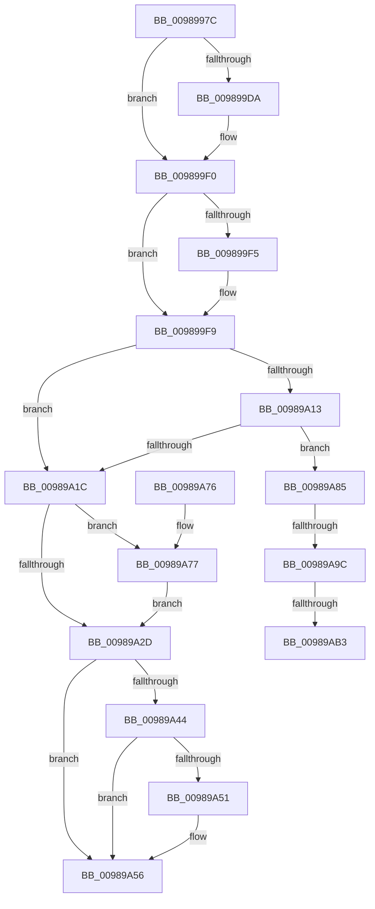

# MiObtainRelocationBits

- RVA: `0x0098997C`–`0x00989AC8` (길이 `332` bytes)
- VA: `0x000000014098997C`
- 실행 섹션: `PAGE`
- PDB 이름 있음: `예`; PDB Function 태그: `예`
- unwind 정보 RVA: `0x00097FB8`
- 디코드: `88`개 명령, `332/332` bytes 표시
- 미해석 바이트: `0` (있으면 어셈블리에 `.byte`로 보존)

> 이 문서는 커널 이미지의 기계어와 PDB 기호를 분석해 생성했습니다. 4번과 5번은 함수 원형과 자료형을 바이너리 사용 방식에서 추정한 C 해석이며 원본 소스 복구 결과는 아닙니다.

## 1. Dependencies

- 직접 호출 지점: **9**; 고유 호출 대상: **7**
- 직접 호출자로 확인된 함수: **1**
- RIP 상대 이미지 참조: **2**

### Outgoing calls
- `0x009899C6` → [KeAbPreAcquire](../../text/21/KeAbPreAcquire_function_00210230.md) (function, `0x00210230`)
- `0x009899EB` → [ExfAcquirePushLockExclusiveEx](../../text/20/ExfAcquirePushLockExclusiveEx_function_0020FC90.md) (function, `0x0020FC90`)
- `0x00989A02` → [RtlFindClearBitsAndSetEx](../../text/3B/RtlFindClearBitsAndSetEx_function_003B60F0.md) (function, `0x003B60F0`)
- `0x00989A34` → [KeAbPostRelease](../../text/2E/KeAbPostRelease_function_002E1600.md) (function, `0x002E1600`)
- `0x00989A51` → [KiCheckForKernelApcDelivery](../../text/2E/KiCheckForKernelApcDelivery_function_002E2C80.md) (function, `0x002E2C80`)
- `0x00989A7E` → [ExfTryToWakePushLock](../../text/26/ExfTryToWakePushLock_function_00265DD0.md) (function, `0x00265DD0`)
- `0x00989A8B` → [RtlFindClearBitsAndSetEx](../../text/3B/RtlFindClearBitsAndSetEx_function_003B60F0.md) (function, `0x003B60F0`)
- `0x00989AA5` → [RtlClearBitsEx](../../text/29/RtlClearBitsEx_function_00297740.md) (function, `0x00297740`)
- `0x00989ABD` → [RtlClearBitsEx](../../text/29/RtlClearBitsEx_function_00297740.md) (function, `0x00297740`)

### Direct callers
- [MiSelectImageBase](MiSelectImageBase_function_009887B0.md) at `0x0098895B`

### Static image references
- `0x009899B1` → RVA `0x00E2D728` (`.data`; read)
- `0x009899CB` → RVA `0x00E2D728` (`.data`; read/write)

## 2. Other-region calls and transfers

- 다른 실행 섹션으로 향하는 call: **9**
  - `0x009899C6` → [KeAbPreAcquire](../../text/21/KeAbPreAcquire_function_00210230.md) (`PAGE` → `.text`)
  - `0x009899EB` → [ExfAcquirePushLockExclusiveEx](../../text/20/ExfAcquirePushLockExclusiveEx_function_0020FC90.md) (`PAGE` → `.text`)
  - `0x00989A02` → [RtlFindClearBitsAndSetEx](../../text/3B/RtlFindClearBitsAndSetEx_function_003B60F0.md) (`PAGE` → `.text`)
  - `0x00989A34` → [KeAbPostRelease](../../text/2E/KeAbPostRelease_function_002E1600.md) (`PAGE` → `.text`)
  - `0x00989A51` → [KiCheckForKernelApcDelivery](../../text/2E/KiCheckForKernelApcDelivery_function_002E2C80.md) (`PAGE` → `.text`)
  - `0x00989A7E` → [ExfTryToWakePushLock](../../text/26/ExfTryToWakePushLock_function_00265DD0.md) (`PAGE` → `.text`)
  - `0x00989A8B` → [RtlFindClearBitsAndSetEx](../../text/3B/RtlFindClearBitsAndSetEx_function_003B60F0.md) (`PAGE` → `.text`)
  - `0x00989AA5` → [RtlClearBitsEx](../../text/29/RtlClearBitsEx_function_00297740.md) (`PAGE` → `.text`)
  - `0x00989ABD` → [RtlClearBitsEx](../../text/29/RtlClearBitsEx_function_00297740.md) (`PAGE` → `.text`)
- call이 아닌 외부 분기/꼬리 이동: **3**
  - `0x00989A96` → [sub_00B2B81E + 0x47](../B2/Unknown_function_00B2B81E.md) (`tail-transfer`)
  - `0x00989AAD` → [sub_00B2B81E](../B2/Unknown_function_00B2B81E.md) (`tail-transfer`)
  - `0x00989AC3` → [sub_00B2B81E](../B2/Unknown_function_00B2B81E.md) (`tail-transfer`)

## 3. Assembly (complete function range)

```asm
0098997C  48 89 5C 24 08                  mov qword ptr [rsp + 8], rbx
00989981  48 89 6C 24 10                  mov qword ptr [rsp + 0x10], rbp
00989986  48 89 74 24 18                  mov qword ptr [rsp + 0x18], rsi
0098998B  57                              push rdi
0098998C  41 54                           push r12
0098998E  41 55                           push r13
00989990  41 56                           push r14
00989992  41 57                           push r15
00989994  48 83 EC 20                     sub rsp, 0x20
00989998  65 4C 8B 34 25 88 01 00 00      mov r14, qword ptr gs:[0x188]
009899A1  4D 8B E0                        mov r12, r8
009899A4  44 0F B7 EA                     movzx r13d, dx
009899A8  48 8B F1                        mov rsi, rcx
009899AB  41 BF 01 00 00 00               mov r15d, 1
009899B1  48 8D 0D 70 3D 4A 00            lea rcx, [rip + 0x4a3d70]
009899B8  45 33 C0                        xor r8d, r8d
009899BB  33 D2                           xor edx, edx
009899BD  66 45 29 BE E6 01 00 00         sub word ptr [r14 + 0x1e6], r15w
009899C5  90                              nop
009899C6  E8 65 68 88 FF                  call 0x140210230
009899CB  F0 48 0F BA 2D 53 3D 4A 00 00   lock bts qword ptr [rip + 0x4a3d53], 0
009899D5  48 8B D8                        mov rbx, rax
009899D8  73 16                           jae 0x1409899f0
009899DA  4C 8D 05 47 3D 4A 00            lea r8, [rip + 0x4a3d47]
009899E1  48 8B D0                        mov rdx, rax
009899E4  48 8D 0D 3D 3D 4A 00            lea rcx, [rip + 0x4a3d3d]
009899EB  E8 A0 62 88 FF                  call 0x14020fc90
009899F0  48 85 DB                        test rbx, rbx
009899F3  74 04                           je 0x1409899f9
009899F5  44 88 7B 0A                     mov byte ptr [rbx + 0xa], r15b
009899F9  48 8B 0E                        mov rcx, qword ptr [rsi]
009899FC  4D 8B C4                        mov r8, r12
009899FF  49 8B D5                        mov rdx, r13
00989A02  E8 E9 C6 A2 FF                  call 0x1403b60f0
00989A07  48 83 CB FF                     or rbx, 0xffffffffffffffff
00989A0B  48 8B F8                        mov rdi, rax
00989A0E  48 3B C3                        cmp rax, rbx
00989A11  74 09                           je 0x140989a1c
00989A13  48 8B 4E 08                     mov rcx, qword ptr [rsi + 8]
00989A17  48 85 C9                        test rcx, rcx
00989A1A  75 69                           jne 0x140989a85
00989A1C  F0 48 0F C1 1D 03 3D 4A 00      lock xadd qword ptr [rip + 0x4a3d03], rbx
00989A25  80 E3 06                        and bl, 6
00989A28  80 FB 02                        cmp bl, 2
00989A2B  74 4A                           je 0x140989a77
00989A2D  48 8D 0D F4 3C 4A 00            lea rcx, [rip + 0x4a3cf4]
00989A34  E8 C7 7B 95 FF                  call 0x1402e1600
00989A39  90                              nop
00989A3A  66 45 01 BE E6 01 00 00         add word ptr [r14 + 0x1e6], r15w
00989A42  75 12                           jne 0x140989a56
00989A44  49 8D 86 98 00 00 00            lea rax, [r14 + 0x98]
00989A4B  90                              nop
00989A4C  48 39 00                        cmp qword ptr [rax], rax
00989A4F  74 05                           je 0x140989a56
00989A51  E8 2A 92 95 FF                  call 0x1402e2c80
00989A56  48 8B 5C 24 50                  mov rbx, qword ptr [rsp + 0x50]
00989A5B  48 8B C7                        mov rax, rdi
00989A5E  48 8B 6C 24 58                  mov rbp, qword ptr [rsp + 0x58]
00989A63  48 8B 74 24 60                  mov rsi, qword ptr [rsp + 0x60]
00989A68  48 83 C4 20                     add rsp, 0x20
00989A6C  41 5F                           pop r15
00989A6E  41 5E                           pop r14
00989A70  41 5D                           pop r13
00989A72  41 5C                           pop r12
00989A74  5F                              pop rdi
00989A75  C3                              ret
00989A76  CC                              int3
00989A77  48 8D 0D AA 3C 4A 00            lea rcx, [rip + 0x4a3caa]
00989A7E  E8 4D C3 8D FF                  call 0x140265dd0
00989A83  EB A8                           jmp 0x140989a2d
00989A85  4C 8B C7                        mov r8, rdi
00989A88  49 8B D5                        mov rdx, r13
00989A8B  E8 60 C6 A2 FF                  call 0x1403b60f0
00989A90  4C 8B F8                        mov r15, rax
00989A93  48 3B C7                        cmp rax, rdi
00989A96  0F 84 C9 1D 1A 00               je 0x140b2b865
00989A9C  48 8B 0E                        mov rcx, qword ptr [rsi]
00989A9F  4D 8B C5                        mov r8, r13
00989AA2  48 8B D7                        mov rdx, rdi
00989AA5  E8 96 DC 90 FF                  call 0x140297740
00989AAA  4C 3B FB                        cmp r15, rbx
00989AAD  0F 84 6B 1D 1A 00               je 0x140b2b81e
00989AB3  48 8B 4E 08                     mov rcx, qword ptr [rsi + 8]
00989AB7  4D 8B C5                        mov r8, r13
00989ABA  49 8B D7                        mov rdx, r15
00989ABD  E8 7E DC 90 FF                  call 0x140297740
00989AC2  90                              nop
00989AC3  E9 56 1D 1A 00                  jmp 0x140b2b81e
```

## 4. C-style interpretation (structured pseudocode)

```c
__int64 __fastcall MiObtainRelocationBits(__int64 a1, int a2, __int64 a3)
{
    __int64 result;
    __int64 v_rbx;
    __int64 v_rsp;
    unsigned __int64 v_stack_p10;
    unsigned __int64 v_stack_p18;
    unsigned __int64 v_stack_p8;

    v_stack_p8 = v_rbx;
    v_stack_p10 = v_rbp;
    v_stack_p18 = v_rsi;
    v_rsp = (v_rsp) - (32);
    a3 = 0;
    a2 = 0;
    result = KeAbPreAcquire(v_rip + 4865392, a2, a3, a4);
    if (!(condition_is_above_or_equal)) {
        a3 = v_rip + 4865351;
        a2 = result;
        a1 = v_rip + 4865341;
        result = ExfAcquirePushLockExclusiveEx(a1, a2, a3, a4);
    }
    if (result != 0) {
        *(unsigned __int8 *)(result + 10) = 1;
    }
    result = RtlFindClearBitsAndSetEx(*(unsigned __int64 *)(a1), (unsigned __int16)(a2), a3, a4);
    v_rbx = (result) | (-1);
    if (result == v_rbx) goto loc_00989A1C;
    if (*(unsigned __int64 *)(a1 + 8) != 0) goto loc_00989A85;
loc_00989A1C:
    v_rbx = (unsigned __int8)((v_rbx) & (6));
    if (((unsigned __int8)(v_rbx)) == 2) goto loc_00989A77;
loc_00989A2D:
    result = KeAbPostRelease(v_rip + 4865268, (unsigned __int16)(a2), a3, a4);
    if (((unsigned __int8)(v_rbx)) != 2) goto loc_00989A56;
    result = *(unsigned __int64 *)(gs_base + (0 + 392)) + 152;
    if ((*(unsigned __int64 *)(*(unsigned __int64 *)(gs_base + (0 + 392)) + 152)) != (*(unsigned __int64 *)(gs_base + (0 + 392)) + 152)) {
        result = KiCheckForKernelApcDelivery(v_rip + 4865268, (unsigned __int16)(a2), a3, a4);
    }
    v_rsp = (v_rsp) + (32);
    return result;
loc_00989A77:
    result = ExfTryToWakePushLock(v_rip + 4865194, (unsigned __int16)(a2), a3, a4);
    goto loc_00989A2D;
loc_00989A85:
    result = RtlFindClearBitsAndSetEx(v_rip + 4865194, (unsigned __int16)(a2), result, a4);
    result = RtlClearBitsEx(*(unsigned __int64 *)(v_stack_p18), result, (unsigned __int16)(a2), a4);
    result = RtlClearBitsEx(*(unsigned __int64 *)(v_stack_p18 + 8), result, (unsigned __int16)(a2), a4);
}
```

## 5. (Beta) C Style

```c
int64_t MiObtainRelocationBits(void *Arg1, int32_t Arg2, int64_t Arg3)
{
    uint8_t *arg1 = (uint8_t *)Arg1;

    int64_t result;
    int64_t local_rbx;
    int64_t local_rsp;
    uint64_t v_stack_p10;
    uint64_t v_stack_p18;
    uint64_t v_stack_p8;

    v_stack_p8 = local_rbx;
    v_stack_p10 = local_rbp;
    v_stack_p18 = local_rsi;
    local_rsp = (local_rsp) - (32);
    Arg3 = 0;
    Arg2 = 0;
    result = KeAbPreAcquire(v_rip + 4865392, Arg2, Arg3, a4);
    if (!(condition_is_above_or_equal)) {
        Arg3 = v_rip + 4865351;
        Arg2 = result;
        Arg1 = v_rip + 4865341;
        result = ExfAcquirePushLockExclusiveEx(Arg1, Arg2, Arg3, a4);
    }
    if (result != 0) {
        *(uint8_t *)(result + 0xA) = 1;
    }
    result = RtlFindClearBitsAndSetEx(*(uint64_t *)(arg1), (uint16_t)(Arg2), Arg3, a4);
    local_rbx = (result) | (-1);
    if (result == local_rbx) goto loc_00989A1C;
    if (*(uint64_t *)(arg1 + 0x8) != 0) goto loc_00989A85;
loc_00989A1C:
    local_rbx = (uint8_t)((local_rbx) & (6));
    if (((uint8_t)(local_rbx)) == 2) goto loc_00989A77;
loc_00989A2D:
    result = KeAbPostRelease(v_rip + 4865268, (uint16_t)(Arg2), Arg3, a4);
    if (((uint8_t)(local_rbx)) != 2) goto loc_00989A56;
    result = *(uint64_t *)(gs_base + (0 + 0x188)) + 152;
    if ((*(uint64_t *)(*(uint64_t *)(gs_base + (0 + 0x188)) + 0x98)) != (*(uint64_t *)(gs_base + (0 + 0x188)) + 152)) {
        result = KiCheckForKernelApcDelivery(v_rip + 4865268, (uint16_t)(Arg2), Arg3, a4);
    }
    local_rsp = (local_rsp) + (32);
    return result;
loc_00989A77:
    result = ExfTryToWakePushLock(v_rip + 4865194, (uint16_t)(Arg2), Arg3, a4);
    goto loc_00989A2D;
loc_00989A85:
    result = RtlFindClearBitsAndSetEx(v_rip + 4865194, (uint16_t)(Arg2), result, a4);
    result = RtlClearBitsEx(*(uint64_t *)(v_stack_p18), result, (uint16_t)(Arg2), a4);
    result = RtlClearBitsEx(*(uint64_t *)(v_stack_p18 + 0x8), result, (uint16_t)(Arg2), a4);
}
```

### 관측된 메모리 오프셋

구조체 형식이 확인되지 않은 접근은 인자 기준의 오프셋으로만 기록했습니다.

| 기준 인자 | 오프셋 표현 | 폭 (bit) | 접근 |
|---|---:|---:|---|
| `Arg1` | `+ 0x0` | `64` | `R` |
| `Arg1` | `+ 0x8` | `64` | `R` |

## 6. Execution-region graph

[열기: 2D/3D 그래프와 함수 탐색 컨트롤 패널](../../../control-panel.html?section=page&rva=0x0098997C&view=graph)

- 2D 그래프는 위에서 아래로 흐르고, 3D 그래프는 빈 공간을 드래그해 회전합니다. Shift+드래그는 이동, 휠은 확대·축소, 함수 노드 선택은 대상 보고서 이동입니다.

### Static fallback


