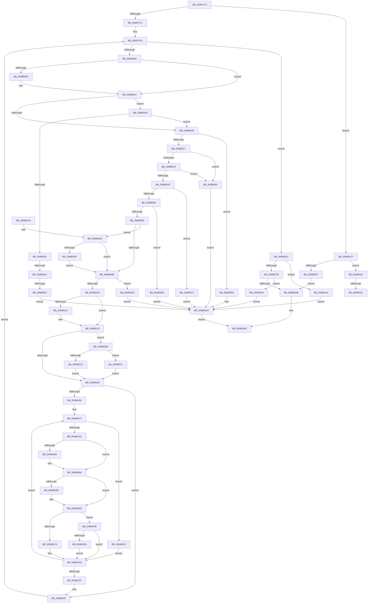

# MiParseImageSectionHeaders

- RVA: `0x00987F70`–`0x0098839F` (길이 `1,071` bytes)
- VA: `0x0000000140987F70`
- 실행 섹션: `PAGE`
- PDB 이름 있음: `예`; PDB Function 태그: `예`
- unwind 정보 RVA: `0x00097D74`
- 디코드: `272`개 명령, `1,071/1,071` bytes 표시
- 미해석 바이트: `0` (있으면 어셈블리에 `.byte`로 보존)

> 이 문서는 커널 이미지의 기계어와 PDB 기호를 분석해 생성했습니다. 4번과 5번은 함수 원형과 자료형을 바이너리 사용 방식에서 추정한 C 해석이며 원본 소스 복구 결과는 아닙니다.

## 1. Dependencies

- 직접 호출 지점: **2**; 고유 호출 대상: **2**
- 직접 호출자로 확인된 함수: **1**
- RIP 상대 이미지 참조: **3**

### Outgoing calls
- `0x00988145` → [MiMakeSubsectionPte](../../text/47/MiMakeSubsectionPte_function_0047B4F0.md) (function, `0x0047B4F0`)
- `0x00988150` → [MiMakeDemandZeroPte](../../text/33/MiMakeDemandZeroPte_function_00337A00.md) (function, `0x00337A00`)

### Direct callers
- [MiBuildImageControlArea](MiBuildImageControlArea_function_009878A4.md) at `0x00987C06`

### Static image references
- `0x00988118` → RVA `0x0001A480` (`.rdata`; read)
- `0x00988196` → RVA `0x00010880` (`.rdata`; read)
- `0x009882E0` → RVA `0x00E2D7F8` (`.data`; write)

## 2. Other-region calls and transfers

- 다른 실행 섹션으로 향하는 call: **2**
  - `0x00988145` → [MiMakeSubsectionPte](../../text/47/MiMakeSubsectionPte_function_0047B4F0.md) (`PAGE` → `.text`)
  - `0x00988150` → [MiMakeDemandZeroPte](../../text/33/MiMakeDemandZeroPte_function_00337A00.md) (`PAGE` → `.text`)
- call이 아닌 외부 분기/꼬리 이동: **4**
  - `0x0098832B` → [sub_00B2B4CE](../B2/Unknown_function_00B2B4CE.md) (`tail-transfer`)
  - `0x00988333` → [sub_00B2B4CE](../B2/Unknown_function_00B2B4CE.md) (`tail-transfer`)
  - `0x00988346` → [sub_00B2B4CE + 0x44](../B2/Unknown_function_00B2B4CE.md) (`tail-transfer`)
  - `0x00988351` → [sub_00B2B4CE + 0x44](../B2/Unknown_function_00B2B4CE.md) (`tail-transfer`)

## 3. Assembly (complete function range)

```asm
00987F70  48 89 5C 24 18                  mov qword ptr [rsp + 0x18], rbx
00987F75  89 4C 24 08                     mov dword ptr [rsp + 8], ecx
00987F79  55                              push rbp
00987F7A  56                              push rsi
00987F7B  57                              push rdi
00987F7C  41 54                           push r12
00987F7E  41 55                           push r13
00987F80  41 56                           push r14
00987F82  41 57                           push r15
00987F84  48 83 EC 50                     sub rsp, 0x50
00987F88  48 8B 3A                        mov rdi, qword ptr [rdx]
00987F8B  4C 8D 9A 80 00 00 00            lea r11, [rdx + 0x80]
00987F92  49 8B 43 08                     mov rax, qword ptr [r11 + 8]
00987F96  44 8B D1                        mov r10d, ecx
00987F99  41 8B 4B 2C                     mov ecx, dword ptr [r11 + 0x2c]
00987F9D  41 8B F1                        mov esi, r9d
00987FA0  4C 8B F2                        mov r14, rdx
00987FA3  48 8D 04 C8                     lea rax, [rax + rcx*8]
00987FA7  48 89 44 24 30                  mov qword ptr [rsp + 0x30], rax
00987FAC  8A 47 0E                        mov al, byte ptr [rdi + 0xe]
00987FAF  24 E7                           and al, 0xe7
00987FB1  0C 07                           or al, 7
00987FB3  88 47 0E                        mov byte ptr [rdi + 0xe], al
00987FB6  41 0F BA E2 14                  bt r10d, 0x14
00987FBB  0F 82 0E 03 00 00               jb 0x1409882cf
00987FC1  48 8B 47 38                     mov rax, qword ptr [rdi + 0x38]
00987FC5  49 8D 58 14                     lea rbx, [r8 + 0x14]
00987FC9  41 8B 53 2C                     mov edx, dword ptr [r11 + 0x2c]
00987FCD  4C 8B 8C 24 B0 00 00 00         mov r9, qword ptr [rsp + 0xb0]
00987FD5  44 8B A4 24 B8 00 00 00         mov r12d, dword ptr [rsp + 0xb8]
00987FDD  44 8B 68 38                     mov r13d, dword ptr [rax + 0x38]
00987FE1  C1 E2 0C                        shl edx, 0xc
00987FE4  48 03 57 20                     add rdx, qword ptr [rdi + 0x20]
00987FE8  45 8B 79 0C                     mov r15d, dword ptr [r9 + 0xc]
00987FEC  41 FF C5                        inc r13d
00987FEF  48 89 54 24 38                  mov qword ptr [rsp + 0x38], rdx
00987FF4  44 89 7C 24 2C                  mov dword ptr [rsp + 0x2c], r15d
00987FF9  48 89 44 24 40                  mov qword ptr [rsp + 0x40], rax
00987FFE  85 F6                           test esi, esi
00988000  0F 84 66 02 00 00               je 0x14098826c
00988006  8B 6B F4                        mov ebp, dword ptr [rbx - 0xc]
00988009  85 ED                           test ebp, ebp
0098800B  75 03                           jne 0x140988010
0098800D  8B 6B FC                        mov ebp, dword ptr [rbx - 4]
00988010  8B 43 FC                        mov eax, dword ptr [rbx - 4]
00988013  85 C0                           test eax, eax
00988015  0F 84 1D 03 00 00               je 0x140988338
0098801B  8B 0B                           mov ecx, dword ptr [rbx]
0098801D  03 C1                           add eax, ecx
0098801F  3B C1                           cmp eax, ecx
00988021  0F 82 B9 02 00 00               jb 0x1409882e0
00988027  49 8D 43 38                     lea rax, [r11 + 0x38]
0098802B  49 89 43 10                     mov qword ptr [r11 + 0x10], rax
0098802F  4C 8B D8                        mov r11, rax
00988032  4C 89 30                        mov qword ptr [rax], r14
00988035  8B 43 F8                        mov eax, dword ptr [rbx - 8]
00988038  49 03 01                        add rax, qword ptr [r9]
0098803B  48 3B D0                        cmp rdx, rax
0098803E  0F 85 3D 03 00 00               jne 0x140988381
00988044  85 ED                           test ebp, ebp
00988046  0F 84 35 03 00 00               je 0x140988381
0098804C  8D 45 FF                        lea eax, [rbp - 1]
0098804F  41 03 C7                        add eax, r15d
00988052  3B C5                           cmp eax, ebp
00988054  0F 86 18 03 00 00               jbe 0x140988372
0098805A  41 8B CF                        mov ecx, r15d
0098805D  8B C5                           mov eax, ebp
0098805F  48 8D 51 FF                     lea rdx, [rcx - 1]
00988063  48 03 D0                        add rdx, rax
00988066  48 FF C9                        dec rcx
00988069  48 C1 EA 0C                     shr rdx, 0xc
0098806D  48 F7 D1                        not rcx
00988070  48 C1 E9 0C                     shr rcx, 0xc
00988074  23 CA                           and ecx, edx
00988076  41 89 4B 2C                     mov dword ptr [r11 + 0x2c], ecx
0098807A  41 3B CC                        cmp ecx, r12d
0098807D  0F 87 8B 02 00 00               ja 0x14098830e
00988083  8B C1                           mov eax, ecx
00988085  83 FE 01                        cmp esi, 1
00988088  0F 84 18 02 00 00               je 0x1409882a6
0098808E  44 8B 3B                        mov r15d, dword ptr [rbx]
00988091  44 2B E0                        sub r12d, eax
00988094  41 C1 EF 09                     shr r15d, 9
00988098  45 89 7B 24                     mov dword ptr [r11 + 0x24], r15d
0098809C  41 8B 51 08                     mov edx, dword ptr [r9 + 8]
009880A0  44 8B 03                        mov r8d, dword ptr [rbx]
009880A3  8B 4B FC                        mov ecx, dword ptr [rbx - 4]
009880A6  03 CA                           add ecx, edx
009880A8  44 89 A4 24 B8 00 00 00         mov dword ptr [rsp + 0xb8], r12d
009880B0  F7 DA                           neg edx
009880B2  45 8D 48 FF                     lea r9d, [r8 - 1]
009880B6  44 03 C9                        add r9d, ecx
009880B9  44 23 CA                        and r9d, edx
009880BC  45 3B C8                        cmp r9d, r8d
009880BF  0F 82 9E 02 00 00               jb 0x140988363
009880C5  41 8B C1                        mov eax, r9d
009880C8  41 81 E1 FF 01 00 00            and r9d, 0x1ff
009880CF  C1 E8 09                        shr eax, 9
009880D2  41 2B C7                        sub eax, r15d
009880D5  41 C1 E1 14                     shl r9d, 0x14
009880D9  41 89 43 28                     mov dword ptr [r11 + 0x28], eax
009880DD  48 8B 44 24 30                  mov rax, qword ptr [rsp + 0x30]
009880E2  49 89 43 08                     mov qword ptr [r11 + 8], rax
009880E6  44 8B 43 10                     mov r8d, dword ptr [rbx + 0x10]
009880EA  41 8B C8                        mov ecx, r8d
009880ED  C1 E9 1D                        shr ecx, 0x1d
009880F0  83 E1 01                        and ecx, 1
009880F3  8B D1                           mov edx, ecx
009880F5  83 CA 02                        or edx, 2
009880F8  41 0F BA E0 1E                  bt r8d, 0x1e
009880FD  0F 43 D1                        cmovae edx, ecx
00988100  8B CA                           mov ecx, edx
00988102  83 C9 04                        or ecx, 4
00988105  45 85 C0                        test r8d, r8d
00988108  0F 49 CA                        cmovns ecx, edx
0098810B  8B C1                           mov eax, ecx
0098810D  83 C8 08                        or eax, 8
00988110  41 0F BA E0 1C                  bt r8d, 0x1c
00988115  0F 43 C1                        cmovae eax, ecx
00988118  48 8D 0D 61 23 69 FF            lea rcx, [rip - 0x96dc9f]
0098811F  44 0F BE 3C 08                  movsx r15d, byte ptr [rax + rcx]
00988124  41 F6 C7 02                     test r15b, 2
00988128  74 09                           je 0x140988133
0098812A  48 8B 44 24 40                  mov rax, qword ptr [rsp + 0x40]
0098812F  C6 40 32 01                     mov byte ptr [rax + 0x32], 1
00988133  41 8B D7                        mov edx, r15d
00988136  49 8B CB                        mov rcx, r11
00988139  83 E2 1F                        and edx, 0x1f
0098813C  03 D2                           add edx, edx
0098813E  41 0B D1                        or edx, r9d
00988141  41 89 53 20                     mov dword ptr [r11 + 0x20], edx
00988145  E8 A6 33 AF FF                  call 0x14047b4f0
0098814A  41 8B CF                        mov ecx, r15d
0098814D  4C 8B C0                        mov r8, rax
00988150  E8 AB F8 9A FF                  call 0x140337a00
00988155  8B 0B                           mov ecx, dword ptr [rbx]
00988157  4C 8B C8                        mov r9, rax
0098815A  44 8B 6B FC                     mov r13d, dword ptr [rbx - 4]
0098815E  85 C9                           test ecx, ecx
00988160  4C 0F 44 C0                     cmove r8, rax
00988164  44 03 E9                        add r13d, ecx
00988167  32 C9                           xor cl, cl
00988169  32 C0                           xor al, al
0098816B  88 8C 24 98 00 00 00            mov byte ptr [rsp + 0x98], cl
00988172  88 44 24 20                     mov byte ptr [rsp + 0x20], al
00988176  41 F6 C7 04                     test r15b, 4
0098817A  0F 85 3B 01 00 00               jne 0x1409882bb
00988180  8B 43 FC                        mov eax, dword ptr [rbx - 4]
00988183  33 D2                           xor edx, edx
00988185  45 33 FF                        xor r15d, r15d
00988188  89 44 24 28                     mov dword ptr [rsp + 0x28], eax
0098818C  89 54 24 24                     mov dword ptr [rsp + 0x24], edx
00988190  41 39 53 2C                     cmp dword ptr [r11 + 0x2c], edx
00988194  76 6F                           jbe 0x140988205
00988196  48 8B 05 E3 86 68 FF            mov rax, qword ptr [rip - 0x97791d]
0098819D  44 8A 54 24 20                  mov r10b, byte ptr [rsp + 0x20]
009881A2  4C 8B 64 24 30                  mov r12, qword ptr [rsp + 0x30]
009881A7  44 3B FD                        cmp r15d, ebp
009881AA  73 76                           jae 0x140988222
009881AC  84 C9                           test cl, cl
009881AE  74 04                           je 0x1409881b4
009881B0  48 FF 47 10                     inc qword ptr [rdi + 0x10]
009881B4  45 84 D2                        test r10b, r10b
009881B7  74 04                           je 0x1409881bd
009881B9  48 FF 47 30                     inc qword ptr [rdi + 0x30]
009881BD  44 3B 7C 24 28                  cmp r15d, dword ptr [rsp + 0x28]
009881C2  0F 83 80 00 00 00               jae 0x140988248
009881C8  49 FF 46 78                     inc qword ptr [r14 + 0x78]
009881CC  4D 89 04 24                     mov qword ptr [r12], r8
009881D0  48 81 44 24 38 00 10 00 00      add qword ptr [rsp + 0x38], 0x1000
009881D9  FF C2                           inc edx
009881DB  41 81 C7 00 10 00 00            add r15d, 0x1000
009881E2  89 54 24 24                     mov dword ptr [rsp + 0x24], edx
009881E6  49 83 C4 08                     add r12, 8
009881EA  41 3B 53 2C                     cmp edx, dword ptr [r11 + 0x2c]
009881EE  72 B7                           jb 0x1409881a7
009881F0  44 8B 94 24 90 00 00 00         mov r10d, dword ptr [rsp + 0x90]
009881F8  4C 89 64 24 30                  mov qword ptr [rsp + 0x30], r12
009881FD  44 8B A4 24 B8 00 00 00         mov r12d, dword ptr [rsp + 0xb8]
00988205  48 8B 54 24 38                  mov rdx, qword ptr [rsp + 0x38]
0098820A  48 83 C3 28                     add rbx, 0x28
0098820E  4C 8B 8C 24 B0 00 00 00         mov r9, qword ptr [rsp + 0xb0]
00988216  FF CE                           dec esi
00988218  44 8B 7C 24 2C                  mov r15d, dword ptr [rsp + 0x2c]
0098821D  E9 DC FD FF FF                  jmp 0x140987ffe
00988222  49 89 04 24                     mov qword ptr [r12], rax
00988226  41 8B 4B 34                     mov ecx, dword ptr [r11 + 0x34]
0098822A  8D 51 01                        lea edx, [rcx + 1]
0098822D  33 D1                           xor edx, ecx
0098822F  81 E2 FF FF FF 3F               and edx, 0x3fffffff
00988235  33 D1                           xor edx, ecx
00988237  8A 8C 24 98 00 00 00            mov cl, byte ptr [rsp + 0x98]
0098823E  41 89 53 34                     mov dword ptr [r11 + 0x34], edx
00988242  8B 54 24 24                     mov edx, dword ptr [rsp + 0x24]
00988246  EB 88                           jmp 0x1409881d0
00988248  41 8A CA                        mov cl, r10b
0098824B  4D 89 0C 24                     mov qword ptr [r12], r9
0098824F  0A 8C 24 98 00 00 00            or cl, byte ptr [rsp + 0x98]
00988256  8A 8C 24 98 00 00 00            mov cl, byte ptr [rsp + 0x98]
0098825D  0F 85 6D FF FF FF               jne 0x1409881d0
00988263  48 FF 47 10                     inc qword ptr [rdi + 0x10]
00988267  E9 64 FF FF FF                  jmp 0x1409881d0
0098826C  48 8B 44 24 40                  mov rax, qword ptr [rsp + 0x40]
00988271  44 3B 68 38                     cmp r13d, dword ptr [rax + 0x38]
00988275  0F 87 9F 00 00 00               ja 0x14098831a
0098827B  41 8B 41 0C                     mov eax, dword ptr [r9 + 0xc]
0098827F  C1 E8 0C                        shr eax, 0xc
00988282  44 3B E0                        cmp r12d, eax
00988285  0F 83 05 01 00 00               jae 0x140988390
0098828B  33 C0                           xor eax, eax
0098828D  48 8B 9C 24 A0 00 00 00         mov rbx, qword ptr [rsp + 0xa0]
00988295  48 83 C4 50                     add rsp, 0x50
00988299  41 5F                           pop r15
0098829B  41 5E                           pop r14
0098829D  41 5D                           pop r13
0098829F  41 5C                           pop r12
009882A1  5F                              pop rdi
009882A2  5E                              pop rsi
009882A3  5D                              pop rbp
009882A4  C3                              ret
009882A5  CC                              int3
009882A6  41 3B CC                        cmp ecx, r12d
009882A9  0F 84 DF FD FF FF               je 0x14098808e
009882AF  45 89 63 2C                     mov dword ptr [r11 + 0x2c], r12d
009882B3  41 8B C4                        mov eax, r12d
009882B6  E9 D3 FD FF FF                  jmp 0x14098808e
009882BB  41 83 E7 05                     and r15d, 5
009882BF  41 80 FF 05                     cmp r15b, 5
009882C3  75 2C                           jne 0x1409882f1
009882C5  C6 44 24 20 01                  mov byte ptr [rsp + 0x20], 1
009882CA  E9 B1 FE FF FF                  jmp 0x140988180
009882CF  49 8D 48 10                     lea rcx, [r8 + 0x10]
009882D3  85 F6                           test esi, esi
009882D5  75 4F                           jne 0x140988326
009882D7  8B 47 08                        mov eax, dword ptr [rdi + 8]
009882DA  49 89 46 78                     mov qword ptr [r14 + 0x78], rax
009882DE  EB AB                           jmp 0x14098828b
009882E0  C7 05 0E 55 4A 00 13 00 00 00   mov dword ptr [rip + 0x4a550e], 0x13
009882EA  B8 7B 00 00 C0                  mov eax, 0xc000007b
009882EF  EB 9C                           jmp 0x14098828d
009882F1  B8 00 00 02 00                  mov eax, 0x20000
009882F6  B1 01                           mov cl, 1
009882F8  0B D0                           or edx, eax
009882FA  88 8C 24 98 00 00 00            mov byte ptr [rsp + 0x98], cl
00988301  41 89 53 20                     mov dword ptr [r11 + 0x20], edx
00988305  41 09 46 38                     or dword ptr [r14 + 0x38], eax
00988309  E9 72 FE FF FF                  jmp 0x140988180
0098830E  C7 05 E0 54 4A 00 16 00 00 00   mov dword ptr [rip + 0x4a54e0], 0x16
00988318  EB D0                           jmp 0x1409882ea
0098831A  C7 05 D4 54 4A 00 18 00 00 00   mov dword ptr [rip + 0x4a54d4], 0x18
00988324  EB C4                           jmp 0x1409882ea
00988326  8B 51 F8                        mov edx, dword ptr [rcx - 8]
00988329  85 D2                           test edx, edx
0098832B  0F 85 9D 31 1A 00               jne 0x140b2b4ce
00988331  8B 11                           mov edx, dword ptr [rcx]
00988333  E9 96 31 1A 00                  jmp 0x140b2b4ce
00988338  83 3B 00                        cmp dword ptr [rbx], 0
0098833B  0F 84 DA FC FF FF               je 0x14098801b
00988341  41 0F BA E2 0E                  bt r10d, 0xe
00988346  0F 83 C6 31 1A 00               jae 0x140b2b512
0098834C  41 0F BA E2 10                  bt r10d, 0x10
00988351  0F 82 BB 31 1A 00               jb 0x140b2b512
00988357  C7 05 97 54 4A 00 12 00 00 00   mov dword ptr [rip + 0x4a5497], 0x12
00988361  EB 87                           jmp 0x1409882ea
00988363  C7 05 8B 54 4A 00 17 00 00 00   mov dword ptr [rip + 0x4a548b], 0x17
0098836D  E9 78 FF FF FF                  jmp 0x1409882ea
00988372  C7 05 7C 54 4A 00 15 00 00 00   mov dword ptr [rip + 0x4a547c], 0x15
0098837C  E9 69 FF FF FF                  jmp 0x1409882ea
00988381  C7 05 6D 54 4A 00 14 00 00 00   mov dword ptr [rip + 0x4a546d], 0x14
0098838B  E9 5A FF FF FF                  jmp 0x1409882ea
00988390  C7 05 5E 54 4A 00 19 00 00 00   mov dword ptr [rip + 0x4a545e], 0x19
0098839A  E9 4B FF FF FF                  jmp 0x1409882ea
```

## 4. C-style interpretation (structured pseudocode)

```c
__int64 __fastcall MiParseImageSectionHeaders(int a1, __int64 a2, __int64 a3, int a4, __int64 a5, unsigned int a6)
{
    __int64 result;
    __int64 v_r12;
    __int64 v_r13;
    __int64 v_r15;
    __int64 v_rbp;
    __int64 v_rbx;
    __int64 v_rsi;
    __int64 v_rsp;
    unsigned __int64 v_stack_m48;
    unsigned __int64 v_stack_m50;
    unsigned __int64 v_stack_m58;
    unsigned int v_stack_m5C;
    unsigned int v_stack_m60;
    unsigned int v_stack_m64;
    unsigned __int8 v_stack_m68;
    unsigned __int8 v_stack_p10;
    unsigned __int64 v_stack_p18;
    unsigned __int8 v_stack_p20;
    unsigned int v_stack_p30;
    unsigned int v_stack_p8;
    unsigned __int8 v_stack_p98;

    v_stack_p18 = v_rbx;
    v_stack_p8 = a1;
    v_rsp = (v_rsp) - (80);
    v_stack_m58 = *(unsigned __int64 *)(a2 + 128 + 8) + (unsigned int)(*(unsigned int *)(a2 + 128 + 44)) * 8;
    result = (unsigned __int8)((*(unsigned __int8 *)(*(unsigned __int64 *)(a2) + 14)) & (231));
    result = (unsigned __int8)((result) | (7));
    *(unsigned __int8 *)(*(unsigned __int64 *)(a2) + 14) = (unsigned __int8)(result);
    if (condition_is_below) goto loc_009882CF;
    a2 = (unsigned int)(((unsigned int)(*(unsigned int *)(a2 + 128 + 44))) << (12));
    a2 = (a2) + (*(unsigned __int64 *)(*(unsigned __int64 *)(a2) + 32));
    v_r13 = (unsigned int)(((unsigned int)(*(unsigned int *)(*(unsigned __int64 *)(*(unsigned __int64 *)(a2) + 56) + 56))) + 1);
    v_stack_m50 = a2;
    v_stack_m5C = (unsigned int)((unsigned int)(*(unsigned int *)(a5 + 12)));
    v_stack_m48 = *(unsigned __int64 *)(*(unsigned __int64 *)(a2) + 56);
loc_00987FFE:
    if ((unsigned int)((unsigned int)(a4)) == 0) goto loc_0098826C;
    v_rbp = (unsigned int)(*(unsigned int *)(a3 + 20 - 12));
    if ((unsigned int)((unsigned int)(*(unsigned int *)(a3 + 20 - 12))) == 0) {
        v_rbp = *(unsigned int *)(a3 + 20 - 4);
    }
    if ((unsigned int)((unsigned int)(*(unsigned int *)(a3 + 20 - 4))) == 0) goto loc_00988338;
loc_0098801B:
    result = (unsigned int)(((unsigned int)(*(unsigned int *)(a3 + 20 - 4))) + ((unsigned int)((unsigned int)(*(unsigned int *)(a3 + 20)))));
    if (((unsigned int)(result)) < ((unsigned int)((unsigned int)(*(unsigned int *)(a3 + 20))))) goto loc_009882E0;
    *(unsigned __int64 *)(a2 + 128 + 16) = a2 + 128 + 56;
    *(unsigned __int64 *)(a2 + 128 + 56) = a2;
    result = ((unsigned int)(*(unsigned int *)(a3 + 20 - 8))) + (*(unsigned __int64 *)(a5));
    if (a2 != result) goto loc_00988381;
    if ((unsigned int)(v_rbp) == 0) goto loc_00988381;
    result = (unsigned int)((v_rbp - 1) + ((unsigned int)((unsigned int)(*(unsigned int *)(a5 + 12)))));
    if (((unsigned int)(result)) <= ((unsigned int)(v_rbp))) goto loc_00988372;
    a2 = ((unsigned int)((unsigned int)((unsigned int)(*(unsigned int *)(a5 + 12)))) - 1) + ((unsigned int)((unsigned int)(v_rbp)));
    a1 = ((unsigned int)((unsigned int)((unsigned int)(*(unsigned int *)(a5 + 12))))) - 1;
    a2 = (a2) >> (12);
    a1 = ~(a1);
    a1 = (a1) >> (12);
    a1 = (unsigned int)((a1) & ((unsigned int)(a2)));
    *(unsigned int *)(a2 + 128 + 56 + 44) = a1;
    if (a1 > ((unsigned int)((unsigned int)(a6)))) goto loc_0098830E;
    if (((unsigned int)((unsigned int)(a4))) == 1) goto loc_009882A6;
loc_0098808E:
    v_r12 = (unsigned int)(((unsigned int)(a6)) - ((unsigned int)((unsigned int)(a1))));
    v_r15 = (unsigned int)(((unsigned int)(*(unsigned int *)(a3 + 20))) >> (9));
    *(unsigned int *)(a2 + 128 + 56 + 36) = (unsigned int)(v_r15);
    a1 = (unsigned int)(((unsigned int)(*(unsigned int *)(a3 + 20 - 4))) + ((unsigned int)((unsigned int)(*(unsigned int *)(a5 + 8)))));
    v_stack_p30 = (unsigned int)(v_r12);
    a2 = (unsigned int)(-((unsigned int)(*(unsigned int *)(a5 + 8))));
    a4 = (unsigned int)(((unsigned int)(*(unsigned int *)(a3 + 20)) - 1) + (a1));
    a4 = (unsigned int)((a4) & ((unsigned int)(a2)));
    if (a4 < ((unsigned int)((unsigned int)(*(unsigned int *)(a3 + 20))))) goto loc_00988363;
    a4 = (unsigned int)((a4) & (511));
    result = (unsigned int)(((unsigned int)(a4)) >> (9));
    result = (unsigned int)((result) - ((unsigned int)(v_r15)));
    a4 = (unsigned int)((a4) << (20));
    *(unsigned int *)(a2 + 128 + 56 + 40) = (unsigned int)(result);
    *(unsigned __int64 *)(a2 + 128 + 56 + 8) = v_stack_m58;
    a1 = (unsigned int)(((unsigned int)((unsigned int)((unsigned int)(*(unsigned int *)(a3 + 20 + 16))))) >> (29));
    a1 = (unsigned int)((a1) & (1));
    a2 = (unsigned int)(((unsigned int)(a1)) | (2));
    if (condition_is_above_or_equal) { a2 = a1; }
    a1 = (unsigned int)(((unsigned int)((unsigned int)(a2))) | (4));
    if (!sign_flag) { a1 = (unsigned int)(a2); }
    result = (unsigned int)(((unsigned int)(a1)) | (8));
    if (condition_is_above_or_equal) { result = a1; }
    if ((((unsigned __int8)((__int8)(*(unsigned __int8 *)(result + v_rip - 9886879 * 1)))) & (2)) != 0) {
        result = v_stack_m48;
        *(unsigned __int8 *)(result + 50) = 1;
    }
    a2 = (unsigned int)(((unsigned int)((unsigned int)((__int8)(*(unsigned __int8 *)(result + v_rip - 9886879 * 1))))) & (31));
    a2 = (unsigned int)((a2) + ((unsigned int)(a2)));
    a2 = (unsigned int)((a2) | (a4));
    *(unsigned int *)(a2 + 128 + 56 + 32) = (unsigned int)(a2);
    result = MiMakeSubsectionPte(a2 + 128 + 56, a2, (unsigned int)(*(unsigned int *)(a3 + 20 + 16)), a4);
    result = MiMakeDemandZeroPte((unsigned int)((unsigned int)((__int8)(*(unsigned __int8 *)(result + v_rip - 9886879 * 1)))), a2, result, a4);
    a3 = result;
    if ((unsigned int)((unsigned int)(*(unsigned int *)(a3 + 20))) == 0) { a3 = result; }
    v_r13 = (unsigned int)(((unsigned int)(*(unsigned int *)(a3 + 20 - 4))) + ((unsigned int)((unsigned int)(*(unsigned int *)(a3 + 20)))));
    a1 = 0;
    result = 0;
    v_stack_p10 = 0;
    v_stack_m68 = 0;
    if ((((unsigned __int8)((__int8)(*(unsigned __int8 *)(result + v_rip - 9886879 * 1)))) & (4)) != 0) goto loc_009882BB;
loc_00988180:
    a2 = 0;
    v_r15 = 0;
    v_stack_m60 = (unsigned int)((unsigned int)(*(unsigned int *)(a3 + 20 - 4)));
    v_stack_m64 = 0;
    if ((*(unsigned int *)(a2 + 128 + 56 + 44)) <= 0) goto loc_00988205;
loc_009881A7:
    if (0 >= ((unsigned int)(v_rbp))) goto loc_00988222;
    if (0 != 0) {
    }
    if ((unsigned __int8)(v_stack_m68) != 0) {
    }
    if (0 >= v_stack_m60) goto loc_00988248;
    *(unsigned __int64 *)(v_stack_m58) = a3;
loc_009881D0:
    a2 = (unsigned int)((a2) + 1);
    v_r15 = (unsigned int)((v_r15) + (0x1000ULL));
    v_stack_m64 = (unsigned int)(a2);
    v_r12 = (v_stack_m58) + (8);
    if (((unsigned int)(a2)) < (*(unsigned int *)(a2 + 128 + 56 + 44))) goto loc_009881A7;
    v_stack_m58 = v_r12;
loc_00988205:
    v_rbx = (a3 + 20) + (40);
    v_rsi = (unsigned int)(((unsigned int)(a4)) - 1);
    goto loc_00987FFE;
loc_00988222:
    *(unsigned __int64 *)((unsigned int)(a6)) = *(unsigned __int64 *)(v_rip - 9926941);
    a2 = (unsigned int)(((unsigned int)(*(unsigned int *)(a2 + 128 + 56 + 52)) + 1) ^ ((unsigned int)((unsigned int)(*(unsigned int *)(a2 + 128 + 56 + 52)))));
    a2 = (unsigned int)((a2) & (0x3FFFFFFFULL));
    a2 = (unsigned int)((a2) ^ ((unsigned int)((unsigned int)(*(unsigned int *)(a2 + 128 + 56 + 52)))));
    *(unsigned int *)(a2 + 128 + 56 + 52) = (unsigned int)(a2);
    goto loc_009881D0;
loc_00988248:
    *(unsigned __int64 *)((unsigned int)(a6)) = a5;
    a1 = (unsigned __int8)(((unsigned __int8)((unsigned int)(v_stack_p8))) | (v_stack_p10));
    if (condition_is_not_equal) goto loc_009881D0;
    goto loc_009881D0;
loc_0098826C:
    if (((unsigned int)(v_r13)) > (*(unsigned int *)(v_stack_m48 + 56))) goto loc_0098831A;
    result = (unsigned int)(((unsigned int)(*(unsigned int *)(a5 + 12))) >> (12));
    if (((unsigned int)((unsigned int)(a6))) >= ((unsigned int)(result))) goto loc_00988390;
loc_0098828B:
    result = 0;
loc_0098828D:
    v_rsp = (v_rsp) + (80);
    return result;
loc_009882A6:
    if (((unsigned int)(v_stack_p10)) == ((unsigned int)((unsigned int)(a6)))) goto loc_0098808E;
    *(unsigned int *)(a2 + 128 + 56 + 44) = (unsigned int)((unsigned int)(a6));
    goto loc_0098808E;
loc_009882BB:
    v_r15 = (unsigned int)(((unsigned int)(v_stack_m5C)) & (5));
    if (((unsigned __int8)(v_r15)) != 5) goto loc_009882F1;
    v_stack_p20 = 1;
    goto loc_00988180;
loc_009882CF:
    if ((unsigned int)(v_rsi) != 0) goto loc_00988326;
    *(unsigned __int64 *)(a2 + 120) = (unsigned int)(*(unsigned int *)(*(unsigned __int64 *)(a2) + 8));
    goto loc_0098828B;
loc_009882E0:
    *(unsigned int *)(v_rip + 4871438) = 19;
loc_009882EA:
    goto loc_0098828D;
loc_009882F1:
    a2 = (unsigned int)(((unsigned int)(v_stack_m64)) | ((unsigned int)((unsigned int)(0x20000ULL))));
    v_stack_p98 = 1;
    *(unsigned int *)(a2 + 128 + 56 + 32) = (unsigned int)(a2);
    goto loc_00988180;
loc_0098830E:
    *(unsigned int *)(v_rip + 4871392) = 22;
    goto loc_009882EA;
loc_0098831A:
    *(unsigned int *)(v_rip + 4871380) = 24;
    goto loc_009882EA;
loc_00988326:
loc_00988338:
    if ((*(unsigned int *)(v_stack_p18)) == 0) goto loc_0098801B;
    *(unsigned int *)(v_rip + 4871319) = 18;
    goto loc_009882EA;
loc_00988363:
    *(unsigned int *)(v_rip + 4871307) = 23;
    goto loc_009882EA;
loc_00988372:
    *(unsigned int *)(v_rip + 4871292) = 21;
    goto loc_009882EA;
loc_00988381:
    *(unsigned int *)(v_rip + 4871277) = 20;
    goto loc_009882EA;
loc_00988390:
    *(unsigned int *)(v_rip + 4871262) = 25;
    goto loc_009882EA;
}
```

## 5. (Beta) C Style

```c
int64_t MiParseImageSectionHeaders(int32_t Arg1, void *Arg2, void *Arg3, int32_t Arg4, void *Arg5, uint32_t Arg6)
{
    uint8_t *arg2 = (uint8_t *)Arg2;
    uint8_t *arg3 = (uint8_t *)Arg3;
    uint8_t *arg5 = (uint8_t *)Arg5;

    int64_t result;
    int64_t local_r12;
    int64_t local_r13;
    int64_t local_r15;
    int64_t local_rbp;
    int64_t local_rbx;
    int64_t local_rsi;
    int64_t local_rsp;
    uint64_t v_stack_m48;
    uint64_t v_stack_m50;
    uint64_t v_stack_m58;
    uint32_t v_stack_m5C;
    uint32_t v_stack_m60;
    uint32_t v_stack_m64;
    uint8_t v_stack_m68;
    uint8_t v_stack_p10;
    uint64_t v_stack_p18;
    uint8_t v_stack_p20;
    uint32_t v_stack_p30;
    uint32_t v_stack_p8;
    uint8_t v_stack_p98;

    v_stack_p18 = local_rbx;
    v_stack_p8 = Arg1;
    local_rsp = (local_rsp) - (80);
    v_stack_m58 = *(uint64_t *)(arg2 + 0x80 + 0x8) + (uint32_t)(*(uint32_t *)(arg2 + 0x80 + 0x2C)) * 8;
    result = (uint8_t)((*(uint8_t *)(*(uint64_t *)(arg2) + 0xE)) & (231));
    result = (uint8_t)((result) | (7));
    *(uint8_t *)(*(uint64_t *)(arg2) + 0xE) = (uint8_t)(result);
    if (condition_is_below) goto loc_009882CF;
    Arg2 = (uint32_t)(((uint32_t)(*(uint32_t *)(arg2 + 0x80 + 0x2C))) << (12));
    Arg2 = (Arg2) + (*(uint64_t *)(*(uint64_t *)(arg2) + 0x20));
    local_r13 = (uint32_t)(((uint32_t)(*(uint32_t *)(*(uint64_t *)(*(uint64_t *)(arg2) + 0x38) + 0x38))) + 1);
    v_stack_m50 = Arg2;
    v_stack_m5C = (uint32_t)((uint32_t)(*(uint32_t *)(arg5 + 0xC)));
    v_stack_m48 = *(uint64_t *)(*(uint64_t *)(arg2) + 0x38);
loc_00987FFE:
    if ((uint32_t)((uint32_t)(Arg4)) == 0) goto loc_0098826C;
    local_rbp = (uint32_t)(*(uint32_t *)(arg3 + 0x14 - 0xC));
    if ((uint32_t)((uint32_t)(*(uint32_t *)(arg3 + 0x14 - 0xC))) == 0) {
        local_rbp = *(uint32_t *)(arg3 + 0x14 - 0x4);
    }
    if ((uint32_t)((uint32_t)(*(uint32_t *)(arg3 + 0x14 - 0x4))) == 0) goto loc_00988338;
loc_0098801B:
    result = (uint32_t)(((uint32_t)(*(uint32_t *)(arg3 + 0x14 - 0x4))) + ((uint32_t)((uint32_t)(*(uint32_t *)(arg3 + 0x14)))));
    if (((uint32_t)(result)) < ((uint32_t)((uint32_t)(*(uint32_t *)(arg3 + 0x14))))) goto loc_009882E0;
    *(void **)(arg2 + 0x80 + 0x10) = Arg2 + 128 + 56;
    *(void **)(arg2 + 0x80 + 0x38) = Arg2;
    result = ((uint32_t)(*(uint32_t *)(arg3 + 0x14 - 0x8))) + (*(uint64_t *)(arg5));
    if (Arg2 != result) goto loc_00988381;
    if ((uint32_t)(local_rbp) == 0) goto loc_00988381;
    result = (uint32_t)((local_rbp - 1) + ((uint32_t)((uint32_t)(*(uint32_t *)(arg5 + 0xC)))));
    if (((uint32_t)(result)) <= ((uint32_t)(local_rbp))) goto loc_00988372;
    Arg2 = ((uint32_t)((uint32_t)((uint32_t)(*(uint32_t *)(arg5 + 0xC)))) - 1) + ((uint32_t)((uint32_t)(local_rbp)));
    Arg1 = ((uint32_t)((uint32_t)((uint32_t)(*(uint32_t *)(arg5 + 0xC))))) - 1;
    Arg2 = (Arg2) >> (12);
    Arg1 = ~(Arg1);
    Arg1 = (Arg1) >> (12);
    Arg1 = (uint32_t)((Arg1) & ((uint32_t)(Arg2)));
    *(uint32_t *)(arg2 + 0x80 + 0x38 + 0x2C) = Arg1;
    if (Arg1 > ((uint32_t)((uint32_t)(Arg6)))) goto loc_0098830E;
    if (((uint32_t)((uint32_t)(Arg4))) == 1) goto loc_009882A6;
loc_0098808E:
    local_r12 = (uint32_t)(((uint32_t)(Arg6)) - ((uint32_t)((uint32_t)(Arg1))));
    local_r15 = (uint32_t)(((uint32_t)(*(uint32_t *)(arg3 + 0x14))) >> (9));
    *(uint32_t *)(arg2 + 0x80 + 0x38 + 0x24) = (uint32_t)(local_r15);
    Arg1 = (uint32_t)(((uint32_t)(*(uint32_t *)(arg3 + 0x14 - 0x4))) + ((uint32_t)((uint32_t)(*(uint32_t *)(arg5 + 0x8)))));
    v_stack_p30 = (uint32_t)(local_r12);
    Arg2 = (uint32_t)(-((uint32_t)(*(uint32_t *)(arg5 + 0x8))));
    Arg4 = (uint32_t)(((uint32_t)(*(uint32_t *)(arg3 + 0x14)) - 1) + (Arg1));
    Arg4 = (uint32_t)((Arg4) & ((uint32_t)(Arg2)));
    if (Arg4 < ((uint32_t)((uint32_t)(*(uint32_t *)(arg3 + 0x14))))) goto loc_00988363;
    Arg4 = (uint32_t)((Arg4) & (511));
    result = (uint32_t)(((uint32_t)(Arg4)) >> (9));
    result = (uint32_t)((result) - ((uint32_t)(local_r15)));
    Arg4 = (uint32_t)((Arg4) << (20));
    *(uint32_t *)(arg2 + 0x80 + 0x38 + 0x28) = (uint32_t)(result);
    *(uint64_t *)(arg2 + 0x80 + 0x38 + 0x8) = v_stack_m58;
    Arg1 = (uint32_t)(((uint32_t)((uint32_t)((uint32_t)(*(uint32_t *)(arg3 + 0x14 + 0x10))))) >> (29));
    Arg1 = (uint32_t)((Arg1) & (1));
    Arg2 = (uint32_t)(((uint32_t)(Arg1)) | (2));
    if (condition_is_above_or_equal) { Arg2 = Arg1; }
    Arg1 = (uint32_t)(((uint32_t)((uint32_t)(Arg2))) | (4));
    if (!sign_flag) { Arg1 = (uint32_t)(Arg2); }
    result = (uint32_t)(((uint32_t)(Arg1)) | (8));
    if (condition_is_above_or_equal) { result = Arg1; }
    if ((((uint8_t)((int8_t)(*(uint8_t *)(result + v_rip - 0x96DC9F * 1)))) & (2)) != 0) {
        result = v_stack_m48;
        *(uint8_t *)(result + 0x32) = 1;
    }
    Arg2 = (uint32_t)(((uint32_t)((uint32_t)((int8_t)(*(uint8_t *)(result + v_rip - 0x96DC9F * 1))))) & (31));
    Arg2 = (uint32_t)((Arg2) + ((uint32_t)(Arg2)));
    Arg2 = (uint32_t)((Arg2) | (Arg4));
    *(uint32_t *)(arg2 + 0x80 + 0x38 + 0x20) = (uint32_t)(Arg2);
    result = MiMakeSubsectionPte(Arg2 + 128 + 56, Arg2, (uint32_t)(*(uint32_t *)(arg3 + 0x14 + 0x10)), Arg4);
    result = MiMakeDemandZeroPte((uint32_t)((uint32_t)((int8_t)(*(uint8_t *)(result + v_rip - 0x96DC9F * 1)))), Arg2, result, Arg4);
    Arg3 = result;
    if ((uint32_t)((uint32_t)(*(uint32_t *)(arg3 + 0x14))) == 0) { Arg3 = result; }
    local_r13 = (uint32_t)(((uint32_t)(*(uint32_t *)(arg3 + 0x14 - 0x4))) + ((uint32_t)((uint32_t)(*(uint32_t *)(arg3 + 0x14)))));
    Arg1 = 0;
    result = 0;
    v_stack_p10 = 0;
    v_stack_m68 = 0;
    if ((((uint8_t)((int8_t)(*(uint8_t *)(result + v_rip - 0x96DC9F * 1)))) & (4)) != 0) goto loc_009882BB;
loc_00988180:
    Arg2 = 0;
    local_r15 = 0;
    v_stack_m60 = (uint32_t)((uint32_t)(*(uint32_t *)(arg3 + 0x14 - 0x4)));
    v_stack_m64 = 0;
    if ((*(uint32_t *)(arg2 + 0x80 + 0x38 + 0x2C)) <= 0) goto loc_00988205;
loc_009881A7:
    if (0 >= ((uint32_t)(local_rbp))) goto loc_00988222;
    if (0 != 0) {
    }
    if ((uint8_t)(v_stack_m68) != 0) {
    }
    if (0 >= v_stack_m60) goto loc_00988248;
    *(void **)(v_stack_m58) = Arg3;
loc_009881D0:
    Arg2 = (uint32_t)((Arg2) + 1);
    local_r15 = (uint32_t)((local_r15) + (0x1000ULL));
    v_stack_m64 = (uint32_t)(Arg2);
    local_r12 = (v_stack_m58) + (8);
    if (((uint32_t)(Arg2)) < (*(uint32_t *)(arg2 + 0x80 + 0x38 + 0x2C))) goto loc_009881A7;
    v_stack_m58 = local_r12;
loc_00988205:
    local_rbx = (Arg3 + 20) + (40);
    local_rsi = (uint32_t)(((uint32_t)(Arg4)) - 1);
    goto loc_00987FFE;
loc_00988222:
    *(uint64_t *)((uint32_t)(Arg6)) = *(uint64_t *)(v_rip - 0x97791D);
    Arg2 = (uint32_t)(((uint32_t)(*(uint32_t *)(arg2 + 0x80 + 0x38 + 0x34)) + 1) ^ ((uint32_t)((uint32_t)(*(uint32_t *)(arg2 + 0x80 + 0x38 + 0x34)))));
    Arg2 = (uint32_t)((Arg2) & (0x3FFFFFFFULL));
    Arg2 = (uint32_t)((Arg2) ^ ((uint32_t)((uint32_t)(*(uint32_t *)(arg2 + 0x80 + 0x38 + 0x34)))));
    *(uint32_t *)(arg2 + 0x80 + 0x38 + 0x34) = (uint32_t)(Arg2);
    goto loc_009881D0;
loc_00988248:
    *(void **)((uint32_t)(Arg6)) = Arg5;
    Arg1 = (uint8_t)(((uint8_t)((uint32_t)(v_stack_p8))) | (v_stack_p10));
    if (condition_is_not_equal) goto loc_009881D0;
    goto loc_009881D0;
loc_0098826C:
    if (((uint32_t)(local_r13)) > (*(uint32_t *)(v_stack_m48 + 0x38))) goto loc_0098831A;
    result = (uint32_t)(((uint32_t)(*(uint32_t *)(arg5 + 0xC))) >> (12));
    if (((uint32_t)((uint32_t)(Arg6))) >= ((uint32_t)(result))) goto loc_00988390;
loc_0098828B:
    result = 0;
loc_0098828D:
    local_rsp = (local_rsp) + (80);
    return result;
loc_009882A6:
    if (((uint32_t)(v_stack_p10)) == ((uint32_t)((uint32_t)(Arg6)))) goto loc_0098808E;
    *(uint32_t *)(arg2 + 0x80 + 0x38 + 0x2C) = (uint32_t)((uint32_t)(Arg6));
    goto loc_0098808E;
loc_009882BB:
    local_r15 = (uint32_t)(((uint32_t)(v_stack_m5C)) & (5));
    if (((uint8_t)(local_r15)) != 5) goto loc_009882F1;
    v_stack_p20 = 1;
    goto loc_00988180;
loc_009882CF:
    if ((uint32_t)(local_rsi) != 0) goto loc_00988326;
    *(uint64_t *)(arg2 + 0x78) = (uint32_t)(*(uint32_t *)(*(uint64_t *)(arg2) + 0x8));
    goto loc_0098828B;
loc_009882E0:
    *(uint32_t *)(v_rip + 0x4A550E) = 19;
loc_009882EA:
    goto loc_0098828D;
loc_009882F1:
    Arg2 = (uint32_t)(((uint32_t)(v_stack_m64)) | ((uint32_t)((uint32_t)(0x20000ULL))));
    v_stack_p98 = 1;
    *(uint32_t *)(arg2 + 0x80 + 0x38 + 0x20) = (uint32_t)(Arg2);
    goto loc_00988180;
loc_0098830E:
    *(uint32_t *)(v_rip + 0x4A54E0) = 22;
    goto loc_009882EA;
loc_0098831A:
    *(uint32_t *)(v_rip + 0x4A54D4) = 24;
    goto loc_009882EA;
loc_00988326:
loc_00988338:
    if ((*(uint32_t *)(v_stack_p18)) == 0) goto loc_0098801B;
    *(uint32_t *)(v_rip + 0x4A5497) = 18;
    goto loc_009882EA;
loc_00988363:
    *(uint32_t *)(v_rip + 0x4A548B) = 23;
    goto loc_009882EA;
loc_00988372:
    *(uint32_t *)(v_rip + 0x4A547C) = 21;
    goto loc_009882EA;
loc_00988381:
    *(uint32_t *)(v_rip + 0x4A546D) = 20;
    goto loc_009882EA;
loc_00988390:
    *(uint32_t *)(v_rip + 0x4A545E) = 25;
    goto loc_009882EA;
}
```

### 관측된 메모리 오프셋

구조체 형식이 확인되지 않은 접근은 인자 기준의 오프셋으로만 기록했습니다.

| 기준 인자 | 오프셋 표현 | 폭 (bit) | 접근 |
|---|---:|---:|---|
| `Arg2` | `+ 0x0` | `64` | `R` |
| `Arg2` | `+ 0x8` | `64` | `R` |
| `Arg2` | `+ 0x2C` | `32` | `R` |
| `Arg2` | `+ 0x38` | `32` | `R/W` |
| `Arg2` | `+ 0x78` | `64` | `R/W` |
| `Arg2` | `+ 0x78` | `64` | `W` |
| `Arg2` | `+ 0x80` | `64` | `R` |
| `Arg3` | `- 0xC` | `32` | `R` |
| `Arg3` | `- 0x8` | `32` | `R` |
| `Arg3` | `- 0x4` | `32` | `R` |
| `Arg3` | `+ 0x0` | `32` | `R` |
| `Arg3` | `+ 0x10` | `32` | `R` |
| `Arg3` | `+ 0x10` | `64` | `R` |
| `Arg3` | `+ 0x14` | `64` | `R` |
| `Arg5` | `+ 0x0` | `64` | `R` |
| `Arg5` | `+ 0x8` | `32` | `R` |
| `Arg5` | `+ 0xC` | `32` | `R` |

## 6. Execution-region graph

[열기: 2D/3D 그래프와 함수 탐색 컨트롤 패널](../../../control-panel.html?section=page&rva=0x00987F70&view=graph)

- 2D 그래프는 위에서 아래로 흐르고, 3D 그래프는 빈 공간을 드래그해 회전합니다. Shift+드래그는 이동, 휠은 확대·축소, 함수 노드 선택은 대상 보고서 이동입니다.

### Static fallback


