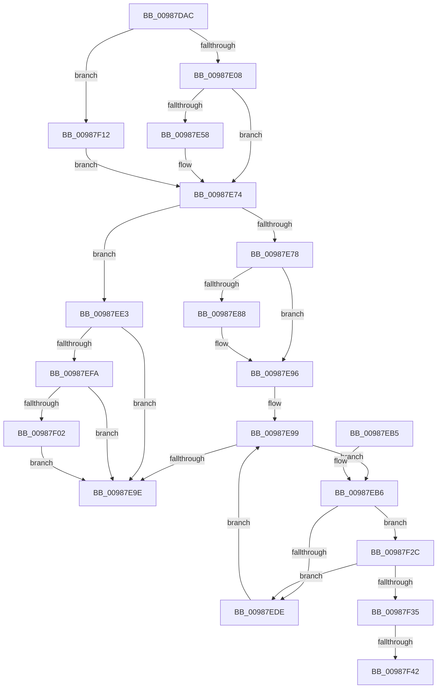

# MiReadImageHeaders

- RVA: `0x00987DAC`–`0x00987F69` (길이 `445` bytes)
- VA: `0x0000000140987DAC`
- 실행 섹션: `PAGE`
- PDB 이름 있음: `예`; PDB Function 태그: `예`
- unwind 정보 RVA: `0x00097D4C`
- 디코드: `119`개 명령, `445/445` bytes 표시
- 미해석 바이트: `0` (있으면 어셈블리에 `.byte`로 보존)

> 이 문서는 커널 이미지의 기계어와 PDB 기호를 분석해 생성했습니다. 4번과 5번은 함수 원형과 자료형을 바이너리 사용 방식에서 추정한 C 해석이며 원본 소스 복구 결과는 아닙니다.

## 1. Dependencies

- 직접 호출 지점: **6**; 고유 호출 대상: **6**
- 직접 호출자로 확인된 함수: **2**
- RIP 상대 이미지 참조: **1**

### Outgoing calls
- `0x00987E1F` → [KeInitializeEvent](../../text/40/KeInitializeEvent_function_0040DD10.md) (function, `0x0040DD10`)
- `0x00987E4A` → [MiPageRead](../../text/29/MiPageRead_function_0029A554.md) (function, `0x0029A554`)
- `0x00987E6D` → [KeWaitForSingleObject](../../text/20/KeWaitForSingleObject_function_0020E6B0.md) (function, `0x0020E6B0`)
- `0x00987E91` → [memset](../../text/6C/memset_function_006C6C40.md) (function, `0x006C6C40`)
- `0x00987EF1` → [MiIsRetryIoStatus](../../text/40/MiIsRetryIoStatus_function_00408640.md) (function, `0x00408640`)
- `0x00987F20` → [MiCopyFromDirectMapExtent](../80/MiCopyFromDirectMapExtent_function_00800D24.md) (function, `0x00800D24`)

### Direct callers
- [MiCreateImageFileMap](MiCreateImageFileMap_function_00986830.md) at `0x00986D2C`
- [sub_00B2B0A8](../B2/Unknown_function_00B2B0A8.md) at `0x00B2B192`
- [sub_00B2B0A8](../B2/Unknown_function_00B2B0A8.md) at `0x00B2B2D2`

### Static image references
- `0x00987EE5` → RVA `0x00E2D7F8` (`.data`; write)

## 2. Other-region calls and transfers

- 다른 실행 섹션으로 향하는 call: **5**
  - `0x00987E1F` → [KeInitializeEvent](../../text/40/KeInitializeEvent_function_0040DD10.md) (`PAGE` → `.text`)
  - `0x00987E4A` → [MiPageRead](../../text/29/MiPageRead_function_0029A554.md) (`PAGE` → `.text`)
  - `0x00987E6D` → [KeWaitForSingleObject](../../text/20/KeWaitForSingleObject_function_0020E6B0.md) (`PAGE` → `.text`)
  - `0x00987E91` → [memset](../../text/6C/memset_function_006C6C40.md) (`PAGE` → `.text`)
  - `0x00987EF1` → [MiIsRetryIoStatus](../../text/40/MiIsRetryIoStatus_function_00408640.md) (`PAGE` → `.text`)
- call이 아닌 외부 분기/꼬리 이동: **2**
  - `0x00987F3C` → [sub_00B2B49E](../B2/Unknown_function_00B2B49E.md) (`tail-transfer`)
  - `0x00987F64` → [sub_00B2B49E + 0x25](../B2/Unknown_function_00B2B49E.md) (`tail-transfer`)

## 3. Assembly (complete function range)

```asm
00987DAC  48 89 5C 24 08                  mov qword ptr [rsp + 8], rbx
00987DB1  48 89 6C 24 18                  mov qword ptr [rsp + 0x18], rbp
00987DB6  56                              push rsi
00987DB7  57                              push rdi
00987DB8  41 56                           push r14
00987DBA  48 83 EC 60                     sub rsp, 0x60
00987DBE  45 8B 50 18                     mov r10d, dword ptr [r8 + 0x18]
00987DC2  49 8B F9                        mov rdi, r9
00987DC5  45 8B 70 28                     mov r14d, dword ptr [r8 + 0x28]
00987DC9  41 81 E2 FF 0F 00 00            and r10d, 0xfff
00987DD0  49 8B 68 10                     mov rbp, qword ptr [r8 + 0x10]
00987DD4  49 81 C6 FF 0F 00 00            add r14, 0xfff
00987DDB  49 83 61 08 00                  and qword ptr [r9 + 8], 0
00987DE0  4D 03 F2                        add r14, r10
00987DE3  48 8B C5                        mov rax, rbp
00987DE6  49 C1 EE 0C                     shr r14, 0xc
00987DEA  48 C1 E0 0C                     shl rax, 0xc
00987DEE  49 8B F0                        mov rsi, r8
00987DF1  48 89 84 24 88 00 00 00         mov qword ptr [rsp + 0x88], rax
00987DF9  4C 8B DA                        mov r11, rdx
00987DFC  48 8B D9                        mov rbx, rcx
00987DFF  48 85 D2                        test rdx, rdx
00987E02  0F 85 0A 01 00 00               jne 0x140987f12
00987E08  0F 57 C0                        xorps xmm0, xmm0
00987E0B  48 8D 4C 24 40                  lea rcx, [rsp + 0x40]
00987E10  33 C0                           xor eax, eax
00987E12  45 33 C0                        xor r8d, r8d
00987E15  0F 11 44 24 40                  movups xmmword ptr [rsp + 0x40], xmm0
00987E1A  48 89 44 24 50                  mov qword ptr [rsp + 0x50], rax
00987E1F  E8 EC 5E A8 FF                  call 0x14040dd10
00987E24  48 83 64 24 30 00               and qword ptr [rsp + 0x30], 0
00987E2A  4C 8D 4C 24 40                  lea r9, [rsp + 0x40]
00987E2F  C7 44 24 28 02 00 00 00         mov dword ptr [rsp + 0x28], 2
00987E37  4C 8D 84 24 88 00 00 00         lea r8, [rsp + 0x88]
00987E3F  48 8B D6                        mov rdx, rsi
00987E42  48 89 7C 24 20                  mov qword ptr [rsp + 0x20], rdi
00987E47  48 8B CB                        mov rcx, rbx
00987E4A  E8 05 27 91 FF                  call 0x14029a554
00987E4F  8B D8                           mov ebx, eax
00987E51  3D 03 01 00 00                  cmp eax, 0x103
00987E56  75 1C                           jne 0x140987e74
00987E58  48 83 64 24 20 00               and qword ptr [rsp + 0x20], 0
00987E5E  48 8D 4C 24 40                  lea rcx, [rsp + 0x40]
00987E63  45 33 C9                        xor r9d, r9d
00987E66  45 33 C0                        xor r8d, r8d
00987E69  41 8D 51 09                     lea edx, [r9 + 9]
00987E6D  E8 3E 68 88 FF                  call 0x14020e6b0
00987E72  8B 1F                           mov ebx, dword ptr [rdi]
00987E74  85 DB                           test ebx, ebx
00987E76  78 6B                           js 0x140987ee3
00987E78  48 8B 4F 08                     mov rcx, qword ptr [rdi + 8]
00987E7C  4D 8B C6                        mov r8, r14
00987E7F  49 C1 E0 0C                     shl r8, 0xc
00987E83  49 3B C8                        cmp rcx, r8
00987E86  74 0E                           je 0x140987e96
00987E88  4C 2B C1                        sub r8, rcx
00987E8B  33 D2                           xor edx, edx
00987E8D  48 03 4E 18                     add rcx, qword ptr [rsi + 0x18]
00987E91  E8 AA ED D3 FF                  call 0x1406c6c40
00987E96  48 8B 3E                        mov rdi, qword ptr [rsi]
00987E99  48 85 FF                        test rdi, rdi
00987E9C  75 18                           jne 0x140987eb6
00987E9E  4C 8D 5C 24 60                  lea r11, [rsp + 0x60]
00987EA3  8B C3                           mov eax, ebx
00987EA5  49 8B 5B 20                     mov rbx, qword ptr [r11 + 0x20]
00987EA9  49 8B 6B 30                     mov rbp, qword ptr [r11 + 0x30]
00987EAD  49 8B E3                        mov rsp, r11
00987EB0  41 5E                           pop r14
00987EB2  5F                              pop rdi
00987EB3  5E                              pop rsi
00987EB4  C3                              ret
00987EB5  CC                              int3
00987EB6  8B 4F 18                        mov ecx, dword ptr [rdi + 0x18]
00987EB9  44 8B 57 28                     mov r10d, dword ptr [rdi + 0x28]
00987EBD  81 E1 FF 0F 00 00               and ecx, 0xfff
00987EC3  4C 8B 4F 10                     mov r9, qword ptr [rdi + 0x10]
00987EC7  49 81 C2 FF 0F 00 00            add r10, 0xfff
00987ECE  4C 03 D1                        add r10, rcx
00987ED1  49 C1 EA 0C                     shr r10, 0xc
00987ED5  4B 8D 04 0A                     lea rax, [r10 + r9]
00987ED9  48 3B E8                        cmp rbp, rax
00987EDC  72 4E                           jb 0x140987f2c
00987EDE  48 8B 3F                        mov rdi, qword ptr [rdi]
00987EE1  EB B6                           jmp 0x140987e99
00987EE3  33 D2                           xor edx, edx
00987EE5  C7 05 09 59 4A 00 20 00 00 00   mov dword ptr [rip + 0x4a5909], 0x20
00987EEF  8B CB                           mov ecx, ebx
00987EF1  E8 4A 07 A8 FF                  call 0x140408640
00987EF6  85 C0                           test eax, eax
00987EF8  75 A4                           jne 0x140987e9e
00987EFA  81 FB 54 00 00 C0               cmp ebx, 0xc0000054
00987F00  74 9C                           je 0x140987e9e
00987F02  81 FB 67 02 00 C0               cmp ebx, 0xc0000267
00987F08  B8 20 00 00 C0                  mov eax, 0xc0000020
00987F0D  0F 45 D8                        cmovne ebx, eax
00987F10  EB 8C                           jmp 0x140987e9e
00987F12  4C 8D 84 24 88 00 00 00         lea r8, [rsp + 0x88]
00987F1A  48 8B D6                        mov rdx, rsi
00987F1D  49 8B CB                        mov rcx, r11
00987F20  E8 FF 8D E7 FF                  call 0x140800d24
00987F25  8B D8                           mov ebx, eax
00987F27  E9 48 FF FF FF                  jmp 0x140987e74
00987F2C  49 8D 04 2E                     lea rax, [r14 + rbp]
00987F30  49 3B C1                        cmp rax, r9
00987F33  76 A9                           jbe 0x140987ede
00987F35  48 8B 4F 18                     mov rcx, qword ptr [rdi + 0x18]
00987F39  4C 3B CD                        cmp r9, rbp
00987F3C  0F 87 5C 35 1A 00               ja 0x140b2b49e
00987F42  48 8B D5                        mov rdx, rbp
00987F45  4D 8B C6                        mov r8, r14
00987F48  49 2B D1                        sub rdx, r9
00987F4B  4C 2B D2                        sub r10, rdx
00987F4E  4D 3B D6                        cmp r10, r14
00987F51  4D 0F 46 C2                     cmovbe r8, r10
00987F55  48 C1 E2 0C                     shl rdx, 0xc
00987F59  49 C1 E0 0C                     shl r8, 0xc
00987F5D  48 03 D1                        add rdx, rcx
00987F60  48 8B 4E 18                     mov rcx, qword ptr [rsi + 0x18]
00987F64  E9 5A 35 1A 00                  jmp 0x140b2b4c3
```

## 4. C-style interpretation (structured pseudocode)

```c
__int64 __fastcall MiReadImageHeaders(__int64 a1, __int64 a2, __int64 a3, __int64 a4)
{
    __int64 result;
    __int64 v_r10;
    __int64 v_r14;
    __int64 v_rbx;
    __int64 v_rsp;
    unsigned __int64 v_stack_m18;
    unsigned __int64 v_stack_m28;
    unsigned __int64 v_stack_m38;
    unsigned __int64 v_stack_m48;
    unsigned int v_stack_m50;
    unsigned __int64 v_stack_m58;
    unsigned __int64 v_stack_p10;
    unsigned __int64 v_stack_p18;
    unsigned __int64 v_stack_p28;
    unsigned __int64 v_stack_p8;

    v_stack_p8 = v_rbx;
    v_stack_p18 = v_rbp;
    v_rsp = (v_rsp) - (96);
    v_r10 = (unsigned int)(((unsigned int)(*(unsigned int *)(a3 + 24))) & (0xFFFULL));
    v_r14 = ((unsigned int)(*(unsigned int *)(a3 + 40))) + (0xFFFULL);
    v_r14 = (v_r14) + (v_r10);
    v_r14 = (v_r14) >> (12);
    result = (*(unsigned __int64 *)(a3 + 16)) << (12);
    v_stack_p10 = result;
    if (a2 != 0) goto loc_00987F12;
    result = 0;
    a3 = 0;
    v_stack_m38 = v_xmm0;
    v_stack_m28 = 0;
    result = KeInitializeEvent(v_stack_m38, a2, a3, a4);
    v_stack_m50 = 2;
    v_stack_m58 = a4;
    result = MiPageRead(a1, 0, v_stack_p10, v_stack_m38);
    v_rbx = (unsigned int)((unsigned int)(result));
    if (((unsigned int)(result)) == 259) {
        a1 = v_stack_m38;
        a4 = 0;
        a3 = 0;
        a2 = a4 + 9;
        result = KeWaitForSingleObject(a1, a2, a3, a4);
        v_rbx = *(unsigned int *)(a4);
    }
    if (sign_flag) goto loc_00987EE3;
    a3 = (v_r14) << (12);
    if ((*(unsigned __int64 *)(a4 + 8)) != a3) {
        a3 = (a3) - (*(unsigned __int64 *)(a4 + 8));
        a2 = 0;
        a1 = (*(unsigned __int64 *)(a4 + 8)) + (*(unsigned __int64 *)(a3 + 24));
        result = memset(a1, a2, a3, a4);
    }
loc_00987E99:
    if (*(unsigned __int64 *)(a3) != 0) goto loc_00987EB6;
loc_00987E9E:
    return (unsigned int)((unsigned int)(v_rbx));
loc_00987EB6:
    a1 = (unsigned int)(((unsigned int)(*(unsigned int *)(*(unsigned __int64 *)(a3) + 24))) & (0xFFFULL));
    v_r10 = ((unsigned int)(*(unsigned int *)(*(unsigned __int64 *)(a3) + 40))) + (0xFFFULL);
    v_r10 = (v_r10) + (a1);
    v_r10 = (v_r10) >> (12);
    if ((*(unsigned __int64 *)(v_stack_m18 + 48)) < (v_r10 + *(unsigned __int64 *)(*(unsigned __int64 *)(a3) + 16) * 1)) goto loc_00987F2C;
loc_00987EDE:
    goto loc_00987E99;
loc_00987EE3:
    a2 = 0;
    *(unsigned int *)(v_rip + 4872457) = 32;
    result = MiIsRetryIoStatus((unsigned int)((unsigned int)(*(unsigned __int64 *)(v_stack_m18 + 32))), a2, a3, *(unsigned __int64 *)(*(unsigned __int64 *)(a3) + 16));
    if ((unsigned int)(result) != 0) goto loc_00987E9E;
    if (((unsigned int)(*(unsigned __int64 *)(v_stack_m18 + 32))) == 0xC0000054ULL) goto loc_00987E9E;
    v_rbx = *(unsigned __int64 *)(v_stack_m18 + 32);
    if (((unsigned int)(*(unsigned __int64 *)(v_stack_m18 + 32))) != 0xC0000267ULL) { v_rbx = (unsigned int)((unsigned int)(0xC0000020ULL)); }
    goto loc_00987E9E;
loc_00987F12:
    result = MiCopyFromDirectMapExtent(v_stack_m18, a3, v_stack_p28, *(unsigned __int64 *)(*(unsigned __int64 *)(a3) + 16));
    goto loc_00987E74;
loc_00987F2C:
    if ((v_r14 + *(unsigned __int64 *)(v_stack_m18 + 48) * 1) <= (*(unsigned __int64 *)(*(unsigned __int64 *)(a3) + 16))) goto loc_00987EDE;
    a2 = (*(unsigned __int64 *)(v_stack_m18 + 48)) - (*(unsigned __int64 *)(*(unsigned __int64 *)(a3) + 16));
    v_r10 = (v_r10) - (a2);
    a3 = v_r14;
    if (v_r10 <= v_r14) { a3 = v_r10; }
    a2 = (a2) << (12);
    a3 = (a3) << (12);
    a2 = (a2) + (*(unsigned __int64 *)(*(unsigned __int64 *)(*(unsigned __int64 *)(a3)) + 24));
}
```

## 5. (Beta) C Style

```c
int64_t MiReadImageHeaders(int64_t Arg1, int64_t Arg2, void *Arg3, void *Arg4)
{
    uint8_t *arg3 = (uint8_t *)Arg3;
    uint8_t *arg4 = (uint8_t *)Arg4;

    int64_t result;
    int64_t local_r10;
    int64_t local_r14;
    int64_t local_rbx;
    int64_t local_rsp;
    uint64_t v_stack_m18;
    uint64_t v_stack_m28;
    uint64_t v_stack_m38;
    uint64_t v_stack_m48;
    uint32_t v_stack_m50;
    uint64_t v_stack_m58;
    uint64_t v_stack_p10;
    uint64_t v_stack_p18;
    uint64_t v_stack_p28;
    uint64_t v_stack_p8;

    v_stack_p8 = local_rbx;
    v_stack_p18 = local_rbp;
    local_rsp = (local_rsp) - (96);
    local_r10 = (uint32_t)(((uint32_t)(*(uint32_t *)(arg3 + 0x18))) & (0xFFFULL));
    local_r14 = ((uint32_t)(*(uint32_t *)(arg3 + 0x28))) + (0xFFFULL);
    local_r14 = (local_r14) + (local_r10);
    local_r14 = (local_r14) >> (12);
    result = (*(uint64_t *)(arg3 + 0x10)) << (12);
    v_stack_p10 = result;
    if (Arg2 != 0) goto loc_00987F12;
    result = 0;
    Arg3 = 0;
    v_stack_m38 = v_xmm0;
    v_stack_m28 = 0;
    result = KeInitializeEvent(v_stack_m38, Arg2, Arg3, Arg4);
    v_stack_m50 = 2;
    v_stack_m58 = Arg4;
    result = MiPageRead(Arg1, 0, v_stack_p10, v_stack_m38);
    local_rbx = (uint32_t)((uint32_t)(result));
    if (((uint32_t)(result)) == 259) {
        Arg1 = v_stack_m38;
        Arg4 = 0;
        Arg3 = 0;
        Arg2 = Arg4 + 9;
        result = KeWaitForSingleObject(Arg1, Arg2, Arg3, Arg4);
        local_rbx = *(uint32_t *)(arg4);
    }
    if (sign_flag) goto loc_00987EE3;
    Arg3 = (local_r14) << (12);
    if ((*(uint64_t *)(arg4 + 0x8)) != Arg3) {
        Arg3 = (Arg3) - (*(uint64_t *)(arg4 + 0x8));
        Arg2 = 0;
        Arg1 = (*(uint64_t *)(arg4 + 0x8)) + (*(uint64_t *)(arg3 + 0x18));
        result = memset(Arg1, Arg2, Arg3, Arg4);
    }
loc_00987E99:
    if (*(uint64_t *)(arg3) != 0) goto loc_00987EB6;
loc_00987E9E:
    return (uint32_t)((uint32_t)(local_rbx));
loc_00987EB6:
    Arg1 = (uint32_t)(((uint32_t)(*(uint32_t *)(*(uint64_t *)(arg3) + 0x18))) & (0xFFFULL));
    local_r10 = ((uint32_t)(*(uint32_t *)(*(uint64_t *)(arg3) + 0x28))) + (0xFFFULL);
    local_r10 = (local_r10) + (Arg1);
    local_r10 = (local_r10) >> (12);
    if ((*(uint64_t *)(v_stack_m18 + 0x30)) < (local_r10 + *(uint64_t *)(*(uint64_t *)(arg3) + 0x10) * 1)) goto loc_00987F2C;
loc_00987EDE:
    goto loc_00987E99;
loc_00987EE3:
    Arg2 = 0;
    *(uint32_t *)(v_rip + 0x4A5909) = 32;
    result = MiIsRetryIoStatus((uint32_t)((uint32_t)(*(uint64_t *)(v_stack_m18 + 0x20))), Arg2, Arg3, *(uint64_t *)(*(uint64_t *)(arg3) + 0x10));
    if ((uint32_t)(result) != 0) goto loc_00987E9E;
    if (((uint32_t)(*(uint64_t *)(v_stack_m18 + 0x20))) == 0xC0000054ULL) goto loc_00987E9E;
    local_rbx = *(uint64_t *)(v_stack_m18 + 0x20);
    if (((uint32_t)(*(uint64_t *)(v_stack_m18 + 0x20))) != 0xC0000267ULL) { local_rbx = (uint32_t)((uint32_t)(0xC0000020ULL)); }
    goto loc_00987E9E;
loc_00987F12:
    result = MiCopyFromDirectMapExtent(v_stack_m18, Arg3, v_stack_p28, *(uint64_t *)(*(uint64_t *)(arg3) + 0x10));
    goto loc_00987E74;
loc_00987F2C:
    if ((local_r14 + *(uint64_t *)(v_stack_m18 + 0x30) * 1) <= (*(uint64_t *)(*(uint64_t *)(arg3) + 0x10))) goto loc_00987EDE;
    Arg2 = (*(uint64_t *)(v_stack_m18 + 0x30)) - (*(uint64_t *)(*(uint64_t *)(arg3) + 0x10));
    local_r10 = (local_r10) - (Arg2);
    Arg3 = local_r14;
    if (local_r10 <= local_r14) { Arg3 = local_r10; }
    Arg2 = (Arg2) << (12);
    Arg3 = (Arg3) << (12);
    Arg2 = (Arg2) + (*(uint64_t *)(*(uint64_t *)(*(uint64_t *)(arg3)) + 0x18));
}
```

### 관측된 메모리 오프셋

구조체 형식이 확인되지 않은 접근은 인자 기준의 오프셋으로만 기록했습니다.

| 기준 인자 | 오프셋 표현 | 폭 (bit) | 접근 |
|---|---:|---:|---|
| `Arg3` | `+ 0x0` | `64` | `R` |
| `Arg3` | `+ 0x10` | `64` | `R` |
| `Arg3` | `+ 0x18` | `32` | `R` |
| `Arg3` | `+ 0x18` | `64` | `R` |
| `Arg3` | `+ 0x28` | `32` | `R` |
| `Arg4` | `+ 0x0` | `32` | `R` |
| `Arg4` | `+ 0x8` | `64` | `R` |
| `Arg4` | `+ 0x8` | `64` | `R/W` |

## 6. Execution-region graph

[열기: 2D/3D 그래프와 함수 탐색 컨트롤 패널](../../../control-panel.html?section=page&rva=0x00987DAC&view=graph)

- 2D 그래프는 위에서 아래로 흐르고, 3D 그래프는 빈 공간을 드래그해 회전합니다. Shift+드래그는 이동, 휠은 확대·축소, 함수 노드 선택은 대상 보고서 이동입니다.

### Static fallback


