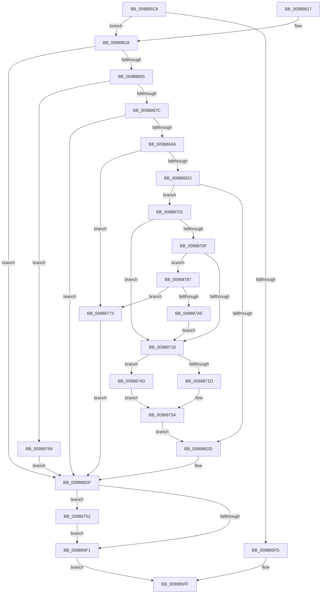

# MiRelocateImageAgain

- RVA: `0x009885C8`–`0x009887AA` (길이 `482` bytes)
- VA: `0x00000001409885C8`
- 실행 섹션: `PAGE`
- PDB 이름 있음: `예`; PDB Function 태그: `아니요`
- unwind 정보 RVA: `0x00097DD8`
- 디코드: `126`개 명령, `482/482` bytes 표시
- 미해석 바이트: `0` (있으면 어셈블리에 `.byte`로 보존)

> 이 문서는 커널 이미지의 기계어와 PDB 기호를 분석해 생성했습니다. 4번과 5번은 함수 원형과 자료형을 바이너리 사용 방식에서 추정한 C 해석이며 원본 소스 복구 결과는 아닙니다.

## 1. Dependencies

- 직접 호출 지점: **12**; 고유 호출 대상: **12**
- 직접 호출자로 확인된 함수: **1**
- RIP 상대 이미지 참조: **2**

### Outgoing calls
- `0x00988643` → [MI_LOCK_RELOCATIONS_EXCLUSIVE](../../text/46/MI_LOCK_RELOCATIONS_EXCLUSIVE_function_004650F8.md) (function, `0x004650F8`)
- `0x0098866B` → [MiReservePtes](../../text/31/MiReservePtes_function_00318D20.md) (function, `0x00318D20`)
- `0x0098869B` → [MiSelectImageBase](MiSelectImageBase_function_009887B0.md) (function, `0x009887B0`)
- `0x009886AE` → [MiGetControlAreaLoadConfig](../../text/46/MiGetControlAreaLoadConfig_function_0046E9D4.md) (function, `0x0046E9D4`)
- `0x009886C4` → [MiUpdateImageSystemWideBitmaps](../8C/MiUpdateImageSystemWideBitmaps_function_008CE540.md) (function, `0x008CE540`)
- `0x009886E7` → [MI_UNLOCK_RELOCATIONS_EXCLUSIVE](../../text/46/MI_UNLOCK_RELOCATIONS_EXCLUSIVE_function_0046965C.md) (function, `0x0046965C`)
- `0x009886F6` → [MiReturnImageBase](MiReturnImageBase_function_00988B00.md) (function, `0x00988B00`)
- `0x0098872D` → [PsGetProcessSessionIdEx](../../text/22/PsGetProcessSessionIdEx_function_0022F8F0.md) (function, `0x0022F8F0`)
- `0x00988746` → [MiSwitchBaseAddress](MiSwitchBaseAddress_function_00988CDC.md) (function, `0x00988CDC`)
- `0x00988762` → [MiReleasePtes](../../text/24/MiReleasePtes_function_00247240.md) (function, `0x00247240`)
- `0x0098877D` → [MiImageUnused](../../text/47/MiImageUnused_function_0047AD6C.md) (function, `0x0047AD6C`)
- `0x0098879A` → [SeSetImageBaseAddress](../AA/SeSetImageBaseAddress_function_00AA8898.md) (function, `0x00AA8898`)

### Direct callers
- [MiValidateExistingImage](MiValidateExistingImage_function_009864B4.md) at `0x00986505`

### Static image references
- `0x0098865C` → RVA `0x00E37668` (`.data`; read)
- `0x00988702` → RVA `0x00FC6A88` (`ALMOSTRO`; read)

## 2. Other-region calls and transfers

- 다른 실행 섹션으로 향하는 call: **7**
  - `0x00988643` → [MI_LOCK_RELOCATIONS_EXCLUSIVE](../../text/46/MI_LOCK_RELOCATIONS_EXCLUSIVE_function_004650F8.md) (`PAGE` → `.text`)
  - `0x0098866B` → [MiReservePtes](../../text/31/MiReservePtes_function_00318D20.md) (`PAGE` → `.text`)
  - `0x009886AE` → [MiGetControlAreaLoadConfig](../../text/46/MiGetControlAreaLoadConfig_function_0046E9D4.md) (`PAGE` → `.text`)
  - `0x009886E7` → [MI_UNLOCK_RELOCATIONS_EXCLUSIVE](../../text/46/MI_UNLOCK_RELOCATIONS_EXCLUSIVE_function_0046965C.md) (`PAGE` → `.text`)
  - `0x0098872D` → [PsGetProcessSessionIdEx](../../text/22/PsGetProcessSessionIdEx_function_0022F8F0.md) (`PAGE` → `.text`)
  - `0x00988762` → [MiReleasePtes](../../text/24/MiReleasePtes_function_00247240.md) (`PAGE` → `.text`)
  - `0x0098877D` → [MiImageUnused](../../text/47/MiImageUnused_function_0047AD6C.md) (`PAGE` → `.text`)
- 별도 외부 분기/꼬리 이동을 확인하지 못했습니다.

## 3. Assembly (complete function range)

```asm
009885C8  48 8B C4                        mov rax, rsp
009885CB  48 89 58 10                     mov qword ptr [rax + 0x10], rbx
009885CF  55                              push rbp
009885D0  56                              push rsi
009885D1  57                              push rdi
009885D2  41 54                           push r12
009885D4  41 55                           push r13
009885D6  41 56                           push r14
009885D8  41 57                           push r15
009885DA  48 83 EC 50                     sub rsp, 0x50
009885DE  48 8B 69 60                     mov rbp, qword ptr [rcx + 0x60]
009885E2  41 8B F0                        mov esi, r8d
009885E5  48 83 60 08 00                  and qword ptr [rax + 8], 0
009885EA  48 83 E5 F8                     and rbp, 0xfffffffffffffff8
009885EE  44 8B E2                        mov r12d, edx
009885F1  48 8B D9                        mov rbx, rcx
009885F4  4C 8B 7D 20                     mov r15, qword ptr [rbp + 0x20]
009885F8  4D 85 FF                        test r15, r15
009885FB  75 1B                           jne 0x140988618
009885FD  33 C0                           xor eax, eax
009885FF  48 8B 9C 24 98 00 00 00         mov rbx, qword ptr [rsp + 0x98]
00988607  48 83 C4 50                     add rsp, 0x50
0098860B  41 5F                           pop r15
0098860D  41 5E                           pop r14
0098860F  41 5D                           pop r13
00988611  41 5C                           pop r12
00988613  5F                              pop rdi
00988614  5E                              pop rsi
00988615  5D                              pop rbp
00988616  C3                              ret
00988617  CC                              int3
00988618  65 48 8B 04 25 88 01 00 00      mov rax, qword ptr gs:[0x188]
00988621  0F 57 C0                        xorps xmm0, xmm0
00988624  4C 8B 29                        mov r13, qword ptr [rcx]
00988627  49 8B D7                        mov rdx, r15
0098862A  48 83 4C 24 38 FF               or qword ptr [rsp + 0x38], 0xffffffffffffffff
00988630  48 8B C8                        mov rcx, rax
00988633  45 33 F6                        xor r14d, r14d
00988636  48 89 44 24 30                  mov qword ptr [rsp + 0x30], rax
0098863B  33 FF                           xor edi, edi
0098863D  F3 0F 7F 44 24 40               movdqu xmmword ptr [rsp + 0x40], xmm0
00988643  E8 B0 CA AD FF                  call 0x1404650f8
00988648  F7 43 5C 00 00 40 00            test dword ptr [rbx + 0x5c], 0x400000
0098864F  0F 85 8A 00 00 00               jne 0x1409886df
00988655  49 8B 45 20                     mov rax, qword ptr [r13 + 0x20]
00988659  8D 57 01                        lea edx, [rdi + 1]
0098865C  48 8D 0D 05 F0 4A 00            lea rcx, [rip + 0x4af005]
00988663  48 89 84 24 A8 00 00 00         mov qword ptr [rsp + 0xa8], rax
0098866B  E8 B0 06 99 FF                  call 0x140318d20
00988670  4C 8B F0                        mov r14, rax
00988673  48 85 C0                        test rax, rax
00988676  0F 84 ED 00 00 00               je 0x140988769
0098867C  48 8D 84 24 90 00 00 00         lea rax, [rsp + 0x90]
00988684  F7 DE                           neg esi
00988686  45 8B C4                        mov r8d, r12d
00988689  48 89 44 24 20                  mov qword ptr [rsp + 0x20], rax
0098868E  45 1B C9                        sbb r9d, r9d
00988691  49 8B D7                        mov rdx, r15
00988694  41 83 E1 02                     and r9d, 2
00988698  49 8B CD                        mov rcx, r13
0098869B  E8 10 01 00 00                  call 0x1409887b0
009886A0  8B F8                           mov edi, eax
009886A2  85 C0                           test eax, eax
009886A4  78 39                           js 0x1409886df
009886A6  0F BA 6B 5C 16                  bts dword ptr [rbx + 0x5c], 0x16
009886AB  48 8B CB                        mov rcx, rbx
009886AE  E8 21 63 AE FF                  call 0x14046e9d4
009886B3  48 8B B4 24 90 00 00 00         mov rsi, qword ptr [rsp + 0x90]
009886BB  4C 8B C0                        mov r8, rax
009886BE  48 8B D6                        mov rdx, rsi
009886C1  48 8B CB                        mov rcx, rbx
009886C4  E8 77 5E F4 FF                  call 0x1408ce540
009886C9  8B F8                           mov edi, eax
009886CB  85 C0                           test eax, eax
009886CD  0F 88 A0 00 00 00               js 0x140988773
009886D3  48 3B B4 24 A8 00 00 00         cmp rsi, qword ptr [rsp + 0xa8]
009886DB  75 25                           jne 0x140988702
009886DD  33 FF                           xor edi, edi
009886DF  48 8B 4C 24 30                  mov rcx, qword ptr [rsp + 0x30]
009886E4  49 8B D7                        mov rdx, r15
009886E7  E8 70 0F AE FF                  call 0x14046965c
009886EC  4D 85 F6                        test r14, r14
009886EF  75 61                           jne 0x140988752
009886F1  48 8D 4C 24 38                  lea rcx, [rsp + 0x38]
009886F6  E8 05 04 00 00                  call 0x140988b00
009886FB  8B C7                           mov eax, edi
009886FD  E9 FD FE FF FF                  jmp 0x1409885ff
00988702  48 F7 05 7B E3 63 00 00 20 00 00  test qword ptr [rip + 0x63e37b], 0x2000
0098870D  74 09                           je 0x140988718
0098870F  F7 43 5C 00 00 0C 00            test dword ptr [rbx + 0x5c], 0xc0000
00988716  75 6F                           jne 0x140988787
00988718  45 85 E4                        test r12d, r12d
0098871B  75 30                           jne 0x14098874d
0098871D  65 48 8B 0C 25 88 01 00 00      mov rcx, qword ptr gs:[0x188]
00988726  48 8B 89 B8 00 00 00            mov rcx, qword ptr [rcx + 0xb8]
0098872D  E8 BE 71 8A FF                  call 0x14022f8f0
00988732  48 8B B4 24 90 00 00 00         mov rsi, qword ptr [rsp + 0x90]
0098873A  44 8B C8                        mov r9d, eax
0098873D  4D 8B C6                        mov r8, r14
00988740  48 8B D6                        mov rdx, rsi
00988743  48 8B CB                        mov rcx, rbx
00988746  E8 91 05 00 00                  call 0x140988cdc
0098874B  EB 90                           jmp 0x1409886dd
0098874D  83 C8 FF                        or eax, 0xffffffff
00988750  EB E8                           jmp 0x14098873a
00988752  41 B8 01 00 00 00               mov r8d, 1
00988758  48 8D 0D 09 EF 4A 00            lea rcx, [rip + 0x4aef09]
0098875F  49 8B D6                        mov rdx, r14
00988762  E8 D9 EA 8B FF                  call 0x140247240
00988767  EB 88                           jmp 0x1409886f1
00988769  0F BA 6B 5C 16                  bts dword ptr [rbx + 0x5c], 0x16
0098876E  E9 6C FF FF FF                  jmp 0x1409886df
00988773  4C 8D 44 24 38                  lea r8, [rsp + 0x38]
00988778  33 D2                           xor edx, edx
0098877A  48 8B CB                        mov rcx, rbx
0098877D  E8 EA 25 AF FF                  call 0x14047ad6c
00988782  E9 58 FF FF FF                  jmp 0x1409886df
00988787  48 8B 4D 28                     mov rcx, qword ptr [rbp + 0x28]
0098878B  48 8B B4 24 90 00 00 00         mov rsi, qword ptr [rsp + 0x90]
00988793  48 83 E1 F8                     and rcx, 0xfffffffffffffff8
00988797  48 8B D6                        mov rdx, rsi
0098879A  E8 F9 00 12 00                  call 0x140aa8898
0098879F  8B F8                           mov edi, eax
009887A1  85 C0                           test eax, eax
009887A3  78 CE                           js 0x140988773
009887A5  E9 6E FF FF FF                  jmp 0x140988718
```

## 4. C-style interpretation (structured pseudocode)

```c
__int64 __fastcall MiRelocateImageAgain(__int64 a1, int a2, int a3, int a4)
{
    __int64 result;
    __int64 v_r14;
    __int64 v_rbp;
    __int64 v_rdi;
    __int64 v_rsi;
    __int64 v_rsp;
    unsigned __int64 v_stack_p10;
    unsigned __int64 v_stack_p20;
    unsigned __int64 v_stack_p30;
    unsigned __int64 v_stack_p38;
    unsigned __int64 v_stack_p40;
    unsigned __int64 v_stack_p90;
    unsigned __int64 v_stack_pA8;

    *(unsigned __int64 *)(v_rsp + 16) = v_rbx;
    v_rsp = (v_rsp) - (80);
    v_rbp = (*(unsigned __int64 *)(a1 + 96)) & (-8);
    if (*(unsigned __int64 *)(v_rbp + 32) != 0) goto loc_00988618;
    result = 0;
loc_009885FF:
    v_rsp = (v_rsp) + (80);
    return result;
loc_00988618:
    v_r14 = 0;
    v_stack_p30 = *(unsigned __int64 *)(gs_base + (0 + 392));
    v_rdi = 0;
    v_stack_p40 = v_xmm0;
    result = MI_LOCK_RELOCATIONS_EXCLUSIVE(*(unsigned __int64 *)(gs_base + (0 + 392)), *(unsigned __int64 *)(v_rbp + 32), a3, a4);
    if (((*(unsigned int *)(v_stack_p10 + 92)) & (0x400000ULL)) != 0) goto loc_009886DF;
    v_stack_pA8 = *(unsigned __int64 *)(*(unsigned __int64 *)(a1) + 32);
    result = MiReservePtes(v_rip + 4911109, v_rdi + 1, a3, a4);
    if (result == 0) goto loc_00988769;
    v_rsi = (unsigned int)(-((unsigned int)(a3)));
    v_stack_p20 = v_stack_p90;
    a4 = (unsigned int)((a4) & (2));
    result = MiSelectImageBase(*(unsigned __int64 *)(a1), *(unsigned __int64 *)(v_rbp + 32), (unsigned int)((unsigned int)((unsigned int)(a2))), a4);
    if (sign_flag) goto loc_009886DF;
    result = MiGetControlAreaLoadConfig(v_stack_p10, *(unsigned __int64 *)(v_rbp + 32), (unsigned int)((unsigned int)((unsigned int)(a2))), a4);
    result = MiUpdateImageSystemWideBitmaps(v_stack_p10, v_stack_p90, result, a4);
    if (sign_flag) goto loc_00988773;
    if (v_stack_p90 != v_stack_pA8) goto loc_00988702;
loc_009886DD:
    v_rdi = 0;
loc_009886DF:
    result = MI_UNLOCK_RELOCATIONS_EXCLUSIVE(v_stack_p30, *(unsigned __int64 *)(v_rbp + 32), result, a4);
    if (result != 0) goto loc_00988752;
loc_009886F1:
    result = MiReturnImageBase(v_stack_p38, *(unsigned __int64 *)(v_rbp + 32), result, a4);
    goto loc_009885FF;
loc_00988702:
    if (((*(unsigned __int64 *)(v_rip + 6546299)) & (0x2000ULL)) == 0) goto loc_00988718;
    if (((*(unsigned int *)(v_stack_p10 + 92)) & (0xC0000ULL)) != 0) goto loc_00988787;
loc_00988718:
    if ((unsigned int)((unsigned int)(a2)) != 0) goto loc_0098874D;
    result = PsGetProcessSessionIdEx(*(unsigned __int64 *)(*(unsigned __int64 *)(gs_base + (0 + 392)) + 184), *(unsigned __int64 *)(v_rbp + 32), result, a4);
loc_0098873A:
    result = MiSwitchBaseAddress(v_stack_p10, v_stack_p90, result, (unsigned int)((unsigned int)(result)));
    goto loc_009886DD;
loc_0098874D:
    result = (unsigned int)((result) | (0xFFFFFFFFULL));
    goto loc_0098873A;
loc_00988752:
    result = MiReleasePtes(v_rip + 4910857, result, 1, (unsigned int)((unsigned int)(result)));
    goto loc_009886F1;
loc_00988769:
    goto loc_009886DF;
loc_00988773:
    a2 = 0;
    result = MiImageUnused(v_stack_p10, a2, v_stack_p38, (unsigned int)((unsigned int)(result)));
    goto loc_009886DF;
loc_00988787:
    a1 = (*(unsigned __int64 *)(v_rbp + 40)) & (-8);
    result = SeSetImageBaseAddress(a1, v_stack_p90, v_stack_p38, (unsigned int)((unsigned int)(result)));
    if (sign_flag) goto loc_00988773;
    goto loc_00988718;
}
```

## 5. (Beta) C Style

```c
int64_t MiRelocateImageAgain(void *Arg1, int32_t Arg2, int32_t Arg3, int32_t Arg4)
{
    uint8_t *arg1 = (uint8_t *)Arg1;

    int64_t result;
    int64_t local_r14;
    int64_t local_rbp;
    int64_t local_rdi;
    int64_t local_rsi;
    int64_t local_rsp;
    uint64_t v_stack_p10;
    uint64_t v_stack_p20;
    uint64_t v_stack_p30;
    uint64_t v_stack_p38;
    uint64_t v_stack_p40;
    uint64_t v_stack_p90;
    uint64_t v_stack_pA8;

    *(uint64_t *)(local_rsp + 0x10) = local_rbx;
    local_rsp = (local_rsp) - (80);
    local_rbp = (*(uint64_t *)(arg1 + 0x60)) & (-8);
    if (*(uint64_t *)(local_rbp + 0x20) != 0) goto loc_00988618;
    result = 0;
loc_009885FF:
    local_rsp = (local_rsp) + (80);
    return result;
loc_00988618:
    local_r14 = 0;
    v_stack_p30 = *(uint64_t *)(gs_base + (0 + 0x188));
    local_rdi = 0;
    v_stack_p40 = v_xmm0;
    result = MI_LOCK_RELOCATIONS_EXCLUSIVE(*(uint64_t *)(gs_base + (0 + 0x188)), *(uint64_t *)(local_rbp + 0x20), Arg3, Arg4);
    if (((*(uint32_t *)(v_stack_p10 + 0x5C)) & (0x400000ULL)) != 0) goto loc_009886DF;
    v_stack_pA8 = *(uint64_t *)(*(uint64_t *)(arg1) + 0x20);
    result = MiReservePtes(v_rip + 4911109, local_rdi + 1, Arg3, Arg4);
    if (result == 0) goto loc_00988769;
    local_rsi = (uint32_t)(-((uint32_t)(Arg3)));
    v_stack_p20 = v_stack_p90;
    Arg4 = (uint32_t)((Arg4) & (2));
    result = MiSelectImageBase(*(uint64_t *)(arg1), *(uint64_t *)(local_rbp + 0x20), (uint32_t)((uint32_t)((uint32_t)(Arg2))), Arg4);
    if (sign_flag) goto loc_009886DF;
    result = MiGetControlAreaLoadConfig(v_stack_p10, *(uint64_t *)(local_rbp + 0x20), (uint32_t)((uint32_t)((uint32_t)(Arg2))), Arg4);
    result = MiUpdateImageSystemWideBitmaps(v_stack_p10, v_stack_p90, result, Arg4);
    if (sign_flag) goto loc_00988773;
    if (v_stack_p90 != v_stack_pA8) goto loc_00988702;
loc_009886DD:
    local_rdi = 0;
loc_009886DF:
    result = MI_UNLOCK_RELOCATIONS_EXCLUSIVE(v_stack_p30, *(uint64_t *)(local_rbp + 0x20), result, Arg4);
    if (result != 0) goto loc_00988752;
loc_009886F1:
    result = MiReturnImageBase(v_stack_p38, *(uint64_t *)(local_rbp + 0x20), result, Arg4);
    goto loc_009885FF;
loc_00988702:
    if (((*(uint64_t *)(v_rip + 0x63E37B)) & (0x2000ULL)) == 0) goto loc_00988718;
    if (((*(uint32_t *)(v_stack_p10 + 0x5C)) & (0xC0000ULL)) != 0) goto loc_00988787;
loc_00988718:
    if ((uint32_t)((uint32_t)(Arg2)) != 0) goto loc_0098874D;
    result = PsGetProcessSessionIdEx(*(uint64_t *)(*(uint64_t *)(gs_base + (0 + 0x188)) + 0xB8), *(uint64_t *)(local_rbp + 0x20), result, Arg4);
loc_0098873A:
    result = MiSwitchBaseAddress(v_stack_p10, v_stack_p90, result, (uint32_t)((uint32_t)(result)));
    goto loc_009886DD;
loc_0098874D:
    result = (uint32_t)((result) | (0xFFFFFFFFULL));
    goto loc_0098873A;
loc_00988752:
    result = MiReleasePtes(v_rip + 4910857, result, 1, (uint32_t)((uint32_t)(result)));
    goto loc_009886F1;
loc_00988769:
    goto loc_009886DF;
loc_00988773:
    Arg2 = 0;
    result = MiImageUnused(v_stack_p10, Arg2, v_stack_p38, (uint32_t)((uint32_t)(result)));
    goto loc_009886DF;
loc_00988787:
    Arg1 = (*(uint64_t *)(local_rbp + 0x28)) & (-8);
    result = SeSetImageBaseAddress(Arg1, v_stack_p90, v_stack_p38, (uint32_t)((uint32_t)(result)));
    if (sign_flag) goto loc_00988773;
    goto loc_00988718;
}
```

### 관측된 메모리 오프셋

구조체 형식이 확인되지 않은 접근은 인자 기준의 오프셋으로만 기록했습니다.

| 기준 인자 | 오프셋 표현 | 폭 (bit) | 접근 |
|---|---:|---:|---|
| `Arg1` | `+ 0x0` | `64` | `R` |
| `Arg1` | `+ 0x5C` | `32` | `R` |
| `Arg1` | `+ 0x5C` | `32` | `R/W` |
| `Arg1` | `+ 0x60` | `64` | `R` |

## 6. Execution-region graph

[열기: 2D/3D 그래프와 함수 탐색 컨트롤 패널](../../../control-panel.html?section=page&rva=0x009885C8&view=graph)

- 2D 그래프는 위에서 아래로 흐르고, 3D 그래프는 빈 공간을 드래그해 회전합니다. Shift+드래그는 이동, 휠은 확대·축소, 함수 노드 선택은 대상 보고서 이동입니다.

### Static fallback


