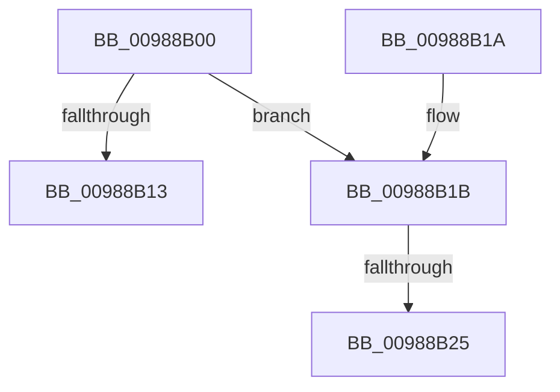

# MiReturnImageBase

- RVA: `0x00988B00`–`0x00988B28` (길이 `40` bytes)
- VA: `0x0000000140988B00`
- 실행 섹션: `PAGE`
- PDB 이름 있음: `예`; PDB Function 태그: `아니요`
- unwind 정보 RVA: `0x00097E20`
- 디코드: `15`개 명령, `40/40` bytes 표시
- 미해석 바이트: `0` (있으면 어셈블리에 `.byte`로 보존)

> 이 문서는 커널 이미지의 기계어와 PDB 기호를 분석해 생성했습니다. 4번과 5번은 함수 원형과 자료형을 바이너리 사용 방식에서 추정한 C 해석이며 원본 소스 복구 결과는 아닙니다.

## 1. Dependencies

- 직접 호출 지점: **0**; 고유 호출 대상: **0**
- 직접 호출자로 확인된 함수: **3**
- RIP 상대 이미지 참조: **0**

### Outgoing calls
- 직접 디코드된 call 명령이 없습니다.

### Direct callers
- [MiCheckControlArea](../../text/28/MiCheckControlArea_function_002861B0.md) at `0x002863CA`
- [MiCheckControlArea](../../text/28/MiCheckControlArea_function_002861B0.md) at `0x00286585`
- [MiRelocateImageAgain](MiRelocateImageAgain_function_009885C8.md) at `0x009886F6`
- [sub_00B25330](../B2/Unknown_function_00B25330.md) at `0x00B2533A`

### Static image references
- 디코드된 RIP-relative 메모리 참조가 없습니다.

## 2. Other-region calls and transfers

- 다른 실행 섹션으로 향하는 call: **0**
- call이 아닌 외부 분기/꼬리 이동: **1**
  - `0x00988B1F` → [sub_00988C72](Unknown_function_00988C72.md) (`tail-transfer`)

## 3. Assembly (complete function range)

```asm
00988B00  40 53                           push rbx
00988B02  57                              push rdi
00988B03  48 83 EC 28                     sub rsp, 0x28
00988B07  48 8B 39                        mov rdi, qword ptr [rcx]
00988B0A  48 8B D9                        mov rbx, rcx
00988B0D  48 83 FF FF                     cmp rdi, -1
00988B11  75 08                           jne 0x140988b1b
00988B13  48 83 C4 28                     add rsp, 0x28
00988B17  5F                              pop rdi
00988B18  5B                              pop rbx
00988B19  C3                              ret
00988B1A  CC                              int3
00988B1B  80 79 0C 00                     cmp byte ptr [rcx + 0xc], 0
00988B1F  0F 85 4D 01 00 00               jne 0x140988c72
00988B25  8B 41 10                        mov eax, dword ptr [rcx + 0x10]
```

## 4. C-style interpretation (structured pseudocode)

```c
__int64 __fastcall MiReturnImageBase(__int64 a1)
{
    __int64 v_rsp;

    v_rsp = (v_rsp) - (40);
    if ((*(unsigned __int64 *)(a1)) != -1) goto loc_00988B1B;
    v_rsp = (v_rsp) + (40);
    return result;
loc_00988B1B:
    return (unsigned int)(*(unsigned int *)(a1 + 16));
}
```

## 5. (Beta) C Style

```c
int64_t MiReturnImageBase(void *Arg1)
{
    uint8_t *arg1 = (uint8_t *)Arg1;

    int64_t local_rsp;

    local_rsp = (local_rsp) - (40);
    if ((*(uint64_t *)(arg1)) != -1) goto loc_00988B1B;
    local_rsp = (local_rsp) + (40);
    return result;
loc_00988B1B:
    return (uint32_t)(*(uint32_t *)(arg1 + 0x10));
}
```

### 관측된 메모리 오프셋

구조체 형식이 확인되지 않은 접근은 인자 기준의 오프셋으로만 기록했습니다.

| 기준 인자 | 오프셋 표현 | 폭 (bit) | 접근 |
|---|---:|---:|---|
| `Arg1` | `+ 0x0` | `64` | `R` |
| `Arg1` | `+ 0xC` | `8` | `R` |
| `Arg1` | `+ 0x10` | `32` | `R` |

## 6. Execution-region graph

[열기: 2D/3D 그래프와 함수 탐색 컨트롤 패널](../../../control-panel.html?section=page&rva=0x00988B00&view=graph)

- 2D 그래프는 위에서 아래로 흐르고, 3D 그래프는 빈 공간을 드래그해 회전합니다. Shift+드래그는 이동, 휠은 확대·축소, 함수 노드 선택은 대상 보고서 이동입니다.

### Static fallback


