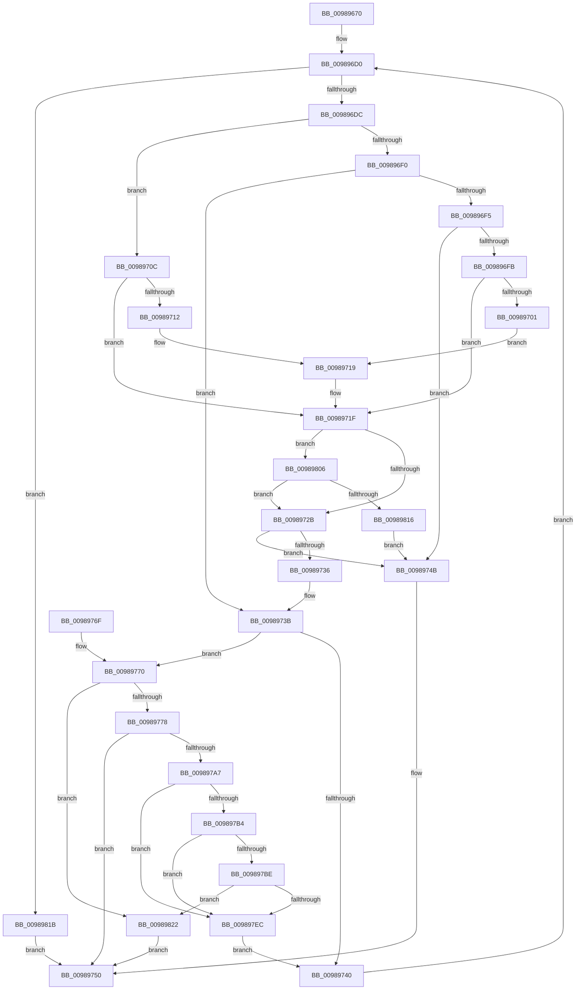

# MiScanRelocationPage

- RVA: `0x00989670`–`0x0098982C` (길이 `444` bytes)
- VA: `0x0000000140989670`
- 실행 섹션: `PAGE`
- PDB 이름 있음: `예`; PDB Function 태그: `아니요`
- unwind 정보 RVA: `0x00097F64`
- 디코드: `119`개 명령, `444/444` bytes 표시
- 미해석 바이트: `0` (있으면 어셈블리에 `.byte`로 보존)

> 이 문서는 커널 이미지의 기계어와 PDB 기호를 분석해 생성했습니다. 4번과 5번은 함수 원형과 자료형을 바이너리 사용 방식에서 추정한 C 해석이며 원본 소스 복구 결과는 아닙니다.

## 1. Dependencies

- 직접 호출 지점: **2**; 고유 호출 대상: **2**
- 직접 호출자로 확인된 함수: **1**
- RIP 상대 이미지 참조: **1**

### Outgoing calls
- `0x0098979E` → [MiCreateFixupRecord](MiCreateFixupRecord_function_00989834.md) (function, `0x00989834`)
- `0x009897E0` → [MiOffsetToProtos](../../text/24/MiOffsetToProtos_function_0024D880.md) (function, `0x0024D880`)

### Direct callers
- [MiRelocateImage](MiRelocateImage_function_00988E14.md) at `0x009892DF`

### Static image references
- `0x009897A7` → RVA `0x00FC6A88` (`ALMOSTRO`; read)

## 2. Other-region calls and transfers

- 다른 실행 섹션으로 향하는 call: **1**
  - `0x009897E0` → [MiOffsetToProtos](../../text/24/MiOffsetToProtos_function_0024D880.md) (`PAGE` → `.text`)
- 별도 외부 분기/꼬리 이동을 확인하지 못했습니다.

## 3. Assembly (complete function range)

```asm
00989670  48 89 6C 24 18                  mov qword ptr [rsp + 0x18], rbp
00989675  48 89 74 24 20                  mov qword ptr [rsp + 0x20], rsi
0098967A  48 89 4C 24 08                  mov qword ptr [rsp + 8], rcx
0098967F  57                              push rdi
00989680  41 54                           push r12
00989682  41 55                           push r13
00989684  41 56                           push r14
00989686  41 57                           push r15
00989688  48 83 EC 40                     sub rsp, 0x40
0098968C  4C 8B AC 24 90 00 00 00         mov r13, qword ptr [rsp + 0x90]
00989694  49 8B F1                        mov rsi, r9
00989697  41 B9 FF 0F 00 00               mov r9d, 0xfff
0098969D  44 8B FA                        mov r15d, edx
009896A0  41 8B F8                        mov edi, r8d
009896A3  48 89 5C 24 78                  mov qword ptr [rsp + 0x78], rbx
009896A8  45 33 F6                        xor r14d, r14d
009896AB  33 ED                           xor ebp, ebp
009896AD  49 8B 45 00                     mov rax, qword ptr [r13]
009896B1  45 33 C0                        xor r8d, r8d
009896B4  33 D2                           xor edx, edx
009896B6  45 8D 59 F9                     lea r11d, [r9 - 7]
009896BA  4C 8B 50 38                     mov r10, qword ptr [rax + 0x38]
009896BE  45 8B 62 40                     mov r12d, dword ptr [r10 + 0x40]
009896C2  45 8D 51 FD                     lea r10d, [r9 - 3]
009896C6  66 66 0F 1F 84 00 00 00 00 00   nop word ptr [rax + rax]
009896D0  8B C7                           mov eax, edi
009896D2  FF CF                           dec edi
009896D4  85 C0                           test eax, eax
009896D6  0F 84 3F 01 00 00               je 0x14098981b
009896DC  0F B7 1E                        movzx ebx, word ptr [rsi]
009896DF  0F B7 C3                        movzx eax, bx
009896E2  66 41 23 D9                     and bx, r9w
009896E6  66 C1 E8 0C                     shr ax, 0xc
009896EA  66 83 F8 0A                     cmp ax, 0xa
009896EE  74 1C                           je 0x14098970c
009896F0  66 85 C0                        test ax, ax
009896F3  74 46                           je 0x14098973b
009896F5  66 83 F8 03                     cmp ax, 3
009896F9  75 50                           jne 0x14098974b
009896FB  66 41 3B DA                     cmp bx, r10w
009896FF  76 1E                           jbe 0x14098971f
00989701  BD 04 00 00 00                  mov ebp, 4
00989706  44 8D 75 FE                     lea r14d, [rbp - 2]
0098970A  EB 0D                           jmp 0x140989719
0098970C  66 41 3B DB                     cmp bx, r11w
00989710  76 0D                           jbe 0x14098971f
00989712  45 33 F6                        xor r14d, r14d
00989715  41 8D 6E 08                     lea ebp, [r14 + 8]
00989719  41 B8 01 00 00 00               mov r8d, 1
0098971F  41 8B CF                        mov ecx, r15d
00989722  41 23 C9                        and ecx, r9d
00989725  0F 85 DB 00 00 00               jne 0x140989806
0098972B  0F B7 C3                        movzx eax, bx
0098972E  41 03 C7                        add eax, r15d
00989731  41 3B C4                        cmp eax, r12d
00989734  72 15                           jb 0x14098974b
00989736  48 8B 4C 24 70                  mov rcx, qword ptr [rsp + 0x70]
0098973B  45 85 C0                        test r8d, r8d
0098973E  75 30                           jne 0x140989770
00989740  48 8B 4C 24 70                  mov rcx, qword ptr [rsp + 0x70]
00989745  48 83 C6 02                     add rsi, 2
00989749  EB 85                           jmp 0x1409896d0
0098974B  B8 69 02 00 C0                  mov eax, 0xc0000269
00989750  48 8B 5C 24 78                  mov rbx, qword ptr [rsp + 0x78]
00989755  4C 8D 5C 24 40                  lea r11, [rsp + 0x40]
0098975A  49 8B 6B 40                     mov rbp, qword ptr [r11 + 0x40]
0098975E  49 8B 73 48                     mov rsi, qword ptr [r11 + 0x48]
00989762  49 8B E3                        mov rsp, r11
00989765  41 5F                           pop r15
00989767  41 5E                           pop r14
00989769  41 5D                           pop r13
0098976B  41 5C                           pop r12
0098976D  5F                              pop rdi
0098976E  C3                              ret
0098976F  CC                              int3
00989770  85 D2                           test edx, edx
00989772  0F 85 AA 00 00 00               jne 0x140989822
00989778  48 8B 84 24 98 00 00 00         mov rax, qword ptr [rsp + 0x98]
00989780  48 8B D1                        mov rdx, rcx
00989783  48 89 44 24 30                  mov qword ptr [rsp + 0x30], rax
00989788  45 8B CE                        mov r9d, r14d
0098978B  44 0F B7 C3                     movzx r8d, bx
0098978F  49 8B CD                        mov rcx, r13
00989792  48 89 74 24 28                  mov qword ptr [rsp + 0x28], rsi
00989797  45 03 C7                        add r8d, r15d
0098979A  89 6C 24 20                     mov dword ptr [rsp + 0x20], ebp
0098979E  E8 91 00 00 00                  call 0x140989834
009897A3  85 C0                           test eax, eax
009897A5  78 A9                           js 0x140989750
009897A7  48 F7 05 D6 D2 63 00 00 00 02 00  test qword ptr [rip + 0x63d2d6], 0x20000
009897B2  74 38                           je 0x1409897ec
009897B4  41 F7 45 5C 00 00 0C 00         test dword ptr [r13 + 0x5c], 0xc0000
009897BC  74 2E                           je 0x1409897ec
009897BE  0F B7 C3                        movzx eax, bx
009897C1  4C 8D 84 24 90 00 00 00         lea r8, [rsp + 0x90]
009897C9  8B D5                           mov edx, ebp
009897CB  49 8B CD                        mov rcx, r13
009897CE  48 03 D0                        add rdx, rax
009897D1  48 C7 84 24 90 00 00 00 00 00 00 00  mov qword ptr [rsp + 0x90], 0
009897DD  49 03 D7                        add rdx, r15
009897E0  E8 9B 40 8C FF                  call 0x14024d880
009897E5  8B 40 20                        mov eax, dword ptr [rax + 0x20]
009897E8  A8 04                           test al, 4
009897EA  75 36                           jne 0x140989822
009897EC  41 B9 FF 0F 00 00               mov r9d, 0xfff
009897F2  45 33 C0                        xor r8d, r8d
009897F5  41 8D 50 01                     lea edx, [r8 + 1]
009897F9  45 8D 51 FD                     lea r10d, [r9 - 3]
009897FD  45 8D 59 F9                     lea r11d, [r9 - 7]
00989801  E9 3A FF FF FF                  jmp 0x140989740
00989806  0F B7 C3                        movzx eax, bx
00989809  03 C1                           add eax, ecx
0098980B  3D FE 0F 00 00                  cmp eax, 0xffe
00989810  0F 86 15 FF FF FF               jbe 0x14098972b
00989816  E9 30 FF FF FF                  jmp 0x14098974b
0098981B  33 C0                           xor eax, eax
0098981D  E9 2E FF FF FF                  jmp 0x140989750
00989822  B8 7B 00 00 C0                  mov eax, 0xc000007b
00989827  E9 24 FF FF FF                  jmp 0x140989750
```

## 4. C-style interpretation (structured pseudocode)

```c
__int64 __fastcall MiScanRelocationPage(__int64 a1, int a2, int a3, __int64 a4, __int64 a5, __int64 a6)
{
    __int64 result;
    __int64 v_r14;
    __int64 v_rbp;
    __int64 v_rbx;
    __int64 v_rdi;
    __int64 v_rsi;
    __int64 v_rsp;
    unsigned __int64 v_stack_m10;
    unsigned __int64 v_stack_m18;
    unsigned int v_stack_m20;
    unsigned __int64 v_stack_m28;
    unsigned __int64 v_stack_p10;
    unsigned __int64 v_stack_p18;
    unsigned __int64 v_stack_p20;
    unsigned __int64 v_stack_p50;
    unsigned __int64 v_stack_p8;

    v_stack_p18 = v_rbp;
    v_stack_p20 = v_rsi;
    v_stack_p8 = a1;
    v_rsp = (v_rsp) - (64);
    v_stack_p10 = v_rbx;
    v_r14 = 0;
    v_rbp = 0;
    a3 = 0;
    a2 = 0;
loc_009896D0:
    v_rdi = (unsigned int)(((unsigned int)(a3)) - 1);
    if ((unsigned int)((unsigned int)((unsigned int)((unsigned int)(a3)))) == 0) goto loc_0098981B;
    v_rbx = (unsigned __int16)((*(unsigned __int16 *)(a4)) & ((unsigned __int16)((unsigned int)(0xFFFULL))));
    result = (unsigned __int16)(((unsigned __int16)(*(unsigned __int16 *)(a4))) >> (12));
    if (((unsigned __int16)(result)) == 10) goto loc_0098970C;
    if ((unsigned __int16)(result) == 0) goto loc_0098973B;
    if (((unsigned __int16)(result)) != 3) goto loc_0098974B;
    if (((unsigned __int16)(v_rbx)) <= ((unsigned __int16)((unsigned int)(0xFFFULL) - 3))) goto loc_0098971F;
    goto loc_00989719;
loc_0098970C:
    if (((unsigned __int16)(v_rbx)) <= ((unsigned __int16)((unsigned int)(0xFFFULL) - 7))) goto loc_0098971F;
    v_r14 = 0;
loc_00989719:
loc_0098971F:
    a1 = (unsigned int)(((unsigned int)((unsigned int)((unsigned int)(a2)))) & ((unsigned int)((unsigned int)(0xFFFULL))));
    if (condition_is_not_equal) goto loc_00989806;
loc_0098972B:
    result = (unsigned int)(((unsigned __int16)(v_rbx)) + ((unsigned int)((unsigned int)(a2))));
    if (((unsigned int)(result)) < ((unsigned int)((unsigned int)(*(unsigned int *)(*(unsigned __int64 *)(*(unsigned __int64 *)(a5) + 56) + 64))))) goto loc_0098974B;
loc_0098973B:
    if (1 != 0) goto loc_00989770;
loc_00989740:
    v_rsi = (a4) + (2);
    goto loc_009896D0;
loc_0098974B:
loc_00989750:
    return (unsigned int)(0xC0000269ULL);
loc_00989770:
    if (0 != 0) goto loc_00989822;
    v_stack_m10 = a6;
    v_stack_m18 = *(unsigned __int64 *)(v_stack_m28 + 72);
    a3 = (unsigned int)(((unsigned __int16)(v_stack_p10)) + ((unsigned int)((unsigned int)(a2))));
    v_stack_m20 = (unsigned int)(*(unsigned __int64 *)(v_stack_m28 + 64));
    result = MiCreateFixupRecord(a5, v_stack_p8, a3, 0);
    if (sign_flag) goto loc_00989750;
    if (((*(unsigned __int64 *)(v_rip + 6542038)) & (0x20000ULL)) == 0) goto loc_009897EC;
    if (((*(unsigned int *)(a5 + 92)) & (0xC0000ULL)) == 0) goto loc_009897EC;
    a2 = ((unsigned int)((unsigned int)(*(unsigned __int64 *)(v_stack_m28 + 64)))) + ((unsigned __int16)(v_stack_p10));
    v_stack_p50 = 0;
    a2 = (a2) + ((unsigned int)(a2));
    result = MiOffsetToProtos(a5, a2, a5, 0);
    if ((((unsigned __int8)((unsigned int)(*(unsigned int *)(result + 32)))) & (4)) != 0) goto loc_00989822;
loc_009897EC:
    a3 = 0;
    goto loc_00989740;
loc_00989806:
    result = (unsigned int)(((unsigned __int16)(v_stack_p10)) + ((unsigned int)(a5)));
    if (((unsigned int)(result)) <= 0xFFEULL) goto loc_0098972B;
    goto loc_0098974B;
loc_0098981B:
    result = 0;
    goto loc_00989750;
loc_00989822:
    goto loc_00989750;
}
```

## 5. (Beta) C Style

```c
int64_t MiScanRelocationPage(int64_t Arg1, int32_t Arg2, int32_t Arg3, void *Arg4, void *Arg5, int64_t Arg6)
{
    uint8_t *arg4 = (uint8_t *)Arg4;
    uint8_t *arg5 = (uint8_t *)Arg5;

    int64_t result;
    int64_t local_r14;
    int64_t local_rbp;
    int64_t local_rbx;
    int64_t local_rdi;
    int64_t local_rsi;
    int64_t local_rsp;
    uint64_t v_stack_m10;
    uint64_t v_stack_m18;
    uint32_t v_stack_m20;
    uint64_t v_stack_m28;
    uint64_t v_stack_p10;
    uint64_t v_stack_p18;
    uint64_t v_stack_p20;
    uint64_t v_stack_p50;
    uint64_t v_stack_p8;

    v_stack_p18 = local_rbp;
    v_stack_p20 = local_rsi;
    v_stack_p8 = Arg1;
    local_rsp = (local_rsp) - (64);
    v_stack_p10 = local_rbx;
    local_r14 = 0;
    local_rbp = 0;
    Arg3 = 0;
    Arg2 = 0;
loc_009896D0:
    local_rdi = (uint32_t)(((uint32_t)(Arg3)) - 1);
    if ((uint32_t)((uint32_t)((uint32_t)((uint32_t)(Arg3)))) == 0) goto loc_0098981B;
    local_rbx = (uint16_t)((*(uint16_t *)(arg4)) & ((uint16_t)((uint32_t)(0xFFFULL))));
    result = (uint16_t)(((uint16_t)(*(uint16_t *)(arg4))) >> (12));
    if (((uint16_t)(result)) == 10) goto loc_0098970C;
    if ((uint16_t)(result) == 0) goto loc_0098973B;
    if (((uint16_t)(result)) != 3) goto loc_0098974B;
    if (((uint16_t)(local_rbx)) <= ((uint16_t)((uint32_t)(0xFFFULL) - 3))) goto loc_0098971F;
    goto loc_00989719;
loc_0098970C:
    if (((uint16_t)(local_rbx)) <= ((uint16_t)((uint32_t)(0xFFFULL) - 7))) goto loc_0098971F;
    local_r14 = 0;
loc_00989719:
loc_0098971F:
    Arg1 = (uint32_t)(((uint32_t)((uint32_t)((uint32_t)(Arg2)))) & ((uint32_t)((uint32_t)(0xFFFULL))));
    if (condition_is_not_equal) goto loc_00989806;
loc_0098972B:
    result = (uint32_t)(((uint16_t)(local_rbx)) + ((uint32_t)((uint32_t)(Arg2))));
    if (((uint32_t)(result)) < ((uint32_t)((uint32_t)(*(uint32_t *)(*(uint64_t *)(*(uint64_t *)(arg5) + 0x38) + 0x40))))) goto loc_0098974B;
loc_0098973B:
    if (1 != 0) goto loc_00989770;
loc_00989740:
    local_rsi = (Arg4) + (2);
    goto loc_009896D0;
loc_0098974B:
loc_00989750:
    return (uint32_t)(0xC0000269ULL);
loc_00989770:
    if (0 != 0) goto loc_00989822;
    v_stack_m10 = Arg6;
    v_stack_m18 = *(uint64_t *)(v_stack_m28 + 0x48);
    Arg3 = (uint32_t)(((uint16_t)(v_stack_p10)) + ((uint32_t)((uint32_t)(Arg2))));
    v_stack_m20 = (uint32_t)(*(uint64_t *)(v_stack_m28 + 0x40));
    result = MiCreateFixupRecord(Arg5, v_stack_p8, Arg3, 0);
    if (sign_flag) goto loc_00989750;
    if (((*(uint64_t *)(v_rip + 0x63D2D6)) & (0x20000ULL)) == 0) goto loc_009897EC;
    if (((*(uint32_t *)(arg5 + 0x5C)) & (0xC0000ULL)) == 0) goto loc_009897EC;
    Arg2 = ((uint32_t)((uint32_t)(*(uint64_t *)(v_stack_m28 + 0x40)))) + ((uint16_t)(v_stack_p10));
    v_stack_p50 = 0;
    Arg2 = (Arg2) + ((uint32_t)(Arg2));
    result = MiOffsetToProtos(Arg5, Arg2, Arg5, 0);
    if ((((uint8_t)((uint32_t)(*(uint32_t *)(result + 0x20)))) & (4)) != 0) goto loc_00989822;
loc_009897EC:
    Arg3 = 0;
    goto loc_00989740;
loc_00989806:
    result = (uint32_t)(((uint16_t)(v_stack_p10)) + ((uint32_t)(Arg5)));
    if (((uint32_t)(result)) <= 0xFFEULL) goto loc_0098972B;
    goto loc_0098974B;
loc_0098981B:
    result = 0;
    goto loc_00989750;
loc_00989822:
    goto loc_00989750;
}
```

### 관측된 메모리 오프셋

구조체 형식이 확인되지 않은 접근은 인자 기준의 오프셋으로만 기록했습니다.

| 기준 인자 | 오프셋 표현 | 폭 (bit) | 접근 |
|---|---:|---:|---|
| `Arg4` | `+ 0x0` | `16` | `R` |
| `Arg5` | `+ 0x0` | `64` | `R` |
| `Arg5` | `+ 0x5C` | `32` | `R` |

## 6. Execution-region graph

[열기: 2D/3D 그래프와 함수 탐색 컨트롤 패널](../../../control-panel.html?section=page&rva=0x00989670&view=graph)

- 2D 그래프는 위에서 아래로 흐르고, 3D 그래프는 빈 공간을 드래그해 회전합니다. Shift+드래그는 이동, 휠은 확대·축소, 함수 노드 선택은 대상 보고서 이동입니다.

### Static fallback


