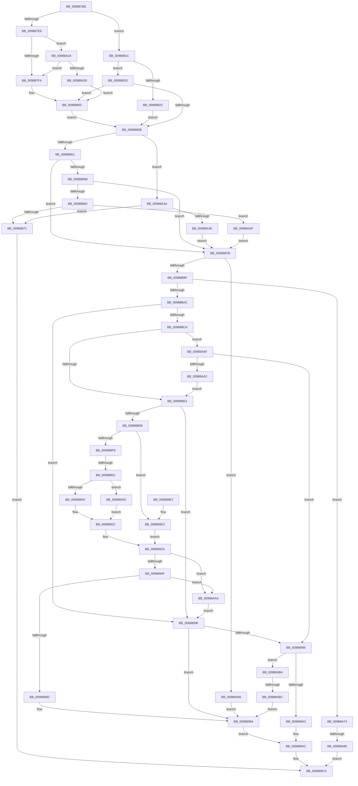

# MiSelectImageBase

- RVA: `0x009887B0`–`0x00988AED` (길이 `829` bytes)
- VA: `0x00000001409887B0`
- 실행 섹션: `PAGE`
- PDB 이름 있음: `예`; PDB Function 태그: `예`
- unwind 정보 RVA: `0x00097DF4`
- 디코드: `206`개 명령, `829/829` bytes 표시
- 미해석 바이트: `0` (있으면 어셈블리에 `.byte`로 보존)

> 이 문서는 커널 이미지의 기계어와 PDB 기호를 분석해 생성했습니다. 4번과 5번은 함수 원형과 자료형을 바이너리 사용 방식에서 추정한 C 해석이며 원본 소스 복구 결과는 아닙니다.

## 1. Dependencies

- 직접 호출 지점: **7**; 고유 호출 대상: **7**
- 직접 호출자로 확인된 함수: **2**
- RIP 상대 이미지 참조: **8**

### Outgoing calls
- `0x0098881C` → [MiGetImageWowSubsystemIndex](../8C/MiGetImageWowSubsystemIndex_function_008CEA2C.md) (function, `0x008CEA2C`)
- `0x0098893D` → [RtlFindClearBitsEx](../../text/3F/RtlFindClearBitsEx_function_003FAF30.md) (function, `0x003FAF30`)
- `0x0098895B` → [MiObtainRelocationBits](MiObtainRelocationBits_function_0098997C.md) (function, `0x0098997C`)
- `0x00988A3D` → [MiBytesToMapSystemImage](../A7/MiBytesToMapSystemImage_function_00A750C4.md) (function, `0x00A750C4`)
- `0x00988A74` → [MiSelectSystemImageAddress](../A7/MiSelectSystemImageAddress_function_00A75110.md) (function, `0x00A75110`)
- `0x00988A95` → [MiImageCanUseHighOverflowArea](../A9/MiImageCanUseHighOverflowArea_function_00A9EA94.md) (function, `0x00A9EA94`)
- `0x00988AC7` → [ExGenRandom](../../text/41/ExGenRandom_function_0041B010.md) (function, `0x0041B010`)

### Direct callers
- [MiRelocateImageAgain](MiRelocateImageAgain_function_009885C8.md) at `0x0098869B`
- [MiRelocateImage](MiRelocateImage_function_00988E14.md) at `0x009890FA`

### Static image references
- `0x00988851` → RVA `0x00E2D8B0` (`.data`; read)
- `0x009888D6` → RVA `0x00FC5210` (`ALMOSTRO`; read)
- `0x0098890A` → RVA `0x00E2D740` (`.data`; read)
- `0x00988911` → RVA `0x00E2D730` (`.data`; read)
- `0x009889E3` → RVA `0x00E2D7D0` (`.data`; read)
- `0x009889EA` → RVA `0x00E2D7C0` (`.data`; read)
- `0x00988A02` → RVA `0x00E2D7A8` (`.data`; read)
- `0x00988A09` → RVA `0x00E2D768` (`.data`; read)

## 2. Other-region calls and transfers

- 다른 실행 섹션으로 향하는 call: **2**
  - `0x0098893D` → [RtlFindClearBitsEx](../../text/3F/RtlFindClearBitsEx_function_003FAF30.md) (`PAGE` → `.text`)
  - `0x00988AC7` → [ExGenRandom](../../text/41/ExGenRandom_function_0041B010.md) (`PAGE` → `.text`)
- call이 아닌 외부 분기/꼬리 이동: **3**
  - `0x009888FB` → [sub_00B2B51A + 0x2F](../B2/Unknown_function_00B2B51A.md) (`tail-transfer`)
  - `0x00988A7F` → [sub_00B2B51A](../B2/Unknown_function_00B2B51A.md) (`tail-transfer`)
  - `0x00988AB6` → [sub_00B2B51A + 0x15F](../B2/Unknown_function_00B2B51A.md) (`tail-transfer`)

## 3. Assembly (complete function range)

```asm
009887B0  48 89 5C 24 20                  mov qword ptr [rsp + 0x20], rbx
009887B5  44 89 44 24 18                  mov dword ptr [rsp + 0x18], r8d
009887BA  48 89 54 24 10                  mov qword ptr [rsp + 0x10], rdx
009887BF  55                              push rbp
009887C0  56                              push rsi
009887C1  57                              push rdi
009887C2  41 54                           push r12
009887C4  41 55                           push r13
009887C6  41 56                           push r14
009887C8  41 57                           push r15
009887CA  48 83 EC 60                     sub rsp, 0x60
009887CE  4C 8B 39                        mov r15, qword ptr [rcx]
009887D1  33 DB                           xor ebx, ebx
009887D3  66 0F BA 61 0C 0F               bt word ptr [rcx + 0xc], 0xf
009887D9  45 8B D1                        mov r10d, r9d
009887DC  45 8B C8                        mov r9d, r8d
009887DF  4C 8B F1                        mov r14, rcx
009887E2  8B FB                           mov edi, ebx
009887E4  72 36                           jb 0x14098881c
009887E6  48 8B 49 38                     mov rcx, qword ptr [rcx + 0x38]
009887EA  F6 41 33 10                     test byte ptr [rcx + 0x33], 0x10
009887EE  0F 85 30 02 00 00               jne 0x140988a24
009887F4  B8 FF FF FF FF                  mov eax, 0xffffffff
009887F9  8B F3                           mov esi, ebx
009887FB  49 39 46 20                     cmp qword ptr [r14 + 0x20], rax
009887FF  40 0F 96 C6                     setbe sil
00988803  41 8B 47 5C                     mov eax, dword ptr [r15 + 0x5c]
00988807  8B CE                           mov ecx, esi
00988809  C1 E1 14                        shl ecx, 0x14
0098880C  33 C8                           xor ecx, eax
0098880E  81 E1 00 00 30 00               and ecx, 0x300000
00988814  33 C8                           xor ecx, eax
00988816  41 89 4F 5C                     mov dword ptr [r15 + 0x5c], ecx
0098881A  EB 1F                           jmp 0x14098883b
0098881C  E8 0B 62 F4 FF                  call 0x1408cea2c
00988821  8B F0                           mov esi, eax
00988823  B8 FF FF FF FF                  mov eax, 0xffffffff
00988828  3B F0                           cmp esi, eax
0098882A  75 07                           jne 0x140988833
0098882C  BE 04 00 00 00                  mov esi, 4
00988831  EB 08                           jmp 0x14098883b
00988833  83 C6 03                        add esi, 3
00988836  83 FE 04                        cmp esi, 4
00988839  75 C8                           jne 0x140988803
0098883B  4D 8B 5E 38                     mov r11, qword ptr [r14 + 0x38]
0098883F  41 8B 4E 08                     mov ecx, dword ptr [r14 + 8]
00988843  4C 89 5C 24 38                  mov qword ptr [rsp + 0x38], r11
00988848  45 85 C9                        test r9d, r9d
0098884B  0F 85 E9 01 00 00               jne 0x140988a3a
00988851  8B 15 59 50 4A 00               mov edx, dword ptr [rip + 0x4a5059]
00988857  85 D2                           test edx, edx
00988859  74 20                           je 0x14098887b
0098885B  41 8B 43 4C                     mov eax, dword ptr [r11 + 0x4c]
0098885F  A8 40                           test al, 0x40
00988861  74 18                           je 0x14098887b
00988863  C1 EA 0C                        shr edx, 0xc
00988866  8D 04 0A                        lea eax, [rdx + rcx]
00988869  3B C1                           cmp eax, ecx
0098886B  0F 83 EE 01 00 00               jae 0x140988a5f
00988871  B8 1F 00 00 C0                  mov eax, 0xc000001f
00988876  E9 4F 01 00 00                  jmp 0x1409889ca
0098887B  4D 8B 6E 20                     mov r13, qword ptr [r14 + 0x20]
0098887F  48 83 CD FF                     or rbp, 0xffffffffffffffff
00988883  8D 55 02                        lea edx, [rbp + 2]
00988886  44 84 D2                        test dl, r10b
00988889  0F 85 D7 01 00 00               jne 0x140988a66
0098888F  48 8B 84 24 A8 00 00 00         mov rax, qword ptr [rsp + 0xa8]
00988897  44 8D 61 0F                     lea r12d, [rcx + 0xf]
0098889B  41 C1 EC 04                     shr r12d, 4
0098889F  4C 2B 68 28                     sub r13, qword ptr [rax + 0x28]
009888A3  45 85 C9                        test r9d, r9d
009888A6  0F 85 C8 01 00 00               jne 0x140988a74
009888AC  41 0F B7 43 2C                  movzx eax, word ptr [r11 + 0x2c]
009888B1  8D 4D 0E                        lea ecx, [rbp + 0xe]
009888B4  66 0F A3 C8                     bt ax, cx
009888B8  0F 93 C1                        setae cl
009888BB  41 F6 C2 02                     test r10b, 2
009888BF  0F 94 C0                        sete al
009888C2  84 C8                           test al, cl
009888C4  0F 85 C5 00 00 00               jne 0x14098898f
009888CA  83 FE 04                        cmp esi, 4
009888CD  48 89 5C 24 48                  mov qword ptr [rsp + 0x48], rbx
009888D2  41 0F 95 C0                     setne r8b
009888D6  39 1D 34 C9 63 00               cmp dword ptr [rip + 0x63c934], ebx
009888DC  0F 85 AD 01 00 00               jne 0x140988a8f
009888E2  45 84 C0                        test r8b, r8b
009888E5  0F 84 A4 00 00 00               je 0x14098898f
009888EB  48 89 5C 24 50                  mov qword ptr [rsp + 0x50], rbx
009888F0  3B F2                           cmp esi, edx
009888F2  0F 84 EB 00 00 00               je 0x1409889e3
009888F8  83 FE 02                        cmp esi, 2
009888FB  0F 84 48 2C 1A 00               je 0x140b2b549
00988901  83 FE 03                        cmp esi, 3
00988904  0F 84 F8 00 00 00               je 0x140988a02
0098890A  4C 8B 05 2F 4E 4A 00            mov r8, qword ptr [rip + 0x4a4e2f]
00988911  48 8D 2D 18 4E 4A 00            lea rbp, [rip + 0x4a4e18]
00988918  48 B8 00 00 FF FF FF 7F 00 00   movabs rax, 0x7fffffff0000
00988922  48 89 84 24 A0 00 00 00         mov qword ptr [rsp + 0xa0], rax
0098892A  41 0F B7 C4                     movzx eax, r12w
0098892E  48 8B CD                        mov rcx, rbp
00988931  8B D0                           mov edx, eax
00988933  48 89 6C 24 48                  mov qword ptr [rsp + 0x48], rbp
00988938  48 89 44 24 20                  mov qword ptr [rsp + 0x20], rax
0098893D  E8 EE 25 A7 FF                  call 0x1403faf30
00988942  48 8B E8                        mov rbp, rax
00988945  48 83 FD FF                     cmp rbp, -1
00988949  0F 84 5B 01 00 00               je 0x140988aaa
0098894F  4C 8B C5                        mov r8, rbp
00988952  48 8D 4C 24 48                  lea rcx, [rsp + 0x48]
00988957  41 0F B7 D4                     movzx edx, r12w
0098895B  E8 1C 10 00 00                  call 0x14098997c
00988960  48 8B E8                        mov rbp, rax
00988963  48 83 F8 FF                     cmp rax, -1
00988967  0F 84 3D 01 00 00               je 0x140988aaa
0098896D  48 8B 44 24 20                  mov rax, qword ptr [rsp + 0x20]
00988972  48 8B BC 24 A0 00 00 00         mov rdi, qword ptr [rsp + 0xa0]
0098897A  48 03 C5                        add rax, rbp
0098897D  48 C1 E0 10                     shl rax, 0x10
00988981  48 2B F8                        sub rdi, rax
00988984  41 89 6F 58                     mov dword ptr [r15 + 0x58], ebp
00988988  66 45 89 67 5C                  mov word ptr [r15 + 0x5c], r12w
0098898D  EB 1D                           jmp 0x1409889ac
0098898F  48 83 FD FF                     cmp rbp, -1
00988993  75 EF                           jne 0x140988984
00988995  41 F7 47 5C 00 00 80 00         test dword ptr [r15 + 0x5c], 0x800000
0098899D  0F 84 11 01 00 00               je 0x140988ab4
009889A3  49 8B 7E 20                     mov rdi, qword ptr [r14 + 0x20]
009889A7  BB 01 00 00 00                  mov ebx, 1
009889AC  41 8B 47 5C                     mov eax, dword ptr [r15 + 0x5c]
009889B0  0F BA F0 17                     btr eax, 0x17
009889B4  C1 E3 17                        shl ebx, 0x17
009889B7  0B C3                           or eax, ebx
009889B9  41 89 47 5C                     mov dword ptr [r15 + 0x5c], eax
009889BD  48 8B 84 24 C0 00 00 00         mov rax, qword ptr [rsp + 0xc0]
009889C5  48 89 38                        mov qword ptr [rax], rdi
009889C8  33 C0                           xor eax, eax
009889CA  48 8B 9C 24 B8 00 00 00         mov rbx, qword ptr [rsp + 0xb8]
009889D2  48 83 C4 60                     add rsp, 0x60
009889D6  41 5F                           pop r15
009889D8  41 5E                           pop r14
009889DA  41 5D                           pop r13
009889DC  41 5C                           pop r12
009889DE  5F                              pop rdi
009889DF  5E                              pop rsi
009889E0  5D                              pop rbp
009889E1  C3                              ret
009889E2  CC                              int3
009889E3  4C 8B 05 E6 4D 4A 00            mov r8, qword ptr [rip + 0x4a4de6]
009889EA  48 8D 2D CF 4D 4A 00            lea rbp, [rip + 0x4a4dcf]
009889F1  48 C7 84 24 A0 00 00 00 00 00 00 78  mov qword ptr [rsp + 0xa0], 0x78000000
009889FD  E9 28 FF FF FF                  jmp 0x14098892a
00988A02  4C 8B 05 9F 4D 4A 00            mov r8, qword ptr [rip + 0x4a4d9f]
00988A09  48 8D 05 58 4D 4A 00            lea rax, [rip + 0x4a4d58]
00988A10  8D 6E FD                        lea ebp, [rsi - 3]
00988A13  48 C1 E5 06                     shl rbp, 6
00988A17  48 03 E8                        add rbp, rax
00988A1A  B8 00 00 00 78                  mov eax, 0x78000000
00988A1F  E9 FE FE FF FF                  jmp 0x140988922
00988A24  66 0F BA 61 2C 0D               bt word ptr [rcx + 0x2c], 0xd
00988A2A  0F 83 C4 FD FF FF               jae 0x1409887f4
00988A30  BE 02 00 00 00                  mov esi, 2
00988A35  E9 C9 FD FF FF                  jmp 0x140988803
00988A3A  C1 E1 0C                        shl ecx, 0xc
00988A3D  E8 82 C6 0E 00                  call 0x140a750c4
00988A42  48 8B C8                        mov rcx, rax
00988A45  48 85 C0                        test rax, rax
00988A48  0F 84 23 FE FF FF               je 0x140988871
00988A4E  44 8B 8C 24 B0 00 00 00         mov r9d, dword ptr [rsp + 0xb0]
00988A56  48 C1 E9 0C                     shr rcx, 0xc
00988A5A  E9 1C FE FF FF                  jmp 0x14098887b
00988A5F  8B C8                           mov ecx, eax
00988A61  E9 15 FE FF FF                  jmp 0x14098887b
00988A66  44 0F B7 E3                     movzx r12d, bx
00988A6A  49 8B FD                        mov rdi, r13
00988A6D  8B DA                           mov ebx, edx
00988A6F  E9 10 FF FF FF                  jmp 0x140988984
00988A74  E8 97 C6 0E 00                  call 0x140a75110
00988A79  48 8B F8                        mov rdi, rax
00988A7C  48 85 C0                        test rax, rax
00988A7F  0F 85 95 2A 1A 00               jne 0x140b2b51a
00988A85  B8 9A 00 00 C0                  mov eax, 0xc000009a
00988A8A  E9 3B FF FF FF                  jmp 0x1409889ca
00988A8F  49 8B D5                        mov rdx, r13
00988A92  49 8B CE                        mov rcx, r14
00988A95  E8 FA 5F 11 00                  call 0x140a9ea94
00988A9A  85 C0                           test eax, eax
00988A9C  0F 85 F3 FE FF FF               jne 0x140988995
00988AA2  8D 50 01                        lea edx, [rax + 1]
00988AA5  E9 38 FE FF FF                  jmp 0x1409888e2
00988AAA  4C 8B 5C 24 38                  mov r11, qword ptr [rsp + 0x38]
00988AAF  E9 DB FE FF FF                  jmp 0x14098898f
00988AB4  85 F6                           test esi, esi
00988AB6  0F 85 BD 2B 1A 00               jne 0x140b2b679
00988ABC  BE 01 00 00 00                  mov esi, 1
00988AC1  41 0F B7 DC                     movzx ebx, r12w
00988AC5  8B CE                           mov ecx, esi
00988AC7  E8 44 25 A9 FF                  call 0x14041b010
00988ACC  33 D2                           xor edx, edx
00988ACE  8B C0                           mov eax, eax
00988AD0  B9 01 00 02 00                  mov ecx, 0x20001
00988AD5  48 2B CB                        sub rcx, rbx
00988AD8  8B DE                           mov ebx, esi
00988ADA  48 F7 F1                        div rcx
00988ADD  48 8D BA 00 00 F6 7F            lea rdi, [rdx + 0x7ff60000]
00988AE4  48 C1 E7 10                     shl rdi, 0x10
00988AE8  E9 97 FE FF FF                  jmp 0x140988984
```

## 4. C-style interpretation (structured pseudocode)

```c
__int64 __fastcall MiSelectImageBase(__int64 a1, __int64 a2, int a3, int a4, __int64 a5)
{
    __int64 result;
    __int64 v_r12;
    __int64 v_r13;
    __int64 v_rbp;
    __int64 v_rbx;
    __int64 v_rdi;
    __int64 v_rsi;
    __int64 v_rsp;
    unsigned __int64 v_stack_m48;
    unsigned __int64 v_stack_m50;
    unsigned __int64 v_stack_m60;
    unsigned __int64 v_stack_m78;
    unsigned __int64 v_stack_p10;
    unsigned int v_stack_p18;
    unsigned __int64 v_stack_p20;
    unsigned __int64 v_stack_p38;
    unsigned __int64 v_stack_p8;
    unsigned __int64 v_stack_pA0;
    unsigned int v_stack_pB0;

    v_stack_p20 = v_rbx;
    v_stack_p18 = a3;
    v_stack_p10 = a2;
    v_rsp = (v_rsp) - (96);
    v_rbx = 0;
    if (condition_is_below) goto loc_0098881C;
    if (((*(unsigned __int8 *)(*(unsigned __int64 *)(a1 + 56) + 51)) & (16)) != 0) goto loc_00988A24;
loc_009887F4:
    v_rsi = ((*(unsigned __int64 *)(a1 + 32)) <= ((unsigned int)(0xFFFFFFFFULL))) ? 1 : 0;
loc_00988803:
    a1 = (unsigned int)(((unsigned int)((unsigned int)(v_rsi))) << (20));
    a1 = (unsigned int)((a1) ^ ((unsigned int)((unsigned int)(*(unsigned int *)(*(unsigned __int64 *)(a1) + 92)))));
    a1 = (unsigned int)((a1) & (0x300000ULL));
    a1 = (unsigned int)((a1) ^ ((unsigned int)((unsigned int)(*(unsigned int *)(*(unsigned __int64 *)(a1) + 92)))));
    *(unsigned int *)(*(unsigned __int64 *)(a1) + 92) = (unsigned int)(a1);
    goto loc_0098883B;
loc_0098881C:
    result = MiGetImageWowSubsystemIndex(a1, a2, a3, (unsigned int)(a3));
    if (((unsigned int)((unsigned int)((unsigned int)(result)))) != ((unsigned int)((unsigned int)(0xFFFFFFFFULL)))) goto loc_00988833;
    goto loc_0098883B;
loc_00988833:
    v_rsi = (unsigned int)((4) + (3));
    if (((unsigned int)(v_rsi)) != 4) goto loc_00988803;
loc_0098883B:
    v_stack_m60 = *(unsigned __int64 *)(a1 + 56);
    if ((unsigned int)((unsigned int)(a3)) != 0) goto loc_00988A3A;
    if ((unsigned int)((unsigned int)(*(unsigned int *)(v_rip + 4870233))) == 0) goto loc_0098887B;
    if ((((unsigned __int8)((unsigned int)(*(unsigned int *)(*(unsigned __int64 *)(a1 + 56) + 76)))) & (64)) == 0) goto loc_0098887B;
    a2 = (unsigned int)(((unsigned int)(*(unsigned int *)(v_rip + 4870233))) >> (12));
    if (((unsigned int)(a2 + (unsigned int)(*(unsigned int *)(a1 + 8)) * 1)) >= ((unsigned int)((unsigned int)(*(unsigned int *)(a1 + 8))))) goto loc_00988A5F;
loc_00988871:
    goto loc_009889CA;
loc_0098887B:
    v_rbp = (v_rbp) | (-1);
    if ((((unsigned __int8)(v_rbp + 2)) & ((unsigned __int8)((unsigned int)(a4)))) != 0) goto loc_00988A66;
    v_r12 = (unsigned int)(((unsigned int)(*(unsigned int *)(a1 + 8)) + 15) >> (4));
    v_r13 = (*(unsigned __int64 *)(a1 + 32)) - (*(unsigned __int64 *)(v_stack_p10 + 40));
    if ((unsigned int)((unsigned int)(a3)) != 0) goto loc_00988A74;
    a1 = (condition_is_above_or_equal) ? 1 : 0;
    result = ((((unsigned __int8)((unsigned int)(a4))) & (2)) == 0) ? 1 : 0;
    if ((((unsigned __int8)(result)) & ((unsigned __int8)(a1))) != 0) goto loc_0098898F;
    v_stack_m50 = 0;
    a3 = (((unsigned int)(v_rsi)) != 4) ? 1 : 0;
    if ((*(unsigned int *)(v_rip + 6539572)) != 0) goto loc_00988A8F;
loc_009888E2:
    if ((unsigned __int8)(a3) == 0) goto loc_0098898F;
    v_stack_m48 = 0;
    if (((unsigned int)(v_rsi)) == ((unsigned int)(v_rbp + 2))) goto loc_009889E3;
    if (((unsigned int)(v_rsi)) == 3) goto loc_00988A02;
loc_00988922:
    v_stack_p8 = result;
loc_0098892A:
    v_stack_m50 = v_rip + 4869656;
    v_stack_m78 = (unsigned __int16)(v_r12);
    result = RtlFindClearBitsEx(v_rip + 4869656, (unsigned int)((unsigned int)((unsigned __int16)(v_r12))), *(unsigned __int64 *)(v_rip + 4869679), (unsigned int)(a3));
    if (result == -1) goto loc_00988AAA;
    result = MiObtainRelocationBits(v_stack_m50, (unsigned __int16)(v_r12), result, (unsigned int)(a3));
    if (result == -1) goto loc_00988AAA;
    result = (v_stack_m78) + (result);
    result = (result) << (16);
    v_rdi = (v_stack_p8) - (result);
loc_00988984:
    *(unsigned int *)(*(unsigned __int64 *)(a1) + 88) = (unsigned int)(result);
    *(unsigned __int16 *)(*(unsigned __int64 *)(a1) + 92) = (unsigned __int16)(v_r12);
    goto loc_009889AC;
loc_0098898F:
    if (result != -1) goto loc_00988984;
loc_00988995:
    if (((*(unsigned int *)(*(unsigned __int64 *)(a1) + 92)) & (0x800000ULL)) == 0) goto loc_00988AB4;
loc_009889AC:
    v_rbx = (unsigned int)((1) << (23));
    result = (unsigned int)(((unsigned int)(*(unsigned int *)(*(unsigned __int64 *)(a1) + 92))) | ((unsigned int)(v_rbx)));
    *(unsigned int *)(*(unsigned __int64 *)(a1) + 92) = (unsigned int)(result);
    *(unsigned __int64 *)(a5) = *(unsigned __int64 *)(a1 + 32);
    result = 0;
loc_009889CA:
    v_rsp = (v_rsp) + (96);
    return result;
loc_009889E3:
    v_stack_pA0 = 0x78000000ULL;
    goto loc_0098892A;
loc_00988A02:
    v_rbp = (v_rsi - 3) << (6);
    v_rbp = (v_rbp) + (v_rip + 4869464);
    goto loc_00988922;
loc_00988A24:
    if (condition_is_above_or_equal) goto loc_009887F4;
    goto loc_00988803;
loc_00988A3A:
    a1 = (unsigned int)((v_stack_m50) << (12));
    result = MiBytesToMapSystemImage(a1, (unsigned __int16)(v_r12), *(unsigned __int64 *)(v_rip + 4869535), (unsigned int)(a3));
    if (result == 0) goto loc_00988871;
    a1 = (result) >> (12);
    goto loc_0098887B;
loc_00988A5F:
    goto loc_0098887B;
loc_00988A66:
    goto loc_00988984;
loc_00988A74:
    result = MiSelectSystemImageAddress((unsigned int)((unsigned int)(result)), (unsigned __int16)(v_r12), *(unsigned __int64 *)(v_rip + 4869535), (unsigned int)(v_stack_pB0));
    goto loc_009889CA;
loc_00988A8F:
    result = MiImageCanUseHighOverflowArea(a1, v_r13, *(unsigned __int64 *)(v_rip + 4869535), (unsigned int)(v_stack_pB0));
    if ((unsigned int)(result) != 0) goto loc_00988995;
    goto loc_009888E2;
loc_00988AAA:
    goto loc_0098898F;
loc_00988AB4:
    result = ExGenRandom(1, result + 1, *(unsigned __int64 *)(v_rip + 4869535), (unsigned int)(v_stack_pB0));
    a2 = 0;
    a1 = ((unsigned int)(0x20001ULL)) - ((unsigned __int16)((unsigned __int16)(v_stack_p20)));
    v_rdi = (a2 + 2146828288) << (16);
    goto loc_00988984;
}
```

## 5. (Beta) C Style

```c
int64_t MiSelectImageBase(void *Arg1, int64_t Arg2, int32_t Arg3, int32_t Arg4, void *Arg5)
{
    uint8_t *arg1 = (uint8_t *)Arg1;
    uint8_t *arg5 = (uint8_t *)Arg5;

    int64_t result;
    int64_t local_r12;
    int64_t local_r13;
    int64_t local_rbp;
    int64_t local_rbx;
    int64_t local_rdi;
    int64_t local_rsi;
    int64_t local_rsp;
    uint64_t v_stack_m48;
    uint64_t v_stack_m50;
    uint64_t v_stack_m60;
    uint64_t v_stack_m78;
    uint64_t v_stack_p10;
    uint32_t v_stack_p18;
    uint64_t v_stack_p20;
    uint64_t v_stack_p38;
    uint64_t v_stack_p8;
    uint64_t v_stack_pA0;
    uint32_t v_stack_pB0;

    v_stack_p20 = local_rbx;
    v_stack_p18 = Arg3;
    v_stack_p10 = Arg2;
    local_rsp = (local_rsp) - (96);
    local_rbx = 0;
    if (condition_is_below) goto loc_0098881C;
    if (((*(uint8_t *)(*(uint64_t *)(arg1 + 0x38) + 0x33)) & (16)) != 0) goto loc_00988A24;
loc_009887F4:
    local_rsi = ((*(uint64_t *)(arg1 + 0x20)) <= ((uint32_t)(0xFFFFFFFFULL))) ? 1 : 0;
loc_00988803:
    Arg1 = (uint32_t)(((uint32_t)((uint32_t)(local_rsi))) << (20));
    Arg1 = (uint32_t)((Arg1) ^ ((uint32_t)((uint32_t)(*(uint32_t *)(*(uint64_t *)(arg1) + 0x5C)))));
    Arg1 = (uint32_t)((Arg1) & (0x300000ULL));
    Arg1 = (uint32_t)((Arg1) ^ ((uint32_t)((uint32_t)(*(uint32_t *)(*(uint64_t *)(arg1) + 0x5C)))));
    *(uint32_t *)(*(uint64_t *)(arg1) + 0x5C) = (uint32_t)(Arg1);
    goto loc_0098883B;
loc_0098881C:
    result = MiGetImageWowSubsystemIndex(Arg1, Arg2, Arg3, (uint32_t)(Arg3));
    if (((uint32_t)((uint32_t)((uint32_t)(result)))) != ((uint32_t)((uint32_t)(0xFFFFFFFFULL)))) goto loc_00988833;
    goto loc_0098883B;
loc_00988833:
    local_rsi = (uint32_t)((4) + (3));
    if (((uint32_t)(local_rsi)) != 4) goto loc_00988803;
loc_0098883B:
    v_stack_m60 = *(uint64_t *)(arg1 + 0x38);
    if ((uint32_t)((uint32_t)(Arg3)) != 0) goto loc_00988A3A;
    if ((uint32_t)((uint32_t)(*(uint32_t *)(v_rip + 0x4A5059))) == 0) goto loc_0098887B;
    if ((((uint8_t)((uint32_t)(*(uint32_t *)(*(uint64_t *)(arg1 + 0x38) + 0x4C)))) & (64)) == 0) goto loc_0098887B;
    Arg2 = (uint32_t)(((uint32_t)(*(uint32_t *)(v_rip + 0x4A5059))) >> (12));
    if (((uint32_t)(Arg2 + (uint32_t)(*(uint32_t *)(arg1 + 0x8)) * 1)) >= ((uint32_t)((uint32_t)(*(uint32_t *)(arg1 + 0x8))))) goto loc_00988A5F;
loc_00988871:
    goto loc_009889CA;
loc_0098887B:
    local_rbp = (local_rbp) | (-1);
    if ((((uint8_t)(local_rbp + 2)) & ((uint8_t)((uint32_t)(Arg4)))) != 0) goto loc_00988A66;
    local_r12 = (uint32_t)(((uint32_t)(*(uint32_t *)(arg1 + 0x8)) + 15) >> (4));
    local_r13 = (*(uint64_t *)(arg1 + 0x20)) - (*(uint64_t *)(v_stack_p10 + 0x28));
    if ((uint32_t)((uint32_t)(Arg3)) != 0) goto loc_00988A74;
    Arg1 = (condition_is_above_or_equal) ? 1 : 0;
    result = ((((uint8_t)((uint32_t)(Arg4))) & (2)) == 0) ? 1 : 0;
    if ((((uint8_t)(result)) & ((uint8_t)(Arg1))) != 0) goto loc_0098898F;
    v_stack_m50 = 0;
    Arg3 = (((uint32_t)(local_rsi)) != 4) ? 1 : 0;
    if ((*(uint32_t *)(v_rip + 0x63C934)) != 0) goto loc_00988A8F;
loc_009888E2:
    if ((uint8_t)(Arg3) == 0) goto loc_0098898F;
    v_stack_m48 = 0;
    if (((uint32_t)(local_rsi)) == ((uint32_t)(local_rbp + 2))) goto loc_009889E3;
    if (((uint32_t)(local_rsi)) == 3) goto loc_00988A02;
loc_00988922:
    v_stack_p8 = result;
loc_0098892A:
    v_stack_m50 = v_rip + 4869656;
    v_stack_m78 = (uint16_t)(local_r12);
    result = RtlFindClearBitsEx(v_rip + 4869656, (uint32_t)((uint32_t)((uint16_t)(local_r12))), *(uint64_t *)(v_rip + 0x4A4E2F), (uint32_t)(Arg3));
    if (result == -1) goto loc_00988AAA;
    result = MiObtainRelocationBits(v_stack_m50, (uint16_t)(local_r12), result, (uint32_t)(Arg3));
    if (result == -1) goto loc_00988AAA;
    result = (v_stack_m78) + (result);
    result = (result) << (16);
    local_rdi = (v_stack_p8) - (result);
loc_00988984:
    *(uint32_t *)(*(uint64_t *)(arg1) + 0x58) = (uint32_t)(result);
    *(uint16_t *)(*(uint64_t *)(arg1) + 0x5C) = (uint16_t)(local_r12);
    goto loc_009889AC;
loc_0098898F:
    if (result != -1) goto loc_00988984;
loc_00988995:
    if (((*(uint32_t *)(*(uint64_t *)(arg1) + 0x5C)) & (0x800000ULL)) == 0) goto loc_00988AB4;
loc_009889AC:
    local_rbx = (uint32_t)((1) << (23));
    result = (uint32_t)(((uint32_t)(*(uint32_t *)(*(uint64_t *)(arg1) + 0x5C))) | ((uint32_t)(local_rbx)));
    *(uint32_t *)(*(uint64_t *)(arg1) + 0x5C) = (uint32_t)(result);
    *(uint64_t *)(arg5) = *(uint64_t *)(arg1 + 0x20);
    result = 0;
loc_009889CA:
    local_rsp = (local_rsp) + (96);
    return result;
loc_009889E3:
    v_stack_pA0 = 0x78000000ULL;
    goto loc_0098892A;
loc_00988A02:
    local_rbp = (local_rsi - 3) << (6);
    local_rbp = (local_rbp) + (v_rip + 4869464);
    goto loc_00988922;
loc_00988A24:
    if (condition_is_above_or_equal) goto loc_009887F4;
    goto loc_00988803;
loc_00988A3A:
    Arg1 = (uint32_t)((v_stack_m50) << (12));
    result = MiBytesToMapSystemImage(Arg1, (uint16_t)(local_r12), *(uint64_t *)(v_rip + 0x4A4D9F), (uint32_t)(Arg3));
    if (result == 0) goto loc_00988871;
    Arg1 = (result) >> (12);
    goto loc_0098887B;
loc_00988A5F:
    goto loc_0098887B;
loc_00988A66:
    goto loc_00988984;
loc_00988A74:
    result = MiSelectSystemImageAddress((uint32_t)((uint32_t)(result)), (uint16_t)(local_r12), *(uint64_t *)(v_rip + 0x4A4D9F), (uint32_t)(v_stack_pB0));
    goto loc_009889CA;
loc_00988A8F:
    result = MiImageCanUseHighOverflowArea(Arg1, local_r13, *(uint64_t *)(v_rip + 0x4A4D9F), (uint32_t)(v_stack_pB0));
    if ((uint32_t)(result) != 0) goto loc_00988995;
    goto loc_009888E2;
loc_00988AAA:
    goto loc_0098898F;
loc_00988AB4:
    result = ExGenRandom(1, result + 1, *(uint64_t *)(v_rip + 0x4A4D9F), (uint32_t)(v_stack_pB0));
    Arg2 = 0;
    Arg1 = ((uint32_t)(0x20001ULL)) - ((uint16_t)((uint16_t)(v_stack_p20)));
    local_rdi = (Arg2 + 2146828288) << (16);
    goto loc_00988984;
}
```

### 관측된 메모리 오프셋

구조체 형식이 확인되지 않은 접근은 인자 기준의 오프셋으로만 기록했습니다.

| 기준 인자 | 오프셋 표현 | 폭 (bit) | 접근 |
|---|---:|---:|---|
| `Arg1` | `+ 0x0` | `64` | `R` |
| `Arg1` | `+ 0x8` | `32` | `R` |
| `Arg1` | `+ 0xC` | `16` | `R` |
| `Arg1` | `+ 0x20` | `64` | `R` |
| `Arg1` | `+ 0x38` | `64` | `R` |
| `Arg5` | `+ 0x0` | `64` | `W` |

## 6. Execution-region graph

[열기: 2D/3D 그래프와 함수 탐색 컨트롤 패널](../../../control-panel.html?section=page&rva=0x009887B0&view=graph)

- 2D 그래프는 위에서 아래로 흐르고, 3D 그래프는 빈 공간을 드래그해 회전합니다. Shift+드래그는 이동, 휠은 확대·축소, 함수 노드 선택은 대상 보고서 이동입니다.

### Static fallback


