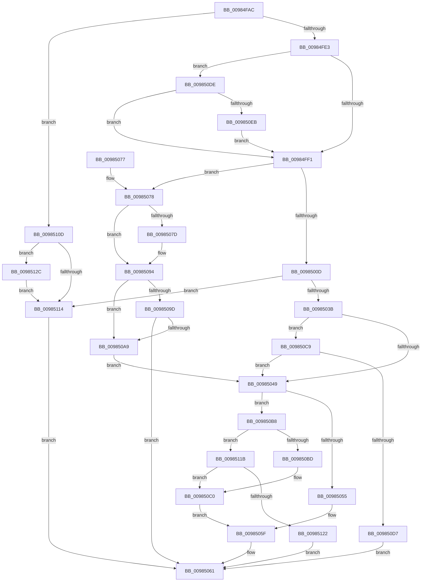

# MiShareExistingControlArea

- RVA: `0x00984FAC`–`0x00985145` (길이 `409` bytes)
- VA: `0x0000000140984FAC`
- 실행 섹션: `PAGE`
- PDB 이름 있음: `예`; PDB Function 태그: `아니요`
- unwind 정보 RVA: `0x00097BD4`
- 디코드: `109`개 명령, `409/409` bytes 표시
- 미해석 바이트: `0` (있으면 어셈블리에 `.byte`로 보존)

> 이 문서는 커널 이미지의 기계어와 PDB 기호를 분석해 생성했습니다. 4번과 5번은 함수 원형과 자료형을 바이너리 사용 방식에서 추정한 C 해석이며 원본 소스 복구 결과는 아닙니다.

## 1. Dependencies

- 직접 호출 지점: **11**; 고유 호출 대상: **7**
- 직접 호출자로 확인된 함수: **1**
- RIP 상대 이미지 참조: **0**

### Outgoing calls
- `0x00984FD4` → [MiValidateControlAreaPartition](../../text/45/MiValidateControlAreaPartition_function_00452AA8.md) (function, `0x00452AA8`)
- `0x00985015` → [FsRtlGetFileSize](FsRtlGetFileSize_function_00985150.md) (function, `0x00985150`)
- `0x00985023` → [IoSetTopLevelIrp](../../text/42/IoSetTopLevelIrp_function_0042A7D0.md) (function, `0x0042A7D0`)
- `0x0098502B` → [FsRtlReleaseFile](FsRtlReleaseFile_function_00985B70.md) (function, `0x00985B70`)
- `0x00985084` → [IoSetTopLevelIrp](../../text/42/IoSetTopLevelIrp_function_0042A7D0.md) (function, `0x0042A7D0`)
- `0x0098508C` → [FsRtlReleaseFile](FsRtlReleaseFile_function_00985B70.md) (function, `0x00985B70`)
- `0x009850A0` → [MiValidateExistingImage](MiValidateExistingImage_function_009864B4.md) (function, `0x009864B4`)
- `0x009850DE` → [PsIsCurrentThreadPrefetching](../../text/45/PsIsCurrentThreadPrefetching_function_004511B0.md) (function, `0x004511B0`)
- `0x00985103` → [MmChangeSectionBackingFile](../../text/45/MmChangeSectionBackingFile_function_0045808C.md) (function, `0x0045808C`)
- `0x00985133` → [IoSetTopLevelIrp](../../text/42/IoSetTopLevelIrp_function_0042A7D0.md) (function, `0x0042A7D0`)
- `0x0098513B` → [FsRtlReleaseFile](FsRtlReleaseFile_function_00985B70.md) (function, `0x00985B70`)

### Direct callers
- [sub_009848DC](Unknown_function_009848DC.md) at `0x00984A50`

### Static image references
- 디코드된 RIP-relative 메모리 참조가 없습니다.

## 2. Other-region calls and transfers

- 다른 실행 섹션으로 향하는 call: **6**
  - `0x00984FD4` → [MiValidateControlAreaPartition](../../text/45/MiValidateControlAreaPartition_function_00452AA8.md) (`PAGE` → `.text`)
  - `0x00985023` → [IoSetTopLevelIrp](../../text/42/IoSetTopLevelIrp_function_0042A7D0.md) (`PAGE` → `.text`)
  - `0x00985084` → [IoSetTopLevelIrp](../../text/42/IoSetTopLevelIrp_function_0042A7D0.md) (`PAGE` → `.text`)
  - `0x009850DE` → [PsIsCurrentThreadPrefetching](../../text/45/PsIsCurrentThreadPrefetching_function_004511B0.md) (`PAGE` → `.text`)
  - `0x00985103` → [MmChangeSectionBackingFile](../../text/45/MmChangeSectionBackingFile_function_0045808C.md) (`PAGE` → `.text`)
  - `0x00985133` → [IoSetTopLevelIrp](../../text/42/IoSetTopLevelIrp_function_0042A7D0.md) (`PAGE` → `.text`)
- 별도 외부 분기/꼬리 이동을 확인하지 못했습니다.

## 3. Assembly (complete function range)

```asm
00984FAC  48 8B C4                        mov rax, rsp
00984FAF  48 89 58 10                     mov qword ptr [rax + 0x10], rbx
00984FB3  48 89 70 18                     mov qword ptr [rax + 0x18], rsi
00984FB7  48 89 78 20                     mov qword ptr [rax + 0x20], rdi
00984FBB  41 56                           push r14
00984FBD  48 83 EC 20                     sub rsp, 0x20
00984FC1  4C 8B 71 40                     mov r14, qword ptr [rcx + 0x40]
00984FC5  48 8B D9                        mov rbx, rcx
00984FC8  48 83 60 08 00                  and qword ptr [rax + 8], 0
00984FCD  49 8B D6                        mov rdx, r14
00984FD0  48 8B 79 38                     mov rdi, qword ptr [rcx + 0x38]
00984FD4  E8 CF DA AC FF                  call 0x140452aa8
00984FD9  8B F0                           mov esi, eax
00984FDB  85 C0                           test eax, eax
00984FDD  0F 88 2A 01 00 00               js 0x14098510d
00984FE3  41 F7 46 38 00 02 00 00         test dword ptr [r14 + 0x38], 0x200
00984FEB  0F 85 ED 00 00 00               jne 0x1409850de
00984FF1  8B 13                           mov edx, dword ptr [rbx]
00984FF3  83 CA 04                        or edx, 4
00984FF6  F6 C2 01                        test dl, 1
00984FF9  89 13                           mov dword ptr [rbx], edx
00984FFB  49 8B 36                        mov rsi, qword ptr [r14]
00984FFE  0F 94 C1                        sete cl
00985001  41 F6 46 38 20                  test byte ptr [r14 + 0x38], 0x20
00985006  0F 94 C0                        sete al
00985009  84 C8                           test al, cl
0098500B  74 6B                           je 0x140985078
0098500D  48 8D 54 24 30                  lea rdx, [rsp + 0x30]
00985012  48 8B CF                        mov rcx, rdi
00985015  E8 36 01 00 00                  call 0x140985150
0098501A  48 8B 8B B8 00 00 00            mov rcx, qword ptr [rbx + 0xb8]
00985021  8B F0                           mov esi, eax
00985023  E8 A8 57 AA FF                  call 0x14042a7d0
00985028  48 8B CF                        mov rcx, rdi
0098502B  E8 40 0B 00 00                  call 0x140985b70
00985030  83 23 FD                        and dword ptr [rbx], 0xfffffffd
00985033  85 F6                           test esi, esi
00985035  0F 88 D9 00 00 00               js 0x140985114
0098503B  48 8B 44 24 30                  mov rax, qword ptr [rsp + 0x30]
00985040  48 85 C0                        test rax, rax
00985043  0F 84 80 00 00 00               je 0x1409850c9
00985049  48 8B 8B 98 00 00 00            mov rcx, qword ptr [rbx + 0x98]
00985050  48 85 C9                        test rcx, rcx
00985053  75 63                           jne 0x1409850b8
00985055  83 0B 08                        or dword ptr [rbx], 8
00985058  48 89 83 80 00 00 00            mov qword ptr [rbx + 0x80], rax
0098505F  33 C0                           xor eax, eax
00985061  48 8B 5C 24 38                  mov rbx, qword ptr [rsp + 0x38]
00985066  48 8B 74 24 40                  mov rsi, qword ptr [rsp + 0x40]
0098506B  48 8B 7C 24 48                  mov rdi, qword ptr [rsp + 0x48]
00985070  48 83 C4 20                     add rsp, 0x20
00985074  41 5E                           pop r14
00985076  C3                              ret
00985077  CC                              int3
00985078  F6 C2 02                        test dl, 2
0098507B  74 17                           je 0x140985094
0098507D  48 8B 8B B8 00 00 00            mov rcx, qword ptr [rbx + 0xb8]
00985084  E8 47 57 AA FF                  call 0x14042a7d0
00985089  48 8B CF                        mov rcx, rdi
0098508C  E8 DF 0A 00 00                  call 0x140985b70
00985091  83 23 FD                        and dword ptr [rbx], 0xfffffffd
00985094  F7 43 10 00 00 00 01            test dword ptr [rbx + 0x10], 0x1000000
0098509B  74 0C                           je 0x1409850a9
0098509D  48 8B CB                        mov rcx, rbx
009850A0  E8 0F 14 00 00                  call 0x1409864b4
009850A5  85 C0                           test eax, eax
009850A7  78 B8                           js 0x140985061
009850A9  48 83 C9 FF                     or rcx, 0xffffffffffffffff
009850AD  48 8B C1                        mov rax, rcx
009850B0  F0 48 0F B1 4E 18               lock cmpxchg qword ptr [rsi + 0x18], rcx
009850B6  EB 91                           jmp 0x140985049
009850B8  48 3B C1                        cmp rax, rcx
009850BB  72 5E                           jb 0x14098511b
009850BD  83 0B 08                        or dword ptr [rbx], 8
009850C0  48 89 8B 80 00 00 00            mov qword ptr [rbx + 0x80], rcx
009850C7  EB 96                           jmp 0x14098505f
009850C9  48 83 BB 98 00 00 00 00         cmp qword ptr [rbx + 0x98], 0
009850D1  0F 85 72 FF FF FF               jne 0x140985049
009850D7  B8 1E 01 00 C0                  mov eax, 0xc000011e
009850DC  EB 83                           jmp 0x140985061
009850DE  E8 CD C0 AC FF                  call 0x1404511b0
009850E3  84 C0                           test al, al
009850E5  0F 85 06 FF FF FF               jne 0x140984ff1
009850EB  8B 43 10                        mov eax, dword ptr [rbx + 0x10]
009850EE  48 8B D7                        mov rdx, rdi
009850F1  25 00 00 00 01                  and eax, 0x1000000
009850F6  F7 D8                           neg eax
009850F8  45 1B C0                        sbb r8d, r8d
009850FB  33 C9                           xor ecx, ecx
009850FD  41 F7 D8                        neg r8d
00985100  41 FF C0                        inc r8d
00985103  E8 84 2F AD FF                  call 0x14045808c
00985108  E9 E4 FE FF FF                  jmp 0x140984ff1
0098510D  8B 13                           mov edx, dword ptr [rbx]
0098510F  F6 C2 02                        test dl, 2
00985112  75 18                           jne 0x14098512c
00985114  8B C6                           mov eax, esi
00985116  E9 46 FF FF FF                  jmp 0x140985061
0098511B  8B 43 1C                        mov eax, dword ptr [rbx + 0x1c]
0098511E  A8 44                           test al, 0x44
00985120  75 9E                           jne 0x1409850c0
00985122  B8 40 00 00 C0                  mov eax, 0xc0000040
00985127  E9 35 FF FF FF                  jmp 0x140985061
0098512C  48 8B 8B B8 00 00 00            mov rcx, qword ptr [rbx + 0xb8]
00985133  E8 98 56 AA FF                  call 0x14042a7d0
00985138  48 8B CF                        mov rcx, rdi
0098513B  E8 30 0A 00 00                  call 0x140985b70
00985140  83 23 FD                        and dword ptr [rbx], 0xfffffffd
00985143  EB CF                           jmp 0x140985114
```

## 4. C-style interpretation (structured pseudocode)

```c
__int64 __fastcall MiShareExistingControlArea(__int64 a1, __int64 a2, int a3)
{
    __int64 result;
    __int64 v_rsp;
    unsigned __int64 v_stack_p10;
    unsigned __int64 v_stack_p18;
    unsigned __int64 v_stack_p20;
    unsigned __int64 v_stack_p8;

    *(unsigned __int64 *)(v_rsp + 16) = v_rbx;
    *(unsigned __int64 *)(v_rsp + 24) = v_rsi;
    *(unsigned __int64 *)(v_rsp + 32) = v_rdi;
    v_rsp = (v_rsp) - (32);
    result = MiValidateControlAreaPartition(a1, *(unsigned __int64 *)(a1 + 64), a3, a4);
    if (sign_flag) goto loc_0098510D;
    if (((*(unsigned int *)(*(unsigned __int64 *)(a1 + 64) + 56)) & (512)) != 0) goto loc_009850DE;
loc_00984FF1:
    a2 = (unsigned int)(((unsigned int)(*(unsigned int *)(a1))) | (4));
    *(unsigned int *)(a1) = (unsigned int)(a2);
    a1 = ((((unsigned __int8)(a2)) & (1)) == 0) ? 1 : 0;
    result = (((*(unsigned __int8 *)(*(unsigned __int64 *)(a1 + 64) + 56)) & (32)) == 0) ? 1 : 0;
    if ((((unsigned __int8)(result)) & ((unsigned __int8)(a1))) == 0) goto loc_00985078;
    result = FsRtlGetFileSize(*(unsigned __int64 *)(a1 + 56), v_stack_p8, a3, a4);
    result = IoSetTopLevelIrp(*(unsigned __int64 *)(a1 + 184), v_stack_p8, a3, a4);
    result = FsRtlReleaseFile(*(unsigned __int64 *)(a1 + 56), v_stack_p8, a3, a4);
    if (sign_flag) goto loc_00985114;
    if (v_stack_p8 == 0) goto loc_009850C9;
loc_00985049:
    if (*(unsigned __int64 *)(a1 + 152) != 0) goto loc_009850B8;
    *(unsigned __int64 *)(a1 + 128) = v_stack_p8;
loc_0098505F:
    result = 0;
loc_00985061:
    v_rsp = (v_rsp) + (32);
    return result;
loc_00985078:
    if ((((unsigned __int8)(v_stack_p8)) & (2)) != 0) {
        a1 = *(unsigned __int64 *)(v_stack_p10 + 184);
        result = IoSetTopLevelIrp(a1, v_stack_p8, a3, a4);
        a1 = v_stack_p20;
        result = FsRtlReleaseFile(a1, v_stack_p8, a3, a4);
    }
    if (((*(unsigned int *)(v_stack_p10 + 16)) & (0x1000000ULL)) == 0) goto loc_009850A9;
    result = MiValidateExistingImage(v_stack_p10, v_stack_p8, a3, a4);
    if (sign_flag) goto loc_00985061;
loc_009850A9:
    a1 = (v_stack_p10) | (-1);
    goto loc_00985049;
loc_009850B8:
    if (a1 < a1) goto loc_0098511B;
loc_009850C0:
    *(unsigned __int64 *)(v_stack_p10 + 128) = a1;
    goto loc_0098505F;
loc_009850C9:
    if ((*(unsigned __int64 *)(v_stack_p10 + 152)) != 0) goto loc_00985049;
    goto loc_00985061;
loc_009850DE:
    result = PsIsCurrentThreadPrefetching(a1, v_stack_p8, a3, a4);
    if ((unsigned __int8)(result) != 0) goto loc_00984FF1;
    result = (unsigned int)(((unsigned int)(*(unsigned int *)(v_stack_p10 + 16))) & (0x1000000ULL));
    result = (unsigned int)(-(result));
    a1 = 0;
    a3 = (unsigned int)(-(a3));
    a3 = (unsigned int)((a3) + 1);
    result = MmChangeSectionBackingFile(a1, v_stack_p20, a3, a4);
    goto loc_00984FF1;
loc_0098510D:
    if ((((unsigned __int8)((unsigned int)(*(unsigned int *)(v_stack_p10)))) & (2)) != 0) goto loc_0098512C;
loc_00985114:
    goto loc_00985061;
loc_0098511B:
    if ((((unsigned __int8)((unsigned int)(*(unsigned int *)(v_stack_p10 + 28)))) & (68)) != 0) goto loc_009850C0;
    goto loc_00985061;
loc_0098512C:
    result = IoSetTopLevelIrp(*(unsigned __int64 *)(v_stack_p10 + 184), (unsigned int)(*(unsigned int *)(v_stack_p10)), a3, a4);
    result = FsRtlReleaseFile(v_stack_p20, (unsigned int)(*(unsigned int *)(v_stack_p10)), a3, a4);
    goto loc_00985114;
}
```

## 5. (Beta) C Style

```c
int64_t MiShareExistingControlArea(void *Arg1, int64_t Arg2, int32_t Arg3)
{
    uint8_t *arg1 = (uint8_t *)Arg1;

    int64_t result;
    int64_t local_rsp;
    uint64_t v_stack_p10;
    uint64_t v_stack_p18;
    uint64_t v_stack_p20;
    uint64_t v_stack_p8;

    *(uint64_t *)(local_rsp + 0x10) = local_rbx;
    *(uint64_t *)(local_rsp + 0x18) = local_rsi;
    *(uint64_t *)(local_rsp + 0x20) = local_rdi;
    local_rsp = (local_rsp) - (32);
    result = MiValidateControlAreaPartition(Arg1, *(uint64_t *)(arg1 + 0x40), Arg3, a4);
    if (sign_flag) goto loc_0098510D;
    if (((*(uint32_t *)(*(uint64_t *)(arg1 + 0x40) + 0x38)) & (512)) != 0) goto loc_009850DE;
loc_00984FF1:
    Arg2 = (uint32_t)(((uint32_t)(*(uint32_t *)(arg1))) | (4));
    *(uint32_t *)(arg1) = (uint32_t)(Arg2);
    Arg1 = ((((uint8_t)(Arg2)) & (1)) == 0) ? 1 : 0;
    result = (((*(uint8_t *)(*(uint64_t *)(arg1 + 0x40) + 0x38)) & (32)) == 0) ? 1 : 0;
    if ((((uint8_t)(result)) & ((uint8_t)(Arg1))) == 0) goto loc_00985078;
    result = FsRtlGetFileSize(*(uint64_t *)(arg1 + 0x38), v_stack_p8, Arg3, a4);
    result = IoSetTopLevelIrp(*(uint64_t *)(arg1 + 0xB8), v_stack_p8, Arg3, a4);
    result = FsRtlReleaseFile(*(uint64_t *)(arg1 + 0x38), v_stack_p8, Arg3, a4);
    if (sign_flag) goto loc_00985114;
    if (v_stack_p8 == 0) goto loc_009850C9;
loc_00985049:
    if (*(uint64_t *)(arg1 + 0x98) != 0) goto loc_009850B8;
    *(uint64_t *)(arg1 + 0x80) = v_stack_p8;
loc_0098505F:
    result = 0;
loc_00985061:
    local_rsp = (local_rsp) + (32);
    return result;
loc_00985078:
    if ((((uint8_t)(v_stack_p8)) & (2)) != 0) {
        Arg1 = *(uint64_t *)(v_stack_p10 + 0xB8);
        result = IoSetTopLevelIrp(Arg1, v_stack_p8, Arg3, a4);
        Arg1 = v_stack_p20;
        result = FsRtlReleaseFile(Arg1, v_stack_p8, Arg3, a4);
    }
    if (((*(uint32_t *)(v_stack_p10 + 0x10)) & (0x1000000ULL)) == 0) goto loc_009850A9;
    result = MiValidateExistingImage(v_stack_p10, v_stack_p8, Arg3, a4);
    if (sign_flag) goto loc_00985061;
loc_009850A9:
    Arg1 = (v_stack_p10) | (-1);
    goto loc_00985049;
loc_009850B8:
    if (Arg1 < Arg1) goto loc_0098511B;
loc_009850C0:
    *(void **)(v_stack_p10 + 0x80) = Arg1;
    goto loc_0098505F;
loc_009850C9:
    if ((*(uint64_t *)(v_stack_p10 + 0x98)) != 0) goto loc_00985049;
    goto loc_00985061;
loc_009850DE:
    result = PsIsCurrentThreadPrefetching(Arg1, v_stack_p8, Arg3, a4);
    if ((uint8_t)(result) != 0) goto loc_00984FF1;
    result = (uint32_t)(((uint32_t)(*(uint32_t *)(v_stack_p10 + 0x10))) & (0x1000000ULL));
    result = (uint32_t)(-(result));
    Arg1 = 0;
    Arg3 = (uint32_t)(-(Arg3));
    Arg3 = (uint32_t)((Arg3) + 1);
    result = MmChangeSectionBackingFile(Arg1, v_stack_p20, Arg3, a4);
    goto loc_00984FF1;
loc_0098510D:
    if ((((uint8_t)((uint32_t)(*(uint32_t *)(v_stack_p10)))) & (2)) != 0) goto loc_0098512C;
loc_00985114:
    goto loc_00985061;
loc_0098511B:
    if ((((uint8_t)((uint32_t)(*(uint32_t *)(v_stack_p10 + 0x1C)))) & (68)) != 0) goto loc_009850C0;
    goto loc_00985061;
loc_0098512C:
    result = IoSetTopLevelIrp(*(uint64_t *)(v_stack_p10 + 0xB8), (uint32_t)(*(uint32_t *)(v_stack_p10)), Arg3, a4);
    result = FsRtlReleaseFile(v_stack_p20, (uint32_t)(*(uint32_t *)(v_stack_p10)), Arg3, a4);
    goto loc_00985114;
}
```

### 관측된 메모리 오프셋

구조체 형식이 확인되지 않은 접근은 인자 기준의 오프셋으로만 기록했습니다.

| 기준 인자 | 오프셋 표현 | 폭 (bit) | 접근 |
|---|---:|---:|---|
| `Arg1` | `+ 0x0` | `32` | `R` |
| `Arg1` | `+ 0x0` | `32` | `R/W` |
| `Arg1` | `+ 0x0` | `32` | `W` |
| `Arg1` | `+ 0x10` | `32` | `R` |
| `Arg1` | `+ 0x1C` | `32` | `R` |
| `Arg1` | `+ 0x38` | `64` | `R` |
| `Arg1` | `+ 0x40` | `64` | `R` |
| `Arg1` | `+ 0x80` | `64` | `W` |
| `Arg1` | `+ 0x98` | `64` | `R` |
| `Arg1` | `+ 0xB8` | `64` | `R` |

## 6. Execution-region graph

[열기: 2D/3D 그래프와 함수 탐색 컨트롤 패널](../../../control-panel.html?section=page&rva=0x00984FAC&view=graph)

- 2D 그래프는 위에서 아래로 흐르고, 3D 그래프는 빈 공간을 드래그해 회전합니다. Shift+드래그는 이동, 휠은 확대·축소, 함수 노드 선택은 대상 보고서 이동입니다.

### Static fallback


