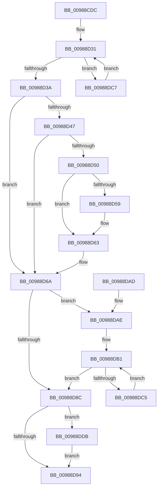

# MiSwitchBaseAddress

- RVA: `0x00988CDC`–`0x00988E0B` (길이 `303` bytes)
- VA: `0x0000000140988CDC`
- 실행 섹션: `PAGE`
- PDB 이름 있음: `예`; PDB Function 태그: `아니요`
- unwind 정보 RVA: `0x00097F00`
- 디코드: `84`개 명령, `303/303` bytes 표시
- 미해석 바이트: `0` (있으면 어셈블리에 `.byte`로 보존)

> 이 문서는 커널 이미지의 기계어와 PDB 기호를 분석해 생성했습니다. 4번과 5번은 함수 원형과 자료형을 바이너리 사용 방식에서 추정한 C 해석이며 원본 소스 복구 결과는 아닙니다.

## 1. Dependencies

- 직접 호출 지점: **5**; 고유 호출 대상: **4**
- 직접 호출자로 확인된 함수: **1**
- RIP 상대 이미지 참조: **0**

### Outgoing calls
- `0x00988D3D` → [MiGetControlAreaLoadConfig](../../text/46/MiGetControlAreaLoadConfig_function_0046E9D4.md) (function, `0x0046E9D4`)
- `0x00988D76` → [MiWalkEntireImage](../../text/36/MiWalkEntireImage_function_00365D70.md) (function, `0x00365D70`)
- `0x00988DB8` → [MiApplyBytestreamFixup](../../text/4A/MiApplyBytestreamFixup_function_004AC5AC.md) (function, `0x004AC5AC`)
- `0x00988DCE` → [MiApplyBytestreamFixup](../../text/4A/MiApplyBytestreamFixup_function_004AC5AC.md) (function, `0x004AC5AC`)
- `0x00988DFB` → [DbgUnLoadImageSymbolsUnicode](../../text/4A/DbgUnLoadImageSymbolsUnicode_function_004AE114.md) (function, `0x004AE114`)

### Direct callers
- [MiRelocateImageAgain](MiRelocateImageAgain_function_009885C8.md) at `0x00988746`

### Static image references
- 디코드된 RIP-relative 메모리 참조가 없습니다.

## 2. Other-region calls and transfers

- 다른 실행 섹션으로 향하는 call: **5**
  - `0x00988D3D` → [MiGetControlAreaLoadConfig](../../text/46/MiGetControlAreaLoadConfig_function_0046E9D4.md) (`PAGE` → `.text`)
  - `0x00988D76` → [MiWalkEntireImage](../../text/36/MiWalkEntireImage_function_00365D70.md) (`PAGE` → `.text`)
  - `0x00988DB8` → [MiApplyBytestreamFixup](../../text/4A/MiApplyBytestreamFixup_function_004AC5AC.md) (`PAGE` → `.text`)
  - `0x00988DCE` → [MiApplyBytestreamFixup](../../text/4A/MiApplyBytestreamFixup_function_004AC5AC.md) (`PAGE` → `.text`)
  - `0x00988DFB` → [DbgUnLoadImageSymbolsUnicode](../../text/4A/DbgUnLoadImageSymbolsUnicode_function_004AE114.md) (`PAGE` → `.text`)
- 별도 외부 분기/꼬리 이동을 확인하지 못했습니다.

## 3. Assembly (complete function range)

```asm
00988CDC  48 89 5C 24 08                  mov qword ptr [rsp + 8], rbx
00988CE1  48 89 6C 24 10                  mov qword ptr [rsp + 0x10], rbp
00988CE6  48 89 74 24 18                  mov qword ptr [rsp + 0x18], rsi
00988CEB  57                              push rdi
00988CEC  41 56                           push r14
00988CEE  41 57                           push r15
00988CF0  48 83 EC 20                     sub rsp, 0x20
00988CF4  48 8B 41 60                     mov rax, qword ptr [rcx + 0x60]
00988CF8  4C 8B F2                        mov r14, rdx
00988CFB  48 8B 39                        mov rdi, qword ptr [rcx]
00988CFE  48 83 E0 F8                     and rax, 0xfffffffffffffff8
00988D02  48 8B F1                        mov rsi, rcx
00988D05  4D 8B F8                        mov r15, r8
00988D08  4C 8B DA                        mov r11, rdx
00988D0B  48 8B 68 20                     mov rbp, qword ptr [rax + 0x20]
00988D0F  4C 8B 57 20                     mov r10, qword ptr [rdi + 0x20]
00988D13  4D 2B F2                        sub r14, r10
00988D16  48 8B 5D 28                     mov rbx, qword ptr [rbp + 0x28]
00988D1A  4C 89 75 28                     mov qword ptr [rbp + 0x28], r14
00988D1E  48 8B 4F 38                     mov rcx, qword ptr [rdi + 0x38]
00988D22  48 89 57 20                     mov qword ptr [rdi + 0x20], rdx
00988D26  48 8B 45 28                     mov rax, qword ptr [rbp + 0x28]
00988D2A  48 01 01                        add qword ptr [rcx], rax
00988D2D  48 8B 45 10                     mov rax, qword ptr [rbp + 0x10]
00988D31  48 85 C0                        test rax, rax
00988D34  0F 85 8D 00 00 00               jne 0x140988dc7
00988D3A  48 8B CE                        mov rcx, rsi
00988D3D  E8 92 5C AE FF                  call 0x14046e9d4
00988D42  48 85 C0                        test rax, rax
00988D45  74 23                           je 0x140988d6a
00988D47  48 8B 48 18                     mov rcx, qword ptr [rax + 0x18]
00988D4B  48 85 C9                        test rcx, rcx
00988D4E  74 1A                           je 0x140988d6a
00988D50  48 8B 41 08                     mov rax, qword ptr [rcx + 8]
00988D54  48 85 C0                        test rax, rax
00988D57  74 0A                           je 0x140988d63
00988D59  49 2B C3                        sub rax, r11
00988D5C  49 03 C2                        add rax, r10
00988D5F  48 89 41 08                     mov qword ptr [rcx + 8], rax
00988D63  4D 2B D3                        sub r10, r11
00988D66  4C 01 51 10                     add qword ptr [rcx + 0x10], r10
00988D6A  41 B8 02 00 00 00               mov r8d, 2
00988D70  49 8B D7                        mov rdx, r15
00988D73  48 8B CE                        mov rcx, rsi
00988D76  E8 F5 CF 9D FF                  call 0x140365d70
00988D7B  49 8D 04 1E                     lea rax, [r14 + rbx]
00988D7F  48 89 45 28                     mov qword ptr [rbp + 0x28], rax
00988D83  48 8B 45 10                     mov rax, qword ptr [rbp + 0x10]
00988D87  48 85 C0                        test rax, rax
00988D8A  75 22                           jne 0x140988dae
00988D8C  66 0F BA 67 0C 0B               bt word ptr [rdi + 0xc], 0xb
00988D92  72 47                           jb 0x140988ddb
00988D94  48 8B 5C 24 40                  mov rbx, qword ptr [rsp + 0x40]
00988D99  48 8B 6C 24 48                  mov rbp, qword ptr [rsp + 0x48]
00988D9E  48 8B 74 24 50                  mov rsi, qword ptr [rsp + 0x50]
00988DA3  48 83 C4 20                     add rsp, 0x20
00988DA7  41 5F                           pop r15
00988DA9  41 5E                           pop r14
00988DAB  5F                              pop rdi
00988DAC  C3                              ret
00988DAD  CC                              int3
00988DAE  48 F7 DB                        neg rbx
00988DB1  48 8D 50 18                     lea rdx, [rax + 0x18]
00988DB5  4C 8B C3                        mov r8, rbx
00988DB8  E8 EF 37 B2 FF                  call 0x1404ac5ac
00988DBD  48 8B 00                        mov rax, qword ptr [rax]
00988DC0  48 85 C0                        test rax, rax
00988DC3  74 C7                           je 0x140988d8c
00988DC5  EB EA                           jmp 0x140988db1
00988DC7  48 8D 50 18                     lea rdx, [rax + 0x18]
00988DCB  4C 8B C3                        mov r8, rbx
00988DCE  E8 D9 37 B2 FF                  call 0x1404ac5ac
00988DD3  48 8B 00                        mov rax, qword ptr [rax]
00988DD6  E9 56 FF FF FF                  jmp 0x140988d31
00988DDB  65 4C 8B 04 25 88 01 00 00      mov r8, qword ptr gs:[0x188]
00988DE4  48 8B 4E 40                     mov rcx, qword ptr [rsi + 0x40]
00988DE8  48 8B 57 20                     mov rdx, qword ptr [rdi + 0x20]
00988DEC  48 83 E1 F0                     and rcx, 0xfffffffffffffff0
00988DF0  48 83 C1 58                     add rcx, 0x58
00988DF4  4D 8B 80 B8 00 00 00            mov r8, qword ptr [r8 + 0xb8]
00988DFB  E8 14 53 B2 FF                  call 0x1404ae114
00988E00  B8 FF F7 00 00                  mov eax, 0xf7ff
00988E05  66 21 47 0C                     and word ptr [rdi + 0xc], ax
00988E09  EB 89                           jmp 0x140988d94
```

## 4. C-style interpretation (structured pseudocode)

```c
__int64 __fastcall MiSwitchBaseAddress(__int64 a1, __int64 a2, __int64 a3)
{
    __int64 result;
    __int64 v_r10;
    __int64 v_r14;
    __int64 v_rbx;
    __int64 v_rsp;
    unsigned __int64 v_stack_p10;
    unsigned __int64 v_stack_p18;
    unsigned __int64 v_stack_p8;

    v_stack_p8 = v_rbx;
    v_stack_p10 = v_rbp;
    v_stack_p18 = v_rsi;
    v_rsp = (v_rsp) - (32);
    result = (*(unsigned __int64 *)(a1 + 96)) & (-8);
    v_r14 = (a2) - (*(unsigned __int64 *)(*(unsigned __int64 *)(a1) + 32));
    *(unsigned __int64 *)(*(unsigned __int64 *)(result + 32) + 40) = v_r14;
    *(unsigned __int64 *)(*(unsigned __int64 *)(a1) + 32) = a2;
loc_00988D31:
    if (*(unsigned __int64 *)(*(unsigned __int64 *)(result + 32) + 16) != 0) goto loc_00988DC7;
    result = MiGetControlAreaLoadConfig(a1, a2, a3, a4);
    if (result == 0) goto loc_00988D6A;
    if (*(unsigned __int64 *)(result + 24) == 0) goto loc_00988D6A;
    result = *(unsigned __int64 *)(*(unsigned __int64 *)(result + 24) + 8);
    if (*(unsigned __int64 *)(*(unsigned __int64 *)(result + 24) + 8) != 0) {
        result = (*(unsigned __int64 *)(*(unsigned __int64 *)(result + 24) + 8)) - (a2);
        result = (result) + (*(unsigned __int64 *)(*(unsigned __int64 *)(a1) + 32));
        *(unsigned __int64 *)(*(unsigned __int64 *)(result + 24) + 8) = result;
    }
    v_r10 = (*(unsigned __int64 *)(*(unsigned __int64 *)(a1) + 32)) - (a2);
loc_00988D6A:
    result = MiWalkEntireImage(a1, a3, 2, a4);
    *(unsigned __int64 *)(*(unsigned __int64 *)(result + 32) + 40) = v_r14 + *(unsigned __int64 *)(*(unsigned __int64 *)(result + 32) + 40) * 1;
    if (*(unsigned __int64 *)(*(unsigned __int64 *)(result + 32) + 16) != 0) goto loc_00988DAE;
loc_00988D8C:
    if (condition_is_below) goto loc_00988DDB;
loc_00988D94:
    v_rsp = (v_rsp) + (32);
    return *(unsigned __int64 *)(*(unsigned __int64 *)(result + 32) + 16);
loc_00988DAE:
    v_rbx = -(v_stack_p8);
loc_00988DB1:
    result = MiApplyBytestreamFixup(a1, *(unsigned __int64 *)(*(unsigned __int64 *)(result + 32) + 16) + 24, v_rbx, a4);
    if (*(unsigned __int64 *)(result) == 0) goto loc_00988D8C;
    goto loc_00988DB1;
loc_00988DC7:
    result = MiApplyBytestreamFixup(a1, *(unsigned __int64 *)(result) + 24, v_rbx, a4);
    goto loc_00988D31;
loc_00988DDB:
    a1 = (*(unsigned __int64 *)(v_stack_p18 + 64)) & (-16);
    a1 = (a1) + (88);
    result = DbgUnLoadImageSymbolsUnicode(a1, *(unsigned __int64 *)(*(unsigned __int64 *)(a1) + 32), *(unsigned __int64 *)(*(unsigned __int64 *)(gs_base + (0 + 392)) + 184), a4);
    goto loc_00988D94;
}
```

## 5. (Beta) C Style

```c
int64_t MiSwitchBaseAddress(void *Arg1, void *Arg2, int64_t Arg3)
{
    uint8_t *arg1 = (uint8_t *)Arg1;
    uint8_t *arg2 = (uint8_t *)Arg2;

    int64_t result;
    int64_t local_r10;
    int64_t local_r14;
    int64_t local_rbx;
    int64_t local_rsp;
    uint64_t v_stack_p10;
    uint64_t v_stack_p18;
    uint64_t v_stack_p8;

    v_stack_p8 = local_rbx;
    v_stack_p10 = local_rbp;
    v_stack_p18 = local_rsi;
    local_rsp = (local_rsp) - (32);
    result = (*(uint64_t *)(arg1 + 0x60)) & (-8);
    local_r14 = (Arg2) - (*(uint64_t *)(*(uint64_t *)(arg1) + 0x20));
    *(uint64_t *)(*(uint64_t *)(result + 0x20) + 0x28) = local_r14;
    *(void **)(*(uint64_t *)(arg1) + 0x20) = Arg2;
loc_00988D31:
    if (*(uint64_t *)(*(uint64_t *)(result + 0x20) + 0x10) != 0) goto loc_00988DC7;
    result = MiGetControlAreaLoadConfig(Arg1, Arg2, Arg3, a4);
    if (result == 0) goto loc_00988D6A;
    if (*(uint64_t *)(result + 0x18) == 0) goto loc_00988D6A;
    result = *(uint64_t *)(*(uint64_t *)(result + 0x18) + 0x8);
    if (*(uint64_t *)(*(uint64_t *)(result + 0x18) + 0x8) != 0) {
        result = (*(uint64_t *)(*(uint64_t *)(result + 0x18) + 0x8)) - (Arg2);
        result = (result) + (*(uint64_t *)(*(uint64_t *)(arg1) + 0x20));
        *(uint64_t *)(*(uint64_t *)(result + 0x18) + 0x8) = result;
    }
    local_r10 = (*(uint64_t *)(*(uint64_t *)(arg1) + 0x20)) - (Arg2);
loc_00988D6A:
    result = MiWalkEntireImage(Arg1, Arg3, 2, a4);
    *(uint64_t *)(*(uint64_t *)(result + 0x20) + 0x28) = local_r14 + *(uint64_t *)(*(uint64_t *)(result + 0x20) + 0x28) * 1;
    if (*(uint64_t *)(*(uint64_t *)(result + 0x20) + 0x10) != 0) goto loc_00988DAE;
loc_00988D8C:
    if (condition_is_below) goto loc_00988DDB;
loc_00988D94:
    local_rsp = (local_rsp) + (32);
    return *(uint64_t *)(*(uint64_t *)(result + 0x20) + 0x10);
loc_00988DAE:
    local_rbx = -(v_stack_p8);
loc_00988DB1:
    result = MiApplyBytestreamFixup(Arg1, *(uint64_t *)(*(uint64_t *)(result + 0x20) + 0x10) + 24, local_rbx, a4);
    if (*(uint64_t *)(result) == 0) goto loc_00988D8C;
    goto loc_00988DB1;
loc_00988DC7:
    result = MiApplyBytestreamFixup(Arg1, *(uint64_t *)(result) + 24, local_rbx, a4);
    goto loc_00988D31;
loc_00988DDB:
    Arg1 = (*(uint64_t *)(v_stack_p18 + 0x40)) & (-16);
    Arg1 = (Arg1) + (88);
    result = DbgUnLoadImageSymbolsUnicode(Arg1, *(uint64_t *)(*(uint64_t *)(arg1) + 0x20), *(uint64_t *)(*(uint64_t *)(gs_base + (0 + 0x188)) + 0xB8), a4);
    goto loc_00988D94;
}
```

### 관측된 메모리 오프셋

구조체 형식이 확인되지 않은 접근은 인자 기준의 오프셋으로만 기록했습니다.

| 기준 인자 | 오프셋 표현 | 폭 (bit) | 접근 |
|---|---:|---:|---|
| `Arg1` | `+ 0x0` | `64` | `R` |
| `Arg1` | `+ 0x40` | `64` | `R` |
| `Arg1` | `+ 0x60` | `64` | `R` |
| `Arg2` | `+ 0x0 + rbx*1` | `64` | `R` |

## 6. Execution-region graph

[열기: 2D/3D 그래프와 함수 탐색 컨트롤 패널](../../../control-panel.html?section=page&rva=0x00988CDC&view=graph)

- 2D 그래프는 위에서 아래로 흐르고, 3D 그래프는 빈 공간을 드래그해 회전합니다. Shift+드래그는 이동, 휠은 확대·축소, 함수 노드 선택은 대상 보고서 이동입니다.

### Static fallback


