# MiValidateExistingImage

- RVA: `0x009864B4`–`0x00986828` (길이 `884` bytes)
- VA: `0x00000001409864B4`
- 실행 섹션: `PAGE`
- PDB 이름 있음: `예`; PDB Function 태그: `아니요`
- unwind 정보 RVA: `0x00097CAC`
- 디코드: `213`개 명령, `884/884` bytes 표시
- 미해석 바이트: `0` (있으면 어셈블리에 `.byte`로 보존)

> 이 문서는 커널 이미지의 기계어와 PDB 기호를 분석해 생성했습니다. 4번과 5번은 함수 원형과 자료형을 바이너리 사용 방식에서 추정한 C 해석이며 원본 소스 복구 결과는 아닙니다.

## 1. Dependencies

- 직접 호출 지점: **7**; 고유 호출 대상: **6**
- 직접 호출자로 확인된 함수: **1**
- RIP 상대 이미지 참조: **2**

### Outgoing calls
- `0x00986505` → [MiRelocateImageAgain](MiRelocateImageAgain_function_009885C8.md) (function, `0x009885C8`)
- `0x0098658A` → [SeGetImageRequiredSigningLevel](../A1/SeGetImageRequiredSigningLevel_function_00A135BC.md) (function, `0x00A135BC`)
- `0x0098661E` → [Feature_TrustedLaunchHosts__private_IsEnabledDeviceUsageNoInline](../../text/4F/Feature_TrustedLaunchHosts__private_IsEnabledDeviceUsageNoInline_function_004F4150.md) (function, `0x004F4150`)
- `0x0098669B` → [SeCompareSigningLevels](../A1/SeCompareSigningLevels_function_00A13760.md) (function, `0x00A13760`)
- `0x009866BD` → [SeCompareSigningLevels](../A1/SeCompareSigningLevels_function_00A13760.md) (function, `0x00A13760`)
- `0x0098670C` → [MiValidateSectionSigningPolicy](../93/MiValidateSectionSigningPolicy_function_0093FF40.md) (function, `0x0093FF40`)
- `0x0098675A` → [guard_dispatch_icall](../../text/6B/guard_dispatch_icall_function_006BAAD0.md) (function, `0x006BAAD0`)

### Direct callers
- [MiShareExistingControlArea](MiShareExistingControlArea_function_00984FAC.md) at `0x009850A0`

### Static image references
- `0x00986593` → RVA `0x00E2D7F8` (`.data`; write)
- `0x0098667E` → RVA `0x00F04ED8` (`.data`; read)

## 2. Other-region calls and transfers

- 다른 실행 섹션으로 향하는 call: **2**
  - `0x0098661E` → [Feature_TrustedLaunchHosts__private_IsEnabledDeviceUsageNoInline](../../text/4F/Feature_TrustedLaunchHosts__private_IsEnabledDeviceUsageNoInline_function_004F4150.md) (`PAGE` → `.text`)
  - `0x0098675A` → [guard_dispatch_icall](../../text/6B/guard_dispatch_icall_function_006BAAD0.md) (`PAGE` → `.text`)
- 별도 외부 분기/꼬리 이동을 확인하지 못했습니다.

## 3. Assembly (complete function range)

```asm
009864B4  48 89 5C 24 18                  mov qword ptr [rsp + 0x18], rbx
009864B9  55                              push rbp
009864BA  56                              push rsi
009864BB  57                              push rdi
009864BC  41 54                           push r12
009864BE  41 55                           push r13
009864C0  41 56                           push r14
009864C2  41 57                           push r15
009864C4  48 83 EC 50                     sub rsp, 0x50
009864C8  4C 8B 71 40                     mov r14, qword ptr [rcx + 0x40]
009864CC  45 32 E4                        xor r12b, r12b
009864CF  4C 8B 79 38                     mov r15, qword ptr [rcx + 0x38]
009864D3  33 F6                           xor esi, esi
009864D5  BF 00 08 00 00                  mov edi, 0x800
009864DA  4C 89 BC 24 98 00 00 00         mov qword ptr [rsp + 0x98], r15
009864E2  48 8B D9                        mov rbx, rcx
009864E5  41 85 7E 38                     test dword ptr [r14 + 0x38], edi
009864E9  0F 85 80 02 00 00               jne 0x14098676f
009864EF  8B 11                           mov edx, dword ptr [rcx]
009864F1  44 8B C2                        mov r8d, edx
009864F4  41 C1 E8 1C                     shr r8d, 0x1c
009864F8  49 8B CE                        mov rcx, r14
009864FB  C1 EA 05                        shr edx, 5
009864FE  41 83 E0 01                     and r8d, 1
00986502  83 E2 01                        and edx, 1
00986505  E8 BE 20 00 00                  call 0x1409885c8
0098650A  85 C0                           test eax, eax
0098650C  0F 88 7D 02 00 00               js 0x14098678f
00986512  8B 13                           mov edx, dword ptr [rbx]
00986514  84 D2                           test dl, dl
00986516  0F 89 9A 00 00 00               jns 0x1409865b6
0098651C  B9 04 00 00 00                  mov ecx, 4
00986521  4D 8B 2E                        mov r13, qword ptr [r14]
00986524  8B E9                           mov ebp, ecx
00986526  83 CD 10                        or ebp, 0x10
00986529  0F BA E2 0A                     bt edx, 0xa
0098652D  0F 43 E9                        cmovae ebp, ecx
00986530  8B CA                           mov ecx, edx
00986532  0F BA E2 09                     bt edx, 9
00986536  0F 83 CB 00 00 00               jae 0x140986607
0098653C  F6 C2 10                        test dl, 0x10
0098653F  0F 85 C2 00 00 00               jne 0x140986607
00986545  65 48 8B 04 25 88 01 00 00      mov rax, qword ptr gs:[0x188]
0098654E  48 8D 7B 18                     lea rdi, [rbx + 0x18]
00986552  8B D5                           mov edx, ebp
00986554  48 8B 88 B8 00 00 00            mov rcx, qword ptr [rax + 0xb8]
0098655B  48 8D 84 24 90 00 00 00         lea rax, [rsp + 0x90]
00986563  48 89 44 24 20                  mov qword ptr [rsp + 0x20], rax
00986568  44 8B B9 50 07 00 00            mov r15d, dword ptr [rcx + 0x750]
0098656F  45 8A 4D 0F                     mov r9b, byte ptr [r13 + 0xf]
00986573  44 8A 07                        mov r8b, byte ptr [rdi]
00986576  41 80 E1 0F                     and r9b, 0xf
0098657A  48 8B 8C 24 98 00 00 00         mov rcx, qword ptr [rsp + 0x98]
00986582  40 88 B4 24 90 00 00 00         mov byte ptr [rsp + 0x90], sil
0098658A  E8 2D D0 08 00                  call 0x140a135bc
0098658F  85 C0                           test eax, eax
00986591  79 3C                           jns 0x1409865cf
00986593  C7 05 5B 72 4A 00 0E 00 00 00   mov dword ptr [rip + 0x4a725b], 0xe
0098659D  48 8B 9C 24 A0 00 00 00         mov rbx, qword ptr [rsp + 0xa0]
009865A5  48 83 C4 50                     add rsp, 0x50
009865A9  41 5F                           pop r15
009865AB  41 5E                           pop r14
009865AD  41 5D                           pop r13
009865AF  41 5C                           pop r12
009865B1  5F                              pop rdi
009865B2  5E                              pop rsi
009865B3  5D                              pop rbp
009865B4  C3                              ret
009865B5  CC                              int3
009865B6  F6 C2 20                        test dl, 0x20
009865B9  0F 85 DF 01 00 00               jne 0x14098679e
009865BF  F6 C2 10                        test dl, 0x10
009865C2  0F 85 E0 01 00 00               jne 0x1409867a8
009865C8  33 C9                           xor ecx, ecx
009865CA  E9 52 FF FF FF                  jmp 0x140986521
009865CF  8B 0B                           mov ecx, dword ptr [rbx]
009865D1  0F BA E1 0A                     bt ecx, 0xa
009865D5  72 1F                           jb 0x1409865f6
009865D7  40 38 37                        cmp byte ptr [rdi], sil
009865DA  0F 85 DB 01 00 00               jne 0x1409867bb
009865E0  41 0F BA E7 18                  bt r15d, 0x18
009865E5  0F 82 E9 01 00 00               jb 0x1409867d4
009865EB  41 0F BA E7 19                  bt r15d, 0x19
009865F0  0F 82 E6 01 00 00               jb 0x1409867dc
009865F6  8A 84 24 90 00 00 00            mov al, byte ptr [rsp + 0x90]
009865FD  4C 8B BC 24 98 00 00 00         mov r15, qword ptr [rsp + 0x98]
00986605  88 07                           mov byte ptr [rdi], al
00986607  0F BA E1 12                     bt ecx, 0x12
0098660B  0F 82 D3 01 00 00               jb 0x1409867e4
00986611  8B FD                           mov edi, ebp
00986613  0F BA EF 1D                     bts edi, 0x1d
00986617  0F BA E1 15                     bt ecx, 0x15
0098661B  0F 43 FD                        cmovae edi, ebp
0098661E  E8 2D DB B6 FF                  call 0x1404f4150
00986623  85 C0                           test eax, eax
00986625  74 0C                           je 0x140986633
00986627  F7 03 00 00 00 08               test dword ptr [rbx], 0x8000000
0098662D  0F 85 C8 01 00 00               jne 0x1409867fb
00986633  F7 03 00 02 00 00               test dword ptr [rbx], 0x200
00986639  0F 84 9B 00 00 00               je 0x1409866da
0098663F  49 8B 46 60                     mov rax, qword ptr [r14 + 0x60]
00986643  48 B9 FF FF FF FF FF FF FF 0F   movabs rcx, 0xfffffffffffffff
0098664D  48 83 E0 F8                     and rax, 0xfffffffffffffff8
00986651  48 8B 40 28                     mov rax, qword ptr [rax + 0x28]
00986655  48 83 E0 F8                     and rax, 0xfffffffffffffff8
00986659  4C 8B C0                        mov r8, rax
0098665C  49 C1 E8 03                     shr r8, 3
00986660  4C 3B C1                        cmp r8, rcx
00986663  4C 0F 47 C0                     cmova r8, rax
00986667  41 0F B6 45 0F                  movzx eax, byte ptr [r13 + 0xf]
0098666C  8B 0B                           mov ecx, dword ptr [rbx]
0098666E  40 8A E8                        mov bpl, al
00986671  40 80 E5 0F                     and bpl, 0xf
00986675  F6 C1 10                        test cl, 0x10
00986678  0F 85 9A 01 00 00               jne 0x140986818
0098667E  4C 8B 15 53 E8 57 00            mov r10, qword ptr [rip + 0x57e853]
00986685  48 8B 8B A0 00 00 00            mov rcx, qword ptr [rbx + 0xa0]
0098668C  8A 53 18                        mov dl, byte ptr [rbx + 0x18]
0098668F  4D 85 D2                        test r10, r10
00986692  0F 85 A0 00 00 00               jne 0x140986738
00986698  40 8A CD                        mov cl, bpl
0098669B  E8 C0 D0 08 00                  call 0x140a13760
009866A0  85 C0                           test eax, eax
009866A2  0F 84 70 01 00 00               je 0x140986818
009866A8  0F BA E7 1E                     bt edi, 0x1e
009866AC  0F 82 52 01 00 00               jb 0x140986804
009866B2  40 84 ED                        test bpl, bpl
009866B5  74 71                           je 0x140986728
009866B7  41 8A D4                        mov dl, r12b
009866BA  40 8A CD                        mov cl, bpl
009866BD  E8 9E D0 08 00                  call 0x140a13760
009866C2  8B CE                           mov ecx, esi
009866C4  83 C9 04                        or ecx, 4
009866C7  85 C0                           test eax, eax
009866C9  0F 45 CE                        cmovne ecx, esi
009866CC  F7 03 00 00 00 04               test dword ptr [rbx], 0x4000000
009866D2  8B F1                           mov esi, ecx
009866D4  0F 85 46 01 00 00               jne 0x140986820
009866DA  8A 43 18                        mov al, byte ptr [rbx + 0x18]
009866DD  4D 8B C6                        mov r8, r14
009866E0  44 8B 8B A8 00 00 00            mov r9d, dword ptr [rbx + 0xa8]
009866E7  49 8B D7                        mov rdx, r15
009866EA  44 88 64 24 40                  mov byte ptr [rsp + 0x40], r12b
009866EF  B9 01 00 00 00                  mov ecx, 1
009866F4  88 44 24 38                     mov byte ptr [rsp + 0x38], al
009866F8  48 8B 83 A0 00 00 00            mov rax, qword ptr [rbx + 0xa0]
009866FF  89 74 24 30                     mov dword ptr [rsp + 0x30], esi
00986703  89 7C 24 28                     mov dword ptr [rsp + 0x28], edi
00986707  48 89 44 24 20                  mov qword ptr [rsp + 0x20], rax
0098670C  E8 2F 98 FB FF                  call 0x14093ff40
00986711  85 C0                           test eax, eax
00986713  0F 89 84 FE FF FF               jns 0x14098659d
00986719  C7 05 D5 70 4A 00 0F 00 00 00   mov dword ptr [rip + 0x4a70d5], 0xf
00986723  E9 75 FE FF FF                  jmp 0x14098659d
00986728  49 8B 45 38                     mov rax, qword ptr [r13 + 0x38]
0098672C  8A 50 2E                        mov dl, byte ptr [rax + 0x2e]
0098672F  84 D2                           test dl, dl
00986731  79 84                           jns 0x1409866b7
00986733  E9 E0 00 00 00                  jmp 0x140986818
00986738  44 8B C8                        mov r9d, eax
0098673B  4C 89 7C 24 30                  mov qword ptr [rsp + 0x30], r15
00986740  48 89 4C 24 28                  mov qword ptr [rsp + 0x28], rcx
00986745  49 8B C2                        mov rax, r10
00986748  41 C1 E9 04                     shr r9d, 4
0098674C  8B CF                           mov ecx, edi
0098674E  4C 89 44 24 20                  mov qword ptr [rsp + 0x20], r8
00986753  41 83 E1 07                     and r9d, 7
00986757  44 8A C5                        mov r8b, bpl
0098675A  E8 71 43 D3 FF                  call 0x1406baad0
0098675F  8A 53 18                        mov dl, byte ptr [rbx + 0x18]
00986762  85 C0                           test eax, eax
00986764  0F 84 2E FF FF FF               je 0x140986698
0098676A  E9 A9 00 00 00                  jmp 0x140986818
0098676F  F7 01 00 00 04 00               test dword ptr [rcx], 0x40000
00986775  0F 84 74 FD FF FF               je 0x1409864ef
0098677B  C7 05 73 70 4A 00 0C 00 00 00   mov dword ptr [rip + 0x4a7073], 0xc
00986785  B8 33 04 00 C0                  mov eax, 0xc0000433
0098678A  E9 0E FE FF FF                  jmp 0x14098659d
0098678F  C7 05 5F 70 4A 00 0D 00 00 00   mov dword ptr [rip + 0x4a705f], 0xd
00986799  E9 FF FD FF FF                  jmp 0x14098659d
0098679E  B9 01 00 00 00                  mov ecx, 1
009867A3  E9 79 FD FF FF                  jmp 0x140986521
009867A8  8B C2                           mov eax, edx
009867AA  23 C7                           and eax, edi
009867AC  F7 D8                           neg eax
009867AE  1B C9                           sbb ecx, ecx
009867B0  83 E1 06                        and ecx, 6
009867B3  83 C1 02                        add ecx, 2
009867B6  E9 66 FD FF FF                  jmp 0x140986521
009867BB  41 0F BA E7 17                  bt r15d, 0x17
009867C0  0F 83 1A FE FF FF               jae 0x1409865e0
009867C6  BE 01 00 00 00                  mov esi, 1
009867CB  48 8D 7B 18                     lea rdi, [rbx + 0x18]
009867CF  E9 0C FE FF FF                  jmp 0x1409865e0
009867D4  41 B4 08                        mov r12b, 8
009867D7  E9 1A FE FF FF                  jmp 0x1409865f6
009867DC  41 B4 06                        mov r12b, 6
009867DF  E9 12 FE FF FF                  jmp 0x1409865f6
009867E4  0F BA ED 1E                     bts ebp, 0x1e
009867E8  80 7B 18 00                     cmp byte ptr [rbx + 0x18], 0
009867EC  0F 85 1F FE FF FF               jne 0x140986611
009867F2  C6 43 18 04                     mov byte ptr [rbx + 0x18], 4
009867F6  E9 16 FE FF FF                  jmp 0x140986611
009867FB  0F BA EF 15                     bts edi, 0x15
009867FF  E9 2F FE FF FF                  jmp 0x140986633
00986804  41 8B 46 5C                     mov eax, dword ptr [r14 + 0x5c]
00986808  25 00 00 0C 00                  and eax, 0xc0000
0098680D  3D 00 00 08 00                  cmp eax, 0x80000
00986812  0F 84 9A FE FF FF               je 0x1409866b2
00986818  83 CE 02                        or esi, 2
0098681B  E9 97 FE FF FF                  jmp 0x1409866b7
00986820  83 CE 08                        or esi, 8
00986823  E9 B2 FE FF FF                  jmp 0x1409866da
```

## 4. C-style interpretation (structured pseudocode)

```c
__int64 __fastcall MiValidateExistingImage(__int64 a1)
{
    __int64 result;
    __int64 v_r12;
    __int64 v_rbp;
    __int64 v_rdi;
    __int64 v_rsi;
    __int64 v_rsp;
    unsigned __int64 v_stack_m68;
    unsigned __int64 v_stack_p10;
    unsigned __int64 v_stack_p18;
    unsigned __int64 v_stack_p20;
    unsigned int v_stack_p28;
    unsigned int v_stack_p30;
    unsigned __int8 v_stack_p38;
    unsigned __int8 v_stack_p40;
    unsigned __int64 v_stack_p8;
    unsigned __int8 v_stack_p90;
    unsigned __int64 v_stack_p98;

    v_stack_p18 = v_rbx;
    v_rsp = (v_rsp) - (80);
    v_r12 = 0;
    v_rsi = 0;
    v_stack_p10 = *(unsigned __int64 *)(a1 + 56);
    if (((*(unsigned int *)(*(unsigned __int64 *)(a1 + 64) + 56)) & ((unsigned int)((unsigned int)(0x800ULL)))) != 0) goto loc_0098676F;
loc_009864EF:
    a3 = (unsigned int)(((unsigned int)((unsigned int)((unsigned int)(*(unsigned int *)(a1))))) >> (28));
    a2 = (unsigned int)(((unsigned int)(*(unsigned int *)(a1))) >> (5));
    a3 = (unsigned int)((a3) & (1));
    a2 = (unsigned int)((a2) & (1));
    result = MiRelocateImageAgain(*(unsigned __int64 *)(a1 + 64), a2, a3, a4);
    if (sign_flag) goto loc_0098678F;
    if (!sign_flag) goto loc_009865B6;
loc_00986521:
    v_rbp = (unsigned int)((4) | (16));
    if (condition_is_above_or_equal) { v_rbp = 4; }
    if (condition_is_above_or_equal) goto loc_00986607;
    if ((((unsigned __int8)((unsigned int)(*(unsigned int *)(a1)))) & (16)) != 0) goto loc_00986607;
    v_stack_m68 = v_stack_p8;
    a4 = (unsigned __int8)((*(unsigned __int8 *)(*(unsigned __int64 *)(*(unsigned __int64 *)(a1 + 64)) + 15)) & (15));
    v_stack_p8 = 0;
    result = SeGetImageRequiredSigningLevel(v_stack_p10, (unsigned int)((unsigned int)(v_rbp)), *(unsigned __int8 *)(a1 + 24), a4);
    if (!sign_flag) goto loc_009865CF;
    *(unsigned int *)(v_rip + 4878939) = 14;
loc_0098659D:
    v_rsp = (v_rsp) + (80);
    return result;
loc_009865B6:
    if ((((unsigned __int8)((unsigned int)((unsigned int)(v_rbp)))) & (32)) != 0) goto loc_0098679E;
    if ((((unsigned __int8)((unsigned int)((unsigned int)(v_rbp)))) & (16)) != 0) goto loc_009867A8;
    a1 = 0;
    goto loc_00986521;
loc_009865CF:
    if (condition_is_below) goto loc_009865F6;
    if ((*(unsigned __int8 *)(a1 + 24)) != 0) goto loc_009867BB;
loc_009865E0:
    if ((*(unsigned __int8 *)(a1 + 24)) < 0) goto loc_009867D4;
    if ((*(unsigned __int8 *)(a1 + 24)) < 0) goto loc_009867DC;
loc_009865F6:
    *(unsigned __int8 *)(a1 + 24) = (unsigned __int8)(v_stack_p90);
loc_00986607:
    if ((*(unsigned __int8 *)(a1 + 24)) < 0) goto loc_009867E4;
loc_00986611:
    v_rdi = (unsigned int)((unsigned int)(v_rbp));
    if ((*(unsigned __int8 *)(a1 + 24)) >= 0) { v_rdi = (unsigned int)(v_rbp); }
    result = Feature_TrustedLaunchHosts__private_IsEnabledDeviceUsageNoInline((unsigned int)(*(unsigned int *)(v_stack_p18)), (unsigned int)((unsigned int)(v_rbp)), *(unsigned __int8 *)(a1 + 24), a4);
    if ((unsigned int)(result) == 0) goto loc_00986633;
    if (((*(unsigned int *)(v_stack_p18)) & (0x8000000ULL)) != 0) goto loc_009867FB;
loc_00986633:
    if (((*(unsigned int *)(v_stack_p18)) & (512)) == 0) goto loc_009866DA;
    result = (*(unsigned __int64 *)(*(unsigned __int64 *)(a1 + 64) + 96)) & (-8);
    result = (*(unsigned __int64 *)(result + 40)) & (-8);
    a3 = (result) >> (3);
    if (a3 > ((unsigned int)(*(unsigned int *)(v_stack_p18)))) { a3 = result; }
    v_rbp = (unsigned __int8)(((unsigned __int8)(*(unsigned __int8 *)(*(unsigned __int64 *)(*(unsigned __int64 *)(a1 + 64)) + 15))) & (15));
    if ((((unsigned __int8)((unsigned int)(*(unsigned int *)(v_stack_p18)))) & (16)) != 0) goto loc_00986818;
    if (*(unsigned __int64 *)(v_rip + 5761107) != 0) goto loc_00986738;
loc_00986698:
    result = SeCompareSigningLevels((unsigned __int8)(v_rbp), *(unsigned __int8 *)(v_stack_p18 + 24), a3, a4);
    if ((unsigned int)(result) == 0) goto loc_00986818;
    if (condition_is_below) goto loc_00986804;
loc_009866B2:
    if ((unsigned __int8)(v_rbp) == 0) goto loc_00986728;
loc_009866B7:
    result = SeCompareSigningLevels((unsigned __int8)(v_rbp), 0, a3, a4);
    a1 = (unsigned int)((0) | (4));
    if ((unsigned int)(result) != 0) { a1 = 0; }
    if (((*(unsigned int *)(v_stack_p18)) & (0x4000000ULL)) != 0) goto loc_00986820;
loc_009866DA:
    v_stack_p40 = 0;
    v_stack_p38 = (unsigned __int8)(*(unsigned __int8 *)(v_stack_p18 + 24));
    v_stack_p30 = (unsigned int)((unsigned int)((unsigned int)(a1)));
    v_stack_p28 = (unsigned int)(v_rdi);
    v_stack_p20 = *(unsigned __int64 *)(v_stack_p18 + 160);
    result = MiValidateSectionSigningPolicy(1, v_stack_p98, *(unsigned __int64 *)(a1 + 64), (unsigned int)(*(unsigned int *)(v_stack_p18 + 168)));
    if (!sign_flag) goto loc_0098659D;
    *(unsigned int *)(v_rip + 4878549) = 15;
    goto loc_0098659D;
loc_00986728:
    if (!sign_flag) goto loc_009866B7;
    goto loc_00986818;
loc_00986738:
    v_stack_p30 = v_stack_p98;
    v_stack_p28 = 1;
    a4 = (unsigned int)(((unsigned int)((unsigned int)(*(unsigned __int64 *)(*(unsigned __int64 *)(*(unsigned __int64 *)(a1 + 64)) + 56)))) >> (4));
    v_stack_p20 = *(unsigned __int64 *)(a1 + 64);
    a4 = (unsigned int)((a4) & (7));
    result = guard_dispatch_icall((unsigned int)((unsigned int)(v_rdi)), *(unsigned __int8 *)(*(unsigned __int64 *)(*(unsigned __int64 *)(*(unsigned __int64 *)(a1 + 64)) + 56) + 46), (unsigned __int8)(v_rbp), a4);
    if ((unsigned int)(result) == 0) goto loc_00986698;
    goto loc_00986818;
loc_0098676F:
    if (((*(unsigned int *)((unsigned int)((unsigned int)(v_rdi)))) & (0x40000ULL)) == 0) goto loc_009864EF;
    *(unsigned int *)(v_rip + 4878451) = 12;
    goto loc_0098659D;
loc_0098678F:
    *(unsigned int *)(v_rip + 4878431) = 13;
    goto loc_0098659D;
loc_0098679E:
    goto loc_00986521;
loc_009867A8:
    result = (unsigned int)(((unsigned int)((unsigned int)(*(unsigned __int8 *)(v_stack_p18 + 24)))) & ((unsigned int)(v_rdi)));
    result = (unsigned int)(-(result));
    a1 = (unsigned int)((1) & (6));
    a1 = (unsigned int)((a1) + (2));
    goto loc_00986521;
loc_009867BB:
    if (condition_is_above_or_equal) goto loc_009865E0;
    goto loc_009865E0;
loc_009867D4:
    goto loc_009865F6;
loc_009867DC:
    goto loc_009865F6;
loc_009867E4:
    if ((*(unsigned __int8 *)(v_stack_p18 + 24)) != 0) goto loc_00986611;
    *(unsigned __int8 *)(v_stack_p18 + 24) = 4;
    goto loc_00986611;
loc_009867FB:
    goto loc_00986633;
loc_00986804:
    result = (unsigned int)(((unsigned int)(*(unsigned int *)(*(unsigned __int64 *)(a1 + 64) + 92))) & (0xC0000ULL));
    if (((unsigned int)(result)) == 0x80000ULL) goto loc_009866B2;
loc_00986818:
    v_rsi = (unsigned int)((1) | (2));
    goto loc_009866B7;
loc_00986820:
    v_rsi = (unsigned int)((v_rsi) | (8));
    goto loc_009866DA;
}
```

## 5. (Beta) C Style

```c
int64_t MiValidateExistingImage(void *Arg1)
{
    uint8_t *arg1 = (uint8_t *)Arg1;

    int64_t result;
    int64_t local_r12;
    int64_t local_rbp;
    int64_t local_rdi;
    int64_t local_rsi;
    int64_t local_rsp;
    uint64_t v_stack_m68;
    uint64_t v_stack_p10;
    uint64_t v_stack_p18;
    uint64_t v_stack_p20;
    uint32_t v_stack_p28;
    uint32_t v_stack_p30;
    uint8_t v_stack_p38;
    uint8_t v_stack_p40;
    uint64_t v_stack_p8;
    uint8_t v_stack_p90;
    uint64_t v_stack_p98;

    v_stack_p18 = local_rbx;
    local_rsp = (local_rsp) - (80);
    local_r12 = 0;
    local_rsi = 0;
    v_stack_p10 = *(uint64_t *)(arg1 + 0x38);
    if (((*(uint32_t *)(*(uint64_t *)(arg1 + 0x40) + 0x38)) & ((uint32_t)((uint32_t)(0x800ULL)))) != 0) goto loc_0098676F;
loc_009864EF:
    a3 = (uint32_t)(((uint32_t)((uint32_t)((uint32_t)(*(uint32_t *)(arg1))))) >> (28));
    a2 = (uint32_t)(((uint32_t)(*(uint32_t *)(arg1))) >> (5));
    a3 = (uint32_t)((a3) & (1));
    a2 = (uint32_t)((a2) & (1));
    result = MiRelocateImageAgain(*(uint64_t *)(arg1 + 0x40), a2, a3, a4);
    if (sign_flag) goto loc_0098678F;
    if (!sign_flag) goto loc_009865B6;
loc_00986521:
    local_rbp = (uint32_t)((4) | (16));
    if (condition_is_above_or_equal) { local_rbp = 4; }
    if (condition_is_above_or_equal) goto loc_00986607;
    if ((((uint8_t)((uint32_t)(*(uint32_t *)(arg1)))) & (16)) != 0) goto loc_00986607;
    v_stack_m68 = v_stack_p8;
    a4 = (uint8_t)((*(uint8_t *)(*(uint64_t *)(*(uint64_t *)(arg1 + 0x40)) + 0xF)) & (15));
    v_stack_p8 = 0;
    result = SeGetImageRequiredSigningLevel(v_stack_p10, (uint32_t)((uint32_t)(local_rbp)), *(uint8_t *)(arg1 + 0x18), a4);
    if (!sign_flag) goto loc_009865CF;
    *(uint32_t *)(v_rip + 0x4A725B) = 14;
loc_0098659D:
    local_rsp = (local_rsp) + (80);
    return result;
loc_009865B6:
    if ((((uint8_t)((uint32_t)((uint32_t)(local_rbp)))) & (32)) != 0) goto loc_0098679E;
    if ((((uint8_t)((uint32_t)((uint32_t)(local_rbp)))) & (16)) != 0) goto loc_009867A8;
    Arg1 = 0;
    goto loc_00986521;
loc_009865CF:
    if (condition_is_below) goto loc_009865F6;
    if ((*(uint8_t *)(arg1 + 0x18)) != 0) goto loc_009867BB;
loc_009865E0:
    if ((*(uint8_t *)(arg1 + 0x18)) < 0) goto loc_009867D4;
    if ((*(uint8_t *)(arg1 + 0x18)) < 0) goto loc_009867DC;
loc_009865F6:
    *(uint8_t *)(arg1 + 0x18) = (uint8_t)(v_stack_p90);
loc_00986607:
    if ((*(uint8_t *)(arg1 + 0x18)) < 0) goto loc_009867E4;
loc_00986611:
    local_rdi = (uint32_t)((uint32_t)(local_rbp));
    if ((*(uint8_t *)(arg1 + 0x18)) >= 0) { local_rdi = (uint32_t)(local_rbp); }
    result = Feature_TrustedLaunchHosts__private_IsEnabledDeviceUsageNoInline((uint32_t)(*(uint32_t *)(v_stack_p18)), (uint32_t)((uint32_t)(local_rbp)), *(uint8_t *)(arg1 + 0x18), a4);
    if ((uint32_t)(result) == 0) goto loc_00986633;
    if (((*(uint32_t *)(v_stack_p18)) & (0x8000000ULL)) != 0) goto loc_009867FB;
loc_00986633:
    if (((*(uint32_t *)(v_stack_p18)) & (512)) == 0) goto loc_009866DA;
    result = (*(uint64_t *)(*(uint64_t *)(arg1 + 0x40) + 0x60)) & (-8);
    result = (*(uint64_t *)(result + 0x28)) & (-8);
    a3 = (result) >> (3);
    if (a3 > ((uint32_t)(*(uint32_t *)(v_stack_p18)))) { a3 = result; }
    local_rbp = (uint8_t)(((uint8_t)(*(uint8_t *)(*(uint64_t *)(*(uint64_t *)(arg1 + 0x40)) + 0xF))) & (15));
    if ((((uint8_t)((uint32_t)(*(uint32_t *)(v_stack_p18)))) & (16)) != 0) goto loc_00986818;
    if (*(uint64_t *)(v_rip + 0x57E853) != 0) goto loc_00986738;
loc_00986698:
    result = SeCompareSigningLevels((uint8_t)(local_rbp), *(uint8_t *)(v_stack_p18 + 0x18), a3, a4);
    if ((uint32_t)(result) == 0) goto loc_00986818;
    if (condition_is_below) goto loc_00986804;
loc_009866B2:
    if ((uint8_t)(local_rbp) == 0) goto loc_00986728;
loc_009866B7:
    result = SeCompareSigningLevels((uint8_t)(local_rbp), 0, a3, a4);
    Arg1 = (uint32_t)((0) | (4));
    if ((uint32_t)(result) != 0) { Arg1 = 0; }
    if (((*(uint32_t *)(v_stack_p18)) & (0x4000000ULL)) != 0) goto loc_00986820;
loc_009866DA:
    v_stack_p40 = 0;
    v_stack_p38 = (uint8_t)(*(uint8_t *)(v_stack_p18 + 0x18));
    v_stack_p30 = (uint32_t)((uint32_t)((uint32_t)(Arg1)));
    v_stack_p28 = (uint32_t)(local_rdi);
    v_stack_p20 = *(uint64_t *)(v_stack_p18 + 0xA0);
    result = MiValidateSectionSigningPolicy(1, v_stack_p98, *(uint64_t *)(arg1 + 0x40), (uint32_t)(*(uint32_t *)(v_stack_p18 + 0xA8)));
    if (!sign_flag) goto loc_0098659D;
    *(uint32_t *)(v_rip + 0x4A70D5) = 15;
    goto loc_0098659D;
loc_00986728:
    if (!sign_flag) goto loc_009866B7;
    goto loc_00986818;
loc_00986738:
    v_stack_p30 = v_stack_p98;
    v_stack_p28 = 1;
    a4 = (uint32_t)(((uint32_t)((uint32_t)(*(uint64_t *)(*(uint64_t *)(*(uint64_t *)(arg1 + 0x40)) + 0x38)))) >> (4));
    v_stack_p20 = *(uint64_t *)(arg1 + 0x40);
    a4 = (uint32_t)((a4) & (7));
    result = guard_dispatch_icall((uint32_t)((uint32_t)(local_rdi)), *(uint8_t *)(*(uint64_t *)(*(uint64_t *)(*(uint64_t *)(arg1 + 0x40)) + 0x38) + 0x2E), (uint8_t)(local_rbp), a4);
    if ((uint32_t)(result) == 0) goto loc_00986698;
    goto loc_00986818;
loc_0098676F:
    if (((*(uint32_t *)((uint32_t)((uint32_t)(local_rdi)))) & (0x40000ULL)) == 0) goto loc_009864EF;
    *(uint32_t *)(v_rip + 0x4A7073) = 12;
    goto loc_0098659D;
loc_0098678F:
    *(uint32_t *)(v_rip + 0x4A705F) = 13;
    goto loc_0098659D;
loc_0098679E:
    goto loc_00986521;
loc_009867A8:
    result = (uint32_t)(((uint32_t)((uint32_t)(*(uint8_t *)(v_stack_p18 + 0x18)))) & ((uint32_t)(local_rdi)));
    result = (uint32_t)(-(result));
    Arg1 = (uint32_t)((1) & (6));
    Arg1 = (uint32_t)((Arg1) + (2));
    goto loc_00986521;
loc_009867BB:
    if (condition_is_above_or_equal) goto loc_009865E0;
    goto loc_009865E0;
loc_009867D4:
    goto loc_009865F6;
loc_009867DC:
    goto loc_009865F6;
loc_009867E4:
    if ((*(uint8_t *)(v_stack_p18 + 0x18)) != 0) goto loc_00986611;
    *(uint8_t *)(v_stack_p18 + 0x18) = 4;
    goto loc_00986611;
loc_009867FB:
    goto loc_00986633;
loc_00986804:
    result = (uint32_t)(((uint32_t)(*(uint32_t *)(*(uint64_t *)(arg1 + 0x40) + 0x5C))) & (0xC0000ULL));
    if (((uint32_t)(result)) == 0x80000ULL) goto loc_009866B2;
loc_00986818:
    local_rsi = (uint32_t)((1) | (2));
    goto loc_009866B7;
loc_00986820:
    local_rsi = (uint32_t)((local_rsi) | (8));
    goto loc_009866DA;
}
```

### 관측된 메모리 오프셋

구조체 형식이 확인되지 않은 접근은 인자 기준의 오프셋으로만 기록했습니다.

| 기준 인자 | 오프셋 표현 | 폭 (bit) | 접근 |
|---|---:|---:|---|
| `Arg1` | `+ 0x0` | `8` | `R` |
| `Arg1` | `+ 0x0` | `8` | `W` |
| `Arg1` | `+ 0x0` | `32` | `R` |
| `Arg1` | `+ 0x18` | `8` | `R` |
| `Arg1` | `+ 0x18` | `8` | `W` |
| `Arg1` | `+ 0x18` | `64` | `R` |
| `Arg1` | `+ 0x38` | `64` | `R` |
| `Arg1` | `+ 0x40` | `64` | `R` |
| `Arg1` | `+ 0xA0` | `64` | `R` |
| `Arg1` | `+ 0xA8` | `32` | `R` |

## 6. Execution-region graph

[열기: 2D/3D 그래프와 함수 탐색 컨트롤 패널](../../../control-panel.html?section=page&rva=0x009864B4&view=graph)

- 2D 그래프는 위에서 아래로 흐르고, 3D 그래프는 빈 공간을 드래그해 회전합니다. Shift+드래그는 이동, 휠은 확대·축소, 함수 노드 선택은 대상 보고서 이동입니다.

### Static fallback

```mermaid
flowchart TD
  bb_009864B4[BB_009864B4]
  bb_009864EF[BB_009864EF]
  bb_00986512[BB_00986512]
  bb_0098651C[BB_0098651C]
  bb_00986521[BB_00986521]
  bb_0098653C[BB_0098653C]
  bb_00986545[BB_00986545]
  bb_00986593[BB_00986593]
  bb_0098659D[BB_0098659D]
  bb_009865B5[BB_009865B5]
  bb_009865B6[BB_009865B6]
  bb_009865BF[BB_009865BF]
  bb_009865C8[BB_009865C8]
  bb_009865CF[BB_009865CF]
  bb_009865D7[BB_009865D7]
  bb_009865E0[BB_009865E0]
  bb_009865EB[BB_009865EB]
  bb_009865F6[BB_009865F6]
  bb_00986607[BB_00986607]
  bb_00986611[BB_00986611]
  bb_00986627[BB_00986627]
  bb_00986633[BB_00986633]
  bb_0098663F[BB_0098663F]
  bb_0098667E[BB_0098667E]
  bb_00986698[BB_00986698]
  bb_009866A8[BB_009866A8]
  bb_009866B2[BB_009866B2]
  bb_009866B7[BB_009866B7]
  bb_009866DA[BB_009866DA]
  bb_00986719[BB_00986719]
  bb_00986728[BB_00986728]
  bb_00986733[BB_00986733]
  bb_00986738[BB_00986738]
  bb_0098676A[BB_0098676A]
  bb_0098676F[BB_0098676F]
  bb_0098677B[BB_0098677B]
  bb_0098678F[BB_0098678F]
  bb_0098679E[BB_0098679E]
  bb_009867A8[BB_009867A8]
  bb_009867BB[BB_009867BB]
  bb_009867C6[BB_009867C6]
  bb_009867D4[BB_009867D4]
  bb_009867DC[BB_009867DC]
  bb_009867E4[BB_009867E4]
  bb_009867F2[BB_009867F2]
  bb_009867FB[BB_009867FB]
  bb_00986804[BB_00986804]
  bb_00986818[BB_00986818]
  bb_00986820[BB_00986820]
  bb_009864B4 -->|branch| bb_0098676F
  bb_009864B4 -->|fallthrough| bb_009864EF
  bb_009864EF -->|branch| bb_0098678F
  bb_009864EF -->|fallthrough| bb_00986512
  bb_00986512 -->|branch| bb_009865B6
  bb_00986512 -->|fallthrough| bb_0098651C
  bb_0098651C -->|flow| bb_00986521
  bb_00986521 -->|branch| bb_00986607
  bb_00986521 -->|fallthrough| bb_0098653C
  bb_0098653C -->|branch| bb_00986607
  bb_0098653C -->|fallthrough| bb_00986545
  bb_00986545 -->|branch| bb_009865CF
  bb_00986545 -->|fallthrough| bb_00986593
  bb_00986593 -->|flow| bb_0098659D
  bb_009865B5 -->|flow| bb_009865B6
  bb_009865B6 -->|branch| bb_0098679E
  bb_009865B6 -->|fallthrough| bb_009865BF
  bb_009865BF -->|branch| bb_009867A8
  bb_009865BF -->|fallthrough| bb_009865C8
  bb_009865C8 -->|branch| bb_00986521
  bb_009865CF -->|branch| bb_009865F6
  bb_009865CF -->|fallthrough| bb_009865D7
  bb_009865D7 -->|branch| bb_009867BB
  bb_009865D7 -->|fallthrough| bb_009865E0
  bb_009865E0 -->|branch| bb_009867D4
  bb_009865E0 -->|fallthrough| bb_009865EB
  bb_009865EB -->|branch| bb_009867DC
  bb_009865EB -->|fallthrough| bb_009865F6
  bb_009865F6 -->|flow| bb_00986607
  bb_00986607 -->|branch| bb_009867E4
  bb_00986607 -->|fallthrough| bb_00986611
  bb_00986611 -->|branch| bb_00986633
  bb_00986611 -->|fallthrough| bb_00986627
  bb_00986627 -->|branch| bb_009867FB
  bb_00986627 -->|fallthrough| bb_00986633
  bb_00986633 -->|branch| bb_009866DA
  bb_00986633 -->|fallthrough| bb_0098663F
  bb_0098663F -->|branch| bb_00986818
  bb_0098663F -->|fallthrough| bb_0098667E
  bb_0098667E -->|branch| bb_00986738
  bb_0098667E -->|fallthrough| bb_00986698
  bb_00986698 -->|branch| bb_00986818
  bb_00986698 -->|fallthrough| bb_009866A8
  bb_009866A8 -->|branch| bb_00986804
  bb_009866A8 -->|fallthrough| bb_009866B2
  bb_009866B2 -->|branch| bb_00986728
  bb_009866B2 -->|fallthrough| bb_009866B7
  bb_009866B7 -->|branch| bb_00986820
  bb_009866B7 -->|fallthrough| bb_009866DA
  bb_009866DA -->|branch| bb_0098659D
  bb_009866DA -->|fallthrough| bb_00986719
  bb_00986719 -->|branch| bb_0098659D
  bb_00986728 -->|branch| bb_009866B7
  bb_00986728 -->|fallthrough| bb_00986733
  bb_00986733 -->|branch| bb_00986818
  bb_00986738 -->|branch| bb_00986698
  bb_00986738 -->|fallthrough| bb_0098676A
  bb_0098676A -->|branch| bb_00986818
  bb_0098676F -->|branch| bb_009864EF
  bb_0098676F -->|fallthrough| bb_0098677B
  bb_0098677B -->|branch| bb_0098659D
  bb_0098678F -->|branch| bb_0098659D
  bb_0098679E -->|branch| bb_00986521
  bb_009867A8 -->|branch| bb_00986521
  bb_009867BB -->|branch| bb_009865E0
  bb_009867BB -->|fallthrough| bb_009867C6
  bb_009867C6 -->|branch| bb_009865E0
  bb_009867D4 -->|branch| bb_009865F6
  bb_009867DC -->|branch| bb_009865F6
  bb_009867E4 -->|branch| bb_00986611
  bb_009867E4 -->|fallthrough| bb_009867F2
  bb_009867F2 -->|branch| bb_00986611
  bb_009867FB -->|branch| bb_00986633
  bb_00986804 -->|branch| bb_009866B2
  bb_00986804 -->|fallthrough| bb_00986818
  bb_00986818 -->|branch| bb_009866B7
  bb_00986820 -->|branch| bb_009866DA
```


