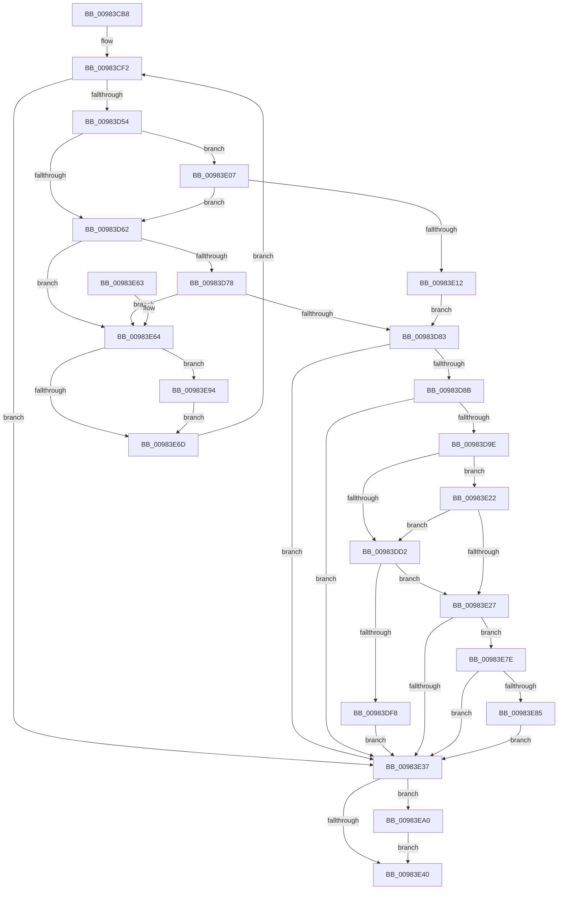

# MmCreateCacheManagerSection

- RVA: `0x00983CB8`–`0x00983EAC` (길이 `500` bytes)
- VA: `0x0000000140983CB8`
- 실행 섹션: `PAGE`
- PDB 이름 있음: `예`; PDB Function 태그: `아니요`
- unwind 정보 RVA: `0x00097AA0`
- 디코드: `129`개 명령, `500/500` bytes 표시
- 미해석 바이트: `0` (있으면 어셈블리에 `.byte`로 보존)

> 이 문서는 커널 이미지의 기계어와 PDB 기호를 분석해 생성했습니다. 4번과 5번은 함수 원형과 자료형을 바이너리 사용 방식에서 추정한 C 해석이며 원본 소스 복구 결과는 아닙니다.

## 1. Dependencies

- 직접 호출 지점: **10**; 고유 호출 대상: **9**
- 직접 호출자로 확인된 함수: **1**
- RIP 상대 이미지 참조: **1**

### Outgoing calls
- `0x00983CFE` → [memset](../../text/6C/memset_function_006C6C40.md) (function, `0x006C6C40`)
- `0x00983D45` → [MiInitializeCreateSectionPacket](MiInitializeCreateSectionPacket_function_00984130.md) (function, `0x00984130`)
- `0x00983D66` → [MiCreateImageOrDataSection](MiCreateImageOrDataSection_function_00984880.md) (function, `0x00984880`)
- `0x00983D8F` → [MiFinishCreateSection](MiFinishCreateSection_function_009844FC.md) (function, `0x009844FC`)
- `0x00983DED` → [MmExtendSection](MmExtendSection_function_00982C38.md) (function, `0x00982C38`)
- `0x00983E00` → [ObfDereferenceObjectWithTag](../../text/2F/ObfDereferenceObjectWithTag_function_002F78E0.md) (function, `0x002F78E0`)
- `0x00983E16` → [MiCreatePagingFileMap](MiCreatePagingFileMap_function_009852F8.md) (function, `0x009852F8`)
- `0x00983E8D` → [MiLogSectionObjectEvent](../7F/MiLogSectionObjectEvent_function_007FCF28.md) (function, `0x007FCF28`)
- `0x00983E99` → [PsDereferencePartition](../../text/34/PsDereferencePartition_function_00342E70.md) (function, `0x00342E70`)
- `0x00983EA5` → [PsDereferencePartition](../../text/34/PsDereferencePartition_function_00342E70.md) (function, `0x00342E70`)

### Direct callers
- [CcInitializeCacheMapInternal](../../text/3C/CcInitializeCacheMapInternal_function_003CC720.md) at `0x003CC85E`

### Static image references
- `0x00983E27` → RVA `0x00FC6B04` (`ALMOSTRO`; read)

## 2. Other-region calls and transfers

- 다른 실행 섹션으로 향하는 call: **4**
  - `0x00983CFE` → [memset](../../text/6C/memset_function_006C6C40.md) (`PAGE` → `.text`)
  - `0x00983E00` → [ObfDereferenceObjectWithTag](../../text/2F/ObfDereferenceObjectWithTag_function_002F78E0.md) (`PAGE` → `.text`)
  - `0x00983E99` → [PsDereferencePartition](../../text/34/PsDereferencePartition_function_00342E70.md) (`PAGE` → `.text`)
  - `0x00983EA5` → [PsDereferencePartition](../../text/34/PsDereferencePartition_function_00342E70.md) (`PAGE` → `.text`)
- 별도 외부 분기/꼬리 이동을 확인하지 못했습니다.

## 3. Assembly (complete function range)

```asm
00983CB8  48 8B C4                        mov rax, rsp
00983CBB  48 89 58 08                     mov qword ptr [rax + 8], rbx
00983CBF  48 89 70 10                     mov qword ptr [rax + 0x10], rsi
00983CC3  48 89 78 18                     mov qword ptr [rax + 0x18], rdi
00983CC7  4C 89 60 20                     mov qword ptr [rax + 0x20], r12
00983CCB  55                              push rbp
00983CCC  41 56                           push r14
00983CCE  41 57                           push r15
00983CD0  48 8D 68 98                     lea rbp, [rax - 0x68]
00983CD4  48 81 EC 50 01 00 00            sub rsp, 0x150
00983CDB  41 83 E0 01                     and r8d, 1
00983CDF  49 8B F1                        mov rsi, r9
00983CE2  4C 8B F2                        mov r14, rdx
00983CE5  4C 8B E1                        mov r12, rcx
00983CE8  33 DB                           xor ebx, ebx
00983CEA  46 8D 3C 85 02 00 00 00         lea r15d, [r8*4 + 2]
00983CF2  33 D2                           xor edx, edx
00983CF4  48 8D 4D 80                     lea rcx, [rbp - 0x80]
00983CF8  41 B8 C8 00 00 00               mov r8d, 0xc8
00983CFE  E8 3D 2F D4 FF                  call 0x1406c6c40
00983D03  48 83 64 24 60 00               and qword ptr [rsp + 0x60], 0
00983D09  48 8D 4D 80                     lea rcx, [rbp - 0x80]
00983D0D  83 4C 24 58 FF                  or dword ptr [rsp + 0x58], 0xffffffff
00983D12  41 B9 04 00 00 00               mov r9d, 4
00983D18  C6 44 24 50 00                  mov byte ptr [rsp + 0x50], 0
00983D1D  4D 8B C6                        mov r8, r14
00983D20  48 89 74 24 48                  mov qword ptr [rsp + 0x48], rsi
00983D25  33 D2                           xor edx, edx
00983D27  48 83 64 24 40 00               and qword ptr [rsp + 0x40], 0
00983D2D  C6 44 24 38 00                  mov byte ptr [rsp + 0x38], 0
00983D32  48 83 64 24 30 00               and qword ptr [rsp + 0x30], 0
00983D38  44 89 7C 24 28                  mov dword ptr [rsp + 0x28], r15d
00983D3D  C7 44 24 20 00 00 00 08         mov dword ptr [rsp + 0x20], 0x8000000
00983D45  E8 E6 03 00 00                  call 0x140984130
00983D4A  8B F8                           mov edi, eax
00983D4C  85 C0                           test eax, eax
00983D4E  0F 88 E3 00 00 00               js 0x140983e37
00983D54  09 5D 80                        or dword ptr [rbp - 0x80], ebx
00983D57  48 83 7D A8 00                  cmp qword ptr [rbp - 0x58], 0
00983D5C  0F 84 A5 00 00 00               je 0x140983e07
00983D62  48 8D 4D 80                     lea rcx, [rbp - 0x80]
00983D66  E8 15 0B 00 00                  call 0x140984880
00983D6B  8B F8                           mov edi, eax
00983D6D  3D 54 00 00 C0                  cmp eax, 0xc0000054
00983D72  0F 84 EC 00 00 00               je 0x140983e64
00983D78  3D 76 04 00 C0                  cmp eax, 0xc0000476
00983D7D  0F 84 E1 00 00 00               je 0x140983e64
00983D83  85 FF                           test edi, edi
00983D85  0F 88 AC 00 00 00               js 0x140983e37
00983D8B  48 8D 4D 80                     lea rcx, [rbp - 0x80]
00983D8F  E8 68 07 00 00                  call 0x1409844fc
00983D94  8B F8                           mov edi, eax
00983D96  85 C0                           test eax, eax
00983D98  0F 88 99 00 00 00               js 0x140983e37
00983D9E  48 8B 75 C0                     mov rsi, qword ptr [rbp - 0x40]
00983DA2  48 83 CA FF                     or rdx, 0xffffffffffffffff
00983DA6  48 8B 5D 10                     mov rbx, qword ptr [rbp + 0x10]
00983DAA  48 8B C2                        mov rax, rdx
00983DAD  48 8B 0E                        mov rcx, qword ptr [rsi]
00983DB0  F0 48 0F B1 51 18               lock cmpxchg qword ptr [rcx + 0x18], rdx
00983DB6  F6 45 80 09                     test byte ptr [rbp - 0x80], 9
00983DBA  4C 8D 43 30                     lea r8, [rbx + 0x30]
00983DBE  4C 8B C8                        mov r9, rax
00983DC1  0F 94 C2                        sete dl
00983DC4  F7 46 38 00 80 00 00            test dword ptr [rsi + 0x38], 0x8000
00983DCB  0F 95 C1                        setne cl
00983DCE  84 D1                           test cl, dl
00983DD0  74 50                           je 0x140983e22
00983DD2  49 8B 00                        mov rax, qword ptr [r8]
00983DD5  48 8D 54 24 70                  lea rdx, [rsp + 0x70]
00983DDA  4D 89 08                        mov qword ptr [r8], r9
00983DDD  48 8B CB                        mov rcx, rbx
00983DE0  44 8B 45 80                     mov r8d, dword ptr [rbp - 0x80]
00983DE4  41 83 E0 01                     and r8d, 1
00983DE8  48 89 44 24 70                  mov qword ptr [rsp + 0x70], rax
00983DED  E8 46 EE FF FF                  call 0x140982c38
00983DF2  8B F8                           mov edi, eax
00983DF4  85 C0                           test eax, eax
00983DF6  79 2F                           jns 0x140983e27
00983DF8  BA 4D 6D 53 43                  mov edx, 0x43536d4d
00983DFD  48 8B CB                        mov rcx, rbx
00983E00  E8 DB 3A 97 FF                  call 0x1402f78e0
00983E05  EB 30                           jmp 0x140983e37
00983E07  48 83 7D B0 00                  cmp qword ptr [rbp - 0x50], 0
00983E0C  0F 85 50 FF FF FF               jne 0x140983d62
00983E12  48 8D 4D 80                     lea rcx, [rbp - 0x80]
00983E16  E8 DD 14 00 00                  call 0x1409852f8
00983E1B  8B F8                           mov edi, eax
00983E1D  E9 61 FF FF FF                  jmp 0x140983d83
00983E22  4D 39 08                        cmp qword ptr [r8], r9
00983E25  77 AB                           ja 0x140983dd2
00983E27  F7 05 D3 2C 64 00 01 00 40 00   test dword ptr [rip + 0x642cd3], 0x400001
00983E31  49 89 1C 24                     mov qword ptr [r12], rbx
00983E35  75 47                           jne 0x140983e7e
00983E37  48 8B 4D 30                     mov rcx, qword ptr [rbp + 0x30]
00983E3B  48 85 C9                        test rcx, rcx
00983E3E  75 60                           jne 0x140983ea0
00983E40  4C 8D 9C 24 50 01 00 00         lea r11, [rsp + 0x150]
00983E48  8B C7                           mov eax, edi
00983E4A  49 8B 5B 20                     mov rbx, qword ptr [r11 + 0x20]
00983E4E  49 8B 73 28                     mov rsi, qword ptr [r11 + 0x28]
00983E52  49 8B 7B 30                     mov rdi, qword ptr [r11 + 0x30]
00983E56  4D 8B 63 38                     mov r12, qword ptr [r11 + 0x38]
00983E5A  49 8B E3                        mov rsp, r11
00983E5D  41 5F                           pop r15
00983E5F  41 5E                           pop r14
00983E61  5D                              pop rbp
00983E62  C3                              ret
00983E63  CC                              int3
00983E64  48 8B 4D 30                     mov rcx, qword ptr [rbp + 0x30]
00983E68  48 85 C9                        test rcx, rcx
00983E6B  75 27                           jne 0x140983e94
00983E6D  8B 5D 80                        mov ebx, dword ptr [rbp - 0x80]
00983E70  C1 EB 18                        shr ebx, 0x18
00983E73  83 E3 01                        and ebx, 1
00983E76  C1 E3 18                        shl ebx, 0x18
00983E79  E9 74 FE FF FF                  jmp 0x140983cf2
00983E7E  48 83 7E 40 00                  cmp qword ptr [rsi + 0x40], 0
00983E83  75 B2                           jne 0x140983e37
00983E85  BA 01 00 00 00                  mov edx, 1
00983E8A  48 8B CB                        mov rcx, rbx
00983E8D  E8 96 90 E7 FF                  call 0x1407fcf28
00983E92  EB A3                           jmp 0x140983e37
00983E94  BA 4D 4D 43 70                  mov edx, 0x70434d4d
00983E99  E8 D2 EF 9B FF                  call 0x140342e70
00983E9E  EB CD                           jmp 0x140983e6d
00983EA0  BA 4D 4D 43 70                  mov edx, 0x70434d4d
00983EA5  E8 C6 EF 9B FF                  call 0x140342e70
00983EAA  EB 94                           jmp 0x140983e40
```

## 4. C-style interpretation (structured pseudocode)

```c
__int64 __fastcall MmCreateCacheManagerSection(__int64 a1, __int64 a2, int a3, __int64 a4)
{
    __int64 result;
    __int64 v_rbx;
    __int64 v_rsp;
    unsigned __int64 v_stack_m108;
    unsigned int v_stack_m110;
    unsigned __int8 v_stack_m118;
    unsigned __int64 v_stack_m120;
    unsigned __int64 v_stack_m128;
    unsigned __int8 v_stack_m130;
    unsigned __int64 v_stack_m138;
    unsigned int v_stack_m140;
    unsigned int v_stack_m148;
    unsigned __int64 v_stack_m18;
    unsigned __int64 v_stack_mF8;

    *(unsigned __int64 *)(v_rsp + 8) = v_rbx;
    *(unsigned __int64 *)(v_rsp + 16) = v_rsi;
    *(unsigned __int64 *)(v_rsp + 24) = v_rdi;
    *(unsigned __int64 *)(v_rsp + 32) = v_r12;
    v_rsp = (v_rsp) - (336);
    a3 = (unsigned int)((a3) & (1));
    v_rbx = 0;
loc_00983CF2:
    a2 = 0;
    result = memset(v_rsp - 104 - 128, a2, 200, a4);
    v_stack_m118 = 0;
    v_stack_m120 = a4;
    a2 = 0;
    v_stack_m130 = 0;
    v_stack_m140 = (unsigned int)(a3 * 4 + 2);
    v_stack_m148 = 0x8000000ULL;
    result = MiInitializeCreateSectionPacket(v_rsp - 104 - 128, a2, 0, 4);
    if (sign_flag) goto loc_00983E37;
    if ((*(unsigned __int64 *)(v_rsp - 104 - 88)) == 0) goto loc_00983E07;
loc_00983D62:
    result = MiCreateImageOrDataSection(v_rsp - 104 - 128, a2, 0, 4);
    if (((unsigned int)(result)) == 0xC0000054ULL) goto loc_00983E64;
    if (((unsigned int)(result)) == 0xC0000476ULL) goto loc_00983E64;
loc_00983D83:
    if (sign_flag) goto loc_00983E37;
    result = MiFinishCreateSection(v_rsp - 104 - 128, a2, 0, 4);
    if (sign_flag) goto loc_00983E37;
    a2 = (a2) | (-1);
    a2 = (((*(unsigned __int8 *)(v_rsp - 104 - 128)) & (9)) == 0) ? 1 : 0;
    a1 = (((*(unsigned int *)(*(unsigned __int64 *)(v_rsp - 104 - 64) + 56)) & (0x8000ULL)) != 0) ? 1 : 0;
    if ((((unsigned __int8)(a1)) & ((unsigned __int8)(a2))) == 0) goto loc_00983E22;
loc_00983DD2:
    *(unsigned __int64 *)(*(unsigned __int64 *)(v_rsp - 104 + 16) + 48) = a2;
    a3 = (unsigned int)(((unsigned int)(*(unsigned int *)(v_rsp - 104 - 128))) & (1));
    v_stack_mF8 = *(unsigned __int64 *)(*(unsigned __int64 *)(v_rsp - 104 + 16) + 48);
    result = MmExtendSection(*(unsigned __int64 *)(v_rsp - 104 + 16), v_stack_mF8, a3, a2);
    if (!sign_flag) goto loc_00983E27;
    result = ObfDereferenceObjectWithTag(*(unsigned __int64 *)(v_rsp - 104 + 16), (unsigned int)(0x43536D4DULL), a3, a2);
    goto loc_00983E37;
loc_00983E07:
    if ((*(unsigned __int64 *)(v_rsp - 104 - 80)) != 0) goto loc_00983D62;
    result = MiCreatePagingFileMap(v_rsp - 104 - 128, (unsigned int)(0x43536D4DULL), a3, a2);
    goto loc_00983D83;
loc_00983E22:
    if ((*(unsigned __int64 *)(a3)) > a2) goto loc_00983DD2;
loc_00983E27:
    *(unsigned __int64 *)(a1) = *(unsigned __int64 *)(v_rsp - 104 + 16);
    if (((*(unsigned int *)(v_rip + 6565075)) & (0x400001ULL)) != 0) goto loc_00983E7E;
loc_00983E37:
    if (*(unsigned __int64 *)(v_rsp - 104 + 48) != 0) goto loc_00983EA0;
loc_00983E40:
    return (unsigned int)((unsigned int)((unsigned int)((unsigned int)(result))));
loc_00983E64:
    if (*(unsigned __int64 *)(v_rsp - 104 + 48) != 0) goto loc_00983E94;
loc_00983E6D:
    v_rbx = (unsigned int)(((unsigned int)(*(unsigned int *)(v_rsp - 104 - 128))) >> (24));
    v_rbx = (unsigned int)((v_rbx) & (1));
    v_rbx = (unsigned int)((v_rbx) << (24));
    goto loc_00983CF2;
loc_00983E7E:
    if ((*(unsigned __int64 *)(*(unsigned __int64 *)(v_stack_m18 + 40) + 64)) != 0) goto loc_00983E37;
    result = MiLogSectionObjectEvent(v_rbx, 1, a3, a2);
    goto loc_00983E37;
loc_00983E94:
    result = PsDereferencePartition(v_rbx, (unsigned int)(0x70434D4DULL), a3, a2);
    goto loc_00983E6D;
loc_00983EA0:
    result = PsDereferencePartition(v_rbx, (unsigned int)(0x70434D4DULL), a3, a2);
    goto loc_00983E40;
}
```

## 5. (Beta) C Style

```c
int64_t MmCreateCacheManagerSection(void *Arg1, int64_t Arg2, int32_t Arg3, int64_t Arg4)
{
    uint8_t *arg1 = (uint8_t *)Arg1;

    int64_t result;
    int64_t local_rbx;
    int64_t local_rsp;
    uint64_t v_stack_m108;
    uint32_t v_stack_m110;
    uint8_t v_stack_m118;
    uint64_t v_stack_m120;
    uint64_t v_stack_m128;
    uint8_t v_stack_m130;
    uint64_t v_stack_m138;
    uint32_t v_stack_m140;
    uint32_t v_stack_m148;
    uint64_t v_stack_m18;
    uint64_t v_stack_mF8;

    *(uint64_t *)(local_rsp + 0x8) = local_rbx;
    *(uint64_t *)(local_rsp + 0x10) = local_rsi;
    *(uint64_t *)(local_rsp + 0x18) = local_rdi;
    *(uint64_t *)(local_rsp + 0x20) = local_r12;
    local_rsp = (local_rsp) - (336);
    Arg3 = (uint32_t)((Arg3) & (1));
    local_rbx = 0;
loc_00983CF2:
    Arg2 = 0;
    result = memset(local_rsp - 104 - 128, Arg2, 200, Arg4);
    v_stack_m118 = 0;
    v_stack_m120 = Arg4;
    Arg2 = 0;
    v_stack_m130 = 0;
    v_stack_m140 = (uint32_t)(Arg3 * 4 + 2);
    v_stack_m148 = 0x8000000ULL;
    result = MiInitializeCreateSectionPacket(local_rsp - 104 - 128, Arg2, 0, 4);
    if (sign_flag) goto loc_00983E37;
    if ((*(uint64_t *)(local_rsp - 0x68 - 0x58)) == 0) goto loc_00983E07;
loc_00983D62:
    result = MiCreateImageOrDataSection(local_rsp - 104 - 128, Arg2, 0, 4);
    if (((uint32_t)(result)) == 0xC0000054ULL) goto loc_00983E64;
    if (((uint32_t)(result)) == 0xC0000476ULL) goto loc_00983E64;
loc_00983D83:
    if (sign_flag) goto loc_00983E37;
    result = MiFinishCreateSection(local_rsp - 104 - 128, Arg2, 0, 4);
    if (sign_flag) goto loc_00983E37;
    Arg2 = (Arg2) | (-1);
    Arg2 = (((*(uint8_t *)(local_rsp - 0x68 - 0x80)) & (9)) == 0) ? 1 : 0;
    Arg1 = (((*(uint32_t *)(*(uint64_t *)(local_rsp - 0x68 - 0x40) + 0x38)) & (0x8000ULL)) != 0) ? 1 : 0;
    if ((((uint8_t)(Arg1)) & ((uint8_t)(Arg2))) == 0) goto loc_00983E22;
loc_00983DD2:
    *(uint64_t *)(*(uint64_t *)(local_rsp - 0x68 + 0x10) + 0x30) = Arg2;
    Arg3 = (uint32_t)(((uint32_t)(*(uint32_t *)(local_rsp - 0x68 - 0x80))) & (1));
    v_stack_mF8 = *(uint64_t *)(*(uint64_t *)(local_rsp - 0x68 + 0x10) + 0x30);
    result = MmExtendSection(*(uint64_t *)(local_rsp - 0x68 + 0x10), v_stack_mF8, Arg3, Arg2);
    if (!sign_flag) goto loc_00983E27;
    result = ObfDereferenceObjectWithTag(*(uint64_t *)(local_rsp - 0x68 + 0x10), (uint32_t)(0x43536D4DULL), Arg3, Arg2);
    goto loc_00983E37;
loc_00983E07:
    if ((*(uint64_t *)(local_rsp - 0x68 - 0x50)) != 0) goto loc_00983D62;
    result = MiCreatePagingFileMap(local_rsp - 104 - 128, (uint32_t)(0x43536D4DULL), Arg3, Arg2);
    goto loc_00983D83;
loc_00983E22:
    if ((*(uint64_t *)(Arg3)) > Arg2) goto loc_00983DD2;
loc_00983E27:
    *(uint64_t *)(arg1) = *(uint64_t *)(local_rsp - 0x68 + 0x10);
    if (((*(uint32_t *)(v_rip + 0x642CD3)) & (0x400001ULL)) != 0) goto loc_00983E7E;
loc_00983E37:
    if (*(uint64_t *)(local_rsp - 0x68 + 0x30) != 0) goto loc_00983EA0;
loc_00983E40:
    return (uint32_t)((uint32_t)((uint32_t)((uint32_t)(result))));
loc_00983E64:
    if (*(uint64_t *)(local_rsp - 0x68 + 0x30) != 0) goto loc_00983E94;
loc_00983E6D:
    local_rbx = (uint32_t)(((uint32_t)(*(uint32_t *)(local_rsp - 0x68 - 0x80))) >> (24));
    local_rbx = (uint32_t)((local_rbx) & (1));
    local_rbx = (uint32_t)((local_rbx) << (24));
    goto loc_00983CF2;
loc_00983E7E:
    if ((*(uint64_t *)(*(uint64_t *)(v_stack_m18 + 0x28) + 0x40)) != 0) goto loc_00983E37;
    result = MiLogSectionObjectEvent(local_rbx, 1, Arg3, Arg2);
    goto loc_00983E37;
loc_00983E94:
    result = PsDereferencePartition(local_rbx, (uint32_t)(0x70434D4DULL), Arg3, Arg2);
    goto loc_00983E6D;
loc_00983EA0:
    result = PsDereferencePartition(local_rbx, (uint32_t)(0x70434D4DULL), Arg3, Arg2);
    goto loc_00983E40;
}
```

### 관측된 메모리 오프셋

구조체 형식이 확인되지 않은 접근은 인자 기준의 오프셋으로만 기록했습니다.

| 기준 인자 | 오프셋 표현 | 폭 (bit) | 접근 |
|---|---:|---:|---|
| `Arg1` | `+ 0x0` | `64` | `W` |

## 6. Execution-region graph

[열기: 2D/3D 그래프와 함수 탐색 컨트롤 패널](../../../control-panel.html?section=page&rva=0x00983CB8&view=graph)

- 2D 그래프는 위에서 아래로 흐르고, 3D 그래프는 빈 공간을 드래그해 회전합니다. Shift+드래그는 이동, 휠은 확대·축소, 함수 노드 선택은 대상 보고서 이동입니다.

### Static fallback


