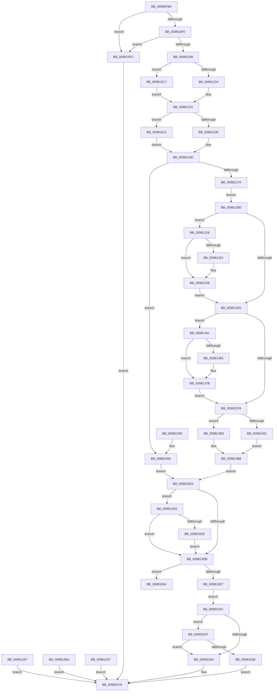

# MmCreatePeb

- RVA: `0x00980FB4`–`0x0098166D` (길이 `1,721` bytes)
- VA: `0x0000000140980FB4`
- 실행 섹션: `PAGE`
- PDB 이름 있음: `예`; PDB Function 태그: `예`
- unwind 정보 RVA: `0x000977E0`
- 디코드: `336`개 명령, `1,721/1,721` bytes 표시
- 미해석 바이트: `0` (있으면 어셈블리에 `.byte`로 보존)

> 이 문서는 커널 이미지의 기계어와 PDB 기호를 분석해 생성했습니다. 4번과 5번은 함수 원형과 자료형을 바이너리 사용 방식에서 추정한 C 해석이며 원본 소스 복구 결과는 아닙니다.

## 1. Dependencies

- 직접 호출 지점: **20**; 고유 호출 대상: **15**
- 직접 호출자로 확인된 함수: **1**
- RIP 상대 이미지 참조: **13**

### Outgoing calls
- `0x0098102C` → [memset](../../text/6C/memset_function_006C6C40.md) (function, `0x006C6C40`)
- `0x00981042` → [KeQueryGroupMaskProcess](../../text/48/KeQueryGroupMaskProcess_function_0048E804.md) (function, `0x0048E804`)
- `0x0098105B` → [KeFindFirstSetRightGroupMask](../../text/25/KeFindFirstSetRightGroupMask_function_00256BE4.md) (function, `0x00256BE4`)
- `0x00981076` → [KiStackAttachProcess](../../text/21/KiStackAttachProcess_function_00216820.md) (function, `0x00216820`)
- `0x009810E1` → [MmMapViewOfSection](MmMapViewOfSection_function_00981680.md) (function, `0x00981680`)
- `0x009810FA` → [MiCreatePebOrTeb](MiCreatePebOrTeb_function_00981874.md) (function, `0x00981874`)
- `0x00981109` → [PsGetCurrentServerSiloGlobals](../../text/2F/PsGetCurrentServerSiloGlobals_function_002FE1F0.md) (function, `0x002FE1F0`)
- `0x00981241` → [PsGetProcessSessionId](../../text/22/PsGetProcessSessionId_function_002233A0.md) (function, `0x002233A0`)
- `0x0098127D` → [RtlImageNtHeader](../../text/44/RtlImageNtHeader_function_00443B60.md) (function, `0x00443B60`)
- `0x009812A1` → [KiUnstackDetachProcess](../../text/21/KiUnstackDetachProcess_function_00217D30.md) (function, `0x00217D30`)
- `0x009812C0` → [RtlImageDirectoryEntryToData](../../text/43/RtlImageDirectoryEntryToData_function_004328D0.md) (function, `0x004328D0`)
- `0x00981322` → [ExRaiseDatatypeMisalignment](../89/ExRaiseDatatypeMisalignment_function_00899FD0.md) (function, `0x00899FD0`)
- `0x009813C4` → [KiUnstackDetachProcess](../../text/21/KiUnstackDetachProcess_function_00217D30.md) (function, `0x00217D30`)
- `0x00981543` → [KiUnstackDetachProcess](../../text/21/KiUnstackDetachProcess_function_00217D30.md) (function, `0x00217D30`)
- `0x00981564` → [KiUnstackDetachProcess](../../text/21/KiUnstackDetachProcess_function_00217D30.md) (function, `0x00217D30`)
- `0x00981581` → [_security_check_cookie](../../text/6A/_security_check_cookie_function_006AC640.md) (function, `0x006AC640`)
- `0x009815DD` → [KeQueryGroupAffinity](../../text/47/KeQueryGroupAffinity_function_00471A60.md) (function, `0x00471A60`)
- `0x00981606` → [KiUnstackDetachProcess](../../text/21/KiUnstackDetachProcess_function_00217D30.md) (function, `0x00217D30`)
- `0x0098162F` → [MiInitializeWowPeb](MiInitializeWowPeb_function_0098079C.md) (function, `0x0098079C`)
- `0x00981648` → [KiUnstackDetachProcess](../../text/21/KiUnstackDetachProcess_function_00217D30.md) (function, `0x00217D30`)

### Direct callers
- [PspAllocateProcess](../A1/PspAllocateProcess_function_00A13B3C.md) at `0x00A15E56`

### Static image references
- `0x00980FC9` → RVA `0x00E0A740` (`.data`; read)
- `0x009810DA` → RVA `0x00FD9FF0` (`PAGEDATA`; read)
- `0x00981141` → RVA `0x00FC41C0` (`.data`; read)
- `0x00981152` → RVA `0x00FC5238` (`ALMOSTRO`; read)
- `0x00981161` → RVA `0x00FC5230` (`ALMOSTRO`; read)
- `0x00981170` → RVA `0x00FC6A80` (`ALMOSTRO`; read)
- `0x0098117D` → RVA `0x00FC42C0` (`.data`; read)
- `0x0098118A` → RVA `0x00FC43C0` (`.data`; read)
- `0x00981197` → RVA `0x00E2DB50` (`.data`; read)
- `0x009811A6` → RVA `0x00FC5218` (`ALMOSTRO`; read)
- `0x009811B4` → RVA `0x00FC5228` (`ALMOSTRO`; read)
- `0x009811C3` → RVA `0x00FC5220` (`ALMOSTRO`; read)
- `0x00981659` → RVA `0x00E2DB4C` (`.data`; read/write)

## 2. Other-region calls and transfers

- 다른 실행 섹션으로 향하는 call: **16**
  - `0x0098102C` → [memset](../../text/6C/memset_function_006C6C40.md) (`PAGE` → `.text`)
  - `0x00981042` → [KeQueryGroupMaskProcess](../../text/48/KeQueryGroupMaskProcess_function_0048E804.md) (`PAGE` → `.text`)
  - `0x0098105B` → [KeFindFirstSetRightGroupMask](../../text/25/KeFindFirstSetRightGroupMask_function_00256BE4.md) (`PAGE` → `.text`)
  - `0x00981076` → [KiStackAttachProcess](../../text/21/KiStackAttachProcess_function_00216820.md) (`PAGE` → `.text`)
  - `0x00981109` → [PsGetCurrentServerSiloGlobals](../../text/2F/PsGetCurrentServerSiloGlobals_function_002FE1F0.md) (`PAGE` → `.text`)
  - `0x00981241` → [PsGetProcessSessionId](../../text/22/PsGetProcessSessionId_function_002233A0.md) (`PAGE` → `.text`)
  - `0x0098127D` → [RtlImageNtHeader](../../text/44/RtlImageNtHeader_function_00443B60.md) (`PAGE` → `.text`)
  - `0x009812A1` → [KiUnstackDetachProcess](../../text/21/KiUnstackDetachProcess_function_00217D30.md) (`PAGE` → `.text`)
  - `0x009812C0` → [RtlImageDirectoryEntryToData](../../text/43/RtlImageDirectoryEntryToData_function_004328D0.md) (`PAGE` → `.text`)
  - `0x009813C4` → [KiUnstackDetachProcess](../../text/21/KiUnstackDetachProcess_function_00217D30.md) (`PAGE` → `.text`)
  - `0x00981543` → [KiUnstackDetachProcess](../../text/21/KiUnstackDetachProcess_function_00217D30.md) (`PAGE` → `.text`)
  - `0x00981564` → [KiUnstackDetachProcess](../../text/21/KiUnstackDetachProcess_function_00217D30.md) (`PAGE` → `.text`)
  - `0x00981581` → [_security_check_cookie](../../text/6A/_security_check_cookie_function_006AC640.md) (`PAGE` → `.text`)
  - `0x009815DD` → [KeQueryGroupAffinity](../../text/47/KeQueryGroupAffinity_function_00471A60.md) (`PAGE` → `.text`)
  - `0x00981606` → [KiUnstackDetachProcess](../../text/21/KiUnstackDetachProcess_function_00217D30.md) (`PAGE` → `.text`)
  - `0x00981648` → [KiUnstackDetachProcess](../../text/21/KiUnstackDetachProcess_function_00217D30.md) (`PAGE` → `.text`)
- call이 아닌 외부 분기/꼬리 이동: **1**
  - `0x00981668` → [sub_00B2A6DE](../B2/Unknown_function_00B2A6DE.md) (`tail-transfer`)

## 3. Assembly (complete function range)

```asm
00980FB4  4C 8B DC                        mov r11, rsp
00980FB7  53                              push rbx
00980FB8  56                              push rsi
00980FB9  57                              push rdi
00980FBA  41 54                           push r12
00980FBC  41 55                           push r13
00980FBE  41 56                           push r14
00980FC0  41 57                           push r15
00980FC2  48 81 EC A0 01 00 00            sub rsp, 0x1a0
00980FC9  48 8B 05 70 97 48 00            mov rax, qword ptr [rip + 0x489770]
00980FD0  48 33 C4                        xor rax, rsp
00980FD3  48 89 84 24 98 01 00 00         mov qword ptr [rsp + 0x198], rax
00980FDB  49 8B D9                        mov rbx, r9
00980FDE  48 89 5C 24 60                  mov qword ptr [rsp + 0x60], rbx
00980FE3  4C 89 84 24 40 01 00 00         mov qword ptr [rsp + 0x140], r8
00980FEB  48 8B FA                        mov rdi, rdx
00980FEE  4C 8B E9                        mov r13, rcx
00980FF1  48 89 8C 24 30 01 00 00         mov qword ptr [rsp + 0x130], rcx
00980FF9  45 33 E4                        xor r12d, r12d
00980FFC  4D 89 A3 38 FF FF FF            mov qword ptr [r11 - 0xc8], r12
00981003  4C 89 64 24 68                  mov qword ptr [rsp + 0x68], r12
00981008  0F 57 C0                        xorps xmm0, xmm0
0098100B  41 0F 11 43 80                  movups xmmword ptr [r11 - 0x80], xmm0
00981010  41 0F 11 43 90                  movups xmmword ptr [r11 - 0x70], xmm0
00981015  41 0F 11 43 A0                  movups xmmword ptr [r11 - 0x60], xmm0
0098101A  41 0F 11 43 B0                  movups xmmword ptr [r11 - 0x50], xmm0
0098101F  33 D2                           xor edx, edx
00981021  41 B8 90 00 00 00               mov r8d, 0x90
00981027  48 8D 4C 24 70                  lea rcx, [rsp + 0x70]
0098102C  E8 0F 5C D4 FF                  call 0x1406c6c40
00981031  0F 57 C0                        xorps xmm0, xmm0
00981034  0F 11 03                        movups xmmword ptr [rbx], xmm0
00981037  49 8B D5                        mov rdx, r13
0098103A  48 8D 8C 24 48 01 00 00         lea rcx, [rsp + 0x148]
00981042  E8 BD D7 B0 FF                  call 0x14048e804
00981047  0F 10 08                        movups xmm1, xmmword ptr [rax]
0098104A  F3 0F 7F 8C 24 88 01 00 00      movdqu xmmword ptr [rsp + 0x188], xmm1
00981053  48 8D 8C 24 88 01 00 00         lea rcx, [rsp + 0x188]
0098105B  E8 84 5B 8D FF                  call 0x140256be4
00981060  66 89 44 24 58                  mov word ptr [rsp + 0x58], ax
00981065  66 89 43 08                     mov word ptr [rbx + 8], ax
00981069  4C 8D 84 24 58 01 00 00         lea r8, [rsp + 0x158]
00981071  33 D2                           xor edx, edx
00981073  49 8B CD                        mov rcx, r13
00981076  E8 A5 57 89 FF                  call 0x140216820
0098107B  4C 89 A4 24 08 01 00 00         mov qword ptr [rsp + 0x108], r12
00981083  4C 89 A4 24 00 01 00 00         mov qword ptr [rsp + 0x100], r12
0098108B  4C 89 A4 24 20 01 00 00         mov qword ptr [rsp + 0x120], r12
00981093  45 8D 74 24 02                  lea r14d, [r12 + 2]
00981098  44 89 74 24 48                  mov dword ptr [rsp + 0x48], r14d
0098109D  C7 44 24 40 00 00 50 00         mov dword ptr [rsp + 0x40], 0x500000
009810A5  C7 44 24 38 01 00 00 00         mov dword ptr [rsp + 0x38], 1
009810AD  48 8D 84 24 20 01 00 00         lea rax, [rsp + 0x120]
009810B5  48 89 44 24 30                  mov qword ptr [rsp + 0x30], rax
009810BA  48 8D 84 24 00 01 00 00         lea rax, [rsp + 0x100]
009810C2  48 89 44 24 28                  mov qword ptr [rsp + 0x28], rax
009810C7  4C 89 64 24 20                  mov qword ptr [rsp + 0x20], r12
009810CC  45 33 C9                        xor r9d, r9d
009810CF  4C 8D 84 24 08 01 00 00         lea r8, [rsp + 0x108]
009810D7  49 8B D5                        mov rdx, r13
009810DA  48 8B 0D 0F 8F 65 00            mov rcx, qword ptr [rip + 0x658f0f]
009810E1  E8 9A 05 00 00                  call 0x140981680
009810E6  8B D8                           mov ebx, eax
009810E8  85 C0                           test eax, eax
009810EA  0F 88 0C 05 00 00               js 0x1409815fc
009810F0  4C 8D 84 24 10 01 00 00         lea r8, [rsp + 0x110]
009810F8  33 C9                           xor ecx, ecx
009810FA  E8 75 07 00 00                  call 0x140981874
009810FF  8B D8                           mov ebx, eax
00981101  85 C0                           test eax, eax
00981103  0F 88 F3 04 00 00               js 0x1409815fc
00981109  E8 E2 D0 97 FF                  call 0x1402fe1f0
0098110E  48 8B D0                        mov rdx, rax
00981111  49 8B B5 B0 02 00 00            mov rsi, qword ptr [r13 + 0x2b0]
00981118  48 89 B4 24 38 01 00 00         mov qword ptr [rsp + 0x138], rsi
00981120  45 8D 7C 24 0A                  lea r15d, [r12 + 0xa]
00981125  4C 89 7C 24 7C                  mov qword ptr [rsp + 0x7c], r15
0098112A  0F B7 88 38 05 00 00            movzx ecx, word ptr [rax + 0x538]
00981131  66 89 8C 24 88 00 00 00         mov word ptr [rsp + 0x88], cx
00981139  44 89 B4 24 84 00 00 00         mov dword ptr [rsp + 0x84], r14d
00981141  44 0F B7 35 77 30 64 00         movzx r14d, word ptr [rip + 0x643077]
00981149  66 44 89 B4 24 8A 00 00 00      mov word ptr [rsp + 0x8a], r14w
00981152  48 8B 0D DF 40 64 00            mov rcx, qword ptr [rip + 0x6440df]
00981159  48 89 8C 24 90 00 00 00         mov qword ptr [rsp + 0x90], rcx
00981161  48 8B 0D C8 40 64 00            mov rcx, qword ptr [rip + 0x6440c8]
00981168  48 89 8C 24 98 00 00 00         mov qword ptr [rsp + 0x98], rcx
00981170  8B 0D 0A 59 64 00               mov ecx, dword ptr [rip + 0x64590a]
00981176  89 8C 24 A0 00 00 00            mov dword ptr [rsp + 0xa0], ecx
0098117D  8B 05 3D 31 64 00               mov eax, dword ptr [rip + 0x64313d]
00981183  89 84 24 A4 00 00 00            mov dword ptr [rsp + 0xa4], eax
0098118A  8B 05 30 32 64 00               mov eax, dword ptr [rip + 0x643230]
00981190  89 84 24 A8 00 00 00            mov dword ptr [rsp + 0xa8], eax
00981197  48 8B 05 B2 C9 4A 00            mov rax, qword ptr [rip + 0x4ac9b2]
0098119E  48 89 84 24 B0 00 00 00         mov qword ptr [rsp + 0xb0], rax
009811A6  8B 05 6C 40 64 00               mov eax, dword ptr [rip + 0x64406c]
009811AC  48 89 84 24 B8 00 00 00         mov qword ptr [rsp + 0xb8], rax
009811B4  48 8B 05 6D 40 64 00            mov rax, qword ptr [rip + 0x64406d]
009811BB  48 89 84 24 C0 00 00 00         mov qword ptr [rsp + 0xc0], rax
009811C3  48 8B 05 56 40 64 00            mov rax, qword ptr [rip + 0x644056]
009811CA  48 89 84 24 C8 00 00 00         mov qword ptr [rsp + 0xc8], rax
009811D2  8A 07                           mov al, byte ptr [rdi]
009811D4  88 84 24 D0 00 00 00            mov byte ptr [rsp + 0xd0], al
009811DB  8A 47 03                        mov al, byte ptr [rdi + 3]
009811DE  88 84 24 D1 00 00 00            mov byte ptr [rsp + 0xd1], al
009811E5  48 8B 47 08                     mov rax, qword ptr [rdi + 8]
009811E9  48 89 84 24 D8 00 00 00         mov qword ptr [rsp + 0xd8], rax
009811F1  48 89 B4 24 E0 00 00 00         mov qword ptr [rsp + 0xe0], rsi
009811F9  0F B7 82 08 04 00 00            movzx eax, word ptr [rdx + 0x408]
00981200  66 89 84 24 E8 00 00 00         mov word ptr [rsp + 0xe8], ax
00981208  0F B7 82 48 04 00 00            movzx eax, word ptr [rdx + 0x448]
0098120F  66 89 84 24 EA 00 00 00         mov word ptr [rsp + 0xea], ax
00981217  4C 39 A2 B0 04 00 00            cmp qword ptr [rdx + 0x4b0], r12
0098121E  0F 84 A3 03 00 00               je 0x1409815c7
00981224  B8 A5 06 00 00                  mov eax, 0x6a5
00981229  66 89 84 24 EC 00 00 00         mov word ptr [rsp + 0xec], ax
00981231  4D 39 A5 E8 02 00 00            cmp qword ptr [r13 + 0x2e8], r12
00981238  0F 84 D4 03 00 00               je 0x140981612
0098123E  49 8B CD                        mov rcx, r13
00981241  E8 5A 21 8A FF                  call 0x1402233a0
00981246  89 84 24 AC 00 00 00            mov dword ptr [rsp + 0xac], eax
0098124D  48 8B 84 24 08 01 00 00         mov rax, qword ptr [rsp + 0x108]
00981255  48 89 84 24 F0 00 00 00         mov qword ptr [rsp + 0xf0], rax
0098125D  44 89 A4 24 F8 00 00 00         mov dword ptr [rsp + 0xf8], r12d
00981265  41 8A DC                        mov bl, r12b
00981268  88 5C 24 50                     mov byte ptr [rsp + 0x50], bl
0098126C  41 F6 85 70 01 00 00 01         test byte ptr [r13 + 0x170], 1
00981274  0F 85 20 03 00 00               jne 0x14098159a
0098127A  48 8B CE                        mov rcx, rsi
0098127D  E8 DE 28 AC FF                  call 0x140443b60
00981282  48 8B F8                        mov rdi, rax
00981285  48 89 44 24 68                  mov qword ptr [rsp + 0x68], rax
0098128A  44 0F B7 60 16                  movzx r12d, word ptr [rax + 0x16]
0098128F  66 44 89 64 24 54               mov word ptr [rsp + 0x54], r12w
00981295  EB 19                           jmp 0x1409812b0
00981297  33 D2                           xor edx, edx
00981299  48 8D 8C 24 58 01 00 00         lea rcx, [rsp + 0x158]
009812A1  E8 8A 6A 89 FF                  call 0x140217d30
009812A6  B8 30 01 00 C0                  mov eax, 0xc0000130
009812AB  E9 C6 02 00 00                  jmp 0x140981576
009812B0  45 8B C7                        mov r8d, r15d
009812B3  4C 8D 8C 24 18 01 00 00         lea r9, [rsp + 0x118]
009812BB  B2 01                           mov dl, 1
009812BD  48 8B CE                        mov rcx, rsi
009812C0  E8 0B 16 AB FF                  call 0x1404328d0
009812C5  48 8B C8                        mov rcx, rax
009812C8  48 89 84 24 28 01 00 00         mov qword ptr [rsp + 0x128], rax
009812D0  48 85 C0                        test rax, rax
009812D3  75 43                           jne 0x140981318
009812D5  0F B7 77 5C                     movzx esi, word ptr [rdi + 0x5c]
009812D9  89 74 24 70                     mov dword ptr [rsp + 0x70], esi
009812DD  44 0F B7 7F 48                  movzx r15d, word ptr [rdi + 0x48]
009812E2  44 89 7C 24 74                  mov dword ptr [rsp + 0x74], r15d
009812E7  44 0F B7 47 4A                  movzx r8d, word ptr [rdi + 0x4a]
009812EC  44 89 44 24 78                  mov dword ptr [rsp + 0x78], r8d
009812F1  8B 57 4C                        mov edx, dword ptr [rdi + 0x4c]
009812F4  85 D2                           test edx, edx
009812F6  75 69                           jne 0x140981361
009812F8  48 85 C9                        test rcx, rcx
009812FB  0F 84 B2 00 00 00               je 0x1409813b3
00981301  48 8B 41 40                     mov rax, qword ptr [rcx + 0x40]
00981305  48 8B 4C 24 60                  mov rcx, qword ptr [rsp + 0x60]
0098130A  48 89 01                        mov qword ptr [rcx], rax
0098130D  B3 01                           mov bl, 1
0098130F  88 5C 24 50                     mov byte ptr [rsp + 0x50], bl
00981313  E9 A0 00 00 00                  jmp 0x1409813b8
00981318  BE 03 00 00 00                  mov esi, 3
0098131D  40 84 CE                        test sil, cl
00981320  74 06                           je 0x140981328
00981322  E8 A9 8C F1 FF                  call 0x140899fd0
00981327  CC                              int3
00981328  48 B8 00 00 FF FF FF 7F 00 00   movabs rax, 0x7fffffff0000
00981332  48 3B C8                        cmp rcx, rax
00981335  48 0F 43 C8                     cmovae rcx, rax
00981339  90                              nop
0098133A  8A 01                           mov al, byte ptr [rcx]
0098133C  44 0F B7 64 24 54               movzx r12d, word ptr [rsp + 0x54]
00981342  48 8B 7C 24 68                  mov rdi, qword ptr [rsp + 0x68]
00981347  48 8B 8C 24 28 01 00 00         mov rcx, qword ptr [rsp + 0x128]
0098134F  44 0F B7 B4 24 8A 00 00 00      movzx r14d, word ptr [rsp + 0x8a]
00981358  8A 5C 24 50                     mov bl, byte ptr [rsp + 0x50]
0098135C  E9 74 FF FF FF                  jmp 0x1409812d5
00981361  48 85 C9                        test rcx, rcx
00981364  74 15                           je 0x14098137b
00981366  0F B7 41 4C                     movzx eax, word ptr [rcx + 0x4c]
0098136A  66 85 C0                        test ax, ax
0098136D  66 44 0F 45 F0                  cmovne r14w, ax
00981372  66 44 89 B4 24 8A 00 00 00      mov word ptr [rsp + 0x8a], r14w
0098137B  0F B6 C2                        movzx eax, dl
0098137E  89 44 24 7C                     mov dword ptr [rsp + 0x7c], eax
00981382  8B C2                           mov eax, edx
00981384  C1 E8 08                        shr eax, 8
00981387  0F B6 C0                        movzx eax, al
0098138A  89 84 24 80 00 00 00            mov dword ptr [rsp + 0x80], eax
00981391  8B C2                           mov eax, edx
00981393  C1 E8 10                        shr eax, 0x10
00981396  66 89 84 24 88 00 00 00         mov word ptr [rsp + 0x88], ax
0098139E  81 F2 FF FF FF BF               xor edx, 0xbfffffff
009813A4  C1 EA 1E                        shr edx, 0x1e
009813A7  89 94 24 84 00 00 00            mov dword ptr [rsp + 0x84], edx
009813AE  E9 45 FF FF FF                  jmp 0x1409812f8
009813B3  48 8B 4C 24 60                  mov rcx, qword ptr [rsp + 0x60]
009813B8  EB 19                           jmp 0x1409813d3
009813BA  33 D2                           xor edx, edx
009813BC  48 8D 8C 24 58 01 00 00         lea rcx, [rsp + 0x158]
009813C4  E8 67 69 89 FF                  call 0x140217d30
009813C9  B8 30 01 00 C0                  mov eax, 0xc0000130
009813CE  E9 A3 01 00 00                  jmp 0x140981576
009813D3  84 DB                           test bl, bl
009813D5  0F 85 FA 01 00 00               jne 0x1409815d5
009813DB  66 41 0F BA E4 0E               bt r12w, 0xe
009813E1  0F 82 6D 02 00 00               jb 0x140981654
009813E7  48 8B 9C 24 10 01 00 00         mov rbx, qword ptr [rsp + 0x110]
009813EF  8B 44 24 7C                     mov eax, dword ptr [rsp + 0x7c]
009813F3  89 83 18 01 00 00               mov dword ptr [rbx + 0x118], eax
009813F9  8B 84 24 80 00 00 00            mov eax, dword ptr [rsp + 0x80]
00981400  89 83 1C 01 00 00               mov dword ptr [rbx + 0x11c], eax
00981406  0F B7 84 24 88 00 00 00         movzx eax, word ptr [rsp + 0x88]
0098140E  66 89 83 20 01 00 00            mov word ptr [rbx + 0x120], ax
00981415  8B 84 24 84 00 00 00            mov eax, dword ptr [rsp + 0x84]
0098141C  89 83 24 01 00 00               mov dword ptr [rbx + 0x124], eax
00981422  66 44 89 B3 22 01 00 00         mov word ptr [rbx + 0x122], r14w
0098142A  48 8B 84 24 90 00 00 00         mov rax, qword ptr [rsp + 0x90]
00981432  48 89 83 C8 00 00 00            mov qword ptr [rbx + 0xc8], rax
00981439  48 8B 84 24 98 00 00 00         mov rax, qword ptr [rsp + 0x98]
00981441  48 89 83 D0 00 00 00            mov qword ptr [rbx + 0xd0], rax
00981448  8B 05 32 56 64 00               mov eax, dword ptr [rip + 0x645632]
0098144E  89 83 B8 00 00 00               mov dword ptr [rbx + 0xb8], eax
00981454  8B 05 66 2E 64 00               mov eax, dword ptr [rip + 0x642e66]
0098145A  89 83 BC 00 00 00               mov dword ptr [rbx + 0xbc], eax
00981460  8B 05 5A 2F 64 00               mov eax, dword ptr [rip + 0x642f5a]
00981466  89 83 C4 07 00 00               mov dword ptr [rbx + 0x7c4], eax
0098146C  48 8B 05 DD C6 4A 00            mov rax, qword ptr [rip + 0x4ac6dd]
00981473  48 89 83 C0 00 00 00            mov qword ptr [rbx + 0xc0], rax
0098147A  8B 05 98 3D 64 00               mov eax, dword ptr [rip + 0x643d98]
00981480  48 89 83 18 03 00 00            mov qword ptr [rbx + 0x318], rax
00981487  48 8B 05 9A 3D 64 00            mov rax, qword ptr [rip + 0x643d9a]
0098148E  48 89 83 D8 00 00 00            mov qword ptr [rbx + 0xd8], rax
00981495  48 8B 05 84 3D 64 00            mov rax, qword ptr [rip + 0x643d84]
0098149C  48 89 83 E0 00 00 00            mov qword ptr [rbx + 0xe0], rax
009814A3  8B 84 24 AC 00 00 00            mov eax, dword ptr [rsp + 0xac]
009814AA  89 83 C0 02 00 00               mov dword ptr [rbx + 0x2c0], eax
009814B0  89 B3 28 01 00 00               mov dword ptr [rbx + 0x128], esi
009814B6  44 89 BB 2C 01 00 00            mov dword ptr [rbx + 0x12c], r15d
009814BD  8B 44 24 78                     mov eax, dword ptr [rsp + 0x78]
009814C1  89 83 30 01 00 00               mov dword ptr [rbx + 0x130], eax
009814C7  8A 84 24 D0 00 00 00            mov al, byte ptr [rsp + 0xd0]
009814CE  88 03                           mov byte ptr [rbx], al
009814D0  8A 84 24 D1 00 00 00            mov al, byte ptr [rsp + 0xd1]
009814D7  88 43 03                        mov byte ptr [rbx + 3], al
009814DA  48 8B 84 24 D8 00 00 00         mov rax, qword ptr [rsp + 0xd8]
009814E2  48 89 43 08                     mov qword ptr [rbx + 8], rax
009814E6  48 8B 84 24 38 01 00 00         mov rax, qword ptr [rsp + 0x138]
009814EE  48 89 43 10                     mov qword ptr [rbx + 0x10], rax
009814F2  0F B7 84 24 E8 00 00 00         movzx eax, word ptr [rsp + 0xe8]
009814FA  66 89 83 4C 03 00 00            mov word ptr [rbx + 0x34c], ax
00981501  0F B7 84 24 EA 00 00 00         movzx eax, word ptr [rsp + 0xea]
00981509  66 89 83 4E 03 00 00            mov word ptr [rbx + 0x34e], ax
00981510  0F B7 84 24 EC 00 00 00         movzx eax, word ptr [rsp + 0xec]
00981518  66 89 83 50 03 00 00            mov word ptr [rbx + 0x350], ax
0098151F  48 8B 84 24 F0 00 00 00         mov rax, qword ptr [rsp + 0xf0]
00981527  48 89 83 B8 07 00 00            mov qword ptr [rbx + 0x7b8], rax
0098152E  83 A3 C0 07 00 00 00            and dword ptr [rbx + 0x7c0], 0
00981535  EB 15                           jmp 0x14098154c
00981537  8B D8                           mov ebx, eax
00981539  33 D2                           xor edx, edx
0098153B  48 8D 8C 24 58 01 00 00         lea rcx, [rsp + 0x158]
00981543  E8 E8 67 89 FF                  call 0x140217d30
00981548  8B C3                           mov eax, ebx
0098154A  EB 2A                           jmp 0x140981576
0098154C  49 83 BD 10 03 00 00 00         cmp qword ptr [r13 + 0x310], 0
00981554  0F 85 C5 00 00 00               jne 0x14098161f
0098155A  33 D2                           xor edx, edx
0098155C  48 8D 8C 24 58 01 00 00         lea rcx, [rsp + 0x158]
00981564  E8 C7 67 89 FF                  call 0x140217d30
00981569  48 8B 84 24 40 01 00 00         mov rax, qword ptr [rsp + 0x140]
00981571  48 89 18                        mov qword ptr [rax], rbx
00981574  33 C0                           xor eax, eax
00981576  48 8B 8C 24 98 01 00 00         mov rcx, qword ptr [rsp + 0x198]
0098157E  48 33 CC                        xor rcx, rsp
00981581  E8 BA B0 D2 FF                  call 0x1406ac640
00981586  48 81 C4 A0 01 00 00            add rsp, 0x1a0
0098158D  41 5F                           pop r15
0098158F  41 5E                           pop r14
00981591  41 5D                           pop r13
00981593  41 5C                           pop r12
00981595  5F                              pop rdi
00981596  5E                              pop rsi
00981597  5B                              pop rbx
00981598  C3                              ret
00981599  CC                              int3
0098159A  BE 03 00 00 00                  mov esi, 3
0098159F  89 74 24 70                     mov dword ptr [rsp + 0x70], esi
009815A3  44 8D 66 1F                     lea r12d, [rsi + 0x1f]
009815A7  66 44 89 64 24 54               mov word ptr [rsp + 0x54], r12w
009815AD  4C 89 7C 24 74                  mov qword ptr [rsp + 0x74], r15
009815B2  45 33 C9                        xor r9d, r9d
009815B5  41 8B F9                        mov edi, r9d
009815B8  4C 89 4C 24 68                  mov qword ptr [rsp + 0x68], r9
009815BD  48 8B 4C 24 60                  mov rcx, qword ptr [rsp + 0x60]
009815C2  E9 0C FE FF FF                  jmp 0x1409813d3
009815C7  66 44 89 A4 24 EC 00 00 00      mov word ptr [rsp + 0xec], r12w
009815D0  E9 5C FC FF FF                  jmp 0x140981231
009815D5  48 8B 19                        mov rbx, qword ptr [rcx]
009815D8  0F B7 4C 24 58                  movzx ecx, word ptr [rsp + 0x58]
009815DD  E8 7E 04 AF FF                  call 0x140471a60
009815E2  48 23 C3                        and rax, rbx
009815E5  48 3B C3                        cmp rax, rbx
009815E8  0F 84 ED FD FF FF               je 0x1409813db
009815EE  48 8B 44 24 60                  mov rax, qword ptr [rsp + 0x60]
009815F3  48 83 20 00                     and qword ptr [rax], 0
009815F7  E9 DF FD FF FF                  jmp 0x1409813db
009815FC  33 D2                           xor edx, edx
009815FE  48 8D 8C 24 58 01 00 00         lea rcx, [rsp + 0x158]
00981606  E8 25 67 89 FF                  call 0x140217d30
0098160B  8B C3                           mov eax, ebx
0098160D  E9 64 FF FF FF                  jmp 0x140981576
00981612  44 89 A4 24 AC 00 00 00         mov dword ptr [rsp + 0xac], r12d
0098161A  E9 2E FC FF FF                  jmp 0x14098124d
0098161F  4C 8B 4C 24 60                  mov r9, qword ptr [rsp + 0x60]
00981624  4D 8B C5                        mov r8, r13
00981627  48 8B D7                        mov rdx, rdi
0098162A  48 8D 4C 24 70                  lea rcx, [rsp + 0x70]
0098162F  E8 68 F1 FF FF                  call 0x14098079c
00981634  8B F8                           mov edi, eax
00981636  85 C0                           test eax, eax
00981638  0F 89 1C FF FF FF               jns 0x14098155a
0098163E  33 D2                           xor edx, edx
00981640  48 8D 8C 24 58 01 00 00         lea rcx, [rsp + 0x158]
00981648  E8 E3 66 89 FF                  call 0x140217d30
0098164D  8B C7                           mov eax, edi
0098164F  E9 22 FF FF FF                  jmp 0x140981576
00981654  BF 01 00 00 00                  mov edi, 1
00981659  F0 0F C1 3D EB C4 4A 00         lock xadd dword ptr [rip + 0x4ac4eb], edi
00981661  FF C7                           inc edi
00981663  4C 8B 6C 24 60                  mov r13, qword ptr [rsp + 0x60]
00981668  E9 71 90 1A 00                  jmp 0x140b2a6de
```

## 4. C-style interpretation (structured pseudocode)

```c
__int64 __fastcall MmCreatePeb(__int64 a1, __int64 a2, __int64 a3, __int64 a4)
{
    __int64 result;
    __int64 v_r12;
    __int64 v_r14;
    __int64 v_rdi;
    __int64 v_rsp;
    unsigned __int64 v_stack_m100;
    unsigned __int8 v_stack_m107;
    unsigned __int8 v_stack_m108;
    unsigned __int64 v_stack_m110;
    unsigned __int64 v_stack_m118;
    unsigned __int64 v_stack_m120;
    unsigned __int64 v_stack_m128;
    unsigned int v_stack_m12C;
    unsigned int v_stack_m130;
    unsigned int v_stack_m134;
    unsigned int v_stack_m138;
    unsigned __int64 v_stack_m140;
    unsigned __int64 v_stack_m148;
    unsigned __int16 v_stack_m14E;
    unsigned __int16 v_stack_m150;
    unsigned int v_stack_m154;
    unsigned int v_stack_m158;
    unsigned __int64 v_stack_m15C;
    unsigned int v_stack_m160;
    unsigned int v_stack_m164;
    unsigned __int64 v_stack_m168;
    unsigned __int64 v_stack_m170;
    unsigned __int64 v_stack_m178;
    unsigned __int16 v_stack_m180;
    unsigned __int16 v_stack_m184;
    unsigned __int8 v_stack_m188;
    unsigned int v_stack_m190;
    unsigned int v_stack_m198;
    unsigned int v_stack_m1A0;
    unsigned __int64 v_stack_m1A8;
    unsigned __int64 v_stack_m1B0;
    unsigned __int64 v_stack_m1B8;
    unsigned __int64 v_stack_m40;
    unsigned __int64 v_stack_m50;
    unsigned __int64 v_stack_m80;
    unsigned __int64 v_stack_m90;
    unsigned __int64 v_stack_m98;
    unsigned __int64 v_stack_mA0;
    unsigned __int64 v_stack_mA8;
    unsigned __int64 v_stack_mB0;
    unsigned __int64 v_stack_mB8;
    unsigned __int64 v_stack_mC0;
    unsigned __int64 v_stack_mC8;
    unsigned __int64 v_stack_mD0;
    unsigned __int64 v_stack_mD8;
    unsigned int v_stack_mE0;
    unsigned __int64 v_stack_mE8;
    unsigned __int16 v_stack_mEC;
    unsigned __int16 v_stack_mEE;
    unsigned __int16 v_stack_mF0;
    unsigned __int64 v_stack_mF8;
    unsigned __int64 v_stack_p158;
    unsigned __int16 v_stack_p54;
    unsigned __int16 v_stack_p58;
    unsigned __int64 v_stack_p60;
    unsigned __int64 v_stack_p68;
    unsigned int v_stack_p70;
    unsigned __int64 v_stack_p74;
    unsigned int v_stack_pAC;
    unsigned __int16 v_stack_pEC;

    v_rsp = (v_rsp) - (416);
    result = (*(unsigned __int64 *)(v_rip + 4757360)) ^ (v_rsp);
    v_stack_m40 = result;
    v_stack_m178 = a4;
    v_stack_m98 = a3;
    v_stack_mA8 = a1;
    v_r12 = 0;
    *(unsigned __int64 *)(v_rsp - 200) = 0;
    v_stack_m170 = 0;
    *(unsigned __int64 *)(v_rsp - 128) = v_xmm0;
    *(unsigned __int64 *)(v_rsp - 112) = v_xmm0;
    *(unsigned __int64 *)(v_rsp - 96) = v_xmm0;
    *(unsigned __int64 *)(v_rsp - 80) = v_xmm0;
    a2 = 0;
    result = memset(v_stack_m168, a2, 144, a4);
    *(unsigned __int64 *)(a4) = v_xmm0;
    result = KeQueryGroupMaskProcess(v_stack_m90, a1, 144, a4);
    v_stack_m50 = v_xmm1;
    result = KeFindFirstSetRightGroupMask(v_stack_m50, a1, 144, a4);
    v_stack_m180 = (unsigned __int16)(result);
    *(unsigned __int16 *)(a4 + 8) = (unsigned __int16)(result);
    a2 = 0;
    result = KiStackAttachProcess(a1, a2, v_stack_m80, a4);
    v_stack_mD0 = 0;
    v_stack_mD8 = 0;
    v_stack_mB8 = 0;
    v_stack_m190 = (unsigned int)(v_r12 + 2);
    v_stack_m198 = 0x500000ULL;
    v_stack_m1A0 = 1;
    v_stack_m1A8 = v_stack_mB8;
    v_stack_m1B0 = v_stack_mD8;
    v_stack_m1B8 = 0;
    a4 = 0;
    result = MmMapViewOfSection(*(unsigned __int64 *)(v_rip + 6655759), a1, v_stack_mD0, a4);
    if (sign_flag) goto loc_009815FC;
    a1 = 0;
    result = MiCreatePebOrTeb(a1, a1, v_stack_mC8, a4);
    if (sign_flag) goto loc_009815FC;
    result = PsGetCurrentServerSiloGlobals(a1, a1, v_stack_mC8, a4);
    v_stack_mA0 = *(unsigned __int64 *)(a1 + 688);
    v_stack_m15C = v_r12 + 10;
    v_stack_m150 = (unsigned __int16)(*(unsigned __int16 *)(result + 1336));
    v_stack_m154 = (unsigned int)(v_r12 + 2);
    v_stack_m14E = (unsigned __int16)(*(unsigned __int16 *)(v_rip + 6566007));
    v_stack_m148 = *(unsigned __int64 *)(v_rip + 6570207);
    v_stack_m140 = *(unsigned __int64 *)(v_rip + 6570184);
    v_stack_m138 = (unsigned int)((unsigned int)(*(unsigned int *)(v_rip + 6576394)));
    v_stack_m134 = (unsigned int)((unsigned int)(*(unsigned int *)(v_rip + 6566205)));
    v_stack_m130 = (unsigned int)((unsigned int)(*(unsigned int *)(v_rip + 6566448)));
    v_stack_m128 = *(unsigned __int64 *)(v_rip + 4901298);
    v_stack_m120 = (unsigned int)(*(unsigned int *)(v_rip + 6570092));
    v_stack_m118 = *(unsigned __int64 *)(v_rip + 6570093);
    v_stack_m110 = *(unsigned __int64 *)(v_rip + 6570070);
    v_stack_m108 = (unsigned __int8)(*(unsigned __int8 *)(a2));
    v_stack_m107 = (unsigned __int8)(*(unsigned __int8 *)(a2 + 3));
    v_stack_m100 = *(unsigned __int64 *)(a2 + 8);
    v_stack_mF8 = *(unsigned __int64 *)(a1 + 688);
    v_stack_mF0 = (unsigned __int16)(*(unsigned __int16 *)(result + 1032));
    v_stack_mEE = (unsigned __int16)(*(unsigned __int16 *)(result + 1096));
    if ((*(unsigned __int64 *)(result + 1200)) == 0) goto loc_009815C7;
    v_stack_mEC = (unsigned __int16)((unsigned int)(0x6A5ULL));
loc_00981231:
    if ((*(unsigned __int64 *)(a1 + 744)) == 0) goto loc_00981612;
    result = PsGetProcessSessionId(0, result, v_stack_mC8, a4);
    v_stack_m12C = (unsigned int)(result);
loc_0098124D:
    v_stack_mE8 = v_stack_mD0;
    v_stack_mE0 = 0;
    v_stack_m188 = 0;
    if (((*(unsigned __int8 *)(a1 + 368)) & (1)) != 0) goto loc_0098159A;
    result = RtlImageNtHeader(*(unsigned __int64 *)(a1 + 688), result, v_stack_mC8, a4);
    v_stack_m170 = result;
    v_stack_m184 = (unsigned __int16)(*(unsigned __int16 *)(result + 22));
    goto loc_009812B0;
loc_009812B0:
    result = RtlImageDirectoryEntryToData(*(unsigned __int64 *)(a1 + 688), 1, (unsigned int)((unsigned int)(v_r12 + 10)), v_stack_mC0);
    v_stack_mB0 = result;
    if (result != 0) goto loc_00981318;
loc_009812D5:
    v_stack_m168 = (unsigned int)(*(unsigned __int16 *)(result + 92));
    v_stack_m164 = (unsigned int)(*(unsigned __int16 *)(result + 72));
    v_stack_m160 = (unsigned int)(*(unsigned __int16 *)(result + 74));
    if ((unsigned int)((unsigned int)(*(unsigned int *)(result + 76))) != 0) goto loc_00981361;
loc_009812F8:
    if (result == 0) goto loc_009813B3;
    *(unsigned __int64 *)(v_stack_m178) = *(unsigned __int64 *)(result + 64);
    v_stack_m188 = 1;
    goto loc_009813B8;
loc_00981318:
    result = *(unsigned __int64 *)(result + 64);
    if (((3) & ((unsigned __int8)(v_stack_m178))) != 0) {
        result = ExRaiseDatatypeMisalignment(v_stack_m178, (unsigned int)(*(unsigned int *)(result + 76)), *(unsigned __int16 *)(result + 74), v_stack_mC0);
    }
    a1 = v_stack_m178;
    if (v_stack_m178 >= result) { a1 = result; }
    goto loc_009812D5;
loc_00981361:
    result = *(unsigned __int8 *)(a1);
    v_r14 = v_stack_m14E;
    if (v_stack_mB0 != 0) {
        result = *(unsigned __int16 *)(v_stack_mB0 + 76);
        v_r14 = v_stack_m14E;
        if ((unsigned __int16)(result) != 0) { v_r14 = (unsigned __int16)(result); }
        v_stack_m14E = (unsigned __int16)(v_r14);
    }
    v_stack_m15C = (unsigned int)((unsigned __int8)((unsigned int)(*(unsigned int *)(result + 76))));
    result = (unsigned int)(((unsigned int)((unsigned int)((unsigned int)(*(unsigned int *)(result + 76))))) >> (8));
    v_stack_m158 = (unsigned int)((unsigned __int8)(result));
    result = (unsigned int)(((unsigned int)((unsigned int)((unsigned int)(*(unsigned int *)(result + 76))))) >> (16));
    v_stack_m150 = (unsigned __int16)(result);
    a2 = (unsigned int)(((unsigned int)(*(unsigned int *)(result + 76))) ^ (0xBFFFFFFFULL));
    a2 = (unsigned int)((a2) >> (30));
    v_stack_m154 = (unsigned int)(a2);
    goto loc_009812F8;
loc_009813B3:
loc_009813B8:
    goto loc_009813D3;
loc_009813D3:
    if ((unsigned __int8)(v_stack_m188) != 0) goto loc_009815D5;
loc_009813DB:
    if (condition_is_below) goto loc_00981654;
    *(unsigned int *)(v_stack_mC8 + 280) = (unsigned int)((unsigned int)(v_stack_m15C));
    *(unsigned int *)(v_stack_mC8 + 284) = (unsigned int)((unsigned int)(v_stack_m158));
    *(unsigned __int16 *)(v_stack_mC8 + 288) = (unsigned __int16)(v_stack_m150);
    *(unsigned int *)(v_stack_mC8 + 292) = (unsigned int)((unsigned int)(v_stack_m154));
    *(unsigned __int16 *)(v_stack_mC8 + 290) = (unsigned __int16)(v_r14);
    *(unsigned __int64 *)(v_stack_mC8 + 200) = v_stack_m148;
    *(unsigned __int64 *)(v_stack_mC8 + 208) = v_stack_m140;
    *(unsigned int *)(v_stack_mC8 + 184) = (unsigned int)((unsigned int)(*(unsigned int *)(v_rip + 6575666)));
    *(unsigned int *)(v_stack_mC8 + 188) = (unsigned int)((unsigned int)(*(unsigned int *)(v_rip + 6565478)));
    *(unsigned int *)(v_stack_mC8 + 1988) = (unsigned int)((unsigned int)(*(unsigned int *)(v_rip + 6565722)));
    *(unsigned __int64 *)(v_stack_mC8 + 192) = *(unsigned __int64 *)(v_rip + 4900573);
    *(unsigned __int64 *)(v_stack_mC8 + 792) = (unsigned int)(*(unsigned int *)(v_rip + 6569368));
    *(unsigned __int64 *)(v_stack_mC8 + 216) = *(unsigned __int64 *)(v_rip + 6569370);
    *(unsigned __int64 *)(v_stack_mC8 + 224) = *(unsigned __int64 *)(v_rip + 6569348);
    *(unsigned int *)(v_stack_mC8 + 704) = (unsigned int)((unsigned int)(v_stack_m12C));
    *(unsigned int *)(v_stack_mC8 + 296) = 3;
    *(unsigned int *)(v_stack_mC8 + 300) = (unsigned int)(*(unsigned __int16 *)(result + 72));
    *(unsigned int *)(v_stack_mC8 + 304) = (unsigned int)((unsigned int)(v_stack_m160));
    *(unsigned __int8 *)(v_stack_mC8) = (unsigned __int8)(v_stack_m108);
    *(unsigned __int8 *)(v_stack_mC8 + 3) = (unsigned __int8)(v_stack_m107);
    *(unsigned __int64 *)(v_stack_mC8 + 8) = v_stack_m100;
    *(unsigned __int64 *)(v_stack_mC8 + 16) = v_stack_mA0;
    *(unsigned __int16 *)(v_stack_mC8 + 844) = (unsigned __int16)(v_stack_mF0);
    *(unsigned __int16 *)(v_stack_mC8 + 846) = (unsigned __int16)(v_stack_mEE);
    *(unsigned __int16 *)(v_stack_mC8 + 848) = (unsigned __int16)(v_stack_mEC);
    *(unsigned __int64 *)(v_stack_mC8 + 1976) = v_stack_mE8;
    goto loc_0098154C;
loc_0098154C:
    if ((*(unsigned __int64 *)(a1 + 784)) != 0) goto loc_0098161F;
loc_0098155A:
    a2 = 0;
    result = KiUnstackDetachProcess(v_stack_m80, a2, *(unsigned __int16 *)(result + 74), v_stack_mC0);
    *(unsigned __int64 *)(v_stack_m98) = v_stack_mC8;
    result = 0;
loc_00981576:
    a1 = (v_stack_m40) ^ (v_rsp);
    result = _security_check_cookie(a1, a2, *(unsigned __int16 *)(result + 74), v_stack_mC0);
    v_rsp = (v_rsp) + (416);
    return result;
loc_0098159A:
    v_stack_p70 = 3;
    v_stack_p54 = (unsigned __int16)(3 + 31);
    v_stack_p74 = *(unsigned __int16 *)(result + 72);
    a4 = 0;
    v_stack_p68 = 0;
    goto loc_009813D3;
loc_009815C7:
    v_stack_pEC = (unsigned __int16)(3 + 31);
    goto loc_00981231;
loc_009815D5:
    result = KeQueryGroupAffinity(v_stack_p58, a2, *(unsigned __int16 *)(result + 74), a4);
    result = (result) & (*(unsigned __int64 *)(v_stack_p60));
    if (result == (*(unsigned __int64 *)(v_stack_p60))) goto loc_009813DB;
    goto loc_009813DB;
loc_009815FC:
    a2 = 0;
    result = KiUnstackDetachProcess(v_stack_p158, a2, *(unsigned __int16 *)(result + 74), a4);
    goto loc_00981576;
loc_00981612:
    v_stack_pAC = (unsigned int)(3 + 31);
    goto loc_0098124D;
loc_0098161F:
    result = MiInitializeWowPeb(v_stack_p70, 0, a1, v_stack_p60);
    if (!sign_flag) goto loc_0098155A;
    a2 = 0;
    result = KiUnstackDetachProcess(v_stack_p158, a2, a1, v_stack_p60);
    goto loc_00981576;
loc_00981654:
    v_rdi = (unsigned int)((1) + 1);
}
```

## 5. (Beta) C Style

```c
int64_t MmCreatePeb(void *Arg1, void *Arg2, int64_t Arg3, void *Arg4)
{
    uint8_t *arg1 = (uint8_t *)Arg1;
    uint8_t *arg2 = (uint8_t *)Arg2;
    uint8_t *arg4 = (uint8_t *)Arg4;

    int64_t result;
    int64_t local_r12;
    int64_t local_r14;
    int64_t local_rdi;
    int64_t local_rsp;
    uint64_t v_stack_m100;
    uint8_t v_stack_m107;
    uint8_t v_stack_m108;
    uint64_t v_stack_m110;
    uint64_t v_stack_m118;
    uint64_t v_stack_m120;
    uint64_t v_stack_m128;
    uint32_t v_stack_m12C;
    uint32_t v_stack_m130;
    uint32_t v_stack_m134;
    uint32_t v_stack_m138;
    uint64_t v_stack_m140;
    uint64_t v_stack_m148;
    uint16_t v_stack_m14E;
    uint16_t v_stack_m150;
    uint32_t v_stack_m154;
    uint32_t v_stack_m158;
    uint64_t v_stack_m15C;
    uint32_t v_stack_m160;
    uint32_t v_stack_m164;
    uint64_t v_stack_m168;
    uint64_t v_stack_m170;
    uint64_t v_stack_m178;
    uint16_t v_stack_m180;
    uint16_t v_stack_m184;
    uint8_t v_stack_m188;
    uint32_t v_stack_m190;
    uint32_t v_stack_m198;
    uint32_t v_stack_m1A0;
    uint64_t v_stack_m1A8;
    uint64_t v_stack_m1B0;
    uint64_t v_stack_m1B8;
    uint64_t v_stack_m40;
    uint64_t v_stack_m50;
    uint64_t v_stack_m80;
    uint64_t v_stack_m90;
    uint64_t v_stack_m98;
    uint64_t v_stack_mA0;
    uint64_t v_stack_mA8;
    uint64_t v_stack_mB0;
    uint64_t v_stack_mB8;
    uint64_t v_stack_mC0;
    uint64_t v_stack_mC8;
    uint64_t v_stack_mD0;
    uint64_t v_stack_mD8;
    uint32_t v_stack_mE0;
    uint64_t v_stack_mE8;
    uint16_t v_stack_mEC;
    uint16_t v_stack_mEE;
    uint16_t v_stack_mF0;
    uint64_t v_stack_mF8;
    uint64_t v_stack_p158;
    uint16_t v_stack_p54;
    uint16_t v_stack_p58;
    uint64_t v_stack_p60;
    uint64_t v_stack_p68;
    uint32_t v_stack_p70;
    uint64_t v_stack_p74;
    uint32_t v_stack_pAC;
    uint16_t v_stack_pEC;

    local_rsp = (local_rsp) - (416);
    result = (*(uint64_t *)(v_rip + 0x489770)) ^ (local_rsp);
    v_stack_m40 = result;
    v_stack_m178 = Arg4;
    v_stack_m98 = Arg3;
    v_stack_mA8 = Arg1;
    local_r12 = 0;
    *(uint64_t *)(local_rsp - 0xC8) = 0;
    v_stack_m170 = 0;
    *(uint64_t *)(local_rsp - 0x80) = v_xmm0;
    *(uint64_t *)(local_rsp - 0x70) = v_xmm0;
    *(uint64_t *)(local_rsp - 0x60) = v_xmm0;
    *(uint64_t *)(local_rsp - 0x50) = v_xmm0;
    Arg2 = 0;
    result = memset(v_stack_m168, Arg2, 144, Arg4);
    *(uint64_t *)(arg4) = v_xmm0;
    result = KeQueryGroupMaskProcess(v_stack_m90, Arg1, 144, Arg4);
    v_stack_m50 = v_xmm1;
    result = KeFindFirstSetRightGroupMask(v_stack_m50, Arg1, 144, Arg4);
    v_stack_m180 = (uint16_t)(result);
    *(uint16_t *)(arg4 + 0x8) = (uint16_t)(result);
    Arg2 = 0;
    result = KiStackAttachProcess(Arg1, Arg2, v_stack_m80, Arg4);
    v_stack_mD0 = 0;
    v_stack_mD8 = 0;
    v_stack_mB8 = 0;
    v_stack_m190 = (uint32_t)(local_r12 + 2);
    v_stack_m198 = 0x500000ULL;
    v_stack_m1A0 = 1;
    v_stack_m1A8 = v_stack_mB8;
    v_stack_m1B0 = v_stack_mD8;
    v_stack_m1B8 = 0;
    Arg4 = 0;
    result = MmMapViewOfSection(*(uint64_t *)(v_rip + 0x658F0F), Arg1, v_stack_mD0, Arg4);
    if (sign_flag) goto loc_009815FC;
    Arg1 = 0;
    result = MiCreatePebOrTeb(Arg1, Arg1, v_stack_mC8, Arg4);
    if (sign_flag) goto loc_009815FC;
    result = PsGetCurrentServerSiloGlobals(Arg1, Arg1, v_stack_mC8, Arg4);
    v_stack_mA0 = *(uint64_t *)(arg1 + 0x2B0);
    v_stack_m15C = local_r12 + 10;
    v_stack_m150 = (uint16_t)(*(uint16_t *)(result + 0x538));
    v_stack_m154 = (uint32_t)(local_r12 + 2);
    v_stack_m14E = (uint16_t)(*(uint16_t *)(v_rip + 0x643077));
    v_stack_m148 = *(uint64_t *)(v_rip + 0x6440DF);
    v_stack_m140 = *(uint64_t *)(v_rip + 0x6440C8);
    v_stack_m138 = (uint32_t)((uint32_t)(*(uint32_t *)(v_rip + 0x64590A)));
    v_stack_m134 = (uint32_t)((uint32_t)(*(uint32_t *)(v_rip + 0x64313D)));
    v_stack_m130 = (uint32_t)((uint32_t)(*(uint32_t *)(v_rip + 0x643230)));
    v_stack_m128 = *(uint64_t *)(v_rip + 0x4AC9B2);
    v_stack_m120 = (uint32_t)(*(uint32_t *)(v_rip + 0x64406C));
    v_stack_m118 = *(uint64_t *)(v_rip + 0x64406D);
    v_stack_m110 = *(uint64_t *)(v_rip + 0x644056);
    v_stack_m108 = (uint8_t)(*(uint8_t *)(arg2));
    v_stack_m107 = (uint8_t)(*(uint8_t *)(arg2 + 0x3));
    v_stack_m100 = *(uint64_t *)(arg2 + 0x8);
    v_stack_mF8 = *(uint64_t *)(arg1 + 0x2B0);
    v_stack_mF0 = (uint16_t)(*(uint16_t *)(result + 0x408));
    v_stack_mEE = (uint16_t)(*(uint16_t *)(result + 0x448));
    if ((*(uint64_t *)(result + 0x4B0)) == 0) goto loc_009815C7;
    v_stack_mEC = (uint16_t)((uint32_t)(0x6A5ULL));
loc_00981231:
    if ((*(uint64_t *)(arg1 + 0x2E8)) == 0) goto loc_00981612;
    result = PsGetProcessSessionId(0, result, v_stack_mC8, Arg4);
    v_stack_m12C = (uint32_t)(result);
loc_0098124D:
    v_stack_mE8 = v_stack_mD0;
    v_stack_mE0 = 0;
    v_stack_m188 = 0;
    if (((*(uint8_t *)(arg1 + 0x170)) & (1)) != 0) goto loc_0098159A;
    result = RtlImageNtHeader(*(uint64_t *)(arg1 + 0x2B0), result, v_stack_mC8, Arg4);
    v_stack_m170 = result;
    v_stack_m184 = (uint16_t)(*(uint16_t *)(result + 0x16));
    goto loc_009812B0;
loc_009812B0:
    result = RtlImageDirectoryEntryToData(*(uint64_t *)(arg1 + 0x2B0), 1, (uint32_t)((uint32_t)(local_r12 + 10)), v_stack_mC0);
    v_stack_mB0 = result;
    if (result != 0) goto loc_00981318;
loc_009812D5:
    v_stack_m168 = (uint32_t)(*(uint16_t *)(result + 0x5C));
    v_stack_m164 = (uint32_t)(*(uint16_t *)(result + 0x48));
    v_stack_m160 = (uint32_t)(*(uint16_t *)(result + 0x4A));
    if ((uint32_t)((uint32_t)(*(uint32_t *)(result + 0x4C))) != 0) goto loc_00981361;
loc_009812F8:
    if (result == 0) goto loc_009813B3;
    *(uint64_t *)(v_stack_m178) = *(uint64_t *)(result + 0x40);
    v_stack_m188 = 1;
    goto loc_009813B8;
loc_00981318:
    result = *(uint64_t *)(result + 0x40);
    if (((3) & ((uint8_t)(v_stack_m178))) != 0) {
        result = ExRaiseDatatypeMisalignment(v_stack_m178, (uint32_t)(*(uint32_t *)(result + 0x4C)), *(uint16_t *)(result + 0x4A), v_stack_mC0);
    }
    Arg1 = v_stack_m178;
    if (v_stack_m178 >= result) { Arg1 = result; }
    goto loc_009812D5;
loc_00981361:
    result = *(uint8_t *)(arg1);
    local_r14 = v_stack_m14E;
    if (v_stack_mB0 != 0) {
        result = *(uint16_t *)(v_stack_mB0 + 0x4C);
        local_r14 = v_stack_m14E;
        if ((uint16_t)(result) != 0) { local_r14 = (uint16_t)(result); }
        v_stack_m14E = (uint16_t)(local_r14);
    }
    v_stack_m15C = (uint32_t)((uint8_t)((uint32_t)(*(uint32_t *)(result + 0x4C))));
    result = (uint32_t)(((uint32_t)((uint32_t)((uint32_t)(*(uint32_t *)(result + 0x4C))))) >> (8));
    v_stack_m158 = (uint32_t)((uint8_t)(result));
    result = (uint32_t)(((uint32_t)((uint32_t)((uint32_t)(*(uint32_t *)(result + 0x4C))))) >> (16));
    v_stack_m150 = (uint16_t)(result);
    Arg2 = (uint32_t)(((uint32_t)(*(uint32_t *)(result + 0x4C))) ^ (0xBFFFFFFFULL));
    Arg2 = (uint32_t)((Arg2) >> (30));
    v_stack_m154 = (uint32_t)(Arg2);
    goto loc_009812F8;
loc_009813B3:
loc_009813B8:
    goto loc_009813D3;
loc_009813D3:
    if ((uint8_t)(v_stack_m188) != 0) goto loc_009815D5;
loc_009813DB:
    if (condition_is_below) goto loc_00981654;
    *(uint32_t *)(v_stack_mC8 + 0x118) = (uint32_t)((uint32_t)(v_stack_m15C));
    *(uint32_t *)(v_stack_mC8 + 0x11C) = (uint32_t)((uint32_t)(v_stack_m158));
    *(uint16_t *)(v_stack_mC8 + 0x120) = (uint16_t)(v_stack_m150);
    *(uint32_t *)(v_stack_mC8 + 0x124) = (uint32_t)((uint32_t)(v_stack_m154));
    *(uint16_t *)(v_stack_mC8 + 0x122) = (uint16_t)(local_r14);
    *(uint64_t *)(v_stack_mC8 + 0xC8) = v_stack_m148;
    *(uint64_t *)(v_stack_mC8 + 0xD0) = v_stack_m140;
    *(uint32_t *)(v_stack_mC8 + 0xB8) = (uint32_t)((uint32_t)(*(uint32_t *)(v_rip + 0x645632)));
    *(uint32_t *)(v_stack_mC8 + 0xBC) = (uint32_t)((uint32_t)(*(uint32_t *)(v_rip + 0x642E66)));
    *(uint32_t *)(v_stack_mC8 + 0x7C4) = (uint32_t)((uint32_t)(*(uint32_t *)(v_rip + 0x642F5A)));
    *(uint64_t *)(v_stack_mC8 + 0xC0) = *(uint64_t *)(v_rip + 0x4AC6DD);
    *(uint64_t *)(v_stack_mC8 + 0x318) = (uint32_t)(*(uint32_t *)(v_rip + 0x643D98));
    *(uint64_t *)(v_stack_mC8 + 0xD8) = *(uint64_t *)(v_rip + 0x643D9A);
    *(uint64_t *)(v_stack_mC8 + 0xE0) = *(uint64_t *)(v_rip + 0x643D84);
    *(uint32_t *)(v_stack_mC8 + 0x2C0) = (uint32_t)((uint32_t)(v_stack_m12C));
    *(uint32_t *)(v_stack_mC8 + 0x128) = 3;
    *(uint32_t *)(v_stack_mC8 + 0x12C) = (uint32_t)(*(uint16_t *)(result + 0x48));
    *(uint32_t *)(v_stack_mC8 + 0x130) = (uint32_t)((uint32_t)(v_stack_m160));
    *(uint8_t *)(v_stack_mC8) = (uint8_t)(v_stack_m108);
    *(uint8_t *)(v_stack_mC8 + 0x3) = (uint8_t)(v_stack_m107);
    *(uint64_t *)(v_stack_mC8 + 0x8) = v_stack_m100;
    *(uint64_t *)(v_stack_mC8 + 0x10) = v_stack_mA0;
    *(uint16_t *)(v_stack_mC8 + 0x34C) = (uint16_t)(v_stack_mF0);
    *(uint16_t *)(v_stack_mC8 + 0x34E) = (uint16_t)(v_stack_mEE);
    *(uint16_t *)(v_stack_mC8 + 0x350) = (uint16_t)(v_stack_mEC);
    *(uint64_t *)(v_stack_mC8 + 0x7B8) = v_stack_mE8;
    goto loc_0098154C;
loc_0098154C:
    if ((*(uint64_t *)(arg1 + 0x310)) != 0) goto loc_0098161F;
loc_0098155A:
    Arg2 = 0;
    result = KiUnstackDetachProcess(v_stack_m80, Arg2, *(uint16_t *)(result + 0x4A), v_stack_mC0);
    *(uint64_t *)(v_stack_m98) = v_stack_mC8;
    result = 0;
loc_00981576:
    Arg1 = (v_stack_m40) ^ (local_rsp);
    result = _security_check_cookie(Arg1, Arg2, *(uint16_t *)(result + 0x4A), v_stack_mC0);
    local_rsp = (local_rsp) + (416);
    return result;
loc_0098159A:
    v_stack_p70 = 3;
    v_stack_p54 = (uint16_t)(3 + 31);
    v_stack_p74 = *(uint16_t *)(result + 0x48);
    Arg4 = 0;
    v_stack_p68 = 0;
    goto loc_009813D3;
loc_009815C7:
    v_stack_pEC = (uint16_t)(3 + 31);
    goto loc_00981231;
loc_009815D5:
    result = KeQueryGroupAffinity(v_stack_p58, Arg2, *(uint16_t *)(result + 0x4A), Arg4);
    result = (result) & (*(uint64_t *)(v_stack_p60));
    if (result == (*(uint64_t *)(v_stack_p60))) goto loc_009813DB;
    goto loc_009813DB;
loc_009815FC:
    Arg2 = 0;
    result = KiUnstackDetachProcess(v_stack_p158, Arg2, *(uint16_t *)(result + 0x4A), Arg4);
    goto loc_00981576;
loc_00981612:
    v_stack_pAC = (uint32_t)(3 + 31);
    goto loc_0098124D;
loc_0098161F:
    result = MiInitializeWowPeb(v_stack_p70, 0, Arg1, v_stack_p60);
    if (!sign_flag) goto loc_0098155A;
    Arg2 = 0;
    result = KiUnstackDetachProcess(v_stack_p158, Arg2, Arg1, v_stack_p60);
    goto loc_00981576;
loc_00981654:
    local_rdi = (uint32_t)((1) + 1);
}
```

### 관측된 메모리 오프셋

구조체 형식이 확인되지 않은 접근은 인자 기준의 오프셋으로만 기록했습니다.

| 기준 인자 | 오프셋 표현 | 폭 (bit) | 접근 |
|---|---:|---:|---|
| `Arg1` | `+ 0x170` | `8` | `R` |
| `Arg1` | `+ 0x2B0` | `64` | `R` |
| `Arg1` | `+ 0x2E8` | `64` | `R` |
| `Arg1` | `+ 0x310` | `64` | `R` |
| `Arg2` | `+ 0x0` | `8` | `R` |
| `Arg2` | `+ 0x3` | `8` | `R` |
| `Arg2` | `+ 0x8` | `64` | `R` |
| `Arg4` | `+ 0x0` | `128` | `R` |
| `Arg4` | `+ 0x8` | `16` | `W` |

## 6. Execution-region graph

[열기: 2D/3D 그래프와 함수 탐색 컨트롤 패널](../../../control-panel.html?section=page&rva=0x00980FB4&view=graph)

- 2D 그래프는 위에서 아래로 흐르고, 3D 그래프는 빈 공간을 드래그해 회전합니다. Shift+드래그는 이동, 휠은 확대·축소, 함수 노드 선택은 대상 보고서 이동입니다.

### Static fallback


