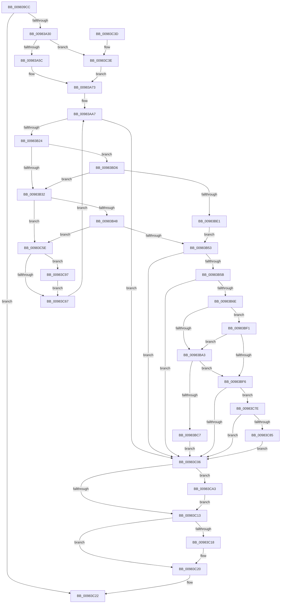

# MmCreateSectionEx

- RVA: `0x009839CC`–`0x00983CB2` (길이 `742` bytes)
- VA: `0x00000001409839CC`
- 실행 섹션: `PAGE`
- PDB 이름 있음: `예`; PDB Function 태그: `아니요`
- unwind 정보 RVA: `0x00097A80`
- 디코드: `186`개 명령, `742/742` bytes 표시
- 미해석 바이트: `0` (있으면 어셈블리에 `.byte`로 보존)

> 이 문서는 커널 이미지의 기계어와 PDB 기호를 분석해 생성했습니다. 4번과 5번은 함수 원형과 자료형을 바이너리 사용 방식에서 추정한 C 해석이며 원본 소스 복구 결과는 아닙니다.

## 1. Dependencies

- 직접 호출 지점: **14**; 고유 호출 대상: **13**
- 직접 호출자로 확인된 함수: **4**
- RIP 상대 이미지 참조: **1**

### Outgoing calls
- `0x00983A23` → [MiCaptureSectionCreateExtendedParameters](MiCaptureSectionCreateExtendedParameters_function_00983958.md) (function, `0x00983958`)
- `0x00983A6B` → [PsReferencePrimaryTokenWithTag](../../text/20/PsReferencePrimaryTokenWithTag_function_0020FF80.md) (function, `0x0020FF80`)
- `0x00983A98` → [PsGetProcessSessionIdEx](../../text/22/PsGetProcessSessionIdEx_function_0022F8F0.md) (function, `0x0022F8F0`)
- `0x00983AB3` → [memset](../../text/6C/memset_function_006C6C40.md) (function, `0x006C6C40`)
- `0x00983B15` → [MiInitializeCreateSectionPacket](MiInitializeCreateSectionPacket_function_00984130.md) (function, `0x00984130`)
- `0x00983B36` → [MiCreateImageOrDataSection](MiCreateImageOrDataSection_function_00984880.md) (function, `0x00984880`)
- `0x00983B5F` → [MiFinishCreateSection](MiFinishCreateSection_function_009844FC.md) (function, `0x009844FC`)
- `0x00983BBC` → [MmExtendSection](MmExtendSection_function_00982C38.md) (function, `0x00982C38`)
- `0x00983BCF` → [ObfDereferenceObjectWithTag](../../text/2F/ObfDereferenceObjectWithTag_function_002F78E0.md) (function, `0x002F78E0`)
- `0x00983BE5` → [MiCreatePagingFileMap](MiCreatePagingFileMap_function_009852F8.md) (function, `0x009852F8`)
- `0x00983C1B` → [ObfDereferenceObject](../../text/2F/ObfDereferenceObject_function_002F9350.md) (function, `0x002F9350`)
- `0x00983C8D` → [MiLogSectionObjectEvent](../7F/MiLogSectionObjectEvent_function_007FCF28.md) (function, `0x007FCF28`)
- `0x00983C9C` → [PsDereferencePartition](../../text/34/PsDereferencePartition_function_00342E70.md) (function, `0x00342E70`)
- `0x00983CA8` → [PsDereferencePartition](../../text/34/PsDereferencePartition_function_00342E70.md) (function, `0x00342E70`)

### Direct callers
- [FsRtlCreateSectionForDataScan](../../text/45/FsRtlCreateSectionForDataScan_function_00453330.md) at `0x00453447`
- [AlpcpCreateSection](../89/AlpcpCreateSection_function_0089307C.md) at `0x00893190`
- [PspSchedulerSharedDataRegionCreate](PspSchedulerSharedDataRegionCreate_function_009825DC.md) at `0x00982734`
- [MmCreateSection](MmCreateSection_function_009838B0.md) at `0x00983917`

### Static image references
- `0x00983BFA` → RVA `0x00FC6B04` (`ALMOSTRO`; read)

## 2. Other-region calls and transfers

- 다른 실행 섹션으로 향하는 call: **7**
  - `0x00983A6B` → [PsReferencePrimaryTokenWithTag](../../text/20/PsReferencePrimaryTokenWithTag_function_0020FF80.md) (`PAGE` → `.text`)
  - `0x00983A98` → [PsGetProcessSessionIdEx](../../text/22/PsGetProcessSessionIdEx_function_0022F8F0.md) (`PAGE` → `.text`)
  - `0x00983AB3` → [memset](../../text/6C/memset_function_006C6C40.md) (`PAGE` → `.text`)
  - `0x00983BCF` → [ObfDereferenceObjectWithTag](../../text/2F/ObfDereferenceObjectWithTag_function_002F78E0.md) (`PAGE` → `.text`)
  - `0x00983C1B` → [ObfDereferenceObject](../../text/2F/ObfDereferenceObject_function_002F9350.md) (`PAGE` → `.text`)
  - `0x00983C9C` → [PsDereferencePartition](../../text/34/PsDereferencePartition_function_00342E70.md) (`PAGE` → `.text`)
  - `0x00983CA8` → [PsDereferencePartition](../../text/34/PsDereferencePartition_function_00342E70.md) (`PAGE` → `.text`)
- 별도 외부 분기/꼬리 이동을 확인하지 못했습니다.

## 3. Assembly (complete function range)

```asm
009839CC  48 8B C4                        mov rax, rsp
009839CF  48 89 58 08                     mov qword ptr [rax + 8], rbx
009839D3  44 89 48 20                     mov dword ptr [rax + 0x20], r9d
009839D7  4C 89 40 18                     mov qword ptr [rax + 0x18], r8
009839DB  48 89 50 10                     mov qword ptr [rax + 0x10], rdx
009839DF  55                              push rbp
009839E0  56                              push rsi
009839E1  57                              push rdi
009839E2  41 54                           push r12
009839E4  41 55                           push r13
009839E6  41 56                           push r14
009839E8  41 57                           push r15
009839EA  48 8D 6C 24 A0                  lea rbp, [rsp - 0x60]
009839EF  48 81 EC 60 01 00 00            sub rsp, 0x160
009839F6  8B 95 F0 00 00 00               mov edx, dword ptr [rbp + 0xf0]
009839FC  33 C0                           xor eax, eax
009839FE  89 45 80                        mov dword ptr [rbp - 0x80], eax
00983A01  4C 8B E9                        mov r13, rcx
00983A04  48 8B 8D E8 00 00 00            mov rcx, qword ptr [rbp + 0xe8]
00983A0B  0F 57 C0                        xorps xmm0, xmm0
00983A0E  88 45 84                        mov byte ptr [rbp - 0x7c], al
00983A11  45 33 C9                        xor r9d, r9d
00983A14  48 8D 44 24 70                  lea rax, [rsp + 0x70]
00983A19  48 89 44 24 20                  mov qword ptr [rsp + 0x20], rax
00983A1E  0F 11 44 24 70                  movups xmmword ptr [rsp + 0x70], xmm0
00983A23  E8 30 FF FF FF                  call 0x140983958
00983A28  85 C0                           test eax, eax
00983A2A  0F 88 F2 01 00 00               js 0x140983c22
00983A30  65 48 8B 04 25 88 01 00 00      mov rax, qword ptr gs:[0x188]
00983A39  33 DB                           xor ebx, ebx
00983A3B  48 8B B8 B8 00 00 00            mov rdi, qword ptr [rax + 0xb8]
00983A42  65 48 8B 04 25 88 01 00 00      mov rax, qword ptr gs:[0x188]
00983A4B  44 8A B8 32 02 00 00            mov r15b, byte ptr [rax + 0x232]
00983A52  41 80 FF 01                     cmp r15b, 1
00983A56  0F 85 E2 01 00 00               jne 0x140983c3e
00983A5C  44 8A B7 F9 05 00 00            mov r14b, byte ptr [rdi + 0x5f9]
00983A63  BA 44 66 6C 74                  mov edx, 0x746c6644
00983A68  48 8B CF                        mov rcx, rdi
00983A6B  E8 10 C5 88 FF                  call 0x14020ff80
00983A70  48 8B F0                        mov rsi, rax
00983A73  8B D3                           mov edx, ebx
00983A75  48 8B CF                        mov rcx, rdi
00983A78  83 CA 02                        or edx, 2
00983A7B  48 83 BD D0 00 00 00 00         cmp qword ptr [rbp + 0xd0], 0
00983A83  0F 44 D3                        cmove edx, ebx
00983A86  44 8B E2                        mov r12d, edx
00983A89  41 83 CC 04                     or r12d, 4
00983A8D  F6 85 D8 00 00 00 02            test byte ptr [rbp + 0xd8], 2
00983A94  44 0F 44 E2                     cmove r12d, edx
00983A98  E8 53 BE 8A FF                  call 0x14022f8f0
00983A9D  8B F8                           mov edi, eax
00983A9F  89 85 E0 00 00 00               mov dword ptr [rbp + 0xe0], eax
00983AA5  33 DB                           xor ebx, ebx
00983AA7  33 D2                           xor edx, edx
00983AA9  48 8D 4D 90                     lea rcx, [rbp - 0x70]
00983AAD  41 B8 C8 00 00 00               mov r8d, 0xc8
00983AB3  E8 88 31 D4 FF                  call 0x1406c6c40
00983AB8  44 8B 8D B8 00 00 00            mov r9d, dword ptr [rbp + 0xb8]
00983ABF  48 8D 44 24 70                  lea rax, [rsp + 0x70]
00983AC4  4C 8B 85 B0 00 00 00            mov r8, qword ptr [rbp + 0xb0]
00983ACB  48 8D 4D 90                     lea rcx, [rbp - 0x70]
00983ACF  48 8B 95 A8 00 00 00            mov rdx, qword ptr [rbp + 0xa8]
00983AD6  48 89 44 24 60                  mov qword ptr [rsp + 0x60], rax
00983ADB  48 8B 85 D0 00 00 00            mov rax, qword ptr [rbp + 0xd0]
00983AE2  89 7C 24 58                     mov dword ptr [rsp + 0x58], edi
00983AE6  44 88 7C 24 50                  mov byte ptr [rsp + 0x50], r15b
00983AEB  48 89 44 24 48                  mov qword ptr [rsp + 0x48], rax
00983AF0  48 8B 85 C8 00 00 00            mov rax, qword ptr [rbp + 0xc8]
00983AF7  48 89 44 24 40                  mov qword ptr [rsp + 0x40], rax
00983AFC  8B 85 C0 00 00 00               mov eax, dword ptr [rbp + 0xc0]
00983B02  44 88 74 24 38                  mov byte ptr [rsp + 0x38], r14b
00983B07  48 89 74 24 30                  mov qword ptr [rsp + 0x30], rsi
00983B0C  44 89 64 24 28                  mov dword ptr [rsp + 0x28], r12d
00983B11  89 44 24 20                     mov dword ptr [rsp + 0x20], eax
00983B15  E8 16 06 00 00                  call 0x140984130
00983B1A  8B F8                           mov edi, eax
00983B1C  85 C0                           test eax, eax
00983B1E  0F 88 E2 00 00 00               js 0x140983c06
00983B24  09 5D 90                        or dword ptr [rbp - 0x70], ebx
00983B27  48 83 7D B8 00                  cmp qword ptr [rbp - 0x48], 0
00983B2C  0F 84 A4 00 00 00               je 0x140983bd6
00983B32  48 8D 4D 90                     lea rcx, [rbp - 0x70]
00983B36  E8 45 0D 00 00                  call 0x140984880
00983B3B  8B F8                           mov edi, eax
00983B3D  3D 54 00 00 C0                  cmp eax, 0xc0000054
00983B42  0F 84 16 01 00 00               je 0x140983c5e
00983B48  3D 76 04 00 C0                  cmp eax, 0xc0000476
00983B4D  0F 84 0B 01 00 00               je 0x140983c5e
00983B53  85 FF                           test edi, edi
00983B55  0F 88 AB 00 00 00               js 0x140983c06
00983B5B  48 8D 4D 90                     lea rcx, [rbp - 0x70]
00983B5F  E8 98 09 00 00                  call 0x1409844fc
00983B64  8B F8                           mov edi, eax
00983B66  85 C0                           test eax, eax
00983B68  0F 88 98 00 00 00               js 0x140983c06
00983B6E  4C 8B 75 D0                     mov r14, qword ptr [rbp - 0x30]
00983B72  48 83 CA FF                     or rdx, 0xffffffffffffffff
00983B76  48 8B 5D 20                     mov rbx, qword ptr [rbp + 0x20]
00983B7A  48 8B C2                        mov rax, rdx
00983B7D  49 8B 0E                        mov rcx, qword ptr [r14]
00983B80  F0 48 0F B1 51 18               lock cmpxchg qword ptr [rcx + 0x18], rdx
00983B86  F6 45 90 09                     test byte ptr [rbp - 0x70], 9
00983B8A  4C 8D 43 30                     lea r8, [rbx + 0x30]
00983B8E  4C 8B C8                        mov r9, rax
00983B91  0F 94 C2                        sete dl
00983B94  41 F7 46 38 00 80 00 00         test dword ptr [r14 + 0x38], 0x8000
00983B9C  0F 95 C1                        setne cl
00983B9F  84 D1                           test cl, dl
00983BA1  74 4E                           je 0x140983bf1
00983BA3  49 8B 00                        mov rax, qword ptr [r8]
00983BA6  48 8D 55 88                     lea rdx, [rbp - 0x78]
00983BAA  4D 89 08                        mov qword ptr [r8], r9
00983BAD  48 8B CB                        mov rcx, rbx
00983BB0  44 8B 45 90                     mov r8d, dword ptr [rbp - 0x70]
00983BB4  41 83 E0 01                     and r8d, 1
00983BB8  48 89 45 88                     mov qword ptr [rbp - 0x78], rax
00983BBC  E8 77 F0 FF FF                  call 0x140982c38
00983BC1  8B F8                           mov edi, eax
00983BC3  85 C0                           test eax, eax
00983BC5  79 2F                           jns 0x140983bf6
00983BC7  BA 4D 6D 53 43                  mov edx, 0x43536d4d
00983BCC  48 8B CB                        mov rcx, rbx
00983BCF  E8 0C 3D 97 FF                  call 0x1402f78e0
00983BD4  EB 30                           jmp 0x140983c06
00983BD6  48 83 7D C0 00                  cmp qword ptr [rbp - 0x40], 0
00983BDB  0F 85 51 FF FF FF               jne 0x140983b32
00983BE1  48 8D 4D 90                     lea rcx, [rbp - 0x70]
00983BE5  E8 0E 17 00 00                  call 0x1409852f8
00983BEA  8B F8                           mov edi, eax
00983BEC  E9 62 FF FF FF                  jmp 0x140983b53
00983BF1  4D 39 08                        cmp qword ptr [r8], r9
00983BF4  77 AD                           ja 0x140983ba3
00983BF6  49 89 5D 00                     mov qword ptr [r13], rbx
00983BFA  F7 05 00 2F 64 00 01 00 40 00   test dword ptr [rip + 0x642f00], 0x400001
00983C04  75 78                           jne 0x140983c7e
00983C06  48 8B 4D 40                     mov rcx, qword ptr [rbp + 0x40]
00983C0A  48 85 C9                        test rcx, rcx
00983C0D  0F 85 90 00 00 00               jne 0x140983ca3
00983C13  48 85 F6                        test rsi, rsi
00983C16  74 08                           je 0x140983c20
00983C18  48 8B CE                        mov rcx, rsi
00983C1B  E8 30 57 97 FF                  call 0x1402f9350
00983C20  8B C7                           mov eax, edi
00983C22  48 8B 9C 24 A0 01 00 00         mov rbx, qword ptr [rsp + 0x1a0]
00983C2A  48 81 C4 60 01 00 00            add rsp, 0x160
00983C31  41 5F                           pop r15
00983C33  41 5E                           pop r14
00983C35  41 5D                           pop r13
00983C37  41 5C                           pop r12
00983C39  5F                              pop rdi
00983C3A  5E                              pop rsi
00983C3B  5D                              pop rbp
00983C3C  C3                              ret
00983C3D  CC                              int3
00983C3E  8B 4D 80                        mov ecx, dword ptr [rbp - 0x80]
00983C41  83 E1 08                        and ecx, 8
00983C44  8B C1                           mov eax, ecx
00983C46  F7 D8                           neg eax
00983C48  45 1A F6                        sbb r14b, r14b
00983C4B  33 F6                           xor esi, esi
00983C4D  44 22 74 24 7C                  and r14b, byte ptr [rsp + 0x7c]
00983C52  F7 D9                           neg ecx
00983C54  1B DB                           sbb ebx, ebx
00983C56  83 E3 10                        and ebx, 0x10
00983C59  E9 15 FE FF FF                  jmp 0x140983a73
00983C5E  48 8B 4D 40                     mov rcx, qword ptr [rbp + 0x40]
00983C62  48 85 C9                        test rcx, rcx
00983C65  75 30                           jne 0x140983c97
00983C67  8B 5D 90                        mov ebx, dword ptr [rbp - 0x70]
00983C6A  8B BD E0 00 00 00               mov edi, dword ptr [rbp + 0xe0]
00983C70  C1 EB 18                        shr ebx, 0x18
00983C73  83 E3 01                        and ebx, 1
00983C76  C1 E3 18                        shl ebx, 0x18
00983C79  E9 29 FE FF FF                  jmp 0x140983aa7
00983C7E  49 83 7E 40 00                  cmp qword ptr [r14 + 0x40], 0
00983C83  75 81                           jne 0x140983c06
00983C85  BA 01 00 00 00                  mov edx, 1
00983C8A  48 8B CB                        mov rcx, rbx
00983C8D  E8 96 92 E7 FF                  call 0x1407fcf28
00983C92  E9 6F FF FF FF                  jmp 0x140983c06
00983C97  BA 4D 4D 43 70                  mov edx, 0x70434d4d
00983C9C  E8 CF F1 9B FF                  call 0x140342e70
00983CA1  EB C4                           jmp 0x140983c67
00983CA3  BA 4D 4D 43 70                  mov edx, 0x70434d4d
00983CA8  E8 C3 F1 9B FF                  call 0x140342e70
00983CAD  E9 61 FF FF FF                  jmp 0x140983c13
```

## 4. C-style interpretation (structured pseudocode)

```c
__int64 __fastcall MmCreateSectionEx(__int64 a1, __int64 a2, __int64 a3, int a4, unsigned int a5, __int64 a6, __int64 a7, unsigned __int8 a8, unsigned int a9, __int64 a10, unsigned int a11)
{
    __int64 result;
    __int64 v_r12;
    __int64 v_r14;
    __int64 v_rbx;
    __int64 v_rsi;
    __int64 v_rsp;
    unsigned __int64 v_stack_m108;
    unsigned __int64 v_stack_m110;
    unsigned __int8 v_stack_m114;
    unsigned int v_stack_m118;
    unsigned __int64 v_stack_m128;
    unsigned __int64 v_stack_m138;
    unsigned int v_stack_m140;
    unsigned __int8 v_stack_m148;
    unsigned __int64 v_stack_m150;
    unsigned __int64 v_stack_m158;
    unsigned __int8 v_stack_m160;
    unsigned __int64 v_stack_m168;
    unsigned int v_stack_m170;
    unsigned __int64 v_stack_m178;
    unsigned __int64 v_stack_m58;
    unsigned __int64 v_stack_m78;
    unsigned __int64 v_stack_m98;
    unsigned __int64 v_stack_mC8;
    unsigned __int64 v_stack_mD8;
    unsigned __int64 v_stack_mE0;
    unsigned __int64 v_stack_p10;
    unsigned __int64 v_stack_p18;
    unsigned int v_stack_p20;
    unsigned int v_stack_p48;
    unsigned __int8 v_stack_p7C;
    unsigned __int64 v_stack_p8;

    *(unsigned __int64 *)(v_rsp + 8) = v_rbx;
    *(unsigned int *)(v_rsp + 32) = a4;
    *(unsigned __int64 *)(v_rsp + 24) = a3;
    *(unsigned __int64 *)(v_rsp + 16) = a2;
    v_rsp = (v_rsp) - (352);
    result = 0;
    v_stack_m118 = 0;
    v_stack_m114 = 0;
    a4 = 0;
    v_stack_m178 = v_stack_m128;
    v_stack_m128 = v_xmm0;
    result = MiCaptureSectionCreateExtendedParameters(a10, (unsigned int)(a11), a3, a4);
    if (sign_flag) goto loc_00983C22;
    v_rbx = 0;
    if (((unsigned __int8)(*(unsigned __int8 *)(*(unsigned __int64 *)(gs_base + (0 + 392)) + 562))) != 1) goto loc_00983C3E;
    result = PsReferencePrimaryTokenWithTag(*(unsigned __int64 *)(*(unsigned __int64 *)(gs_base + (0 + 392)) + 184), (unsigned int)(0x746C6644ULL), a3, a4);
loc_00983A73:
    a2 = (unsigned int)((0) | (2));
    if (a7 == 0) { a2 = 0; }
    v_r12 = (unsigned int)(((unsigned int)((unsigned int)(a2))) | (4));
    if (((a8) & (2)) == 0) { v_r12 = (unsigned int)(a2); }
    result = PsGetProcessSessionIdEx(*(unsigned __int64 *)(*(unsigned __int64 *)(gs_base + (0 + 392)) + 184), a2, a3, a4);
    v_stack_p48 = (unsigned int)(result);
    v_rbx = 0;
loc_00983AA7:
    a2 = 0;
    result = memset(v_stack_m108, a2, 200, a4);
    v_stack_m138 = v_stack_m128;
    v_stack_m140 = (unsigned int)((unsigned int)((unsigned int)(result)));
    v_stack_m148 = (unsigned __int8)(*(unsigned __int8 *)(*(unsigned __int64 *)(gs_base + (0 + 392)) + 562));
    v_stack_m150 = a7;
    v_stack_m158 = a6;
    v_stack_m160 = (unsigned __int8)(*(unsigned __int8 *)(*(unsigned __int64 *)(*(unsigned __int64 *)(gs_base + (0 + 392)) + 184) + 1529));
    v_stack_m168 = result;
    v_stack_m170 = (unsigned int)(v_r12);
    v_stack_m178 = (unsigned int)((unsigned int)(a5));
    result = MiInitializeCreateSectionPacket(v_stack_m108, v_stack_p10, v_stack_p18, (unsigned int)(v_stack_p20));
    if (sign_flag) goto loc_00983C06;
    if (v_stack_mE0 == 0) goto loc_00983BD6;
loc_00983B32:
    result = MiCreateImageOrDataSection(v_stack_m108, v_stack_p10, v_stack_p18, (unsigned int)(v_stack_p20));
    if (((unsigned int)(result)) == 0xC0000054ULL) goto loc_00983C5E;
    if (((unsigned int)(result)) == 0xC0000476ULL) goto loc_00983C5E;
loc_00983B53:
    if (sign_flag) goto loc_00983C06;
    result = MiFinishCreateSection(v_stack_m108, v_stack_p10, v_stack_p18, (unsigned int)(v_stack_p20));
    if (sign_flag) goto loc_00983C06;
    a2 = (v_stack_p10) | (-1);
    a2 = (((v_stack_m108) & (9)) == 0) ? 1 : 0;
    a1 = (((*(unsigned int *)(v_stack_mC8 + 56)) & (0x8000ULL)) != 0) ? 1 : 0;
    if ((((unsigned __int8)(a1)) & ((unsigned __int8)(a2))) == 0) goto loc_00983BF1;
loc_00983BA3:
    *(unsigned __int64 *)(v_stack_m78 + 48) = a2;
    a3 = (unsigned int)(((unsigned int)(v_stack_m108)) & (1));
    v_stack_m110 = *(unsigned __int64 *)(v_stack_m78 + 48);
    result = MmExtendSection(v_stack_m78, v_stack_m110, a3, a2);
    if (!sign_flag) goto loc_00983BF6;
    result = ObfDereferenceObjectWithTag(v_stack_m78, (unsigned int)(0x43536D4DULL), a3, a2);
    goto loc_00983C06;
loc_00983BD6:
    if (v_stack_mD8 != 0) goto loc_00983B32;
    result = MiCreatePagingFileMap(v_stack_m108, (unsigned int)(0x43536D4DULL), a3, a2);
    goto loc_00983B53;
loc_00983BF1:
    if ((*(unsigned __int64 *)(a3)) > a2) goto loc_00983BA3;
loc_00983BF6:
    *(unsigned __int64 *)(a1) = v_stack_m78;
    if (((*(unsigned int *)(v_rip + 6565632)) & (0x400001ULL)) != 0) goto loc_00983C7E;
loc_00983C06:
    if (v_stack_m58 != 0) goto loc_00983CA3;
loc_00983C13:
    if (result != 0) {
        a1 = result;
        result = ObfDereferenceObject(a1, (unsigned int)(0x43536D4DULL), a3, a2);
    }
loc_00983C22:
    v_rsp = (v_rsp) + (352);
    return (unsigned int)((unsigned int)((unsigned int)((unsigned int)(result))));
loc_00983C3E:
    a1 = (unsigned int)(((unsigned int)(v_stack_m118)) & (8));
    result = (unsigned int)(-((unsigned int)((unsigned int)(a1))));
    v_rsi = 0;
    v_r14 = (unsigned __int8)((v_stack_mC8) & (v_stack_p7C));
    a1 = (unsigned int)(-(a1));
    v_rbx = (unsigned int)((v_stack_p8) & (16));
    goto loc_00983A73;
loc_00983C5E:
    if (v_stack_m58 != 0) goto loc_00983C97;
loc_00983C67:
    v_rbx = (unsigned int)(((unsigned int)(v_stack_m108)) >> (24));
    v_rbx = (unsigned int)((v_rbx) & (1));
    v_rbx = (unsigned int)((v_rbx) << (24));
    goto loc_00983AA7;
loc_00983C7E:
    if ((*(unsigned __int64 *)(v_r14 + 64)) != 0) goto loc_00983C06;
    result = MiLogSectionObjectEvent(v_rbx, 1, a3, a2);
    goto loc_00983C06;
loc_00983C97:
    result = PsDereferencePartition(v_rbx, (unsigned int)(0x70434D4DULL), a3, a2);
    goto loc_00983C67;
loc_00983CA3:
    result = PsDereferencePartition(v_rbx, (unsigned int)(0x70434D4DULL), a3, a2);
    goto loc_00983C13;
}
```

## 5. (Beta) C Style

```c
int64_t MmCreateSectionEx(void *Arg1, int64_t Arg2, int64_t Arg3, int32_t Arg4, uint32_t Arg5, int64_t Arg6, int64_t Arg7, uint8_t Arg8, uint32_t Arg9, int64_t Arg10, uint32_t Arg11)
{
    uint8_t *arg1 = (uint8_t *)Arg1;

    int64_t result;
    int64_t local_r12;
    int64_t local_r14;
    int64_t local_rbx;
    int64_t local_rsi;
    int64_t local_rsp;
    uint64_t v_stack_m108;
    uint64_t v_stack_m110;
    uint8_t v_stack_m114;
    uint32_t v_stack_m118;
    uint64_t v_stack_m128;
    uint64_t v_stack_m138;
    uint32_t v_stack_m140;
    uint8_t v_stack_m148;
    uint64_t v_stack_m150;
    uint64_t v_stack_m158;
    uint8_t v_stack_m160;
    uint64_t v_stack_m168;
    uint32_t v_stack_m170;
    uint64_t v_stack_m178;
    uint64_t v_stack_m58;
    uint64_t v_stack_m78;
    uint64_t v_stack_m98;
    uint64_t v_stack_mC8;
    uint64_t v_stack_mD8;
    uint64_t v_stack_mE0;
    uint64_t v_stack_p10;
    uint64_t v_stack_p18;
    uint32_t v_stack_p20;
    uint32_t v_stack_p48;
    uint8_t v_stack_p7C;
    uint64_t v_stack_p8;

    *(uint64_t *)(local_rsp + 0x8) = local_rbx;
    *(uint32_t *)(local_rsp + 0x20) = Arg4;
    *(uint64_t *)(local_rsp + 0x18) = Arg3;
    *(uint64_t *)(local_rsp + 0x10) = Arg2;
    local_rsp = (local_rsp) - (352);
    result = 0;
    v_stack_m118 = 0;
    v_stack_m114 = 0;
    Arg4 = 0;
    v_stack_m178 = v_stack_m128;
    v_stack_m128 = v_xmm0;
    result = MiCaptureSectionCreateExtendedParameters(Arg10, (uint32_t)(Arg11), Arg3, Arg4);
    if (sign_flag) goto loc_00983C22;
    local_rbx = 0;
    if (((uint8_t)(*(uint8_t *)(*(uint64_t *)(gs_base + (0 + 0x188)) + 0x232))) != 1) goto loc_00983C3E;
    result = PsReferencePrimaryTokenWithTag(*(uint64_t *)(*(uint64_t *)(gs_base + (0 + 0x188)) + 0xB8), (uint32_t)(0x746C6644ULL), Arg3, Arg4);
loc_00983A73:
    Arg2 = (uint32_t)((0) | (2));
    if (Arg7 == 0) { Arg2 = 0; }
    local_r12 = (uint32_t)(((uint32_t)((uint32_t)(Arg2))) | (4));
    if (((Arg8) & (2)) == 0) { local_r12 = (uint32_t)(Arg2); }
    result = PsGetProcessSessionIdEx(*(uint64_t *)(*(uint64_t *)(gs_base + (0 + 0x188)) + 0xB8), Arg2, Arg3, Arg4);
    v_stack_p48 = (uint32_t)(result);
    local_rbx = 0;
loc_00983AA7:
    Arg2 = 0;
    result = memset(v_stack_m108, Arg2, 200, Arg4);
    v_stack_m138 = v_stack_m128;
    v_stack_m140 = (uint32_t)((uint32_t)((uint32_t)(result)));
    v_stack_m148 = (uint8_t)(*(uint8_t *)(*(uint64_t *)(gs_base + (0 + 0x188)) + 0x232));
    v_stack_m150 = Arg7;
    v_stack_m158 = Arg6;
    v_stack_m160 = (uint8_t)(*(uint8_t *)(*(uint64_t *)(*(uint64_t *)(gs_base + (0 + 0x188)) + 0xB8) + 0x5F9));
    v_stack_m168 = result;
    v_stack_m170 = (uint32_t)(local_r12);
    v_stack_m178 = (uint32_t)((uint32_t)(Arg5));
    result = MiInitializeCreateSectionPacket(v_stack_m108, v_stack_p10, v_stack_p18, (uint32_t)(v_stack_p20));
    if (sign_flag) goto loc_00983C06;
    if (v_stack_mE0 == 0) goto loc_00983BD6;
loc_00983B32:
    result = MiCreateImageOrDataSection(v_stack_m108, v_stack_p10, v_stack_p18, (uint32_t)(v_stack_p20));
    if (((uint32_t)(result)) == 0xC0000054ULL) goto loc_00983C5E;
    if (((uint32_t)(result)) == 0xC0000476ULL) goto loc_00983C5E;
loc_00983B53:
    if (sign_flag) goto loc_00983C06;
    result = MiFinishCreateSection(v_stack_m108, v_stack_p10, v_stack_p18, (uint32_t)(v_stack_p20));
    if (sign_flag) goto loc_00983C06;
    Arg2 = (v_stack_p10) | (-1);
    Arg2 = (((v_stack_m108) & (9)) == 0) ? 1 : 0;
    Arg1 = (((*(uint32_t *)(v_stack_mC8 + 0x38)) & (0x8000ULL)) != 0) ? 1 : 0;
    if ((((uint8_t)(Arg1)) & ((uint8_t)(Arg2))) == 0) goto loc_00983BF1;
loc_00983BA3:
    *(uint64_t *)(v_stack_m78 + 0x30) = Arg2;
    Arg3 = (uint32_t)(((uint32_t)(v_stack_m108)) & (1));
    v_stack_m110 = *(uint64_t *)(v_stack_m78 + 0x30);
    result = MmExtendSection(v_stack_m78, v_stack_m110, Arg3, Arg2);
    if (!sign_flag) goto loc_00983BF6;
    result = ObfDereferenceObjectWithTag(v_stack_m78, (uint32_t)(0x43536D4DULL), Arg3, Arg2);
    goto loc_00983C06;
loc_00983BD6:
    if (v_stack_mD8 != 0) goto loc_00983B32;
    result = MiCreatePagingFileMap(v_stack_m108, (uint32_t)(0x43536D4DULL), Arg3, Arg2);
    goto loc_00983B53;
loc_00983BF1:
    if ((*(uint64_t *)(Arg3)) > Arg2) goto loc_00983BA3;
loc_00983BF6:
    *(uint64_t *)(arg1) = v_stack_m78;
    if (((*(uint32_t *)(v_rip + 0x642F00)) & (0x400001ULL)) != 0) goto loc_00983C7E;
loc_00983C06:
    if (v_stack_m58 != 0) goto loc_00983CA3;
loc_00983C13:
    if (result != 0) {
        Arg1 = result;
        result = ObfDereferenceObject(Arg1, (uint32_t)(0x43536D4DULL), Arg3, Arg2);
    }
loc_00983C22:
    local_rsp = (local_rsp) + (352);
    return (uint32_t)((uint32_t)((uint32_t)((uint32_t)(result))));
loc_00983C3E:
    Arg1 = (uint32_t)(((uint32_t)(v_stack_m118)) & (8));
    result = (uint32_t)(-((uint32_t)((uint32_t)(Arg1))));
    local_rsi = 0;
    local_r14 = (uint8_t)((v_stack_mC8) & (v_stack_p7C));
    Arg1 = (uint32_t)(-(Arg1));
    local_rbx = (uint32_t)((v_stack_p8) & (16));
    goto loc_00983A73;
loc_00983C5E:
    if (v_stack_m58 != 0) goto loc_00983C97;
loc_00983C67:
    local_rbx = (uint32_t)(((uint32_t)(v_stack_m108)) >> (24));
    local_rbx = (uint32_t)((local_rbx) & (1));
    local_rbx = (uint32_t)((local_rbx) << (24));
    goto loc_00983AA7;
loc_00983C7E:
    if ((*(uint64_t *)(local_r14 + 0x40)) != 0) goto loc_00983C06;
    result = MiLogSectionObjectEvent(local_rbx, 1, Arg3, Arg2);
    goto loc_00983C06;
loc_00983C97:
    result = PsDereferencePartition(local_rbx, (uint32_t)(0x70434D4DULL), Arg3, Arg2);
    goto loc_00983C67;
loc_00983CA3:
    result = PsDereferencePartition(local_rbx, (uint32_t)(0x70434D4DULL), Arg3, Arg2);
    goto loc_00983C13;
}
```

### 관측된 메모리 오프셋

구조체 형식이 확인되지 않은 접근은 인자 기준의 오프셋으로만 기록했습니다.

| 기준 인자 | 오프셋 표현 | 폭 (bit) | 접근 |
|---|---:|---:|---|
| `Arg1` | `+ 0x0` | `64` | `W` |

## 6. Execution-region graph

[열기: 2D/3D 그래프와 함수 탐색 컨트롤 패널](../../../control-panel.html?section=page&rva=0x009839CC&view=graph)

- 2D 그래프는 위에서 아래로 흐르고, 3D 그래프는 빈 공간을 드래그해 회전합니다. Shift+드래그는 이동, 휠은 확대·축소, 함수 노드 선택은 대상 보고서 이동입니다.

### Static fallback


