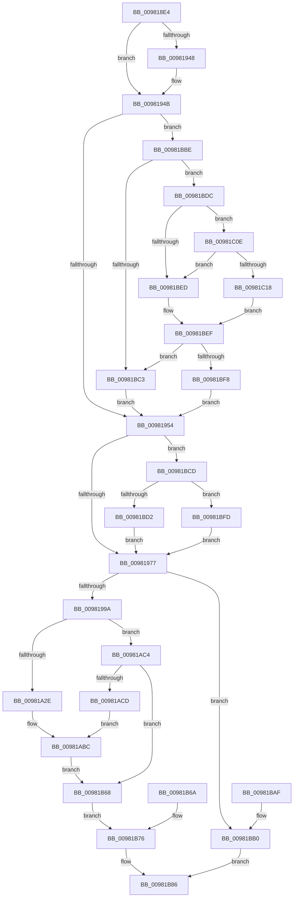

# MmCreateTeb

- RVA: `0x009818E4`–`0x00981C1C` (길이 `824` bytes)
- VA: `0x00000001409818E4`
- 실행 섹션: `PAGE`
- PDB 이름 있음: `예`; PDB Function 태그: `아니요`
- unwind 정보 RVA: `0x0009786C`
- 디코드: `193`개 명령, `824/824` bytes 표시
- 미해석 바이트: `0` (있으면 어셈블리에 `.byte`로 보존)

> 이 문서는 커널 이미지의 기계어와 PDB 기호를 분석해 생성했습니다. 4번과 5번은 함수 원형과 자료형을 바이너리 사용 방식에서 추정한 C 해석이며 원본 소스 복구 결과는 아닙니다.

## 1. Dependencies

- 직접 호출 지점: **5**; 고유 호출 대상: **4**
- 직접 호출자로 확인된 함수: **1**
- RIP 상대 이미지 참조: **1**

### Outgoing calls
- `0x0098195E` → [KiStackAttachProcess](../../text/21/KiStackAttachProcess_function_00216820.md) (function, `0x00216820`)
- `0x0098198B` → [MiAllocateFromSubAllocatedRegion](MiAllocateFromSubAllocatedRegion_function_00981C24.md) (function, `0x00981C24`)
- `0x00981B7D` → [KiUnstackDetachProcess](../../text/21/KiUnstackDetachProcess_function_00217D30.md) (function, `0x00217D30`)
- `0x00981B90` → [_security_check_cookie](../../text/6A/_security_check_cookie_function_006AC640.md) (function, `0x006AC640`)
- `0x00981BB7` → [KiUnstackDetachProcess](../../text/21/KiUnstackDetachProcess_function_00217D30.md) (function, `0x00217D30`)

### Direct callers
- [PspAllocateThread](../9E/PspAllocateThread_function_009EF72C.md) at `0x009EFD58`

### Static image references
- `0x009818FB` → RVA `0x00E0A740` (`.data`; read)

## 2. Other-region calls and transfers

- 다른 실행 섹션으로 향하는 call: **4**
  - `0x0098195E` → [KiStackAttachProcess](../../text/21/KiStackAttachProcess_function_00216820.md) (`PAGE` → `.text`)
  - `0x00981B7D` → [KiUnstackDetachProcess](../../text/21/KiUnstackDetachProcess_function_00217D30.md) (`PAGE` → `.text`)
  - `0x00981B90` → [_security_check_cookie](../../text/6A/_security_check_cookie_function_006AC640.md) (`PAGE` → `.text`)
  - `0x00981BB7` → [KiUnstackDetachProcess](../../text/21/KiUnstackDetachProcess_function_00217D30.md) (`PAGE` → `.text`)
- 별도 외부 분기/꼬리 이동을 확인하지 못했습니다.

## 3. Assembly (complete function range)

```asm
009818E4  48 89 5C 24 10                  mov qword ptr [rsp + 0x10], rbx
009818E9  48 89 74 24 18                  mov qword ptr [rsp + 0x18], rsi
009818EE  57                              push rdi
009818EF  41 54                           push r12
009818F1  41 55                           push r13
009818F3  41 56                           push r14
009818F5  41 57                           push r15
009818F7  48 83 EC 70                     sub rsp, 0x70
009818FB  48 8B 05 3E 8E 48 00            mov rax, qword ptr [rip + 0x488e3e]
00981902  48 33 C4                        xor rax, rsp
00981905  48 89 44 24 68                  mov qword ptr [rsp + 0x68], rax
0098190A  4D 8B F0                        mov r14, r8
0098190D  48 89 54 24 28                  mov qword ptr [rsp + 0x28], rdx
00981912  4C 8B F9                        mov r15, rcx
00981915  4C 8B A4 24 C0 00 00 00         mov r12, qword ptr [rsp + 0xc0]
0098191D  4C 89 64 24 30                  mov qword ptr [rsp + 0x30], r12
00981922  0F 57 C0                        xorps xmm0, xmm0
00981925  0F 11 44 24 38                  movups xmmword ptr [rsp + 0x38], xmm0
0098192A  0F 11 44 24 48                  movups xmmword ptr [rsp + 0x48], xmm0
0098192F  0F 11 44 24 58                  movups xmmword ptr [rsp + 0x58], xmm0
00981934  BF 04 00 00 00                  mov edi, 4
00981939  45 33 ED                        xor r13d, r13d
0098193C  48 8B 81 10 03 00 00            mov rax, qword ptr [rcx + 0x310]
00981943  48 85 C0                        test rax, rax
00981946  74 03                           je 0x14098194b
00981948  4C 8B 28                        mov r13, qword ptr [rax]
0098194B  4D 85 ED                        test r13, r13
0098194E  0F 85 6A 02 00 00               jne 0x140981bbe
00981954  4C 8D 44 24 38                  lea r8, [rsp + 0x38]
00981959  33 D2                           xor edx, edx
0098195B  49 8B CF                        mov rcx, r15
0098195E  E8 BD 4E 89 FF                  call 0x140216820
00981963  48 83 64 24 20 00               and qword ptr [rsp + 0x20], 0
00981969  BA 78 18 00 00                  mov edx, 0x1878
0098196E  83 FF 04                        cmp edi, 4
00981971  0F 85 56 02 00 00               jne 0x140981bcd
00981977  48 81 C2 FF 0F 00 00            add rdx, 0xfff
0098197E  B8 00 F0 FF FF                  mov eax, 0xfffff000
00981983  48 23 D0                        and rdx, rax
00981986  4C 8D 44 24 20                  lea r8, [rsp + 0x20]
0098198B  E8 94 02 00 00                  call 0x140981c24
00981990  8B F0                           mov esi, eax
00981992  85 C0                           test eax, eax
00981994  0F 88 16 02 00 00               js 0x140981bb0
0098199A  41 B8 00 1E 00 00               mov r8d, 0x1e00
009819A0  48 8B 5C 24 20                  mov rbx, qword ptr [rsp + 0x20]
009819A5  44 89 43 20                     mov dword ptr [rbx + 0x20], r8d
009819A9  48 89 5B 30                     mov qword ptr [rbx + 0x30], rbx
009819AD  49 8B 46 08                     mov rax, qword ptr [r14 + 8]
009819B1  48 89 43 48                     mov qword ptr [rbx + 0x48], rax
009819B5  49 8B 06                        mov rax, qword ptr [r14]
009819B8  48 89 43 40                     mov qword ptr [rbx + 0x40], rax
009819BC  41 B9 FE FF 00 00               mov r9d, 0xfffe
009819C2  44 89 8B E8 02 00 00            mov dword ptr [rbx + 0x2e8], r9d
009819C9  49 8B 46 08                     mov rax, qword ptr [r14 + 8]
009819CD  48 89 83 E0 07 00 00            mov qword ptr [rbx + 0x7e0], rax
009819D4  49 8B 06                        mov rax, qword ptr [r14]
009819D7  48 89 83 D8 07 00 00            mov qword ptr [rbx + 0x7d8], rax
009819DE  41 BA 0A 02 00 00               mov r10d, 0x20a
009819E4  66 44 89 93 5A 12 00 00         mov word ptr [rbx + 0x125a], r10w
009819EC  48 8D 83 68 12 00 00            lea rax, [rbx + 0x1268]
009819F3  48 89 83 60 12 00 00            mov qword ptr [rbx + 0x1260], rax
009819FA  49 8B 87 E0 02 00 00            mov rax, qword ptr [r15 + 0x2e0]
00981A01  48 89 43 60                     mov qword ptr [rbx + 0x60], rax
00981A05  48 8B 54 24 28                  mov rdx, qword ptr [rsp + 0x28]
00981A0A  48 8B 42 10                     mov rax, qword ptr [rdx + 0x10]
00981A0E  48 89 43 08                     mov qword ptr [rbx + 8], rax
00981A12  48 8B 42 18                     mov rax, qword ptr [rdx + 0x18]
00981A16  48 89 43 10                     mov qword ptr [rbx + 0x10], rax
00981A1A  48 8B 42 20                     mov rax, qword ptr [rdx + 0x20]
00981A1E  48 89 83 78 14 00 00            mov qword ptr [rbx + 0x1478], rax
00981A25  83 FF 05                        cmp edi, 5
00981A28  0F 85 96 00 00 00               jne 0x140981ac4
00981A2E  48 8D 8B 00 20 00 00            lea rcx, [rbx + 0x2000]
00981A35  48 89 4C 24 28                  mov qword ptr [rsp + 0x28], rcx
00981A3A  44 89 41 10                     mov dword ptr [rcx + 0x10], r8d
00981A3E  89 49 18                        mov dword ptr [rcx + 0x18], ecx
00981A41  41 8B 46 08                     mov eax, dword ptr [r14 + 8]
00981A45  89 41 24                        mov dword ptr [rcx + 0x24], eax
00981A48  41 8B 06                        mov eax, dword ptr [r14]
00981A4B  89 41 20                        mov dword ptr [rcx + 0x20], eax
00981A4E  44 89 89 D0 01 00 00            mov dword ptr [rcx + 0x1d0], r9d
00981A55  41 8B 46 08                     mov eax, dword ptr [r14 + 8]
00981A59  89 81 B8 06 00 00               mov dword ptr [rcx + 0x6b8], eax
00981A5F  41 8B 06                        mov eax, dword ptr [r14]
00981A62  89 81 B4 06 00 00               mov dword ptr [rcx + 0x6b4], eax
00981A68  66 44 89 91 FA 0B 00 00         mov word ptr [rcx + 0xbfa], r10w
00981A70  8D 81 00 0C 00 00               lea eax, [rcx + 0xc00]
00981A76  89 81 FC 0B 00 00               mov dword ptr [rcx + 0xbfc], eax
00981A7C  83 09 FF                        or dword ptr [rcx], 0xffffffff
00981A7F  44 89 69 30                     mov dword ptr [rcx + 0x30], r13d
00981A83  89 99 70 0F 00 00               mov dword ptr [rcx + 0xf70], ebx
00981A89  8B 83 90 16 00 00               mov eax, dword ptr [rbx + 0x1690]
00981A8F  89 81 18 0F 00 00               mov dword ptr [rcx + 0xf18], eax
00981A95  8B 42 28                        mov eax, dword ptr [rdx + 0x28]
00981A98  89 41 04                        mov dword ptr [rcx + 4], eax
00981A9B  8B 42 30                        mov eax, dword ptr [rdx + 0x30]
00981A9E  89 41 08                        mov dword ptr [rcx + 8], eax
00981AA1  8B 42 38                        mov eax, dword ptr [rdx + 0x38]
00981AA4  89 81 0C 0E 00 00               mov dword ptr [rcx + 0xe0c], eax
00981AAA  8B C1                           mov eax, ecx
00981AAC  2B C3                           sub eax, ebx
00981AAE  89 83 0C 18 00 00               mov dword ptr [rbx + 0x180c], eax
00981AB4  F7 D8                           neg eax
00981AB6  89 81 DC 0F 00 00               mov dword ptr [rcx + 0xfdc], eax
00981ABC  48 89 0B                        mov qword ptr [rbx], rcx
00981ABF  E9 A4 00 00 00                  jmp 0x140981b68
00981AC4  83 FF 06                        cmp edi, 6
00981AC7  0F 85 9B 00 00 00               jne 0x140981b68
00981ACD  48 8D 8B 00 20 00 00            lea rcx, [rbx + 0x2000]
00981AD4  44 89 41 20                     mov dword ptr [rcx + 0x20], r8d
00981AD8  48 89 49 30                     mov qword ptr [rcx + 0x30], rcx
00981ADC  49 8B 46 08                     mov rax, qword ptr [r14 + 8]
00981AE0  48 89 41 48                     mov qword ptr [rcx + 0x48], rax
00981AE4  49 8B 06                        mov rax, qword ptr [r14]
00981AE7  48 89 41 40                     mov qword ptr [rcx + 0x40], rax
00981AEB  44 89 89 E8 02 00 00            mov dword ptr [rcx + 0x2e8], r9d
00981AF2  49 8B 46 08                     mov rax, qword ptr [r14 + 8]
00981AF6  48 89 81 E0 07 00 00            mov qword ptr [rcx + 0x7e0], rax
00981AFD  49 8B 06                        mov rax, qword ptr [r14]
00981B00  48 89 81 D8 07 00 00            mov qword ptr [rcx + 0x7d8], rax
00981B07  66 44 89 91 5A 12 00 00         mov word ptr [rcx + 0x125a], r10w
00981B0F  48 8D 81 68 12 00 00            lea rax, [rcx + 0x1268]
00981B16  48 89 81 60 12 00 00            mov qword ptr [rcx + 0x1260], rax
00981B1D  4C 89 69 60                     mov qword ptr [rcx + 0x60], r13
00981B21  83 A1 40 17 00 00 00            and dword ptr [rcx + 0x1740], 0
00981B28  48 8B 83 90 16 00 00            mov rax, qword ptr [rbx + 0x1690]
00981B2F  48 89 81 90 16 00 00            mov qword ptr [rcx + 0x1690], rax
00981B36  48 8B 42 28                     mov rax, qword ptr [rdx + 0x28]
00981B3A  48 89 41 08                     mov qword ptr [rcx + 8], rax
00981B3E  48 8B 42 30                     mov rax, qword ptr [rdx + 0x30]
00981B42  48 89 41 10                     mov qword ptr [rcx + 0x10], rax
00981B46  48 8B 42 38                     mov rax, qword ptr [rdx + 0x38]
00981B4A  48 89 81 78 14 00 00            mov qword ptr [rcx + 0x1478], rax
00981B51  8B C1                           mov eax, ecx
00981B53  2B C3                           sub eax, ebx
00981B55  89 83 0C 18 00 00               mov dword ptr [rbx + 0x180c], eax
00981B5B  F7 D8                           neg eax
00981B5D  89 81 0C 18 00 00               mov dword ptr [rcx + 0x180c], eax
00981B63  E9 54 FF FF FF                  jmp 0x140981abc
00981B68  EB 0C                           jmp 0x140981b76
00981B6A  8B F0                           mov esi, eax
00981B6C  48 8B 5C 24 20                  mov rbx, qword ptr [rsp + 0x20]
00981B71  4C 8B 64 24 30                  mov r12, qword ptr [rsp + 0x30]
00981B76  33 D2                           xor edx, edx
00981B78  48 8D 4C 24 38                  lea rcx, [rsp + 0x38]
00981B7D  E8 AE 61 89 FF                  call 0x140217d30
00981B82  49 89 1C 24                     mov qword ptr [r12], rbx
00981B86  8B C6                           mov eax, esi
00981B88  48 8B 4C 24 68                  mov rcx, qword ptr [rsp + 0x68]
00981B8D  48 33 CC                        xor rcx, rsp
00981B90  E8 AB AA D2 FF                  call 0x1406ac640
00981B95  4C 8D 5C 24 70                  lea r11, [rsp + 0x70]
00981B9A  49 8B 5B 38                     mov rbx, qword ptr [r11 + 0x38]
00981B9E  49 8B 73 40                     mov rsi, qword ptr [r11 + 0x40]
00981BA2  49 8B E3                        mov rsp, r11
00981BA5  41 5F                           pop r15
00981BA7  41 5E                           pop r14
00981BA9  41 5D                           pop r13
00981BAB  41 5C                           pop r12
00981BAD  5F                              pop rdi
00981BAE  C3                              ret
00981BAF  CC                              int3
00981BB0  33 D2                           xor edx, edx
00981BB2  48 8D 4C 24 38                  lea rcx, [rsp + 0x38]
00981BB7  E8 74 61 89 FF                  call 0x140217d30
00981BBC  EB C8                           jmp 0x140981b86
00981BBE  48 85 C0                        test rax, rax
00981BC1  75 19                           jne 0x140981bdc
00981BC3  BF 06 00 00 00                  mov edi, 6
00981BC8  E9 87 FD FF FF                  jmp 0x140981954
00981BCD  83 FF 05                        cmp edi, 5
00981BD0  75 2B                           jne 0x140981bfd
00981BD2  BA 38 30 00 00                  mov edx, 0x3038
00981BD7  E9 9B FD FF FF                  jmp 0x140981977
00981BDC  0F B7 81 EC 06 00 00            movzx eax, word ptr [rcx + 0x6ec]
00981BE3  B9 4C 01 00 00                  mov ecx, 0x14c
00981BE8  66 3B C1                        cmp ax, cx
00981BEB  75 21                           jne 0x140981c0e
00981BED  B0 01                           mov al, 1
00981BEF  84 C0                           test al, al
00981BF1  BF 05 00 00 00                  mov edi, 5
00981BF6  74 CB                           je 0x140981bc3
00981BF8  E9 57 FD FF FF                  jmp 0x140981954
00981BFD  B8 78 38 00 00                  mov eax, 0x3878
00981C02  83 FF 06                        cmp edi, 6
00981C05  48 0F 44 D0                     cmove rdx, rax
00981C09  E9 69 FD FF FF                  jmp 0x140981977
00981C0E  B9 C4 01 00 00                  mov ecx, 0x1c4
00981C13  66 3B C1                        cmp ax, cx
00981C16  74 D5                           je 0x140981bed
00981C18  32 C0                           xor al, al
00981C1A  EB D3                           jmp 0x140981bef
```

## 4. C-style interpretation (structured pseudocode)

```c
__int64 __fastcall MmCreateTeb(__int64 a1, __int64 a2, __int64 a3, __int64 a4, __int64 a5)
{
    __int64 result;
    __int64 v_r13;
    __int64 v_rsp;
    unsigned __int64 v_stack_m28;
    unsigned __int64 v_stack_m30;
    unsigned __int64 v_stack_m38;
    unsigned __int64 v_stack_m40;
    unsigned __int64 v_stack_m50;
    unsigned __int64 v_stack_m60;
    unsigned __int64 v_stack_m68;
    unsigned __int64 v_stack_m70;
    unsigned __int64 v_stack_m78;
    unsigned __int64 v_stack_p10;
    unsigned __int64 v_stack_p18;

    v_stack_p10 = v_rbx;
    v_stack_p18 = v_rsi;
    v_rsp = (v_rsp) - (112);
    result = (*(unsigned __int64 *)(v_rip + 4755006)) ^ (v_rsp);
    v_stack_m30 = result;
    v_stack_m70 = a2;
    v_stack_m68 = a5;
    v_stack_m60 = v_xmm0;
    v_stack_m50 = v_xmm0;
    v_stack_m40 = v_xmm0;
    v_r13 = 0;
    if (*(unsigned __int64 *)(a1 + 784) != 0) {
        v_r13 = *(unsigned __int64 *)(*(unsigned __int64 *)(a1 + 784));
    }
    if (v_r13 != 0) goto loc_00981BBE;
loc_00981954:
    a2 = 0;
    result = KiStackAttachProcess(a1, a2, v_stack_m60, a4);
    if (4 != 4) goto loc_00981BCD;
loc_00981977:
    a2 = ((unsigned int)(0x1878ULL)) + (0xFFFULL);
    a2 = (a2) & ((unsigned int)(0xFFFFF000ULL));
    result = MiAllocateFromSubAllocatedRegion(a1, a2, v_stack_m78, a4);
    if (sign_flag) goto loc_00981BB0;
    *(unsigned int *)(v_stack_m78 + 32) = (unsigned int)((unsigned int)(0x1E00ULL));
    *(unsigned __int64 *)(v_stack_m78 + 48) = v_stack_m78;
    *(unsigned __int64 *)(v_stack_m78 + 72) = *(unsigned __int64 *)(a3 + 8);
    *(unsigned __int64 *)(v_stack_m78 + 64) = *(unsigned __int64 *)(a3);
    *(unsigned int *)(v_stack_m78 + 744) = (unsigned int)((unsigned int)(0xFFFEULL));
    *(unsigned __int64 *)(v_stack_m78 + 2016) = *(unsigned __int64 *)(a3 + 8);
    *(unsigned __int64 *)(v_stack_m78 + 2008) = *(unsigned __int64 *)(a3);
    *(unsigned __int16 *)(v_stack_m78 + 4698) = 522;
    *(unsigned __int64 *)(v_stack_m78 + 4704) = v_stack_m78 + 4712;
    *(unsigned __int64 *)(v_stack_m78 + 96) = *(unsigned __int64 *)(a1 + 736);
    *(unsigned __int64 *)(v_stack_m78 + 8) = *(unsigned __int64 *)(v_stack_m70 + 16);
    *(unsigned __int64 *)(v_stack_m78 + 16) = *(unsigned __int64 *)(v_stack_m70 + 24);
    *(unsigned __int64 *)(v_stack_m78 + 5240) = *(unsigned __int64 *)(v_stack_m70 + 32);
    if (4 != 5) goto loc_00981AC4;
    v_stack_m70 = v_stack_m78 + 8192;
    *(unsigned int *)(v_stack_m78 + 8192 + 16) = (unsigned int)((unsigned int)(0x1E00ULL));
    *(unsigned int *)(v_stack_m78 + 8192 + 24) = (unsigned int)(v_stack_m78 + 8192);
    *(unsigned int *)(v_stack_m78 + 8192 + 36) = (unsigned int)((unsigned int)(*(unsigned int *)(a3 + 8)));
    *(unsigned int *)(v_stack_m78 + 8192 + 32) = (unsigned int)((unsigned int)(*(unsigned int *)(a3)));
    *(unsigned int *)(v_stack_m78 + 8192 + 464) = (unsigned int)((unsigned int)(0xFFFEULL));
    *(unsigned int *)(v_stack_m78 + 8192 + 1720) = (unsigned int)((unsigned int)(*(unsigned int *)(a3 + 8)));
    *(unsigned int *)(v_stack_m78 + 8192 + 1716) = (unsigned int)((unsigned int)(*(unsigned int *)(a3)));
    *(unsigned __int16 *)(v_stack_m78 + 8192 + 3066) = 522;
    *(unsigned int *)(v_stack_m78 + 8192 + 3068) = (unsigned int)(v_stack_m78 + 8192 + 3072);
    *(unsigned int *)(v_stack_m78 + 8192 + 48) = (unsigned int)(v_r13);
    *(unsigned int *)(v_stack_m78 + 8192 + 3952) = (unsigned int)(v_stack_m78);
    *(unsigned int *)(v_stack_m78 + 8192 + 3864) = (unsigned int)((unsigned int)(*(unsigned int *)(v_stack_m78 + 5776)));
    *(unsigned int *)(v_stack_m78 + 8192 + 4) = (unsigned int)((unsigned int)(*(unsigned int *)(v_stack_m70 + 40)));
    *(unsigned int *)(v_stack_m78 + 8192 + 8) = (unsigned int)((unsigned int)(*(unsigned int *)(v_stack_m70 + 48)));
    *(unsigned int *)(v_stack_m78 + 8192 + 3596) = (unsigned int)((unsigned int)(*(unsigned int *)(v_stack_m70 + 56)));
    result = (unsigned int)(((unsigned int)((unsigned int)(v_stack_m78 + 8192))) - ((unsigned int)(v_stack_m78)));
    *(unsigned int *)(v_stack_m78 + 6156) = (unsigned int)(result);
    result = (unsigned int)(-(result));
    *(unsigned int *)(v_stack_m78 + 8192 + 4060) = (unsigned int)(result);
loc_00981ABC:
    *(unsigned __int64 *)(v_stack_m78) = v_stack_m78 + 8192;
    goto loc_00981B68;
loc_00981AC4:
    if (4 != 6) goto loc_00981B68;
    *(unsigned int *)(v_stack_m78 + 8192 + 32) = (unsigned int)((unsigned int)(0x1E00ULL));
    *(unsigned __int64 *)(v_stack_m78 + 8192 + 48) = v_stack_m78 + 8192;
    *(unsigned __int64 *)(v_stack_m78 + 8192 + 72) = *(unsigned __int64 *)(a3 + 8);
    *(unsigned __int64 *)(v_stack_m78 + 8192 + 64) = *(unsigned __int64 *)(a3);
    *(unsigned int *)(v_stack_m78 + 8192 + 744) = (unsigned int)((unsigned int)(0xFFFEULL));
    *(unsigned __int64 *)(v_stack_m78 + 8192 + 2016) = *(unsigned __int64 *)(a3 + 8);
    *(unsigned __int64 *)(v_stack_m78 + 8192 + 2008) = *(unsigned __int64 *)(a3);
    *(unsigned __int16 *)(v_stack_m78 + 8192 + 4698) = 522;
    *(unsigned __int64 *)(v_stack_m78 + 8192 + 4704) = v_stack_m78 + 8192 + 4712;
    *(unsigned __int64 *)(v_stack_m78 + 8192 + 96) = v_r13;
    *(unsigned __int64 *)(v_stack_m78 + 8192 + 5776) = *(unsigned __int64 *)(v_stack_m78 + 5776);
    *(unsigned __int64 *)(v_stack_m78 + 8192 + 8) = *(unsigned __int64 *)(v_stack_m70 + 40);
    *(unsigned __int64 *)(v_stack_m78 + 8192 + 16) = *(unsigned __int64 *)(v_stack_m70 + 48);
    *(unsigned __int64 *)(v_stack_m78 + 8192 + 5240) = *(unsigned __int64 *)(v_stack_m70 + 56);
    result = (unsigned int)(((unsigned int)((unsigned int)(v_stack_m78 + 8192))) - ((unsigned int)(v_stack_m78)));
    *(unsigned int *)(v_stack_m78 + 6156) = (unsigned int)(result);
    result = (unsigned int)(-(result));
    *(unsigned int *)(v_stack_m78 + 8192 + 6156) = (unsigned int)(result);
    goto loc_00981ABC;
loc_00981B68:
    goto loc_00981B76;
loc_00981B76:
    a2 = 0;
    result = KiUnstackDetachProcess(v_stack_m60, a2, (unsigned int)(0x1E00ULL), (unsigned int)(0xFFFEULL));
    *(unsigned __int64 *)(a5) = v_stack_m78;
loc_00981B86:
    a1 = (v_stack_m30) ^ (v_rsp);
    result = _security_check_cookie(a1, a2, (unsigned int)(0x1E00ULL), (unsigned int)(0xFFFEULL));
    return result;
loc_00981BB0:
    a2 = 0;
    result = KiUnstackDetachProcess(v_stack_m38, a2, (unsigned int)(0x1E00ULL), (unsigned int)(0xFFFEULL));
    goto loc_00981B86;
loc_00981BBE:
    if (result != 0) goto loc_00981BDC;
loc_00981BC3:
    goto loc_00981954;
loc_00981BCD:
    if (6 != 5) goto loc_00981BFD;
    goto loc_00981977;
loc_00981BDC:
    if (((unsigned __int16)(*(unsigned __int16 *)(v_stack_m38 + 1772))) != 332) goto loc_00981C0E;
loc_00981BED:
loc_00981BEF:
    if (1 == 0) goto loc_00981BC3;
    goto loc_00981954;
loc_00981BFD:
    a2 = (unsigned int)(0x3038ULL);
    if (5 == 6) { a2 = (unsigned int)(0x3878ULL); }
    goto loc_00981977;
loc_00981C0E:
    if (((unsigned __int16)((unsigned int)(0x3878ULL))) == 452) goto loc_00981BED;
    result = 0;
    goto loc_00981BEF;
}
```

## 5. (Beta) C Style

```c
int64_t MmCreateTeb(void *Arg1, int64_t Arg2, void *Arg3, int64_t Arg4, void *Arg5)
{
    uint8_t *arg1 = (uint8_t *)Arg1;
    uint8_t *arg3 = (uint8_t *)Arg3;
    uint8_t *arg5 = (uint8_t *)Arg5;

    int64_t result;
    int64_t local_r13;
    int64_t local_rsp;
    uint64_t v_stack_m28;
    uint64_t v_stack_m30;
    uint64_t v_stack_m38;
    uint64_t v_stack_m40;
    uint64_t v_stack_m50;
    uint64_t v_stack_m60;
    uint64_t v_stack_m68;
    uint64_t v_stack_m70;
    uint64_t v_stack_m78;
    uint64_t v_stack_p10;
    uint64_t v_stack_p18;

    v_stack_p10 = local_rbx;
    v_stack_p18 = local_rsi;
    local_rsp = (local_rsp) - (112);
    result = (*(uint64_t *)(v_rip + 0x488E3E)) ^ (local_rsp);
    v_stack_m30 = result;
    v_stack_m70 = Arg2;
    v_stack_m68 = Arg5;
    v_stack_m60 = v_xmm0;
    v_stack_m50 = v_xmm0;
    v_stack_m40 = v_xmm0;
    local_r13 = 0;
    if (*(uint64_t *)(arg1 + 0x310) != 0) {
        local_r13 = *(uint64_t *)(*(uint64_t *)(arg1 + 0x310));
    }
    if (local_r13 != 0) goto loc_00981BBE;
loc_00981954:
    Arg2 = 0;
    result = KiStackAttachProcess(Arg1, Arg2, v_stack_m60, Arg4);
    if (4 != 4) goto loc_00981BCD;
loc_00981977:
    Arg2 = ((uint32_t)(0x1878ULL)) + (0xFFFULL);
    Arg2 = (Arg2) & ((uint32_t)(0xFFFFF000ULL));
    result = MiAllocateFromSubAllocatedRegion(Arg1, Arg2, v_stack_m78, Arg4);
    if (sign_flag) goto loc_00981BB0;
    *(uint32_t *)(v_stack_m78 + 0x20) = (uint32_t)((uint32_t)(0x1E00ULL));
    *(uint64_t *)(v_stack_m78 + 0x30) = v_stack_m78;
    *(uint64_t *)(v_stack_m78 + 0x48) = *(uint64_t *)(arg3 + 0x8);
    *(uint64_t *)(v_stack_m78 + 0x40) = *(uint64_t *)(arg3);
    *(uint32_t *)(v_stack_m78 + 0x2E8) = (uint32_t)((uint32_t)(0xFFFEULL));
    *(uint64_t *)(v_stack_m78 + 0x7E0) = *(uint64_t *)(arg3 + 0x8);
    *(uint64_t *)(v_stack_m78 + 0x7D8) = *(uint64_t *)(arg3);
    *(uint16_t *)(v_stack_m78 + 0x125A) = 522;
    *(uint64_t *)(v_stack_m78 + 0x1260) = v_stack_m78 + 4712;
    *(uint64_t *)(v_stack_m78 + 0x60) = *(uint64_t *)(arg1 + 0x2E0);
    *(uint64_t *)(v_stack_m78 + 0x8) = *(uint64_t *)(v_stack_m70 + 0x10);
    *(uint64_t *)(v_stack_m78 + 0x10) = *(uint64_t *)(v_stack_m70 + 0x18);
    *(uint64_t *)(v_stack_m78 + 0x1478) = *(uint64_t *)(v_stack_m70 + 0x20);
    if (4 != 5) goto loc_00981AC4;
    v_stack_m70 = v_stack_m78 + 8192;
    *(uint32_t *)(v_stack_m78 + 0x2000 + 0x10) = (uint32_t)((uint32_t)(0x1E00ULL));
    *(uint32_t *)(v_stack_m78 + 0x2000 + 0x18) = (uint32_t)(v_stack_m78 + 8192);
    *(uint32_t *)(v_stack_m78 + 0x2000 + 0x24) = (uint32_t)((uint32_t)(*(uint32_t *)(arg3 + 0x8)));
    *(uint32_t *)(v_stack_m78 + 0x2000 + 0x20) = (uint32_t)((uint32_t)(*(uint32_t *)(arg3)));
    *(uint32_t *)(v_stack_m78 + 0x2000 + 0x1D0) = (uint32_t)((uint32_t)(0xFFFEULL));
    *(uint32_t *)(v_stack_m78 + 0x2000 + 0x6B8) = (uint32_t)((uint32_t)(*(uint32_t *)(arg3 + 0x8)));
    *(uint32_t *)(v_stack_m78 + 0x2000 + 0x6B4) = (uint32_t)((uint32_t)(*(uint32_t *)(arg3)));
    *(uint16_t *)(v_stack_m78 + 0x2000 + 0xBFA) = 522;
    *(uint32_t *)(v_stack_m78 + 0x2000 + 0xBFC) = (uint32_t)(v_stack_m78 + 8192 + 3072);
    *(uint32_t *)(v_stack_m78 + 0x2000 + 0x30) = (uint32_t)(local_r13);
    *(uint32_t *)(v_stack_m78 + 0x2000 + 0xF70) = (uint32_t)(v_stack_m78);
    *(uint32_t *)(v_stack_m78 + 0x2000 + 0xF18) = (uint32_t)((uint32_t)(*(uint32_t *)(v_stack_m78 + 0x1690)));
    *(uint32_t *)(v_stack_m78 + 0x2000 + 0x4) = (uint32_t)((uint32_t)(*(uint32_t *)(v_stack_m70 + 0x28)));
    *(uint32_t *)(v_stack_m78 + 0x2000 + 0x8) = (uint32_t)((uint32_t)(*(uint32_t *)(v_stack_m70 + 0x30)));
    *(uint32_t *)(v_stack_m78 + 0x2000 + 0xE0C) = (uint32_t)((uint32_t)(*(uint32_t *)(v_stack_m70 + 0x38)));
    result = (uint32_t)(((uint32_t)((uint32_t)(v_stack_m78 + 8192))) - ((uint32_t)(v_stack_m78)));
    *(uint32_t *)(v_stack_m78 + 0x180C) = (uint32_t)(result);
    result = (uint32_t)(-(result));
    *(uint32_t *)(v_stack_m78 + 0x2000 + 0xFDC) = (uint32_t)(result);
loc_00981ABC:
    *(uint64_t *)(v_stack_m78) = v_stack_m78 + 8192;
    goto loc_00981B68;
loc_00981AC4:
    if (4 != 6) goto loc_00981B68;
    *(uint32_t *)(v_stack_m78 + 0x2000 + 0x20) = (uint32_t)((uint32_t)(0x1E00ULL));
    *(uint64_t *)(v_stack_m78 + 0x2000 + 0x30) = v_stack_m78 + 8192;
    *(uint64_t *)(v_stack_m78 + 0x2000 + 0x48) = *(uint64_t *)(arg3 + 0x8);
    *(uint64_t *)(v_stack_m78 + 0x2000 + 0x40) = *(uint64_t *)(arg3);
    *(uint32_t *)(v_stack_m78 + 0x2000 + 0x2E8) = (uint32_t)((uint32_t)(0xFFFEULL));
    *(uint64_t *)(v_stack_m78 + 0x2000 + 0x7E0) = *(uint64_t *)(arg3 + 0x8);
    *(uint64_t *)(v_stack_m78 + 0x2000 + 0x7D8) = *(uint64_t *)(arg3);
    *(uint16_t *)(v_stack_m78 + 0x2000 + 0x125A) = 522;
    *(uint64_t *)(v_stack_m78 + 0x2000 + 0x1260) = v_stack_m78 + 8192 + 4712;
    *(uint64_t *)(v_stack_m78 + 0x2000 + 0x60) = local_r13;
    *(uint64_t *)(v_stack_m78 + 0x2000 + 0x1690) = *(uint64_t *)(v_stack_m78 + 0x1690);
    *(uint64_t *)(v_stack_m78 + 0x2000 + 0x8) = *(uint64_t *)(v_stack_m70 + 0x28);
    *(uint64_t *)(v_stack_m78 + 0x2000 + 0x10) = *(uint64_t *)(v_stack_m70 + 0x30);
    *(uint64_t *)(v_stack_m78 + 0x2000 + 0x1478) = *(uint64_t *)(v_stack_m70 + 0x38);
    result = (uint32_t)(((uint32_t)((uint32_t)(v_stack_m78 + 8192))) - ((uint32_t)(v_stack_m78)));
    *(uint32_t *)(v_stack_m78 + 0x180C) = (uint32_t)(result);
    result = (uint32_t)(-(result));
    *(uint32_t *)(v_stack_m78 + 0x2000 + 0x180C) = (uint32_t)(result);
    goto loc_00981ABC;
loc_00981B68:
    goto loc_00981B76;
loc_00981B76:
    Arg2 = 0;
    result = KiUnstackDetachProcess(v_stack_m60, Arg2, (uint32_t)(0x1E00ULL), (uint32_t)(0xFFFEULL));
    *(uint64_t *)(arg5) = v_stack_m78;
loc_00981B86:
    Arg1 = (v_stack_m30) ^ (local_rsp);
    result = _security_check_cookie(Arg1, Arg2, (uint32_t)(0x1E00ULL), (uint32_t)(0xFFFEULL));
    return result;
loc_00981BB0:
    Arg2 = 0;
    result = KiUnstackDetachProcess(v_stack_m38, Arg2, (uint32_t)(0x1E00ULL), (uint32_t)(0xFFFEULL));
    goto loc_00981B86;
loc_00981BBE:
    if (result != 0) goto loc_00981BDC;
loc_00981BC3:
    goto loc_00981954;
loc_00981BCD:
    if (6 != 5) goto loc_00981BFD;
    goto loc_00981977;
loc_00981BDC:
    if (((uint16_t)(*(uint16_t *)(v_stack_m38 + 0x6EC))) != 332) goto loc_00981C0E;
loc_00981BED:
loc_00981BEF:
    if (1 == 0) goto loc_00981BC3;
    goto loc_00981954;
loc_00981BFD:
    Arg2 = (uint32_t)(0x3038ULL);
    if (5 == 6) { Arg2 = (uint32_t)(0x3878ULL); }
    goto loc_00981977;
loc_00981C0E:
    if (((uint16_t)((uint32_t)(0x3878ULL))) == 452) goto loc_00981BED;
    result = 0;
    goto loc_00981BEF;
}
```

### 관측된 메모리 오프셋

구조체 형식이 확인되지 않은 접근은 인자 기준의 오프셋으로만 기록했습니다.

| 기준 인자 | 오프셋 표현 | 폭 (bit) | 접근 |
|---|---:|---:|---|
| `Arg1` | `+ 0x2E0` | `64` | `R` |
| `Arg1` | `+ 0x310` | `64` | `R` |
| `Arg1` | `+ 0x6EC` | `16` | `R` |
| `Arg3` | `+ 0x0` | `32` | `R` |
| `Arg3` | `+ 0x0` | `64` | `R` |
| `Arg3` | `+ 0x8` | `32` | `R` |
| `Arg3` | `+ 0x8` | `64` | `R` |
| `Arg5` | `+ 0x0` | `64` | `W` |

## 6. Execution-region graph

[열기: 2D/3D 그래프와 함수 탐색 컨트롤 패널](../../../control-panel.html?section=page&rva=0x009818E4&view=graph)

- 2D 그래프는 위에서 아래로 흐르고, 3D 그래프는 빈 공간을 드래그해 회전합니다. Shift+드래그는 이동, 휠은 확대·축소, 함수 노드 선택은 대상 보고서 이동입니다.

### Static fallback


