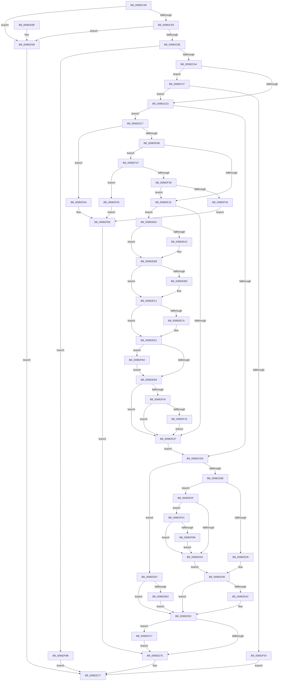

# MmExtendSection

- RVA: `0x00982C38`–`0x00982FD3` (길이 `923` bytes)
- VA: `0x0000000140982C38`
- 실행 섹션: `PAGE`
- PDB 이름 있음: `예`; PDB Function 태그: `아니요`
- unwind 정보 RVA: `0x000979B0`
- 디코드: `235`개 명령, `923/923` bytes 표시
- 미해석 바이트: `0` (있으면 어셈블리에 `.byte`로 보존)

> 이 문서는 커널 이미지의 기계어와 PDB 기호를 분석해 생성했습니다. 4번과 5번은 함수 원형과 자료형을 바이너리 사용 방식에서 추정한 C 해석이며 원본 소스 복구 결과는 아닙니다.

## 1. Dependencies

- 직접 호출 지점: **25**; 고유 호출 대상: **17**
- 직접 호출자로 확인된 함수: **6**
- RIP 상대 이미지 참조: **2**

### Outgoing calls
- `0x00982C6E` → [MiSectionControlArea](../../text/29/MiSectionControlArea_function_00294CB0.md) (function, `0x00294CB0`)
- `0x00982CC0` → [MiLockControlAreaSectionExtend](../../text/2C/MiLockControlAreaSectionExtend_function_002C9D60.md) (function, `0x002C9D60`)
- `0x00982CE5` → [MiFindLastSubsection](../../text/2A/MiFindLastSubsection_function_002ACF20.md) (function, `0x002ACF20`)
- `0x00982D41` → [MiExtendSection](MiExtendSection_function_00982FDC.md) (function, `0x00982FDC`)
- `0x00982D63` → [MiUnlockControlAreaSectionExtend](../../text/44/MiUnlockControlAreaSectionExtend_function_0044BDC4.md) (function, `0x0044BDC4`)
- `0x00982DC0` → [MiUpdateLastSubsectionSize](../../text/45/MiUpdateLastSubsectionSize_function_0045876C.md) (function, `0x0045876C`)
- `0x00982DCE` → [MiUnlockControlAreaSectionExtend](../../text/44/MiUnlockControlAreaSectionExtend_function_0044BDC4.md) (function, `0x0044BDC4`)
- `0x00982DD6` → [MiReferenceControlAreaFile](../../text/43/MiReferenceControlAreaFile_function_00431554.md) (function, `0x00431554`)
- `0x00982DF0` → [MiLockControlAreaSectionExtend](../../text/2C/MiLockControlAreaSectionExtend_function_002C9D60.md) (function, `0x002C9D60`)
- `0x00982DFC` → [FsRtlGetFileSize](FsRtlGetFileSize_function_00985150.md) (function, `0x00985150`)
- `0x00982E26` → [MiUnlockControlAreaSectionExtend](../../text/44/MiUnlockControlAreaSectionExtend_function_0044BDC4.md) (function, `0x0044BDC4`)
- `0x00982E32` → [MiDereferenceControlAreaFile](../../text/43/MiDereferenceControlAreaFile_function_004345E0.md) (function, `0x004345E0`)
- `0x00982E45` → [MiLockControlAreaSectionExtend](../../text/2C/MiLockControlAreaSectionExtend_function_002C9D60.md) (function, `0x002C9D60`)
- `0x00982E62` → [MiUpdateLastSubsectionSize](../../text/45/MiUpdateLastSubsectionSize_function_0045876C.md) (function, `0x0045876C`)
- `0x00982E8E` → [KeAbPreAcquire](../../text/21/KeAbPreAcquire_function_00210230.md) (function, `0x00210230`)
- `0x00982EB3` → [ExfAcquirePushLockExclusiveEx](../../text/20/ExfAcquirePushLockExclusiveEx_function_0020FC90.md) (function, `0x0020FC90`)
- `0x00982EEF` → [KeAbPostRelease](../../text/2E/KeAbPostRelease_function_002E1600.md) (function, `0x002E1600`)
- `0x00982F15` → [KiCheckForKernelApcDelivery](../../text/2E/KiCheckForKernelApcDelivery_function_002E2C80.md) (function, `0x002E2C80`)
- `0x00982F36` → [FsRtlSetFileSize](FsRtlSetFileSize_function_00982B04.md) (function, `0x00982B04`)
- `0x00982F5E` → [MiUnlockControlAreaSectionExtend](../../text/44/MiUnlockControlAreaSectionExtend_function_0044BDC4.md) (function, `0x0044BDC4`)
- `0x00982F75` → [MiUnlockControlAreaSectionExtend](../../text/44/MiUnlockControlAreaSectionExtend_function_0044BDC4.md) (function, `0x0044BDC4`)
- `0x00982F80` → [MiDereferenceControlAreaFile](../../text/43/MiDereferenceControlAreaFile_function_004345E0.md) (function, `0x004345E0`)
- `0x00982F91` → [ExfTryToWakePushLock](../../text/26/ExfTryToWakePushLock_function_00265DD0.md) (function, `0x00265DD0`)
- `0x00982FB9` → [MiSubsectionNeedsExtents](../../text/67/MiSubsectionNeedsExtents_function_0067EFF8.md) (function, `0x0067EFF8`)
- `0x00982FC7` → [MiUpdateActiveSubsection](../../text/67/MiUpdateActiveSubsection_function_0067F034.md) (function, `0x0067F034`)

### Direct callers
- [CcSetFileSizesEx](../../text/26/CcSetFileSizesEx_function_0026D070.md) at `0x0026D2B1`
- [MiCommitFileBackedSection](../88/MiCommitFileBackedSection_function_00882238.md) at `0x00882341`
- [MmCreateSectionEx](MmCreateSectionEx_function_009839CC.md) at `0x00983BBC`
- [MmCreateCacheManagerSection](MmCreateCacheManagerSection_function_00983CB8.md) at `0x00983DED`
- [MiCreateSection](MiCreateSection_function_00983EC0.md) at `0x0098404F`
- [NtExtendSection](../A8/NtExtendSection_function_00A8EC60.md) at `0x00A8ECE9`

### Static image references
- `0x00982E75` → RVA `0x00E2CD10` (`.data`; read)
- `0x00982E93` → RVA `0x00E2CD10` (`.data`; read/write)

## 2. Other-region calls and transfers

- 다른 실행 섹션으로 향하는 call: **22**
  - `0x00982C6E` → [MiSectionControlArea](../../text/29/MiSectionControlArea_function_00294CB0.md) (`PAGE` → `.text`)
  - `0x00982CC0` → [MiLockControlAreaSectionExtend](../../text/2C/MiLockControlAreaSectionExtend_function_002C9D60.md) (`PAGE` → `.text`)
  - `0x00982CE5` → [MiFindLastSubsection](../../text/2A/MiFindLastSubsection_function_002ACF20.md) (`PAGE` → `.text`)
  - `0x00982D63` → [MiUnlockControlAreaSectionExtend](../../text/44/MiUnlockControlAreaSectionExtend_function_0044BDC4.md) (`PAGE` → `.text`)
  - `0x00982DC0` → [MiUpdateLastSubsectionSize](../../text/45/MiUpdateLastSubsectionSize_function_0045876C.md) (`PAGE` → `.text`)
  - `0x00982DCE` → [MiUnlockControlAreaSectionExtend](../../text/44/MiUnlockControlAreaSectionExtend_function_0044BDC4.md) (`PAGE` → `.text`)
  - `0x00982DD6` → [MiReferenceControlAreaFile](../../text/43/MiReferenceControlAreaFile_function_00431554.md) (`PAGE` → `.text`)
  - `0x00982DF0` → [MiLockControlAreaSectionExtend](../../text/2C/MiLockControlAreaSectionExtend_function_002C9D60.md) (`PAGE` → `.text`)
  - `0x00982E26` → [MiUnlockControlAreaSectionExtend](../../text/44/MiUnlockControlAreaSectionExtend_function_0044BDC4.md) (`PAGE` → `.text`)
  - `0x00982E32` → [MiDereferenceControlAreaFile](../../text/43/MiDereferenceControlAreaFile_function_004345E0.md) (`PAGE` → `.text`)
  - `0x00982E45` → [MiLockControlAreaSectionExtend](../../text/2C/MiLockControlAreaSectionExtend_function_002C9D60.md) (`PAGE` → `.text`)
  - `0x00982E62` → [MiUpdateLastSubsectionSize](../../text/45/MiUpdateLastSubsectionSize_function_0045876C.md) (`PAGE` → `.text`)
  - `0x00982E8E` → [KeAbPreAcquire](../../text/21/KeAbPreAcquire_function_00210230.md) (`PAGE` → `.text`)
  - `0x00982EB3` → [ExfAcquirePushLockExclusiveEx](../../text/20/ExfAcquirePushLockExclusiveEx_function_0020FC90.md) (`PAGE` → `.text`)
  - `0x00982EEF` → [KeAbPostRelease](../../text/2E/KeAbPostRelease_function_002E1600.md) (`PAGE` → `.text`)
  - `0x00982F15` → [KiCheckForKernelApcDelivery](../../text/2E/KiCheckForKernelApcDelivery_function_002E2C80.md) (`PAGE` → `.text`)
  - `0x00982F5E` → [MiUnlockControlAreaSectionExtend](../../text/44/MiUnlockControlAreaSectionExtend_function_0044BDC4.md) (`PAGE` → `.text`)
  - `0x00982F75` → [MiUnlockControlAreaSectionExtend](../../text/44/MiUnlockControlAreaSectionExtend_function_0044BDC4.md) (`PAGE` → `.text`)
  - `0x00982F80` → [MiDereferenceControlAreaFile](../../text/43/MiDereferenceControlAreaFile_function_004345E0.md) (`PAGE` → `.text`)
  - `0x00982F91` → [ExfTryToWakePushLock](../../text/26/ExfTryToWakePushLock_function_00265DD0.md) (`PAGE` → `.text`)
  - `0x00982FB9` → [MiSubsectionNeedsExtents](../../text/67/MiSubsectionNeedsExtents_function_0067EFF8.md) (`PAGE` → `.text`)
  - `0x00982FC7` → [MiUpdateActiveSubsection](../../text/67/MiUpdateActiveSubsection_function_0067F034.md) (`PAGE` → `.text`)
- 별도 외부 분기/꼬리 이동을 확인하지 못했습니다.

## 3. Assembly (complete function range)

```asm
00982C38  48 89 5C 24 10                  mov qword ptr [rsp + 0x10], rbx
00982C3D  55                              push rbp
00982C3E  56                              push rsi
00982C3F  57                              push rdi
00982C40  41 54                           push r12
00982C42  41 55                           push r13
00982C44  41 56                           push r14
00982C46  41 57                           push r15
00982C48  48 8B EC                        mov rbp, rsp
00982C4B  48 83 EC 60                     sub rsp, 0x60
00982C4F  48 83 65 40 00                  and qword ptr [rbp + 0x40], 0
00982C54  0F 57 C0                        xorps xmm0, xmm0
00982C57  33 C0                           xor eax, eax
00982C59  41 8B F0                        mov esi, r8d
00982C5C  0F 11 45 D0                     movups xmmword ptr [rbp - 0x30], xmm0
00982C60  48 89 45 F0                     mov qword ptr [rbp - 0x10], rax
00982C64  48 8B FA                        mov rdi, rdx
00982C67  0F 11 45 E0                     movups xmmword ptr [rbp - 0x20], xmm0
00982C6B  4C 8B E9                        mov r13, rcx
00982C6E  E8 3D 20 91 FF                  call 0x140294cb0
00982C73  48 8B D8                        mov rbx, rax
00982C76  F7 40 38 20 04 00 00            test dword ptr [rax + 0x38], 0x420
00982C7D  0F 85 0D 01 00 00               jne 0x140982d90
00982C83  48 83 78 40 00                  cmp qword ptr [rax + 0x40], 0
00982C88  0F 84 02 01 00 00               je 0x140982d90
00982C8E  4C 8B 27                        mov r12, qword ptr [rdi]
00982C91  48 B8 00 00 00 00 00 00 40 00   movabs rax, 0x40000000000000
00982C9B  4C 3B E0                        cmp r12, rax
00982C9E  0F 87 F7 02 00 00               ja 0x140982f9b
00982CA4  4C 8B 3B                        mov r15, qword ptr [rbx]
00982CA7  48 8D 55 D0                     lea rdx, [rbp - 0x30]
00982CAB  49 81 C4 FF 0F 00 00            add r12, 0xfff
00982CB2  C7 45 D8 10 00 00 00            mov dword ptr [rbp - 0x28], 0x10
00982CB9  48 8B CB                        mov rcx, rbx
00982CBC  49 C1 EC 0C                     shr r12, 0xc
00982CC0  E8 9B 70 94 FF                  call 0x1402c9d60
00982CC5  F7 43 38 00 80 00 00            test dword ptr [rbx + 0x38], 0x8000
00982CCC  0F 84 75 02 00 00               je 0x140982f47
00982CD2  85 F6                           test esi, esi
00982CD4  0F 84 ED 00 00 00               je 0x140982dc7
00982CDA  33 F6                           xor esi, esi
00982CDC  33 D2                           xor edx, edx
00982CDE  48 21 75 58                     and qword ptr [rbp + 0x58], rsi
00982CE2  48 8B CB                        mov rcx, rbx
00982CE5  E8 36 A2 92 FF                  call 0x1402acf20
00982CEA  41 8B 4F 08                     mov ecx, dword ptr [r15 + 8]
00982CEE  4C 8B F0                        mov r14, rax
00982CF1  41 0F B7 47 0C                  movzx eax, word ptr [r15 + 0xc]
00982CF6  25 FF 03 00 00                  and eax, 0x3ff
00982CFB  48 C1 E0 20                     shl rax, 0x20
00982CFF  48 0B C1                        or rax, rcx
00982D02  4C 3B E0                        cmp r12, rax
00982D05  0F 86 8C 00 00 00               jbe 0x140982d97
00982D0B  45 8B 46 34                     mov r8d, dword ptr [r14 + 0x34]
00982D0F  4C 2B E0                        sub r12, rax
00982D12  41 8B C0                        mov eax, r8d
00982D15  B9 FF FF FF 3F                  mov ecx, 0x3fffffff
00982D1A  48 23 C1                        and rax, rcx
00982D1D  4C 3B E0                        cmp r12, rax
00982D20  0F 86 29 01 00 00               jbe 0x140982e4f
00982D26  44 23 C1                        and r8d, ecx
00982D29  48 8B D7                        mov rdx, rdi
00982D2C  41 8B C0                        mov eax, r8d
00982D2F  49 8B CE                        mov rcx, r14
00982D32  4C 2B E0                        sub r12, rax
00982D35  48 8D 45 58                     lea rax, [rbp + 0x58]
00982D39  4D 8B CC                        mov r9, r12
00982D3C  48 89 44 24 20                  mov qword ptr [rsp + 0x20], rax
00982D41  E8 96 02 00 00                  call 0x140982fdc
00982D46  8B F0                           mov esi, eax
00982D48  85 C0                           test eax, eax
00982D4A  78 10                           js 0x140982d5c
00982D4C  48 8B 07                        mov rax, qword ptr [rdi]
00982D4F  33 F6                           xor esi, esi
00982D51  49 87 47 18                     xchg qword ptr [r15 + 0x18], rax
00982D55  48 8B 0F                        mov rcx, qword ptr [rdi]
00982D58  49 89 4D 30                     mov qword ptr [r13 + 0x30], rcx
00982D5C  48 8D 55 D0                     lea rdx, [rbp - 0x30]
00982D60  48 8B CB                        mov rcx, rbx
00982D63  E8 5C 90 AC FF                  call 0x14044bdc4
00982D68  48 8B 4D 58                     mov rcx, qword ptr [rbp + 0x58]
00982D6C  48 85 C9                        test rcx, rcx
00982D6F  0F 85 52 02 00 00               jne 0x140982fc7
00982D75  8B C6                           mov eax, esi
00982D77  48 8B 9C 24 A8 00 00 00         mov rbx, qword ptr [rsp + 0xa8]
00982D7F  48 83 C4 60                     add rsp, 0x60
00982D83  41 5F                           pop r15
00982D85  41 5E                           pop r14
00982D87  41 5D                           pop r13
00982D89  41 5C                           pop r12
00982D8B  5F                              pop rdi
00982D8C  5E                              pop rsi
00982D8D  5D                              pop rbp
00982D8E  C3                              ret
00982D8F  CC                              int3
00982D90  B8 87 00 00 C0                  mov eax, 0xc0000087
00982D95  EB E0                           jmp 0x140982d77
00982D97  48 8B 0F                        mov rcx, qword ptr [rdi]
00982D9A  49 89 4D 30                     mov qword ptr [r13 + 0x30], rcx
00982D9E  48 83 C9 FF                     or rcx, 0xffffffffffffffff
00982DA2  48 8B C1                        mov rax, rcx
00982DA5  F0 49 0F B1 4F 18               lock cmpxchg qword ptr [r15 + 0x18], rcx
00982DAB  48 8B 0F                        mov rcx, qword ptr [rdi]
00982DAE  48 3B C1                        cmp rax, rcx
00982DB1  73 A9                           jae 0x140982d5c
00982DB3  49 87 4F 18                     xchg qword ptr [r15 + 0x18], rcx
00982DB7  49 8B CE                        mov rcx, r14
00982DBA  45 33 C0                        xor r8d, r8d
00982DBD  48 8B D7                        mov rdx, rdi
00982DC0  E8 A7 59 AD FF                  call 0x14045876c
00982DC5  EB 95                           jmp 0x140982d5c
00982DC7  48 8D 55 D0                     lea rdx, [rbp - 0x30]
00982DCB  48 8B CB                        mov rcx, rbx
00982DCE  E8 F1 8F AC FF                  call 0x14044bdc4
00982DD3  48 8B CB                        mov rcx, rbx
00982DD6  E8 79 E7 AA FF                  call 0x140431554
00982DDB  48 8D 55 D0                     lea rdx, [rbp - 0x30]
00982DDF  48 89 45 58                     mov qword ptr [rbp + 0x58], rax
00982DE3  48 8B CB                        mov rcx, rbx
00982DE6  C7 45 D8 20 00 00 00            mov dword ptr [rbp - 0x28], 0x20
00982DED  48 8B F0                        mov rsi, rax
00982DF0  E8 6B 6F 94 FF                  call 0x1402c9d60
00982DF5  48 8D 55 40                     lea rdx, [rbp + 0x40]
00982DF9  48 8B CE                        mov rcx, rsi
00982DFC  E8 4F 23 00 00                  call 0x140985150
00982E01  8B F0                           mov esi, eax
00982E03  85 C0                           test eax, eax
00982E05  0F 88 5F 01 00 00               js 0x140982f6a
00982E0B  48 8B 0F                        mov rcx, qword ptr [rdi]
00982E0E  48 3B 4D 40                     cmp rcx, qword ptr [rbp + 0x40]
00982E12  0F 87 07 01 00 00               ja 0x140982f1f
00982E18  49 83 7F 20 00                  cmp qword ptr [r15 + 0x20], 0
00982E1D  75 4D                           jne 0x140982e6c
00982E1F  48 8D 55 D0                     lea rdx, [rbp - 0x30]
00982E23  48 8B CB                        mov rcx, rbx
00982E26  E8 99 8F AC FF                  call 0x14044bdc4
00982E2B  48 8B 55 58                     mov rdx, qword ptr [rbp + 0x58]
00982E2F  48 8B CB                        mov rcx, rbx
00982E32  E8 A9 17 AB FF                  call 0x1404345e0
00982E37  48 8D 55 D0                     lea rdx, [rbp - 0x30]
00982E3B  C7 45 D8 10 00 00 00            mov dword ptr [rbp - 0x28], 0x10
00982E42  48 8B CB                        mov rcx, rbx
00982E45  E8 16 6F 94 FF                  call 0x1402c9d60
00982E4A  E9 8B FE FF FF                  jmp 0x140982cda
00982E4F  F6 43 3E 0C                     test byte ptr [rbx + 0x3e], 0xc
00982E53  0F 85 53 01 00 00               jne 0x140982fac
00982E59  45 8B C4                        mov r8d, r12d
00982E5C  48 8B D7                        mov rdx, rdi
00982E5F  49 8B CE                        mov rcx, r14
00982E62  E8 05 59 AD FF                  call 0x14045876c
00982E67  E9 DA FE FF FF                  jmp 0x140982d46
00982E6C  65 4C 8B 34 25 88 01 00 00      mov r14, qword ptr gs:[0x188]
00982E75  48 8D 0D 94 9E 4A 00            lea rcx, [rip + 0x4a9e94]
00982E7C  48 83 C8 FF                     or rax, 0xffffffffffffffff
00982E80  45 33 C0                        xor r8d, r8d
00982E83  33 D2                           xor edx, edx
00982E85  66 41 01 86 E6 01 00 00         add word ptr [r14 + 0x1e6], ax
00982E8D  90                              nop
00982E8E  E8 9D D3 88 FF                  call 0x140210230
00982E93  F0 48 0F BA 2D 73 9E 4A 00 00   lock bts qword ptr [rip + 0x4a9e73], 0
00982E9D  48 8B F0                        mov rsi, rax
00982EA0  73 16                           jae 0x140982eb8
00982EA2  4C 8D 05 67 9E 4A 00            lea r8, [rip + 0x4a9e67]
00982EA9  48 8B D0                        mov rdx, rax
00982EAC  48 8D 0D 5D 9E 4A 00            lea rcx, [rip + 0x4a9e5d]
00982EB3  E8 D8 CD 88 FF                  call 0x14020fc90
00982EB8  48 85 F6                        test rsi, rsi
00982EBB  74 04                           je 0x140982ec1
00982EBD  C6 46 0A 01                     mov byte ptr [rsi + 0xa], 1
00982EC1  49 8B 4F 20                     mov rcx, qword ptr [r15 + 0x20]
00982EC5  48 85 C9                        test rcx, rcx
00982EC8  74 07                           je 0x140982ed1
00982ECA  48 8B 45 40                     mov rax, qword ptr [rbp + 0x40]
00982ECE  48 89 01                        mov qword ptr [rcx], rax
00982ED1  48 83 C8 FF                     or rax, 0xffffffffffffffff
00982ED5  F0 48 0F C1 05 32 9E 4A 00      lock xadd qword ptr [rip + 0x4a9e32], rax
00982EDE  24 06                           and al, 6
00982EE0  3C 02                           cmp al, 2
00982EE2  0F 84 A2 00 00 00               je 0x140982f8a
00982EE8  48 8D 0D 21 9E 4A 00            lea rcx, [rip + 0x4a9e21]
00982EEF  E8 0C E7 95 FF                  call 0x1402e1600
00982EF4  90                              nop
00982EF5  66 41 83 86 E6 01 00 00 01      add word ptr [r14 + 0x1e6], 1
00982EFE  0F 85 1B FF FF FF               jne 0x140982e1f
00982F04  49 8D 86 98 00 00 00            lea rax, [r14 + 0x98]
00982F0B  90                              nop
00982F0C  48 39 00                        cmp qword ptr [rax], rax
00982F0F  0F 84 0A FF FF FF               je 0x140982e1f
00982F15  E8 66 FD 95 FF                  call 0x1402e2c80
00982F1A  E9 00 FF FF FF                  jmp 0x140982e1f
00982F1F  41 8B 45 3C                     mov eax, dword ptr [r13 + 0x3c]
00982F23  4C 8B 75 58                     mov r14, qword ptr [rbp + 0x58]
00982F27  A8 44                           test al, 0x44
00982F29  74 7A                           je 0x140982fa5
00982F2B  48 89 4D 40                     mov qword ptr [rbp + 0x40], rcx
00982F2F  48 8D 55 40                     lea rdx, [rbp + 0x40]
00982F33  49 8B CE                        mov rcx, r14
00982F36  E8 C9 FB FF FF                  call 0x140982b04
00982F3B  85 C0                           test eax, eax
00982F3D  0F 89 D5 FE FF FF               jns 0x140982e18
00982F43  8B F0                           mov esi, eax
00982F45  EB 27                           jmp 0x140982f6e
00982F47  49 8B 45 30                     mov rax, qword ptr [r13 + 0x30]
00982F4B  48 39 07                        cmp qword ptr [rdi], rax
00982F4E  0F 87 7E FD FF FF               ja 0x140982cd2
00982F54  48 8D 55 D0                     lea rdx, [rbp - 0x30]
00982F58  48 89 07                        mov qword ptr [rdi], rax
00982F5B  48 8B CB                        mov rcx, rbx
00982F5E  E8 61 8E AC FF                  call 0x14044bdc4
00982F63  33 C0                           xor eax, eax
00982F65  E9 0D FE FF FF                  jmp 0x140982d77
00982F6A  4C 8B 75 58                     mov r14, qword ptr [rbp + 0x58]
00982F6E  48 8D 55 D0                     lea rdx, [rbp - 0x30]
00982F72  48 8B CB                        mov rcx, rbx
00982F75  E8 4A 8E AC FF                  call 0x14044bdc4
00982F7A  49 8B D6                        mov rdx, r14
00982F7D  48 8B CB                        mov rcx, rbx
00982F80  E8 5B 16 AB FF                  call 0x1404345e0
00982F85  E9 EB FD FF FF                  jmp 0x140982d75
00982F8A  48 8D 0D 7F 9D 4A 00            lea rcx, [rip + 0x4a9d7f]
00982F91  E8 3A 2E 8E FF                  call 0x140265dd0
00982F96  E9 4D FF FF FF                  jmp 0x140982ee8
00982F9B  B8 40 00 00 C0                  mov eax, 0xc0000040
00982FA0  E9 D2 FD FF FF                  jmp 0x140982d77
00982FA5  BE 87 00 00 C0                  mov esi, 0xc0000087
00982FAA  EB C2                           jmp 0x140982f6e
00982FAC  49 39 76 08                     cmp qword ptr [r14 + 8], rsi
00982FB0  0F 84 A3 FE FF FF               je 0x140982e59
00982FB6  49 8B CE                        mov rcx, r14
00982FB9  E8 3A C0 CF FF                  call 0x14067eff8
00982FBE  4C 89 75 58                     mov qword ptr [rbp + 0x58], r14
00982FC2  E9 92 FE FF FF                  jmp 0x140982e59
00982FC7  E8 68 C0 CF FF                  call 0x14067f034
00982FCC  8B F0                           mov esi, eax
00982FCE  E9 A2 FD FF FF                  jmp 0x140982d75
```

## 4. C-style interpretation (structured pseudocode)

```c
__int64 __fastcall MmExtendSection(__int64 a1, __int64 a2, int a3)
{
    __int64 result;
    __int64 v_r12;
    __int64 v_rsi;
    __int64 v_rsp;
    unsigned __int64 v_stack_m48;
    unsigned __int64 v_stack_m58;
    unsigned int v_stack_m60;
    unsigned __int64 v_stack_m68;
    unsigned __int64 v_stack_m78;
    unsigned __int64 v_stack_p10;
    unsigned __int64 v_stack_p20;
    unsigned __int64 v_stack_p8;

    v_stack_p10 = v_rbx;
    v_rsp = (v_rsp) - (96);
    result = 0;
    v_stack_m68 = v_xmm0;
    v_stack_m48 = 0;
    v_stack_m58 = v_xmm0;
    result = MiSectionControlArea(a1, a2, a3, a4);
    if (((*(unsigned int *)(result + 56)) & (0x420ULL)) != 0) goto loc_00982D90;
    if ((*(unsigned __int64 *)(result + 64)) == 0) goto loc_00982D90;
    if ((*(unsigned __int64 *)(a2)) > result) goto loc_00982F9B;
    v_r12 = (*(unsigned __int64 *)(a2)) + (0xFFFULL);
    v_stack_m60 = 16;
    v_r12 = (v_r12) >> (12);
    result = MiLockControlAreaSectionExtend(result, v_stack_m68, a3, a4);
    if (((*(unsigned int *)(result + 56)) & (0x8000ULL)) == 0) goto loc_00982F47;
loc_00982CD2:
    if ((unsigned int)((unsigned int)(a3)) == 0) goto loc_00982DC7;
loc_00982CDA:
    v_rsi = 0;
    a2 = 0;
    result = MiFindLastSubsection(result, a2, a3, a4);
    result = (unsigned int)((*(unsigned __int16 *)(*(unsigned __int64 *)(result) + 12)) & (0x3FFULL));
    result = (result) << (32);
    result = (result) | ((unsigned int)(*(unsigned int *)(*(unsigned __int64 *)(result) + 8)));
    if (v_r12 <= result) goto loc_00982D97;
    v_r12 = (v_r12) - (result);
    result = ((unsigned int)((unsigned int)((unsigned int)(*(unsigned int *)(result + 52))))) & ((unsigned int)(0x3FFFFFFFULL));
    if (v_r12 <= result) goto loc_00982E4F;
    a3 = (unsigned int)(((unsigned int)(*(unsigned int *)(result + 52))) & ((unsigned int)((unsigned int)(0x3FFFFFFFULL))));
    v_r12 = (v_r12) - ((unsigned int)(a3));
    v_stack_m78 = v_stack_p20;
    result = MiExtendSection(result, 0, a3, v_r12);
loc_00982D46:
    v_rsi = (unsigned int)((unsigned int)(result));
    if (!(sign_flag)) {
        result = *(unsigned __int64 *)(a2);
        v_rsi = 0;
        a1 = *(unsigned __int64 *)(a2);
        *(unsigned __int64 *)(a1 + 48) = a1;
    }
    result = MiUnlockControlAreaSectionExtend(result, v_stack_m68, a3, v_r12);
    if (v_stack_p20 != 0) goto loc_00982FC7;
loc_00982D75:
loc_00982D77:
    v_rsp = (v_rsp) + (96);
    return 0;
loc_00982D90:
    goto loc_00982D77;
loc_00982D97:
    *(unsigned __int64 *)(a1 + 48) = *(unsigned __int64 *)(a2);
    a1 = (*(unsigned __int64 *)(a2)) | (-1);
    if (a1 >= (*(unsigned __int64 *)(a2))) goto loc_00982D5C;
    a3 = 0;
    result = MiUpdateLastSubsectionSize(result, 0, a3, v_r12);
    goto loc_00982D5C;
loc_00982DC7:
    result = MiUnlockControlAreaSectionExtend(v_stack_p10, v_stack_m68, a3, v_r12);
    result = MiReferenceControlAreaFile(v_stack_p10, v_stack_m68, a3, v_r12);
    v_stack_p20 = result;
    v_stack_m60 = 32;
    result = MiLockControlAreaSectionExtend(v_stack_p10, v_stack_m68, a3, v_r12);
    result = FsRtlGetFileSize(result, v_stack_p8, a3, v_r12);
    if (sign_flag) goto loc_00982F6A;
    if ((*(unsigned __int64 *)(a2)) > v_stack_p8) goto loc_00982F1F;
loc_00982E18:
    if ((*(unsigned __int64 *)(*(unsigned __int64 *)(result) + 32)) != 0) goto loc_00982E6C;
loc_00982E1F:
    result = MiUnlockControlAreaSectionExtend(v_stack_p10, v_stack_m68, a3, v_r12);
    result = MiDereferenceControlAreaFile(v_stack_p10, v_stack_p20, a3, v_r12);
    v_stack_m60 = 16;
    result = MiLockControlAreaSectionExtend(v_stack_p10, v_stack_m68, a3, v_r12);
    goto loc_00982CDA;
loc_00982E4F:
    if (((*(unsigned __int8 *)(v_stack_p10 + 62)) & (12)) != 0) goto loc_00982FAC;
loc_00982E59:
    result = MiUpdateLastSubsectionSize(result, 0, (unsigned int)((unsigned int)(v_r12)), v_r12);
    goto loc_00982D46;
loc_00982E6C:
    result = (result) | (-1);
    a3 = 0;
    a2 = 0;
    result = KeAbPreAcquire(v_rip + 4890260, a2, a3, v_r12);
    if (!(condition_is_above_or_equal)) {
        a3 = v_rip + 4890215;
        a2 = result;
        a1 = v_rip + 4890205;
        result = ExfAcquirePushLockExclusiveEx(a1, a2, a3, v_r12);
    }
    if (result != 0) {
        *(unsigned __int8 *)(result + 10) = 1;
    }
    if (*(unsigned __int64 *)(*(unsigned __int64 *)(result) + 32) != 0) {
        result = v_stack_p8;
        *(unsigned __int64 *)(*(unsigned __int64 *)(*(unsigned __int64 *)(result) + 32)) = result;
    }
    result = (result) | (-1);
    result = (unsigned __int8)((result) & (6));
    if (((unsigned __int8)(result)) == 2) goto loc_00982F8A;
loc_00982EE8:
    result = KeAbPostRelease(v_rip + 4890145, a2, a3, v_r12);
    if (((unsigned __int8)(result)) != 2) goto loc_00982E1F;
    if ((*(unsigned __int64 *)(*(unsigned __int64 *)(gs_base + (0 + 392)) + 152)) == (*(unsigned __int64 *)(gs_base + (0 + 392)) + 152)) goto loc_00982E1F;
    result = KiCheckForKernelApcDelivery(v_rip + 4890145, a2, a3, v_r12);
    goto loc_00982E1F;
loc_00982F1F:
    if ((((unsigned __int8)((unsigned int)(*(unsigned int *)(a1 + 60)))) & (68)) == 0) goto loc_00982FA5;
    v_stack_p8 = v_rip + 4890145;
    result = FsRtlSetFileSize(v_stack_p20, v_stack_p8, a3, v_r12);
    if (!sign_flag) goto loc_00982E18;
    goto loc_00982F6E;
loc_00982F47:
    if ((*(unsigned __int64 *)(a2)) > (*(unsigned __int64 *)(a1 + 48))) goto loc_00982CD2;
    *(unsigned __int64 *)(a2) = *(unsigned __int64 *)(a1 + 48);
    result = MiUnlockControlAreaSectionExtend(v_stack_p10, v_stack_m68, a3, v_r12);
    result = 0;
    goto loc_00982D77;
loc_00982F6A:
loc_00982F6E:
    result = MiUnlockControlAreaSectionExtend(v_stack_p10, v_stack_m68, a3, v_r12);
    result = MiDereferenceControlAreaFile(v_stack_p10, v_stack_p20, a3, v_r12);
    goto loc_00982D75;
loc_00982F8A:
    result = ExfTryToWakePushLock(v_rip + 4889983, v_stack_p20, a3, v_r12);
    goto loc_00982EE8;
loc_00982F9B:
    goto loc_00982D77;
loc_00982FA5:
    goto loc_00982F6E;
loc_00982FAC:
    if ((*(unsigned __int64 *)(v_stack_p20 + 8)) == ((unsigned int)(0xC0000087ULL))) goto loc_00982E59;
    result = MiSubsectionNeedsExtents(v_stack_p20, v_stack_p20, a3, v_r12);
    v_stack_p20 = v_stack_p20;
    goto loc_00982E59;
loc_00982FC7:
    result = MiUpdateActiveSubsection(v_stack_p20, v_stack_p20, a3, v_r12);
    goto loc_00982D75;
}
```

## 5. (Beta) C Style

```c
int64_t MmExtendSection(void *Arg1, void *Arg2, int32_t Arg3)
{
    uint8_t *arg1 = (uint8_t *)Arg1;
    uint8_t *arg2 = (uint8_t *)Arg2;

    int64_t result;
    int64_t local_r12;
    int64_t local_rsi;
    int64_t local_rsp;
    uint64_t v_stack_m48;
    uint64_t v_stack_m58;
    uint32_t v_stack_m60;
    uint64_t v_stack_m68;
    uint64_t v_stack_m78;
    uint64_t v_stack_p10;
    uint64_t v_stack_p20;
    uint64_t v_stack_p8;

    v_stack_p10 = local_rbx;
    local_rsp = (local_rsp) - (96);
    result = 0;
    v_stack_m68 = v_xmm0;
    v_stack_m48 = 0;
    v_stack_m58 = v_xmm0;
    result = MiSectionControlArea(Arg1, Arg2, Arg3, a4);
    if (((*(uint32_t *)(result + 0x38)) & (0x420ULL)) != 0) goto loc_00982D90;
    if ((*(uint64_t *)(result + 0x40)) == 0) goto loc_00982D90;
    if ((*(uint64_t *)(arg2)) > result) goto loc_00982F9B;
    local_r12 = (*(uint64_t *)(arg2)) + (0xFFFULL);
    v_stack_m60 = 16;
    local_r12 = (local_r12) >> (12);
    result = MiLockControlAreaSectionExtend(result, v_stack_m68, Arg3, a4);
    if (((*(uint32_t *)(result + 0x38)) & (0x8000ULL)) == 0) goto loc_00982F47;
loc_00982CD2:
    if ((uint32_t)((uint32_t)(Arg3)) == 0) goto loc_00982DC7;
loc_00982CDA:
    local_rsi = 0;
    Arg2 = 0;
    result = MiFindLastSubsection(result, Arg2, Arg3, a4);
    result = (uint32_t)((*(uint16_t *)(*(uint64_t *)(result) + 0xC)) & (0x3FFULL));
    result = (result) << (32);
    result = (result) | ((uint32_t)(*(uint32_t *)(*(uint64_t *)(result) + 0x8)));
    if (local_r12 <= result) goto loc_00982D97;
    local_r12 = (local_r12) - (result);
    result = ((uint32_t)((uint32_t)((uint32_t)(*(uint32_t *)(result + 0x34))))) & ((uint32_t)(0x3FFFFFFFULL));
    if (local_r12 <= result) goto loc_00982E4F;
    Arg3 = (uint32_t)(((uint32_t)(*(uint32_t *)(result + 0x34))) & ((uint32_t)((uint32_t)(0x3FFFFFFFULL))));
    local_r12 = (local_r12) - ((uint32_t)(Arg3));
    v_stack_m78 = v_stack_p20;
    result = MiExtendSection(result, 0, Arg3, local_r12);
loc_00982D46:
    local_rsi = (uint32_t)((uint32_t)(result));
    if (!(sign_flag)) {
        result = *(uint64_t *)(arg2);
        local_rsi = 0;
        Arg1 = *(uint64_t *)(arg2);
        *(void **)(arg1 + 0x30) = Arg1;
    }
    result = MiUnlockControlAreaSectionExtend(result, v_stack_m68, Arg3, local_r12);
    if (v_stack_p20 != 0) goto loc_00982FC7;
loc_00982D75:
loc_00982D77:
    local_rsp = (local_rsp) + (96);
    return 0;
loc_00982D90:
    goto loc_00982D77;
loc_00982D97:
    *(uint64_t *)(arg1 + 0x30) = *(uint64_t *)(arg2);
    Arg1 = (*(uint64_t *)(arg2)) | (-1);
    if (Arg1 >= (*(uint64_t *)(arg2))) goto loc_00982D5C;
    Arg3 = 0;
    result = MiUpdateLastSubsectionSize(result, 0, Arg3, local_r12);
    goto loc_00982D5C;
loc_00982DC7:
    result = MiUnlockControlAreaSectionExtend(v_stack_p10, v_stack_m68, Arg3, local_r12);
    result = MiReferenceControlAreaFile(v_stack_p10, v_stack_m68, Arg3, local_r12);
    v_stack_p20 = result;
    v_stack_m60 = 32;
    result = MiLockControlAreaSectionExtend(v_stack_p10, v_stack_m68, Arg3, local_r12);
    result = FsRtlGetFileSize(result, v_stack_p8, Arg3, local_r12);
    if (sign_flag) goto loc_00982F6A;
    if ((*(uint64_t *)(arg2)) > v_stack_p8) goto loc_00982F1F;
loc_00982E18:
    if ((*(uint64_t *)(*(uint64_t *)(result) + 0x20)) != 0) goto loc_00982E6C;
loc_00982E1F:
    result = MiUnlockControlAreaSectionExtend(v_stack_p10, v_stack_m68, Arg3, local_r12);
    result = MiDereferenceControlAreaFile(v_stack_p10, v_stack_p20, Arg3, local_r12);
    v_stack_m60 = 16;
    result = MiLockControlAreaSectionExtend(v_stack_p10, v_stack_m68, Arg3, local_r12);
    goto loc_00982CDA;
loc_00982E4F:
    if (((*(uint8_t *)(v_stack_p10 + 0x3E)) & (12)) != 0) goto loc_00982FAC;
loc_00982E59:
    result = MiUpdateLastSubsectionSize(result, 0, (uint32_t)((uint32_t)(local_r12)), local_r12);
    goto loc_00982D46;
loc_00982E6C:
    result = (result) | (-1);
    Arg3 = 0;
    Arg2 = 0;
    result = KeAbPreAcquire(v_rip + 4890260, Arg2, Arg3, local_r12);
    if (!(condition_is_above_or_equal)) {
        Arg3 = v_rip + 4890215;
        Arg2 = result;
        Arg1 = v_rip + 4890205;
        result = ExfAcquirePushLockExclusiveEx(Arg1, Arg2, Arg3, local_r12);
    }
    if (result != 0) {
        *(uint8_t *)(result + 0xA) = 1;
    }
    if (*(uint64_t *)(*(uint64_t *)(result) + 0x20) != 0) {
        result = v_stack_p8;
        *(uint64_t *)(*(uint64_t *)(*(uint64_t *)(result) + 0x20)) = result;
    }
    result = (result) | (-1);
    result = (uint8_t)((result) & (6));
    if (((uint8_t)(result)) == 2) goto loc_00982F8A;
loc_00982EE8:
    result = KeAbPostRelease(v_rip + 4890145, Arg2, Arg3, local_r12);
    if (((uint8_t)(result)) != 2) goto loc_00982E1F;
    if ((*(uint64_t *)(*(uint64_t *)(gs_base + (0 + 0x188)) + 0x98)) == (*(uint64_t *)(gs_base + (0 + 0x188)) + 152)) goto loc_00982E1F;
    result = KiCheckForKernelApcDelivery(v_rip + 4890145, Arg2, Arg3, local_r12);
    goto loc_00982E1F;
loc_00982F1F:
    if ((((uint8_t)((uint32_t)(*(uint32_t *)(arg1 + 0x3C)))) & (68)) == 0) goto loc_00982FA5;
    v_stack_p8 = v_rip + 4890145;
    result = FsRtlSetFileSize(v_stack_p20, v_stack_p8, Arg3, local_r12);
    if (!sign_flag) goto loc_00982E18;
    goto loc_00982F6E;
loc_00982F47:
    if ((*(uint64_t *)(arg2)) > (*(uint64_t *)(arg1 + 0x30))) goto loc_00982CD2;
    *(uint64_t *)(arg2) = *(uint64_t *)(arg1 + 0x30);
    result = MiUnlockControlAreaSectionExtend(v_stack_p10, v_stack_m68, Arg3, local_r12);
    result = 0;
    goto loc_00982D77;
loc_00982F6A:
loc_00982F6E:
    result = MiUnlockControlAreaSectionExtend(v_stack_p10, v_stack_m68, Arg3, local_r12);
    result = MiDereferenceControlAreaFile(v_stack_p10, v_stack_p20, Arg3, local_r12);
    goto loc_00982D75;
loc_00982F8A:
    result = ExfTryToWakePushLock(v_rip + 4889983, v_stack_p20, Arg3, local_r12);
    goto loc_00982EE8;
loc_00982F9B:
    goto loc_00982D77;
loc_00982FA5:
    goto loc_00982F6E;
loc_00982FAC:
    if ((*(uint64_t *)(v_stack_p20 + 0x8)) == ((uint32_t)(0xC0000087ULL))) goto loc_00982E59;
    result = MiSubsectionNeedsExtents(v_stack_p20, v_stack_p20, Arg3, local_r12);
    v_stack_p20 = v_stack_p20;
    goto loc_00982E59;
loc_00982FC7:
    result = MiUpdateActiveSubsection(v_stack_p20, v_stack_p20, Arg3, local_r12);
    goto loc_00982D75;
}
```

### 관측된 메모리 오프셋

구조체 형식이 확인되지 않은 접근은 인자 기준의 오프셋으로만 기록했습니다.

| 기준 인자 | 오프셋 표현 | 폭 (bit) | 접근 |
|---|---:|---:|---|
| `Arg1` | `+ 0x30` | `64` | `R` |
| `Arg1` | `+ 0x30` | `64` | `W` |
| `Arg1` | `+ 0x3C` | `32` | `R` |
| `Arg2` | `+ 0x0` | `64` | `R` |
| `Arg2` | `+ 0x0` | `64` | `W` |

## 6. Execution-region graph

[열기: 2D/3D 그래프와 함수 탐색 컨트롤 패널](../../../control-panel.html?section=page&rva=0x00982C38&view=graph)

- 2D 그래프는 위에서 아래로 흐르고, 3D 그래프는 빈 공간을 드래그해 회전합니다. Shift+드래그는 이동, 휠은 확대·축소, 함수 노드 선택은 대상 보고서 이동입니다.

### Static fallback


