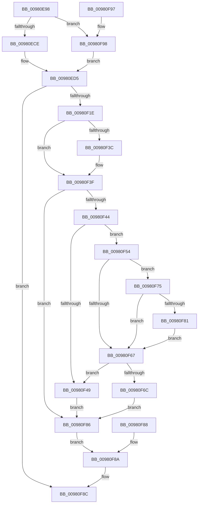

# MmMapApiSetView

- RVA: `0x00980E98`–`0x00980FAC` (길이 `276` bytes)
- VA: `0x0000000140980E98`
- 실행 섹션: `PAGE`
- PDB 이름 있음: `예`; PDB Function 태그: `아니요`
- unwind 정보 RVA: `0x000977B8`
- 디코드: `72`개 명령, `276/276` bytes 표시
- 미해석 바이트: `0` (있으면 어셈블리에 `.byte`로 보존)

> 이 문서는 커널 이미지의 기계어와 PDB 기호를 분석해 생성했습니다. 4번과 5번은 함수 원형과 자료형을 바이너리 사용 방식에서 추정한 C 해석이며 원본 소스 복구 결과는 아닙니다.

## 1. Dependencies

- 직접 호출 지점: **4**; 고유 호출 대상: **4**
- 직접 호출자로 확인된 함수: **2**
- RIP 상대 이미지 참조: **1**

### Outgoing calls
- `0x00980EB6` → [PsGetProcessServerSilo](../../text/44/PsGetProcessServerSilo_function_0044BEE0.md) (function, `0x0044BEE0`)
- `0x00980EC1` → [PsIsHostSilo](../../text/44/PsIsHostSilo_function_00443B30.md) (function, `0x00443B30`)
- `0x00980F13` → [MmMapViewOfSection](MmMapViewOfSection_function_00981680.md) (function, `0x00981680`)
- `0x00980F9B` → [PsGetServerSiloGlobals](../../text/22/PsGetServerSiloGlobals_function_002250A0.md) (function, `0x002250A0`)

### Direct callers
- [PspAllocateProcess](../A1/PspAllocateProcess_function_00A13B3C.md) at `0x00A16101`
- [PspSetupUserProcessAddressSpace](../AE/PspSetupUserProcessAddressSpace_function_00AEBDC8.md) at `0x00AEC018`

### Static image references
- `0x00980ECE` → RVA `0x00E2D7D8` (`.data`; read)

## 2. Other-region calls and transfers

- 다른 실행 섹션으로 향하는 call: **3**
  - `0x00980EB6` → [PsGetProcessServerSilo](../../text/44/PsGetProcessServerSilo_function_0044BEE0.md) (`PAGE` → `.text`)
  - `0x00980EC1` → [PsIsHostSilo](../../text/44/PsIsHostSilo_function_00443B30.md) (`PAGE` → `.text`)
  - `0x00980F9B` → [PsGetServerSiloGlobals](../../text/22/PsGetServerSiloGlobals_function_002250A0.md) (`PAGE` → `.text`)
- 별도 외부 분기/꼬리 이동을 확인하지 못했습니다.

## 3. Assembly (complete function range)

```asm
00980E98  48 8B C4                        mov rax, rsp
00980E9B  48 89 58 08                     mov qword ptr [rax + 8], rbx
00980E9F  57                              push rdi
00980EA0  48 83 EC 50                     sub rsp, 0x50
00980EA4  48 8B D9                        mov rbx, rcx
00980EA7  48 83 60 10 00                  and qword ptr [rax + 0x10], 0
00980EAC  48 83 60 20 00                  and qword ptr [rax + 0x20], 0
00980EB1  48 83 60 18 00                  and qword ptr [rax + 0x18], 0
00980EB6  E8 25 B0 AC FF                  call 0x14044bee0
00980EBB  48 8B F8                        mov rdi, rax
00980EBE  48 8B C8                        mov rcx, rax
00980EC1  E8 6A 2C AC FF                  call 0x140443b30
00980EC6  84 C0                           test al, al
00980EC8  0F 84 CA 00 00 00               je 0x140980f98
00980ECE  48 8B 0D 03 C9 4A 00            mov rcx, qword ptr [rip + 0x4ac903]
00980ED5  C7 44 24 48 02 00 00 00         mov dword ptr [rsp + 0x48], 2
00980EDD  C7 44 24 40 00 00 40 00         mov dword ptr [rsp + 0x40], 0x400000
00980EE5  BF 01 00 00 00                  mov edi, 1
00980EEA  89 7C 24 38                     mov dword ptr [rsp + 0x38], edi
00980EEE  48 8D 44 24 70                  lea rax, [rsp + 0x70]
00980EF3  48 89 44 24 30                  mov qword ptr [rsp + 0x30], rax
00980EF8  48 8D 44 24 78                  lea rax, [rsp + 0x78]
00980EFD  48 89 44 24 28                  mov qword ptr [rsp + 0x28], rax
00980F02  48 83 64 24 20 00               and qword ptr [rsp + 0x20], 0
00980F08  45 33 C9                        xor r9d, r9d
00980F0B  4C 8D 44 24 68                  lea r8, [rsp + 0x68]
00980F10  48 8B D3                        mov rdx, rbx
00980F13  E8 68 07 00 00                  call 0x140981680
00980F18  8B D0                           mov edx, eax
00980F1A  85 C0                           test eax, eax
00980F1C  78 6E                           js 0x140980f8c
00980F1E  48 8B 8B E0 02 00 00            mov rcx, qword ptr [rbx + 0x2e0]
00980F25  48 8B 44 24 68                  mov rax, qword ptr [rsp + 0x68]
00980F2A  48 89 41 68                     mov qword ptr [rcx + 0x68], rax
00980F2E  33 C9                           xor ecx, ecx
00980F30  48 8B 83 10 03 00 00            mov rax, qword ptr [rbx + 0x310]
00980F37  48 85 C0                        test rax, rax
00980F3A  74 03                           je 0x140980f3f
00980F3C  48 8B 08                        mov rcx, qword ptr [rax]
00980F3F  48 85 C9                        test rcx, rcx
00980F42  74 42                           je 0x140980f86
00980F44  48 85 C0                        test rax, rax
00980F47  75 0B                           jne 0x140980f54
00980F49  48 8B 44 24 68                  mov rax, qword ptr [rsp + 0x68]
00980F4E  48 89 41 68                     mov qword ptr [rcx + 0x68], rax
00980F52  EB 32                           jmp 0x140980f86
00980F54  0F B7 83 EC 06 00 00            movzx eax, word ptr [rbx + 0x6ec]
00980F5B  41 B8 4C 01 00 00               mov r8d, 0x14c
00980F61  66 41 3B C0                     cmp ax, r8w
00980F65  75 0E                           jne 0x140980f75
00980F67  40 84 FF                        test dil, dil
00980F6A  74 DD                           je 0x140980f49
00980F6C  8B 44 24 68                     mov eax, dword ptr [rsp + 0x68]
00980F70  89 41 38                        mov dword ptr [rcx + 0x38], eax
00980F73  EB 11                           jmp 0x140980f86
00980F75  41 B8 C4 01 00 00               mov r8d, 0x1c4
00980F7B  66 41 3B C0                     cmp ax, r8w
00980F7F  74 E6                           je 0x140980f67
00980F81  40 32 FF                        xor dil, dil
00980F84  EB E1                           jmp 0x140980f67
00980F86  EB 02                           jmp 0x140980f8a
00980F88  8B D0                           mov edx, eax
00980F8A  8B C2                           mov eax, edx
00980F8C  48 8B 5C 24 60                  mov rbx, qword ptr [rsp + 0x60]
00980F91  48 83 C4 50                     add rsp, 0x50
00980F95  5F                              pop rdi
00980F96  C3                              ret
00980F97  CC                              int3
00980F98  48 8B CF                        mov rcx, rdi
00980F9B  E8 00 41 8A FF                  call 0x1402250a0
00980FA0  48 8B 88 E8 03 00 00            mov rcx, qword ptr [rax + 0x3e8]
00980FA7  E9 29 FF FF FF                  jmp 0x140980ed5
```

## 4. C-style interpretation (structured pseudocode)

```c
__int64 __fastcall MmMapApiSetView(__int64 a1, __int64 a2, __int64 a3, int a4)
{
    __int64 result;
    __int64 v_rdi;
    __int64 v_rsp;
    unsigned int v_stack_m10;
    unsigned int v_stack_m18;
    unsigned int v_stack_m20;
    unsigned __int64 v_stack_m28;
    unsigned __int64 v_stack_m30;
    unsigned __int64 v_stack_m38;
    unsigned __int64 v_stack_p10;
    unsigned __int64 v_stack_p18;
    unsigned __int64 v_stack_p20;
    unsigned __int64 v_stack_p8;

    *(unsigned __int64 *)(v_rsp + 8) = v_rbx;
    v_rsp = (v_rsp) - (80);
    result = PsGetProcessServerSilo(a1, a2, a3, a4);
    result = PsIsHostSilo(result, a2, a3, a4);
    if ((unsigned __int8)(result) == 0) goto loc_00980F98;
loc_00980ED5:
    v_stack_m10 = 2;
    v_stack_m18 = 0x400000ULL;
    v_stack_m20 = 1;
    v_stack_m28 = v_stack_p18;
    v_stack_m30 = v_stack_p20;
    a4 = 0;
    result = MmMapViewOfSection(*(unsigned __int64 *)(v_rip + 4901123), a1, v_stack_p10, a4);
    if (sign_flag) goto loc_00980F8C;
    *(unsigned __int64 *)(*(unsigned __int64 *)(a1 + 736) + 104) = v_stack_p10;
    a1 = 0;
    if (*(unsigned __int64 *)(a1 + 784) != 0) {
        a1 = *(unsigned __int64 *)(*(unsigned __int64 *)(a1 + 784));
    }
    if (a1 == 0) goto loc_00980F86;
    if (*(unsigned __int64 *)(a1 + 784) != 0) goto loc_00980F54;
loc_00980F49:
    *(unsigned __int64 *)(a1 + 104) = v_stack_p10;
    goto loc_00980F86;
loc_00980F54:
    if (((unsigned __int16)(*(unsigned __int16 *)(a1 + 1772))) != 332) goto loc_00980F75;
loc_00980F67:
    if (1 == 0) goto loc_00980F49;
    *(unsigned int *)(a1 + 56) = (unsigned int)((unsigned int)(v_stack_p10));
    goto loc_00980F86;
loc_00980F75:
    if (((unsigned __int16)((unsigned int)(v_stack_p10))) == 452) goto loc_00980F67;
    v_rdi = 0;
    goto loc_00980F67;
loc_00980F86:
    goto loc_00980F8A;
loc_00980F8A:
loc_00980F8C:
    v_rsp = (v_rsp) + (80);
    return (unsigned int)((unsigned int)((unsigned int)((unsigned int)(result))));
loc_00980F98:
    result = PsGetServerSiloGlobals(0, (unsigned int)((unsigned int)(result)), 452, a4);
    goto loc_00980ED5;
}
```

## 5. (Beta) C Style

```c
int64_t MmMapApiSetView(void *Arg1, int64_t Arg2, int64_t Arg3, int32_t Arg4)
{
    uint8_t *arg1 = (uint8_t *)Arg1;

    int64_t result;
    int64_t local_rdi;
    int64_t local_rsp;
    uint32_t v_stack_m10;
    uint32_t v_stack_m18;
    uint32_t v_stack_m20;
    uint64_t v_stack_m28;
    uint64_t v_stack_m30;
    uint64_t v_stack_m38;
    uint64_t v_stack_p10;
    uint64_t v_stack_p18;
    uint64_t v_stack_p20;
    uint64_t v_stack_p8;

    *(uint64_t *)(local_rsp + 0x8) = local_rbx;
    local_rsp = (local_rsp) - (80);
    result = PsGetProcessServerSilo(Arg1, Arg2, Arg3, Arg4);
    result = PsIsHostSilo(result, Arg2, Arg3, Arg4);
    if ((uint8_t)(result) == 0) goto loc_00980F98;
loc_00980ED5:
    v_stack_m10 = 2;
    v_stack_m18 = 0x400000ULL;
    v_stack_m20 = 1;
    v_stack_m28 = v_stack_p18;
    v_stack_m30 = v_stack_p20;
    Arg4 = 0;
    result = MmMapViewOfSection(*(uint64_t *)(v_rip + 0x4AC903), Arg1, v_stack_p10, Arg4);
    if (sign_flag) goto loc_00980F8C;
    *(uint64_t *)(*(uint64_t *)(arg1 + 0x2E0) + 0x68) = v_stack_p10;
    Arg1 = 0;
    if (*(uint64_t *)(arg1 + 0x310) != 0) {
        Arg1 = *(uint64_t *)(*(uint64_t *)(arg1 + 0x310));
    }
    if (Arg1 == NULL) goto loc_00980F86;
    if (*(uint64_t *)(arg1 + 0x310) != 0) goto loc_00980F54;
loc_00980F49:
    *(uint64_t *)(arg1 + 0x68) = v_stack_p10;
    goto loc_00980F86;
loc_00980F54:
    if (((uint16_t)(*(uint16_t *)(arg1 + 0x6EC))) != 332) goto loc_00980F75;
loc_00980F67:
    if (1 == 0) goto loc_00980F49;
    *(uint32_t *)(arg1 + 0x38) = (uint32_t)((uint32_t)(v_stack_p10));
    goto loc_00980F86;
loc_00980F75:
    if (((uint16_t)((uint32_t)(v_stack_p10))) == 452) goto loc_00980F67;
    local_rdi = 0;
    goto loc_00980F67;
loc_00980F86:
    goto loc_00980F8A;
loc_00980F8A:
loc_00980F8C:
    local_rsp = (local_rsp) + (80);
    return (uint32_t)((uint32_t)((uint32_t)((uint32_t)(result))));
loc_00980F98:
    result = PsGetServerSiloGlobals(0, (uint32_t)((uint32_t)(result)), 452, Arg4);
    goto loc_00980ED5;
}
```

### 관측된 메모리 오프셋

구조체 형식이 확인되지 않은 접근은 인자 기준의 오프셋으로만 기록했습니다.

| 기준 인자 | 오프셋 표현 | 폭 (bit) | 접근 |
|---|---:|---:|---|
| `Arg1` | `+ 0x2E0` | `64` | `R` |
| `Arg1` | `+ 0x310` | `64` | `R` |
| `Arg1` | `+ 0x6EC` | `16` | `R` |

## 6. Execution-region graph

[열기: 2D/3D 그래프와 함수 탐색 컨트롤 패널](../../../control-panel.html?section=page&rva=0x00980E98&view=graph)

- 2D 그래프는 위에서 아래로 흐르고, 3D 그래프는 빈 공간을 드래그해 회전합니다. Shift+드래그는 이동, 휠은 확대·축소, 함수 노드 선택은 대상 보고서 이동입니다.

### Static fallback


