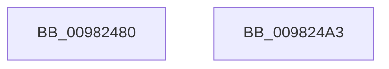

# MmMapViewInSessionSpace

- RVA: `0x00982480`–`0x009824A4` (길이 `36` bytes)
- VA: `0x0000000140982480`
- 실행 섹션: `PAGE`
- PDB 이름 있음: `예`; PDB Function 태그: `아니요`
- unwind 정보 RVA: `0x00097934`
- 디코드: `11`개 명령, `36/36` bytes 표시
- 미해석 바이트: `0` (있으면 어셈블리에 `.byte`로 보존)

> 이 문서는 커널 이미지의 기계어와 PDB 기호를 분석해 생성했습니다. 4번과 5번은 함수 원형과 자료형을 바이너리 사용 방식에서 추정한 C 해석이며 원본 소스 복구 결과는 아닙니다.

## 1. Dependencies

- 직접 호출 지점: **1**; 고유 호출 대상: **1**
- 직접 호출자로 확인된 함수: **11**
- RIP 상대 이미지 참조: **0**

### Outgoing calls
- `0x00982499` → [MiMapViewInSystemSpace](MiMapViewInSystemSpace_function_009824D8.md) (function, `0x009824D8`)

### Direct callers
- [LdrpMapResourceFile](../../text/5E/LdrpMapResourceFile_function_005E5CBC.md) at `0x005E5E6D`
- [EtwpCoverageEnsureContext](../70/EtwpCoverageEnsureContext_function_007028E4.md) at `0x00702B3B`
- [NtCreateIoRing](../72/NtCreateIoRing_function_00720530.md) at `0x00720848`
- [PspApiSetCopyToSystemSpace](../77/PspApiSetCopyToSystemSpace_function_0077F648.md) at `0x0077F6C7`
- [PspSiloInitializeUserSharedData](../78/PspSiloInitializeUserSharedData_function_00780684.md) at `0x007806F7`
- [EtwpCoverageSamplerSetBloomFilter](../7C/EtwpCoverageSamplerSetBloomFilter_function_007C2070.md) at `0x007C211B`
- [ExInitializeLeapSecondData](../7C/ExInitializeLeapSecondData_function_007C562C.md) at `0x007C56E1`
- [SLUpdateLicenseDataInternal](../7C/SLUpdateLicenseDataInternal_function_007C9C04.md) at `0x007CA19C`
- [NtMapCMFModule](../7D/NtMapCMFModule_function_007D4310.md) at `0x007D4554`
- [CmFcpMapSection](../AC/CmFcpMapSection_function_00AC1714.md) at `0x00AC1756`
- [MiInitializeApiSets](../../init/C6/MiInitializeApiSets_function_00C6BA2C.md) at `0x00C6BA9F`

### Static image references
- 디코드된 RIP-relative 메모리 참조가 없습니다.

## 2. Other-region calls and transfers

- 다른 실행 섹션으로 향하는 call: **0**
- 별도 외부 분기/꼬리 이동을 확인하지 못했습니다.

## 3. Assembly (complete function range)

```asm
00982480  4C 8B DC                        mov r11, rsp
00982483  48 83 EC 38                     sub rsp, 0x38
00982487  33 C0                           xor eax, eax
00982489  4D 8D 4B 20                     lea r9, [r11 + 0x20]
0098248D  49 89 43 F0                     mov qword ptr [r11 - 0x10], rax
00982491  49 89 43 E8                     mov qword ptr [r11 - 0x18], rax
00982495  49 89 43 20                     mov qword ptr [r11 + 0x20], rax
00982499  E8 3A 00 00 00                  call 0x1409824d8
0098249E  48 83 C4 38                     add rsp, 0x38
009824A2  C3                              ret
009824A3  CC                              int3
```

## 4. C-style interpretation (structured pseudocode)

```c
__int64 __fastcall MmMapViewInSessionSpace(void)
{
    __int64 result;
    __int64 v_rsp;

    v_rsp = (v_rsp) - (56);
    result = 0;
    *(unsigned __int64 *)(v_rsp - 16) = 0;
    *(unsigned __int64 *)(v_rsp - 24) = 0;
    *(unsigned __int64 *)(v_rsp + 32) = 0;
    result = MiMapViewInSystemSpace(a1, a2, a3, v_rsp + 32);
    v_rsp = (v_rsp) + (56);
    return result;
}
```

## 5. (Beta) C Style

```c
void MmMapViewInSessionSpace(void)
{
    int64_t result;
    int64_t local_rsp;

    local_rsp = (local_rsp) - (56);
    result = 0;
    *(uint64_t *)(local_rsp - 0x10) = 0;
    *(uint64_t *)(local_rsp - 0x18) = 0;
    *(uint64_t *)(local_rsp + 0x20) = 0;
    result = MiMapViewInSystemSpace(a1, a2, a3, local_rsp + 32);
    local_rsp = (local_rsp) + (56);
    return result;
}
```

## 6. Execution-region graph

[열기: 2D/3D 그래프와 함수 탐색 컨트롤 패널](../../../control-panel.html?section=page&rva=0x00982480&view=graph)

- 2D 그래프는 위에서 아래로 흐르고, 3D 그래프는 빈 공간을 드래그해 회전합니다. Shift+드래그는 이동, 휠은 확대·축소, 함수 노드 선택은 대상 보고서 이동입니다.

### Static fallback


