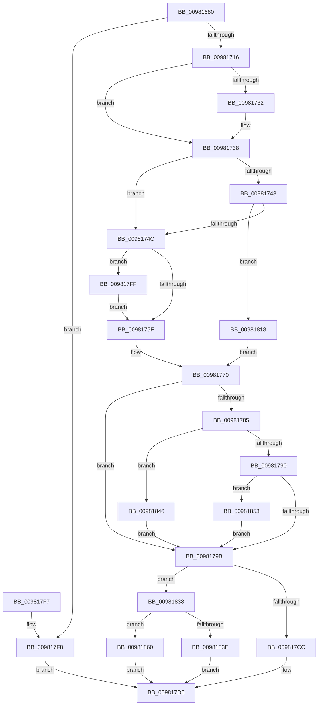

# MmMapViewOfSection

- RVA: `0x00981680`–`0x0098186B` (길이 `491` bytes)
- VA: `0x0000000140981680`
- 실행 섹션: `PAGE`
- PDB 이름 있음: `예`; PDB Function 태그: `아니요`
- unwind 정보 RVA: `0x00097848`
- 디코드: `122`개 명령, `491/491` bytes 표시
- 미해석 바이트: `0` (있으면 어셈블리에 `.byte`로 보존)

> 이 문서는 커널 이미지의 기계어와 PDB 기호를 분석해 생성했습니다. 4번과 5번은 함수 원형과 자료형을 바이너리 사용 방식에서 추정한 C 해석이며 원본 소스 복구 결과는 아닙니다.

## 1. Dependencies

- 직접 호출 지점: **3**; 고유 호출 대상: **3**
- 직접 호출자로 확인된 함수: **9**
- RIP 상대 이미지 참조: **3**

### Outgoing calls
- `0x009816B7` → [MiSectionControlArea](../../text/29/MiSectionControlArea_function_00294CB0.md) (function, `0x00294CB0`)
- `0x009816CB` → [memset](../../text/6C/memset_function_006C6C40.md) (function, `0x006C6C40`)
- `0x009817C1` → [MiMapViewOfSection](../89/MiMapViewOfSection_function_00898F10.md) (function, `0x00898F10`)

### Direct callers
- [DifMmMapViewOfSectionWrapper](../../text/63/DifMmMapViewOfSectionWrapper_function_006360A0.md) at `0x006361EF`
- [NtCreateIoRing](../72/NtCreateIoRing_function_00720530.md) at `0x00720903`
- [NtMapCMFModule](../7D/NtMapCMFModule_function_007D4310.md) at `0x007D4B63`
- [EtwpCoverageEnsureUserModeView](EtwpCoverageEnsureUserModeView_function_00980584.md) at `0x0098063C`
- [NtInitializeNlsFiles](NtInitializeNlsFiles_function_00980C90.md) at `0x00980D82`
- [MmMapApiSetView](MmMapApiSetView_function_00980E98.md) at `0x00980F13`
- [MmCreatePeb](MmCreatePeb_function_00980FB4.md) at `0x009810E1`
- [PspSchedulerSharedDataRegionCreate](PspSchedulerSharedDataRegionCreate_function_009825DC.md) at `0x00982828`
- [sub_00B4005A](../B4/Unknown_function_00B4005A.md) at `0x00B400BF`

### Static image references
- `0x009816F5` → RVA `0x00FC5000` (`ALMOSTRO`; read)
- `0x0098183E` → RVA `0x00E302A8` (`.data`; read/write)
- `0x00981860` → RVA `0x00E302AC` (`.data`; read/write)

## 2. Other-region calls and transfers

- 다른 실행 섹션으로 향하는 call: **2**
  - `0x009816B7` → [MiSectionControlArea](../../text/29/MiSectionControlArea_function_00294CB0.md) (`PAGE` → `.text`)
  - `0x009816CB` → [memset](../../text/6C/memset_function_006C6C40.md) (`PAGE` → `.text`)
- 별도 외부 분기/꼬리 이동을 확인하지 못했습니다.

## 3. Assembly (complete function range)

```asm
00981680  48 8B C4                        mov rax, rsp
00981683  48 89 58 08                     mov qword ptr [rax + 8], rbx
00981687  48 89 70 10                     mov qword ptr [rax + 0x10], rsi
0098168B  48 89 78 18                     mov qword ptr [rax + 0x18], rdi
0098168F  55                              push rbp
00981690  41 54                           push r12
00981692  41 55                           push r13
00981694  41 56                           push r14
00981696  41 57                           push r15
00981698  48 8D 68 D1                     lea rbp, [rax - 0x2f]
0098169C  48 81 EC C0 00 00 00            sub rsp, 0xc0
009816A3  4C 8B 65 67                     mov r12, qword ptr [rbp + 0x67]
009816A7  4D 8B F1                        mov r14, r9
009816AA  49 8B D8                        mov rbx, r8
009816AD  48 8B FA                        mov rdi, rdx
009816B0  4C 8B E9                        mov r13, rcx
009816B3  4D 8B 3C 24                     mov r15, qword ptr [r12]
009816B7  E8 F4 35 91 FF                  call 0x140294cb0
009816BC  33 D2                           xor edx, edx
009816BE  48 8D 4D 87                     lea rcx, [rbp - 0x79]
009816C2  41 B8 80 00 00 00               mov r8d, 0x80
009816C8  48 8B F0                        mov rsi, rax
009816CB  E8 70 55 D4 FF                  call 0x1406c6c40
009816D0  65 4C 8B 0C 25 88 01 00 00      mov r9, qword ptr gs:[0x188]
009816D9  4D 8B 81 B8 00 00 00            mov r8, qword ptr [r9 + 0xb8]
009816E0  4C 89 45 E7                     mov qword ptr [rbp - 0x19], r8
009816E4  44 8B 45 77                     mov r8d, dword ptr [rbp + 0x77]
009816E8  48 89 7D DF                     mov qword ptr [rbp - 0x21], rdi
009816EC  65 48 8B 0C 25 88 01 00 00      mov rcx, qword ptr gs:[0x188]
009816F5  0F B7 05 04 39 64 00            movzx eax, word ptr [rip + 0x643904]
009816FC  8A 91 32 02 00 00               mov dl, byte ptr [rcx + 0x232]
00981702  41 8B C8                        mov ecx, r8d
00981705  83 E1 7F                        and ecx, 0x7f
00981708  88 55 C0                        mov byte ptr [rbp - 0x40], dl
0098170B  89 4D BB                        mov dword ptr [rbp - 0x45], ecx
0098170E  3B C8                           cmp ecx, eax
00981710  0F 87 E2 00 00 00               ja 0x1409817f8
00981716  83 65 C7 00                     and dword ptr [rbp - 0x39], 0
0098171A  41 8B C0                        mov eax, r8d
0098171D  8B 4D C3                        mov ecx, dword ptr [rbp - 0x3d]
00981720  83 E0 80                        and eax, 0xffffff80
00981723  48 83 3B 00                     cmp qword ptr [rbx], 0
00981727  89 45 AF                        mov dword ptr [rbp - 0x51], eax
0098172A  8B 45 7F                        mov eax, dword ptr [rbp + 0x7f]
0098172D  89 45 B3                        mov dword ptr [rbp - 0x4d], eax
00981730  74 06                           je 0x140981738
00981732  83 C9 01                        or ecx, 1
00981735  89 4D C3                        mov dword ptr [rbp - 0x3d], ecx
00981738  4C 89 7D 9F                     mov qword ptr [rbp - 0x61], r15
0098173C  8B 46 38                        mov eax, dword ptr [rsi + 0x38]
0098173F  A8 20                           test al, 0x20
00981741  75 09                           jne 0x14098174c
00981743  F6 C1 01                        test cl, 1
00981746  0F 85 CC 00 00 00               jne 0x140981818
0098174C  48 BA FF FF FE FF FF 7F 00 00   movabs rdx, 0x7ffffffeffff
00981756  4D 85 F6                        test r14, r14
00981759  0F 85 A0 00 00 00               jne 0x1409817ff
0098175F  48 8B 87 68 03 00 00            mov rax, qword ptr [rdi + 0x368]
00981766  48 FF C8                        dec rax
00981769  48 3B D0                        cmp rdx, rax
0098176C  48 0F 46 C2                     cmovbe rax, rdx
00981770  48 89 45 8F                     mov qword ptr [rbp - 0x71], rax
00981774  48 C7 45 97 00 00 01 00         mov qword ptr [rbp - 0x69], 0x10000
0098177C  F7 46 38 20 04 00 00            test dword ptr [rsi + 0x38], 0x420
00981783  75 16                           jne 0x14098179b
00981785  41 0F BA E0 1D                  bt r8d, 0x1d
0098178A  0F 82 B6 00 00 00               jb 0x140981846
00981790  41 0F BA E0 1E                  bt r8d, 0x1e
00981795  0F 82 B8 00 00 00               jb 0x140981853
0098179B  8B 45 6F                        mov eax, dword ptr [rbp + 0x6f]
0098179E  48 8D 55 87                     lea rdx, [rbp - 0x79]
009817A2  4C 8B 4D 57                     mov r9, qword ptr [rbp + 0x57]
009817A6  4C 8B C3                        mov r8, rbx
009817A9  C7 44 24 30 01 00 00 00         mov dword ptr [rsp + 0x30], 1
009817B1  49 8B CD                        mov rcx, r13
009817B4  89 44 24 28                     mov dword ptr [rsp + 0x28], eax
009817B8  48 8B 45 5F                     mov rax, qword ptr [rbp + 0x5f]
009817BC  48 89 44 24 20                  mov qword ptr [rsp + 0x20], rax
009817C1  E8 4A 77 F1 FF                  call 0x140898f10
009817C6  8B C8                           mov ecx, eax
009817C8  85 C0                           test eax, eax
009817CA  78 6C                           js 0x140981838
009817CC  48 8B 45 9F                     mov rax, qword ptr [rbp - 0x61]
009817D0  49 89 04 24                     mov qword ptr [r12], rax
009817D4  8B C1                           mov eax, ecx
009817D6  4C 8D 9C 24 C0 00 00 00         lea r11, [rsp + 0xc0]
009817DE  49 8B 5B 30                     mov rbx, qword ptr [r11 + 0x30]
009817E2  49 8B 73 38                     mov rsi, qword ptr [r11 + 0x38]
009817E6  49 8B 7B 40                     mov rdi, qword ptr [r11 + 0x40]
009817EA  49 8B E3                        mov rsp, r11
009817ED  41 5F                           pop r15
009817EF  41 5E                           pop r14
009817F1  41 5D                           pop r13
009817F3  41 5C                           pop r12
009817F5  5D                              pop rbp
009817F6  C3                              ret
009817F7  CC                              int3
009817F8  B8 0D 00 00 C0                  mov eax, 0xc000000d
009817FD  EB D7                           jmp 0x1409817d6
009817FF  48 83 C8 FF                     or rax, 0xffffffffffffffff
00981803  49 8B CE                        mov rcx, r14
00981806  48 D3 E8                        shr rax, cl
00981809  48 3B C2                        cmp rax, rdx
0098180C  48 0F 47 C2                     cmova rax, rdx
00981810  48 8B D0                        mov rdx, rax
00981813  E9 47 FF FF FF                  jmp 0x14098175f
00981818  48 8B 87 68 03 00 00            mov rax, qword ptr [rdi + 0x368]
0098181F  48 BA FF FF FE FF FF 7F 00 00   movabs rdx, 0x7ffffffeffff
00981829  48 FF C8                        dec rax
0098182C  48 3B C2                        cmp rax, rdx
0098182F  48 0F 43 C2                     cmovae rax, rdx
00981833  E9 38 FF FF FF                  jmp 0x140981770
00981838  48 83 3B 00                     cmp qword ptr [rbx], 0
0098183C  75 22                           jne 0x140981860
0098183E  FF 05 64 EA 4A 00               inc dword ptr [rip + 0x4aea64]
00981844  EB 90                           jmp 0x1409817d6
00981846  48 C7 45 97 00 00 20 00         mov qword ptr [rbp - 0x69], 0x200000
0098184E  E9 48 FF FF FF                  jmp 0x14098179b
00981853  48 C7 45 97 00 10 00 00         mov qword ptr [rbp - 0x69], 0x1000
0098185B  E9 3B FF FF FF                  jmp 0x14098179b
00981860  FF 05 46 EA 4A 00               inc dword ptr [rip + 0x4aea46]
00981866  E9 6B FF FF FF                  jmp 0x1409817d6
```

## 4. C-style interpretation (structured pseudocode)

```c
__int64 __fastcall MmMapViewOfSection(__int64 a1, __int64 a2, __int64 a3, __int64 a4)
{
    __int64 result;
    __int64 v_rsp;
    unsigned __int64 v_stack_m28;
    unsigned int v_stack_mB8;
    unsigned int v_stack_mC0;
    unsigned __int64 v_stack_mC8;

    *(unsigned __int64 *)(v_rsp + 8) = v_rbx;
    *(unsigned __int64 *)(v_rsp + 16) = v_rsi;
    *(unsigned __int64 *)(v_rsp + 24) = v_rdi;
    v_rsp = (v_rsp) - (192);
    result = MiSectionControlArea(a1, a2, a3, a4);
    a2 = 0;
    result = memset(v_rsp - 47 - 121, a2, 128, a4);
    *(unsigned __int64 *)(v_rsp - 47 - 25) = *(unsigned __int64 *)(*(unsigned __int64 *)(gs_base + (0 + 392)) + 184);
    *(unsigned __int64 *)(v_rsp - 47 - 33) = 0;
    a1 = (unsigned int)(((unsigned int)((unsigned int)((unsigned int)(*(unsigned int *)(v_rsp - 47 + 119))))) & (127));
    *(unsigned __int8 *)(v_rsp - 47 - 64) = (unsigned __int8)(*(unsigned __int8 *)(*(unsigned __int64 *)(gs_base + (0 + 392)) + 562));
    *(unsigned int *)(v_rsp - 47 - 69) = (unsigned int)(a1);
    if (((unsigned int)(a1)) > ((unsigned int)(*(unsigned __int16 *)(v_rip + 6568196)))) goto loc_009817F8;
    result = (unsigned int)(((unsigned int)((unsigned int)((unsigned int)(*(unsigned int *)(v_rsp - 47 + 119))))) & (0xFFFFFF80ULL));
    *(unsigned int *)(v_rsp - 47 - 81) = (unsigned int)(result);
    *(unsigned int *)(v_rsp - 47 - 77) = (unsigned int)((unsigned int)(*(unsigned int *)(v_rsp - 47 + 127)));
    if ((*(unsigned __int64 *)(a3)) != 0) {
        a1 = (unsigned int)(((unsigned int)(*(unsigned int *)(v_rsp - 47 - 61))) | (1));
        *(unsigned int *)(v_rsp - 47 - 61) = (unsigned int)(a1);
    }
    *(unsigned __int64 *)(v_rsp - 47 - 97) = *(unsigned __int64 *)(*(unsigned __int64 *)(v_rsp - 47 + 103));
    if ((((unsigned __int8)((unsigned int)(*(unsigned int *)(result + 56)))) & (32)) != 0) goto loc_0098174C;
    if ((((unsigned __int8)(a1)) & (1)) != 0) goto loc_00981818;
loc_0098174C:
    if (a4 != 0) goto loc_009817FF;
loc_0098175F:
    result = (*(unsigned __int64 *)(a2 + 872)) - 1;
    if ((*(unsigned __int8 *)(*(unsigned __int64 *)(gs_base + (0 + 392)) + 562)) <= result) { result = *(unsigned __int8 *)(*(unsigned __int64 *)(gs_base + (0 + 392)) + 562); }
loc_00981770:
    *(unsigned __int64 *)(v_rsp - 47 - 113) = result;
    *(unsigned __int64 *)(v_rsp - 47 - 105) = 0x10000ULL;
    if (((*(unsigned int *)(result + 56)) & (0x420ULL)) != 0) goto loc_0098179B;
    if (condition_is_below) goto loc_00981846;
    if (condition_is_below) goto loc_00981853;
loc_0098179B:
    v_stack_mB8 = 1;
    v_stack_mC0 = (unsigned int)((unsigned int)(*(unsigned int *)(v_rsp - 47 + 111)));
    v_stack_mC8 = *(unsigned __int64 *)(v_rsp - 47 + 95);
    result = MiMapViewOfSection(a1, v_rsp - 47 - 121, a3, *(unsigned __int64 *)(v_rsp - 47 + 87));
    if (sign_flag) goto loc_00981838;
    *(unsigned __int64 *)(*(unsigned __int64 *)(v_rsp - 47 + 103)) = *(unsigned __int64 *)(v_rsp - 47 - 97);
loc_009817D6:
    return (unsigned int)((unsigned int)((unsigned int)((unsigned int)(result))));
loc_009817F8:
    goto loc_009817D6;
loc_009817FF:
    result = ((unsigned int)(0xC000000DULL)) | (-1);
    result = (result) >> ((unsigned __int8)(a4));
    if (result > (v_rsp - 47 - 121)) { result = v_rsp - 47 - 121; }
    goto loc_0098175F;
loc_00981818:
    result = (*(unsigned __int64 *)(*(unsigned __int64 *)(v_stack_m28 + 64) + 872)) - 1;
    if (result >= result) { result = result; }
    goto loc_00981770;
loc_00981838:
    if ((*(unsigned __int64 *)(*(unsigned __int64 *)(v_stack_m28 + 48))) != 0) goto loc_00981860;
    goto loc_009817D6;
loc_00981846:
    *(unsigned __int64 *)(v_rsp - 47 - 105) = 0x200000ULL;
    goto loc_0098179B;
loc_00981853:
    *(unsigned __int64 *)(v_rsp - 47 - 105) = 0x1000ULL;
    goto loc_0098179B;
loc_00981860:
    goto loc_009817D6;
}
```

## 5. (Beta) C Style

```c
int64_t MmMapViewOfSection(int64_t Arg1, void *Arg2, void *Arg3, int64_t Arg4)
{
    uint8_t *arg2 = (uint8_t *)Arg2;
    uint8_t *arg3 = (uint8_t *)Arg3;

    int64_t result;
    int64_t local_rsp;
    uint64_t v_stack_m28;
    uint32_t v_stack_mB8;
    uint32_t v_stack_mC0;
    uint64_t v_stack_mC8;

    *(uint64_t *)(local_rsp + 0x8) = local_rbx;
    *(uint64_t *)(local_rsp + 0x10) = local_rsi;
    *(uint64_t *)(local_rsp + 0x18) = local_rdi;
    local_rsp = (local_rsp) - (192);
    result = MiSectionControlArea(Arg1, Arg2, Arg3, Arg4);
    Arg2 = 0;
    result = memset(local_rsp - 47 - 121, Arg2, 128, Arg4);
    *(uint64_t *)(local_rsp - 0x2F - 0x19) = *(uint64_t *)(*(uint64_t *)(gs_base + (0 + 0x188)) + 0xB8);
    *(uint64_t *)(local_rsp - 0x2F - 0x21) = 0;
    Arg1 = (uint32_t)(((uint32_t)((uint32_t)((uint32_t)(*(uint32_t *)(local_rsp - 0x2F + 0x77))))) & (127));
    *(uint8_t *)(local_rsp - 0x2F - 0x40) = (uint8_t)(*(uint8_t *)(*(uint64_t *)(gs_base + (0 + 0x188)) + 0x232));
    *(uint32_t *)(local_rsp - 0x2F - 0x45) = (uint32_t)(Arg1);
    if (((uint32_t)(Arg1)) > ((uint32_t)(*(uint16_t *)(v_rip + 0x643904)))) goto loc_009817F8;
    result = (uint32_t)(((uint32_t)((uint32_t)((uint32_t)(*(uint32_t *)(local_rsp - 0x2F + 0x77))))) & (0xFFFFFF80ULL));
    *(uint32_t *)(local_rsp - 0x2F - 0x51) = (uint32_t)(result);
    *(uint32_t *)(local_rsp - 0x2F - 0x4D) = (uint32_t)((uint32_t)(*(uint32_t *)(local_rsp - 0x2F + 0x7F)));
    if ((*(uint64_t *)(arg3)) != 0) {
        Arg1 = (uint32_t)(((uint32_t)(*(uint32_t *)(local_rsp - 0x2F - 0x3D))) | (1));
        *(uint32_t *)(local_rsp - 0x2F - 0x3D) = (uint32_t)(Arg1);
    }
    *(uint64_t *)(local_rsp - 0x2F - 0x61) = *(uint64_t *)(*(uint64_t *)(local_rsp - 0x2F + 0x67));
    if ((((uint8_t)((uint32_t)(*(uint32_t *)(result + 0x38)))) & (32)) != 0) goto loc_0098174C;
    if ((((uint8_t)(Arg1)) & (1)) != 0) goto loc_00981818;
loc_0098174C:
    if (Arg4 != 0) goto loc_009817FF;
loc_0098175F:
    result = (*(uint64_t *)(arg2 + 0x368)) - 1;
    if ((*(uint8_t *)(*(uint64_t *)(gs_base + (0 + 0x188)) + 0x232)) <= result) { result = *(uint8_t *)(*(uint64_t *)(gs_base + (0 + 0x188)) + 0x232); }
loc_00981770:
    *(uint64_t *)(local_rsp - 0x2F - 0x71) = result;
    *(uint64_t *)(local_rsp - 0x2F - 0x69) = 0x10000ULL;
    if (((*(uint32_t *)(result + 0x38)) & (0x420ULL)) != 0) goto loc_0098179B;
    if (condition_is_below) goto loc_00981846;
    if (condition_is_below) goto loc_00981853;
loc_0098179B:
    v_stack_mB8 = 1;
    v_stack_mC0 = (uint32_t)((uint32_t)(*(uint32_t *)(local_rsp - 0x2F + 0x6F)));
    v_stack_mC8 = *(uint64_t *)(local_rsp - 0x2F + 0x5F);
    result = MiMapViewOfSection(Arg1, local_rsp - 47 - 121, Arg3, *(uint64_t *)(local_rsp - 0x2F + 0x57));
    if (sign_flag) goto loc_00981838;
    *(uint64_t *)(*(uint64_t *)(local_rsp - 0x2F + 0x67)) = *(uint64_t *)(local_rsp - 0x2F - 0x61);
loc_009817D6:
    return (uint32_t)((uint32_t)((uint32_t)((uint32_t)(result))));
loc_009817F8:
    goto loc_009817D6;
loc_009817FF:
    result = ((uint32_t)(0xC000000DULL)) | (-1);
    result = (result) >> ((uint8_t)(Arg4));
    if (result > (local_rsp - 47 - 121)) { result = local_rsp - 47 - 121; }
    goto loc_0098175F;
loc_00981818:
    result = (*(uint64_t *)(*(uint64_t *)(v_stack_m28 + 0x40) + 0x368)) - 1;
    if (result >= result) { result = result; }
    goto loc_00981770;
loc_00981838:
    if ((*(uint64_t *)(*(uint64_t *)(v_stack_m28 + 0x30))) != 0) goto loc_00981860;
    goto loc_009817D6;
loc_00981846:
    *(uint64_t *)(local_rsp - 0x2F - 0x69) = 0x200000ULL;
    goto loc_0098179B;
loc_00981853:
    *(uint64_t *)(local_rsp - 0x2F - 0x69) = 0x1000ULL;
    goto loc_0098179B;
loc_00981860:
    goto loc_009817D6;
}
```

### 관측된 메모리 오프셋

구조체 형식이 확인되지 않은 접근은 인자 기준의 오프셋으로만 기록했습니다.

| 기준 인자 | 오프셋 표현 | 폭 (bit) | 접근 |
|---|---:|---:|---|
| `Arg2` | `+ 0x368` | `64` | `R` |
| `Arg3` | `+ 0x0` | `64` | `R` |

## 6. Execution-region graph

[열기: 2D/3D 그래프와 함수 탐색 컨트롤 패널](../../../control-panel.html?section=page&rva=0x00981680&view=graph)

- 2D 그래프는 위에서 아래로 흐르고, 3D 그래프는 빈 공간을 드래그해 회전합니다. Shift+드래그는 이동, 휠은 확대·축소, 함수 노드 선택은 대상 보고서 이동입니다.

### Static fallback


